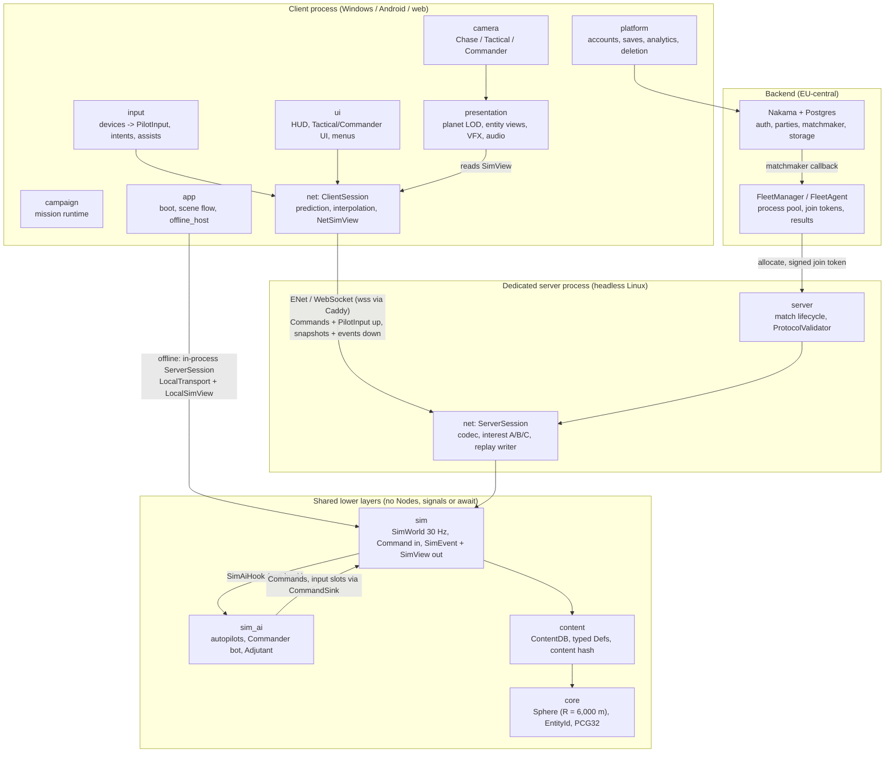

# 00 - Master Plan

| | |
|---|---|
| **Project** | Codename **PLANEWAR**. Godot 4.7.2, typed GDScript, stylized low-poly. |
| **Document** | The entry point. It summarises the plan and points to the document that owns each topic. It decides nothing new: where it and another document differ, the owning document wins (01 and `reviews/R0-resolution-register.md` first) and this page is patched. |
| **Status** | v1.0, 2026-10-10, written by the editor-in-chief agent after the final consistency sweep. Planning is complete; no code exists yet. Week 1 of delivery starts Monday 2026-10-12. |
| **Audience** | The owner, the orchestrator session, and any agent that needs orientation. Task agents do not read it by default (`CLAUDE.md`). |

---

## 1. The pitch

PLANEWAR is an arcade dogfighter fused with a Command & Conquer-style base builder, fought across the whole surface of a small spherical moon (radius 6 km). It is a spiritual successor to Triplane Turmoil with spaceships: thrust, gravity, finite fuel and bombs, two kill speeds (random gun damage, instant-kill bombs), and a resupply landing you have to fly. There is no avatar. Every ship, turret, harvester and factory on your side runs itself, and you can possess any of them at any moment: fly a sortie, set down tail-first on your pad to refuel and rearm, then zoom out to orbit and run the war. When you let go, the unit returns to its autopilot. Two to eight players, bots in every empty seat, Online PvP, Skirmish, Co-op vs AI and an eight-mission campaign that doubles as the tutorial. v1.0 ships on Windows (Steam, including Steam Deck), Android and the web.

## 2. Owner decisions (binding)

Made 2026-10-09/10 and recorded in R0 Part 0 (O-1..O-8) and the 01 amendment log.

| # | Decision | Where it lands |
|---|---|---|
| O-1 | Moon radius **6,000 m** (`PLANET_RADIUS`, defined once in `core/sphere.gd`). S-WORLD-1 still renders 4/6/8 km only to prove the renderer is radius-agnostic. | 01 s5.1, ADR-03 |
| O-2 | **Tail-down powered landing**, Lunar-Lander style: the ship pitches nose-up, hovers on its main engine and settles tail-first on tail landing legs. Safe touchdown: body forward (thrust) axis within **25 degrees** of the pad normal, vertical **<= 8 m/s**, horizontal **<= 15 m/s** (damage band to 15 / 25 m/s and 45 degrees). Every ship hovers: schema minimum `a_thrust >= 2.0 g`. | 01 s3.1.4, R0 B.5, 02 s2.2, 03 s6.4, 05 s5.5 |
| O-3 | **v1.0 platforms:** Windows via Steam (covers Steam Deck), Android (Google Play), web (itch.io + own site). **v1.1:** iOS, macOS, Linux native, Poki, CrazyGames. CI builds every export from day one; only store, QA and compliance work for v1.1 platforms waits. | 01 O10, ADR-12, 06 s9.0 |
| O-4 | **v1 cuts: only the Storage Silo.** Core storage 3,000 Ore / 800 Ice, each Refinery +1,500 / +500, each Outpost +250 / +100. Siege Crawler, Rail Lance and the moving sun (campaign/custom only) **stay in v1**. | 01 s3.2, s6.2, 02 s5.1 |
| O-5 | **Slot layouts:** 8 equatorial slots at longitude 22.5 + 45 k degrees. 1v1 uses slots 0 and 2 (90 degrees, 9,425 m, 86 s at Dart cruise); 4 players 0/2/4/6; 6 players 0/1/2 vs 4/5/6; 8 players all. | 01 s5.7, 02 s9.0 |
| O-6 | **Auto-economy Adjutant** (`adjutant_economy`: Harvesters, power, replenishment only) allowed in casual PvP queues and shown to opponents as "Auto economy"; off in the later ranked ladder. | 01 s4.3, 02 s14, 05 s8 |
| O-7 | **Supply Canisters** (08 SL-5, amendment A-1 accepted) restore 40 % fuel and 50 % ammo in flight; bombs and repair still need a landing. Ships in v1 behind the PM-02 scope gate. | 01 s3.1.4, 08 SL-5 |
| O-8 | Every other 01 open question keeps its stated default (Section 11 below). | 01 s11 |

## 3. The five pillars

Every feature names the pillar it serves; a feature that serves none is cut (01 s1).

1. **P1 Possess anything, depend on nothing.** Every acting entity has a competent autopilot; possess and release are one input each; a released unit resumes its standing order. Flying only and commanding only are both complete ways to play.
2. **P2 Momentum, gravity and the landing.** Thrust-vector flight with inertia and constant gravity, finite consumables, two kill speeds, and the tail-down resupply landing as the signature skill.
3. **P3 One moon, no edges.** The whole sphere is playable; the horizon hides low flyers; day and night hemispheres hold different resources; the two poles are neutral objectives.
4. **P4 Readable from cockpit to orbit.** Flat-shaded low-poly, emissive colour-blind-safe team colours with shape cues, one alert feed, one renderer (Compatibility) on every platform.
5. **P5 Fair, finite, rematch-ready.** 20-30 minute matches with a hard end, no pay-to-win, input-class matchmaking, bots in every empty seat, server authority, identical balance data everywhere.

Development principle (not a pillar): everything numeric is data, every module has a contract.

## 4. The game in one page

**World.** A moon of radius 6,000 m (452 km^2), constant gravity 6.0 m/s^2 toward the core, relief -500 to +700 m. Altitude bands: Deck (below 150 m AGL, under the Flak floor), Low, High (above the Autocannon envelope), Fade (1,500-2,000 m, thrust fades) and the Ceiling at 2,000 m, where the possession link breaks and the autopilot takes over. The sun is fixed over the +Z pole in matchmade play, so the terminator is the equator: solar power to the north, Ice in permanently shadowed Cold Traps to the south. The Noon Pole holds the Solar Plateau and a capturable Relay Station; the Midnight Pole the richest Ice. Three v1 maps (`cradle`, `anvil`, `rimewater`) are baked offline from recipe JSON into cube-sphere height faces. (01 s5, 02 s9, 07 s9)

**Moment to moment.** Ships fly "curved-flat" (CF) kinematics: arcade flight that follows the sphere by parallel transport, with a speed-scaled lift law so level cruise needs only a few degrees of nose-up. Guns fire straight world-frame slugs with random damage (Dart 6-14 per hit); bombs fall under gravity and kill any ship outright; rockets are guided; Flak cannot engage below 150 m relative altitude and Autocannons cannot engage above 400 m, so altitude is the counter. Fuel, ammo and bombs are restored only by landing on a friendly Pad (refuel 10 s, rearm 6 s, repair 15 s in parallel), which costs Ice and Ore, so every sortie bleeds the economy. Landings are graded ACE / CLEAN / FAIR / HARD / BENT / CRASH / AUTO; auto-dock (default on for touch and gamepad) flies the last 150 m when DOCK is held. (01 s3.1, 02 s2-4)

**Minute to minute.** Two team stockpiles (Ore, Ice) and one rate (Power). Every player starts with a Core, Refinery, Shipyard, Vehicle Bay and one Harvester mining, plus 800 Ore / 300 Ice. Harvesters crawl Ore home; Ice Extractors on Cold Traps pipe Ice to a Refinery within 500 m, or Haulers ferry it. Structures are placed inside the build radius of a Core (600 m), Outpost (400 m) or Relay Pylon (250 m) and self-assemble; Outposts instead need a friendly unit within 300 m and spacing from other bases. Four weapon towers (Autocannon Turret, Flak Battery, Missile Tower, Rail Lance) plus the Shield Projector defend; Pylons carry the supply network. Wrecks are worth 40 % of their cost for 90 s and Haulers tow them home: the comeback mechanism. (01 s3.2, 02 s5-8)

**Match arc.** Open (0-5 min: Dart airborne by 0:45, the Core's integrated shield blocks bomb rushes until 8:00), Expand (5-15: Outposts, convoy raids, poles contested), Siege (15-30: Bombers, Shield Projectors, Rail Lances, Core assaults), then Core Exposure and a hard end; per mode `pvp_1v1` 20:00 / 30:00, `pvp_2v2` 25:00 / 35:00, team, co-op, custom and skirmish 30:00 / 40:00. Victory: destroy every enemy Core. An eliminated commander keeps flying team units until the last team Core falls. (01 s3.3, 02 s12-13)

**Control model.** Every entity is AUTO, ORDERED or POSSESSED(player). Possess stores the standing order; release runs a safety handoff and resumes it. Teammates' orders to a possessed unit wait as a pending order. One pilot per entity, with request and hand-over. Three camera tiers: **Chase** (the possessed unit), **Tactical** (300-2,500 m orbit), **Commander** (2,500-14,000 m globe), with production available from every tier. Assist tiers Full / Standard / Raw follow the input class (touch / gamepad / pointer) and never change stats. (01 s4, 05 s2, 06 s3-5)

**Roster.** Ships: **Dart** (interceptor, the default possession), **Lancer** (gunship, rockets), **Bomber** (6 bombs, needs a Hangar), **Scout** (unarmed, 2,000 m sensors), **Hauler** (Ice ferry, wreck tug, Relay capture). Ground: **Harvester**, **Siege Crawler** (1,200 m artillery). Structures: Core, Outpost, Relay Pylon, Solar Array, Reactor, Refinery, Ice Extractor, Pad, Hangar, Shipyard, Vehicle Bay, Sensor Mast, the four towers and the Shield Projector; the neutral Relay Station. Three Doctrines (Vanguard, Bulwark, Foundry) are pure data modifiers. Bots: the **Commander bot** plays full slots at four difficulty tiers without stat cheats; the **Adjutant** is a restricted Commander bot that can run a human's economy. Modes: `pvp_1v1`, `pvp_2v2`, `pvp_team`, `coop`, `custom`, `skirmish`, `campaign` (8 missions: M1-M3 are the tutorial). Progression is cosmetic only. (01 s6, 02, 05 s7-8)

## 5. The architecture in one page

One Godot project builds the client, the headless dedicated server and the offline host. The simulation is **server-authoritative, fixed 30 Hz, pure GDScript `RefCounted` code with no Nodes**, structure-of-arrays entity storage, our own CF kinematics, swept-sphere collision and analytic terrain sampling (no Godot physics in v1). The **only** way to change the sim is `SimWorld.apply_command(Command)`; it reports through drained `SimEvent`s and the read-only `SimView`. AI runs inside the tick through one hook (`SimAiHook`, implemented by `sim_ai`), staggered so each autopilot thinks at 3 Hz. Clients predict only the unit they possess (shared `Kinematics.step_ship`), interpolate everything else 100 ms behind, and receive tiered, quantised snapshots (A/B/C interest tiers, <= 24 KB/s typical). Native clients use ENet, browsers WebSocket behind Caddy; offline modes run the same `ServerSession` in-process and read a `LocalSimView` directly. Nakama provides accounts, parties, matchmaking and storage; our FleetManager allocates pre-warmed match processes on dedicated-vCPU hosts. Content is JSON validated by schemas and hashed into the handshake. Renderer: Compatibility everywhere; the planet is a cube-sphere quadtree with chunked LOD. (01 s7 ADR-01..14, 03, 04)

Dependencies point down only and are enforced by `tools/check_deps.py` against `tools/deps.json` (01 s9.2, R0 B.4). Lanes are the modules; each has a `MODULE.md` contract. Tick order (R0 B.5, 03 s4.1): commands, human inputs, AI hook (think + act), assist substitution, kinematics, projectiles, spatial hash, collision, combat, economy/production/build/docking service, vision, events.

## 6. Document map

Read sections, not documents. The owning document wins on its topic.

| Doc | Owns | Read it when |
|---|---|---|
| `00-master-plan.md` (this) | orientation, known issues | first, once |
| `01-vision-and-core-decisions.md` | pillars, owner decisions, core loops, control model, world scale, roster, **14 ADRs**, budgets, module map and interfaces, **glossary (s10)**, open questions, P0 spike table (App. A) | before any design or contract question; ADR-14 before any agent work |
| `reviews/R0-resolution-register.md` | owner decisions verbatim (Part 0), all critic resolutions (Part A), **canonical contract tables (Part B: def fields, maps, enums, dependencies, signatures, modes, budgets)**; overrides 02-08 | writing schemas, defs, enums, `MODULE.md`, signatures |
| `02-game-design.md` | every gameplay number: ships, weapons, structures, doctrines, economy model, maps' resources, modes, bots' promises, campaign, scoring, balance bands | content and sim gameplay tasks |
| `03-technical-architecture.md` | project setup, sphere math, sim data model, tick order and CPU budget, kinematics, collision, planet renderer, moon baker, content pipeline, `check_deps`, MODULE.md templates | sim, core, presentation/planet, tools, ci tasks |
| `04-networking-and-backend.md` | wire protocol, snapshot codec, interest, prediction, transports, server loop, FleetManager, Nakama, security, hosting cost, replays | net, server, server-ops, platform tasks |
| `05-ai-autonomy-and-control.md` | control-state machine, orders, autopilots, steering and landing controller, Commander bot, Adjutant, AI budget, scenarios | sim_ai, sim/steer, sim/orders tasks |
| `06-platforms-input-ux.md` | input architecture, control maps, touch layouts, camera, HUD, RTS UI, screen flow, platform specifics, accessibility, localisation, onboarding | input, camera, ui, web, platform tasks |
| `07-art-audio-content.md` | art bible, palette, moon look, Blender pipeline, asset inventory, VFX, audio, map recipe authoring, naming and IP rules | assets, presentation (non-planet), audio, maps tasks |
| `08-feature-ideas.md` | ranked feature backlog; shortlist designs SL-1..SL-6 | FEAT tasks; PM-02 / PM-03 scope decisions |
| `09-roadmap-and-backlog.md` + `backlog/backlog.json` | milestones, calendar, 339 tasks, critical path, waves, lane ownership, effort and cost, owner tasks, risk gates. **Owns order, size, tier, milestone and dependencies**; `backlog.json` is the status source of truth | planning a wave; checking a task's dependencies |
| `10-agent-coordination.md` | roles, tier policy, task lifecycle and brief template, definition of done, review pairings, contract-change protocol, running a wave, spikes, cadence, cost control | before running agents; when a task fails or a contract must change |
| `research/R1..R3` | game references, Godot 4.7 facts, platform requirements | only when a decision is being revisited |
| `reviews/C1..C3`, `reviews/issues-index.md` | the critics' reports and the 91 issues (all resolved in R0 Part A) | auditing why something is the way it is |
| `../CLAUDE.md`, `../.claude/agents/*.md` | the short agent conventions; 12 role subagents (model = tier) | every agent, every task |

Precedence when two sources disagree: owner decisions > 01 > R0 Part B > `MODULE.md` > 02-08 > 09/10 on what is built; 09 on order, size, tier and dependencies; 10 on process.

## 7. Milestones

Week 1 = 2026-10-12. Full exit criteria: 09 s1.1. v1.0 effort: 478.5 agent-days (Fable 2.5, Opus 105, Sonnet 319.5, Haiku 51.5) plus 16.8 owner days; v1.1 adds 43.5.

| ID | Milestone | Weeks (dates) | Exit criteria (short) |
|---|---|---|---|
| M0 | Foundations | w1-2 (to 10-23) | S-CI-1 green (soak slope < 2 %/min, PR pipeline <= 15 min); CONTRACT-0 merged (schemas, `sim/MODULE.md`, docs examples validate); `check_deps` D1-D10 pass |
| M1 | Flight on a sphere | w3-4 (to 11-06) | S-FLIGHT-1 pass: three novices land tail-down within 10 min, < 20 % crashes in minutes 5-10, co-altitude hits, cruise AoA <= 6 deg, "feels like a plane" >= 4/5; anchor patch accepted |
| M2 | Sim core + world | w5-10 (to 12-18) | S-SIM-1 p95 <= 25 ms / p99 <= 33 ms on 6 instances on the production SKU; S-WORLD-1 60/30/30 fps, no z-fighting, boost path clean; S-NAV-1; S-WEB-1 <= 20 MB; S-UX-1; PM-01 replan approved |
| M3 | Playable skirmish vertical slice | w11-18 (to 2027-02-19) | 20-min Skirmish 1v1 vs Normal on PC, Android-mid (Lite), web (Reduced); S-WEB-2 pass; scenario suites green; >= 90 % balance bands; playtest 1; PM-02 scope gate recorded |
| M4 | Networked match | w19-26 (to 04-16) | S-NET-1 and S-BACKEND-1 pass; fuzzing clean; signed AAB, server image and Steam depot from a tag; playtest 2 with no lost match |
| M5 | Content complete alpha | w27-34 (to 06-11) | 8 missions, 3 maps, music, SL-1/2/3 (SL-5 only if the gate opened), accessibility and localisation (en 100 %, fi >= 95 %), entitlements; content hash stable a week |
| M6 | Beta | w35-42 (to 08-06) | Play closed test complete; Deck checklist; web <= 20 s to gameplay; perf budgets green 7 days; >= 95 % bands; zero P0/P1; legal signed |
| M7 | v1.0 launch | w43-45 (to 2027-08-27) | Steam, Google Play, itch.io + own site live the same day; crash rate < 1 %; week-one patch |
| M8 | v1.1 | w46-62 (to 2027-12-24) | iOS (TestFlight, App Review), macOS, Linux, portals if A2 allows, WebRTC, Apple/Google sign-in, ranked season 1, SL-6 then SL-4 |

## 8. The first two waves

Wave 0 is the owner's own day-1 work; agents cannot start before HUM-01. Waves follow 09 s3.2 (M0.1-M0.4) and 10 Appendix B. One agent per lane per wave; tasks sharing a lane run back to back.

**Wave 0 - owner, day 1**

| ID | Task | Tier | Size |
|---|---|---|---|
| HUM-01 | GitHub org/repo, Actions, LFS quota, secret store | Owner | 0.25 |
| HUM-06 | Order reference devices (Android-mid, 3 GB Android, Steam Deck) | Owner | 0.25 |
| HUM-04 | Start buying the control VPS, dedicated-vCPU game host (pinned perf runner), EU bucket, domain (after HUM-01) | Owner | 0.5 |

**Wave 1 - repository bootstrap (day 2 to 3)**

| ID | Task | Tier | Lane | Size | After |
|---|---|---|---|---|---|
| REPO-01 | `git init`, `.gitignore`, LFS attributes, 01 s9.1 skeleton; commit `CLAUDE.md`, `.claude/agents/`, `docs/`, `README.md` | Haiku | repo | 0.5 | HUM-01 |
| TA-01 | `project.godot` per 03 s1.1 (warning set, 30 Hz, Compatibility), `.godot-version`, `export_presets.cfg` | Sonnet | app | 1 | REPO-01 |
| REPO-02 | Refine `CLAUDE.md` (every ADR-14 / 03 s12.2 rule once, with pointers) | Sonnet | repo | 1 | REPO-01 |
| DOC-01, REPO-04, REPO-05 | Extend README; extract docs JSON examples to `docs/examples/`; ADR-amendment and REPORT templates + `tools/backlog_report.py` (one Haiku agent, in sequence) | Haiku | docs | 0.5 + 1 + 0.5 | REPO-01 |
| ART-02 | `palette.json`, `build_palette.py`, colour-blind check in CI | Sonnet | tools | 1 | REPO-01 |

**Wave 2 - toolchain and the first gate (day 4 to end of week 2)**

| ID | Task | Tier | Lane | Size | After |
|---|---|---|---|---|---|
| TA-05 | `core/` utilities: `entity_id`, `rng` (PCG32 vectors), `log`, `config`, `mathx` | Haiku | core | 1.5 | TA-01 |
| TA-02 | `tools/check_deps.py` D1-D10 + `tools/deps.json` (R0 B.4) | Sonnet | tools | 2 | TA-01 |
| REPO-03 | Refine the 12 role subagents (per-lane paths), `.claude/settings.json`, PostToolUse hook | Sonnet | repo | 1 | REPO-02 |
| TA-03 | **S-CI-1**: `ci.yml`/`nightly.yml`, gdUnit4, 10-min soak with slope check, exports, size gate (Opus signs the soak) | Sonnet | ci | 3 | TA-01, TA-02 |

Then, still in M0: REPO-06, **CONTRACT-0** (Opus 1.5: schemas + `sim/MODULE.md` from R0 Part B; no lane opens before it merges), TEST-01, ART-32; GD-01, TA-07; TA-10, TA-08. M1 opens with GD-02/03/05 (Haiku defs), TA-04 sphere math (Opus), TA-12 kinematics (Opus), then TA-30 **S-FLIGHT-1** (Opus) with three novice testers; the owner flies it before the gate line is written.

## 9. How to run the agents

- **Operating manual:** `docs/10-agent-coordination.md`. Section 5 is the owner's step-by-step for a wave (pick the ready set, spawn, verify, merge, close); Section 3.1 is the copy-paste brief; Section 5.4 is a Workflow script outline; Section 6.3 is the weekly cadence.
- **Conventions every agent reads:** `CLAUDE.md` (the binding coding, layering, contract and lane rules in one page).
- **Agents:** `.claude/agents/` holds 12 role subagents whose `model` is the tier: `architect` (Fable 5.1: PM-01/02/03 and contract changes only), `sim-engineer`, `net-engineer`, `ai-engineer`, `planet-renderer-engineer` (Opus 5.5), `feature-engineer`, `ui-engineer`, `tools-engineer`, `playtest-analyst` (Sonnet 5.5), `content-author`, `test-author` (Haiku 5.5) and `code-reviewer` (Opus for `sim`, `net`, `presentation/planet`, `sim_ai` Commander/brains/steer and every contract file; Sonnet otherwise). The task's `tier` in `backlog.json` always sets the model; the lane picks the persona (10 s5.2).
- **Rules that keep it cheap and safe:** briefs name doc sections, not documents; one task per lane per wave; two failed rounds escalate one tier (an Opus double failure becomes a contract question for the Architect); contract changes follow 10 s4; only the owner merges to `main`.
- **Ready set:** the one-liner in 10 s5.1 until REPO-05 ships `tools/backlog_report.py --ready`.

## 10. Top risks and their gating spikes

Full gate table with fallbacks: 09 s6; spike definitions: 01 Appendix A and 03 s14. Fallbacks are data changes, never code-path splits.

| Risk | Gate (task, week) | Pass criterion | Fallback if it fails |
|---|---|---|---|
| Flight and the tail-down landing do not feel good or are too hard for novices | **S-FLIGHT-1** (TA-30, w4) | novice landing and crash rates, co-altitude hits, AoA <= 6 deg, "plane" >= 4/5 | widen auto-dock/flare and grade bands, retune g and `k_up_flight`; second failure is an owner call on P2 at PM-01 |
| GDScript server tick does not fit 1,200 entities at 30 Hz on the production host | **S-SIM-1** (TA-22, w9-10) | p95 <= 25 ms, p99 <= 33 ms per instance, 6 instances | cut-ladder rungs 3-6 as data, 4 matches per host, native twins in v1.1 (Q6) |
| Planet renderer z-fights or cannot mesh fast enough at boost speed on mobile/web | **S-WORLD-1** (TA-25, w9-10) | 60/30/30 fps; no holes > 1 s on the boost path | GPU displacement variant, depth 5 on LOW, icon band moves |
| Web build too big or too slow to start | **S-WEB-1** (TA-28, w10) | <= 20 MB Brotli, <= 20 s to gameplay, boots on 3 GB devices | custom template, pack splits, locale trim |
| Offline Skirmish (server + bots + renderer on one thread) too slow on web/mobile | **S-WEB-2** (TA-41, w17-18) | web-desktop p5 >= 45 fps Reduced; web-mobile >= 25 fps Lite; Android 25 min at 30 fps | Lite caps stay; web funnel becomes 1v1/2v2 vs AI |
| Ground pathing on the sphere too costly | **S-NAV-1** (TA-20, w8) | <= 0.5 ms/tick amortised, cache hit >= 80 % | hierarchical layer, `AStar3D` container |
| Touch flying unusable | **S-UX-1** (UX-01, w9) | 3 of 4 novices fly rings and land within 10 min | layout iterations; forced Full assists on touch |
| Bandwidth or browser feel in online play | **S-NET-1** (NET-45, w25-26) | <= 30 KB/s per client, reconcile p95 < 1 m at 150 ms RTT with real browsers | tier B rate cut; `s_transport` matchmaking key; WebRTC first in v1.1 |
| Backend and ops load for a one-person team | **S-BACKEND-1** (NET-31, w23-24) | browser + native in one match, verified result row, restore drill within 2 h | pool and pre-warm tuning; smaller dumps |
| Headless CI stalls or exceeds 15 min | **S-CI-1** (TA-03, w2) | green, soak slope < 2 %/min | bisect stall; exports to nightly |
| Scope: too much for v1.0 | **PM-02 scope gate** (w18) | S-SIM-1, S-WEB-2, S-FLIGHT-1 green and slice complete | SL-5 Supply Canister slips to v1.1 without a new decision |
| Owner review bandwidth (no spike) | weekly cadence, 10 s6.3 | 1-2 h/day of merges in M2-M3 | fewer concurrent agents (09 s1.3), never fewer reviews |

## 11. Remaining owner questions (defaults apply until answered)

| # | Question | Default |
|---|---|---|
| Q1 | Final title | Codename internally; "Regolith" leading candidate pending clearance (HUM-02, week 27-30) |
| Q2 | Business model | Premium (EUR 15-20) on Steam; free mobile with offline Skirmish + Campaign chapter 1 and a one-time unlock IAP; free web funnel; no randomised paid items (HUM-03, week 24) |
| Q3 | Shared vs per-player economy | Shared team stockpile and team-shared queues |
| Q4 | Campaign scope | 8 missions, 4-6 hours, M1-M3 tutorial, moving sun allowed |
| Q6 | Native code if GDScript misses the tick budget | None in v1; cut ladder and caps first; native twins in v1.1 |
| Q7 | First region / population | EU-central, one 8 vCPU dedicated host; bots guarantee starts |
| Q8 | Chat scope | Team text + pings only, no all-chat, no voice |
| Q9 | Moving sun in matchmade | No; campaign and custom only |
| Q10 | Mac hardware for iOS | GitHub macOS runners now; a Mac mini before the first v1.1 iOS perf milestone |
| Q11 | Open-source anything | All proprietary; `tools/` may be MIT later |
| Q12 | FFA in matchmade | Teams only; FFA in custom lobbies |
| Q13 | Ranked at launch | Quick match with ratings recorded but unused; ranked ladder in the first season patch (Adjutant economy off there) |
| Q14 | Odd player counts | Bot-fill to the next even count on the 8 slots |
| Q15 | Portal ad SDKs (06 A2) | Decided at v1.1 planning; no ad or tracking SDK in any v1.0 build |
| Q16 | Supply Canister timing | v1 only if the PM-02 gate opens in time; otherwise v1.1 without a new decision |
| Q-ART1/2 | Music sourcing; AI-generated assets | Licensed packs (EUR 300-800), owner auditions; no AI-generated audio or shipped AI art |
| Q-UX-4/8 | Guest age prompt; analytics defaults by age band | Age prompt at first launch; 16+ on with toggle, 13-15 opt-in, under 13 off (compliance to confirm) |

Q5 is answered (Crawler and Rail Lance stay). Lower-level questions with defaults live in 02-08's "Open questions"; none blocks M0-M2.

## 12. Known issues from the final sweep

The 2026-10-10 sweep found the set consistent on every owner decision, on enum names against R0 B.3, on def and map ids, and on the 09 effort totals against `backlog.json`. Small fixes were applied and logged (01 amendment log #41-45, 09 and 10 revision logs, a pointer row in `CLAUDE.md`):

- 01 s5.6 still placed bases at `360/N * i`; now keyed to the 8 fixed slots (O-5). 01 s5.1 implied 1v1 at the antipode; restated as 90 degrees / 86 s.
- 01 s6.3 had the Barge row orphaned below the unit table; moved and labelled as 08 rates it (anchored v1.x, moving deck v2).
- 01 s9.1 and s10: `docs/` line and the Core Exposure glossary entry updated (00-10; per-mode timers).
- REPO-02, REPO-03 and DOC-01 (09 and `backlog.json`) would have re-created `CLAUDE.md`, lane-based subagents and the README; retitled as refinements of the files that already exist. Ids, tiers, sizes and dependencies unchanged.

Larger items left open for the Architect (none blocks Wave 0-2):

1. **"15 schemas" is not enumerated.** CONTRACT-0, GD-01, 03 and 09 say "15 schemas / 15 def files", while R0 B.1 lists about 29 files. Working reading: `rules.json` plus the 14 02-owned def files (ships, ground_units, weapons, projectiles, structures, towers, doctrines, economy, match_rules, modes, bot_promises, scoring, medals, progression) plus `map_recipe`; the 05/06/07/08 files and `quality_tiers.json` get their schemas in their own tasks. The orchestrator should put this list in the CONTRACT-0 brief.
2. **Seed tables in 02-08 still show pre-09 dependencies and tiers** (e.g. 07 ART-01, 05 AI-10, 02 GD-22, 06 UX-25 and the tier changes of 09 s2.2). 09 owns order, tier and dependencies and `backlog.json` is canonical; the docs are patched at their next revision, not by task agents.
3. **Gate weeks in 09 s6 differ from the gantt bars in 09 s1.2** (S-NAV-1 w8 vs a bar starting in w6; S-UX-1 w9 vs w7; S-SIM-1/S-WORLD-1 w9-10 vs bars starting in w8). Read the bars as earliest start and s6 as the decision deadline; PM-01 at w10 is unaffected. PM-01 should align them.
4. **TA-01 is in lane `app`** but writes `project.godot` and `export_presets.cfg`, which 10 s4.3 lists as shared contract files edited by the ci lane with Opus review. Launch TA-01 with the `tools-engineer` persona and an Opus review.
5. **06 A2** (portal ad SDKs vs ADR-13) stays an open ADR amendment request, deferred to v1.1 (Q15).

## 13. Glossary

Use the words of **01 s10** (Core, Outpost, Harvester, Dart, Hauler, Bomber, Siege Crawler, Rail Lance, possess/release, autopilot, Commander bot, Adjutant, Doctrine, tail-down landing, Chase/Tactical/Commander camera tiers, `SimView`, `Command`, `PilotInput`, Deck/Low/High/Fade/Ceiling, Core Exposure, lane). The canonical names for enums and def fields are in R0 Part B. Never use Triplane Turmoil names or synonyms such as "map mode".
