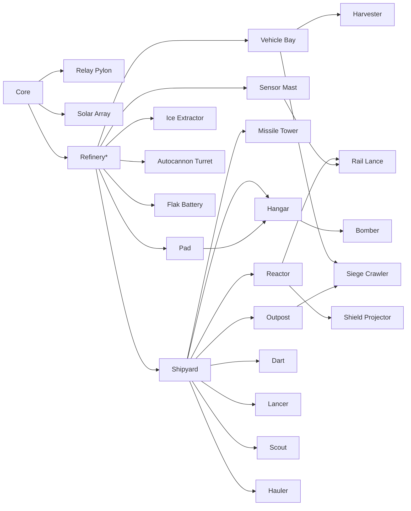
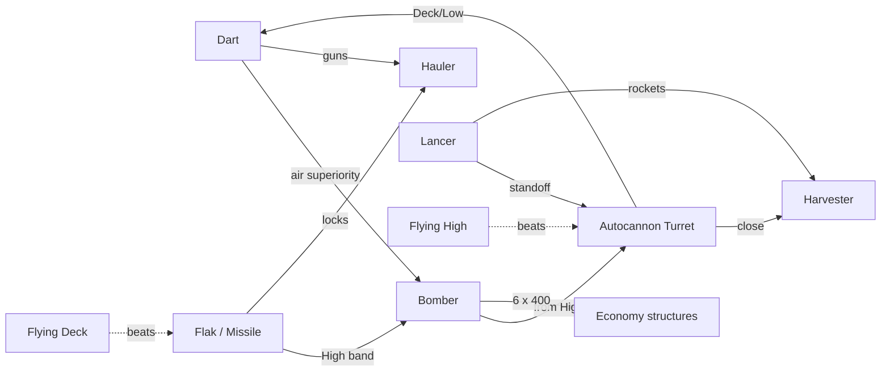
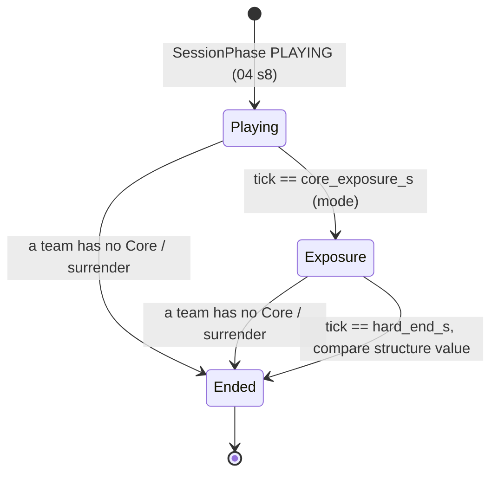

# 02 - Game Design Document

| | |
|---|---|
| **Project** | Codename **PLANEWAR**: arcade spaceship combat + C&C-style base building on a spherical moon. Godot 4.7.2, typed GDScript. v1.0 platforms: Windows (Steam, incl. Deck), Android, web (itch.io + own site); iOS, macOS, Linux native and portals in v1.1 (01 ADR-12). |
| **Document** | 02 - Game design: rules, full stat tables, economy model, maps, counters, possession rules, match rules, modes, bots, campaign, scoring, balance-test hooks. |
| **Status** | v1.0 (stage 3, revised 2026-10-10) |
| **Date** | 2026-10-10 (v0.1 draft 2026-10-09) |
| **Author** | Lead game designer agent; stage-3 revision by the 02 reviser agent |
| **Inputs** | `docs/reviews/R0-resolution-register.md` (binding; its Part B tables override this doc where they differ); `docs/01-vision-and-core-decisions.md` v1.1 (binding spine; brief in 01 s12 "02"); `docs/research/R1-game-references.md`; `docs/research/R2-godot-tech.md`; `docs/research/R3-platform-requirements.md`; critic reports C1-C3 |
| **Owns** | Every gameplay def file and field name listed in Section 1.1 (R0 B.1 "Owner 02"), every gameplay number in them, the `resources` block of `godot/content/maps/<map_id>/recipe.json`, mission content in `godot/content/campaign/*.json`, the player-facing bot promises, and the soak-test pass bands. |

**How to read.** Sections 1-7 are the stat and rule tables an implementation agent transcribes into JSON. Section 8 is the economy model with worked timelines. Sections 9-13 are maps, counters, possession, match rules and comeback. Sections 14-17 are modes, bots, campaign and scoring. Section 18 is the balance-test contract. Sections 19-22 are the closing sections required by the brief. Every stat table names its JSON field in the column header as `field_name`. Numbers marked *(anchor)* may be moved by tuning without a doc change as long as the soak pass bands of Section 18 still hold; unmarked numbers change only by editing this doc.

---

## Decisions inherited from 01 (v1.1) and R0

1. Pillars P1-P5 (01 s1); every feature here names the pillar it serves where it is not obvious.
2. CF kinematics: constant g = 6.0 m/s^2 *(anchor 5-8)*, thrust efficiency fades from 80 % of cruise to 0 at cruise, side grip `k_side`, **speed-scaled vertical grip** `k_up_eff = k_up + (k_up_flight - k_up) * clamp(v_fwd / v_cruise, 0, 1)^2` (`rules.lift_model = "speed_scaled"`), dives exceed cruise up to `v_dive_max`, flip with cooldown, retro-thrust at 0.6 x thrust (01 s3.1.1, R0 B.5).
3. Two kill speeds: guns do random damage per hit (Dart gun uniform 6-14), bombs destroy any ship instantly and do 400 to structures (01 s3.1.3). **Slugs, flak shells and rail slugs fly straight lines in the world frame (no transport, no gravity); bombs and siege shells are CF-transported and fall under g; rockets are guided** (R0 C1-03).
4. Consumables fuel/ammo/bombs; restored by docking on a friendly pad; refuel 10 s, rearm 6 s, repair 15 s in parallel for a Dart; refuel 2 Ice/s, bombs 10 Ice each, guns free, repair 1 Ore per 10 HP. Exception (A-1, owner): a collected Supply Canister (08 SL-5, v1 stretch) restores 40 % fuel and 50 % ammo in flight; bombs and repair come only from landing (01 s3.1.4).
5. **Tail-down powered landing** (owner, 01 s3.1.4): touchdown with vertical <= 8 m/s, horizontal <= 15 m/s and the body forward (thrust) axis within 25 degrees of the pad normal; landing struts on the tail; every ship hovers (`a_thrust >= 2.0 g`).
6. Soft ceiling 1,500 m, hard ceiling 2,000 m with forced release (01 s3.1.5). Altitude bands Deck/Low/High/Fade/Ceiling (01 s5.3).
7. Assist tiers per input class; assists never change stats (01 s3.1.6).
8. No avatar; re-embodiment on death, no respawn timer; wrecks persist 90 s worth 40 % of Ore cost (01 s3.1.7, s3.2).
9. Two stockpiles (Ore, Ice) plus Power as a rate; **shared team stockpile and team-shared production queues** (01 s3.2, Q3 default), with owner-only cancel and an early share lock (R0 C3-08).
10. C&C-style placement inside build radii (Core 600 m, Outpost 400 m, Pylon 250 m); the Outpost uses the presence rule instead (02 AR-1, accepted); cost paid up front; self-assembly; no builder units (01 s3.2).
11. Start kit: Core, Refinery, Shipyard with launch pad, Vehicle Bay, 1 Harvester mining; 800 Ore / 300 Ice per player (R0 B.6).
12. Match arc: Dart in the air by 0:45 (median ~0:30), first Outpost by 6:00 median, Core integrated shield until 8:00, Core Exposure and hard end per mode (30:00 / 40:00 is the long-form team value), median length 24 min in soak (01 s3.3, R0 C3-19).
13. Victory by destroying every enemy Core; a Core-less player stays in the match as a pilot; their structures self-destruct after 60 s (01 s3.3).
14. Fair PvP: everything available from match one; progression cosmetic only; no randomised paid items (01 s3.4, R3 s6.5).
15. Control states AUTO / ORDERED / POSSESSED and handoff rules 1-7 (01 s4.2-4.4).
16. `PLANET_RADIUS` = 6,000 m (owner-confirmed); 8 equatorial slots at longitude `22.5 + 45 k`; 1v1 uses slots 0 and 2 (90 degrees); sun fixed along +Z in matchmade play; moving sun in campaign/custom (01 s5.1, s5.5, s5.7, R0 B.6).
17. Resource template per slot (two home Ore Fields, home Cold Trap, contested field, mid-latitude traps, pole objectives) (01 s5.6).
18. Roster of 01 s6: the Storage Silo is cut; Siege Crawler and Rail Lance are `core` (owner O-4); no new units without an amendment.
19. Doctrines Vanguard / Bulwark / Foundry as JSON multipliers plus one rule tweak each (01 s6.4).
20. Caps profiles Standard / Reduced / Lite (01 s8.1, R0 B.7).
21. All numbers live in JSON defs, validated by schemas, hashed into the content hash (ADR-09); sim randomness only from the per-match PCG32 (ADR-06). Field names, file list and enumerations are frozen in R0 Part B and `sim/MODULE.md`.
22. Bots act only through `Command`s, never possess, never get stat or resource bonuses (01 s12 "05").

---

## 1. Conventions and def files

### 1.1 File map

Canonical list: R0 B.1. Schemas live in `tools/schemas/<file-stem>.schema.json` (committed by CONTRACT-0); numeric fields carry `minimum`/`maximum` from the 01 anchor tolerances.

| File (under `godot/content/`) | Def class | Holds | Owner | Section |
|---|---|---|---|---|
| `defs/ships.json` | `ShipDef` + `flight_common` | Dart, Lancer, Bomber, Scout, Hauler; shared flight constants | 02 | 2 |
| `defs/ground_units.json` | `GroundUnitDef` | Harvester, Siege Crawler | 02 | 3 |
| `defs/weapons.json` | `WeaponDef` | 9 weapons | 02 | 4.1 |
| `defs/projectiles.json` | `ProjectileDef` | 7 projectiles + `supply_canister` (candidate) | 02 | 4.2 |
| `defs/structures.json` | `StructureDef` | 13 non-tower structures incl. neutral `relay_station` | 02 | 5.1 |
| `defs/towers.json` | `StructureDef` (with `tower` block) | Autocannon Turret, Flak Battery, Missile Tower, Rail Lance, Shield Projector | 02 | 5.2 |
| `defs/doctrines.json` | `DoctrineDef` | Vanguard, Bulwark, Foundry (selector schema) | 02 | 7 |
| `defs/economy.json` | `EconomyDef` | economy constants incl. start kit and share lock | 02 | 8 |
| `defs/match_rules.json` | `MatchRulesDef` | victory, elimination, Core shield, surrender, session timing, caps profiles | 02 | 12 |
| `defs/modes.json` | `ModeDef[]` | 7 modes, per-mode timers, fill times, `slots_by_player_count` | 02 | 14, 9.1 |
| `defs/bot_promises.json` | `BotPromiseDef[]` | player-facing tier promises incl. cadence/rate numbers | 02 | 15 |
| `defs/scoring.json`, `defs/medals.json`, `defs/progression.json` | `ScoringDef`, `MedalDef[]`, `ProgressionDef` | score events (incl. the SL-1 landing block), medals, levels, cosmetic unlocks | 02 (+ 08 SL-1) | 17 |
| `maps/<map_id>/recipe.json` (block `resources`) | `MapDef` | node layouts per map | 02 block; 03 schema; 07 terrain blocks | 9 |
| `campaign/mNN_<id>.json` | `MissionDef` | the 8 v1 missions | 02 | 16 |
| `defs/rules.json` | `RulesDef` | **world constants only** (`gravity`, ceilings, `tick_hz`, `lift_model`, `path_expansions_per_tick`, `sim_budget_profile`, `friendly_fire`, debug flags) | 03 | R0 B.1 |
| `defs/bot_profiles.json`, `autopilots.json`, `order_rules.json`, `build_orders.json` | | bot behaviour per tier id, adjutant profiles, autopilots, orders, opening books | 05 | 15 (pointer) |
| `defs/assists.json` | `AssistDef` | assist tier numbers (in hash) | 06 | - |
| `defs/wing.json`, `callsigns.json`, `barks.json`; `commander_verbs.json` | | SL-2/SL-3 (v1); SL-5 Supply Canister (`candidate` until the C1-13 scope gate opens) | 08 | 2.3 |
| `defs/quality_tiers.json`; `sfx.json`, `vfx_prewarm.json`; `chat_filter.json` | | render tiers; presentation (hash-excluded); chat word list (hash-excluded) | 03; 07; 04 | - |

There is no `storage_silo`, `resources.json` or `bots.json`; salvage and wreck constants live in `economy.json`, match timing in `match_rules.json`/`modes.json`.

### 1.2 Conventions

- Units: metres, seconds, m/s, m/s^2, degrees, degrees per second (`_dps`). Costs are integers. HP are integers.
- Ids are lowercase snake_case and load as `StringName`. Every def has `id`, `status` (`"core"` or `"candidate"`), `tags` (string array), `presentation` (owned by 07; mesh, VFX, audio ids, smoke thresholds; stripped from the content hash) and an optional hash-excluded `_doc` string. **No `name_key` field**: display strings derive from the id through 06's localisation pipeline (`unit.<id>.name`, `structure.<id>.name`, `doctrine.<id>.name`; campaign keys `campaign_<mission>.<key>`, e.g. `campaign_m05.title`).
- Field names are R0 B.1's: descriptive snake_case with units where ambiguous (`_s`, `_m`, `_mps`, `_dps`, `_dps2`).
- Multipliers are written as factors (`1.15`), never as percent strings.
- Distances that derive from the moon's size are written as angles in recipes (Section 9) and converted with `Sphere.PLANET_RADIUS` at load. Distances that are gameplay ranges (weapons, radii, sensors) are metres and do not scale with R.
- Randomness: only `Rng` (PCG32) owned by `SimWorld`; damage rolls call `rng.range_i(min, max)` inclusive.
- Doctrine resolution order: base def -> doctrine modifiers (Section 7) -> rounding (costs to nearest 5, HP and damage to nearest integer, speeds and rates to 0.1; halves round up). Resolution is a pure function, run once per doctrine in play at `SimWorld.load_map`, outside the content hash; it never mutates base defs.

```gdscript
# src/content/content_db.gd (excerpt of the public surface this doc needs; sim/MODULE.md and content/MODULE.md are canonical)
class_name ContentDB extends RefCounted
func ship(id: StringName) -> ShipDef
func flight_common() -> FlightCommonDef
func ground_unit(id: StringName) -> GroundUnitDef
func structure(id: StringName) -> StructureDef        # towers included; StructureDef.tower is null for non-towers
func weapon(id: StringName) -> WeaponDef
func projectile(id: StringName) -> ProjectileDef      # ProjectileStore keeps the projectile def index, not the weapon index
func doctrine(id: StringName) -> DoctrineDef
func economy() -> EconomyDef
func match_rules() -> MatchRulesDef
func resolve_for_doctrine(doctrine_id: StringName) -> ResolvedDefs   # pure; never mutates base defs
func content_hash() -> String
```

---

## 2. Ships

All ships share the CF flight model (01 s3.1.1). Fields below are read by `Kinematics.step_ship()` (03) and by autopilots (05). Speeds and turn rates are *(anchor +-15 %)* per 01 s5.2.

### 2.1 Identity, cost and production

| Ship `id` | Role | HP `hp` | Ore `cost_ore` | Ice `cost_ice` | Build s `build_time_s` | Built at `produced_at` | Requires `requires` | Sensor m `sensor_radius` | Bounding m `bounding_radius` | Score `score_value` |
|---|---|---|---|---|---|---|---|---|---|---|
| `dart` | interceptor, light bomber | 100 | 150 | 0 | 20 | `shipyard` | `["shipyard"]` | 1,400 | 6 | 100 |
| `lancer` | gunship, anti-ground | 220 | 300 | 0 | 30 | `shipyard` | `["shipyard"]` | 1,400 | 8 | 150 |
| `bomber` | siege bomber | 300 | 450 | 50 | 45 | `shipyard` | `["hangar"]` | 1,200 | 10 | 250 |
| `scout` | unarmed recon | 40 | 60 | 0 | 10 | `shipyard` | `["shipyard"]` | 2,000 | 4 | 50 |
| `hauler` | ice ferry, wreck tug, Relay capture | 120 | 200 | 0 | 25 | `shipyard` | `["shipyard"]` | 1,000 | 8 | 100 |

### 2.2 Flight

| Ship `id` | Cruise `v_cruise` | Cruise loaded `v_cruise_loaded` | Boost `v_boost` | Boost s `boost_duration_s` | Boost CD `boost_cooldown_s` | Dive cap `v_dive_max` | Thrust `a_thrust` | Pitch `pitch_rate_dps` | Yaw `yaw_rate_dps` | Roll `roll_rate_dps` | Flip CD `flip_cooldown_s` | Flip s `flip_duration_s` |
|---|---|---|---|---|---|---|---|---|---|---|---|---|
| `dart` | 110 | - | 160 | 6 | 20 | 190 | 24 | 120 | 60 | 180 | 2.0 | 0.5 |
| `lancer` | 80 | - | 115 | 5 | 25 | 150 | 18 | 80 | 45 | 120 | 3.0 | 0.7 |
| `bomber` | 70 | - | 95 | 4 | 30 | 140 | **14** | 50 | 30 | 70 | 5.0 | 1.0 |
| `scout` | 140 | - | 190 | 8 | 15 | 220 | 30 | 140 | 80 | 220 | 1.5 | 0.4 |
| `hauler` | 45 | 35 | 60 | 4 | 30 | 120 | **15** | 60 | 40 | 90 | 4.0 | 0.8 |

| Ship `id` | Rate response `rate_accel_dps2` | Side grip `k_side` | Glide grip `k_up` | Flight grip `k_up_flight` *(anchor 0.6-1.5)* | Hover margin (`a_thrust / g`) |
|---|---|---|---|---|---|
| `dart` | 720 | 0.5 | 0.10 | 1.0 | 4.0 g |
| `lancer` | 600 | 0.6 | 0.12 | 1.0 | 3.0 g |
| `bomber` | 480 | 0.7 | 0.15 | 1.2 | 2.3 g |
| `scout` | 900 | 0.5 | 0.10 | 0.8 | 5.0 g |
| `hauler` | 540 | 0.8 | 0.20 | 1.2 | 2.5 g |

`rate_accel_dps2` is how fast commanded body rates are reached. `k_up` applies at zero forward speed (free-fall and terminal-sink numbers of 01 unchanged); `k_up_flight` at `v_cruise` and above, blended by `(v_fwd / v_cruise)^2` so level cruise needs only a few degrees of nose-up (01 s3.1.1). The schema enforces `a_thrust >= 2.0 * rules.gravity` (12.0) so every ship hovers with margin for the tail-down landing; the landing controller's 30 degree tilt limit needs >= 1.16 g of vertical authority plus horizontal control, so 2.3 g is the floor (Bomber 13 -> 14 and Hauler 14 -> 15 for this reason).

Shared flight constants live in `ships.json` under a top-level `"flight_common"` object (R0 B.1): `eff_fade_start` 0.8, `brake_factor` 0.6, `brake_fade_mps` 10 (the brake ramps in linearly below this forward speed so it cannot reverse the ship; R0 B.9 A-13), `boost_thrust_mult` 1.5, `overspeed_dps` 10 (flat hull damage per second above `v_dive_max`), `terrain_kill_speed` 25, `terrain_damage_speed` 8, `landing_safe_v_vert` 8, `landing_safe_v_hor` 15, `landing_safe_pitch_deg` 25 (**angle between the body forward/thrust axis and the pad normal**: the ship lands tail-down, nose up), `landing_damage_v_vert` 15, `landing_damage_v_hor` 25, `launch_speed_mps` 5, `tether_len_m` 25, `tether_drop_m` 8, `tether_tau_s` 0.4, `tow_turn_rate_mult` 0.6, `auto_dock_radius_m` 150 (horizontal distance in the pad frame, R0 B.9 A-33); S-FLIGHT-1 appends (R0 B.9 A-29..A-35): `flip_speed_retain` 0.75, `scrape_clear_s` 0.5, `fuel_burn_boost_per_s` 2.0, `fuel_burn_brake_per_s` 0.6, `fuel_burn_idle_per_s` 0.05 (the Section 2.3 burn constants as fields), `landing_damage_tilt_deg` 45, `auto_dock_latch_mult` 5.

**Impact and landing** (tail-down landing, 01 s3.1.4; rule in R0 B.5). A ship lands on a free friendly pad when, in one tick, it is within `pad_radius_m` of the pad centre, its vertical speed is <= 8 m/s, its tangential speed <= 15 m/s and its thrust axis is within 25 degrees of the pad normal. Between the safe and damage limits (15 / 25 m/s, or attitude 25-45 degrees) it lands but takes `hp_max * max(ratio_vert, ratio_hor, ratio_tilt)` with each ratio = excess / (damage - safe); beyond, it is destroyed and the pad takes 100 damage. Terrain impact between `terrain_damage_speed` and `terrain_kill_speed` deals `hp_max * excess / (kill - damage)`; above, the ship dies. A ship launches tail-down at `launch_speed_mps` along the pad normal and pitches over above 20 m AGL. "Loaded" means carrying Ice cargo or towing; a towing Hauler's turn rates are multiplied by `tow_turn_rate_mult`.

### 2.3 Loadout, fuel and service

| Ship `id` | Primary `primary` (weapon, ammo) | Secondary `secondary` (weapon, count) | Fuel s `fuel_s` | Refuel Ice `refuel_ice` | Refuel s `refuel_time_s` | Rearm s `rearm_time_s` | Repair s `repair_time_s` | Cargo Ice `cargo_ice` | Tow slots `tow_slots` |
|---|---|---|---|---|---|---|---|---|---|
| `dart` | `gun_dart`, 400 | `bomb`, 2 | 240 | 20 | 10 | 6 | 15 | 0 | 0 |
| `lancer` | `gun_lancer`, 300 | `rocket_lancer`, 8 | 300 | 30 | 12 | 8 | 18 | 0 | 0 |
| `bomber` | none | `bomb`, 6 | 360 | 45 | 15 | 10 | 22 | 0 | 0 |
| `scout` | none | none | 180 | 10 | 6 | 0 | 10 | 0 | 0 |
| `hauler` | none | none | 400 | 40 | 12 | 0 | 15 | 400 | 1 |

Fuel burn per second = `thrust` input (0..1) + 2.0 extra while boosting + 0.6 while braking + 0.05 idle (attitude jets). A ship at 0 fuel has zero thrust and glides under gravity; autopilot return thresholds are 05's (01 s4.3 anchors: fuel < 25 %, ammo 0, HP < 40 %). Refuel time scales with fuel missing; Ice drawn = `refuel_ice * fuel_missing01`, so the Dart's rate is 2 Ice/s as 01 fixes. Repair time scales with HP missing; repair costs `ceil(hp_missing * 0.1)` Ore. Rearm of bombs and rockets costs `rearm_ice` per round (Section 4.1); gun rounds are free. If the team stockpile cannot pay, the corresponding service pauses (the pad shows "waiting for Ice/Ore"); a possessed ship may launch at any time with what it has, an AUTO ship waits until fuel >= 50 %.

**In-flight resupply (SL-5, v1 stretch behind the C1-13 scope gate).** A collected Supply Canister restores 40 % of `fuel_s` and 50 % of gun ammo and rockets in flight; it never restores bombs or HP, so bombing and repair still require a landing (01 s3.1.4, A-1). Canister cost, deployment and the `supply_canister` projectile are 08 SL-5's (`commander_verbs.json`, `status: "candidate"` until the gate opens). The Ice ceiling of Section 8.5 counts canister Ice like service Ice.

A produced ship spawns fully fuelled and armed (its production cost includes the first load), parked tail-down on its Shipyard's launch pad, and is airborne (> 20 m AGL) about 3 s after completion. The Shipyard launch pad is launch-only, never a service pad (`launch_pad: true` with `pads` 0 in `structures.json`, R0 B.9 A-19: the ship spawns DOCKED on the socket and leaves through the normal `LAUNCHED` rule; `nearest_friendly_pad` never returns a Shipyard).

### 2.4 Ship notes

- **Dart** is the default possession and the Triplane-lineage plane: fast, agile, two bombs, gun that kills another Dart in about 10 hits. Air superiority and harvester raids.
- **Lancer** is the anti-ground gunship: its gun and rockets out-range the Autocannon Turret (800/1,500 m vs 700 m) and its heavier gun hurts structures (`structure_mult` 0.35). It loses dogfights to Darts (lower turn rates) and must respect Missile Towers and Flak.
- **Bomber** carries 2,400 structure damage per sortie and no gun. It never free-roams (01 s4.3). Requires a Hangar to build (it needs a bomb-proof service bay to be worth its cost).
- **Scout** is a 60-Ore sensor that dies to anything; the cheapest answer to fog and the best "presence" unit for Outpost placement (Section 6.2).
- **Hauler** ferries 400 Ice, tows one wreck (Foundry: two), and is the only unit that captures the Relay Station. Loaded or towing, its cruise drops to 35 m/s.

```json
{ "id": "dart", "status": "core", "tags": ["ship", "fighter"],
  "hp": 100, "cost_ore": 150, "cost_ice": 0, "build_time_s": 20, "produced_at": "shipyard", "requires": ["shipyard"],
  "sensor_radius": 1400, "bounding_radius": 6, "score_value": 100,
  "v_cruise": 110, "v_boost": 160, "boost_duration_s": 6, "boost_cooldown_s": 20, "v_dive_max": 190, "a_thrust": 24,
  "pitch_rate_dps": 120, "yaw_rate_dps": 60, "roll_rate_dps": 180, "rate_accel_dps2": 720,
  "flip_cooldown_s": 2.0, "flip_duration_s": 0.5,
  "k_side": 0.5, "k_up": 0.1, "k_up_flight": 1.0,
  "primary": { "weapon": "gun_dart", "ammo": 400 }, "secondary": { "weapon": "bomb", "count": 2 },
  "fuel_s": 240, "refuel_ice": 20, "refuel_time_s": 10, "rearm_time_s": 6, "repair_time_s": 15,
  "cargo_ice": 0, "tow_slots": 0, "possessable": true, "autopilot": "ap_dart",
  "presentation": { "mesh": "res://assets/ships/dart.glb", "smoke_hp01": [0.75, 0.5, 0.25] } }
```

---

## 3. Ground units

| Unit `id` | HP `hp` | Ore `cost_ore` | Ice `cost_ice` | Build s `build_time_s` | Requires `requires` | Speed `ground_speed` | Loaded `ground_speed_loaded` | Max slope `max_slope_deg` | Cargo `cargo_ore` | Mine rate `mine_rate` | Unload s `unload_time_s` | Weapon `weapon` | Sensor `sensor_radius` | Status `status` |
|---|---|---|---|---|---|---|---|---|---|---|---|---|---|---|
| `harvester` | 150 | 250 | 0 | 20 | `["vehicle_bay"]` | 12 | 10 | 25 | 300 | 15 (Ore/s) | 6 | none | 600 | core |
| `siege_crawler` | 400 | 450 | 0 | 40 | `["vehicle_bay", "outpost"]` | 8 | - | 20 | - | - | - | `siege_gun` (`ammo` 20 shells) | 1,000 | **core** |

Further fields (R0 B.1): both `produced_at: "vehicle_bay"`, `possessable: true`; `bounding_radius` / `score_value` / `autopilot`: harvester 4.5 / 120 / `ap_harvester`, siege_crawler 7 / 150 / `ap_crawler`.

Speed on slope: `speed * (1 - 0.6 * slope_deg / max_slope_deg)`; cells steeper than `max_slope_deg` are impassable on the path grid (ADR-05). Harvesters are possessable (drive manually, e.g. to flee a raid along a route the autopilot would not pick); a possessed Harvester mines when stopped on a field and unloads when stopped at a Refinery dock. The Siege Crawler fires only at ground targets and structures, 300-1,200 m, and needs escort. It is a v1 unit (owner O-4); BAL-14 polices its share of structure damage.

---

## 4. Weapons, projectiles and damage rules

### 4.1 Weapons (`defs/weapons.json`)

| Weapon `id` | Kind `kind` | Projectile `projectile` | Dmg min `damage_min` | Dmg max `damage_max` | vs structures `structure_mult` | vs ground units `ground_mult` | Rate `rof` (rounds/s) | Burst `burst` | Burst gap s `burst_interval_s` | Salvo `salvo` | Reload s `reload_s` | Range m `range_m` | Spread `spread_deg` | Lock cone `lock_cone_deg` | Lock s `lock_time_s` | Guided turn `turn_rate_dps` | Rearm Ice `rearm_ice` |
|---|---|---|---|---|---|---|---|---|---|---|---|---|---|---|---|---|---|
| `gun_dart` | gun | `slug_light` | 6 | 14 | 0.15 | 1.0 | 10 | - | - | - | - | 800 | 0.6 | - | - | - | 0 |
| `gun_lancer` | gun | `slug_heavy` | 8 | 16 | 0.35 | 1.0 | 8 | - | - | - | - | 800 | 0.8 | - | - | - | 0 |
| `gun_turret` | gun | `slug_light` | 6 | 14 | 0.15 | 1.0 | 12 | 5 | 1.2 | - | - | 700 | 1.0 | - | - | - | 0 |
| `bomb` | bomb | `bomb` | 400 | 400 | 1.0 | 1.0 | 2.5 (0.4 s refire) | - | - | - | - | ballistic | - | - | - | - | 10 |
| `rocket_lancer` | rocket | `rocket` | 40 | 40 | 1.0 | 1.0 | 1.67 (0.6 s refire) | - | - | 1 | - | 1,500 | - | 20 | 0.8 | 90 | 4 |
| `rocket_tower` | rocket | `rocket` | 40 | 40 | - (air only) | - | - | - | - | 2 | 6.0 | 1,500 | - | 360 | 1.0 | 75 | 0 |
| `flak_gun` | flak | `flak_shell` | 30 | 30 | - (air only) | - | - | - | - | 2 | 2.0 | 1,500 | 0.5 | - | - | - | 0 |
| `rail_gun` | rail | `rail_slug` | 250 | 250 | 1.0 | 1.0 | - | - | - | 1 | 8.0 | 2,500 | 0.1 | - | - | - | 0 |
| `siege_gun` | artillery | `siege_shell` | 120 | 120 | 1.0 | 1.0 | - | - | - | 1 | 4.0 | 1,200 (`range_min_m` 300) | 1.5 | - | - | - | 0 |

All *(anchor)* except the 01-fixed values: Dart gun 6-14 at 10 rounds/s with 400 rounds, bomb 400 vs structures, rockets 40 at 250 m/s to 1,500 m, flak 30 in a 25 m burst at 300 m/s to 1,500 m. Two fields the table does not show (R0 B.8 A-2, A-3): `range_min_m` (optional, default 0; only `siege_gun` sets it, 300) and `weapon_mount`, one of `ship` (gun_dart, gun_lancer, bomb, rocket_lancer), `tower` (gun_turret, rocket_tower, flak_gun, rail_gun) or `ground` (siege_gun, carried by the Siege Crawler). The weapon `bomb` and the projectile `bomb` share a name on purpose: weapon ids and projectile ids are separate namespaces (R0 B.8 A-1).

### 4.2 Projectiles (`defs/projectiles.json`)

| Projectile `id` | Behaviour `behaviour` | Speed `speed_mps` | Life s `lifetime_s` | Gravity `gravity` | Transport `transport` | Radius `radius_m` | Blast `blast_radius_m` / `blast_radius_structure_m` | Fuse `fuse` (`fuse_radius_m`) | Arm s `arm_s` | Shield absorbs `shield_absorbed` | HP `hp` |
|---|---|---|---|---|---|---|---|---|---|---|---|
| `slug_light` | straight | 700 | 1.15 | **false** | **false** | 0.5 | 0 | contact | 0 | false | 0 |
| `slug_heavy` | straight | 700 | 1.15 | **false** | **false** | 0.6 | 0 | contact | 0 | false | 0 |
| `bomb` | ballistic | 0 (carrier velocity) + `eject_down_mps` 40 | 30 | true | true | 1.0 | 15 / 20 | contact (incl. terrain) | 0.5 | true | 0 |
| `rocket` | guided | 250 | 6.0 | false | true | 0.8 | 4 / 4 | proximity (4) | 0.2 | true | 0 |
| `flak_shell` | straight | 300 | 5.0 | **false** | **false** | 0.5 | 25 / 0 | timed: predicted intercept + 0.3 s; early burst within 12 m (12) | 0.5 | false | 0 |
| `rail_slug` | straight | 1,500 | 1.7 | **false** | **false** | 0.5 | 0 | contact | 0 | false | 0 |
| `siege_shell` | ballistic | up to 110 (lofted) | 12 | true | true | 1.0 | 12 / 12 | contact (incl. terrain) | 1.0 | true | 0 |
| `supply_canister` (candidate, SL-5) | rendezvous | per 08 SL-5 | per 08 | - | true | per 08 | 0 | - | - | false | 30 |

**Motion rule (R0 B.5, 01 s3.1.3).** Slugs, flak shells and rail slugs fly straight lines in the world frame (`p += v * dt`; no parallel transport, no gravity, no damping) and travel on the wire as `PROJECTILE_BATCH` spawns, never as entities. Bombs and siege shells are CF-transported and fall under g. Rockets fly at constant speed, guided toward their lock target within `turn_rate_dps` and `lock_cone_deg`, transported. Every lead solver (turret aim, autopilot `aim_lead`, the HUD lead pip) is a straight-line intercept carrying the shooter's velocity with no gravity term, so what a player aims at visually is what a slug hits at every range. All projectiles are pooled (2,000 cap Standard, 01 s8.1).

### 4.3 Damage rules (implemented once in `src/sim/combat.gd`)

1. **Gun hit:** `dmg = rng.range_i(damage_min, damage_max)`, then `* structure_mult` vs structures or `* ground_mult` vs ground units, then `round()`, minimum 1. Doctrine factors are already folded into the resolved `damage_min`/`damage_max` (Section 7), never applied twice. Rolls happen on the server only (ADR-07).
2. **Bomb vs ships:** any ship whose bounding sphere is within 15 m of a bomb detonation, or that the bomb touches after arming, is destroyed outright (01 s3.1.3). A ship docked in a **Hangar** is immune to bombs (and, for Bulwark, to rockets).
3. **Bomb vs everything else:** ground units within 20 m take 400; structures whose footprint edge is within 20 m take `400 * structure_bomb_mult` (1.0 for all structures except the Hangar, 0.25).
4. **Rockets:** 40 to the target hit by the proximity burst; no splash to others. Rocket locks follow Section 4.4.
5. **Flak:** 30 to every enemy ship within 25 m of the burst. Flak never targets ground units or structures.
6. **Shield domes** (Section 5.2) **and the Core's integrated shield** (Section 5.1): a projectile with `shield_absorbed: true` that enters an enemy dome from outside is destroyed if the dome's current charge >= its damage (charge -= damage). If the charge is lower, the projectile passes through unchanged and the dome collapses to 0 for 10 s. Ships pass through domes freely; projectiles fired from inside a dome are never absorbed by it.
7. **Ramming:** ship-ship contact destroys both (01). Ship-structure contact destroys the ship and deals its remaining HP to the structure.
8. **No friendly fire** from weapons. Ramming, terrain and Reactor explosions (100 m, 200 damage, everyone) ignore teams.
9. **Damage feedback:** every gun hit emits a `HIT` event with the rolled value; presentation scales sparks by value and smoke by `hp01` thresholds 0.75 / 0.5 / 0.25 (readable state without health bars, 01 s3.1.3).

```gdscript
# src/sim/combat.gd
class_name Combat extends RefCounted
static func roll_gun_damage(w: WeaponDef, target_kind: int, rng: Rng) -> int   # w is the owner's doctrine-resolved def
func detonate_bomb(pos: Vector3, owner_team: int, structure_dmg: int) -> void      # applies rules 2-3
func shield_intercept(proj_slot: int, from_pos: Vector3, to_pos: Vector3) -> bool  # rule 6; true if absorbed
```

### 4.4 Tower envelopes and lock rules

Relative height `h_rel = |p_target| - |p_tower|` (metres, against the datum, 01 s3.1.3). AGL = `|p| - (R + Terrain.height_at(dir))`.

| Tower `id` | `h_rel_min` | `h_rel_max` | `target_agl_min` | Range `range_m` (of its weapon) | Turn `turret_turn_dps` | Targets `target_kinds` | Beaten by (design note) |
|---|---|---|---|---|---|---|---|
| `autocannon_turret` | -200 | 400 | 0 | 700 | 120 | `["ship", "ground"]` | flying High (> 400 m rel); out-ranging (Lancer, Siege Crawler) |
| `flak_battery` | 150 | 1,500 | - | 1,500 | 60 | `["ship"]` | flying Deck (< 150 m rel) |
| `missile_tower` | -300 | 1,500 | 40 | 1,500 | 90 | `["ship"]` | flying below 40 m AGL ("ground clutter"); the flip; horizon |
| `rail_lance` | -300 | 1,500 | 0 | 2,500 | 30 | `["ship", "ground"]` | jinking during the 1.7 s slug flight; 8 s reload |

- **Aim:** turrets solve a straight-line intercept with no gravity term (slugs, flak and rail slugs fly straight, Section 4.2); `turret_turn_dps` limits slew. A possessed tower slews with the `pitch`/`yaw` input axes as rates.
- **Fire pipeline** (GD-36): guns fire at `rof` and draw one round per shot (`ammo_per_shot` 1); towers fire `burst` rounds every `burst_interval_s` from their `ammo_pool`; unsupplied towers fire at 50 % rate (Section 5.4); rockets launch only after `lock_time_s` of continuous lock.

- **Missile lock:** requires the target inside `lock_cone_deg`, inside range, above `target_agl_min`, not beyond the horizon (datum-sphere test, ADR-05), held continuously for `lock_time_s`. A rocket in flight loses lock permanently if its target drops below 40 m AGL, or if the target **starts a flip while the rocket is 100-500 m away**; it then flies straight until `lifetime_s`. The flip-break window is deterministic so it is a learnable skill, not a dice roll. This rule implements 01's "beaten by terrain masking and the flip" without terrain line-of-sight (not simulated in v1, ADR-05).
- **Target priority** (`target_priority` in each tower def, 01 s4.3): `["bomber", "hauler_loaded", "lancer", "dart", "siege_crawler", "harvester", "scout", "hauler"]`, filtered by what the tower can engage; ties break by distance.
- **Power:** tower rate of fire scales by the team power ratio; below 0.5 towers are offline (01 s3.2).

---

## 5. Structures

### 5.1 Infrastructure (`defs/structures.json`)

Footprints are in build-grid cells (~9.2 m, ADR-05). Power: positive produces, negative draws. Storage values add to the team cap.

| Structure `id` | HP `hp` | Ore `cost_ore` | Ice `cost_ice` | Build s `build_time_s` | Power `power` | Requires `requires` | Footprint `footprint` | Build radius `build_radius` | Sensor `sensor_radius` | Ore cap `storage_ore` | Ice cap `storage_ice` | Slots `construction_slots` | Pads `pads` | Pad radius `pad_radius_m` | Max `max_per_player` |
|---|---|---|---|---|---|---|---|---|---|---|---|---|---|---|---|
| `core` | 3,000 | - | - | - | +20 | - | 8x8 | 600 | 2,000 | **3,000** | **800** | 2 | 1 | 12 | 1 |
| `outpost` | 1,200 | 450 | 0 | 45 | +5 | `shipyard` | 6x6 | 400 | 1,200 | 250 | 100 | +1 | 1 | 10 | 6 |
| `relay_pylon` | 150 | 75 | 0 | 10 | 0 | `core` | 2x2 | 250 | 300 | - | - | - | - | - | 30 |
| `solar_array` | 300 | 100 | 0 | 15 | +12 x solar factor | `core` | 4x4 | - | 400 | - | - | - | - | - | 20 |
| `reactor` | 600 | 400 | 150 | 45 | +40 | `shipyard` | 5x5 | - | 400 | - | - | - | - | - | 4 |
| `refinery` | 1,000 | 300 | 0 | 30 | -4 | `core` | 6x6 | - | 600 | **1,500** | **500** | - | - | - | 6 |
| `ice_extractor` | 400 | 200 | 0 | 25 | -3 | `refinery` | 4x4 (on node) | - | 600 | `buffer_ice` 400 | - | - | - | - | - |
| `pad` | 600 | 150 | 0 | 20 | -2 | `refinery` | 4x4 | - | 400 | - | - | - | 1 | 10 | 12 |
| `hangar` | 900 | 225 | 0 | 30 | -3 | `pad`, `shipyard` | 4x4 | - | 400 | - | - | - | 1 (`pad_roofed`) | 10 | 8 |
| `shipyard` | 1,500 | 400 | 0 | 35 | -10 | `refinery` | 8x6 | - | 800 | - | - | - | launch only (`launch_pad: true`, `pads` omitted) | - | 3 |
| `vehicle_bay` | 1,200 | 300 | 0 | 30 | -6 | `refinery` | 6x6 | - | 600 | - | - | - | - | - | 2 |
| `sensor_mast` | 350 | 250 | 0 | 20 | -4 | `refinery` | 2x2 | - | 3,500 (`deck_reveal_radius` 1,200) | - | - | - | - | - | 6 |
| `relay_station` (neutral) | indestructible | - | - | - | 0 | - | pre-placed | - | 3,500 (`deck_reveal_radius` 1,200) | - | - | - | 1 | 12 | - |

Notes:
- **No Storage Silo** (owner O-4): Core and Refinery storage were raised to compensate (Section 8.6).
- **JSON for non-buildable defs:** `core` and `relay_station` carry `"buildable": false`, `cost_ore` 0, `cost_ice` 0, `build_time_s` 0; the Relay Station has `"invulnerable": true` and `hp` 1. A dash elsewhere in these tables means the field is omitted (schema default 0 or null). Other per-def fields of R0 B.1: `on_node: "cold_trap"` (extractor), `pipe_radius_m` 500 and `docks` 2 (refinery), `solar: true` (solar_array), `explode {radius_m 100, damage 200}` (reactor), `upgrade_from`/`upgrade_cost_ore`/`upgrade_time_s` (hangar), `possessable`.
- **Pre-built start kit** (Section 8.1): every player starts with a Core, a Refinery, a Shipyard and a Vehicle Bay; the pre-built ones count against `max_per_player`. The kit is power-neutral (Core +20 against Refinery 4 + Shipyard 10 + Vehicle Bay 6), so the first Solar Array is the first real decision.
- **Core**: cannot be built or rebuilt; one per player; possessing it is not allowed (01 s4.4). Its 2 construction slots and the pre-built factories make the opening deadlock-free. **Integrated shield** (`integrated_shield {charge_max 2400, recharge_per_s 40, recharge_delay_s 5}`): a dome over the Core's own footprint that absorbs bombs and rockets exactly like a Shield Projector (rule 4.3.6) but costs no Ice and draws no power; it is active from 0:00 until `match_rules.core_shield_until_s` (480 s) and is removed at Core Exposure if still active. It blocks a bomb rush on an undefended Core (scenario C-13, BAL-31) and does not protect any other structure. 06 shows its timer on the Core; 07 reuses `vfx_shield_dome`.
- **Refinery**: 2 unload docks; delivery point for Ore (Harvesters) and Ice (Haulers); automatically pipes Ice from any friendly Ice Extractor within `pipe_radius_m` 500 m (`economy.json`, 01 s6.2).
- **Pads**: `pad_radius_m` is the landing-zone radius used by the landing rule (Section 2.2) and by the landing grade's offset term (Section 17.1).
- **Hangar**: build directly (225 Ore) or upgrade an existing Pad in place (`upgrade_from: "pad"`, +75 Ore, 15 s, pad unusable while upgrading). Docked ships are bomb-proof (rule 4.3.2). The roof takes 25 % bomb damage.
- **Ice Extractor**: only structure allowed on a resource node; fills a 400-Ice buffer at the node's rate; the buffer empties into a piped Refinery or into Haulers (40 Ice/s load rate).
- **Solar factor** (Section 8.4) is 0 on the night side, 1 on the day side, 1.5 on the Solar Plateau.
- **Possessable structures**: the four towers (manual aim), Shipyard and Vehicle Bay (production UI). Nothing else (01 s4.4).

### 5.2 Towers and the Shield Projector (`defs/towers.json`)

| Tower `id` | HP `hp` | Ore `cost_ore` | Ice `cost_ice` | Build s `build_time_s` | Power `power` | Requires `requires` | Footprint `footprint` | Weapon `weapon` | Ammo pool `ammo_pool` | Refill /s `ammo_refill_per_s` | Sensor `sensor_radius` | Max `max_per_player` | Status `status` |
|---|---|---|---|---|---|---|---|---|---|---|---|---|---|
| `autocannon_turret` | 500 | 200 | 0 | 20 | -4 | `refinery` | 3x3 | `gun_turret` | 300 rounds | 10 | 1,600 | 16 | core |
| `flak_battery` | 600 | 300 | 0 | 25 | -6 | `refinery` | 3x3 | `flak_gun` | 40 shells | 1.0 | 1,600 | 12 | core |
| `missile_tower` | 500 | 350 | 0 | 25 | -6 | `shipyard` | 3x3 | `rocket_tower` | 12 rockets | 0.25 | 1,600 | 12 | core |
| `rail_lance` | 700 | 900 | 100 | 50 | -15 | `reactor`, `sensor_mast` | 4x5 | `rail_gun` | 10 slugs | 0.1 | 1,600 | 2 | **core** |
| `shield_projector` | 800 | 600 | 100 | 40 | -15 | `reactor` | 3x3 | none | - | - | 600 | 4 | core |

**Shield Projector** fields: `dome_radius` 250, `charge_max` 1,200 (three bombs), `recharge_per_s` 20 after `recharge_delay_s` 5 without an absorb, `recharge_ice_per_point` 0.05 (1 Ice per 20 charge, so a full recharge costs 60 Ice), `collapse_s` 10, offline when power ratio < 0.5, `exposure_charge_mult` 0.5 and `exposure_recharge_mult` 0.5 when the dome covers any Core after Core Exposure (Section 12). Towers and the Shield draw power and ammo through the supply network (Section 5.4). Tower `tower {}` blocks carry `weapon`, `ammo_pool`, `ammo_refill_per_s`, `h_rel_min`, `h_rel_max`, `target_agl_min`, `turret_turn_dps`, `target_kinds[]`, `target_priority[]` (Section 4.4).

### 5.3 Neutral objectives

- **Relay Station** (Noon Pole, pre-placed, indestructible, no weapons). **Capture:** a Hauler of team T is DOCKED on its pad for `capture_s` 20 with no enemy unit (ship or ground) within `contest_radius` 300 m. Progress pauses while contested and resets if the Hauler leaves. The holder gets the pad (normal service costs), 3,500 m sensors with 1,200 m deck reveal, and +300 score per capture. Recapture uses the same rule. Pillar P3.
- **Solar Plateau**: 1,000 m radius around the Noon Pole; Solar factor 1.5 (01 s5.4). Building there needs an Outpost (Section 6.2).
- **Midnight Pole cluster**: four Cold Trap nodes (Section 9); Ice Extractors there need an Outpost.

### 5.4 Supply network

- **Roots:** Core and Outposts. **Links:** a Relay Pylon whose centre is inside the build radius of a root or of another linked Pylon. Connectivity is recomputed when any root or Pylon is built or destroyed (graph over at most 30 Pylons + 7 roots per player; trivial cost).
- A tower or Shield Projector is **supplied** when its footprint centre is inside the build radius of a connected node of its own team (any teammate's network counts).
- Supplied towers refill `ammo_refill_per_s` for free and receive team power. Unsupplied towers keep firing from their remaining pool, never refill, and fire at 50 % rate; an unsupplied Shield does not recharge. Pools are visible bars (Mindustry lesson, R1 s3 item 12).
- Pylons are 150 HP: one bomb, four Lancer rockets, or about 100 Dart-gun hits (1.5 average after `structure_mult`). The intended "cut the supply line" target (01 s6.2).

---

## 6. Tech gating, placement and construction

### 6.1 Tech tree

Prerequisites are **team-wide** and must be **alive** (a teammate's Shipyard unlocks Outposts for you; losing your only Hangar stops Bomber production). The tree is shallow by design (01 s12).



\* Every player starts with a Refinery, a Shipyard and a Vehicle Bay (Section 8.1), so tiers 2 and 3 (Missile Tower, Outpost, Reactor, Hangar after a Pad, every ship except the Bomber, the Harvester) are open at 0:00; the tiers still order what a player can afford.

### 6.2 Placement rules

A `BUILD` command is accepted when all hold:

1. The player is not eliminated and has the def's prerequisites (team-wide, alive) and is below `max_per_player` and below the structure cap of the match's caps profile (60 / 40 / 30).
2. Every footprint cell is free on the occupancy grid, the maximum slope across the footprint is <= 15 degrees, and the footprint does not overlap a resource node unless the def is `ice_extractor` on a Cold Trap node (ADR-05). Footprints may cross a cube-face edge (Outposts can be placed anywhere).
3. The footprint is inside current team vision and outside every enemy build radius.
4. **Radius rule (all structures except the Outpost):** the footprint centre lies inside the build radius of a friendly Core, Outpost or connected or unconnected Relay Pylon (01 s3.2).
5. **Outpost rule (02 AR-1, accepted):** instead of rule 4, an Outpost needs (a) a friendly unit within `presence_radius` 300 m of the footprint centre at the moment of placement, (b) >= `min_spacing_friendly` 800 m from every friendly Core and Outpost, (c) >= `min_spacing_enemy` 1,500 m from every enemy Core and Outpost. This is what makes "expansion to contested fields and the poles" (01 s6.2) possible: a Pylon chain to a pole would need 36 Pylons.
6. Payment succeeds (Section 6.3) and the player's early share lock allows it (Section 6.4).

Rejections map one-to-one to `Build.Reject` (R0 B.3, append-only) and travel in `CommandResult.REJECTED_PLACEMENT`; 06 shows each reason in plain words and the Outpost presence ring.

```gdscript
# src/sim/build.gd  (canonical signatures: R0 B.5 / sim/MODULE.md)
class_name Build extends RefCounted
enum Reject { OK, ELIMINATED, PREREQ, CAP, OCCUPIED, SLOPE, NODE, NOT_VISIBLE, ENEMY_RADIUS, NO_RADIUS,
              NO_PRESENCE, SPACING, FUNDS, SPEND_LOCKED }
func can_place(player: int, def_id: int, cell: int, rotation: int) -> Build.Reject   # def_id = def index, cell = build cell
func place(player: int, def_id: int, cell: int, rotation: int) -> int               # returns site EntityId or 0
```

### 6.3 Construction rules

- **Construction slots:** each player assembles at most `construction_slots_base` 2 + `outposts_alive` structures at once (`construction_slots_max` 4). Further placements become **queued sites** (ghosts that reserve their footprint) and start in placement order when a slot frees. Pillar P5: keeps build pace readable and stops an early bank from turning into an instant fortress.
- **Payment:** the full Ore/Ice cost is taken when assembly **starts** (01's "paid up front"); a queued site waits with "waiting for Ore" if the stockpile is short. Assembly time is not affected by power (so a powerless base can always build Solar).
- **During assembly** the site has `hp * max(0.1, progress)` and can be attacked; if destroyed it leaves no wreck.
- **Cancel** (`CANCEL_BUILD`): queued site refunds 100 % (`cancel_refund_queued`); site in assembly refunds 75 % of what was paid (`cancel_refund_assembly`). Only the player who placed the site may cancel it, or any teammate if that player is disconnected, eliminated or a bot (otherwise `REJECTED_NOT_OWNER`). Completed structures cannot be sold in v1 (OQ-4).
- **Self-repair:** a completed, supplied structure that has taken no damage for `self_repair_delay_s` 10 s repairs `max(2, 0.005 * hp)` HP/s, paying `repair_ore_per_hp` (1 Ore per 10 HP); it pauses when the team has no Ore.

### 6.4 Production rules

- One queue per Shipyard / Vehicle Bay, `queue_max` 5 items. Queues are team-shared: any teammate may add to any queue; the unit belongs to the player who queued it and uses that player's doctrine and caps (Section 7). **`CANCEL_PRODUCE` is owner-only**: valid for the player who queued the item, or for any teammate if that player is disconnected, eliminated or a bot.
- Cost is paid when an item **starts**. Production speed = `max(production_min_speed, power_ratio)`.
- **Early share lock** (`economy.early_share_lock_s` 120, `early_share_ore` 800): in teams of two or more, until 2:00 each player may spend at most 800 Ore of the team pool plus the Ore that player's own Harvesters and Core trickle have delivered. A BUILD whose payment would exceed it is rejected `SPEND_LOCKED` (queued sites wait instead); a PRODUCE start waits and a new PRODUCE is rejected `REJECTED_LOCKED`. 06 shows the locked amount greyed with its reason; `AlertKind.SPEND_LOCKED` fires once. The lock keeps one teammate from draining the commons before the others' openings (BAL-33).
- **Auto-replenish** (`TOGGLE_AUTO_REPLENISH`): per player and per class, a target count (default 0); when alive + queued < target, the item is appended to the least-loaded eligible queue. The Adjutant (01 s4.3) sets targets for players who enable it.
- At the unit cap, items that would exceed it block with "cap reached" (01 s8.1).
- **Rally:** each facility has a rally point (`SET_RALLY`); a produced unit takes `ORDERED: move to rally`, then AUTO.

---

## 7. Doctrines (`defs/doctrines.json`)

Doctrines apply to entities **owned by** the choosing player (the player who issued the `BUILD` or `PRODUCE`) and to that player's purchases. In team play the Foundry player's cheaper purchases produce Foundry-stat units: that trade is intended. Pillar P5: asymmetry through data only.

| Doctrine | Modifier (selector -> field, op, value) | Rule tweak (`rules`) |
|---|---|---|
| **Vanguard** | ships -> `v_cruise`, `v_boost`, `a_thrust` x1.15; ships -> `v_dive_max` x1.10; ships -> `pitch_rate_dps`, `yaw_rate_dps`, `roll_rate_dps` x1.15; ships -> `hp` x0.80; `dart` -> `secondary.count` set 1 | `flip_cooldown_s_override`: 1.0 (all ships) |
| **Bulwark** | structures and towers (incl. Core) -> `hp` x1.25; tower-mounted weapons (`weapon_mount: "tower"`) -> `range_m` x1.10; ships -> `v_cruise`, `v_boost` x0.90; structures and towers -> `cost_ore`, `cost_ice` x1.15 | `hangar_blocks_rockets`: true |
| **Foundry** | structures, towers, ships, ground units -> `cost_ore`, `cost_ice` x0.85; `harvester` -> `cargo_ore` x1.25 (375); `hauler` -> `tow_slots` set 2; ship-mounted weapons -> `damage_min`, `damage_max` x0.85 (bombs vs structures 340; bombs still destroy ships) | `reactor_unlock_s`: 600 (no Reactor before 10:00; this also delays Shield Projector and Rail Lance) |

Resolved examples: Vanguard Dart 80 HP, 126.5 m/s cruise, 1 bomb; Bulwark Core 3,750 HP, Autocannon 770 m range, Pad 175 Ore (rounded from 172.5); Foundry Dart 130 Ore (rounded from 127.5, halves round up), gun 5-12, Harvester 215 Ore.

```json
{ "id": "foundry", "status": "core", "tags": ["doctrine"],
  "modifiers": [
    { "select": { "tags_any": ["structure", "tower", "ship", "ground"] }, "field": "cost_ore", "op": "mul", "value": 0.85 },
    { "select": { "tags_any": ["structure", "tower", "ship", "ground"] }, "field": "cost_ice", "op": "mul", "value": 0.85 },
    { "select": { "ids": ["harvester"] }, "field": "cargo_ore", "op": "mul", "value": 1.25 },
    { "select": { "ids": ["hauler"] }, "field": "tow_slots", "op": "set", "value": 2 },
    { "select": { "weapon_mount": "ship" }, "field": "damage_min", "op": "mul", "value": 0.85 },
    { "select": { "weapon_mount": "ship" }, "field": "damage_max", "op": "mul", "value": 0.85 } ],
  "rules": { "reactor_unlock_s": 600 },
  "presentation": { "icon": "doctrine_foundry" } }
```

`op` is one of `mul`, `add`, `set`; `field` may be a dotted path (`secondary.count`). Selectors: `ids`, `tags_any`, `weapon_mount` (`"ship"` / `"tower"` / `"ground"`; Foundry's x0.85 selects `"ship"` only, so the Siege Crawler's `siege_gun` keeps full damage, R0 B.8 A-3). The schema rejects modifiers on fields that do not exist on the selected defs. `ContentDB.resolve_for_doctrine()` applies them as a pure function once per match (Section 1.2). Rule keys (`rules {}`): `flip_cooldown_s_override`, `hangar_blocks_rockets`, `reactor_unlock_s`.

---

## 8. Economy model

The economy is C&C's three-link loop (gatherer -> depot -> stockpile) plus power gating (R1 s2.4), with a second, scarcer resource (Ice) that every sortie burns. Design intent in one line: **Ore decides how much you can build; Ice decides how much you can fly.**

### 8.1 Starting kit and globals (`defs/economy.json`)

| Constant | Value | Field |
|---|---|---|
| Starting Ore per player (summed into the team stockpile) | 800 *(anchor)* | `start_ore` |
| Starting Ice per player | 300 *(anchor)* | `start_ice` |
| Core trickle (a floor income that survives losing every Harvester) | 1.0 Ore/s *(anchor)* | `core_trickle_ore_per_s` |
| Starting entities | Core; Refinery at the recipe's `start_refinery` position (toward Home Field A, 500 m from the Core); Shipyard adjacent to the Core with its launch pad; Vehicle Bay beside the Refinery; 1 Harvester already mining Field A. Pre-built structures count against `max_per_player`. A mission may override. | `start_kit` = `["core", "refinery", "shipyard", "vehicle_bay", "harvester"]` |
| Early share lock (teams of 2+) | 120 s; 800 Ore per player (Section 6.4) | `early_share_lock_s`, `early_share_ore` |
| Repair cost | 0.1 Ore per HP | `repair_ore_per_hp` |
| Wreck value / lifetime / pod size | 0.40 of Ore cost / 90 s / max 120 Ore per pod | `wreck_fraction`, `wreck_lifetime_s`, `salvage_pod_max_ore` |
| Solar terminator band / Plateau multiplier / Plateau radius | 0.5 degrees / 1.5 / 1,000 m | `solar_band_deg`, `solar_plateau_mult`, `solar_plateau_radius_m` |
| Towers offline below power ratio | 0.5 | `tower_offline_ratio` |
| Minimum production speed | 0.2 | `production_min_speed` |
| Refinery pipe radius / docks | 500 m / 2 | `pipe_radius_m`, `refinery_docks` |
| Hauler load and unload rate | 40 Ice/s | `hauler_transfer_per_s` |
| Production queue length | 5 | `queue_max` |
| Construction slots base / max | 2 / 4 | `construction_slots_base`, `construction_slots_max` |
| Cancel refunds queued / in assembly | 1.0 / 0.75 | `cancel_refund_queued`, `cancel_refund_assembly` |
| Self-repair delay | 10 s | `self_repair_delay_s` |
| Unused-slot yield | 0.5 | `unused_slot_yield` (also in each recipe's `resources` block, Section 9.1) |

Why a pre-built kit: production exists at 0:00, so the first decisions are *what* to build (Solar, second Harvester, first Dart, a tower) rather than unlocking factories; income flows from the first minute (C&C's start pattern, R1 s2.4); a phone player needs one or two placements in the first minute, not four; and a Dart is in the air by ~0:30 so pilots fly early (01 s3.3). `start_ore` was cut from 1,500 to 800 so the Ore saved on the factories (700) does not become a bank; the opening tempo in Ore is unchanged, only ~35 s faster.

### 8.2 Ore: the harvest cycle

Trip time for a Harvester on a field `d` metres (one way) from its Refinery dock:

`T_trip = d / ground_speed + cargo_ore / mine_rate + d / ground_speed_loaded + unload_time_s` (+ dock queue wait)

`ore_per_min = 60 * cargo_ore / T_trip`

| One-way distance d | Typical case | T_trip | Ore/min per Harvester | Payback of a 250-Ore Harvester |
|---|---|---|---|---|
| 200 m | Refinery placed at a field edge | 62.7 s | 287 | 0.9 min |
| 250 m | Outpost + Refinery beside a contested field | 71.8 s | 251 | 1.0 min |
| 450 m | starting Refinery to Home Field A | 108.5 s | 166 | 1.5 min |
| 600 m | second Refinery at the Core edge to Home Field B | 136.0 s | 132 | 1.9 min |
| 1,000 m | Field B from the starting Refinery | 209.3 s | 86 | 2.9 min |
| 1,500 m | no forward Refinery | 301.0 s | 60 | 4.2 min |

The table is the C&C lesson in numbers: a Refinery beside the field doubles a Harvester's yield, which is what pulls Outposts and Refineries outward into raidable positions.

**Ore Field rules** (recipe values, Section 9): `capacity`, `regen_per_s` (only while below capacity; **stops at Core Exposure**), `radius_m`, `max_miners` (Harvesters mining at once; extra Harvesters re-target). A Harvester that finds less than a full load takes what is there and its autopilot re-targets the nearest field with free capacity (05).

| Field kind | `capacity` | `regen_per_s` | `radius_m` | `max_miners` |
|---|---|---|---|---|
| Home (each of two per slot) | 6,000 | 2.0 | 150 | 4 |
| Home in an unused slot | 3,000 | 1.0 | 150 | 4 |
| Contested (between adjacent slots) | 10,000 | 3.0 | 200 | 6 |

Four Harvesters on one home field draw about 660 Ore/min against 120 Ore/min of regen, so a home field runs dry around minute 11-14: that is the clock that drives the Expand phase (01 s3.3).

### 8.3 Ice: extraction and logistics

An Ice Extractor fills its 400-Ice buffer at the node rate. If a friendly Refinery is within 500 m the buffer is piped into the stockpile continuously; otherwise Haulers carry it. Hauler cycle: `T_h = d / 45 + 400 / 40 + d / 35 + 400 / 40`.

| Node | `capacity` | `rate_per_s` | Typical haul d | T_h | One Hauler moves | Verdict |
|---|---|---|---|---|---|---|
| Home Cold Trap | 2,000 | 0.8 | 1,700 m | 106 s | 3.8 Ice/s | one Hauler covers it with time left to tow wrecks |
| Mid-latitude trap | 6,000 | 1.5 | 5,150 m | 282 s | 1.4 Ice/s | slightly short; an Outpost + Refinery at the trap (pipe) is better |
| Midnight Pole node (x4) | 5,000 | 0.75 | 9,425 m | 498 s | 0.8 Ice/s | Haulers on long convoys or a forward Outpost + Refinery: contested by design |

Ice does not regenerate. Home traps last about 42 minutes, so they never run out in a normal match; they are simply too small for a mid-game air force (Section 8.5).

### 8.4 Power

`power_ratio(team) = min(1, supply / demand)` (1 when demand is 0). Supply: Core +20, Outpost +5, Reactor +40, Solar Array `+12 * solar_factor`.

`solar_factor = clamp((elev_deg + solar_band_deg) / (2 * solar_band_deg), 0, 1) * (solar_plateau_mult if within the Plateau else 1)`, where `elev_deg = rad_to_deg(asin(up.dot(sun_dir)))` at the structure. With the fixed sun along +Z, `elev_deg` equals latitude, so a Solar Array must sit at least 52 m north of the equator for full output; the Core straddles the terminator and every base has a "solar side" and an "ice side". Under the moving-sun rule the same formula makes arrays fade as night arrives.

| Power ratio | Production speed | Tower rate of fire | Towers | Shield Projector |
|---|---|---|---|---|
| 1.0 | 100 % | 100 % | online | recharges |
| 0.5 - 0.99 | x ratio (min 0.2) | x ratio | online | recharges at x ratio |
| < 0.5 | x ratio (min 0.2) | 0 | **offline** | **dome down** (charge frozen) |

Construction speed is never affected (Section 6.3). `LOW_POWER` fires when the ratio drops below 1.

| Typical base (Normal bot, model of 8.7) | Supply | Demand |
|---|---|---|
| 0:00 (start kit: Core, Refinery, Shipyard, Vehicle Bay) | 20 | 20 |
| 0:30 (+ Solar, Autocannon) | 32 | 24 |
| 5:00 (+ Outpost, Solar #2, Refinery #2) | 49 | 28 |
| 10:00 (+ Flak, Missile, Sensor Mast, 2 Pads, Extractor) | 61 | 55 |
| 15:00 (+ Reactor, Shield, 2nd Shipyard) | 123 | 97 |
| 24:00 | 195 | 212 (ratio 0.92: the bot is behind on power) |

```gdscript
# src/sim/economy.gd
class_name Economy extends RefCounted
static func solar_factor(up: Vector3, sun_dir: Vector3, on_plateau: bool, band_deg: float, plateau_mult: float) -> float
static func harvest_trip_time(d: float, def: GroundUnitDef) -> float
func power_ratio(team: int) -> float
func stockpile(team: int) -> Vector2i              # x = Ore, y = Ice
func caps(team: int) -> Vector2i
func try_spend(team: int, ore: int, ice: int) -> bool
func credit(team: int, ore: int, ice: int) -> void  # clamps to caps, emits ALERT(AlertKind.STORAGE_FULL) on overflow
```

### 8.5 Sortie costs and the Ice ceiling

| Ship | Full tank Ice | Full munitions Ice | Typical service (70 % fuel, 75 % munitions, 30 % HP lost): Ice / Ore | Typical sortie | Ice per flight-minute |
|---|---|---|---|---|---|
| Dart | 20 | 20 (2 bombs) | 29 / 3 | 4.0 min | ~7 |
| Lancer | 30 | 32 (8 rockets) | 45 / 7 | 5.0 min | ~9 |
| Bomber | 45 | 60 (6 bombs) | 92 / 9 | 6.5 min | ~14 |
| Scout | 10 | 0 | 8 / 1 | 3.0 min | ~3 |
| Hauler | 40 | 0 | 20 / 2 | 5-8 min | ~3 (and it delivers 400 Ice per trip) |

**Rule of thumb (the Ice ceiling):** combat ships a team can keep flying ~= team Ice income per minute / 8. One player holding a home trap and one mid-latitude trap (~138 Ice/min) sustains about 15-17 combat ships; Shield recharge competes for the same Ice. Beyond that, ships wait on pads for fuel. This is a deliberate cap-pressure mechanic (Section 13) and the reason the Midnight Pole matters.

### 8.6 Storage

Team caps are the sum over the team's structures: Core 3,000 Ore / 800 Ice, Refinery +1,500 / +500, Outpost +250 / +100. There is no Storage Silo (owner O-4). A fresh player contributes 4,500 / 1,300 (Core + starting Refinery); a typical 1v1 player at 10:00 (two Refineries, one Outpost) holds 6,250 / 1,900, which is above every stockpile the model of 8.7-8.9 reaches. Income above the cap is lost with a `STORAGE_FULL` alert. Banking beyond that requires more Refineries (1,000 HP, 300 Ore, 6 per player) and Outposts, which are bomb targets and pull the base outward.

### 8.7 Worked timeline: 1v1 at the Normal bot level

**Model.** `cradle` (Section 9.2), slots 0 and 2 (90 degrees, 9,425 m apart: a Dart needs ~86 s base to base, BAL-32), one player's view (the opponent is symmetric). Start kit and 800 Ore per Section 8.1. The Normal bot opening below is the target 05's books implement (`build solar_array`, `produce harvester`, `produce dart`, `build autocannon_turret`, ...); bot reaction delay 2 s; the Vehicle Bay sits beside the Refinery; Harvester trips per 8.2 (Field A d = 450 m from the starting Refinery, Field B d = 600 m from a second Refinery at the Core's west edge, contested field d = 250 m behind a second Outpost); Ice per 8.3; service costs per sortie charged pessimistically (Dart 35 Ice + 4 Ore every 255 s, Lancer 55 + 8 every 315 s, Bomber 100 + 10 every 420 s); scripted losses: Dart at 5:30, Harvester at 7:30, then one unit every ~70 s from 10:00 (cycle Dart, Harvester, Dart, Lancer, Dart, Bomber). The bot stops adding combat ships when the fleet exceeds the Ice ceiling of 8.5 and never keeps more than 8 Harvesters. `tools/econ_model.py` (GD-21) reproduces every number below from the defs. **Stage-3 note:** the 0-4 minute rows were re-derived by hand for the C3-01 start kit; from minute 4 the kit change is Ore-neutral (1,500 - 800 = the 700 Ore of Shipyard + Vehicle Bay), so the later rows carry over from the v0.1 model with the Storage Silo replaced by a second Pad. GD-21 regenerates every table; its output supersedes these within +-5 %.

**Opening event log.**

| Time | Action / event | Ore after |
|---|---|---|
| 0:00 | Start kit: Core, Refinery, Shipyard, Vehicle Bay, Harvester H1 already mining Field A; power 20 / 20 | 800 |
| 0:03 | Place Solar Array ~100 m north of the Core (construction slot 1) | 700 |
| 0:04 | Queue Harvester H2 on the Vehicle Bay | 450 |
| 0:05 | Queue Dart #1 on the Shipyard | 300 |
| 0:06 | Place Autocannon Turret on the Field A line (slot 2) | 100 |
| 0:18 | Solar done (power 32 / 20) | 112 |
| 0:24 | H2 complete, drives to Field A | 118 |
| **0:25** | Dart #1 complete, **airborne 0:28** (01 checkpoint "by 0:45" met with 17 s to spare); it scouts and overflies the Outpost site. Autocannon done 0:26 (power 32 / 24) | 119 |
| 0:56 | Dart #2 starts | 0 |
| 1:10 | H1 first delivery (+300); Harvester H3 starts | 64 |
| 1:10-2:14 | Trickle only: the **first-sortie window** (~0:30-3:00) when a human flies Dart #1 | 128 |
| 2:14 | H2 delivers (+300); Solar #2 | 328 |
| 2:59 | H1 delivers (+300); place **Outpost** 1,350 m south (Dart #2 overhead satisfies the presence rule); Hauler starts | 23 |
| 3:19 | H3 delivers; place Refinery #2 at the Core's west edge for Field B | 43 |
| **3:44** | **Outpost complete** (checkpoint "by 6:00" met with 2:16 to spare): +1 construction slot, a second pad, +5 power | - |
| 4:45 | Ice Extractor on the home Cold Trap (inside the Outpost radius) | - |
| 4:48 | Harvester H4 (Field B); Pad | - |
| 5:07 | Flak Battery; Dart #3 | - |
| 5:10 | Extractor online (0.8 Ice/s into its buffer); Hauler ferrying from ~5:35 | - |
| 5:30 | Dart #1 lost on a raid | - |

**Minute-by-minute (end of minute; "in" and "spent" cover the preceding minute; Ore income is lumpy because Harvesters deliver 300 at a time).**

| Min | Ore | Ice | Harvesters | Ore in (incl. trickle) | Ore spent | Ice in / out | Power | Notable |
|---|---|---|---|---|---|---|---|---|
| 0 | 800 | 300 | 1 | - | - | - | 20/20 | start kit |
| 1 | 10 | 300 | 2 | 60 | 850 | 0 / 0 | 32/24 | Dart #1 airborne 0:28; Dart #2 started 0:56 |
| 2 | 120 | 300 | 3 | 360 | 250 | 0 / 0 | 32/24 | 3 Harvesters on Field A |
| 3 | 30 | 300 | 3 | 660 | 750 | 0 / 0 | 44/24 | Solar #2; Outpost and Hauler 2:59 |
| 4 | 90 | 300 | 3 | 360 | 300 | 0 / 0 | 49/28 | Outpost done 3:44; Refinery #2 |
| 5 | 150 | 300 | 3 | 660 | 600 | 0 / 0 | 49/28 | Extractor, H4, Pad |
| 6 | 52 | 230 | 4 | 360 | 458 | 0 / 70 | 49/39 | first two Dart services; Dart lost |
| 7 | 162 | 275 | 5 | 1,260 | 1,150 | 45 / 0 | 49/39 | Lancer, Sensor Mast, H5, H6 |
| 8 | 72 | 355 | 5 | 60 | 150 | 80 / 0 | 61/43 | Harvester lost 7:30 |
| 9 | 180 | 340 | 5 | 960 | 852 | 0 / 15 | 61/49 | Autocannon #2, Pad #2, Missile Tower |
| 10 | 82 | 350 | 5 | 660 | 758 | 80 / 70 | 61/55 | Outpost #2 placed toward the contested field 9:31 |

By 10:00 the player has mined 4,800 Ore, spent 6,118 (structures 3,300, units 2,800, repair 18), and holds 5 Harvesters, 5 combat ships (3 Darts, 2 Lancers) and a Hauler.

### 8.8 Worked timeline: 4v4 at the Normal bot level (one team)

**Model.** Team A holds slots 0-3 (matchmade 4v4: 0-3 vs 4-7). **Frontier** players (slots 0 and 3) border the enemy at 45 degrees (4,712 m, ~43 s for a Dart; enemy Darts arrive from ~1:15); **interior** players (slots 1 and 2) are shielded and share the interior contested fields (the model gives each interior player 5,000 Ore of contested field at d = 250 m). One team pool: 3,200 Ore and 1,200 Ice at 0:00 (4 x 800 / 300); the early share lock (800 + own income per player until 2:00) never binds in these books. Same service, loss (frontier losses start 2 min earlier, interior losses at 0.6x the rate) and fleet-cap assumptions as 8.7.

| Book | 0:00-1:30 | 1:30-6:00 |
|---|---|---|
| Frontier (P0, P3) | Solar 0:03, H2 0:04, Dart 0:05 (**airborne 0:28**), Autocannon 0:06, Dart #2 0:56, H3 ~1:10 | Flak ~2:50, Solar #2, **Outpost** placed 4:19 / 4:31 south to the home trap (**done 5:04 / 5:16**), Extractor, Hauler, Autocannon #2, Refinery #2 |
| Interior (P1, P2) | Solar 0:03, H2 0:04, Dart 0:05 (**airborne 0:28**), H3 0:40 | **Outpost** placed 2:30 beside the interior contested field (the Dart is overhead from ~1:00; the placement waits for Ore; **done 3:15**), Refinery beside the field 3:15-3:45, H4-H5 to it, Pylon chain + Extractor on the home trap, Pad, Sensor Mast |

**Checkpoints:** first Darts airborne 0:28 for all four players (01 "by 0:45"); first Outposts 3:15 / 3:15 / 5:04 / 5:16, **per-player median 4:10**, latest 5:16 (all by 6:00).

**Team stockpile, minute by minute.**

| Min | Team Ore | Team Ice | Harvesters | Ore in | Ore spent | Ice in / out | Power | Notable |
|---|---|---|---|---|---|---|---|---|
| 0 | 3,200 | 1,200 | 4 | - | - | - | 80/80 | start kit x4 |
| 1 | 244 | 1,200 | 8 | 240 | 3,196 | 0 / 0 | 128/88 | 4 Solars, 4 Darts up, 2 Autocannons, Dart #2 x2, H3 x2 |
| 2 | 1,184 | 1,200 | 12 | 1,440 | 500 | 0 / 0 | 128/88 | first-sortie window |
| 3 | 524 | 1,200 | 12 | 2,640 | 3,300 | 0 / 0 | 140/92 | interior Outposts placed |
| 4 | 114 | 1,200 | 16 | 1,440 | 1,850 | 0 / 0 | 186/122 | interior Outposts done 3:15; first frontier Darts lost 3:30 |
| 5 | 654 | 1,268 | 17 | 4,740 | 4,200 | 68 / 0 | 186/129 | frontier Outposts placed |
| 6 | 78 | 1,208 | 19 | 1,440 | 2,016 | 80 / 140 | 220/146 | frontier Outposts done |
| 7 | 43 | 1,390 | 21 | 5,340 | 5,375 | 182 / 0 | 220/168 | Hangars and second Outposts start |
| 8 | 229 | 1,675 | 26 | 2,040 | 1,854 | 320 / 35 | 235/195 | |
| 9 | 111 | 1,010 | 24 | 7,140 | 7,258 | 0 / 665 | 250/232 | four Reactors (600 Ice) |
| 10 | 343 | 1,265 | 23 | 3,840 | 3,608 | 675 / 420 | 370/245 | first Bomber airborne 9:15 |

The team's per-player income runs ahead of 1v1 (about 1,370 Ore/min per player at 8-10 min against 810) because interior players mine contested fields from 3:45 without frontier pressure: the "protected interior" of contiguous team blocks (01 s5.7) is an economic role, and interior players are expected to fund the frontier through the shared stockpile.

### 8.9 Expected stockpile curves over a 24-minute match (2-minute resolution)

**1v1, per player (Normal).**

| Window | Ore at end | Ice at end | Harvesters | Ships alive | Ore income /min | Ore spent /min | Ice in /min | Ice out /min | Power sup/dem |
|---|---|---|---|---|---|---|---|---|---|
| 0-2 | 120 | 300 | 3 | 2 | 210 | 550 | 0 | 0 | 32/24 |
| 2-4 | 90 | 300 | 3 | 3 | 510 | 525 | 0 | 0 | 49/28 |
| 4-6 | 52 | 230 | 4 | 3 | 510 | 525 | 0 | 35 | 49/39 |
| 6-8 | 72 | 355 | 5 | 5 | 660 | 650 | 62 | 0 | 61/43 |
| 8-10 | 82 | 350 | 5 | 6 | 810 | 800 | 40 | 42 | 61/55 |
| 10-12 | 124 | 395 | 6 | 7 | 810 | 788 | 40 | 18 | 66/62 |
| 12-14 | 230 | 316 | 6 | 6 | 960 | 900 | 113 | 152 | 123/75 |
| 14-16 | 288 | 306 | 6 | 8 | 1,260 | 1,225 | 115 | 120 | 123/97 |
| 16-18 | 306 | 421 | 7 | 12 | 1,410 | 1,400 | 115 | 58 | 123/113 |
| 18-20 | 558 | 461 | 8 | 19 | 1,410 | 1,275 | 115 | 95 | 135/129 |
| 20-22 | 6 | 261 | 8 | 19 | 1,661 | 1,925 | 115 | 215 | 171/160 |
| 22-24 | 52 | 431 | 8 | 20 | 1,410 | 1,375 | 230 | 145 | 195/212 |

24-minute totals per player: Ore income 23,240 (mined 21,800 + trickle 1,440); spent on structures 13,780 (the pre-built Shipyard and Vehicle Bay are no longer bought), units 10,100, repair 120; Ice income 1,890 (+300 start), Ice spent on services 910 and builds 850. Milestones: Outpost #2 at 10:16, Hangar 11:04, Reactor 13:41, first Bomber airborne 14:29, Shield 14:52. Peak Ore stock 558 against a cap of >= 6,250: storage never binds in the Normal model (BAL-18).

**4v4, per team (Normal).**

| Window | Ore at end | Ice at end | Harvesters | Ships alive | Ore income /min | Ore spent /min | Ice in /min | Ice out /min | Power sup/dem |
|---|---|---|---|---|---|---|---|---|---|
| 0-2 | 1,184 | 1,200 | 12 | 6 | 840 | 1,848 | 0 | 0 | 128/88 |
| 2-4 | 114 | 1,200 | 16 | 8 | 2,040 | 2,575 | 0 | 0 | 186/122 |
| 4-6 | 78 | 1,208 | 19 | 14 | 3,090 | 3,100 | 74 | 70 | 220/146 |
| 6-8 | 229 | 1,675 | 26 | 18 | 3,690 | 3,612 | 251 | 18 | 235/195 |
| 8-10 | 343 | 1,265 | 23 | 31 | 5,490 | 5,425 | 338 | 542 | 370/245 |
| 10-12 | 9 | 1,420 | 27 | 42 | 5,003 | 5,150 | 385 | 308 | 370/338 |
| 12-14 | 75 | 1,760 | 27 | 58 | 4,569 | 4,525 | 385 | 215 | 423/389 |
| 14-16 | 77 | 1,672 | 30 | 67 | 4,634 | 4,588 | 536 | 580 | 509/458 |
| 16-18 | 56 | 1,812 | 30 | 73 | 3,141 | 3,100 | 650 | 580 | 509/494 |
| 18-20 | 536 | 1,662 | 32 | 81 | 2,924 | 2,600 | 765 | 840 | 569/546 |
| 20-22 | 640 | 1,202 | 32 | 87 | 3,324 | 3,200 | 535 | 765 | 629/593 |
| 22-24 | 196 | 1,077 | 32 | 92 | 3,180 | 3,325 | 725 | 788 | 677/665 |

24-minute totals per team: Ore income 83,860 (about 21,000 per player); spent on structures 45,250, units 40,850, repair 760; Ice income 9,290 (+1,200 start), Ice spent on services 6,310 and builds 3,100. One interior player takes a Midnight Pole node from ~13:45.

### 8.10 What the model shows, and the tuning levers

1. **Both checkpoints hold with margin** at Normal: Dart airborne 0:28 (01 "by 0:45"), first Outpost 3:15-5:16 (3:44 in 1v1, median 4:10 in 4v4). Humans lose 10-40 s to hesitation and still pass.
2. **The ~0:30-3:00 low-income window** in 1v1 is intentional: it is the first-sortie window, when the player has little to buy and a Dart to fly. 1v1 neighbours are 90 degrees apart, so the first enemy Dart cannot arrive before ~1:55.
3. **Home fields run dry at 11-14 min** in 1v1 and earlier in 4v4, where per-player income peaks at ~10:00 and falls ~40 % by 18:00 as shared fields deplete. That decline is what forces the Expand-to-Siege transition toward frontier fields and the poles.
4. **Ice binds from ~14:00** (1v1) and ~9:00 (4v4): Ice out matches Ice in, so fleet size is set by Ice flow (Section 8.5). Ore surplus then flows into towers, Outposts, extra Refineries and Rail Lances.
5. **Levers, in order of preference:** Harvester `mine_rate` and field `regen_per_s` (Ore pace); `start_ore` (opening tempo); mid-trap `rate_per_s` (late fleet size); `refuel_ice` and `rearm_ice` (sortie bleed); `core_trickle_ore_per_s` (comeback floor). Each change re-runs `tools/econ_model.py` and the soak bands of Section 18.

---

## 9. Maps and resource layouts

Three v1 maps (R0 B.2): `cradle`, `anvil`, `rimewater`, all 8-slot maps built from the 01 s5.6 template on 8 equatorial slots at longitude `22.5 + 45 k` degrees (k = 0..7; no base within 10 degrees of a cube edge). 03 owns the recipe schema (`map_recipe.schema.json`) and the baker; 07 owns the terrain blocks and art; this section owns the `resources` block of each `maps/<map_id>/recipe.json` and the slot layouts. `tiny_test` (03) is a test-only map.

### 9.0 Slot layouts (`modes.json`, `slots_by_player_count`)

| Players | Slots used | Teams in matchmade play | Nearest enemy |
|---|---|---|---|
| 2 (1v1) | [0, 2] | 0 vs 2 | 90 degrees, 9,425 m, ~86 s for a Dart |
| 4 (2v2) | [0, 2, 4, 6] | 0, 2 vs 4, 6 | 90 degrees |
| 6 (3v3) | [0, 1, 2, 4, 5, 6] | 0-2 vs 4-6 | 90 degrees |
| 8 (4v4) | [0..7] | 0-3 vs 4-7 | 45 degrees, 4,712 m, ~43 s |

Each slot's Core faces north; either pole is 9,425 m from every slot. Unused slots keep their slot features at `unused_slot_yield` 0.5. Odd player counts (custom lobbies only) fill with bots to the next even count. FFA in custom lobbies uses the same layouts with every player on its own team.

### 9.1 Recipe `resources` block

| Field | Meaning |
|---|---|
| `slot_features[]` | Defined once, repeated for every slot. `{id, kind, bearing_deg, distance_m, ...}`; bearing from the slot's Core (0 = north/day side, 90 = east), great-circle distance in metres. |
| `ring_features[]` | Defined once per gap between slot i and i+1. `{id, kind, lat_deg, lon_offset_deg, ...}`; longitude relative to slot i, so `lon_offset_deg: 22.5` is the midpoint at 8 slots. |
| `pole_features[]` | `{id, kind, pole: "noon" or "midnight", bearing_deg, distance_m, ...}`. |
| `kind` | `ore_field`, `cold_trap`, `start_refinery`, `relay_station`, `solar_plateau`. |
| Ore fields | `capacity`, `regen_per_s`, `radius_m`, `max_miners`. |
| Cold traps | `capacity`, `rate_per_s`, `radius_m`. |
| `unused_slot_yield` | 0.5: multiplies capacity, regen and rate of slot features in unoccupied slots (01 s5.6). Ring and pole features are never reduced. |

The block is copied verbatim into 03's recipe schema (`resources {slot_features[], ring_features[], pole_features[], unused_slot_yield}`); slot positions come from the recipe's `slots {count 8, lon0_deg 22.5, spacing_deg 45, ...}` block, and which slots a match uses from `modes.json` `slots_by_player_count` (Section 9.0). Metres along the surface are converted to angles with `PLANET_RADIUS` at load; values in brackets below are at R = 6,000 m.

### 9.2 The three maps

| Feature | **`cradle`** - Cradle (baseline, open) | **`anvil`** - Anvil (craters and rilles) | **`rimewater`** - Rimewater (highlands, ice-rich) |
|---|---|---|---|
| Character | Broad dark maria along the equator, few large craters, highlands beyond 30 degrees latitude. Learnable, readable, the ranked default. | Dense cratering; Ore in crater floors; a rille per slot from the base to its mid-latitude trap (deck corridor). Rewards low flying. | Highlands everywhere except a narrow equatorial mare strip. Ore is leaner, Ice richer; favours air play and Bombers. |
| Start Refinery | bearing 90, 500 m | bearing 70, 480 m | bearing 80, 500 m |
| Home Field A | bearing 90, 1,100 m; 6,000 / 2.0 / r 150 / 4 | bearing 70, 1,000 m, crater floor; 6,000 / 2.0 / r 150 / 4 | bearing 80, 1,200 m, 8-12 degree slope; 6,000 / 2.0 / r 150 / 4 |
| Home Field B | bearing 270, 1,300 m; same | bearing 250, 1,400 m, crater floor; same | bearing 280, 1,200 m, slope; same |
| Home Cold Trap | bearing 180, 1,700 m; 2,000 Ice / 0.8 /s / r 100 | bearing 190, 1,600 m; 2,000 / 0.8 | bearing 180, 1,500 m; 3,000 / 1.0 |
| Contested Ore | lat +3, lon +22.5 [~2,380 m from each Core]; 10,000 / 3.0 / r 200 / 6 | two fields 800 m apart: lat +2, lon +18.5 and lat +6, lon +26.5; 5,000 / 1.5 / r 150 / 4 each | lat +3, lon +22.5; 8,000 / 2.5 / r 200 / 6 |
| Mid-latitude trap | lat -45, lon +22.5 [5,150 m]; 6,000 / 1.5 | lat -40, lon +22.5 [4,710 m]; 6,000 / 1.5 | lat -35, lon +22.5 [4,280 m]; 8,000 / 1.8 |
| Midnight Pole | 4 nodes at 400 m, bearings 0/90/180/270; 5,000 / 0.75 each (20,000, 3.0 /s) | same as Cradle | 4 nodes; 6,000 / 0.9 each (24,000, 3.6 /s) |
| Noon Pole | Relay Station at the pole; Solar Plateau r 1,000 m | same | same |
| Modes | all; ranked default | all | all |
| Campaign use | M1, M2, M3 | M4a, M4b, M6 | M5, M8 |

Display names Cradle / Anvil / Rimewater come from the recipe's optional `display_key` through 06's localisation pipeline. A fourth map (`glassfield`) is a v1.x candidate owned by 07.

### 9.3 Resource totals (`cradle`, before regeneration)

| Mode (slots used) | Ore on map | Ice on map | Ore per player | Ice per player |
|---|---|---|---|---|
| 1v1 (2) | 140,000 | 78,000 | 70,000 | 39,000 |
| 2v2 (4) | 152,000 | 80,000 | 38,000 | 20,000 |
| 4v4 (8) | 176,000 | 84,000 | 22,000 | 10,500 |

Regeneration can add up to 2.0 Ore/s per home field and 3.0 per contested field until Core Exposure (up to ~100,000 Ore over 30 minutes in 4v4). 4v4 is deliberately tight (the model's teams mine ~21,000 per player in 24 minutes, Section 8.9); 1v1 is rich but far-flung, so expansion is about distance, not scarcity.

---

## 10. Counter relationships

### 10.1 Attacker vs target

`++` decisive, `+` favoured, `0` even or skill-decided, `-` unfavoured, `--` hopeless or impossible (towers cannot target structures at all). Reasons for the key cells follow the table; the load-bearing ones are scenario tests (Section 18.3).

| Attacker \ Target | Dart | Lancer | Bomber | Scout | Hauler | Harvester | Siege Crawler | Autocannon | Flak | Missile Tower | Shielded cluster | Other structures |
|---|---|---|---|---|---|---|---|---|---|---|---|---|
| **Dart** (gun, 2 bombs) | 0 | + | ++ | ++ | ++ | ++ | ++ | - | + | 0 | - | + |
| **Lancer** (gun, 8 rockets) | - | 0 | ++ | + | ++ | ++ | ++ | ++ | + | - | 0 | + |
| **Bomber** (6 bombs) | -- | -- | -- | -- | -- | + | + | ++ | -- | -- | - | ++ |
| **Siege Crawler** | -- | -- | -- | -- | -- | + | 0 | + | ++ | ++ | - | ++ |
| **Autocannon Turret** | + | - | -- | + | + | ++ | - | -- | -- | -- | -- | -- |
| **Flak Battery** | 0 | 0 | ++ | + | ++ | -- | -- | -- | -- | -- | -- | -- |
| **Missile Tower** | + | + | ++ | + | ++ | -- | -- | -- | -- | -- | -- | -- |
| **Rail Lance** | + | + | ++ | + | ++ | + | ++ | -- | -- | -- | -- | -- |

Notes: Dart vs Bomber: 30 gun hits, no return fire. Dart vs Autocannon: bombing it means entering the 0-400 m envelope inside 700 m. Dart vs Flak: a deck bomb run under 150 m is immune. Dart vs Missile Tower: only below 40 m AGL or with a timed flip. Lancer vs Autocannon: gun 800 m and rockets 1,500 m out-range its 700 m; one Lancer kills an Autocannon in ~13 s from standoff. Lancer vs Missile Tower: locked whenever above 40 m AGL. Bomber vs Autocannon: from High it is out of the envelope. Bomber vs Flak and Missile: the High band is their killing ground. Siege Crawler vs towers: 1,200 m range; Flak and Missile cannot target ground. Shielded cluster: bombs, rockets and shells are absorbed until the dome collapses; guns and rail slugs are not.

### 10.2 The loop in one picture



### 10.3 Altitude bands

AGL bands from 01 s5.3; tower envelopes use `h_rel` (equal to AGL over flat ground near the tower). Horizon distances are one-sided `sqrt(2Rh + h^2)` from the target's height; an observer's own height adds its own term.

| Band | Autocannon | Flak | Missile | Rail Lance | Who sees you | Main risk | Who lives here |
|---|---|---|---|---|---|---|---|
| Deck, below 40 m AGL | yes, inside 700 m | no | **no lock** | yes | horizon < 690 m; Sensor Mast reveals within 1,200 m | terrain impact; autopilots will not go here | possessed Lancers and Darts on raids |
| Deck, 40-150 m AGL | yes | no | yes | yes | horizon 690-1,340 m | Autocannons, Missile Towers | Dart harvester raids, Harvester escorts |
| Low, 150-400 m | yes | yes | yes | yes | horizon 1.3-2.2 km | crossfire of every tower | nobody by choice: transit and dogfights |
| High, 400-1,500 m | **no** | yes | yes | yes | visible to 2.2-4.5 km | Flak, Missile Towers, intercepting Darts | Bombers vs Autocannon-only bases; fast transit |
| Fade, 1,500-2,000 m | no | yes (to 1,500 m rel) | yes | yes | everyone | thrust fades; forced release at 2,000 m | escapes only |

Design statement: **there is no safe altitude over a mixed defence**. A base with Autocannons and Flak forces the attacker to choose which tower to face; a Missile Tower closes the middle and is itself beaten only by skill (deck flying, the flip). Bombing accuracy falls with altitude because fall time grows (9 s from 600 m, 12.8 s from 1,000 m), which is fine against structures and poor against moving units.

### 10.4 Worked counter numbers

| Situation | Arithmetic | Result |
|---|---|---|
| One Flak Battery vs a lone Bomber at 600 m | Bomber crosses 1,500 m -> release point ~630 m short of target: 12.4 s under fire; 2 shells / 2 s at ~50 % hits x 30 = 15 DPS | 186 damage: **the Bomber survives and bombs** |
| Two Flak Batteries vs the same Bomber | 30 DPS x 12.4 s = 372 > 300 | **Bomber dies before release** |
| Shield Projector vs a Bomber stick | charge 1,200 = 3 bombs; 4th bomb within 5 s passes and the dome collapses for 10 s | 2 Bombers break one dome |
| Autocannon vs a strafing Dart | 5-round bursts, ~40 % hits = ~20 per burst every 1.2 s; Dart crossing 1,400 m of envelope at 110 m/s = 12.7 s | a straight pass dies; a boosted dive-and-exit (~5 s) survives with smoke |
| Lancer vs Autocannon from 800 m | 8 rockets = 320; remaining 180 HP / (12 x 0.35 x 70 % hits x 8 rps) | ~13 s, zero return fire |

---

## 11. Possession: the rules, and why a human pilot is worth it

### 11.1 Possession as game rules (player-facing; implements 01 s4.4)

| # | Rule |
|---|---|
| P-1 | One input possesses the selected or tapped friendly unit; one input releases. No cooldowns in v1. |
| P-2 | Possessable: every unit; the four towers (manual aim); Shipyard and Vehicle Bay (opens their production UI). Not possessable: Core and passive structures, enemy or neutral entities, anything already piloted. |
| P-3 | **A possessed entity has exactly the stats of its def.** Assist tiers change controls, never numbers. The only rewards for flying yourself are outcomes: the manual-landing repair bonus (repair time x0.9 for a manual landing graded FAIR or better, 01 s3.1.4, Section 17.1) and score. |
| P-4 | On release the autopilot performs the safety handoff (keep velocity; pull up if terrain impact is < 2 s away; set "return to pad" if fuel < 20 %), then resumes the saved standing order if still valid, otherwise AUTO. |
| P-5 | At 2,000 m altitude the uplink breaks: forced release, autopilot descends to 1,400 m and resumes. Between 1,500 and 2,000 m the HUD warns "uplink fading". |
| P-6 | When your possessed unit dies: 1.5 s on the wreck, then pick the nearest friendly unit of the same class, the Core view, or anything on the roster. No timer. |
| P-7 | One pilot per entity. Others see "piloted by <name>", may send one request; the pilot may hand over or ignore. |
| P-8 | Orders sent to a possessed unit become its pending order, shown as a HUD suggestion, applied on release. |
| P-9 | Teammates see who pilots what. **Enemies cannot tell a possessed unit from an autopilot** (no badge, no different behaviour tells in the data they receive). |
| P-10 | Disconnect releases with the safety handoff; commander rights are held 120 s (`reconnect_grace_s`), then the Adjutant runs the slot. Teammates may cancel the disconnected player's queued items (Section 6.4). |
| P-11 | Bots never possess. A bot-filled slot's units are always autopilots. |
| P-12 | Possession is free and instant to request; the camera transition (0.5 s) hides the server round trip. |

### 11.2 Why a human beats the autopilot without stat bonuses

The autopilot must be competent (pillar P1: it lands 99 % of the time, defends, harvests, escorts). It is also deliberately **conservative and predictable**, because a unit that runs itself must not throw itself away. Every row below is a policy 05 implements for all autopilots on all teams; none is a stat.

| Dimension | Autopilot policy | What a possessing human can do instead |
|---|---|---|
| Terrain margin | Cruise >= 60 m AGL, attack runs >= 40 m AGL | Fly 10-30 m AGL: below the Missile Tower floor, inside rilles, under the Sensor-free horizon |
| Risk | Breaks off when projected damage on the path exceeds 50 % HP; returns at fuel 25 %, ammo 0, HP 40 % | Accept the trade: push one more pass on the Hauler with cargo, or come home early to dodge a raid |
| Flip | Defensive only, decided at the 3 Hz think cadence; targets breaking about half of rocket locks | Time the flip into the 100-500 m window: near-certain lock break |
| Gunnery | First-order lead re-planned at 3 Hz; target hit-rate goal 12-18 % vs a manoeuvring Dart | Continuous correction at 30 Hz input, plus the class aim assist (6 / 3 / 0 degrees) |
| Bombing | Picks a band by the target cell's defence (Deck vs Flak/Missile, High vs Autocannon only, Low otherwise), releases level at standard speed and heading, at most 3 passes | Dive-bomb, toss from the Deck, or hit a docking pad exactly as an enemy settles onto it |
| Target choice | Class priority table (01 s4.3, `towers.json` `target_priority`) | Intent: the one Pylon that cuts a tower cluster, the Refinery before a bank, the Hauler towing a wreck |
| Landing | Auto-dock profile (transition, hover-descent, flare) from 150 m, ~20 s, graded AUTO | Manual tail-down approach in 8-10 s, repair x0.9 at FAIR or better, landing points (Section 17.1) |
| Towers | Priority list, fires as soon as in envelope | Hold fire to bait a Bomber closer; switch to the Bomber over a nearer Dart |

**Measurable promises** (playtest telemetry, Section 18.4): a skilled pilot wins >= 70 % of Dart-vs-autopilot-Dart duels; a player who has finished missions 1-3 wins >= 40 %; human-possessed sorties deliver >= 1.4x the damage per Ice of AUTO sorties of the same class (interim pass band 1.2x until S-FLIGHT-1 reports); human manual landings turn a Dart around >= 20 % faster than auto-dock. The converse promise for players who never fly is in Section 18.4.

The other side of the bargain: while you fly one ship, nobody is commanding unless you use the production sidebar (available in Chase), a teammate does, or the Adjutant does (in casual PvP only the restricted `adjutant_economy` profile, shown to opponents as "Auto economy", Section 14). The game wants you to switch often; that is why possess and release are one input each.

---

## 12. Match rules and checkpoints

### 12.1 Rules (`defs/match_rules.json`)

| Rule | Value | Field |
|---|---|---|
| Victory | every enemy Core destroyed | `victory: "all_enemy_cores"` |
| Commander elimination | your Core destroyed: no BUILD / PRODUCE / queue edits; you keep possessing and ordering team units | `eliminate_on_core_loss: true` |
| Eliminated player's structures | self-destruct after 60 s, leaving normal 40 % wrecks (salvage for whoever tows them) | `eliminated_selfdestruct_s: 60` |
| Eliminated player's units | stay, keep their owner id (and doctrine), commanded by any teammate; count against the owner's cap | - |
| Team defeat | last Core of the team destroyed: match ends immediately | - |
| Core integrated shield | every Core's shield (Section 5.1) is active from 0:00 until 8:00, then removed; also removed at Core Exposure if still active | `core_shield_until_s: 480` |
| Core Exposure | at the mode's `core_exposure_s` (Section 14; 30:00 long-form, 20:00 in 1v1, 25:00 in 2v2): domes covering any Core get `exposure_charge_mult` 0.5 and `exposure_recharge_mult` 0.5; bombs deal x1.25 to Cores; Ore Fields stop regenerating; alert + music state | `modes.json` `core_exposure_s`; `core_bomb_mult_exposure: 1.25` |
| Hard end | at the mode's `hard_end_s` (40:00 long-form, 30:00 in 1v1, 35:00 in 2v2) the team with the higher **structure value** wins | `modes.json` `hard_end_s` |
| Structure value | `sum(cost_ore + cost_ice) * hp01` over alive structures; the Core counts `core_value` 2,000 x hp01. Tie-break: total damage dealt to enemy structures; then draw | `core_value: 2000` |
| Surrender | unanimous vote of connected human teammates, from 10:00 (1v1: from 3:00); bots do not vote | `surrender_min_s: 600`, `surrender_min_s_1v1: 180` |
| Reconnect grace | 120 s, then the Adjutant takes the slot | `reconnect_grace_s: 120` |
| Session timing (read by 04 for the pre-match phases) | join window 60 s, load timeout 60 s, countdown 5 s; spectators: 300-tick delay, at most 4 | `join_window_s: 60`, `load_timeout_s: 60`, `countdown_s: 5`, `spectator_delay_ticks: 300`, `spectators_max: 4` |
| Caps profiles (R0 B.7) | `standard`: 80 units / 60 structures per player, 2,000 projectiles, 200 wrecks, 8 slots; `reduced`: 40 / 40 / 1,000 / 100 / 8; `lite`: 30 / 30 / 600 / 60 / 4. Online matches always run `standard` on the server; `reduced` and `lite` are offline and client-side profiles (Section 14) | `caps {standard, reduced, lite}` |

Core Exposure and hard end are per-mode data (R0 C3-19) so short formats end in short time; BAL-01 and BAL-08 are evaluated per mode.

Pre-match phases (allocation, lobby with the doctrine pick, loading, countdown) belong to 04 s8 (`SessionPhase`); the sim's match state starts at PLAYING.



```gdscript
# src/sim/match_rules.gd  (one MatchRules: 03's config + this phase API; def file match_rules.json -> MatchRulesDef)
class_name MatchRules extends RefCounted
enum Phase { PLAYING, EXPOSURE, ENDED }       # R0 B.3; MatchArc (OPEN/EXPAND/SIEGE/OVERTIME) is separate
func phase() -> Phase
func structure_value(team: int, view: SimView) -> float
func winner() -> int                                  # team id, -1 draw, -2 not ended
func on_core_destroyed(player: int) -> void            # elimination + self-destruct timers
```

### 12.2 Match-arc checkpoints

Targets for a Normal-bot mirror; humans are measured by telemetry against the same bands. "Median" is over the soak runs of Section 18.

| Checkpoint | Definition | 1v1 target (model) | 4v4 target (model) | Pass band (median) |
|---|---|---|---|---|
| First Dart airborne | first own ship > 20 m AGL after production | 0:28 | 0:28 (all) | 0:25-1:30, p90 <= 1:45 (01: "by 0:45", median ~0:30) |
| First Outpost | first own Outpost complete | 3:44 | per-player median 4:10 | 3:00-6:00, p90 <= 7:30 |
| Ice online | first Ice delivered to the stockpile from an Extractor | ~5:35 | ~4:30 (team) | <= 7:00 |
| First contact | first damage to an enemy entity | 2:30-5:00 | 1:30-4:00 | as targets |
| First structure lost | first structure destroyed by an enemy (either side) | 6:00-11:00 | 5:00-9:00 | as targets |
| Poles contested | first Relay capture or first pole Extractor | 12:00-16:00 | 10:00-14:00 | >= 70 % of matches by 16:00 |
| First Bomber airborne | | 14:29 | 9:15 | 1v1 12:00-17:00; 4v4 8:00-13:00 |
| Core destroyed early | Core lost before 10:00 | - | - | <= 2 % of Hard/Brutal 1v1 bot matches (BAL-31) |
| Match length | | 14-18 min (Exposure at 20:00) | 22-26 min | per mode, BAL-01 |
| Core Exposure reached | at the mode's `core_exposure_s` | | | 10-30 % of matches, per mode |
| Hard end reached | at the mode's `hard_end_s` | | | <= 5 % of matches, per mode |

---

## 13. Anti-snowball and comeback

Pillar P5 wants decisive matches that are not decided in minute six (Sacrifice's failure, R1 s2.2). The levers, all data:

1. **Wreck salvage** (01 s3.2): 40 % of Ore cost for 90 s. Ships leave one wreck towed by a Hauler on a kinematic tether (the wreck follows `tether_len_m` 25 m behind and `tether_drop_m` 8 m below `HP_Tether` through a critically damped spring with `tether_tau_s` 0.4; no pendulum in the sim, no collision while towed; swing is presentation only); structures and the Core break into `ceil(value / 120)` salvage pods of equal value. Values: Dart 60, Lancer 120, Bomber 180, Scout 24, Hauler 80, Harvester 100, Siege Crawler 180, Pad 60, Autocannon 80, Flak 120, Missile Tower 140, Refinery 120, Shipyard 160 (2 pods), Outpost 180 (2 pods), Core 800 (7 pods). Defenders benefit most: fights over your base drop wrecks a short tow from your Refinery.
2. **Hard caps** (01 s8.1): 80 units / 60 structures per player online. A leading team hits the cap first; surplus Ore goes into towers, which do not travel.
3. **The Ice ceiling** (Section 8.5): fleet size follows Ice flow, not Ore. A snowballing team must hold more Cold Traps, which spreads it thin.
4. **Storage caps** (Section 8.6): banking beyond Core + Refinery storage needs more Refineries and Outposts, which are bomb targets; overflow is lost.
5. **The Core trickle** (1 Ore/s): a player who loses every Harvester can rebuild one in about four minutes even with no income, and Haulers can still tow wrecks.
6. **Distance and supply:** forward Outposts and Pylon chains are cheap to cut; the attacker's logistics lengthen as it advances, the defender's shorten.
7. **Elimination is not exit:** a Core-less player keeps flying and ordering team units until the last team Core falls (01 s3.3).
8. **No rewards for kills beyond score:** no bounties, no kill-streak bonuses, no veterancy in v1.
9. **Core Exposure and the hard end** finish stalemates without a sudden-death coin flip; the Core's integrated shield (to 8:00) stops the opposite failure, a Core lost to an opening bomb rush.
10. **Bots never rubber-band:** difficulty never changes during a match (fairness over drama).

Pass bands that police these levers: BAL-22 (salvage share), BAL-23 (comeback rate), BAL-24 (first-structure snowball) in Section 18.

---

## 14. Modes (`defs/modes.json`)

Canonical mode list: R0 B.6. `adjutant` values: `off`, `economy` (the restricted `adjutant_economy` profile: Harvester count, Solar/Refinery power balance, replenishment; no towers, no Outposts, no other production) and `full` (the player's chosen full Adjutant profile, `adjutant_assist` or `adjutant_caretaker`, 05).

| Mode `id` | Humans `humans` | Teams `teams` | Bot fill `fill_after_s` (`fill_rating_weight`) | Doctrine `doctrine_pick` | Adjutant `adjutant` | Moving sun `moving_sun` | Pause / save `pause_save` | Caps `caps` | Rating `rating` | Exposure / hard end s `core_exposure_s` / `hard_end_s` | Maps `maps` | Hosting `hosting` |
|---|---|---|---|---|---|---|---|---|---|---|---|---|
| `pvp_1v1` | 2 | 1v1 (slots 0, 2) | 120 (match flagged "vs bot", no MMR change; "wait for a human" toggle in queue settings) | LOBBY 20 s blind | off / economy | off | no | standard | hidden MMR recorded | 1,200 / 1,800 | rotation of 3 | dedicated |
| `pvp_2v2` | 2-4 | 2v2 | 60 (bot-filled matches at rating weight 0.5) | LOBBY 20 s blind | off / economy | off | no | standard | hidden MMR recorded | 1,500 / 2,100 | rotation of 3 | dedicated |
| `pvp_team` | 4-8 | 3v3 / 4v4 pooled | 90 | LOBBY 20 s blind | off / economy | off | no | standard | hidden MMR recorded | 1,800 / 2,400 | rotation of 3 | dedicated |
| `coop` | 2-4 | humans + friendly bots vs bot team, equal sizes up to 4v4 | host starts; enemy tier preset Patrol (Normal), Siege (Hard), Last Light (Brutal) | each human | selectable per human: off / economy / full | option | listen-server host only | standard | none | 1,800 / 2,400 | any | dedicated or listen |
| `custom` | 1-8 | any, incl. FFA (Q12) and alternating slots; odd counts fill with bots to even | host sets per slot | host may lock | host may allow | host option, period 30-90 min | no | host option | none | 1,800 / 2,400 (host may edit) | any, incl. matching data packs (ADR-09) | dedicated or listen server |
| `skirmish` | 1 | any; **web and mobile default to 1v1 / 2v2** | per slot, any tier | per slot | **full** on by default | option | **yes** (autosave 5 min, 3 manual slots, ADR-10) | standard on native PC/Deck; **lite** on web and mobile until S-WEB-2 passes at reduced, then **reduced** | none | 1,800 / 2,400 | any | in-process |
| `campaign` | 1 | mission-defined | mission scripts | mission-defined, M8 player pick | mission-defined (default full; Commander-assist option, Section 16.2) | mission-defined | yes | standard on native; lite on web/mobile (as skirmish) | none | per mission | mission map | in-process |

Rules common to matchmade PvP (`pvp_1v1`, `pvp_2v2`, `pvp_team`): stock content only (content hash must match, ADR-09); matchmaking keys at launch are **region, mode, input class and content hash**, with parties adopting the leader's class; no rating bands or widening until the first season patch, and the "any input" pool, leaderboards and seasons are v1.x (R0 C3-15); ratings are recorded from launch. **Doctrine pick** runs in the match process's LOBBY phase: a 20 s window, blind (opponents see only lock flags), revealed on the loading screen; an unlocked player gets a random doctrine (04 messages `DOCTRINE_PICK` / `LOBBY_STATE`). **Auto economy**: a player may enable `adjutant_economy`; every player in the lobby and on the scoreboard sees the tag "Auto economy" next to that player; it will be off in the later visible ranked ladder, where assist tiers are also locked to the class default (01 s3.1.6). Text chat team-only with ping wheel (ADR-13). `modes.json` also holds `slots_by_player_count` (Section 9.0); offline 8-slot matches are native PC/Deck only (Lite allows 4 slots).

**Field typing (R0 B.8 A-4).** The prose cells above load as: `humans` `[min, max]`; `teams` string; `fill_after_s` number or `null` (host / per slot / mission); `fill_rating_weight` optional number 0-1 (`pvp_1v1` 0 = no MMR change, `pvp_2v2` 0.5, omitted = 1.0); `doctrine_pick` one of `lobby_blind`, `each_human`, `host_may_lock`, `per_slot`, `mission`; `adjutant` array of `off`/`economy`/`full`; `moving_sun` `off`/`option`/`mission`; `pause_save` bool plus optional `pause_scope` `in_process` (default: offline pause with save/load) / `listen_host` (the listen-server host may pause, no save; `coop`; R0 B.9 A-16); `caps` `standard`/`reduced`/`lite`/`host` plus optional `caps_web_mobile` (the profile `app` selects for in-process sessions on web and mobile builds; `skirmish` and `campaign` carry `lite` until S-WEB-2 passes at `reduced`, then the value changes as data; R0 B.9 A-17); `rating` `none`/`hidden_mmr`; `core_exposure_s`/`hard_end_s` number or `null` (per mission); `maps` `rotation`/`any`/`mission`; `hosting` array of `dedicated`/`listen`/`in_process`. Section 15's cells load as: time ranges `[lo, hi]` with `null` for an open end (`first_dart_s`, `first_attack_s`, `win_vs_lower` as percentages), single times as numbers (`first_outpost_s`, `bombers_from_s`, `poles_by_s` or `null` = never), `uses_shields` / `uses_rail_lance` `no`/`rarely`/`yes`, `raid_targets` string array, `audience_key` / `human_target_key` locale keys `promise.<id>.audience` / `promise.<id>.human_target` (R0 B.9 A-18; 06 s11 owns the locale files).

---

## 15. Bot difficulty tiers: player-facing promises (`defs/bot_promises.json`)

No tier cheats: no extra resources, no stat multipliers, no vision beyond its team's sensors, no possession (01 s12 "05"). Tiers differ in decision cadence, reaction delay, command-rate cap and how much of the playbook they use. 05 implements; these are the promises it must meet, and each is a soak assertion (Section 18). **This table is the source of the cadence and rate numbers** (R0 C2-13): 05's `bot_profiles.json` holds behaviour parameters only, references the tier id and adopts `think_period_ticks` 90/30/30/30, `reaction_delay_s` 6/2/0.5/0 and `max_commands_per_min` 20/40/80/150 from here.

| Promise (`field`) | `easy` | `normal` | `hard` | `brutal` |
|---|---|---|---|---|
| Who it is for (`audience_key`) | finished missions 1-3 | the reference opponent; most players after the campaign | experienced players | top quick-match players |
| First Dart airborne (`first_dart_s` range) | <= 1:30 | 0:25-0:45 | 0:25-0:40 | 0:25-0:35 |
| First Outpost (`first_outpost_s` max) | <= 9:00 | <= 6:00 | <= 5:00 | <= 4:30 |
| First attack on you, 1v1 (`first_attack_s` range) | not before 6:00 | 3:00-6:00 | 2:30-5:00 | 2:00-4:00 |
| Raid targets (`raid_targets`) | units near its own base | Harvesters, Haulers | Harvesters, Pylons, Refineries, docked ships | multi-prong; times raids for when your ships dock |
| Bombers (`bombers_from_s`) | not before 18:00 | from ~12:00 (1v1) | from ~10:00 | from ~9:00 |
| Shields / Rail Lance (`uses_shields`, `uses_rail_lance`) | no / no | yes / rarely | yes / yes | yes / yes |
| Contests the poles (`poles_by_s`) | no | by ~14:00 | by ~12:00 | by ~10:00 |
| Command-rate cap per minute (`command_rate_cap`) | 20 | 40 | 80 | 150 |
| Think cadence / reaction delay (`think_s`, `reaction_s`) | 3 s / +6 s | 1 s / +2 s | 1 s / +0.5 s | 1 s / 0 |
| Bot-vs-bot vs the tier below (`win_vs_lower`) | - | wins 80-97 % vs Easy | wins 70-90 % vs Normal | wins 60-85 % vs Hard |
| Human-facing target (`human_target_key`) | a new player wins >= 70 % after missions M1-M4b | median campaign finisher wins ~50 % | median ranked player wins ~50 % | median top-10 % player wins ~50 % |

Autopilots are the same for every tier and every player (Section 11.2); tiers change what the Commander bot orders, never how a unit flies.

---

## 16. Campaign

### 16.1 Fiction (original; no Triplane names, nations, eras or plots, R1 s1.4)

**Cinder** is a captured moonlet in high Earth orbit: twelve kilometres across, an iron heart under grey regolith, dense enough that a dropped wrench falls almost as it would at home. Its spin axis points at the Sun, so its north pole lives in permanent noon, its south pole in permanent midnight, and its equator is an endless sunset; ice survives only in the shadowed craters of the south. The player is a new Site Commander of the **Lantern Cooperative**, independent crews who mine ore and ice and light their pads through the night. Their rival is **Marrow Consolidated**, a claims corporation drilling for the iron core, which in the second half of the story starts firing mass drivers to tip the moonlet and drag the sunset across the Co-op's ice fields. Voices: **Mara Okafor** (Co-op operations chief, the player's briefer), **Teodor Lind** (pad crew chief, landing and service tips), **Calder Voss** (Marrow site director). Three acts and 8 v1 missions (01 Q4): arrival and harassment (M1-M3, the tutorial chapter and the free mobile chapter under the Q2 default), building through the night (M4a, M4b, M5, M6), and the salvage war that opens at the Noon Pole relay and ends at the Midnight Pole (M8, which absorbs the former M7 as its lead-in). Campaign dialogue is subtitled text with speaker blips in v1 (no recorded VO).

### 16.2 Missions

| # / `id` | Title | Premise | Map and rules | Objectives (O = required, opt = optional) | Teaches | Fail conditions |
|---|---|---|---|---|---|---|
| 1 `m01_landfall` | Landfall (~10 min) | Your crew lands on Cinder; Okafor puts you in a Dart before the first survey flight. | `cradle`, slot 0 only, no enemies; infinite stockpile; start: Core, Pad, 1 Dart docked tail-down. | O: take off; climb and fly 3 survey rings in order (ring 2 needs a boost-dive, ring 3 sits below a crater rim); climb until "uplink fading", come back below 1,200 m; in a scripted dive, tap RELEASE and watch the Dart recover itself (`RELEASE`); possess it again and dock on the Core pad, auto or manual (`LAND` mode `any`); switch to the Commander view and pan the base (`CAMERA_TIER`); jump to an alert. Opt: a manual landing on the survey pad; an ACE landing; under 8:00. | Throttle, pitch/yaw/roll, boost, dives gain speed, the ceiling, emergency release, auto-dock and the tail-down hover landing, Commander view, alerts, re-embodiment after a crash | none (a crash offers a fresh Dart) |
| 2 `m02_two_kill_speeds` | Two Kill Speeds | Marrow drones are planting claim beacons on Co-op ground. | `cradle`; Marrow = scripted Easy; first wave holds fire; start Ice 200. | O: shoot down 4 drone Darts; bomb 3 claim beacons (Relay Pylons, 1 bomb each); break a training rocket's lock with a flip; land and rearm once (HUD shows the Ice cost); stop 2 armed Darts from killing your Harvester. Opt: no gun kill needing more than 15 hits; Harvester undamaged. | Random gun damage read through smoke, the straight-line lead pip, instant-kill bombs and the bomb sight, rocket locks and the flip, consumables, service costs Ice | your Harvester destroyed |
| 3 `m03_hands_off` | Hands Off | A Marrow raid hits your Harvester convoy as it moves to a new field. | `cradle`; pre-built base: start kit, 3 Harvesters, 3 Darts; a Flak Battery completes at a scripted moment. Pilot-assist option. | O: release your Dart and watch it land itself; build a Solar Array and an Autocannon Turret, queue a Harvester; possess the Autocannon and down 3 deck raiders (`assist: pilot`); a Bomber passes at 700 m (the Autocannon cannot reach it: HUD explains) - possess a Dart and kill it (`assist: pilot`); order 2 Darts to escort the convoy; possess the new Flak Battery for the second Bomber (`assist: pilot`). Keep 2 of 3 Harvesters. Opt: all 3 survive; one manual landing graded CLEAN or better. | Possess and release, autopilot, building and production, orders and pending orders, tower envelopes | 2 Harvesters lost; Refinery destroyed |
| 4a `m04a_first_light` | First Light | Okafor hands you a bare landing site on the terminator and a deadline before Marrow comes back. | `anvil`; standard start kit; Commander-assist option; Marrow = Easy, one Dart probe at 6:00. | O: a Solar Array that actually produces (a night-side array shows 0 and a hint); 4 Harvesters; power ratio 1.0 with >= 3 consumers; auto-replenish on Harvesters; survive the probe. All `assist: economy` except the last. Opt: 600 Ore/min income; no Harvester lost. | The Ore loop, terminator solar, power, production sidebar, auto-replenish | Core destroyed |
| 4b `m04b_ice_run` | Ice Run | The home trap is yours if you can link it and hold it. | `anvil`; start: the M4a end state (scripted); Commander-assist option; Marrow = Easy limited to Darts, raid at 10:00. | O: Pylon chain + Ice Extractor on the home trap (`assist: economy`); 200 Ice delivered by a Hauler (`assist: economy`); 2 towers covering the Field A line by 8:00; survive the 10:00 raid. Opt: no Pylon lost; Extractor piped by a forward Refinery. | Ice, Haulers, the supply network, tower placement | Core destroyed |
| 5 `m05_long_night` | Long Night | Marrow's mass drivers have started tipping Cinder; the sunset is moving and your base will be in darkness at 9:00. | `rimewater`; **moving sun**: `sun_period_s` 2,160, phase set so the player's base crosses into night at 9:00; `cold_trap_sunlit_mult` 0.5 (sunlit ice sublimates); Marrow = Normal; Commander-assist option. | O: place an Outpost at the mid-latitude trap (fly a unit there first); build a Reactor before 9:00; keep power ratio >= 1.0 from 10:00 to 12:00; stockpile 1,500 Ice by 20:00; repel the dusk assault (~14:00). Opt: no tower offline at any time; 2 Haulers alive at the end. | Day/night, Reactors and their Ice cost, the Outpost presence rule, Ice logistics, power effects | Core destroyed; power ratio < 0.5 for 90 s in a row after 9:00 |
| 6 `m06_rim_road` | The Rim Road | Marrow has a forward Refinery fed by a Harvester convoy running down a rille toward your side. | `anvil`; Marrow = Normal; forward base: Sensor Mast, Flak, Missile Tower, 2 Autocannons, Refinery. Commander-assist and Pilot-assist options. | O: destroy the forward Sensor Mast (`assist: pilot`); destroy 4 of 6 convoy Harvesters before 8:00 (`assist: pilot`); destroy the forward Refinery. Opt: no ship lost to Flak; kill the Missile Tower without being locked. | Altitude counters, the 40 m missile floor, the flip lock-break, Lancer standoff vs Autocannons, Sensor Mast deck reveal | 3 convoy Harvesters unload; Core destroyed |
| 8 `m08_midnight_pole` | Midnight Pole | A second Co-op crew lands beside you as Marrow moves on the Noon Pole relay; then Voss digs in at the Midnight Pole, where the tipping engines draw their power. End it. | `rimewater`; allied bot commander (Normal) on your team stockpile; Marrow = Hard with two Cores: a mid-latitude base and a pole fortress (2 Shield Projectors, Rail Lance, Flak ring, 4 Reactors); player picks a Doctrine; Commander-assist option; `core_exposure_s` 1,500; `hard_end_s` 2,400 with hard end = defeat. | O (lead-in): capture the Relay Station; hold it 6 cumulative minutes. O (siege): destroy the mid-latitude Core; destroy the pole Core. Opt: tow 1,500 Ore of wrecks and pods to a Refinery; destroy all 4 Reactors before attacking the domes; win before 30:00; lose no Bomber to the Rail Lance. | Relay capture, salvage and towing, team-shared stockpile; siege: Bombers and escorts, shields (guns are not absorbed; Ice starvation and power kills drop them), jinking the Rail Lance, Core Exposure, Doctrines | your Core or the ally's Core destroyed; 40:00 reached |

The mission id `m07_*` is retired (merged into M8); numbering keeps M8 so save data and dialogue keys stay stable.

**Assist options** (C3-10). *Commander assist* (M4a-M8): when the player enables it on the mission-select screen, the Adjutant runs the economy and may complete objectives tagged `assist: "economy"`. *Pilot assist* (M3, M6): SL-2 wingmen fly with the player and may score objectives tagged `assist: "pilot"`. Using either caps the mission medal at silver. Neither option changes stats, enemy behaviour or fail conditions.

Medals per mission: **bronze** = complete; **silver** = complete + any one optional; **gold** = all optionals and under par, no assist option used. Medals unlock cosmetics only (01 s3.4). Missions unlock in order; M1-M3 can be replayed any time as the tutorial.

**Tutorial acceptance (shared by GD-30 and 06 UX-36; 06 s12 beats map onto these rows).**

| Mission | 06 beats | Pass (scripted test player and first-time playtest) |
|---|---|---|
| M1 | 0:40-3:30 (climb, 3 rings, dive/boost) and 6:00-10:00 (landing, release, Commander pan, alert jump) | Completed by the scripted input player in <= 10 min; median novice completion <= 12 min; >= 80 % of novices dock (auto or manual) within 3 attempts |
| M2 | 3:30-6:00 (guns, bombs, rocket/flip) | Completed by the scripted player; each of gun kill, bomb kill and flip lock-break is triggered at least once by >= 90 % of novices |
| M3 | 10:00-13:30 (build, queue, possess tower) | Completed by the scripted player; fail conditions trigger in negative runs; median first session to M3 completion <= 25 min (Section 18.4) |

### 16.3 Mission data (`godot/content/campaign/mNN_<id>.json`)

```json
{ "id": "m05_long_night", "map": "rimewater", "player_slot": 2,
  "teams": [[2], [6]],
  "rules": { "sun_period_s": 2160, "sun_axis": "x", "sun_phase_deg": 74, "cold_trap_sunlit_mult": 0.5,
             "core_exposure_s": 0, "hard_end_s": 0, "adjutant": "allowed", "start_ore": 800, "start_ice": 300,
             "start_kit": null, "allowed_defs": null },
  "assist_options": ["economy"],
  "bots": [ { "slot": 6, "difficulty": "normal", "doctrine": "bulwark", "script": "m05_marrow_dusk" } ],
  "objectives": [
    { "id": "o1", "kind": "BUILD", "params": { "def": "outpost", "near_feature": "mid_trap_2", "radius_m": 600 }, "assist": "economy" },
    { "id": "o2", "kind": "BUILD", "params": { "def": "reactor", "before_s": 540 }, "assist": "economy" },
    { "id": "o3", "kind": "POWER_RATIO", "params": { "min": 1.0, "from_s": 600, "to_s": 720 }, "assist": "economy" },
    { "id": "o4", "kind": "STOCKPILE", "params": { "resource": "ice", "amount": 1500, "before_s": 1200 }, "assist": "economy" },
    { "id": "o5", "kind": "SURVIVE_UNTIL", "params": { "s": 1080 } },
    { "id": "opt1", "kind": "NO_EVENT", "params": { "alert": "TOWER_OFFLINE" }, "optional": true } ],
  "fail": [ { "kind": "CORE_LOST" }, { "kind": "POWER_BELOW", "params": { "ratio": 0.5, "seconds": 90, "after_s": 540 } } ],
  "triggers": [ { "at_s": 540, "do": "DIALOGUE", "key": "campaign_m05.nightfall" } ],
  "medals": { "par_s": 1500 } }
```

Strings derive from the id (`campaign_m05.title`, `campaign_m05.briefing`); triggers name explicit keys in the same `campaign_<mission>.` domain. `rules.start_kit: null` means the standard kit of Section 8.1; a mission may list its own. `bots[].script` ids are run by 05's `ScriptedDirector` as command sources.

Objective kinds: `TAKE_OFF`, `REACH_GATES`, `CLIMB_TO`, `LAND` (`mode` auto / manual / any, `min_grade` a `LandingGrade.Grade` name), `DESTROY` (filter, count, `before_s`), `PROTECT` (filter, `min_alive`), `BUILD` (def, count, near, `before_s`), `PRODUCE` (def, count), `HAVE_UNITS`, `INCOME_RATE`, `STOCKPILE`, `POWER_RATIO`, `CAPTURE`, `HOLD`, `TOW_SALVAGE`, `POSSESS`, `RELEASE`, `ORDER`, `DOCK_IN`, `SURVIVE_UNTIL`, `NO_EVENT` (a `SimEvent.Kind` or `AlertKind` name), `CAMERA_TIER` (`tier`: an 06 camera tier id reached by the local player; evaluated from the client-side camera state the campaign module receives from `ui`). Every objective may carry `"assist": "economy"` or `"pilot"` (C3-10) and `"optional": true`. Fail kinds: `CORE_LOST`, `ALLY_CORE_LOST`, `ENTITY_LOST`, `ENEMY_DELIVERS`, `POWER_BELOW`, `TIME_UP`. The runtime acts only through `Command`s (via `CommandSinkBase`) and reads only `SimView` and `SimEvent`s.

```gdscript
# src/campaign/mission_runtime.gd   (campaign may depend on sim's CommandSinkBase, R0 B.4)
class_name MissionRuntime extends RefCounted
enum Result { RUNNING, WON, LOST }
func _init(mission: MissionDef, sink: CommandSinkBase) -> void
func on_tick(view: SimView, events: Array[SimEvent]) -> void
func objective_states() -> Array[ObjectiveState]
func result() -> Result
```

---

## 17. Scoring, medals and cosmetic progression

### 17.1 Score events (`defs/scoring.json`)

| Event `event` | Points `points` |
|---|---|
| `kill_scout` / `kill_dart` / `kill_hauler` / `kill_lancer` / `kill_bomber` | 50 / 100 / 100 / 150 / 250 |
| `kill_hauler_loaded_bonus` (cargo or tow) | +50 |
| `kill_harvester` / `kill_siege_crawler` | 120 / 150 |
| `structure_destroyed` | `(cost_ore + cost_ice) / 5`; `core_destroyed` 1,000 |
| `structure_damage` | 1 per 10 damage |
| `assist` (>= 25 % of the damage within the last 10 s) | 50 % of the kill value |
| `landing_hard` / `landing_fair` / `landing_clean` / `landing_ace` (manual landings only) | 5 / 15 / 30 / 50; `landing_hot_mult` x1.5 when hot; `landing_dead_stick_bonus` +20 |
| `salvage_delivered` | 1 per 4 Ore |
| `ice_delivered_possessed` | 1 per 10 Ice |
| `relay_capture` / `relay_hold_min` | 300 / 10 per minute held |
| `commander_ore_spent` | 1 per 25 Ore |
| `commander_auto_kill` (kills by your units in AUTO or ORDERED) | 50 % of the kill value |
| `match_win` | 500 |

Score is split into **Pilot** (events while possessing) and **Commander** (everything else) on the post-match screen. Score never affects the match.

**Landing grades** (the single v1 system: 08 SL-1 `LandingGrade`, without banking; R0 C3-13). Evaluated once per landing in `sim/scoring/` from the touchdown tick, with each term clamped to [0, 1]:

`q = 0.35 * (1 - v_vert / 8) + 0.25 * (1 - v_horiz / 15) + 0.20 * (1 - tilt_deg / 25) + 0.20 * (1 - offset_m / pad_radius_m)`

where `tilt_deg` is the angle between the thrust axis and the pad normal and `offset_m` the horizontal distance from the pad centre.

| `LandingGrade.Grade` | Condition | Points |
|---|---|---|
| ACE | safe landing, q >= 0.85 | 50 |
| CLEAN | safe landing, q >= 0.65 | 30 |
| FAIR | safe landing, q >= 0.40 | 15 |
| HARD | safe landing, q < 0.40 | 5 |
| BENT | landed inside the damage band (hull damage taken) | 0 |
| CRASH | destroyed on landing | 0 |
| AUTO | not manual (any assist tick in the final 150 m) | 0 |

- **Manual** = no auto-dock/assist tick occurred in the final 150 m of the approach.
- **Hot**: x1.5 if an enemy ship is within 1,500 m of the pad or the ship took a hit in the last 5 s. **Dead stick**: +20 if `fuel01 < 0.03` at touchdown.
- **Repair bonus**: a manual landing graded FAIR or better repairs in `repair_time_s x 0.9` (P-3).
- Points add straight to the Pilot score (no unbanked pool, no forfeit, no multipliers beyond hot and dead-stick), so `SimView.player_score` reports banked == total. The grade travels in `SimEvent.LANDING` (`entity, pad, grade, q, manual, hot, v_vert, v_horiz`), never as extra `DOCKED` fields; 06 shows the grade stamp and the Sortie Card. Autopilot landings must average q >= 0.70 when scored as if manual (05 test oracle).

**Match result fields** (04 `MATCH_END` and the result POST carry them; GD-27): per player `score_pilot`, `score_commander`, `medals[]` (`medals.json` order), `structures_destroyed`, `sorties`, `ore_mined`, `ore_spent`, `ice_delivered`, `pilot_time_s[5]` (per ship class); per team `structure_value`. The post-match screen shows each player's Ore spent, Ore mined and Ice delivered (team-economy contribution, C3-08).

### 17.2 Match medals (`defs/medals.json`, cosmetic only)

| Medal `id` | Condition `condition` (evaluated server-side from SimEvents) |
|---|---|
| `feather_touch` | 5 manual landings graded CLEAN or better in one match |
| `two_speeds` | a gun kill and a bomb kill in the same sortie |
| `under_the_floor` | destroy a Missile Tower without being locked by it |
| `lock_breaker` | break 3 rocket locks with flips in one match |
| `salvage_baron` | deliver 1,000 Ore of salvage |
| `night_shift` | deliver 2,000 Ice with possessed Haulers |
| `uplink` | capture the Relay Station |
| `many_hands` | possess 10 different entities in one match |
| `iron_wall` | your team loses no structure before 15:00 |
| `last_light` | your team wins after your Core was destroyed |

### 17.3 Account progression (`defs/progression.json`)

- XP per match = score x mode factor (PvP 1.0, Co-op 0.8, Skirmish 0.5) x 1.25 on a win. Campaign: 2,000 XP per first clear, +500 silver, +1,000 gold.
- XP to go from level L to L+1 = `1000 + 250 * L`; level cap 50 (~355,000 XP; ~120 PvP matches at ~3,000 XP).
- Every level unlocks one item: hull paints on even levels, pad flags every 5 levels, callsign titles at 10/20/30/40/50 (Spotter, Wingman, Flight Lead, Pad Chief, Line Captain). Campaign gold medals unlock 8 mission paints.
- Cosmetics never change silhouettes or the emissive team-colour mask (pillar P4; 07 enforces).
- Progression and unlocks are server-authoritative (ADR-08); offline progress syncs when an account is linked.

---

## 18. Balance-test hooks

### 18.1 Soak configurations (`godot/test/soak/configs/*.json`)

| Config | Match | Bots | Doctrines | Maps | Length | Nightly n | Weekly balance run n |
|---|---|---|---|---|---|---|---|
| SOAK-A | 4v4 (`pvp_team` rules) | 8 x Normal | random per slot | all 3 | to end or hard end | 6 | 300 |
| SOAK-B | 1v1 (`pvp_1v1` rules, slots 0/2) | 2 x Normal mirror | random | all 3 | to end | 6 | 300 |
| SOAK-C | 1v1 | 2 x Hard | 3x3 doctrine matrix | `cradle` | to end | 0 | 300 per pairing |
| SOAK-D | 1v1 | tier ladder Easy-Normal, Normal-Hard, Hard-Brutal | random | all 3 | to end | 3 | 200 per rung |
| SOAK-E | 2v2 (`pvp_2v2` rules) | 4 x Hard | random | all 3 | to end | 3 | 200 |
| SOAK-F | 4v4 | 8 x Normal, autopilot-only flight (no commands after 10:00) | random | `cradle` | 20 min | 2 | 50 |
| SOAK-F `commander_only` | 1v1 | Normal Commander bot with `commander_only: true` (its units are never possessed and it uses only order defaults) vs Easy | random | all 3 | to end | 2 | 100 |

Nightly runs track trends and catch breakage; weekly runs gate content PRs that touch balance fields. A metric passes when its point estimate lies inside the band with the stated sample size; win-rate bands assume n >= 300 (95 % interval about +-5.5 points).

### 18.2 Metrics and pass bands (`godot/test/soak/balance_bands.json`)

| ID | Metric | Config | Pass band |
|---|---|---|---|
| BAL-01 | Median match length, per mode | A / E / B | `pvp_team` 18-32 min (01 ADR-11), target 22-26; `pvp_2v2` 15-28; `pvp_1v1` 12-24, target 14-18 |
| BAL-02 | First Dart airborne, Normal (median / p90) | A, B | 0:25-1:30 / <= 1:45 |
| BAL-03 | First Outpost complete per player, Normal (median / p90) | A, B | 3:00-6:00 / <= 7:30 |
| BAL-04 | First contact | B / A | 2:30-5:00 / 1:30-4:00 |
| BAL-05 | First structure destroyed | B / A | 6:00-11:00 / 5:00-9:00 |
| BAL-06 | First Bomber airborne | B / A | 12:00-17:00 / 8:00-13:00 |
| BAL-07 | Poles contested by 16:00 | A | >= 70 % of matches |
| BAL-08 | Core Exposure reached / hard end reached, at each mode's own timers | A, B, E (each) | 10-30 % / <= 5 % |
| BAL-09 | Win rate by slot (positional fairness) | A, B | each slot or team side 45-55 % |
| BAL-10 | Doctrine pairing win rate | C | every pairing 42-58 % |
| BAL-11 | Share of ship Ore by class | A, B | Dart 25-45 %, Lancer 15-35 %, Bomber 10-30 %, Scout 1-8 %, Hauler 4-12 % |
| BAL-12 | Share of tower Ore by type | A, B | each of Autocannon, Flak, Missile >= 12 %; Rail Lance 3-15 % (else retune) |
| BAL-13 | Ship deaths by cause | A, B | ship guns 30-55 %, rockets 10-30 %, towers 20-40 %, bombs 1-8 %, terrain/ram/overspeed 2-10 % |
| BAL-14 | Structure damage by source | A, B | bombs 40-65 %, rockets 10-30 %, guns 8-25 %, Siege Crawler <= 15 %, Rail Lance <= 10 % |
| BAL-15 | Autopilot dock success / crash on landing | F | >= 99.0 % / <= 0.5 % |
| BAL-16 | Sortie length median; return triggers fuel / ammo / HP | A, F | 150-330 s; 30-60 % / 15-40 % / 15-35 % |
| BAL-17 | Time with team Ice < 40 (median / p90) | A, B | <= 10 % / <= 25 % |
| BAL-18 | Time at Ore storage cap (Core 3,000 + Refinery 1,500 each + Outpost 250 each); median peak Ore stock as a share of cap | A, B | <= 5 %; <= 50 % |
| BAL-19 | Unspent Ore per player at 10:00 / 20:00 (median) | A, B | <= 800 / <= 2,000 |
| BAL-20 | Time with power ratio < 1.0 / < 0.5 | A, B | 5-25 % / <= 3 % |
| BAL-21 | Ore income per player at 5 / 10 / 20 min (Normal) | B / A | 1v1: 400-750 / 650-1,100 / 1,100-1,900; 4v4: 550-950 / 1,000-1,600 / 550-1,100 Ore/min (Section 8.9) |
| BAL-22 | Salvage share of Ore income | A, B | 3-12 % |
| BAL-23 | Team behind >= 30 % structure value at 15:00 wins | A, E | 12-30 % |
| BAL-24 | Team that destroys the first structure wins | A, B | <= 70 % |
| BAL-25 | Combat-ship flight time by band | A, B | Deck 30-55 %, Low 20-40 %, High 10-30 %, Fade <= 3 % |
| BAL-26 | Harvester lifetime (median) | A, B | 4-10 min |
| BAL-27 | Tier ladder win rates | D | Normal > Easy 80-97 %; Hard > Normal 70-90 %; Brutal > Hard 60-85 % |
| BAL-28 | Time any player sits at the unit cap | A | <= 5 % |
| BAL-29 | Share of bomb + rocket damage absorbed by shields at shielded clusters | A, B | 15-40 % |
| BAL-30 | Wrecks towed before expiry | A, B | 25-60 % of ship wrecks within 1,500 m of a friendly Refinery |
| BAL-31 | Core destroyed before 10:00 (Core shield, C3-05) | C, D (Hard and Brutal rungs) | <= 2 % of matches |
| BAL-32 | 1v1 base-to-base Dart transit (cruise, Core to enemy Core) | B | 80-100 s |
| BAL-33 | Largest single player's share of a 4-player team's Ore spent in the first 5 minutes | A | <= 45 % |
| BAL-34 | `commander_only` Normal bot beats Easy | F `commander_only` | >= 90 % |

### 18.3 Deterministic scenario tests (`godot/test/sim/balance/`)

Each is a scripted `SimWorld` on the test map, fixed seed, run on every PR (ADR-11 sim layer).

| ID | Setup | Assertion |
|---|---|---|
| C-01 | Bomber flies level at 600 m rel over an Autocannon Turret | Turret fires 0 rounds |
| C-02 | Dart flies at 100 m rel within 1,000 m of a Flak Battery for 20 s | Flak fires 0 shells |
| C-03 | Lancer at 30 m AGL inside 1,200 m of a Missile Tower for 10 s | no lock acquired |
| C-04 | Dart flips when a tracking rocket is 300 m away; repeat at 50 m and 700 m | lock broken at 300 m; not broken at 50 m or 700 m |
| C-05 | Lancer engages an Autocannon from 800 m | Autocannon destroyed in < 25 s; Lancer takes 0 damage |
| C-06 | Bomber at 600 m vs one Flak; vs two Flak (fixed seed sweep of 50 seeds) | survives to release in >= 60 % with one; dies before release in >= 80 % with two |
| C-07 | 4 bombs hit a full Shield dome within 5 s | 3 absorbed, 4th passes, dome collapses 10 s |
| C-08 | Dart vs Dart, both autopilot, 200 seeds | each side wins 45-55 % |
| C-09 | Bomb lands 14 m from a docked Dart on a Pad / in a Hangar | Pad: Dart destroyed; Hangar: Dart unharmed |
| C-10 | Each doctrine resolves `defs` | resolved values equal the Section 7 examples |
| C-11 | Outpost placement: no unit within 300 m; unit at 250 m; 700 m from own Core | rejected NO_PRESENCE; accepted; rejected SPACING |
| C-12 | Team at power ratio 0.45 | towers fire 0; production at 0.45; construction at 1.0 |
| C-13 | 4 Darts drop 8 bombs on a tower-less Core at 5:00 in one pass | the integrated shield absorbs 6, collapses; Core keeps >= 600 HP after the pass |
### 18.4 Playtest telemetry (humans; not soak)

Possession uplift (Section 11.2): skilled-pilot duel win rate >= 70 %, post-tutorial >= 40 %; damage per Ice possessed vs AUTO >= 1.4x (pass band 1.2x until S-FLIGHT-1 reports, C3-22); manual-landing turnaround >= 20 % faster.

Commander-only viability (C3-20): a player who has finished M4b and never possesses wins >= 50 % vs Easy and >= 25 % vs Normal in Skirmish 1v1; a commander-only 4v4 teammate contributes >= 70 % of a hybrid teammate's share of team Ore income. Failures are fixed by retuning order defaults (escort, attack-via, return thresholds), never pilot or unit stats.

Pad time (C3-24): median pad time per sortie (approach from 150 m + service) <= 30 s on touch and <= 40 s on pointer, probed at the 10th and 30th sortie of a player. If it fails, apply in order: `auto_dock_radius_m` 150 -> 120, `repair_time_s` -20 % (data), keep the Sortie Card. When SL-5 ships, landings per flight-hour must stay >= 80 % of the pre-canister value.

Onboarding: median first session to M3 completion <= 25 min; >= 80 % of players dock (auto or manual) in M1 and >= 60 % of those who try the optional manual landing achieve FAIR or better (S-FLIGHT-1 novice criteria in 01 App. A extend this). First Dart airborne in Skirmish vs Normal (human) median <= 0:45.

### 18.5 Probe interface

```gdscript
# godot/test/soak/balance_probe.gd
class_name BalanceProbe extends RefCounted
func _init(config_id: StringName, seed: int) -> void
func on_tick(view: SimView, events: Array[SimEvent]) -> void   # accumulates checkpoints, causes, band times
func finish(winner: int) -> Dictionary                          # one JSON line for soak/results.jsonl
```

`tools/balance_report.py` aggregates `results.jsonl`, compares against `balance_bands.json` and fails the weekly job on any band miss; bands are data, so changing a band is a reviewed design change, not a test edit. GD-24 owns the probe; 03 TA-34 provides only the soak harness and 05 AI-31 adds AI metrics to this probe.

---

## 19. ADR amendment requests

None open. AR-1 (Outpost presence rule instead of the radius rule) and AR-2 (Autocannon `h_rel_min` -200 m) were accepted (R0 A.4) and are now part of 01 v1.1 s3.2, s3.1.3 and s6.2; Sections 6.2 and 4.4 implement them.

---

## 20. Open questions

Resolved since v0.1 and removed: R (owner, 6,000 m), Siege Crawler and Rail Lance (owner, both `core`), web caps online (R0 C1-01: online always `standard`), starting Ore (R0 C3-01: 800), 1v1 bot fill (R0 C2-16: 120 s), doctrine visibility (R0 C2-16: blind LOBBY pick).

| # | Question | Default answer so work proceeds |
|---|---|---|
| OQ-4 | Allow selling completed structures? | No in v1 (no SELL command in 01 s9.4); cancel refunds only. |
| OQ-6 | Should the Core trickle stop at Core Exposure? | No; it is the comeback floor and too small to prolong a stalemate. |
| OQ-7 | Should enemies see which units are human-piloted? | No (P-9). Teammates do. The "Auto economy" lobby tag is the only control-mode information shown to opponents. |
| OQ-9 | Campaign names (Cinder, Lantern Cooperative, Marrow Consolidated, character names) | Use as working names; owner approves; 07 may rename through its cross-reference table; light trademark search before store text. |
| OQ-10 | FFA (custom lobbies only, Q12): victory and hard end? | Last Core standing wins; at the mode's `hard_end_s` the highest per-player structure value wins. |

---

## 21. Cross-doc dependencies

Contracts shared with other docs are frozen in R0 Part B (field names B.1, maps B.2, enumerations B.3, module rules B.4, motion/landing/signatures B.5, modes and slots B.6, caps B.7) and `sim/MODULE.md`; this table lists only what 02 needs from each doc.

| Doc | What 02 needs from it, or assumed |
|---|---|
| **03** Technical architecture | `Kinematics.step_ship(s, input, def, common, rules, terrain, dt)` reads the Section 2.2 fields under exactly these names plus `flight_common`; the speed-scaled lift law (`rules.lift_model`); straight-line slugs/flak/rail and transported bombs/shells (Section 4.2); the landing rule and `pad_radius_m` (R0 B.5); `ProjectileDef` and `ContentDB.projectile()`; pure `resolve_for_doctrine()`; `Build.can_place(player, def_id: int, cell, rotation)` with the 14 `Build.Reject` values; one `MatchRules` in `sim/match_rules.gd`; tick order with combat before economy and the Core shield / Exposure timers in step 10; `Terrain.height_at()` for AGL; sun direction from `sun_period_s`, `sun_axis`, `sun_phase_deg`; `map_recipe.schema.json` carrying the `resources` block verbatim; `sim/vision.gd` (TA-37) and `sim/ground_motion.gd` (TA-38); `CommandSinkBase` for `MissionRuntime`; `SimEvent.Kind` incl. LOCK_*, CAPTURE_*, SALVAGE_DELIVERED, LANDING (grade payload), SHIELD_COLLAPSE (R0 B.3). |
| **04** Networking and backend | `MATCH_END` and the result POST carry the Section 17.1 match result fields; `TEAM_DETAIL` carries per-player score at 2 Hz; Nakama storage holds XP, level, cosmetics and campaign medals; hidden MMR per queue recorded but unused for matching; `fill_after_s` read from `modes.json`; `MatchConfig` carries the mode's `core_exposure_s`/`hard_end_s`; `DOCTRINE_PICK`/`LOBBY_STATE` for the blind 20 s pick; owner-only cancel validated (V-OWN); `SET_ADJUTANT` with profile `economy` allowed in casual queues and rejected in ranked; possession badges sent to teammates only (P-9). |
| **05** AI, autonomy and control | The autopilot policies of Section 11.2 (60/40 m AGL margins, 50 % projected-damage abort, defensive-only flip, per-defence bombing band, 3 Hz think) and the tail-down auto-dock profile; opening books matching Sections 8.7-8.8 with the C3-01 start kit; `bot_profiles.json` adopting Section 15's cadence and rate numbers; `adjutant_economy` profile; `ScriptedDirector` running mission `script` ids; fleet sizing under the Ice ceiling (8.5) and the 8-Harvester limit; Hauler salvage, Foundry 2-tow and Relay capture; tower envelopes, lock rules and priority from `towers.json`; construction slots and the Outpost presence rule (move a unit first); `commander_only` soak flag. |
| **06** Platforms, input and UX | HUD: smoke-state readability, straight-line lead pip, bomb sight, rocket-lock warning with a flip cue for the 100-500 m window, tail-down landing guide ("nose from vertical"), grade stamp and Sortie Card, uplink-fade warning, power ratio, Ice/Ore with "waiting for Ice" pad state, storage-full alert, supply and ammo-pool bars on towers, Core shield timer, Exposure countdown from the mode values. Placement shows build radii, the Outpost presence ring and every `Build.Reject` reason; the early share lock as a greyed amount. Production sidebar shows team-shared queues and who queued what. Lobby: "Auto economy" tag, doctrine lock flags. Mission select: assist toggles; objective panel; tutorial beats per the Section 16.2 acceptance table. Post-match Pilot/Commander split and contribution line; medal toasts. |
| **07** Art, audio and content | Terrain characters of `cradle`, `anvil`, `rimewater` (Section 9.2); Solar Plateau and Cold Trap visual language; shield dome states (charged, collapsing, collapsed, Exposure-weakened) incl. the Core's integrated shield (`vfx_shield_dome`); tail landing struts and nose-up parked pose; salvage pod and tether sway (`vfx_tether`, presentation only); smoke thresholds 0.75/0.5/0.25; no `str_silo`; cosmetics never alter silhouettes or the team emissive mask; campaign text with speaker blips for 8 missions and 3 characters (no recorded VO in v1). |
| **08** Feature ideas | SL-1 `LandingGrade` adopted without banking (Section 17.1); SL-2 wingmen used by the Pilot-assist option; SL-5 Supply Canister accepted as v1 stretch behind the C1-13 gate (Section 2.3); Relay Station and moving-sun extensions (I-03/I-04) are proposals, not adopted; any adoption that touches Sections 2-8 numbers goes through a revision of this doc and the BAL bands. |

---

## 22. Work breakdown seeds

| ID | Task | Module / lane | Tier | Depends on | Acceptance criteria |
|---|---|---|---|---|---|
| GD-01 | Complete the CONTRACT-0 schemas for `ships`, `ground_units`, `weapons`, `projectiles`, `structures`, `towers` (fields, types, ranges of Sections 2-5 and R0 B.1, incl. `a_thrust >= 2.0 * gravity`) with negative fixtures | `tools/` | Haiku | CONTRACT-0 | `validate_content.py` rejects 10 negative fixtures (missing field, unknown field, out-of-range, `name_key` present, `a_thrust` 11) and accepts the positive ones |
| GD-02 | Author `ships.json` (incl. `flight_common`) and `ground_units.json` from Sections 2-3 | `content` | Haiku | GD-01 | Validator passes; a unit test checks 20 spot values against this doc (incl. Bomber `a_thrust` 14, Dart `rate_accel_dps2` 720, `k_up_flight`) |
| GD-03 | Author `weapons.json` and `projectiles.json` from Sections 4.1-4.2 | `content` | Haiku | GD-01 | Validator passes; spot-value test; slugs, flak and rail have `gravity: false`, `transport: false` |
| GD-04 | Author `structures.json` and `towers.json` incl. `relay_station`, Core `integrated_shield`, `pad_radius_m`; no `storage_silo` | `content` | Haiku | GD-01 | Validator passes; spot-value test; Rail Lance footprint [4, 5], status `core` |
| GD-05 | Schemas and files for `economy.json`, `match_rules.json`, `modes.json` (7 modes, per-mode timers, `slots_by_player_count`), `bot_promises.json`, `scoring.json` | `content`, `tools/` | Haiku | GD-01 | Validator passes; ContentDB loads all five; mode ids equal R0 B.6 |
| GD-06 | (removed: merged into TA-09 per R0 C2-01 / C2-26) | - | - | - | - |
| GD-07 | `doctrines.json` and pure `ContentDB.resolve_for_doctrine()` with selectors, ops and rounding | `content` | Sonnet | TA-09 | Scenario C-10 passes (resolved values equal Section 7 examples); base defs unchanged after resolution |
| GD-08 | Damage rules 4.3: gun roll, structure/ground multipliers, bomb kill radius and blast, Hangar immunity, ramming, no friendly fire | `sim` | Opus | TA-22, TA-09 | One unit test per rule; C-09 passes; identical results for a fixed seed |
| GD-09 | Tower envelopes, straight-line turret aim, missile lock and AGL floor, flip lock-break window, target priority | `sim`, `sim_ai` | Sonnet (Opus review) | GD-08 | C-01, C-02, C-03, C-04, C-06 pass |
| GD-10 | Shield Projector and Core integrated shield: absorption, collapse, Ice-costed recharge (Projector), power and Exposure effects, Core shield expiry at 480 s | `sim` | Sonnet | GD-08, GD-13 | C-07 and C-13 pass; Exposure halves Projector charge and recharge and removes the Core shield in a sim test |
| GD-11 | Stockpiles, storage caps, Core trickle, `try_spend` / `credit`, storage-full alert | `sim` | Sonnet | TA-09 | Sim tests: cap clamp at 3,000 + 1,500 per Refinery, overflow alert, trickle = 60 Ore/min |
| GD-12 | Harvest cycle: field capacity, regen, `max_miners`, depletion re-targeting, Exposure stop, Refinery docks | `sim`, `sim_ai` | Opus | GD-11, TA-20 | Measured trip time within 5 % of the 8.2 formula at d = 450 and 600 m on the flat test map; regen stops at Exposure |
| GD-13 | Power: supply/demand ratio, solar factor (fixed and moving sun, Plateau), effects on production, towers, shields | `sim` | Sonnet | GD-11 | C-12 passes; solar factor tests at latitudes -1, 0, +0.25, +1 degrees and on the Plateau |
| GD-14 | Ice: Extractor buffers, pipe radius, Hauler transfer, Relay pad service | `sim` | Sonnet | GD-11 | Piped Extractor credits 0.8 Ice/s; Hauler transfers 40 Ice/s |
| GD-15 | Resupply service and landing grade (absorbs 08 FEAT-03/04): parallel timers, per-ship costs, waiting-for-Ice pause, `LandingGrade` q and grades, manual/hot/dead-stick flags, x0.9 repair for manual FAIR+, `LANDING` event | `sim` | Opus | GD-08, GD-11, TA-18 | Sim tests reproduce every ship's service time and cost in 2.3; 20+ grade table cases incl. the 8 m/s, 15 m/s, 25 degree and `pad_radius_m` boundaries; a landing with an assist tick in the last 150 m grades AUTO |
| GD-16 | Build rules: team-wide alive prerequisites, caps, placement checks incl. Outpost presence and spacing, construction slots, queued sites, pay-at-start, owner-only cancel and refunds, early share lock, self-repair | `sim` | Sonnet (Opus review) | TA-09, TA-19 | C-11 passes; one test per `Build.Reject` value incl. SPEND_LOCKED; a teammate's cancel is rejected unless the owner is disconnected, eliminated or a bot |
| GD-17 | Production: 5-item team-shared queues, owner-only cancel, pay at start, early share lock, power speed, auto-replenish, caps, rally, 3 s launch | `sim` | Sonnet | GD-13, GD-16 | Dart airborne 23 s after its start at full power; cap blocks production; a 4-player team member cannot spend past 800 Ore + own income before 2:00 |
| GD-18 | Supply network: Pylon graph, supplied flag, ammo-pool refill, unsupplied 50 % rate | `sim` | Sonnet | GD-16 | Destroying a mid-chain Pylon unsupplies downstream towers on the next tick |
| GD-19 | Wrecks and salvage pods: values, 90 s lifetime, `ceil(value/120)` pods, tow slots, delivery credit | `sim` | Sonnet | GD-11 | A destroyed Shipyard yields 2 pods of 80; pods expire at 90 s; Foundry Hauler tows 2 (tether motion: GD-37) |
| GD-20 | Match rules: elimination, self-destruct, surrender vote, Core shield timer, per-mode Core Exposure (incl. x1.25 bombs on Cores) and hard end, structure value | `sim` | Sonnet | GD-10, GD-12 | One sim test per transition of the 12.1 state diagram, run with the `pvp_1v1` and `pvp_team` timers |
| GD-21 | `tools/econ_model.py`: reproduce Sections 8.7-8.9 from the defs and a bot-book JSON with the C3-01 start kit | `tools/` | Sonnet | GD-02, GD-03, GD-04, GD-05 | Checkpoints within +-5 s and 2-minute aggregates within +-5 % of the doc tables; on a miss the model's output replaces the tables in a 02 revision |
| GD-22 | `resources` blocks for `cradle`, `anvil`, `rimewater` | `content` (maps) | Haiku | TA-15, ART-28, ART-29, ART-30 | Validator passes; `cradle` totals equal Section 9.3 |
| GD-23 | Relay Station capture and hold; Solar Plateau multiplier | `sim` | Sonnet | GD-14 | Capture completes at 20 s uncontested, pauses while an enemy unit is within the 300 m contest radius, resets when the Hauler leaves; recapture uses the same rule |
| GD-24 | `BalanceProbe`, soak configs SOAK-A..F incl. `commander_only`, `results.jsonl` | `test/` (soak) | Sonnet | TA-03, TA-34, AI-27 | Nightly job writes one JSON line per match containing every BAL field (BAL-01..34) |
| GD-25 | `tools/balance_report.py` and `balance_bands.json` | `tools/` | Sonnet | GD-24 | Flags a synthetic out-of-band result; weekly job fails on a miss; per-mode bands for BAL-01/08 |
| GD-26 | Scenario tests C-01..C-13 | `test/` (sim) | Haiku (Sonnet for C-06, C-08) | GD-09, GD-10, GD-16 | All thirteen run on every PR in < 2 min total |
| GD-27 | Score events, landing points, Pilot/Commander split and the match result fields of 17.1 | `sim`, `server` | Sonnet | GD-15 | One unit test per event; `MATCH_END` carries every field of the 17.1 match result list |
| GD-28 | `medals.json`, `progression.json`, cosmetic unlock table | `content` | Haiku | GD-27 | Validator passes; 10 medals, 50 levels, XP curve per 17.3 |
| GD-29 | Mission schema and `MissionRuntime` objective and fail kinds (incl. `CAMERA_TIER`, `LAND` mode `any`, `assist` tags) | `campaign` | Sonnet | TA-09, TA-18 | Each objective and fail kind has a unit test driven by a scripted SimView |
| GD-30 | Missions M1-M3 (tutorial chapter) JSON and scripts | `campaign` | Sonnet | GD-29, UX-36 | The Section 16.2 tutorial acceptance table (shared with UX-36) passes; fail conditions trigger in negative runs |
| GD-31 | Missions M4a, M4b, M5, M6, M8 JSON, assist options and Marrow bot scripts | `campaign` | Haiku draft, Sonnet review | GD-29, AI-23 | Each completable by the scripted test player with and without the assist option; assist caps the medal at silver; M5 base crosses into night at 9:00 +-5 s |
| GD-32 | Campaign briefing and dialogue strings (English) | `content` (locale) | Haiku | GD-31 | Every `campaign_<mission>.*` key referenced by missions exists; lint rejects a Triplane-name list |
| GD-33 | Moving-sun rule: `sun_dir(t)`, terminator crossing, `cold_trap_sunlit_mult` (absorbs 08 FEAT-33) | `sim` | Sonnet | GD-13 | Unit tests: crossing time within +-2 s of the configured phase |
| GD-34 | Balance pass 1 after S-FLIGHT-1 and the first weekly soak; retune anchors; revise this doc | `content` (defs) + docs | Opus | GD-24, GD-25, TA-30 | >= 90 % of BAL bands pass; changes recorded in a 02 revision |
| GD-35 | Possession-value, commander-only and pad-time playtest protocol and telemetry events for Section 18.4 | `test/`, `platform` | Sonnet | UX-19, NET-40 | Playtest build records every 18.4 metric; protocol reviewed by design |
| GD-36 | Weapon-fire pipeline in `combat.gd`: rate of fire, bursts, ammo/supply draw, projectile spawn, lock acquisition | `sim` | Opus | GD-08, TA-14 | Dart fires 10 rps and spends 1 round per shot; tower fires 5-round bursts every 1.2 s; unsupplied tower at 50 % rate; rocket launches only after `lock_time_s` |
| GD-37 | Tow tether link (C3-17): kinematic attach 25 m behind / 8 m below `HP_Tether`, critically damped follow (`tether_tau_s`), no collision while towed, `tow_turn_rate_mult`, Foundry 2 tows | `sim` | Sonnet | GD-19 | Towed wreck stays within 10 m of the attach point in a 1 g turn; towing Hauler turn rates are x0.6 |

---

## Revision log (stage 3)

| Register ID | Change | Section(s) |
|---|---|---|
| O-1..O-7 (owner) | R confirmed; tail-down landing; v1.0 platforms; Silo cut, Crawler/Rail Lance `core`; 1v1 slots 0/2; `adjutant_economy` in casual PvP with "Auto economy" tag; Supply Canister in-flight resupply (A-1) | header, Decisions, 2.2, 2.3, 3, 5.1, 5.2, 6.1, 8.6, 9.0, 11.2, 14, 20 |
| C1-03 | `gravity: false` for slugs/flak/rail; `transport` and `behaviour` columns; "all projectiles transported" deleted; straight-line aim | Decisions, 4.2, 4.4 |
| C1-04 | `k_up_flight` per ship; lift law; `landing_safe_pitch_deg` = thrust axis vs pad normal; tail-down landing and launch | Decisions, 2.2, 2.4 |
| C1-09 | Slots at `22.5 + 45 k`; footprints may cross cube edges | Decisions, 6.2, 9 intro, 9.0 |
| C1-10 / C2-01 | Field names and file list per R0 B.1; `rate_accel_dps2`; `rules.json` world-constants row; `name_key` dropped; pure `resolve_for_doctrine() -> ResolvedDefs`; GD-06 removed | 1.1, 1.2, 2.2, 2.4, 7, 22 |
| C1-01 | Caps profiles standard/reduced/lite; web/mobile Skirmish default 1v1/2v2 at Lite | 12.1, 14 |
| C2-02 / C3-11 | Map ids `cradle`, `anvil`, `rimewater`; `glassfield` v1.x (07) | 9, 16.2, 18.1, 22 |
| C2-03 | Enumerations per R0 B.3 (`Build.Reject`, `AlertKind`, `LANDING` payload) | 6.2, 8.4, 17.1, 21 |
| C2-04 | `MissionRuntime._init(mission, sink: CommandSinkBase)` | 16.3 |
| C2-11 | Projectile/landing constants named for 03 to read; landing damage ratio incl. tilt | 2.2, 4.2 |
| C2-12 | `Build.can_place(player, def_id: int, cell, rotation)`; one `MatchRules` | 6.2, 12.1 |
| C2-13 | Pointer: 02 owns promise numbers, 05 adopts them | 15 |
| C2-14 / C3-01 | Start kit (Core, Refinery, Shipyard, Vehicle Bay, Harvester), `start_ore` 800; 8.7 opening re-derived (Dart airborne 0:28); 8.8-8.9 re-derived; tier 3 open at 0:00; BAL-02 0:25-1:30; bot promises | 6.1, 8.1, 8.4, 8.7-8.10, 12.2, 15, 18.2 |
| C2-16 | Mode ids incl. `pvp_team`; fill times; LOBBY blind doctrine pick | 14, 20 |
| C2-17 | Match result fields; GD-27 acceptance | 17.1, 22 |
| C2-19 / C3-09 | M1-M3 split with 06 beats; 3 rings; dock (auto or manual) required; manual landing optional; `RELEASE` and `CAMERA_TIER`; shared GD-30/UX-36 acceptance table | 16.2, 16.3, 22 |
| C2-20 | Relay contest radius 300 m in GD-23 | 22 |
| C2-23 | New seeds GD-36 (weapon fire), GD-37 (tether) | 22 |
| C2-26 | GD-06 merged into TA-09; GD-15 absorbs FEAT-03/04; GD-24 owns the probe; GD-33 absorbs FEAT-33; dependencies rewritten to task IDs | 18.5, 22 |
| C2-27 | `queue_max` 5 and related economy fields in `economy.json` | 8.1 |
| C2-31 | Smoke thresholds kept; Rail Lance footprint 4x5 | 5.2 |
| C2-32 | Campaign dialogue subtitled with speaker blips | 16.1, 21 |
| C2-33 | `name_key` removed; campaign keys `campaign_m05.*` | 1.2, 2.4, 7, 16.3 |
| C2-37 | `pad_radius_m` column (Core 12, Outpost 10, Pad 10, Hangar 10, Relay Station 12) | 5.1 |
| C2-40 | State diagram starts at PLAYING; `Phase` without LOADING | 12.1 |
| C3-04 | `slots_by_player_count`; 1v1 at 90 degrees; BAL-32 | 9.0, 8.7, 18.2 |
| C3-05 | Core `integrated_shield`, `core_shield_until_s` 480, C-13, BAL-31 | 4.3, 5.1, 12.1, 12.2, 13, 18.2, 18.3 |
| C3-07 (owner) | `adjutant` column off / economy / full; "Auto economy" tag | 11.2, 14 |
| C3-08 | Owner-only cancel; early share lock (`early_share_lock_s` 120, `early_share_ore` 800, `SPEND_LOCKED`); contribution line; BAL-33 | 6.2, 6.3, 6.4, 8.1, 17.1, 18.2 |
| C3-10 | M4a/M4b split; M7 merged into M8; Commander-/Pilot-assist options with `assist` tags; silver cap | 16.1, 16.2, 16.3, 22 |
| C3-13 (and C2-18) | S/A/B grades deleted; SL-1 `LandingGrade` without banking; `landing_*` events; `feather_touch` CLEAN+; ACE optional in M1 | 11.1, 11.2, 16.2, 17.1, 17.2 |
| C3-14 (owner) | Silo deleted; Core 3,000/800; Refinery +1,500/+500; BAL-18 rewritten; Crawler and Rail Lance `core`; OQ-2/OQ-3 closed | 3, 5.1, 5.2, 6.1, 8.6, 13, 15, 18.2, 20 |
| C3-17 | Tether fields in `flight_common`; kinematic link; GD-37 acceptance (towed wreck within 10 m in a 1 g turn; placed on GD-37 rather than GD-19 because GD-37 builds the link) | 2.2, 13, 22 |
| C3-19 | Per-mode `core_exposure_s`/`hard_end_s`; `core_bomb_mult_exposure` 1.25; BAL-01/08 per mode (1v1 length target 14-18 min, consistent with Exposure at 20:00) | 12.1, 12.2, 14, 18.2 |
| C3-20 | Commander-only targets; SOAK-F `commander_only`; BAL-34 | 18.1, 18.2, 18.4 |
| C3-22 | Bombing policy row; 1.2x interim band | 11.2, 18.4 |
| C3-24 | Pad-time telemetry and fallback order | 18.4 |
| 02 AR-1, AR-2 | Accepted; moved out of Section 19 | 6.2, 19 |
| R0 B.8 A-1..A-4 (CONTRACT-0 amendments 01) | Weapon and projectile ids are separate namespaces (`bomb` stays); `range_min_m`; `weapon_mount` gains `ground` (siege_gun), Foundry selects `ship` only; typing of the s14 / s15 prose cells and `fill_rating_weight` | 4.1, 7, 14 |
| R0 B.9 A-13, A-16..A-19 (CONTRACT-0 amendments 02, 2026-10-13) | `flight_common.brake_fade_mps` 10; `modes.json` optional `pause_scope` (coop `listen_host`) and `caps_web_mobile` (skirmish, campaign `lite`); promise locale keys `promise.<id>.audience` / `.human_target`; Shipyard `launch_pad: true`, no service pads | 2.2, 2.3, 5.1, 14 |
