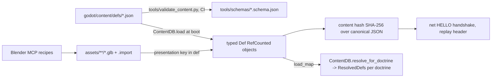

# 03 - Technical Architecture

| | |
|---|---|
| **Project** | PLANEWAR (codename). Arcade spaceship combat + base-building RTS on a spherical moon. Godot 4.7.2, typed GDScript, Compatibility renderer. |
| **Document** | 03 - Technical architecture: engine setup, sphere math, sim data model and tick, CF kinematics, collision, planet renderer, moon baker, content pipeline, performance plan, spikes, module contracts, risks. |
| **Status** | v1.0 (stage 3, revised 2026-10-10) |
| **Date** | 2026-10-10 |
| **Author role** | Technical director / engine architect agent |
| **Inputs** | `docs/reviews/R0-resolution-register.md` (**binding**; its Part B contract tables override this doc where they differ); `docs/01-vision-and-core-decisions.md` v1.1 (binding spine, brief in Section 12 "03"); `docs/research/R2-godot-tech.md` (engine facts); `docs/research/R3-platform-requirements.md` s4, s7 (web and platform constraints); `docs/research/R1-game-references.md` s2.1 (PA client-server lessons). |
| **Audience** | Implementation agents on every tier. Opus for sim/net/planet work, Sonnet for features against the MODULE.md contracts here, Haiku for defs, recipes and tests. |
| **Units** | 1 Godot unit = 1 m; seconds; m/s; m/s^2. `R` = `PLANET_RADIUS` = 6,000 m (confirmed by the owner, R0 O-1). |

**How to read.** Sections 1-2 are setup and the math every module depends on. Sections 3-6 are the simulation. Sections 7-10 are the client side (renderer, baker, content, presentation). Sections 11-13 are performance, web and quality tiers. Section 14 holds the spike mini-specs, Section 15 the MODULE.md template and three filled drafts (15.4 carries the frozen enumerations), Section 16 the risk register. The closing sections (amendment requests, open questions, cross-doc dependencies, work breakdown seeds, revision log) follow the order 01 Section 12 requires.

**Code-level rule.** Everything derived from the moon radius is written in terms of `Sphere.PLANET_RADIUS`, never as a literal. Values in this document that depend on R (cell sizes, horizon distances, chunk sizes) are quoted at R = 6,000 m for readability and are marked "at R=6,000". Gameplay field names and values are 02's (R0 B.1); where this doc quotes a value it is an example, and the def file wins.

---

## 0. Decisions inherited from 01

The following are binding and are not re-argued here. Section numbers refer to 01.

| # | Inherited decision | Where used in this doc |
|---|---|---|
| I1 | Godot 4.7.2-stable, typed GDScript only, warnings-as-Error set, no C#, no GDExtension in v1, addon allowlist (ADR-01). | 1.1, 1.2 |
| I2 | Compatibility renderer on every platform; headless server renders nothing (ADR-02). | 1.1, 7, 13 |
| I3 | One moon-centred float32 world frame, +Z to the Noon Pole, +X to the centre of cube face 0; start slot k at longitude `22.5 + 45 k` degrees; no floating origin; max simulated magnitude R + 2,000 m < 8,192 m (ADR-03, R0 C1-09). | 2 |
| I4 | Five frames: World, Tangent (ENU), Body, Cube-face (equal-angle), Geodetic (ADR-03). | 2 |
| I5 | Cube-sphere quadtree chunked LOD in GDScript; offline Python baker; 6 x 1,024^2 u16 heights (-500..+700 m) + u8 biome faces; 33 x 33 chunks (2,048 grid + 256 skirt triangles), depth 0-6; texel-index mesher; gameplay height = bilinear u16 sample; no deformation (ADR-04). | 6.3, 7, 8 |
| I6 | Four cube-face grid layers: build 6x1024^2, path 6x256^2, interest 6x8^2, collision hash 6x64^2; own time-sliced A* with route cache, never NavigationServer3D (ADR-05). | 2.6, 3.6, 6 |
| I7 | Server-authoritative fixed 30 Hz sim in `RefCounted` SoA packed arrays, `EntityId` = `slot` OR `generation << 20`, `apply_command` is the only mutation path, AI inside `step()` through `set_ai_hook`, staggered AI, PCG32 RNG, own physics, no Jolt anywhere in v1 (ADR-06). | 3, 4, 5 |
| I8 | CF kinematics of 01 s3.1.1 as amended: g = 6.0, per-ship `k_side`/`k_up`/`k_up_flight` with the speed-scaled lift law (`rules.lift_model`), `flight_common.eff_fade_start` 0.8, `brake_factor` 0.6, ceiling fade 1,500-2,000 m; slugs/flak/rail fly straight; tail-down powered landing (01 s3.1.1, s3.1.4, s3.1.5; R0 B.5). | 5, 6.4 |
| I9 | Networking owns prediction of one possessed unit only; `Kinematics.step_ship` is pure and shared (ADR-07). This doc specifies the function; 04 specifies the wire. | 5.6 |
| I10 | JSON defs in `godot/content/defs/*.json` with the file list, field names and values of R0 B.1 (02 names), schemas in `tools/schemas/`, `ContentDB` autoload, SHA-256 content hash (ADR-09). 03 owns `rules.json`, `quality_tiers.json` and the map recipe schema. | 8, 9 |
| I11 | gdUnit4 6.2.x only; test layers of ADR-11; perf assertions only on the pinned production-SKU runner; `--remote-debug tcp://127.0.0.1:0` whenever `-d` is used. | 1.4, 12, 14 |
| I12 | GitHub Actions with `barichello/godot-ci:4.7.2-stable`; every export preset built in CI from day one; v1.0 release scope Windows/Steam (incl. Deck), Android, web (itch.io + own site); iOS, macOS, Linux native, Poki, CrazyGames are v1.1 (ADR-12, R0 O-3). | 1.3, 11 |
| I13 | Module map and dependency whitelist of 01 s9.2 / R0 B.4; signatures of R0 B.5 and `sim/MODULE.md`; three autoloads only (`App`, `ContentDB`, `Log`); files <= 400 lines; `class_name` on every script (ADR-14). | 15, 12.4 |
| I14 | Budgets of 01 Section 8 and R0 B.7: Standard / Reduced / Lite caps profiles; 800 / 200 / 200 visible entity mesh nodes (+ far pools); 150 / 90 chunks; tick p95 <= 25 ms on 1 dedicated vCPU, 6 matches per 8-vCPU host; <= 512 MB per match process; client memory tiers. | 3, 4, 10, 11, 13 |
| I15 | P0 spikes S-CI-1, S-FLIGHT-1, S-SIM-1, S-WORLD-1, S-NAV-1, S-WEB-1, S-WEB-2 with the pass criteria of 01 Appendix A; CONTRACT-0 gate before any lane opens. | 14 |

---

## 1. Godot project setup

### 1.1 `godot/project.godot` (normative settings)

The file is generated once by TA-01 and then edited only through reviewed PRs. Settings not listed keep engine defaults.

```ini
[application]
config/name="PLANEWAR"                      ; codename only; replaced by the title on release day (01 s0.1)
config/features=PackedStringArray("4.7", "GL Compatibility")
run/main_scene="res://scenes/app/boot.tscn"
config/version="0.1.0+0"                    ; MAJOR.MINOR.PATCH+build, build number set by CI
boot_splash/show_image=false

[autoload]
Log="*res://src/core/log.gd"
ContentDB="*res://src/content/content_db.gd"
App="*res://src/app/app.gd"                  ; the ONLY three autoloads (ADR-14)

[debug]
gdscript/warnings/enable=true
gdscript/warnings/exclude_addons=true
gdscript/warnings/untyped_declaration=2
gdscript/warnings/inferred_declaration=2
gdscript/warnings/unsafe_property_access=2
gdscript/warnings/unsafe_method_access=2
gdscript/warnings/unsafe_call_argument=2
gdscript/warnings/unsafe_cast=2
gdscript/warnings/unsafe_void_return=2
gdscript/warnings/return_value_discarded=2
gdscript/warnings/missing_await=2
gdscript/warnings/unused_variable=2
gdscript/warnings/unused_parameter=2
gdscript/warnings/shadowed_variable=2
gdscript/warnings/integer_division=2
gdscript/warnings/narrowing_conversion=2
settings/stdout/flush_stdout_on_print=true   ; systemd/Docker log friendliness (R2 s5.5)

[display]
window/size/viewport_width=1280
window/size/viewport_height=720
window/stretch/mode="canvas_items"
window/stretch/aspect="expand"
window/handheld/orientation=4                ; sensor_landscape on mobile

[physics]
common/physics_ticks_per_second=30           ; the sim tick (ADR-06); presentation interpolates
common/max_physics_steps_per_frame=4         ; a 120 ms hitch catches up; beyond that the clock slips (12.3)
common/physics_interpolation=false           ; our own interpolation from snapshots; Godot's would fight it
3d/physics_engine="Jolt Physics"             ; selected (ADR-01) but not used anywhere in v1, not even for debris (ADR-06)
3d/run_on_separate_thread=false              ; single-threaded web build must behave identically

[rendering]
renderer/rendering_method="gl_compatibility"
renderer/rendering_method.mobile="gl_compatibility"
renderer/rendering_method.web="gl_compatibility"
textures/vram_compression/import_etc2_astc=true
textures/vram_compression/import_s3tc_bptc=true
anti_aliasing/quality/msaa_3d=0              ; quality tiers set it at runtime (13)
lights_and_shadows/directional_shadow/size=2048
lights_and_shadows/directional_shadow/soft_shadow_filter_quality=1
environment/defaults/default_clear_color=Color(0.0, 0.0, 0.0, 1)
mesh_lod/lod_change/threshold_pixels=2.0      ; boot default only; the quality tier sets 1.0 PC/Deck, 3.0 mobile/web (13)

[input_devices]
pointing/emulate_touch_from_mouse=false
pointing/emulate_mouse_from_touch=false     ; input module owns the mapping (01 s9.2)

[network]
limits/debugger/max_chars_per_second=65536  ; agents read long test logs
```

The `return_value_discarded` warning forces `var _r := fn()` or `@warning_ignore("return_value_discarded")` at call sites; the convention is the former for functions whose result matters and an explicit `-> void` signature for functions whose result never matters. `integer_division` at Error means every `a / b` on ints is written `a / b` only when a float is wanted via `float(a) / b`, otherwise `a / b` becomes `@warning_ignore` or `int(a / b)`; the house style is the `floori()`/`posmod()` helpers in `core/mathx.gd` so the ignore annotation appears nowhere in sim code.

### 1.2 `.godot-version`, addons, feature tags

- `.godot-version` contains the single line `4.7.2-stable`. `tools/check_godot_version.py` compares it against `godot --version` and the Docker tag in `.github/workflows/*.yml`; mismatch fails CI.
- `godot/addons/` contains only `gdUnit4` (6.2.x) and `nakama` (nakama-godot master pinned by commit). `tools/check_deps.py` (12.4) fails CI on any other directory under `addons/`.
- Feature tags used in code (`OS.has_feature`): `dedicated_server` (export preset mode), `web` and `mobile` (built in). Neither the caps profile nor the quality tier is a feature tag. The caps profile (`standard` / `reduced` / `lite`, `match_rules.json` `caps`) is a `MatchRules` field chosen by `app` per mode and platform (R0 B.6: offline web/mobile = `lite` until S-WEB-2 passes at `reduced`; online servers always `standard`). Quality tiers LOW / MEDIUM / HIGH are chosen at runtime (Section 13).

### 1.3 Export presets (`godot/export_presets.cfg`)

| Preset name | Platform | Release | Key options | Produced by |
|---|---|---|---|---|
| `linux_server` | Linux x86_64 | v1.0 (server) | `dedicated_server` mode (textures stripped), `binary_format/embed_pck=true`, feature `dedicated_server` | ci.yml per PR; release.yml (Docker image) |
| `windows_x64` | Windows (Steam, incl. Deck via Proton) | **v1.0** | `binary_format/embed_pck=true`, console wrapper on for `--server` debugging | ci.yml per PR; release.yml (Steam depot) |
| `web` | Web (itch.io + own site) | **v1.0** | `variant/thread_support=false`, `variant/extensions_support=false`, `html/export_icon=false`, custom shell `web/shell.html`, `progressive_web_app/enabled=false`, Brotli precompression by `tools/web_compress.py`; **core pack excludes `content/maps/**`** (map packs are separate `.pck`, 11.2) | ci.yml per PR with size gate |
| `android_aab` | Android (Google Play) | **v1.0** | Gradle build, AAB, `arm64-v8a` only, min SDK 24, target SDK 36, `INTERNET` permission, keystore from `GODOT_ANDROID_KEYSTORE_RELEASE_*` | ci.yml (debug APK), release.yml (signed AAB) |
| `linux_x64` | Linux native | v1.1 | as Windows | ci.yml per PR (build only) |
| `ios_xcode` | iOS | v1.1 | Exports the Xcode project on Linux (R2 s12.2); `ios.yml` builds and signs on a macOS runner image providing Xcode >= 26 (verify `macos-15` ships it, else `macos-26`) | weekly build check; release signing wired but gated (TA-39, TA-40) |
| `macos` | macOS | v1.1 | universal; notarisation step in release.yml wired but gated | weekly build check |

CI builds every preset from day one (R0 O-3); only store, QA and compliance work for the v1.1 platforms waits. Resource exclusion filters: every preset excludes `test/**`, `tools/**`, `docs/**`, `*.md`. The server preset additionally excludes `assets/**` audio and `scenes/presentation/**`. No preset contains an ad or tracking SDK (06 A2 deferred to v1.1).

### 1.4 Repository bootstrap and CI shape (what S-CI-1 proves)

`ci.yml` on every PR: `godot --headless --path godot --import` -> `tools/check_deps.py` -> `tools/validate_content.py` (validates every def and every example JSON committed under `docs/examples/`) -> `godot --headless -s tools/validate_scenes.gd` -> gdUnit4 `unit/`, `sim/`, `net/` -> exports `linux_server`, `windows_x64`, `web` (size gate), Android debug APK -> 10-minute soak (`test/soak/soak_pr.gd`, `--fixed-fps 30`, asserts correctness and the slope of per-minute p95 < 2 % per minute) -> same-job base-vs-head A/B of `perf_tick.gd` (fails above +25 %). GitHub-hosted jobs assert correctness and the A/B only; absolute tick-p95 and nightly regression gates run on **one pinned self-hosted runner of the production server SKU** (TA-42; R0 C1-11). `nightly.yml` adds the 30-sim-minute soak, perf benchmarks with `perf/history.jsonl` append (pinned runner), golden screenshots under Xvfb + llvmpipe, and the weekly `linux_x64`/`macos`/`ios_xcode` build checks. `release.yml` (TA-39) signs the AAB, builds and pushes the server Docker image and uploads the Steam depot; macOS notarisation and iOS signing are wired but gated as v1.1 checks. Full spec in Section 14 (S-CI-1).

---

## 2. Core sphere math (`godot/src/core/sphere.gd`)

Everything here is a `static func` on `class_name Sphere`. No state, no Nodes. Unit tests in `godot/test/unit/core/test_sphere.gd` use the vectors in 2.8. Tolerances: direction tests 1e-6, metre tests 1e-3.

### 2.1 Constants

```gdscript
class_name Sphere
const PLANET_RADIUS: float = 6000.0        # the only literal; everything else derives from it
const RELIEF_MIN: float = -500.0           # baked height range, ADR-04
const RELIEF_MAX: float = 700.0
const CEILING_SOFT: float = 1500.0         # altitude above datum, 01 s3.1.5
const CEILING_HARD: float = 2000.0
const MAX_SIM_MAGNITUDE: float = PLANET_RADIUS + CEILING_HARD   # must stay < 8192.0 (ADR-03)
const POLE_AXIS: Vector3 = Vector3(0, 0, 1) # Noon Pole; terminator = equator
const PRIME_AXIS: Vector3 = Vector3(1, 0, 0) # longitude 0 = centre of face 0; start slot 0 sits at longitude 22.5
const SLOT_LON0_DEG: float = 22.5          # slot k at 22.5 + 45 k degrees (R0 B.6); keeps every base off a cube edge
const SLOT_SPACING_DEG: float = 45.0
const GRID_BUILD: int = 1024
const GRID_PATH: int = 256
const GRID_HASH: int = 64
const GRID_INTEREST: int = 8
```

A static assertion at `ContentDB` load (`assert(Sphere.MAX_SIM_MAGNITUDE < 8192.0)`) enforces ADR-03 if the constant is changed.

### 2.2 Altitude, tangent frame, geodetic

```gdscript
static func altitude(p: Vector3) -> float:            return p.length() - PLANET_RADIUS
static func up_at(p: Vector3) -> Vector3:             return p.normalized()
static func tangent_frame(p: Vector3) -> Basis:
    # returns Basis(east, north, up) as columns x, y, z
    var up := p.normalized()
    var north := POLE_AXIS - up * POLE_AXIS.dot(up)
    if north.length_squared() < 1e-8:                 # within ~0.6 m of a pole
        north = PRIME_AXIS - up * PRIME_AXIS.dot(up)  # fallback keeps the frame continuous enough for HUD
    north = north.normalized()
    var east := north.cross(up)
    return Basis(east, north, up)
static func lat_lon(p: Vector3) -> Vector2:           # radians; lat in [-pi/2, pi/2], lon in (-pi, pi]
    var d := p.normalized()
    return Vector2(asin(clampf(d.z, -1.0, 1.0)), atan2(d.y, d.x))
static func from_lat_lon(lat: float, lon: float, radius: float) -> Vector3:
    var c := cos(lat)
    return Vector3(c * cos(lon), c * sin(lon), sin(lat)) * radius
```

Convention check (matches 01 ADR-03): at p = (R,0,0): up = +X, north = +Z, east = +Y. Latitude is measured from the equator toward +Z, so the day hemisphere is lat > 0. Longitude increases counter-clockwise seen from the Noon Pole. Start slot `k` (0..7) is at lat = 0, lon = `deg_to_rad(SLOT_LON0_DEG + SLOT_SPACING_DEG * k)` (01 s5.7, R0 C1-09/B.6); player counts use slot subsets (2 -> [0, 2], 4 -> [0, 2, 4, 6], 6 -> [0, 1, 2, 4, 5, 6], 8 -> all), read from `modes.json` `slots_by_player_count`, never computed as `2*pi*i/N`. The 22.5 degree offset puts every slot at u or v = 0.25 / 0.75 of an equatorial face, about 2.4 km from the nearest cube edge, so no Core footprint, flatten disc or depth-6 chunk at a base straddles a seam.

### 2.3 Great-circle distance and bearing

```gdscript
static func great_circle(a: Vector3, b: Vector3) -> float:
    # a, b any non-zero world positions; distance measured on the datum sphere
    var da := a.normalized(); var db := b.normalized()
    return PLANET_RADIUS * atan2(da.cross(db).length(), da.dot(db))    # stable at 0 and pi, unlike acos
static func bearing(from: Vector3, to: Vector3) -> float:
    # radians clockwise from local north at `from`
    var f := tangent_frame(from)
    var d := to.normalized() - from.normalized()
    return atan2(d.dot(f.x), d.dot(f.y))
static func slerp_dir(a: Vector3, b: Vector3, t: float) -> Vector3:   # for orders along a great circle
    return Quaternion(a.normalized(), b.normalized()).slerp(Quaternion.IDENTITY, 1.0 - t) * a.normalized()
```

The `atan2` form is required: `acos(dot)` loses 3 digits near 0 which matters for the 3.7 m per-tick displacements of a Dart.

### 2.4 Parallel transport (the CF rotation)

Per tick the local up changes from `n = normalize(p_old)` to `n' = normalize(p_new)`. The minimal rotation mapping `n` to `n'` is the quaternion

```
c = n x n'
w = 1 + n . n'
q = normalize(c.x, c.y, c.z, w)          # Quaternion(x, y, z, w) in Godot order
```

which equals the rotation about axis `c/|c|` by angle `acos(n . n')` but needs no trigonometric call and is exact when `n == n'` (q = identity, because `c = 0, w = 2`). The antipodal case `n' = -n` (w = 0, c = 0) cannot occur in one tick (it would need a 2 * R displacement) and is asserted in debug builds.

```gdscript
static func transport(n_old: Vector3, n_new: Vector3) -> Quaternion:
    var c := n_old.cross(n_new)
    var w := 1.0 + n_old.dot(n_new)
    if w < 1e-9: return Quaternion.IDENTITY      # debug: assert(false, "antipodal transport")
    return Quaternion(c.x, c.y, c.z, w).normalized()
```

Usage in `Kinematics.step_ship` (5.3): `v = q * v; B = Basis(q) * B`. Property tests (2.8): `q * n_old` equals `n_new` to 1e-6; `|q| = 1`; transporting a vector tangent at `n_old` yields a vector tangent at `n_new` (dot with `n_new` < 1e-6); two consecutive small transports compose to within 1e-5 of the direct one (the sub-tick path is a great circle, so the error is second order in the step angle).

### 2.5 Equal-angle cube-sphere mapping

**Face frames.** Each face `f` has a normal `N_f` and two tangent axes `S_f` (the u direction) and `T_f` (the v direction) chosen so that `S_f x T_f = N_f` on every face. Because handedness is identical on all six faces, **no edge crossing flips the along-edge coordinate** (2.6), which removes the usual class of cube-map bugs.

| Face | Name | N_f | S_f (u) | T_f (v) | Role |
|---|---|---|---|---|---|
| 0 | +X | (1,0,0) | (0,1,0) | (0,0,1) | equatorial; slot 0 at (u,v) = (0.75, 0.5), slot 7 at (0.25, 0.5) |
| 1 | -X | (-1,0,0) | (0,0,1) | (0,1,0) | equatorial; slots 3 and 4 (at v = 0.75 / 0.25 on its centre line) |
| 2 | +Y | (0,1,0) | (0,0,1) | (1,0,0) | equatorial; slot 1 at (0.5, 0.75), slot 2 at (0.5, 0.25) |
| 3 | -Y | (0,-1,0) | (1,0,0) | (0,0,1) | equatorial; slots 5 and 6 |
| 4 | +Z | (0,0,1) | (1,0,0) | (0,1,0) | **Noon face** (Solar Plateau at centre) |
| 5 | -Z | (0,0,-1) | (0,1,0) | (1,0,0) | **Midnight face** (richest Cold Traps at centre) |

Note that on equatorial faces the v axis is not always +Z (face 1 and 2 have v along +Y and +X); "north" in gameplay is always the tangent-frame north of 2.2, never a face axis.

**Forward mapping** (face, u, v) in [0,1]^2 -> unit direction:

```
a = (2u - 1) * pi/4          # angle in [-pi/4, pi/4]
b = (2v - 1) * pi/4
x = tan(a);  y = tan(b)      # equal-angle: cells subtend equal angles along the face centre lines
d = normalize(N_f + x * S_f + y * T_f)
```

**Inverse mapping** direction -> (face, u, v):

```
m = index of the largest |d_i|;  face = 2m if d_m > 0 else 2m + 1     # X -> 0/1, Y -> 2/3, Z -> 4/5
x = (d . S_f) / (d . N_f);  y = (d . T_f) / (d . N_f)                  # both in [-1, 1]
u = (atan(x) * 4/pi + 1) / 2;  v = (atan(y) * 4/pi + 1) / 2
```

Ties (|d_x| == |d_y|, exactly on an edge) resolve to the lower face index by the `index of the largest` rule using `>` comparisons in the order x, y, z; the resulting (u or v) is exactly 1.0 or 0.0 and the cell functions clamp to `N - 1`.

```gdscript
static func face_uv_to_dir(face: int, u: float, v: float) -> Vector3
static func dir_to_face_uv(d: Vector3) -> Vector3     # returns (face as float, u, v); callers int() the face
static func face_frame(face: int) -> Basis             # columns S_f, T_f, N_f
```

Equal-angle versus plain projection: with plain `x = 2u - 1` the texel size ratio between face centre and corner is about 2.4; with equal-angle it is 1.06 along centre lines and 1.37 at the extreme corner (centre 9.20 m, corner 8.68 m at GRID_BUILD and R=6,000, see 2.7). ADR-05's "about 30 percent" note is honoured.

### 2.6 Cells and edge-neighbour tables

**Cell id.** For a grid of `N` cells per face side, cell `(face, i, j)` with `i = floor(u*N)`, `j = floor(v*N)` (clamped to `N-1`) has

```
cell_id = face * N * N + j * N + i             # 0 .. 6*N*N - 1; GRID_BUILD gives 6,291,456 ids (< 2^23)
```

Helpers: `cell_of(d, N) -> int`, `cell_center_dir(cell_id, N) -> Vector3` (uses `u = (i + 0.5) / N`), `cell_bounds_dirs(cell_id, N) -> PackedVector3Array` (4 corners). All four ADR-05 layers share these with `N` in {1024, 256, 64, 8}; the 1024 -> 256 -> 64 -> 8 hierarchy is a pure right shift of `i` and `j` by 2, 4 and 7 bits within the same face, so parent/child lookups are integer ops.

**Edge neighbours.** Stepping off a face across one of its four edges lands on another face, entering it across one of that face's edges. With the frames of 2.5 the along-edge coordinate is preserved in direction (never reversed) but may change role (u on one face becomes v on the other). The table below was generated from the frames of 2.5 by stepping a point past each edge and running the inverse mapping; `test_sphere.gd` regenerates it the same way and asserts equality so it can never drift from the frames.

| Face, edge | Neighbour face, entered at edge | Along-edge coordinate | Face, edge | Neighbour face, entered at edge | Along-edge coordinate |
|---|---|---|---|---|---|
| F0 u=0 | F3 u=1 | v -> v | F3 u=0 | F1 v=0 | v -> u |
| F0 u=1 | F2 v=1 | v -> u | F3 u=1 | F0 u=0 | v -> v |
| F0 v=0 | F5 v=1 | u -> u | F3 v=0 | F5 u=0 | u -> v |
| F0 v=1 | F4 u=1 | u -> v | F3 v=1 | F4 v=0 | u -> u |
| F1 u=0 | F5 v=0 | v -> u | F4 u=0 | F1 u=1 | v -> v |
| F1 u=1 | F4 u=0 | v -> v | F4 u=1 | F0 v=1 | v -> u |
| F1 v=0 | F3 u=0 | u -> v | F4 v=0 | F3 v=1 | u -> u |
| F1 v=1 | F2 v=0 | u -> u | F4 v=1 | F2 u=1 | u -> v |
| F2 u=0 | F5 u=1 | v -> v | F5 u=0 | F3 v=0 | v -> u |
| F2 u=1 | F4 v=1 | v -> u | F5 u=1 | F2 u=0 | v -> v |
| F2 v=0 | F1 v=1 | u -> u | F5 v=0 | F1 u=0 | u -> v |
| F2 v=1 | F0 u=1 | u -> v | F5 v=1 | F0 v=0 | u -> u |

Reading: "F0 u=1 -> F2 v=1, v -> u" means a cell at `(0, N-1, j)` has its +u neighbour at `(2, j, N-1)` (the along coordinate j becomes the neighbour's i, and the neighbour's v is at its maximum). The 24 rows are encoded as a **flat** `const EDGE_NEIGHBOUR: PackedInt32Array` with `EDGE_NEIGHBOUR_STRIDE = 3`: row `face * 4 + edge` occupies indices `3 r .. 3 r + 2` as `[nbr_face, nbr_edge, along_is_u]` (R0 B.9 A-8; TA-04 found that a `const Array[PackedInt32Array]` is not a constant expression in GDScript 4.7). Edge ids equal the `dir` values: 0 `u=0`, 1 `u=1`, 2 `v=0`, 3 `v=1`. **Neighbour round trip (C3, R0 B.9 A-9):** from `nb = neighbour_cell(c, N, dir)`, stepping `dir ^ 1` when `nb` is on the same face, or stepping the entered edge `EDGE_NEIGHBOUR[(face(c) * 4 + dir) * 3 + 1]` when `nb` is across an edge, returns `c`; `neighbours8` is symmetric. `core/MODULE.md` C3 is the canonical wording.

```gdscript
static func neighbour_cell(cell_id: int, N: int, dir: int) -> int
    # dir: 0 = -u, 1 = +u, 2 = -v, 3 = +v. Within the face: integer step. Across an edge: table lookup.
    # Corner cells have exactly 3 distinct neighbours in the 8-neighbourhood sense; the diagonal
    # across a cube corner does not exist and neighbours8() omits it (A* on 7 neighbours there).
static func neighbours8(cell_id: int, N: int) -> PackedInt32Array   # 8 cells, 7 at the 8 cube corners
static func cells_in_radius(center: Vector3, radius_m: float, N: int) -> PackedInt32Array
    # conservative: all cells whose bounding cone intersects the great-circle disc; callers filter by
    # great_circle() afterwards (ADR-05 consequence). Implementation: flood from cell_of(center) with
    # neighbours4 while min angular distance of the cell corners <= radius_m / PLANET_RADIUS.
```

### 2.7 Cell sizes at R = 6,000 m (for budgets; derive from `PLANET_RADIUS` in code)

| Grid N | Centre cell edge | Corner cell edge | Count | Note |
|---|---|---|---|---|
| 1024 (build) | 9.20 m | 8.68 m | 6,291,456 | one texel of the height face |
| 256 (path) | 36.8 m | 34.7 m | 393,216 | Harvester cell; 8-connected A* (3.6) |
| 64 (hash) | 147 m | 139 m | 24,576 | collision hash; a cell plus its 8 neighbours covers only **~94 m** of 3D radius (ring 2: ~188 m), not the 139 m edge: equal-angle strips are narrowest mid-edge, `asin(sin(delta) / sqrt(2))` = 104 m of arc, less the `(N - 1) / N` margin (TA-14 proof in `spatial.gd`, R0 B.11 A-52) |
| 8 (interest) | 1,178 m | 1,119 m | 384 | interest management and vision aggregation |

Formulas: centre edge = `R * (atan(tan(pi/4 * 1/N) ) * 2)` to first order `R * pi / (2N)`; the corner figure is computed from the mapping and both are verified by `test_sphere.gd`.

### 2.8 Unit-test vectors

All at R = 6,000 m unless R-independent. Directions to 6 decimals.

| Function | Input | Expected |
|---|---|---|
| `face_uv_to_dir` | (0, 0.5, 0.5) | (1, 0, 0) |
| `face_uv_to_dir` | (0, 0.0, 0.0) | (0.577350, -0.577350, -0.577350) (cube corner) |
| `face_uv_to_dir` | (0, 1.0, 0.5) | (0.707107, 0.707107, 0) (edge midpoint toward +Y) |
| `face_uv_to_dir` | (4, 0.5, 0.5) | (0, 0, 1) (Noon Pole) |
| `face_uv_to_dir` | (2, 0.75, 0.25) | (-0.357407, 0.862856, 0.357407) |
| `face_uv_to_dir` | (5, 0.1, 0.9) | (0.506732, -0.506732, -0.697457) |
| `dir_to_face_uv` | each of the above directions | the input triple, round trip error < 1e-6 |
| `great_circle` | (R,0,0), (0,R,0) | 9,424.778 m (quarter circumference) |
| `great_circle` | (R,0,0), (R,0,0) | 0 |
| `great_circle` | p, p + 3.7 m along east | 3.700 m +- 1e-3 (per-tick displacement precision) |
| `transport` | n=(1,0,0), n'=(0,1,0) | q = (0, 0, 0.707107, 0.707107); q * (0,1,0) = (-1,0,0) |
| `transport` | n=(1,0,0), n'=normalize(1, 0.001, 0) | q = (0, 0, 0.000500, 1.000000); q * n = n' |
| `transport` | n = n' | identity |
| `tangent_frame` | (R,0,0) | east (0,1,0), north (0,0,1), up (1,0,0) |
| `tangent_frame` | (0,0,R) | up (0,0,1); frame orthonormal; no NaN |
| `lat_lon` | (0,R,0) | (0, pi/2) |
| `cell_of` | dir of (0,0.5,0.5), N=1024 | face 0, i=512, j=512 -> cell_id 0*1048576 + 512*1024 + 512 = 524,800 |
| `dir_to_face_uv` | `from_lat_lon(0, deg_to_rad(22.5), 1)` (slot 0) | (0, 0.75, 0.5) |
| `dir_to_face_uv` | `from_lat_lon(0, deg_to_rad(67.5), 1)` (slot 1) | (2, 0.5, 0.75) |
| `neighbour_cell` | cell (0, 1023, 300), dir +u, N=1024 | cell (2, 300, 1023) |
| `neighbour_cell` | cell (4, 500, 1023), dir +v, N=1024 | cell (2, 1023, 500) |
| `neighbours8` | cell (0, 0, 0) | 7 ids, all distinct, none equal to the input |
| `horizon_distance` | h = 50 / 100 / 300 / 1,500 | 776.2 / 1,100.0 / 1,920.9 / 4,500.0 m (01 s5.2) |

`horizon_distance(h) = sqrt(2*R*h + h*h)` lives here too, as does `is_occluded_by_datum(a, b) -> bool` (segment-sphere test against radius R, used by Vision 3.7 and by the renderer's horizon cull 7.5). **Endpoint semantics (R0 B.9 A-10):** true iff the point of the *open* segment (a, b) nearest the moon centre is strictly inside the datum sphere; the endpoints themselves never occlude, so a unit on a mare or crater floor (below the datum, relief to -500 m) is neither hidden from a higher observer nor self-occluded; `a == b` is false; symmetric. Callers pass positions as they are (no altitude clamp). Vectors: `a = (R+10, 0, 0)`, `b = (-R-10, 0, 0)` true; `a`, `b = (R+10, 50, 0)` false; two points at `R - 200` 2,000 m apart along the equator true (chord sagitta 83 m); `a = (R-200, 0, 0)`, `b` 500 m above and 3,000 m along the equator false. TA-37 adds the last two to `test_sphere.gd`.

---

## 3. Simulation data model (`godot/src/sim/`)

### 3.1 EntityId and slot allocation (`core/entity_id.gd`, `sim/entity_store.gd`)

```
EntityId (int, 31 bits used) = slot (bits 0-19) | generation (bits 20-30); bit 31 stays 0 (A-48)
slot 0 is reserved: EntityId 0 == NULL_ID
generation starts at 1 and wraps 2047 -> 1 (never 0, so a live id is never 0; 11 bits keep ids positive in PackedInt32Array, A-48)
```

Slot ranges are fixed per store so a slot number alone tells the kind of store:

| Range | Store | Count | Holds |
|---|---|---|---|
| 1 .. 1,279 | `EntityStore` | 1,279 usable (+ slot 0 reserved) = the 1,280 of 01 s8.1 | units and structures |
| 1,280 .. 1,535 | `EntityStore` (same arrays, tail region) | 256 | wrecks (cap 200 live; 56 spare for same-tick death bursts) |
| 4,096 .. 6,143 | `ProjectileStore` | 2,048 | projectiles (cap 2,000 live) |

Allocation: each range keeps a `PackedInt32Array` free stack plus a **quarantine ring** of 64 ticks; a freed slot enters the ring with its release tick and becomes allocatable only after 64 ticks (2.1 s), so a client interpolating 100 ms behind or a replay reader can never see a slot reused within its window. **Exception (owner, 2026-10-13):** the projectile range (`projectile_store.gd`) does not quarantine (0 ticks): at the 2,000-projectile cap the 2,048-slot range has 48 spare slots, which a 64-tick ring (~3,700 slots) and even a 1-2 tick ring (57-114 slots at ~35-tick slug life) overflow; the generation bump keeps projectile ids unique. On free, `generation[slot] += 1` (wrap), every field is reset to its zero value (`clear_slot`), and the slot's `flags` byte is 0 (dead). `alloc` fails (returns `NULL_ID`) when the range is full; the caller (Production, Build, Combat) treats that as "cap reached" and emits `SimEvent.CAP_REACHED` for the UI (01 s8.1). The Reduced and Lite caps (01 s8.1, `match_rules.json` `caps`) are enforced per player by `Economy`/`Production`/`Combat` before allocation, not by shrinking the arrays, so the store layout is identical in every caps profile.

```gdscript
class_name EntityId
const NULL_ID: int = 0
static func make(slot: int, gen: int) -> int:  return slot | (gen << 20)
static func slot(id: int) -> int:               return id & 0xFFFFF
static func gen(id: int) -> int:                return (id >> 20) & 0xFFF
static func is_projectile(id: int) -> bool:     return slot(id) >= 4096
static func is_wreck(id: int) -> bool:          var s := slot(id); return s >= 1280 and s < 1536
```

`EntityStore.alive(id)` is `slot in range and generation[slot] == gen(id) and flags[slot] & F_ALIVE`. `is_projectile` is open-ended on purpose (R0 B.10 A-42): it classifies the range, the store validates (`ProjectileStore` rejects an index `>= SLOT_COUNT`; `alive` checks the generation), and no allocator mints a slot at or above `PROJECTILE_SLOT_END` (6,144; TA-46). Decoders validate ids against the store, never against the predicate.

### 3.2 `EntityStore` structure-of-arrays layout

All arrays are sized to 1,536 at `SimWorld.load_map` and never resized. Per-kind usage: **S** structure, **U** unit (ship or ground), **W** wreck; "-" means the field is zero and ignored for that kind. Bytes are per slot.

| # | Field | Packed type | S | U | W | B | Meaning |
|---|---|---|---|---|---|---|---|
| 1 | `generation` | PackedInt32Array | x | x | x | 4 | see 3.1 |
| 2 | `def_id` | PackedInt32Array | x | x | x | 4 | index into `ContentDB` (a wreck keeps its source def for salvage value) |
| 3 | `kind` | PackedByteArray | x | x | x | 1 | `K_STRUCTURE, K_SHIP, K_GROUND, K_WRECK` |
| 4 | `flags` | PackedByteArray | x | x | x | 1 | bit0 ALIVE, bit1 DOCKED, bit2 LANDED, bit3 POSSESSABLE, bit4 BUILDING, bit5 POWERED, bit6 CEILING_FORCED, bit7 TETHERED |
| 5 | `owner` | PackedByteArray | x | x | x | 1 | player slot 0-7, 255 = neutral |
| 6 | `team` | PackedByteArray | x | x | x | 1 | team 0-7, 255 = neutral |
| 7 | `spawn_tick` | PackedInt32Array | x | x | x | 4 | for wreck decay (90 s), structure self-destruct (60 s after Core loss), age-based tie breaks |
| 8 | `pos` | PackedVector3Array | x | x | x | 12 | world frame (moon-centred) |
| 9 | `vel` | PackedVector3Array | - | x | - | 12 | world frame |
| 10 | `fwd` | PackedVector3Array | x | x | x | 12 | body forward; `right = fwd.cross(up)` is derived, never stored |
| 11 | `up` | PackedVector3Array | x | x | x | 12 | body up |
| 12 | `rates` | PackedVector3Array | - | x | - | 12 | current body angular rates (pitch, yaw, roll) rad/s, for rate limiting and the flip |
| 13 | `radius` | PackedFloat32Array | x | x | x | 4 | bounding sphere, copied from def at spawn (hot path avoids def lookups) |
| 14 | `hash_cell` | PackedInt32Array | x | x | x | 4 | GRID_HASH cell id of `pos`; the interest cell is `hash_cell` shifted (2.6) |
| 15 | `control_state` | PackedByteArray | x | x | - | 1 | `AUTO=0, ORDERED=1, POSSESSED=2` |
| 16 | `possessor` | PackedByteArray | x | x | - | 1 | player slot, 255 = none |
| 17 | `order_kind` | PackedByteArray | x | x | - | 1 | head-of-queue `OrderSpec.Kind` cache for replication and HUD (255 = none); the queues live in the `orders` side table (05 owns orders, R0 C2-06) |
| 18 | `hp` | PackedFloat32Array | x | x | x | 4 | wreck: remaining salvage value in Ore |
| 19 | `fuel` | PackedFloat32Array | - | x | - | 4 | seconds of full thrust remaining |
| 20 | `ammo` | PackedInt32Array | x | x | - | 4 | rounds; towers draw from the supply pool |
| 21 | `bombs` | PackedByteArray | - | x | - | 1 | |
| 22 | `rockets` | PackedByteArray | x | x | - | 1 | Lancer, Missile Tower |
| 23 | `cd_primary` | PackedFloat32Array | x | x | - | 4 | weapon cooldown seconds |
| 24 | `cd_secondary` | PackedFloat32Array | x | x | - | 4 | |
| 25 | `boost_time` | PackedFloat32Array | - | x | - | 4 | > 0 boosting; < 0 cooling down (negative seconds) |
| 26 | `flip_time` | PackedFloat32Array | - | x | - | 4 | same convention: > 0 flipping, < 0 cooldown |
| 27 | `last_damage_tick` | PackedInt32Array | x | x | - | 4 | |
| 28 | `attacker` | PackedInt32Array | x | x | - | 4 | EntityId of the last attacker (Harvester flee, tower retaliation, kill credit) |
| 29 | `cargo` | PackedFloat32Array | x | x | - | 4 | Harvester Ore, Hauler Ice, Extractor buffer, tower supply pool |
| 30 | `cargo_kind` | PackedByteArray | x | x | - | 1 | `NONE, ORE, ICE, WRECK` |
| 31 | `link` | PackedInt32Array | x | x | x | 4 | pad the ship is docked on / ship a pad is servicing / Extractor's Refinery; wreck: EntityId of the ship towing it while bit7 TETHERED is set, else 0 (GD-19, R0 B.20 A-104; the ship end keeps its pad meaning and drops its tows before it docks) |
| 32 | `timer_a` | PackedFloat32Array | x | x | x | 4 | structure: build progress 0..1; ship: refuel+rearm progress; wreck: decay |
| 33 | `timer_b` | PackedFloat32Array | x | x | - | 4 | ship: repair progress; structure: capture progress (Relay Station) |
| 34 | `ai_tag` | PackedByteArray | x | x | - | 1 | opaque AI display tag written only through `CommandSinkBase.set_ai_tag(id, tag)`; replicated to the own team (R0 C2-07); all other AI state is `sim_ai`'s `AiState` |
| 35 | `overlay` | PackedByteArray | x | x | - | 1 | AI overlay (B.3: NONE, SAFETY, RECOVER_CEILING, LINK_BRIDGE) set by `ControlMachine`, executed by `sim_ai` |
| 36 | `visible_mask` | PackedByteArray | x | x | x | 1 | bit t set = visible to team t (Vision, 3.7) |
| 37 | `dirty` | PackedByteArray | x | x | x | 1 | bit0 pose, bit1 vitals, bit2 control, bit3 cargo, bit4 spawned, bit5 died; cleared by `ServerSession` after snapshots |
| 38 | `anchor_cell` | PackedInt32Array | x | - | - | 4 | GRID_BUILD cell of the footprint anchor; `-1` for units |
| | **Total per slot** | | | | | **150** | |

Memory: 150 B x 1,280 slots = **192,000 B (188 KB)** for the 01 cap; with the 256 wreck slots, 150 x 1,536 = 225 KB. Packed arrays have about 40 B of header each, 38 arrays = 1.5 KB. The whole authoritative entity state of an 8-player match fits in L2 cache; the budget problem is interpreter time, not memory (ADR-01 consequence). (v0.1 listed 227 B; the true v0.1 sum was 223 B; removing the order fields (-50 B) and the `ai_*` fields (-25 B) and adding `ai_tag` and `overlay` gives 150 B.)

Side tables that are not SoA because they are sparse or variable length. Packed arrays are never stored inside an `Array` or `Dictionary` and mutated there (copy-on-write; rule 12.2-11): every growable table below is a typed member array or a `RefCounted` holding typed members.

| Table | Type | Bound | Owner |
|---|---|---|---|
| `orders` | `OrderQueue` (`sim/orders/order_queue.gd`, 05 s1.2): per entity a standing queue and a pending queue of `OrderSpec` (kind, flags, haul_mode, target, points[], issuer, progress) | <= 8 + 8 per entity; the standing queue is the saved order while POSSESSED | `Orders` (05) |
| `production_queues` | `ProductionQueues`: flat `PackedInt32Array` ring per factory index | <= 5 per factory (`economy.queue_max`), <= 32 factories per player | `Production` |
| `path_tickets` | `Pathing` ticket table: state, start/goal cells, result cells (`PackedInt32Array` members per ticket slot, reused) | <= 160 open tickets, <= 400 cells per result | `Pathing` |
| `path_cache` | keyed by (start cluster, goal cell); entries invalidated by the per-face change counter | 512 entries, LRU | `Pathing` |
| `tether_target` | **not built** (R0 B.20 A-104): the tow is `link[wreck]` = towing ship's EntityId + bit7 TETHERED on both ends (3.1 rows 4, 31); a Hauler's tow list (<= `tow_slots`, 1; Foundry 2) and a wreck's attach slot (its rank in ascending wreck slot among the wrecks linked to it) are derived, never stored | - | `Salvage` (`sim/salvage/`, GD-19) |
| `pad_queues` | per pad: occupant id and waiting ships in arrival order | <= 8 waiting per pad | `Docking` |
| `scoring` | per player pilot/commander score (u32 each), per ship last `LandingGrade` and q | 8 players | `sim/scoring/` |
| `team` | 8 x `TeamState` (`RefCounted`: ore, ice, power_supply, power_demand, caps, unit_count, structure_count, eliminated, core_id, auto_replenish mask, early-share spend per player) | 8 | `Economy` |
| `players` | 8 x `PlayerState` (slot, team, kind HUMAN/BOT/OPEN, possessed id, commander rights, doctrine id, `ResolvedDefs` index, disconnect tick) | 8 | `SimWorld` |
| `build_grid` | 6 x `PackedByteArray` 1,024^2 (6 MB): 0 free, 1 structure, 2 resource node, 3 reserved (pending build), 4 blocked by slope (baked) | fixed | `Build` |
| `path_weights` | 6 x `PackedByteArray` 256^2 (393 KB): 0 impassable, 1..255 cost | fixed | `Pathing` |
| `resource_nodes` | `Array[ResourceNode]` (cell, kind, remaining, rate, extractor id) | <= 64 per map | `Economy` |
| `hash` | `cell_start: PackedInt32Array` (24,577 = 6 x 64^2 + 1) + `cell_items: PackedInt32Array` (<= 3,584), rebuilt per tick by counting sort over a `touched_cells` list; no Dictionary (R0 C1-19) | fixed | `Spatial` |

### 3.3 `ProjectileStore` layout (2,048 slots)

| Field | Type | B | Meaning |
|---|---|---|---|
| `generation` | PackedInt32Array | 4 | |
| `pos`, `vel` | PackedVector3Array x2 | 24 | |
| `prev_pos` | PackedVector3Array | 12 | start of this tick's sweep (collision 6.1) |
| `kind` | PackedByteArray | 1 | `SLUG, BOMB, ROCKET, FLAK, RAIL, SIEGE_SHELL, CANISTER` (CANISTER reserved for SL-5, v1 stretch); motion class per R0 B.5 |
| `projectile_def` | PackedByteArray | 1 | local index into `ContentDB.projectiles` (`ProjectileDef`: behaviour, speed, gravity, transport, radius, blast, fuse, arm time) |
| `weapon_def` | PackedByteArray | 1 | local index into `ContentDB.weapons`: the damage roll, `structure_mult`, `ground_mult` of the firing weapon |
| `owner`, `team` | PackedByteArray x2 | 2 | kill credit, friendly-fire mask |
| `flags` | PackedByteArray | 1 | ALIVE, ARMED (after `ProjectileDef.arm_s`, bomb 0.5 s), GUIDED |
| `shooter` | PackedInt32Array | 4 | EntityId (ignored in self-collision for 10 ticks) |
| `target` | PackedInt32Array | 4 | rocket lock target or 0; for a timed fuse (flak) the burst tick (R0 B.12 A-74) |
| `ttl` | PackedFloat32Array | 4 | seconds to live (`lifetime_s`); always the lifetime, so `lifetime_s - ttl` is the arming age (A-74) |
| `hash_cell` | PackedInt32Array | 4 | |
| **Total** | | **62** | 62 x 2,048 = 127 KB |

Flak shells carry a timed fuse: at spawn `target` holds the burst tick (closest approach to the ship nearest the boresight plus `ProjectileDef.fuse_delay_s`, clamped to [`arm_s`, lifetime - 1 tick]; end of life when no ship is in the cone) and `Combat` resolves the burst (`blast_radius_m`) on that tick, independent of hitting anything; `ttl` keeps counting the lifetime (R0 B.12 A-74, GD-36 as built). The SL-5 canister, when built, adds an `hp` array to this store (`ProjectileDef.hp` 30); nothing else in the layout changes.

### 3.4 Component sets per entity kind

The SoA has every field for every slot; "component sets" define which fields a kind reads and writes so that systems iterate kind lists, not all slots. `EntityStore` maintains four live-slot lists (`PackedInt32Array`, rebuilt only when a slot is allocated or freed): `ships`, `ground`, `structures`, `wrecks`, plus `possessed` (<= 8). Systems iterate the list they need; nothing iterates all 1,536 slots except `Spatial.rebuild` and serialization.

| Kind | Def class | Systems that touch it per tick | Think cadence |
|---|---|---|---|
| Ship (Dart, Lancer, Bomber, Scout, Hauler) | `ShipDef` + `flight_common` | Kinematics, Spatial, Collision, Combat (weapons, damage), Docking/Economy (service), Vision | autopilot think every `think_period_ticks` (10; 15 under the default budget profile, 05 `autopilots.json`) |
| Ground (Harvester, Siege Crawler) | `GroundUnitDef` | GroundMotion (input-driven on `Terrain.height_at`, 5.3), Spatial, Collision (as target only), Combat (damage; Crawler fires siege shells), Economy (mining, delivery), Vision | as ships |
| Structure (13 structures + 5 towers of R0 B.1) | `StructureDef` (towers with a `tower` block) | Build (construction progress), Production (queues), Economy (power, refinery, pads, extractors, shields, Core integrated shield), Combat (towers fire, damage), Vision | towers as autopilots; Commander slices per 05 s7.2 |
| Wreck | source def | Economy (decay, tow, salvage), Collision (wrecks collide only with ground units; towed wrecks collide with nothing) | none |
| Projectile | `ProjectileDef` (+ firing `WeaponDef`) | ProjectileMotion, Spatial (hash insert), Collision (sweep), Combat (hit resolution) | guided rockets re-aim every tick (cheap: one normalize) |

### 3.5 `SimWorld` composition

```
SimWorld (RefCounted)
  store: EntityStore          projectiles: ProjectileStore
  terrain: Terrain            spatial: Spatial            vision: Vision
  kinematics: (static Kinematics)   ground: GroundMotion  combat: Combat     economy: Economy
  production: Production      build: Build                docking: Docking   scoring: LandingGrade
  orders: Orders (sim/orders) control: ControlMachine (sim/control)   assist: Assist (sim/steer, static)
  pathing: Pathing            commands: CommandValidator  events: Array[SimEvent]
  rng: Rng (PCG32)            tick_no: int                rules: MatchRules   resolved: Array[ResolvedDefs]
  view: LocalSimView          sink: CommandSinkBase impl  ai_hook: SimAiHook (attached via set_ai_hook, not owned)
```

Each system is a `RefCounted` with `_init(world: SimWorld)` and one `step()` or named entry point; systems share state only through `EntityStore` arrays and the side tables of 3.2. `resolved` holds one immutable `ResolvedDefs` per doctrine in play, built once at `load_map` by `ContentDB.resolve_for_doctrine()`; systems read per-player stats through it, never through mutated base defs. No system holds a reference to a `Node`; `tools/check_deps.py` fails any `extends Node` or `get_tree()` under `src/sim/`. `sim` never imports `sim_ai`: the AI is reached only through the abstract `SimAiHook` (R0 B.4). The sim-side `CommandValidator` keeps its name; 04's protocol-level class is `ProtocolValidator`.

### 3.6 Grids inside the sim

- **Build grid** (`Build`): `Build.can_place(player, def_id, cell, rotation) -> Build.Reject` is the one placement validator (server, client preview, bots; R0 C2-12) and returns 02's 13 reasons in B.3 order (ELIMINATED, PREREQ, CAP, OCCUPIED, SLOPE, NODE, NOT_VISIBLE, ENEMY_RADIUS, NO_RADIUS, NO_PRESENCE, SPACING, FUNDS, SPEND_LOCKED). Radius rule for every structure except the Outpost, which uses the presence-and-spacing rule (friendly unit within 300 m, >= 800 m from friendly and >= 1,500 m from enemy Cores/Outposts, outside enemy build radii, inside team vision; 02 AR-1). Footprints are `StructureDef.footprint = [w, h]` cells rotated in 90 degree steps and are **generated by stepping `Sphere.neighbour_cell` from the anchor**, never by rectangle arithmetic inside one face, so a footprint may straddle a cube edge (TA-19 unit test). Slope is checked from the baked slope face (max <= 15 degrees); results cached per cell in `build_grid` value 4 at map load so placement is O(footprint).
- **Path grid** (`Pathing`, `sim/pathing/`, TA-20 as built; R0 B.11 A-55): own A* over 8-connected cells (7 at the eight cube corners) with edge cost `arc(a, b) * (w_a + w_b) / 2` in metres (`w` = the baked weight, >= 1; a cell whose weight is **0 or 255 is impassable**: 0 is the 3.2 table's "void", 255 the baker's "blocked" of 8.2 step 7 and the wreck value of 6.1; both block, and `set_weight` clamps into 0..255) and a per-cell max slope sampled from `Terrain.slope_deg_at` against the unit's `max_slope_deg` mask. Heuristic = great-circle distance to the goal x `(1 + rules.path_heuristic_pct / 100)`; it is admissible and consistent at 0 % (arc >= great circle, w >= 1) and deliberately inflated at the shipped 25 % (weighted A*, bounded suboptimality; measured length / great circle p95 1.09-1.12). The v0.1 text "great-circle / corner cell edge" was a cell count against a metre cost and over-estimated by ~35 m per cell. Open set is a binary heap over parallel packed arrays; closed set by generation stamp. **Hierarchy (deviation from the v0.1 "clusters with portals", ratified):** 6 x 16^2 clusters of 16 x 16 cells are split into **connected regions per mask**; a region A* runs goal -> start, its exhaustion proves NO_PATH, and the cell search runs only inside the region corridor (route regions plus their neighbours); same-region queries search inside that region. Portals alone fell back to whole-component floods of up to 642 k expansions. **Time-sliced (R0 C1-05):** `request(from, to, mask) -> ticket` queues a query; `Pathing.advance()` runs once per tick right after the AI hook (step 3b) and spends at most `rules.path_expansions_per_tick` units (**120**, S-NAV-1 calibration: ~15 us per expansion in-tick because the 4.5 MB search arrays are cold between ticks, not the 0.25 us assumed; 2,000 was the 01 anchor) across all open tickets in FIFO order, one search in flight, at most 160 tickets; `result(ticket)` returns an empty array while pending. A route cache keyed by (start cluster, goal cell, mask), 512 LRU entries, validated by the per-face change counter bumped on every `set_weight`, serves repeated Harvester loops (0.94-0.97 hit rate). There is no per-tick query count cap anywhere (05 deletes `max_path_queries_per_tick`). `AStar3D` lost S-NAV-1 (11x slower at 15 km, 283 MB, not sliceable) and is not used. `sim_ai` reaches `Pathing` through `CommandSinkBase.pathing()` (A-55), never through a `SimWorld` reference.
- **Collision hash** (`Spatial`): rebuilt every tick by counting sort: pass 1 writes each live slot's `hash_cell` and counts into `cell_start` (only cells in `touched_cells` are reset next tick), pass 2 prefix-sums the touched cells, pass 3 scatters slot ids into `cell_items`; no Dictionary, no per-cell arrays (R0 C1-19). `ids_near(p, r, mask)` visits the cell and its 8 neighbours for r <= **~94 m** (`ring1_m`), the 5 x 5 block for r <= **~188 m** (`ring2_m`; TA-14 proof, 2.7, R0 B.11 A-52), else scans the touched cells with a bounding-cone test (the interest-grid fallback is Vision's, TA-37) and filters by 3D distance.
- **Interest grid** (`Vision` and `net`): per tick `Vision` writes `visible_mask` per entity and the per-team per-interest-cell entity lists that `net/Interest` reads.

### 3.7 Vision (inside the tick, ADR-05)

For each team t, for each sensor-bearing entity e of team t (sensor radius `s_e` from def, 0 for Harvesters and most structures): candidate enemies are gathered from the interest grid (cells within `s_e`), then kept if `|p_e - p_x| <= s_e` **and** the segment `p_e -> p_x` does not intersect the datum sphere (`Sphere.is_occluded_by_datum`), except Sensor Masts, which also reveal anything within 1,200 m regardless of occlusion (01 s6.2). Set bit t of `visible_mask[x]`. Vision runs at **10 Hz** (every 3 ticks, staggered by team), or **5 Hz under cut rung 2**, which is part of the default `sim_budget_profile` [1, 2] (4.3), because sensor discs are kilometres wide and units move < 40 m between runs; `net/Interest` treats an entity that lost visibility as visible for one more vision period so blips do not flicker. Consumers (04, 05) assume up to 200 ms visibility latency. Last-known ghosts are a client-side presentation concern (06). Implemented by TA-37 (`sim/vision.gd`, <= 1.1 ms p95 at S-SIM-1 scale).

---

## 4. Tick order and CPU budget

### 4.1 Order (normative; R0 B.5; `ServerSession.tick()` -> `SimWorld.step()`)

`ServerSession.tick()` = poll transports -> queue commands and inputs -> `world.step()` -> route events -> snapshots -> housekeeping. It never calls AI directly; bots run inside `step()` through the AI hook (`ServerSession.add_bot` forwards to `AiDriver.add_bot`).

```mermaid
flowchart TD
  P[0 ServerSession: transport poll, decode PilotInput + Command packets, queue them] --> A
  A[1 Apply queued Commands, incl. POSSESS/RELEASE handoffs by ControlMachine] --> B[2 Store this tick's human PilotInputs into input slots]
  B --> C[3 AI hook: SimAiHook.on_tick - think slice + act for every AI-driven entity, writing input slots via CommandSink.drive, then Pathing.advance]
  C --> D[4 Assist substitution: Assist.auto_dock / Assist.link_bridge overwrite input slots where active]
  D --> E[5 Kinematics: step_ship for ships, GroundMotion.step for ground, turret slew for towers, tether follow]
  E --> F[6 Projectiles: straight / ballistic / guided / rendezvous]
  F --> G[7 Spatial: counting-sort hash rebuild]
  G --> H[8 Collision: projectile sweeps, 8b projectile vs terrain, ship-terrain classification, ship-ship, ship-structure]
  H --> I[9 Combat: weapon fire, damage rolls, flak bursts, shields, deaths deferred, wrecks]
  I --> J[10 Economy / Production / Build / docking service / salvage / Core shield and Exposure timers / caps / scoring]
  J --> K[11 Vision: visible_mask + interest lists, 10 Hz staggered, 5 Hz under rung 2]
  K --> L[12 Events drained by the caller, ServerSession builds snapshots from SnapshotCodec.prepare_tick, replay frame, clears dirty]
```



Rules the order encodes:

1. Commands apply **before** AI so a human order this tick overrides a bot plan this tick (05's "last command wins").
2. `CommandSink.drive` is refused for POSSESSED entities; human input slots written in step 2 are never overwritten by AI, only by the assist substitution of step 4, which runs identically in client `Prediction` (R0 C2-04).
3. AI act runs after think inside the hook so a freshly thought plan is acted on immediately for the thinking subset.
4. Kinematics precedes projectiles so a slug fired this tick spawns from the ship's post-move muzzle; the spawn itself happens in Combat (step 9) using the post-move pose and is integrated for the first time next tick, which clients mirror.
5. Spatial rebuild after all motion; Collision and Combat read one coherent hash.
6. Deaths in Combat free slots **after** step 9 completes (deferred free list), so a projectile that hit a ship that was also rammed resolves on a live entity; the slot enters quarantine (3.1).
7. Economy after Combat so a structure destroyed this tick stops producing this tick and its wreck is created with the same tick stamp; a landing detected in step 8 is graded and serviced in step 10 (6.4). For one dying ship, ground unit or finished structure step 9 emits `WRECK_SPAWNED` once per wreck or pod (pod order), then `RELEASED(reason=DEATH)` if it was POSSESSED (05 C15), then `DEATH` (R0 B.20 A-107); a wreck's expiry emits only `DEATH(cause EXPIRED)` in step 10.
8. Vision last so snapshots reflect this tick's deaths and spawns.
9. Step 5 skips entities with `flags & DOCKED` (R0 B.10 A-41): a docked ship is held by its pad (`vel = 0`, `pos` on the socket, 6.4), so `step_ship` never runs for it and the idle burn of 02 s2.3 is a flight-only cost; step 10's service is the only thing that changes a docked ship's fuel, ammo or HP. `LAUNCHED` clears DOCKED and the ship is stepped again from the next tick.

### 4.2 Per-step CPU budget (server, one dedicated 3 GHz-class vCPU, 1,200 entities, 2,000 projectiles, 8 clients)

Budget is **p95 per tick** (R0 B.7, from C1 Section 3). The honest sum is **26.5 ms before measurement**, over the 25 ms of 01 s8.4; the default `sim_budget_profile` [1, 2] (cut rungs 1-2 of 4.3: autopilot think 15 ticks, vision 5 Hz) saves ~2.3 ms, so the nominal p95 is **~24.2 ms**. The "unit" column is the quantity each row scales with so S-SIM-1 reports cost per unit. All per-unit costs are estimates until S-SIM-1 measures real code.

| Step | Scales with | Count | Budget ms | Cost per unit (GDScript, estimate) | Notes |
|---|---|---|---|---|---|
| 0 Transport poll + decode | input packets | 8 clients x 1-3 packets | 0.8 | 40 us per packet | `ServerSession`, outside `step()`; 8-byte input decode |
| 1-2 Commands + input slots | commands | <= 40 per tick | 0.4 | 10 us | table-driven `CommandValidator` |
| 3-4 AI think + act + assist substitution | AI-driven entities | per 05 s10 with its governor | 6.0 | 05 s10 itemises | Commander bots run 3 slices of <= 0.7 ms each per think period, staggered `(tick + 4 k) % period` for bot k (05 s7.2, R0 C2-38) |
| 3b A* (time-sliced) | node expansions | `path_expansions_per_tick` **120** (A-55; was 2,000) | 0.5 | **~15 us per expansion in-tick** (S-NAV-1 measured; 4.55 us warm; the arrays are cold between ticks) | `Pathing.advance()`; never per-query (R0 C1-05). S-NAV-1 (TA-20, dev box, quiet): amortised 0.27-0.34 ms **passes**; p95 1.56-1.70 ms, p99 2.2-2.4 ms, max 3.6 ms **over** the row; 15 km worst 37 ticks (bar 30), p95 12. The row stays until S-SIM-1 measures it on the pinned runner (4.4); TA-20 proposes re-baselining to "0.5 amortised / 1.7 p95" paid from rung 3, and rung 8 (120 -> 60) is appended to 4.3 as data (A-55, OWNER at PM-01) |
| 5 Kinematics | ships, ground, towers | 400 ships, 200 ground | 3.0 | 6 us ship, 3 us ground | `step_ship` is ~45 Vector3 ops. TA-18 `perf_tick.gd --full` (busy dev laptop, p95): **8.2 ms** (advisory, not a gate: 4.4, R0 C1-11) |
| 6 Projectiles | projectiles | 2,000 | 2.5 | ~1.2 us | straight `p += v*dt` for slugs/flak/rail (no transport); bombs and siege shells CF + g; rockets guided (<= 100 live). TA-12 2.0-2.3 ms, TA-18 --full 3.3 ms (dev laptop) |
| 7 Spatial rebuild | entities + projectiles | 3,200 | 1.2 | 0.35 us | counting sort into flat arrays (R0 C1-19). TA-14 1.51 ms at 1,200 dense, TA-18 --full 3.8 ms (dev laptop) |
| 8 Collision incl. 8b projectile vs terrain | projectiles x neighbours, ships | 2,000 sweeps x ~4 candidates; 600 ship-terrain; ~300 ship pairs | 5.0 | 0.4 us per candidate, 2 us per terrain sample | 8b prefilter: `if (len(p) - R) > RELIEF_MAX + radius: skip`, so only near-ground projectiles sample `height_at` (8b <= 0.5 ms inside the 5.0). TA-14 8.0 ms at 1,200 dense, TA-18 --full 9.7 ms (dev laptop); rung 4 is the data lever |
| 9 Combat | hits, firing entities | ~60 hits, ~150 firing | 1.2 | 8 us per hit, 4 us per fire | includes wreck creation (GD-36 weapon fire). GD-36 `perf_tick --full` (heavy bench, dev laptop): p95 **1.98 ms** (advisory, A-62; candidate rung 3) |
| 10 Economy/Production/Build/scoring | structures, teams | 480 structures | 0.8 | 1.5 us | most structures are passive; only timers advance |
| 11 Vision | sensors x candidates | ~400 sensors per pass (every structure has `sensor_radius`; the v1.0 "~70" counted ships only, R0 B.12 A-76) x ~40 candidates at 10 Hz | 1.1 | 0.3 us per pair | rung 2 halves it. TA-37 (dev box): p95 0.62-0.85 ms at 5 Hz, 0.84-0.85 ms at 10 Hz; sites (`F_BUILDING`) do not sense (A-76) |
| 12 Events + interest + encode + replay | clients x interest set | per 04 s4.1 | 4.0 | 04 owns | `SnapshotCodec.prepare_tick(view)` quantises every visible entity **once per tick** into packed arrays (cell, e/n/u, quat_s3 full + coarse, vel i8, hp, flags); tier C sets per team; per-client work = gap + integer residual against the baseline; the replay writer reads the same cache. NET-06 measured (desktop p50, 400 entities): `prepare_tick` 1.24-1.26 ms, encode ~3 us per record (1.1-1.2 ms per client when every entity is encoded every tick), decode 0.53 ms; at the 04 s4.1 schedule (~190 records per client per tick) the 8-client extrapolation is ~5.8 ms, over this row. The row stays until the pinned runner measures it (4.4, R0 C1-11); NET-49 adds the client-independent FULL / C-BLIP byte cache and the canonical-schedule bench first, NET-08 is the gate, and the over-budget branch is PM-01's with the S-SIM-1 REPORT (R0 B.10 A-40: rung 5, re-split from rows measured under, or a tier-A cap of 32). NET-25: the replay writer costs ~1.4 ms/tick at NET-49 speed on the canonical scene (advisory, A-62) |
| **Total** | | | **26.5** | | **~24.2 with the default profile [1, 2]**. Dev-box sum of the rows measured so far (TA-18 --full total **27.6 ms** p95 without AI, vision, economy or the net row; NET-49 9.7 ms and NET-10 4.3 ms for row 12 at desktop p50) is advisory: no row moves before S-SIM-1 on the pinned runner (4.4; the consolidated proposal and the owner's options are R0 B.11 A-62) |

Reserved rows (C1-13): 08 shortlist features add no cost until built; each SL design carries a "Performance" line at standard caps that is added here when its seed is scheduled (SL-1 landing grade lives in step 10 at < 0.05 ms; SL-2 wing orders in step 3 inside 05's governor; SL-3 chatter is client-side; SL-5 canisters in steps 6/8 at <= 20 live, est. < 0.1 ms). If a reserved row pushes the nominal p95 above 25 ms, the feature waits for a measured saving elsewhere.

Headroom: the p99 target (33 ms) absorbs uneven ticks; Commander slicing guarantees at most one 0.7 ms Commander slice per bot per tick by construction.

### 4.3 What to cut if S-SIM-1 is over budget (the cut ladder)

Ordered; each line states the saving on the 4.2 table and the player-visible cost. The ladder is data: `rules.json` `sim_budget_profile` lists the active rungs (**default [1, 2]**, R0 B.1), the value each rung applies lives in `rules.json` `cut_ladder` (`rung_1_think_period_ticks` 15, `rung_2_vision_hz` 5, `rung_3_projectile_cap` 1,400, `rung_4_ship_pairs_tier_a_only`, `rung_5_tier_b_hz` 10, `rung_6_unit_cap` 60, `rung_8_path_expansions_per_tick` 60; R0 B.11 A-51; rung 7 is code), and a server downshifts one further rung at runtime when the rolling p95 exceeds 25 ms for 5 s (logged, reported in `ServerSession.stats()`). Rungs are appended, never reordered (the ordinals are the `sim_budget_profile` values).

| Order | Cut | Saves | Cost to the game |
|---|---|---|---|
| 1 (default on) | Autopilot think cadence 10 -> 15 ticks (2 Hz) | ~1.8 ms | slightly lazier reactions; 05 keeps act-step steering stable at 2 Hz plans |
| 2 (default on) | Vision 10 Hz -> 5 Hz | ~0.5 ms | blips update slower; the possessed unit's tier A is unaffected |
| 3 | Projectile cap 2,000 -> 1,400 (weapons refuse to fire when full, towers first) | ~1.0 ms | fewer tracers in big fights |
| 4 | Ship-ship collision only within tier A sets + towers (skip far ship pairs) | ~0.6 ms | ramming between two AI ships far from any player resolves one tick later via projectile-style sweep |
| 5 | Tier B snapshot rate 15 -> 10 Hz | ~0.5 ms (sim-side) | 04 budget change; smoother cost than entity caps |
| 6 | Unit cap 80 -> 60 per player (`match_rules.json` caps are per-profile data) | ~4 ms | the only cut players notice directly; Q6 says prefer this to native code in v1 |
| 7 | Native twins for `Kinematics` and `Spatial` (v1.1, ADR-01) | ~4 ms | none, but violates the v1 "no native" rule; scheduled for v1.1 (01 Q6); S-NAV-1 adds `PathSearch.run` and `PathLabel.label_cluster` to the candidate list |
| 8 (appended, R0 B.11 A-55) | `path_expansions_per_tick` 120 -> 60 | ~0.8 ms p95 on row 3b (TA-20: 1.6 -> ~0.9) | ground-unit route latency doubles: 15 km worst ~74 ticks (2.5 s), p95 ~24; Harvester loops stay at 1-3 ticks through the route cache |

### 4.4 Measurement method (shared by S-SIM-1 and the perf lane)

`SimWorld.step()` wraps each budget row in `Time.get_ticks_usec()` deltas accumulated into `SimWorld.profile(): PackedFloat32Array` (14 entries: rows 1-2, 3-4, 3b, 5, 6, 7, 8, 8b, 9, 10, 11, 12, step total, and `ServerSession` fills row 0) when `rules.profile_enabled`; `test/perf/perf_tick.gd` runs 1,800 ticks (60 s) with the S-SIM-1 scenario (14.1) and writes `{p50, p95, p99, max}` per row and total to `perf/history.jsonl` keyed by git SHA and runner id. Absolute assertions (p95 <= 25 ms, nightly regression > 20 % above the 7-day median) run **only on the pinned self-hosted runner of the production SKU** (TA-42); GitHub-hosted jobs run a same-job base-vs-head A/B and fail above +25 % (R0 C1-11). The same rule covers every wall-clock bound under `godot/test/**`, not only `perf_tick`: a unit, sim or net test prints its figure through `PerfGate.check` (`godot/test/perf_gate.gd`, TEST-03) as a `PERF_REPORT` line and asserts the bound only when `PLANEWAR_PINNED_RUNNER` is `1` (TA-42 exports it on the pinned runner); deterministic work counters are the hard checks on hosted runners, and the one exception that may stay hard everywhere is a runaway guard at >= 10x the recorded figure (R0 B.17 A-97). The per-row split is what turns "the tick is slow" into a one-line task for the right lane.

---

## 5. CF kinematics (`godot/src/sim/kinematics.gd`)

### 5.1 Constants (all in JSON; field names are 02's, R0 B.1)

Values are the Dart's (R0 B.1 canonical table, anchors +-15 % on speeds and rates); 02 owns every value except the `rules.json` world constants. The table names fields; it does not set balance.

| Constant | Def field | Dart value | Owner |
|---|---|---|---|
| gravity | `rules.gravity` | 6.0 m/s^2 | 03 (`rules.json`; anchor 5-8) |
| lift model switch | `rules.lift_model` | `speed_scaled` (alt `damping_only`, the S-FLIGHT-1 A/B switch) | 03 |
| soft / hard ceiling | `rules.ceiling_soft_m` / `rules.ceiling_hard_m` | 1,500 / 2,000 m | 03 (01 s3.1.5) |
| side damping | `ship.k_side` | 0.5 /s | 02 (per ship) |
| vertical damping, glide | `ship.k_up` | 0.10 /s | 02 (per ship; at zero forward speed) |
| vertical damping, flight | `ship.k_up_flight` | 1.0 /s | 02 (per ship; anchor 0.6-1.5) |
| thrust efficiency knee | `flight_common.eff_fade_start` | 0.8 (fraction of cruise) | 02 |
| brake factor | `flight_common.brake_factor` | 0.6 | 02 |
| brake fade speed | `flight_common.brake_fade_mps` | 10 m/s (brake ramps in linearly below it so it cannot reverse the ship; R0 B.9 A-13) | 02 |
| flip speed retention | `flight_common.flip_speed_retain` | 0.75 (the flip rotates `v` with the body and scales it; R0 B.9 A-29) | 02 |
| fuel burn boost / brake / idle | `flight_common.fuel_burn_boost_per_s` / `fuel_burn_brake_per_s` / `fuel_burn_idle_per_s` | 2.0 / 0.6 / 0.05 per s (02 s2.3; R0 B.9 A-32) | 02 |
| scrape episode clearance | `flight_common.scrape_clear_s` | 0.5 s (Collision; R0 B.9 A-30) | 02 |
| landing damage tilt | `flight_common.landing_damage_tilt_deg` | 45 deg (6.4 damage band; R0 B.9 A-35) | 02 |
| auto-dock latch | `flight_common.auto_dock_latch_mult` | 5 x `auto_dock_radius_m` while DOCK is held (R0 B.9 A-34) | 02 |
| boost thrust multiplier | `flight_common.boost_thrust_mult` | 1.5 | 02 |
| over-dive damage | `flight_common.overspeed_dps` | 10 HP/s flat while above `v_dive_max` | 02 |
| cruise speed | `ship.v_cruise` | 110 m/s | 02 |
| boost speed, duration, cooldown | `ship.v_boost` / `boost_duration_s` / `boost_cooldown_s` | 160 m/s, 6 s, 20 s | 02 |
| dive cap | `ship.v_dive_max` | 190 m/s | 02 |
| thrust acceleration | `ship.a_thrust` | 24 m/s^2 (schema minimum `2.0 * rules.gravity` = 12.0 so every ship hovers; R0 O-2) | 02 |
| turn rates pitch/yaw/roll | `ship.pitch_rate_dps` / `yaw_rate_dps` / `roll_rate_dps` | 120 / 60 / 180 deg/s | 02 |
| angular acceleration | `ship.rate_accel_dps2` | 720 deg/s^2 (full rate in 0.17-0.25 s) | 02 |
| flip duration, cooldown | `ship.flip_duration_s` / `flip_cooldown_s` | 0.5 s, 2.0 s | 02 |
| bounding radius | `ship.bounding_radius` | 6 m (Dart, 12 m long) | 02 (07 scale chart) |
| fuel | `ship.fuel_s` | 240 s of full thrust | 02 |
| terminal sink at zero forward speed | (derived) | 60 m/s = g / k_up | 01 s3.1.1 (free-fall numbers unchanged) |

### 5.2 Signatures (R0 B.5; `sim/MODULE.md` is canonical)

```gdscript
class_name Kinematics          # all static, pure, no Node access, no RNG, no Time
class_name ShipState extends RefCounted        # sim/ship_state.gd: its own file (ADR-14 one public class per file; R0 B.8 A-7)
var p: Vector3; var v: Vector3; var fwd: Vector3; var up: Vector3; var rates: Vector3
var boost_time: float; var flip_time: float; var fuel: float
var terrain_hit: bool; var hit_normal_speed: float; var ceiling_forced: bool; var over_dive_excess: float
class_name ProjectileState extends RefCounted  # sim/projectile_state.gd (R0 B.8 A-8): p, v after one step; one reused scratch per ProjectileMotion
static func step_ship(s: ShipState, input: PilotInput, def: ShipDef, common: FlightCommonDef, rules: RulesDef, terrain: Terrain, dt: float) -> ShipState
static func step_projectile(p: Vector3, v: Vector3, def: ProjectileDef, rules: RulesDef, dt: float, out: ProjectileState = null) -> ProjectileState
static func thrust_efficiency(v_fwd: float, cruise: float, fade_start: float) -> float
static func ceiling_efficiency(altitude: float, rules: RulesDef) -> float
static func k_up_effective(v_fwd: float, def: ShipDef, rules: RulesDef) -> float
```

`step_projectile` fills and returns `out` when one is passed (R0 B.9 A-12): `ProjectileMotion` passes its one reused scratch, so the 2,000-projectile step allocates nothing (TA-12 measured the per-call `ProjectileState.new()` at ~65 % of a 2.0-2.3 ms step against the 2.5 ms row of 4.2); with `out` omitted it allocates, which is what 05's `Ballistics.predict_impact` and 06's bomb-sight `Callable` wrapper may keep doing. Existing call sites are unchanged.

`step_ship` takes and returns a `ShipState` object rather than writing SoA arrays so the identical function runs on the client prediction buffer (ADR-07). The server-side `ShipMotion.step_all()` copies slot fields into a reused `ShipState`, calls `step_ship`, and writes back; the copy is ~12 field moves and is in the 6 us budget of 4.2. `def` is the doctrine-resolved `ShipDef` of the owning player (`ResolvedDefs`). `Terrain` is passed for the impact test only; it is read-only and identical on both ends.

### 5.3 The step (normative order)

```
# 0. constants
g   = rules.gravity;  n = normalize(p);  alt = |p| - R;  DEG = PI / 180
right = fwd x up

# 1. angular rates: accelerate toward commanded rates, rate-limited
target_rates = Vector3(input.pitch * def.pitch_rate_dps, input.yaw * def.yaw_rate_dps, input.roll * def.roll_rate_dps) * DEG
if flip_time > 0:                      # flip overrides the stick (R0 B.9 A-11): sequential, not simultaneous
    half = def.flip_duration_s / 2;  w = PI / half
    rates = Vector3(0, 0, w * sign_of_flip) if flip_time > half else Vector3(w, 0, 0)   # half roll, then half loop; exact share per tick, 0 on the last tick
else:
    rates = move_toward(rates, target_rates, def.rate_accel_dps2 * DEG * dt)   # per component
flip_time -= dt                        # > 0 flipping, < 0 cooling; FLIP sets flip_time = flip_duration_s if flip_time <= -flip_cooldown_s

# 2. apply rotation in the body frame
q_body = Quaternion(right, rates.x * dt) * Quaternion(up, rates.y * dt) * Quaternion(fwd, rates.z * dt)
fwd = q_body * fwd;  up = q_body * up;  (re-orthonormalise: up = normalize(up - fwd * up.dot(fwd)))

# 3. forces -> acceleration
v_fwd    = v.dot(fwd)
boosting = boost_time > 0
cruise_now = def.v_boost if boosting else def.v_cruise
eff_t = thrust_efficiency(v_fwd, cruise_now, common.eff_fade_start) * ceiling_efficiency(alt, rules)
      thrust_efficiency  = 1.0 if v_fwd <= fade_start * cruise else clamp((cruise - v_fwd) / ((1 - fade_start) * cruise), 0, 1)
      ceiling_efficiency = 1.0 below ceiling_soft_m, linear to 0.0 at ceiling_hard_m, 0.0 above
a_t = def.a_thrust * (common.boost_thrust_mult if boosting else 1.0)
a = -g * n                                            # constant gravity toward the core
if fuel > 0: a += fwd * a_t * input.thrust * eff_t;  fuel -= input.thrust * dt
if input.BRAKE: a -= fwd * common.brake_factor * def.a_thrust * clamp(v_fwd / common.brake_fade_mps, 0, 1)   # brake cannot reverse you (brake_fade_mps 10, R0 B.9 A-13)
# body-frame damping (grip) with the speed-scaled lift law (R0 C1-04a)
v_side = v.dot(right);  v_up = v.dot(up)
k_up_eff = k_up_effective(v_fwd, def, rules)
      speed_scaled: k_up + (k_up_flight - k_up) * clamp(v_fwd / v_cruise, 0, 1)^2
      damping_only: k_up
a -= right * v_side * def.k_side
a -= up * v_up * k_up_eff

# 4. integrate (semi-implicit Euler)
v = v + a * dt
speed = |v|
over_dive_excess = max(0, speed - def.v_dive_max)
if over_dive_excess > 0: v = v * (def.v_dive_max / speed)   # Combat applies common.overspeed_dps * dt hull damage while > 0
p_new = p + v * dt

# 5. parallel transport (the CF rule, 2.4)
n_new = normalize(p_new)
q = Sphere.transport(n, n_new)
v = q * v;  fwd = q * fwd;  up = q * up
p = p_new

# 6. terrain and ceiling checks (results only; consequences are Collision/Combat/Docking's)
h_ground = terrain.height_at(n_new)                 # metres above datum at this direction
if |p| - R - h_ground < def.bounding_radius:
    terrain_hit = true
    ground_n = terrain.normal_at(n_new)             # cheap 3-sample normal
    hit_normal_speed = -v.dot(ground_n)
    p = n_new * (R + h_ground + def.bounding_radius)   # push out; step 8 classifies destroy/damage/land/scrape
    v = v - ground_n * min(v.dot(ground_n), 0)      # remove the into-ground component
ceiling_forced = (alt >= rules.ceiling_hard_m)
boost_time -= dt (clamped to -boost_cooldown_s); BOOST sets boost_time = boost_duration_s if boost_time <= -boost_cooldown_s
```

Why semi-implicit Euler at 30 Hz is sufficient: the stiffest term is `k_up_flight` <= 1.5 /s (time constant >= 0.67 s, 20 ticks), far below the stability bound; gravity is constant; speeds are bounded by `v_dive_max`. The per-tick displacement of a Dart at cruise is 3.67 m, so the parallel-transport angle is 6.1e-4 rad and the second-order transport error is ~1e-7 rad per tick, 2e-4 rad over a 171 s antipodal flight: nothing a player or the reconciliation window can see.

**Lift law check.** Under `speed_scaled` a Dart at 0.9 x `v_cruise` (99 m/s) has `k_up_eff` = 0.10 + 0.90 x 0.81 = 0.83 /s; holding level needs a body-up sink rate of g / k_up_eff = 7.2 m/s, i.e. a steady AoA of about 4 degrees (01 v1.0's damping-only model needed ~29 degrees, C1-04). TA-12 asserts it: autopilot-held level flight at 0.9 x `v_cruise` holds altitude +-1 m for 60 s with steady AoA reported and <= 6 degrees under `speed_scaled`. At zero forward speed `k_up_eff = k_up`, so 01's free-fall and terminal-sink numbers are unchanged. **Hover check:** with `a_thrust >= 2 g` every ship can hold a tail-down hover with >= 30 degrees of tilt authority (Bomber 2.3 g is the floor; R0 B.1).

**Flip semantics (R0 B.9 A-11).** The flip is a scripted manoeuvre in two sequential halves: a 180 degree roll about body forward over the first `flip_duration_s / 2`, then a 180 degree pitch about body right over the second half, each tick turning exactly its share (a remainder under half a tick folds into the last tick; rates read zero when the flip ends). The invariant is the end state: heading reversed, ship upright, body rates zero, in exactly `flip_duration_s`. Simultaneous equal roll and pitch rates (01 v1.0 wording) do not do this: two equal body rates compose to a single rotation about `(right + fwd) / sqrt(2)` of `PI * sqrt(2)` radians, which ends neither upright nor reversed (TA-12). The pitch-over converts forward speed into the reversed direction through the damping terms; a Dart loses about 25 percent of its speed in a flip at cruise, which S-FLIGHT-1 verifies feels right. **Velocity (R0 B.9 A-29, OWNER default):** on each flip tick the velocity is rotated by the same body rotation as `fwd`/`up` and, on the last tick, scaled by `flight_common.flip_speed_retain` (0.75), so the ship leaves the flip flying the way its nose points at ~75 % of its entry speed (S-FLIGHT-1 measured that without this the nose reverses but `v` keeps its old heading, dot 0.94 after 3 s). The `sign_of_flip` is the sign of the roll stick at the moment of the FLIP press (default +1). **OWNER (feel):** roll-then-loop (ends with the altitude signature of a split-S) is the default; S-FLIGHT-1 (TA-30) may file loop-then-roll (Immelmann-like) as its tuning patch if testers prefer it, a one-line change in `_flip_tick`.

**Ground units** do not use `step_ship`. `GroundMotion.step()` (`sim/ground_motion.gd`, TA-38) integrates the ground `PilotInput` (B.3: `thrust` = forward speed fraction, `yaw` = steer rate, BRAKE = stop, reverse at <= 3 m/s after 0.5 s held) for both possessed and AI-driven units; the path-following that produces AI input is `sim_ai`'s (05). Speed = `ground_speed` (or `ground_speed_loaded`) x `(1 - 0.6 * slope_deg / max_slope_deg)` (02), on the great circle along the heading; each tick `pos` snaps to `R + height_at(dir) + bounding_radius`, `up = terrain.normal_at(dir)`, `fwd` = heading projected on the tangent plane; cells with path weight 255 (impassable) or slope > `max_slope_deg` block motion. Movement across cube edges uses the 2.6 neighbour table. No velocity integration, no inertia.

### 5.4 Projectiles (R0 B.5; constants from `ProjectileDef`, 02 values as examples)

```
straight (slug_light, slug_heavy, flak_shell, rail_slug):
        p += v * dt                          # world-frame straight line: no parallel transport, no gravity, no damping
ballistic (bomb, siege_shell):
        v += -g * n * dt; p += v * dt; v = transport(n, n_new) * v      # CF-transported, falls under g
        bomb: spawned with carrier velocity + eject_down_mps (40) along -up; ARMED after arm_s (0.5)
guided (rocket):
        constant speed_mps (250); direction turned toward target at <= WeaponDef.turn_rate_dps
        while the target is alive and inside lock_cone_deg, else flies straight; transported
rendezvous (supply_canister, SL-5 v1 stretch): steers to its recipient; entity with hp; spec in 08 SL-5
```

Flak shells burst when `ttl <= 0` (timed fuse at the predicted intercept); Combat resolves `blast_radius_m` (25) and the weapon's damage. Rail slugs fly 1,500 m/s straight (1.7 s to 2,500 m), resolved by the normal sweep (one tick = 50 m < one hash ring), **not** hitscan: jinking is the counter (02 s4.4). Straight projectiles are deterministic from their spawn and are replicated as `PROJECTILE_BATCH` spawns, never as entities; bombs, rockets, siege shells and canisters are entities (04 s3.3).

**Lead solvers** (05 `aim_lead`, 02 s4.4 turret aim, 06 s6.3 lead pip) are straight-line intercepts with the shooter's velocity carried and **no gravity term**. Unit test `test_slug_hits_coaltitude_target` (TA-12): shooter at 300 m AGL, co-altitude target at 200 / 400 / 650 / 800 m, fired along the line of sight: all hit (with transport the slug would have missed low by d^2/2R, 53 m at 800 m; C1-03).

### 5.5 Autopilot and assist interface to kinematics

The AI hook (3, 4.1) writes one `PilotInput` per tick per AI-driven entity into the entity's input slot through `CommandSink.drive`, exactly like a human's input arrives in step 2. Autopilots produce it with `FlightController.track_velocity()` in `sim/steer/flight_controller.gd` (05 s5.2): `sim/steer/` holds pure, Node-free controllers (`FlightController`, `LandingController`, `TerrainProbe`, `Assist`) written by the AI lane and callable by the sim and by client `Prediction`. The assist substitution sub-step (4.1 step 4) then lets `Assist.auto_dock()` and `Assist.link_bridge()` overwrite the slot where active, on the server and identically in prediction. The sim therefore has one motion path for AUTO, ORDERED and POSSESSED, which is what makes 01 pillar P1's "same Dart with a human brain" literally true in code.

### 5.6 Determinism and purity contract

`step_ship`, `step_projectile` and every `sim/steer/` controller are pure: no `Node`, no autoload, no RNG, no `Time`, no `static var`. Same-machine bit-identity is required (01 s9.4) and tested by `test/unit/sim/test_kinematics_purity.gd`, which runs 3,000 random steps twice and compares bytes. Cross-platform bit-identity is **not** required (ADR-03); the reconciliation window (04) absorbs the ~1e-6 relative differences between x86 and ARM transcendental implementations.

### 5.7 Tow tether (kinematic link, R0 C3-17)

A towed wreck is not simulated as a pendulum. While a Hauler tows (`link[wreck]` = the Hauler's EntityId, flags bit7 TETHERED on both; R0 B.20 A-104, no side table), its anchor point is `HP_Tether` offset by `tether_len_m` (25) behind and `tether_drop_m` (8) below in the Hauler's body frame (a second wreck takes its offset from its attach slot, derived from wreck-slot order); each tick in step 5 the wreck's position follows the anchor through a critically damped spring with time constant `tether_tau_s` (0.4), using the wreck's own `pos` and `vel` (no extra state, no FORMAT change), and takes the Hauler's orientation; the towed wreck has no collision. Hooking and delivery are `Salvage`'s (step 10, `salvage_hook_m` / `salvage_deliver_m`, A-105); a ship that lands drops its tows first. While towing, the Hauler's turn rates are multiplied by `tow_turn_rate_mult` (0.6). All values from `flight_common` (02). Visible swing is presentation only (07 `vfx_tether` sway). Acceptance (GD-37): the wreck stays within 10 m of the attach point in a 1 g turn; tow released on Hauler death.

---

## 6. Collision and terrain sampling

### 6.1 Collision scheme (`sim/collision.gd`)

All shapes are spheres (`radius` field) or swept spheres; terrain is analytic. Every radius, blast and threshold below is read from `ProjectileDef` / `WeaponDef` / `GroundUnitDef` / `flight_common` (02 names, R0 C2-11); numbers in brackets are 02's values as examples. Tests per tick in this order; each emits `Contact` records consumed by `Combat` and `Docking`:

| Test | Pairs | Method | Result |
|---|---|---|---|
| 8 Projectile vs entity | each live projectile vs entities in its `hash_cell` and 8 neighbours (sweep length <= 50 m per tick at 1,500 m/s; ring 1 covers **~94 m** of 3D radius, 2.7 and R0 B.11 A-52, so one ring is enough while sweep + both radii stay under 94 m, i.e. the largest hashed radius is under ~43 m; `ids_near` takes ring 2 above 94 m) | segment `prev_pos -> pos` vs sphere (`bounding_radius` + `ProjectileDef.radius_m` [slug 0.5/0.6, bomb 1.0]); closest-approach parameter t in [0,1]; skip same team unless `rules.friendly_fire`, skip `shooter` for `rules.shooter_grace_ticks` (10) ticks from the projectile's first collision tick, skip wrecks, towed wrecks and dead | `HIT(projectile, entity, t, point)` |
| 8b Projectile vs terrain | each live projectile passing the relief prefilter `if (len(p) - R) > RELIEF_MAX + radius: skip` | `len(pos) - R < height_at(dir) + radius`: impact (bombs: `BOMB_IMPACT` with `blast_radius_m` [15] vs units and `blast_radius_structure_m` [20] vs structures; siege shells likewise; slugs, rail slugs and rockets die; flak bursts) | `GROUND(projectile, point)` |
| Ship vs terrain | reported by `step_ship` (5.3 step 6) | `hit_normal_speed` (hns) > `terrain_kill_speed` [25]: destroyed; between `terrain_damage_speed` [8] and kill speed: hull damage `hp_max * (hns - 8) / (25 - 8)` (full ratio, 02); below damage speed and inside a friendly pad's `pad_radius_m`: landing evaluation (6.4); below damage speed elsewhere: "scrape" (push-out only, 5 HP) | `TERRAIN(ship, hns)` |
| Ship vs ship / ship vs structure | ships vs entities in their hash cell + ring (ships only; structures are tested from the ship side) | sphere-sphere at post-move positions; ship-ship: both destroyed; ship-structure: structure takes the ship's remaining HP, ship destroyed (01 s3.1.3); docked ships are exempt against their own `link` structure (service pad; R0 B.13 A-82); **a ship is never RAM-tested against an own-team `launch_pad: true` structure, DOCKED or not** (the Shipyard; a departing ship sits inside its sphere; R0 B.9 A-19, B.13 A-87); `link` is cleared at `LAUNCHED` and a flying ship never carries one; a ship inside a friendly pad's landing volume (6.4) is evaluated as a landing, not a crash; **deck half-space (R0 B.11 A-53 as widened by B.21 A-109, BUG-1):** a not-DOCKED own-team ship whose altitude above the pad plane of an own-team structure with `pad_radius_m` > 0 is >= -(radius + 0.5) is never RAM-tested against that structure, at any horizontal offset (A-53's 12 m approach column was too narrow: the interim structure sphere, `WorldDefs.radius_of` = footprint half-diagonal on the GRID_BUILD grid, is 52.07 m for the Core and reaches 45.7 m sideways at the 25 m hover height of 05 s6.4, so every approach, human or L4-L6, crossed it outside the column); below the pad plane the sphere-sphere test applies, enemy ships ram the whole sphere at every altitude, and pad-free structures (Refinery, Reactor, Vehicle Bay, towers) keep the full test for every team; the landing volume (6.4) keeps offset <= `pad_radius_m`; the sphere's vertical over-reach for both teams is GD-42 (footprint puck with `StructureDef.height_m`, R0 B.21 A-110) | `RAM(a, b)` |

Projectiles never collide with projectiles (the SL-5 canister, when built, is a `HIT` target with hp). Ground units collide with nothing but are hit by projectiles and blasts; two Harvesters may overlap (05 keeps them apart through path reservation). Wrecks are obstacles only to ground units (path weight 255 on their cell while they lie there); a towed wreck collides with nothing (5.7).

### 6.2 Terrain height sampling (`sim/terrain.gd`)

```gdscript
class_name Terrain extends RefCounted
func load_map(map_dir: String) -> Error             # reads 6 x face{f}.height.u16 and face{f}.biome.u8 (Section 8); not `load`, which shadows a GDScript global (TA-13, R0 B.10 A-46)
func height_at(dir: Vector3) -> float                # metres above datum, bilinear over the u16 face, identical on server and client
func normal_at(dir: Vector3) -> Vector3              # from 3 samples (dir, dir + du, dir + dv) in the tangent plane, du = dv = one texel
func biome_at(dir: Vector3) -> int                   # nearest texel, u8
func surface_point(dir: Vector3) -> Vector3          # dir * (R + height_at(dir))
func slope_deg_at(cell: int) -> float                # GRID_BUILD cell, cached PackedByteArray at load (0..90 in 0.5 deg steps)
```

`height_at`: `(f, u, v) = dir_to_face_uv(dir)`; `x = u * 1023, y = v * 1023` (texel centres at integer coordinates, so the face edge texel row is shared by both adjacent faces: the baker writes identical values on both sides of every edge, Section 8.5); `i0 = floor(x), fx = x - i0`, clamped so `i0 + 1 <= 1023`; `h = lerp(lerp(h00, h10, fx), lerp(h01, h11, fx), fy)`; `h_metres = RELIEF_MIN + h_u16 / 65535 * (RELIEF_MAX - RELIEF_MIN)` (resolution 18.3 mm). The u16 faces are kept as six `PackedByteArray` (2 MB each) and read with `decode_u16(2 * (y * 1024 + x))`, which is faster in GDScript than converting to `PackedInt32Array` and is what keeps `height_at` under 2 us. `bilinear` is `C^0` across texel boundaries, so `normal_at` uses the finite-difference form rather than analytic derivatives of the bilinear patch; the 9.2 m texel means a ship skimming at 12 m sees the terrain as faceted, which the renderer hides with a vertex-shader detail displacement that has no gameplay meaning (ADR-04).

Across a face edge the inverse mapping switches face and the shared edge texel guarantees continuity; the derivative is not continuous there (a 1-2 degree kink at the cube edge), which is invisible in play and irrelevant to collision.

### 6.3 Memory for terrain on every peer

6 x 2 MB (height) + 6 x 1 MB (biome) = 18 MB resident; the slope cache 6 MB and `build_grid` 6 MB (3.2) are server-side and client-side (placement preview) alike, so a client holds **30 MB** of map data in RAM. The compressed map pack (Section 8) is ~4 MB. The server holds the same 30 MB plus `path_weights` (0.4 MB).

### 6.4 Landing detection (`sim/docking.gd`, evaluated in step 8, serviced in step 10)

**Tail-down powered landing (owner decision R0 O-2; Part B.5 is canonical).** Ships pitch nose-up, hover on the main engine and settle tail-first on tail landing struts (`HP_Gear_0..2`). A ship **lands** on friendly pad P when, in one tick, all hold:

| Condition | Test | Source |
|---|---|---|
| over the pad | horizontal distance from ship to pad centre in the pad's tangent frame <= `pad.pad_radius_m` (Core 12, Outpost 10, Pad 10, Hangar 10, Relay Station 12) | `StructureDef.pad_radius_m` (02, R0 C2-37) |
| at the pad | altitude above the pad surface <= `bounding_radius + 0.5` | |
| vertical speed | `-v.dot(up_pad) <= landing_safe_v_vert` (8 m/s) | `flight_common` |
| horizontal speed | tangential speed <= `landing_safe_v_hor` (15 m/s) | `flight_common` |
| attitude | `fwd.dot(up_pad) >= cos(deg_to_rad(landing_safe_pitch_deg))`: thrust axis within 25 degrees of the pad normal, nose up | `flight_common.landing_safe_pitch_deg` (angle between body forward and pad normal) |
| pad free | pad is friendly and not servicing another ship (else the ship holds; `pad_queues` orders arrivals; the HUD and autopilot say so) | |

**Hard landings.** Between the safe and the damage limits (`landing_damage_v_vert` 15, `landing_damage_v_hor` 25, attitude 25-45 degrees) the ship still lands and takes hull damage `hp_max * max(ratio_vert, ratio_hor, ratio_tilt)`, each ratio = excess / (damage limit - safe limit), clamped to [0, 1]. Beyond any damage limit the ship is destroyed and the pad takes 100 damage.

**On landing:** `flags |= DOCKED | LANDED`, `vel = 0`, `pos` snapped to the pad socket (nose-up parked pose), `link = pad`, `timer_a/timer_b = 0`; `LandingGrade` (`sim/scoring/`, 08 SL-1 as simplified by R0 C3-13) computes `q = 0.35(1 - v_vert/8) + 0.25(1 - v_horiz/15) + 0.20(1 - tilt/25) + 0.20(1 - offset/pad_radius_m)` (terms clamped to [0, 1]) and the grade (ACE >= 0.85, CLEAN >= 0.65, FAIR >= 0.40, HARD below 0.40 but safe, BENT in the damage band, CRASH, AUTO if not manual); the sim emits `LANDING` (29: entity, pad, grade, q, manual, hot, v_vert, v_horiz) and then `DOCKED` (4). Points go straight to the pilot score (no banking). Service (refuel, rearm, repair; parallel timers, waiting-for-Ice pause, x0.9 repair for manual FAIR+) is 02 s2.3, implemented by GD-15 in step 10. `LAUNCHED` clears DOCKED and sets `vel = launch_speed_mps * up_pad` (5 m/s, tail-down launch along the pad normal); the pilot or autopilot pitches over above 20 m AGL. Bombs and repair come only from landing; in-flight Supply Canisters (SL-5, v1 stretch) restore 40 % fuel and 50 % ammo (01 s3.1.4 exception) through Economy when built.

**Auto-dock.** `Assist.auto_dock()` in `sim/steer/assist.gd` runs 05's landing phases L4-L6 (TRANSITION, HOVER-DESCENT, FLARE) while DOCK is held within `flight_common.auto_dock_radius_m` (150) of a free friendly pad. It is applied in the assist substitution sub-step of `SimWorld.step()` (4.1 step 4) on the server and by `Prediction` on the client; it produces `PilotInput`, nothing more. A landing counts as **manual** if no assist tick occurred in the final 150 m.

---

## 7. Planet renderer (`godot/src/presentation/planet/`)

Files: `planet_renderer.gd` (Node3D, owns the six root quadtree nodes and the scheduler), `chunk_node.gd` (quadtree node record, `RefCounted`), `chunk_mesher.gd` (builds `ArrayMesh` surfaces from the baked face bytes), `chunk_pool.gd`, `horizon_cull.gd`; shaders use 07's names: `godot/assets/shaders/moon_terrain.gdshader` (terrain), `moon_light.gdshaderinc` (shared day/night lighting include, written by ART-03), `sky_moon.gdshader` (sky). The renderer reads `Terrain` (the same baked faces the sim uses) and `CameraRig.ViewState` (position, altitude, frustum); it never reads `SimView` except the flatten-site list (7.6).

### 7.1 Quadtree and chunk geometry

Each face is a quadtree of depth 0..6. A node at depth L covers `1/2^L` of the face's (u,v) square. Its mesh is a 33 x 33 vertex grid over that square: vertex `(a, b)`, `a, b in 0..32`, sits at face coordinates `u = u0 + a/32 * w`, `v = v0 + b/32 * w` with `w = 1/2^L`; world position `dir(u,v) * (R + height_at(dir))`. Node sizes at R=6,000:

| Depth | Nodes per face | Chunk edge (face centre) | Vertex spacing | Texels per vertex |
|---|---|---|---|---|
| 0 | 1 | 9,425 m | 295 m | 32 |
| 1 | 4 | 4,712 m | 147 m | 16 |
| 2 | 16 | 2,356 m | 73.6 m | 8 |
| 3 | 64 | 1,178 m | 36.8 m | 4 |
| 4 | 256 | 589 m | 18.4 m | 2 |
| 5 | 1,024 | 295 m | 9.2 m | 1 (every texel) |
| 6 | 4,096 | 147 m | 4.6 m | 0.5 (bilinear in between: smooth, no new information, but the detail shader needs the vertices) |

Chunk edge at depth L in code: `Sphere.PLANET_RADIUS * PI / 2 / (1 << L)` (first order; the renderer uses the actual bounding sphere computed from the 4 corners and centre).

### 7.2 Split metric

A node is **split** (its four children rendered instead of it) when

```
d = max(0, |cam - c_node| - r_node)              # distance from camera to the node's bounding sphere surface
split if d < K * edge_L and L < MAX_DEPTH
```

with `K = 2.5` on PC, `1.8` on mobile and web-mobile (quality tier, Section 13), and merged again when `d > (K + 0.5) * edge_L` (hysteresis of half a chunk so a hovering camera does not thrash). Why distance and not screen-space error: the terrain is a smooth bilinear field, the geometric error of depth L is bounded by `0.25 * h_range_in_chunk`, and a distance metric is what keeps the Commander view's chunk count flat (it sees one hemisphere at depth 1-2: ~100 chunks) while the Chase view goes to depth 6 within 370 m (2.5 x 147) and depth 5 within 740 m. Expected visible chunk counts (S-WORLD-1 measures): Chase at 100 m altitude: ~110 on PC, ~80 on mobile; Tactical at 1,000 m: ~95; Commander at 8,000 m: ~70. All under the 150 / 90 caps of 01 s8.1; the scheduler enforces the cap by refusing splits beyond it (the deepest nodes farthest from the camera stay merged).

`MAX_DEPTH` per tier: PC 6, Steam Deck 6, mobile and web 5 with the detail shader doing the rest (13). The renderer never splits a node whose bounding sphere fails the horizon or frustum tests (7.5).

### 7.3 Chunk mesh layout

One `ArrayMesh` per chunk with one surface; the index buffer and the (u,v) grid pattern are **identical for every chunk** and built once per mesher instance; only positions, normals and the per-vertex custom data change.

**Texel-index sampling (R0 C1-06; variant A, the default).** The mesher never round-trips through `face_uv_to_dir -> height_at`. Vertex directions come from a precomputed per-depth direction table (for each depth, the 33 x 33 unit directions of every node position within a face quadrant; 6 x 7 x 1,089 `Vector3`, 1.7 MB, built at load), and heights are read by face-local texel index straight from the u16 face bytes: depth 5 reads one texel per vertex (vertex = texel); depth 6 interpolates bilinearly within a 2 x 2 texel block; depth <= 4 reads every 2nd/4th/... texel (strided). The heights are bit-identical to `Terrain.height_at` at the vertex positions because the sampling convention is shared (8.3, `u = x / 1023`).

| Array | Type | Count | Content |
|---|---|---|---|
| `ARRAY_VERTEX` | PackedVector3Array | 1,089 + 132 skirt = 1,221 | world positions (float32; max magnitude 6,700 m, 0.5 mm step, ADR-03) |
| `ARRAY_NORMAL` | PackedVector3Array | 1,221 | from a 35 x 35 height sample (one ring of neighbours) by central differences in the tangent frame; skirt vertices copy their edge vertex's normal |
| `ARRAY_TEX_UV` | PackedVector2Array | 1,221 | face (u, v): the material samples the biome face texture and a detail noise with it |
| `ARRAY_CUSTOM0` | PackedFloat32Array as RGBA8_UNORM (4 B) | 1,221 | r = normalised height, g = slope01 (input to 07's ramp value), b = biome id / 255 (07 s2.1 ids 0-7), a = skirt-or-footprint flag (1 = skirt vertex or inside a flatten site; the shader fades detail displacement to zero on skirts and to <= 0.6 m in footprints) |
| `ARRAY_INDEX` | PackedInt32Array | 32 x 32 x 6 + 4 x 32 x 6 = 6,144 + 768 = 6,912 | 2,048 grid triangles + 256 skirt triangles (01 s8.2 budget is for the grid) |

Memory per chunk on the GPU: 1,221 x (12 + 12 + 8 + 4) + 6,912 x 4 = 44 KB + 28 KB = 72 KB; 150 chunks = 11 MB. The pool keeps `quality_tiers.json` `chunk_pool_size` `MeshInstance3D` + `ArrayMesh` pairs allocated at load (**150 LOW / 220 MEDIUM / 300 HIGH**, 11 / 16 / 22 MB; TA-23 measured that HIGH's 150 visible chunks plus children in build plus the 1 s merge grace need ~300 slots, R0 B.11 A-59; TA-25 confirms on devices), never frees them, and re-uploads with `surface_update_vertex_region` where possible: in 4.7 a full `clear_surfaces()` + `add_surface_from_arrays()` is the robust path and costs about 0.4 ms for this size; the scheduler counts it.

**Skirts and cracks.** Adjacent chunks may differ by any number of depth levels (no neighbour constraint, which keeps the quadtree logic trivial and the merge/split local). Cracks between a fine edge and a coarse edge are hidden by **skirts**: each edge of the 33 x 33 grid is duplicated as 33 extra vertices displaced **inward along `-dir`** by `skirt_depth_L = 2.5 * max_height_error_L`, where `max_height_error_L` is the maximum deviation of the bilinear height between two vertices at depth L, bounded by `0.5 * (vertex spacing) * tan(max_slope)`; with max slope 45 degrees that is 0.5 x spacing. Skirt depths: depth 6: 6 m, 5: 12 m, 4: 23 m, 3: 46 m, 2: 92 m, 1: 184 m, 0: 368 m. A skirt is only visible when looking into a crack, which is exactly when it should be; its normal copies the edge so lighting continues. This is the cuberact approach (R2 s8) and avoids stitching index permutations entirely. The z-fighting plan (7.7) includes "skirt visible as a dark sliver" as a failure class.

### 7.4 Per-frame build budget scheduler

```gdscript
class_name ChunkScheduler extends RefCounted
var budget_builds_per_frame: int        # 6 PC, 2 mobile/web (01 ADR-04)
var budget_ms_per_frame: float          # 4.0 PC, 2.5 mobile, 2.0 web (a build that would exceed it waits, except under the starvation rule)
var frames_since_build: int             # starvation rule input
var queue: Array[ChunkNode]             # pending builds, re-prioritised each frame
func plan(view: ViewState) -> void      # walk all six trees: decide split/merge/cull; push needed-but-unbuilt nodes
func run() -> void                      # pop by priority until a budget is spent
```

Priority: `priority = (K * edge_L - d) / edge_L` (how far inside its split radius the node is) + 2.0 if the node intersects the frustum + 1.0 if it is on the Chase camera's forward hemisphere. A node whose children are not all built keeps rendering the parent (never a hole); a parent whose children are all built hides itself. Merged children return to the pool after a 1 s grace (hysteresis against re-split). On web (single thread) and mobile the per-frame ms cap dominates; on PC the count cap does. **Starvation rule (R0 C1-06, ADR-04):** if the queue is non-empty and no build ran in the last 2 frames, `run()` executes exactly one build this frame regardless of the ms cap, so at least one build per 3 frames is guaranteed. Per-chunk build costs are **unmeasured** until S-WORLD-1/S-WEB-1 (the v0.1 estimates of 1.2 / 3 / 2.5 ms are withdrawn; C1 estimates 4-20 ms for a naive mesher). Demand to meet: Chase at boost (160 m/s at 30 m AGL) advances the depth-6 split ring by one 147 m chunk every ~0.9 s, about 9 builds per second. First frame after load builds all depth 0-2 chunks (126) synchronously behind the loading screen.

**Variant B (GPU vertex displacement), evaluated in S-WORLD-1.** One shared 33 x 33 grid mesh per depth; the six height faces are uploaded once as RG8-packed u16 textures (2 MB each) and sampled in the `moon_terrain` vertex shader by face-local texel index; the CPU builds only AABBs and per-node uniforms (face, offset, scale), so a "build" costs microseconds. Risks: vertex texture fetch cost on Android-mid Compatibility, per-node uniform overhead, normals from texture differences. S-WORLD-1 picks the winner **per quality tier**; both variants share the quadtree, scheduler, culling and skirts, and the gameplay height path (`Terrain.height_at`) is unaffected either way.

### 7.5 Horizon and frustum culling

A node with bounding sphere `(c, r)` seen from camera `cam` (`D = |cam|`, `R_low = R + RELIEF_MIN`) is **horizon-culled** when

```
cos_h   = R_low / D                              # cosine of the angle from cam direction to the horizon tangent point
theta_h = acos(cos_h)                            # horizon angle (camera below R_low cannot happen: cam altitude >= 0.3 m above terrain)
theta_c = angle between normalize(cam) and normalize(c)
theta_r = asin(min(1, r / |c|))                  # angular radius of the node as seen from the moon centre
cull if theta_c - theta_r > theta_h + theta_up
```

where `theta_up = acos(R_low / (R + RELIEF_MAX))` adds the angle by which a +700 m peak can poke over the horizon (**0.61 rad** at R = 6,000 with `RELIEF_MIN` -500: `acos(5500 / 6700)`; the v0.1 "0.2 rad" was an arithmetic slip, TA-23 / R0 B.11 A-59; `HorizonCull.theta_up_for(h_max)` lets a map with a smaller measured relief use a tighter bound). Using `R_low` for the horizon sphere and adding `theta_up` makes the test conservative on both ends: nothing that could be visible is culled. In code the test is done with dot products (`cos(theta_c)` versus `cos(theta_h + theta_up + theta_r)`) to avoid `acos` per node per frame; the ~1,300 potentially visible nodes cost ~0.3 ms. Frustum culling uses Godot's own `Camera3D.is_position_in_frustum` on the sphere centre with the radius-expanded planes (`Projection.get_projection_planes`), applied after the horizon test. Both tests are used only to decide **what to split and build**; rendered chunks are also culled by the engine's frustum culling per `MeshInstance3D` (AABB).

### 7.6 Near and far plane schedule (ADR-02 consequence)

The Compatibility renderer has a 24-bit non-reversed depth buffer (R2 s2.2). Depth resolution at view distance `z` is about `z^2 / (near * 2^24)`. The far plane is fixed at **40,000 m** so the limb and the sky are always drawn; the near plane follows the camera's height above the terrain, `h_cam`:

```
near = clamp(0.3 + 0.004 * h_cam, 0.3, 20.0)
```

| Tier, typical h_cam | near | z of interest | depth step at z | Comment |
|---|---|---|---|---|
| Chase, 100 m (ship at 35 m, ground 100 m) | 0.7 | 35 / 100 / 1,100 (horizon) | 0.1 mm / 0.9 mm / 0.10 m | terrain-on-terrain and structure-on-terrain at the horizon are the risk |
| Chase, 10 m (landing) | 0.34 | 10 / 500 | 0.02 mm / 44 mm | |
| Tactical, 1,000 m | 4.3 | 1,000 / 3,000 | 14 mm / 0.12 m | structures seen from above: footprints must not z-fight their terrain |
| Commander, 8,000 m | 20 (clamped) | 8,000 / 14,000 | 0.19 m / 0.58 m | nothing small is drawn; structures are icons (7.9) |

The near plane is changed per frame by `CameraRig` through `ViewState.near` (06 owns the rig; the formula is this doc's). Objects closer than `near` are clipped: at `h_cam = 1,000` the 4.3 m near plane is fine because the Tactical camera has nothing within 300 m. The Chase camera sits 35 m behind the ship so the ship itself is never clipped by a near plane <= 20 m. Camera shake and transitions must keep `h_cam >= 0.3 + radius` (06).

Mitigations for structures on terrain (the main residual z-fighting source at 0.1-0.6 m depth steps): every structure mesh carries 07's **foundation skirt** (07 s4.2: depth `0.27 x half_footprint`, minimum 0.6 m below the footprint plane; R0 C2-31 replaces v0.1's plate numbers), so the terrain intersection is a vertical wall, never a coplanar face, and the `moon_terrain` shader fades visual displacement to <= 0.6 m inside footprints; the planet material has `render_priority = -1` and structure materials 0; the build system also places the structure at `surface_point(anchor_dir)` sampled at the footprint centre, and the mesher **flattens** the terrain under a structure footprint by adding the footprint's cells to a per-chunk "flatten list" that the mesher applies as a height override (a client-side cosmetic that exactly matches the sim's placement rule of <= 15 degree slope; gameplay height is untouched, ADR-04). The flatten list comes from `SimView` structure positions, the one place the planet renderer reads sim data, through `PlanetRenderer.set_flatten_sites(sites: PackedVector3Array, radii: PackedFloat32Array)` called by `EntityViewPool` on `BUILD_STARTED`/`STRUCTURE_LOST`.

### 7.7 Z-fighting test plan (S-WORLD-1 deliverable, then nightly golden)

| # | Scene | Camera | Pass |
|---|---|---|---|
| Z1 | Flat mare, 20 structures in a Core cluster, Chase camera at 60 m altitude orbiting 360 degrees over 20 s | Chase | no pixel flicker > 2 percent of structure footprint pixels between consecutive frames (perceptual diff of frame pairs under Xvfb/llvmpipe and on PC-mid GPU) |
| Z2 | Same, Tactical at 300 / 1,000 / 2,500 m | Tactical | same metric; foundation skirts visible as clean edges |
| Z3 | Crater rim, chunk boundary of depth 6 vs depth 3 in view, camera skimming at 20 m | Chase | no visible crack; skirt not visible as a dark line > 1 px in any frame |
| Z4 | Terminator at Commander 8,000 m | Commander | limb is a clean circle; no sparkle on far terrain (depth 0-1 chunks) |
| Z5 | Landing approach: pad at 0.3-10 m, chunk depth 6 under the pad | Chase | pad surface never flickers against terrain; ship never clipped |
| Z6 | R = 4,000 / 6,000 / 8,000 variants of Z1 and Z4 | both | same criteria at all three radii; renderer robustness only, R is fixed at 6,000 (R0 O-1) |
| Z7 | Web-desktop and Android-mid repeats of Z1, Z3, Z5 | | same criteria; records fps |
| Z8 | Structure cluster (Core-sized footprints, Pad, towers) straddling an equatorial cube edge, Chase at 60 m and Tactical at 1,000 m | both | Z1 criteria; no crack or flatten seam along the edge; `Build.can_place` accepts the cross-edge footprint (R0 C1-09) |

A failing case triggers in order: raise the near-plane slope from 0.004 to 0.006; deepen the foundation skirt to 1.0 m (07 agrees per asset class); split the frustum (two cameras, near 0.3-200 and 200-40,000) as the fallback R2 s2.2 names, which costs a second pass of the terrain and is a quality-tier option, not a default.

### 7.8 Lighting, sky, biome material

- **Sun and lighting model:** one `DirectionalLight3D` along `-sun_dir` (global shader uniform `sun_dir`, default +Z = `POLE_AXIS`; light travels from +Z toward the moon). Shadows only on the HIGH tier: 2,048 map, 2 splits, max distance **800 m** (07 s1.5); MEDIUM and LOW have none (R0 C2-29). Moving-sun maps (campaign/custom, `rules_overrides.sun_period_s` / `sun_axis` / `sun_phase_deg`) rotate `sun_dir` and the light; the sim side changes only the Solar yield rule (`economy.solar_band_deg`, 02 owns the cold-trap rule). All day/night shading (wrap, radial ambient, earthshine) is 07 s1.5 in `moon_light.gdshaderinc`, included by every spatial material; this doc fixes only where the include is used.
- **Earthshine:** computed in `moon_light.gdshaderinc` per 07 s1.5 (colour `#9DB6E8`, strongest at the Midnight Pole, tied to Earth at -Z even when the sun moves); `Environment` ambient stays at energy 0 so the include is the single source; team emissives are unaffected.
- **Sky:** `sky_moon.gdshader` (07 s1.5, ART-15): black space, hash stars, sun disc 2 degrees at `sun_dir`, and the Earth as a 6 degree disc **exactly at -Z** above the Midnight Pole (R0 C2-31); no atmosphere scattering (vacuum).
- **Terrain material** (`moon_terrain.gdshader`, spatial, `cull_back`, `depth_draw_opaque`; 07 s3.1): biome id from the baked u8 face (07 s2.1 ids, nearest filter) selects a row of `moon_ramp.png` (16 x 64 RGBA8, generated from `biome_ramps.json` by `tools/moonbake/`); the ramp value is 07's `v = 0.55 * fbm(pos * 0.015) + 0.30 * (1 - slope01) + 0.15 * cell(pos * 0.12)`; flat shading by `flat` varyings; vertex-shader detail displacement <= 1.2 m (07) fading to 0 on skirts, to <= 0.6 m inside footprints and to 0 beyond the tier's detail range (13), so depth 5-6 chunks get regolith grain and distant chunks stay exact; a procedural small-crater pattern in the fragment shader; **no triplanar**, no normal maps (ADR-04). Ore Fields and Cold Traps read through their biome rows.
- Light budget per 01 ADR-02: pads and explosions are `OmniLight3D` with `distance_fade` and a hard cap of 8 affecting any mesh; the `EntityViewPool` keeps a light pool of 16 and reuses by priority (explosion > pad).

### 7.9 Structures and units: LOD and visibility ranges

| Distance band from camera | Units | Structures |
|---|---|---|
| 0-600 m | full mesh (glTF LOD0; import generates LOD1/2 at 2 px threshold, 1.3) | full mesh |
| 600-2,500 m | engine mesh LOD (auto) | LOD1 mesh (import) |
| 2,500-6,000 m | **billboard icon** (team-coloured shape-coded quad, MultiMesh, 06/07 own the glyphs) | low mesh + icon |
| > 6,000 m (Commander) | icon only, size clamped in screen space | icon only, grouped per interest cell when > 20 per cell |

Beyond the tier's entity-view cap (13: 200 / 400 / 800) or beyond 07's `_Far` switch distance (body under 24 px), units and structures draw as `_Far` meshes (<= 48 triangles, flat team colour) through per-class `MultiMeshInstance3D` far pools (07 ART-A1, accepted; R0 C1-17), about 8 draw calls in total. Implemented with `GeometryInstance3D.visibility_range_begin/end` plus `visibility_range_fade_mode = SELF` for the mesh and a `MultiMeshInstance3D` icon layer whose per-instance `custom_data` carries team colour and glyph index. Icons are the readability guarantee of pillar P4 and are also what keeps the Commander view's draw calls near 100.

### 7.10 MultiMesh pools (`presentation/pools/`)

| Pool | Mesh | Capacity (Standard / Reduced) | Update | Cost |
|---|---|---|---|---|
| Projectiles | 0.6 m elongated quad, team-tinted | 2,048 / 1,024 | per frame from `NetSimView.sample(alpha)` for tier A/B projectiles; tier C projectiles are not replicated (04) | one `multimesh.buffer = PackedFloat32Array` upload per frame (2,048 x 12 floats = 98 KB) |
| Debris | 3 variants, 0.5-2 m | 512 | kinematic in the pool with a client-side ballistic arc under `g` and transport; **no Jolt anywhere in v1** (ADR-06 as amended); Jolt may serve v1.x cosmetic debris behind a quality-tier switch | |
| Trails/smoke | ribbon quads, damage-scaled (01 s3.1.3) | 1,024 segments | per frame | |
| Icons | quad | 1,280 / 640 | on `EntityViewPool.sync` | |
| Far pools | one `_Far` mesh per class | per class, sized by caps profile | on `EntityViewPool.sync` for entities beyond the view cap or `_Far` distance | ~8 draws total |
| Decals (bomb scorch) | camera-facing quad | 256 | on `BOMB_IMPACT`, fade 60 s | 4.8's Compatibility decals replace this later (R2 s1.3) |

MultiMesh has no per-instance culling in Compatibility (R2 s2.2); projectile and trail pools are split into **6 regional MultiMeshes, one per cube face**, so a face entirely behind the horizon is culled whole.

---

## 8. Moon baker (`tools/moonbake/`)

Python 3.12, `numpy` only (pinned `numpy==2.3.x`; no scipy, no noise libraries). CLI (R0 B.2, owned by this doc): `python -I -m moonbake bake <recipe.json> --out <dir>`, `python -I -m moonbake validate <recipe.json>`, `python -I -m moonbake preview <recipe.json> --out <dir>` (unfolded height/slope/biome faces and a polar view; absorbs 07's ART-31). Output goes to `godot/content/maps/<map_id>/` and is committed through Git LFS; the bake is re-run in CI to prove reproducibility (8.6). Owner tier: Sonnet builds the tool (TA-15); 07 authors the terrain blocks of the v1 maps (ART-28 `cradle`, ART-29 `anvil`, ART-30 `rimewater`), 02 the `resources` block (GD-22); 03 keeps only the test maps (TA-16: `tiny_test` and the S-WORLD-1 radius variants).

### 8.1 Recipe JSON schema (`tools/schemas/map_recipe.schema.json`, owned by 03; R0 B.2)

The recipe is the **authoring** form: 07's terrain blocks, 02's `resources` block verbatim, and 03's framing fields. Lengths are metres and angles degrees, never fractions of R; the baker converts with `PLANET_RADIUS`. The baker expands the recipe into its internal flat `features.json` (8.3), which is output, never input.

| Field | Type | Req | Owner | Meaning |
|---|---|---|---|---|
| `schema_version` | int | yes | 03 | 1 |
| `id` | string, pattern `^[a-z0-9_]+$` | yes | 03 | = directory name: `cradle`, `anvil`, `rimewater`, `tiny_test` |
| `display_key` | string | no | 06 | locale key; default `map.<id>.name` |
| `seed` | uint32 | yes | 07 | master seed for every noise layer |
| `radius_m` | number | yes | 03 | must equal `Sphere.PLANET_RADIUS` (the baker reads the constant from `godot/src/core/sphere.gd` by regex and refuses otherwise) |
| `face_resolution` | int | yes | 03 | 1024 in v1 (`tiny_test`: 128) |
| `relief` | `{min_m -500, max_m 700}` | yes | 03 | must match `Sphere.RELIEF_*` |
| `symmetry` | `{rotational 8, wedge_start_deg 22.5}` | yes | 07 | the author edits one 45 degree wedge from lon 22.5 to 67.5 (slot 0 to slot 1); the baker replicates it 8 times |
| `base_noise` | `{octaves, freq_per_circumference, amp_m, lacunarity, gain, warp_m}` | yes | 07 | ridged fBm on the sphere direction, domain-warped |
| `highlands` | `{amplitude_m, mask_frequency, threshold, softness}` | no | 07 | low-frequency highland mask |
| `regions[]` | `{kind (mare / highland), lat, lon, radius_m, floor_m or height_m, edge_m}` | no | 07 | basins and plateaus |
| `craters` | `{explicit[] {lat, lon, diam_m, depth_m, rim_m, ejecta_m}, scatter {per_wedge, diam_m [min, max], power, seed_offset}}` | no | 07 | landmark craters and per-wedge scatter |
| `rilles[]` | `{path [[lat, lon]...], width_m, depth_m}` | no | 07 | |
| `slots` | `{count 8, lon0_deg 22.5, spacing_deg 45, flatten_radius_m 300, flatten_edge_m 150, flatten_slope_deg 5, facing_deg 0}` | yes | 03 | B.6 slot layout; validator M11 rejects any flatten disc touching a cube edge |
| `poles` | `{noon_plateau_radius_m 1000, noon_plateau_height_m 150, midnight_ice_ring bool}` | yes | 07 | |
| `boulder_fields[]` | `{lat, lon, radius_m, density}` | no | 07 | presentation props, written to `features.json`; no gameplay meaning |
| `biome_rules` | `"default"` or object | yes | 07 | 07 s9.3 first-match rules |
| `resources` | `{slot_features[], ring_features[], pole_features[], unused_slot_yield}` | yes | 02 | 02 s9.1 verbatim |
| `neutral_structures[]` | `{def, lat, lon, facing_deg}` | no | 02 | non-template neutral structures (template Relay Stations come from `resources.ring_features`) |
| `rules_overrides` | object | no | 02 | e.g. `sun_period_s`, `sun_axis`, `sun_phase_deg` (moving sun, campaign/custom) |
| `meteor_sets[]` | array | no | 08 | reserved for v1.x; the v1 baker ignores it with a warning |
| `notes` | string | no | any | ignored |

Example (`godot/content/maps/cradle/recipe.json`, trimmed; values illustrative, 07 and 02 own them):

```json
{
  "schema_version": 1, "id": "cradle", "seed": 91027, "radius_m": 6000.0,
  "face_resolution": 1024, "relief": {"min_m": -500, "max_m": 700},
  "symmetry": {"rotational": 8, "wedge_start_deg": 22.5},
  "base_noise": {"octaves": 5, "freq_per_circumference": 6, "amp_m": 90, "lacunarity": 2.0, "gain": 0.5, "warp_m": 300},
  "highlands": {"amplitude_m": 350, "mask_frequency": 1.2, "threshold": 0.55, "softness": 0.15},
  "regions": [{"kind": "mare", "lat": 8, "lon": 45, "radius_m": 3200, "floor_m": -320, "edge_m": 600}],
  "craters": {"explicit": [{"lat": 30, "lon": 45, "diam_m": 2400, "depth_m": 280, "rim_m": 220, "ejecta_m": 3600},
                           {"lat": -35, "lon": 40, "diam_m": 500, "depth_m": 120, "rim_m": 60, "ejecta_m": 900}],
              "scatter": {"per_wedge": 60, "diam_m": [60, 600], "power": 2.2, "seed_offset": 7}},
  "rilles": [{"path": [[10, 32], [22, 45], [28, 57]], "width_m": 160, "depth_m": 70}],
  "slots": {"count": 8, "lon0_deg": 22.5, "spacing_deg": 45, "flatten_radius_m": 300, "flatten_edge_m": 150, "flatten_slope_deg": 5, "facing_deg": 0},
  "poles": {"noon_plateau_radius_m": 1000, "noon_plateau_height_m": 150, "midnight_ice_ring": true},
  "boulder_fields": [{"lat": -5, "lon": 34, "radius_m": 800, "density": 0.4}],
  "biome_rules": "default",
  "resources": {
    "slot_features": [{"id": "field_a", "kind": "ore_field", "bearing_deg": 30, "distance_m": 900, "capacity": 6000, "regen_per_s": 2.0, "radius_m": 250, "max_miners": 3}],
    "ring_features": [{"id": "relay", "kind": "relay_station", "lat_deg": 0, "lon_offset_deg": 22.5},
                      {"id": "mid_trap", "kind": "cold_trap", "lat_deg": -35, "lon_offset_deg": 17.5, "capacity": 8000, "rate_per_s": 1.5, "radius_m": 60}],
    "pole_features": [{"id": "midnight_a", "kind": "cold_trap", "pole": "midnight", "bearing_deg": 0, "distance_m": 600, "capacity": 6000, "rate_per_s": 0.9, "radius_m": 60}],
    "unused_slot_yield": 0.5
  }
}
```

### 8.2 Bake pipeline and stamping algorithms

All heights are computed in **float64 metres** on a per-face grid of directions `d[f, y, x] = face_uv_to_dir(f, x / 1023, y / 1023)` (the shared sampling convention, 8.3), with the 2.5 mapping reimplemented in numpy (`moonbake/sphere.py`, cross-checked against the GDScript vectors of 2.8 in `tools/tests/test_sphere_parity.py`). Recipe blocks inside the wedge are first rotated into all 8 wedges (`symmetry`). Steps:

1. **Base noise.** Value noise with an **integer-hash** lattice (`hash32(ix, iy, iz, seed)` -> uniform [0,1) via a fixed xorshift-multiply sequence), trilinear interpolation, ridged fBm (`1 - |2n - 1|`) at `freq_per_circumference` cycles per great circle, amplitude `amp_m`, domain-warped by a second noise scaled by `warp_m / R`. No `numpy.random`, no platform transcendental in the hash path (8.6 covers the guarantee).
2. **Highlands mask.** A low-frequency noise thresholded with `smoothstep(threshold - softness, threshold + softness)`; multiplies an extra fBm amplitude `amplitude_m`.
3. **Stamps** in fixed block order (regions, explicit craters, scatter craters, rilles, poles, resource footprints, slot flattening), each a function of the great-circle distance `s` (metres) from its centre:
   - `regions` mare: `h = lerp(h, floor_m + 0.1 * h, smoothstep(radius + edge, radius, s))` (flattens to the floor keeping 10 % of the relief); highland: `h = lerp(h, height_m + h, ...)` with the same edge.
   - crater (`diam_m` = 2r): bowl `h_c(s) = -depth * (1 - (s/r)^2)` for `s < r`; rim `h_r(s) = rim * exp(-((s - r) / (0.25 r))^2)`; ejecta `h_e(s) = 0.08 * rim * max(0, 1 - (s - r)/(ejecta - r)) * (1 + 0.5 * n(s, angle))`; applied as `h = h_base_smoothed + h_c + h_r + h_e` where `h_base_smoothed` is the height averaged over the crater disc. Scatter: deterministic sub-RNG (`seed ^ seed_offset`), `per_wedge` craters with power-law diameters in `diam_m`, `depth = 0.2 r`, `rim = 0.08 r`, `ejecta = 2 r`; craters under 60 m are left to the renderer's detail shader.
   - rille: polyline; `s` = great-circle distance to the nearest segment (plane-normal method); `h -= depth * (1 - smoothstep(0, width/2, s))^1.5`.
   - poles: Noon plateau `h = lerp(h, noon_plateau_height_m, smoothstep(1.2 r, r, s))` around +Z; Midnight ice ring is props in `features.json`.
   - resource footprints: cold traps get a flat floor (`-depth` for `s < 0.6 r`, cosine blend to the rim) and are only allowed at lat < -5 (validator M4); ore fields do not change height.
   - slot flatten: `h = mean(h over flatten_radius_m)` with smoothstep edge `flatten_edge_m`.
4. **Biomes** per 07 s9.3 first-match rules with **07 s2.1 ids** (R0 B.2): 0 `mare`, 1 `highland`, 2 `crater_floor`, 3 `rim_ejecta`, 4 `cold_trap`, 5 `ore_field`, 6 `solar_plateau`, 7 `rille_floor`, 8-15 reserved.
5. **Clamp and quantise.** `h = clip(h, relief.min_m, relief.max_m)`; round to 1 mm (8.6); `u16 = round((h - min) / (max - min) * 65535)`.
6. **Edge seaming** (8.5).
7. **Slope and path weights.** Slope per build cell from the 4 texel corners (the sim's `slope_deg_at` cache reads it); path weights per 256-grid cell: `w = 1 + 4 * mean_slope/15deg` (1..5), 255 where slope > 30 degrees, inside a cold trap floor or a rille floor (impassable), stored as u8.
8. **Expansion** of `resources`, `slots`, `neutral_structures`, `boulder_fields` into `features.json`; `moon_ramp.png` from `biome_ramps.json` (07); outputs (8.3) and `meta.json` with SHA-256 of every output and of the recipe.

**Validation** (`moonbake validate`, every PR; 07 M1-M10 + M11, M12, R0 B.2): M1 relief range; M2 slot slope (>= 85 % of cells within 600 m <= 15 degrees, mean <= 6); M3 ore fields slope <= 10; M4 cold traps lat < -5, floor >= 80 m below rim; M5 wedge symmetry RMS <= 8 m; M6 template distances; M7 node spacing >= 150 m; M8 ground connectivity (A* from each Core to its home fields and trap); M9 biome coverage +-5 pp; M10 compressed size <= 4 MB; M11 no start-slot flatten disc intersects a cube edge. M12 largest height step between edge-adjacent texels <= 200 m (rationale in 07 s9.5). Plus schema validity, unique feature ids, no resource node inside a flatten disc.

Performance: 6 x 1024^2 = 6.3 M texels; numpy vectorised per face; a 60-feature-per-wedge recipe bakes in ~20 s on a laptop; CI budget 2 minutes.

### 8.3 Output files and byte layouts (`godot/content/maps/<map_id>/`)

| File | Bytes | Layout |
|---|---|---|
| `face{0..5}.height.u16` | 2,097,152 each | little-endian u16, row-major: offset `2 * (y * 1024 + x)`, `x` along `u` (S_f), `y` along `v` (T_f); texel `(x, y)` is the sample at `u = x / 1023`, `v = y / 1023` **for both baking and sampling** (Open question 2 of v0.1, answered yes; R0 B.2), so edge texels lie exactly on cube edges |
| `face{0..5}.biome.u8` | 1,048,576 each | u8 biome id (07 s2.1), same ordering |
| `face{0..5}.slope.u8` | 1,048,576 each | slope in 0.5 degree steps (0..180 = 0..90 degrees), per GRID_BUILD cell |
| `face{0..5}.path.u8` | 65,536 each | path weight per GRID_PATH cell |
| `features.json` | ~20 KB | expanded form: resource nodes (`{id, kind, cell, dir:[x,y,z], radius_m, capacity, regen_per_s or rate_per_s, max_miners, slot}`), start slots (`{slot, dir, facing_dir}`), neutral structures, boulder props, named features for campaign and UI (`{id, type, dir, radius_m}`) |
| `meta.json` | ~1 KB | `{schema_version, id, radius_m, face_resolution, relief, recipe_sha256, outputs: {file: sha256}, map_hash, baker_version, bake_time_utc}`; `map_hash` = SHA-256 over the concatenated output hashes in file-name order; it enters the network handshake and replay header (ADR-07/10) |
| `preview.png` | ~300 KB | 2,048 x 1,024 equirectangular shaded preview for the lobby and docs (not loaded by the game) |

Total raw: 12.6 + 6.3 + 6.3 + 0.4 MB = 25.6 MB; the web map pack carries only height + biome + features + meta (18.9 MB raw, ~4 MB Brotli/zstd in the `.pck`, M10); slopes and path weights are recomputed by the client only if it hosts offline, and the server always loads the committed files. The 20 MB web budget of 01 s8.2 is for the core pack; map packs stream after (11.2).

### 8.4 Loader (`sim/terrain.gd` + `content/map_def.gd`)

`MapDef` (a `Def`) holds `id`, `dir`, `map_hash`, `features` (resource nodes, slots, neutral structures), `rules_overrides`. `Terrain.load_map(dir)` reads the four face sets with `FileAccess.get_buffer` into `PackedByteArray`s, verifies each SHA-256 against `meta.json` (a mismatch is a hard error: a corrupt map on one peer would desync vision and collision), and asserts `radius_m == Sphere.PLANET_RADIUS` and the relief range. Load time budget: 30 MB read + 6 hashes: ~150 ms on PC, ~600 ms on Android-mid, under the loading screen.

### 8.5 Edge seaming and determinism of sampling

Because texel `(x, y)` is sampled at `u = x/1023`, texel column 1023 of a face lies exactly on the cube edge, as does column 0 of the neighbouring face (per the 2.6 table). The baker computes heights at the **true edge directions** for the edge rows/columns and writes the identical u16 into both faces (`seam()` pass after quantisation copies from the lower face index to the higher using the neighbour table), so `height_at` is continuous across edges to the bit. The eight cube corners are shared by three faces; `seam()` writes the lower-face value to all three. `tools/tests/test_seams.py` asserts equality on every edge of every committed map.

### 8.6 Determinism guarantee and CI step

**Guarantee.** For a given `(recipe.json, baker_version)`, the baker produces byte-identical outputs on any x86-64 or arm64 machine with the pinned `numpy==2.3.x` (pinned in `tools/requirements.txt`). Mechanism: all noise is integer-hash based; the only floating-point transcendental calls are `tan`, `atan`, `sqrt`, `exp` and `cos`, which numpy routes to the platform libm; to remove the libm dependency the baker rounds every float64 height to **1 mm** before quantising (`np.round(h, 3)`), so a 1-ulp libm difference (1e-13 m) can never flip a u16 quantisation boundary (18.3 mm steps). Gameplay never depends on the bake being reproducible at runtime (the files are committed and hashed), so this guarantee is for reviewability: a recipe PR shows a diff only if the recipe changed.

**CI step (`ci.yml`, job `bake-check`, on any PR touching `tools/moonbake/**` or `godot/content/maps/**/recipe.json`):** `pip install -r tools/requirements.txt` -> for each map directory: `python -I -m moonbake bake recipe.json --out /tmp/bake/<map_id>` -> compare SHA-256 of every output with the committed `meta.json`; any difference fails with a message naming the file. `python -I -m moonbake validate recipe.json` runs on every PR regardless (checks M1-M11 and the schema, 8.2). A recipe PR from a Haiku agent therefore cannot land baked files that disagree with its recipe.

---

## 9. Content pipeline (ADR-09)

### 9.1 Flow



### 9.2 Def files and classes (R0 B.1 is canonical)

File list, field names and canonical values are frozen in R0 Part B.1 using 02's descriptive snake_case names (units in names: `_s`, `_m`, `_mps`, `_dps`, `_dps2`). Every def carries `id`, `status` (`core` | `candidate`), `tags`, `presentation` (07-owned) and a hash-excluded `_doc`; no `name_key` (display strings derive as `unit.<id>.name`, `structure.<id>.name`). Schemas live in `tools/schemas/<file-stem>.schema.json` with `minimum`/`maximum` from the 01 anchor tolerances; CONTRACT-0 commits the first full set.

| File (`godot/content/defs/`) | Def class | Owner | Contents / notes for code |
|---|---|---|---|
| `rules.json` | `RulesDef` | **03** | world constants only: `gravity` 6.0, `ceiling_soft_m` 1500, `ceiling_hard_m` 2000, `tick_hz` 30, `lift_model` "speed_scaled" (alt "damping_only"), `path_expansions_per_tick` 2000, `sim_budget_profile` [1, 2], `friendly_fire` false, `debug_commands` false, `profile_enabled` false |
| `ships.json` | `ShipDef` + `FlightCommonDef` (`flight_common`) | 02 | 5 ships, B.1 fields (`v_cruise`, `v_boost`, `a_thrust`, `pitch_rate_dps`, `rate_accel_dps2`, `k_side`, `k_up`, `k_up_flight`, `bounding_radius`, `cost_ore`, `build_time_s`...); schema enforces `a_thrust >= 2.0 * rules.gravity` |
| `ground_units.json` | `GroundUnitDef` | 02 | `harvester`, `siege_crawler` (both `core`) |
| `weapons.json` | `WeaponDef` | 02 | 9 weapons (`kind`, `weapon_mount`, `projectile`, damage, `rof`, `lock_time_s`...) |
| `projectiles.json` | `ProjectileDef` | 02 | 7 projectiles + `supply_canister` (candidate): `behaviour`, `speed_mps`, `gravity`, `transport`, `radius_m`, blast radii, `fuse`, `arm_s`, `hp` |
| `structures.json`, `towers.json` | `StructureDef` (towers carry a `tower` block) | 02 | 13 structures incl. `relay_station` + 5 towers; `pad_radius_m`, `footprint`, `integrated_shield` (Core), `launch_pad` (Shipyard, launch-only socket, R0 B.9 A-19); no `storage_silo` (cut, R0 O-4) |
| `doctrines.json` | `DoctrineDef` | 02 | selector schema (`modifiers[] {select, field, op, value}`, `rules {}`) |
| `economy.json`, `match_rules.json`, `modes.json` | `EconomyDef`, `MatchRulesDef`, `ModeDef[]` | 02 | economy constants incl. `queue_max` 5 and wreck/salvage values; victory, shield, surrender and the `caps {standard, reduced, lite}` profiles; 7 modes with per-mode `core_exposure_s`/`hard_end_s`, `fill_after_s`, `slots_by_player_count`, optional `pause_scope` and `caps_web_mobile` (R0 B.9 A-16, A-17: `app` picks `caps_web_mobile` for in-process sessions when `Config.is_web()` or `is_mobile()`) |
| `bot_promises.json` / `bot_profiles.json` | `BotPromiseDef[]` / `BotProfileDef[]` | 02 / 05 | player-facing promises / behaviour parameters incl. `adjutant_*` profiles (v0.1's `bots.json` is renamed) |
| `autopilots.json`, `order_rules.json`, `build_orders.json` | `AutopilotDef[]`, `OrderRulesDef`, `BuildOrderDef[]` | 05 | |
| `assists.json` | `AssistDef` | 06 | in the content hash |
| `scoring.json`, `medals.json`, `progression.json` | `ScoringDef`, `MedalDef[]`, `ProgressionDef` | 02 (+ 08 SL-1 landing block) | |
| `wing.json`, `callsigns.json`, `barks.json` | `WingDef`, `CallsignDef`, `BarkDef[]` | 08 (SL-2/SL-3) | |
| `commander_verbs.json` | `SupplyCanisterDef` | 08 (SL-5) | `status: candidate` until the scope gate opens |
| `quality_tiers.json` | `QualityTierDef[]` | **03** | LOW / MEDIUM / HIGH knobs (13); file and schema authored by TA-47 (Haiku, from the 13 table), consumed by TA-31 (R0 B.9 A-22) |
| `sfx.json`, `vfx_prewarm.json` | presentation | 07 | excluded from the content hash |
| `chat_filter.json` | | 04 | hash-excluded |
| `maps/<map_id>/recipe.json` + outputs | `MapDef` | 03 schema; 07 terrain; 02 `resources` | Section 8 |
| `campaign/mNN_<id>.json` | `MissionDef` | 02 | 8 missions |

v0.1's `resources.json` is deleted (resource values live in the recipe `resources` block); `match{}`, `salvage_fraction`, `wreck_ttl_s`, `k_side`, `k_up`, `thrust_knee`, `retro_factor` and `caps` left `rules.json` for 02's files.

Every `*Def` is a `RefCounted` with typed `var` fields, a `static func from_dict(d: Dictionary) -> XDef` that reads exactly the schema's keys (unknown keys are an error in `validate_content.py`, a warning at runtime), and no methods beyond trivial derived getters. `ContentDB` exposes typed arrays per file, `<kind>_by_id: Dictionary[StringName, int]`, and global `def_id` ranges so the SoA `def_id` tells the kind without a lookup: ships 0..255, ground units 256..511, structures and towers 512..1023, weapons 1024..1279, projectiles 1280..1535.

**Doctrines** are resolved by the pure `ContentDB.resolve_for_doctrine(doctrine_id) -> ResolvedDefs` with 02's rounding: an immutable table of resolved `ShipDef`/`StructureDef`/`WeaponDef`/... copies plus doctrine `rules`, built once per doctrine at `SimWorld.load_map` and outside the content hash. Base defs are never mutated (v0.1's `Economy.apply_doctrine` is gone).

**Content hash** (R0 C2-34): `validate_content.py` and `ContentDB` both compute SHA-256 over the canonical JSON (sorted keys, no whitespace, UTF-8, `\n` separated, files in path order) of **all `content/defs/*.json` except `sfx.json` and `vfx_prewarm.json`**, with every def's `presentation` key and every `_doc` key stripped before hashing; `content/ui/**` and `content/locale/**` are excluded; `assists.json` is included; map identity travels separately as `map_hash` (8.3). Both implementations are tested against a committed vector (`tools/tests/content_hash_vector.json`).

### 9.3 glTF import settings (`godot/assets/**/*.glb.import`, templated by `tools/blender/export_rules.py`)

`meshes/generate_lods=true`, `meshes/lightmap_uv=false`, `meshes/ensure_tangents=false` (flat shading, no normal maps), `nodes/root_type=Node3D`, `materials/extract=false` (materials are the shared palette atlas material assigned by `EntityViewPool`, 07), `animation/import=true` only for the 4 animated classes (Harvester arm, Shipyard door, Extractor drill, Shield dome), `skins/use_named_skins=false`. Textures: `compress/mode=2` (VRAM compressed) with ETC2/ASTC and S3TC/BPTC both imported (1.1) so one import serves all platforms; the shared palette atlas is **256^2** RGBA8 (07; R0 C1-10n, C2-31; 2,048^2 stays the ceiling for a v1.x paint sheet). `tools/validate_assets.py` fails CI when a mesh exceeds its class triangle budget (01 s8.2) read from the def's `presentation.budget_tris`.

### 9.4 Schema discipline for Haiku-tier edits

- A def PR must change only `godot/content/defs/**` and/or `tools/schemas/**` and must pass `validate_content.py` plus the sim test layer; the bot-vs-bot 10-minute PR soak runs when `rules.json`, `ships.json`, `ground_units.json`, `weapons.json`, `projectiles.json`, `structures.json`, `towers.json`, `doctrines.json`, `economy.json` or `match_rules.json` change (ADR-09).
- Numeric fields carry `minimum`/`maximum` in the schema reflecting the 01 anchors' tolerance; a value outside is an error, not a warning (so a tuning agent cannot push `gravity` to 20).
- Every def file has a `_doc` key per entry (schema-permitted, hash-excluded) for one-line rationale.

---

## 10. Presentation layer: entity views and interpolation

### 10.1 `EntityViewPool` (`presentation/entity_view_pool.gd`, `Node3D`)

- One pooled `Node3D` subtree per drawn unit or structure (`EntityView`: `MeshInstance3D` + optional exhaust `GPUParticles3D` + icon slot index). The individually drawn view cap is the quality tier's (13): **200 LOW / 400 MEDIUM / 800 HIGH**, and never above the caps profile's "visible entity mesh nodes" (800 Standard, 200 Reduced and Lite; 01 s8.1). Views are pre-instantiated at load (one per def class up to a per-class pool size from `presentation.pool`), bound to an `EntityId` nearest-first, released on `DEATH`/invisibility with a 2 s linger for the death effect.
- **Far-pool path (07 ART-A1, R0 C1-17):** visible entities beyond the view cap (farthest first) or beyond 07's `_Far` switch distance draw as their class's `_Far` mesh (`presentation.far_mesh_node`) through one `MultiMeshInstance3D` per class, about 8 draws in total; the caps profile still bounds how many entities are simulated and replicated.
- `sync(view: SimView, render_time: float)`: iterates the visible-id list (not all slots), reads `pos/basis` sampled at `render_time` (online: `NetSimView.sample(render_tick: float)`, 04; offline: the `LocalSimView` of the in-process `SimWorld` read directly, no snapshot encode/decode, interpolating between its last two ticks; the shared `SimView` contract test keeps both identical, R0 C1-01), writes `global_transform` once per node per frame, updates team colour through a per-instance shader parameter (`instance_shader_parameters/team_color`, one material for all units), and sets `visible` from the icon/mesh band of 7.9. Budget: 800 nodes x ~3 us = 2.4 ms per frame on PC-mid; 200 nodes + far pools on LOW hold ~0.8 ms.
- **Possessed-unit view (R0 C1-07):** every `_process` frame, `EntityViewPool.set_local_override(id, p, b)` receives the pose of `Prediction.render_state(alpha) -> ShipState` (04 s5.2): the predicted states at `input_tick - 1` and `input_tick` interpolated with `alpha = Engine.get_physics_interpolation_fraction()` plus the smoothing offset; the chase camera follows that pose. Without it the possessed ship would step 3.7 m every other frame at 60 fps. Test (TA-26): at 60 fps a Dart at 110 m/s has per-frame displacement variance < 10 % of the mean.
- Events to VFX: `SimEvent` drain is consumed by `presentation/vfx_router.gd` which maps `HIT` (damage-scaled smoke at 02's 0.75/0.5/0.25 hp thresholds), `BOMB_IMPACT`, `DEATH`, `LAUNCHED`, `DOCKED`, `LANDING`, `SERVICED`, `BUILD_DONE`, `SHIELD_COLLAPSE` to pooled effects by `presentation.vfx` ids from the def (07). Pre-warm list (`vfx_prewarm.json`): one instance of every material and particle effect is spawned off-screen for one frame at load (ADR-02).

### 10.2 Frame loop on the client

```
_physics_process (30 Hz): ClientSession.tick() -> sends PilotInput, decodes snapshots into NetSimView, reconciles Prediction
_process (display rate):  render_time = ClientSession.render_time()   # tick clock minus 100 ms interpolation delay (ADR-07)
                          alpha = Engine.get_physics_interpolation_fraction()
                          s = Prediction.render_state(alpha); EntityViewPool.set_local_override(possessed, s.p, Basis(s.fwd.cross(s.up), s.up, -s.fwd))
                          CameraRig.update(delta)            -> ViewState (pos, near, frustum, tier)
                          PlanetRenderer.plan(view_state); PlanetRenderer.run()
                          EntityViewPool.sync(session.view(), render_time)
                          Pools.sync(...)                    # projectiles, trails, icons, far pools
                          HUD/UI (ui module) reads the same view
```

Per-frame client budget at 60 fps (16.7 ms) on PC-mid (**p95**, like every row of 4.2; R0 B.22 A-115): **`ClientSession.tick` (decode + `NetSimView` + prediction) 1.0 ms per 30 Hz tick**, planet plan+cull 0.6, chunk builds <= 4.0 (bursty), entity sync 2.4, pools 1.0, camera+input 0.3, UI 1.5, engine render submit ~5; the remainder is GPU wait. Mobile and web at 30 fps (33 ms): **`ClientSession.tick` 3.0 ms per tick** (R0 C1-23), planet 0.8 + builds 2.5, entity sync 0.8 (200 nodes + far pools), pools 0.6, UI 2.0, render 12-15. S-WEB-1 and S-NET-1 measure the `ClientSession.tick` lines. Offline, the in-process `ServerSession.tick()` replaces decode and prediction (14.7 budgets it). Dev-box note (NET-17, PR #118, R0 B.22 A-115; no row moves, A-62 / A-97): `ClientSession.tick` without prediction p50 0.49-0.60 / p95 1.09-1.30 ms on the canonical scene, the p95 ticks being the 1-in-15 tier-C ticks (lever L1: stagger tier C by roster index in `Interest`); `NetSimView.read_poses` over 940 entities 3.4 ms p50 against the 2.4 entity-sync row (presentation's; TA-52 / TA-55).

---

## 11. Web build specifics and memory plan

### 11.1 Single thread on web; one `Thread` exception on native

The web export is single-threaded (ADR-01, R2 s3.1). Therefore no module may use `Thread`, `WorkerThreadPool`, `Mutex` or `Semaphore`, with **one exception (ADR-06/ADR-14 amendment, R0 C1-01): `src/app/offline_host.gd` may create one `Thread` on non-web builds** (guarded by `not OS.has_feature("web")`) to run the offline in-process `ServerSession.tick()` on a worker while the main thread renders; the hand-off is a lock-free double buffer of commands in and a `LocalSimView` snapshot index out, owned entirely by that file. `tools/check_deps.py` D3 enforces the allowlist (12.4). On web, offline Skirmish/Campaign runs the sim on the main thread at **Lite** caps (01 s8.1: <= 4 slots, 30 units + 30 structures per player, 600 projectiles, 60 wrecks; autopilot think period 15 ticks, AI budget 3.5 ms) until S-WEB-2 passes at Reduced; 8-slot offline is native PC/Deck only. Everything that is "background work" is a **per-frame budgeted job**: chunk builds (7.4), map pack loading (`ResourceLoader.load_threaded_request` is allowed because the engine falls back to synchronous polling on single-thread builds; the loading screen polls `load_threaded_get_status`), terrain hash verification (6 x SHA-256 of 2 MB, chunked over 6 frames by `HashingContext.update` in 256 KB pieces), content hash, shader pre-warm (one material per frame). Apart from the offline-host thread, native builds run the same code paths so web is never the odd one out (pillar P4).

### 11.2 Pack layout and streaming

| Pack | Contents | Raw | Brotli (estimate; S-WEB-1 measures) | When |
|---|---|---|---|---|
| `index.wasm` + `index.js` | engine (custom template later if needed: R2 s3.2 reports 16-20 MB raw with trimmed features) | ~40 MB (stock) | ~5-6 MB stock, ~3 MB trimmed | initial |
| `core.pck` | scripts, UI, two OFL font families (07 s7), the 256^2 palette atlas, unit/structure meshes (LOD0-2 + `_Far`), shaders, VFX, defs, locale, all SFX (07 s8.3: <= 5 MB decoded, ~2.4 MB Brotli), the `tiny_test`-sized tutorial micro-map (6 x 128^2 faces, 0.3 MB) | ~30 MB | ~11 MB | initial |
| `map_<map_id>.pck` | Section 8 outputs minus slopes/paths | 18.9 MB | ~4 MB (M10 gate) | on lobby map selection, cached via the browser cache (`Cache-Control: immutable`, hashed file names) |
| `music.pck` | music only (07 s8.3: mono 48 kbps Ogg, `playback_type = STREAM` on web) | <= 4 MB | <= 4 MB (already compressed) | after the main menu is interactive; never on the Mission 1 fast-start path |

Initial download = wasm + js + `core.pck` <= **20 MB Brotli** (01 s8.2; the gate in `ci.yml` measures the sum of the `.br` files). `ProjectSettings.load_resource_pack(path)` mounts map and music packs at runtime; the HTML shell (`web/shell.html`) fetches them with progress to the loading screen and shows the lobby while the map pack arrives. **Fast start (R0 C1-21):** on the self-hosted and itch.io builds, Mission 1's first beat is interactive within 10 s on 20 Mbit/s by deferring pre-warm of materials unused in that beat and all music. Portal builds (Poki, CrazyGames) are v1.1 (R0 O-3). If `core.pck` + engine exceed 20 MB at S-WEB-1, the order of cuts is: strip unused engine modules in a custom web template (TA-29, saves 2-3 MB), move unit LOD0 meshes for the four non-Dart classes to a `units_hi.pck` (1 MB), then trim locale to English + Finnish in the core pack.

### 11.3 Memory plan per peer

| Component | Server (per match) | PC client | Mobile client | Web client (wasm heap) |
|---|---|---|---|---|
| Engine baseline (Compatibility, no window on server) | 60 MB | 180 MB | 150 MB | 200 MB |
| Sim state (3.2, 3.3) incl. side tables | 8 MB | 8 MB (offline) | 8 MB | 8 MB |
| Terrain faces + slope + build grid (6.3) | 31 MB | 30 MB | 30 MB | 24 MB (no slopes) |
| Path weights, pathing scratch, route cache | **6 MB** (TA-50 measured 5.67 MB after merged tag / parent, u8 tags and dropped arc tables; S-NAV-1 had 8.8 MB; re-baselined R0 B.12 A-78) | 6 MB (offline; as server) | 6 MB (as server) | 6 MB (as server) |
| Snapshot buffers, per-tick quantisation cache, replay writer | 20 MB (8 clients x 2 s ring + baselines) | 4 MB | 4 MB | 4 MB |
| Chunk pool (220 chunks CPU arrays + GPU) + per-depth direction table | 0 | 34 MB | 22 MB (150 chunks) | 22 MB |
| Unit/structure meshes, 256^2 atlas, VFX, far pools | 0 (stripped) | 110 MB | 80 MB | 80 MB |
| Audio: decoded SFX <= 5 MB + music stream buffers (07 s8.3) | 0 | 15 MB | 15 MB | **15 MB** (R0 C1-16) |
| UI, fonts, locale | 5 MB | 40 MB | 30 MB | 30 MB |
| GDScript objects, Dictionaries, headroom | 60 MB | 100 MB | 80 MB | 100 MB |
| **Total** | **~194 MB (budget 512)** | **~525 MB (budget 2 GB)** | **~420 MB (budget 1 GB)** | **~485 MB (budget 1 GB)** |

Web-mobile (budget 800 MB) follows the mobile column plus the wasm baseline: ~470 MB. The wasm heap starts at **`INITIAL_MEMORY` = 256 MB with growth allowed to 1 GB** (R0 C1-20): a smaller up-front reservation boots on low-RAM Android Chrome; S-WEB-1 records boot success on a 3 GB-RAM Android device. Nightly perf records `OS.get_static_memory_usage()` and `Performance.RENDER_*` counters per platform.

### 11.4 Other web rules that touch architecture

`user://` access wrapped in `Saves.try_*` (R3 s4: IndexedDB may be unavailable); audio unlocked on the first input (06); `WebSocketTransport` only (04); background-tab stall tolerance 60 s with `ClientSession` state `RECONNECTING` (ADR-07); no `OS.execute`, no `FileAccess` outside `user://` and `res://`; the web shell sets no COOP/COEP headers (R3 s4). `JavaScriptBridge` usage is confined to `platform/` and guarded by `OS.has_feature("web")`; `platform/portal_sdk.gd` is a stub in v1.0 (`break_allowed()` returns false; no ad or tracking SDK in any build; the Poki/CrazyGames adapters are v1.1, 06 A2 deferred).

---

## 12. Performance plan and engineering rules

### 12.1 Profiling methodology

| Layer | Tool | Cadence | Artefact |
|---|---|---|---|
| Sim tick, per step | `SimWorld.profile` (4.4) | every perf run, every soak; absolute gates on the pinned production-SKU runner only (TA-42) | `perf/history.jsonl` rows `{sha, runner, scenario, row, p50, p95, p99}` |
| Client frame | `Performance.get_monitor(TIME_PROCESS / TIME_PHYSICS_PROCESS / RENDER_TOTAL_DRAW_CALLS_IN_FRAME / RENDER_TOTAL_PRIMITIVES_IN_FRAME / RENDER_VIDEO_MEM_USED)` sampled per second by `presentation/perf_overlay.gd` (F3 toggle, always compiled in) | manual + golden scenes nightly | overlay screenshot attached to presentation PRs (ADR-11) |
| GDScript hot spots | Godot editor profiler for manual sessions; for CI, `--profile-gpu` is unavailable headless, so per-step `usec` timers are the source of truth | on demand | |
| Web | Chrome Performance panel; `perf_overlay` also prints to `console.log` via `JavaScriptBridge` on web | S-WEB-1, then per release | |
| Mobile | Android: Perfetto trace (R2 s12.1) + overlay; iOS (v1.1): Xcode Instruments on a physical Mac acquired before the first v1.1 iOS performance milestone (01 Q10); until then weekly iOS export checks on GitHub-hosted macOS runners only | per release | |
| Network | 04 owns; the sim exposes `ServerSession.stats()` bytes per tier per client | every net test | |

Rules: a perf PR states before/after p95 from `perf_tick.gd` (the same-job A/B on GitHub-hosted runners, +25 % fails); a nightly regression > 20 percent against the 7-day median on the pinned runner opens a task for the owning lane; the perf scenarios are **data** (`test/perf/scenarios/*.json`: entity mix, projectile rate, camera path) so Haiku can add one.

### 12.2 GDScript performance rules (enforced by review; the first five by `check_deps.py` where mechanically possible)

1. Sim state in packed arrays; **no per-entity objects** on hot paths (`RefCounted` per entity is forbidden in `src/sim/` except `ShipState` scratch instances reused across calls).
2. No `Dictionary` or `Array` allocation inside per-entity loops; preallocate scratch arrays as members.
3. Use `Vector3` built-ins (`dot`, `cross`, `normalized`, `lerp`, `distance_squared_to`) rather than component math; use `PackedVector3Array[i]` reads into locals once per entity.
4. No `String`, `StringName` formatting or `Log` calls in hot loops; `Log.debug` is compiled out by a `const DEBUG := false` branch in release.
5. No signals inside `src/sim/`; events are appended to `Array[SimEvent]` and drained once.
6. Avoid `for i in range(n)` allocations: `for i in n` is fine in 4.x (`range` creates an array only when stored); iterate `PackedInt32Array` live lists directly.
7. Typed everything; `Variant` boxing is the hidden 2-3x.
8. Prefer `static func` on `class_name` utilities (no `self` dispatch) for math.
9. Functions on hot paths <= 40 lines so the profiler attributes time usefully.
10. Measure before cutting: every optimisation PR cites a `perf_tick.gd` delta.
11. Never mutate packed arrays stored inside an `Array` or `Dictionary` (Godot 4 packed arrays are copy-on-write values: `dict[k].append(x)` changes a copy); keep them as typed member variables (R0 C1-19).
12. `SimWorld` is a composer: one call per tick-order step, state and rules in subsystem classes. A task that needs lines in a `sim` file at or above **360 lines** first extracts a cohesive part into its own file (lane-internal `class_name`, documented in the owning `sim/<subsystem>/MODULE.md`, no public symbol moved or renamed) in a separate commit of the same PR; D7's 400 is the hard stop (R0 B.12 A-73; the `EconomyHub` of TA-19 is the model).

### 12.3 Clock and hitch policy

Server: `_physics_process` at 30 Hz with `max_physics_steps_per_frame = 4`; if a tick overran so far that 4 steps queue, `Engine.time_scale` stays 1 and the server emits `ServerSession.stats().slipped_ticks`; FleetManager (04) marks a host unhealthy at > 30 slipped ticks per minute. Client: same settings; a client that cannot keep 30 physics steps per second (slow phone) still renders because presentation runs in `_process`; the `ClientSession` then sends INPUT every other tick with `count` 3 (04 s2.3 redundancy; no protocol change, R0 C2-09) when the measured physics rate is below 24 Hz for 3 s.

### 12.4 `tools/check_deps.py` rule set

Runs on every PR in under 10 s; scans `godot/src/**/*.gd` and `godot/scenes/**/*.tscn`. Any violation fails with file:line.

| Rule | Check | Scope |
|---|---|---|
| D1 Layering | For each file under `src/<module>/`, every `preload(`, `load(`, `ResourceLoader.load(`, type annotation, `extends`, `class_name` reference and `.tscn` script path must resolve to a module in that module's "may depend on" list (`tools/deps.json` = R0 B.4 / 01 s9.2 verbatim). Named-type exceptions by class name: `input` may reference `PilotInput`; `ui` may reference `SimView`, `SimEvent`, `Command`, `CommandResult`, `PilotInput`, `AlertKind`, `OrderSpec`, `LandingGrade` and read-only `Terrain`; `campaign` may reference `CommandSinkBase`; `net` may reference `SimWorld`, `Command`, `PilotInput`, `Kinematics`, `SimView`, `Assist`, `Terrain`, `SimEvent`, `CommandResult` (R0 B.9 A-27), `TeamStateView`, `PlayerStateView`, `OrderSpec` (R0 B.22 A-111) | all |
| D2 No Nodes in sim | `extends Node*`, `get_tree(`, `get_node(`, `$`, `add_child(`, `Signal`, `signal `, `await ` forbidden | `src/sim/**`, `src/sim_ai/**`, `src/core/**` |
| D3 No threads | `Thread`, `WorkerThreadPool`, `Mutex`, `Semaphore` forbidden; allowlist: `Thread` in `src/app/offline_host.gd` only, inside a `not OS.has_feature("web")` branch (R0 C1-01) | all `src/**` |
| D4 Autoloads | only `Log`, `ContentDB`, `App` referenced as globals; `project.godot [autoload]` has exactly those three | all |
| D5 Addons | `godot/addons/` has only `gdUnit4`, `nakama`; no `res://addons/` reference outside `test/` and `platform/` | repo |
| D6 Literals | **Warning** listing every `6000`/`8192` literal in `src/**` outside `core/sphere.gd` and tests, minus entries in `tools/d6_allow.txt` (file:line + reason); **error** only when such a literal appears in an expression together with a position/length variable in `src/sim/**` or `src/presentation/planet/**` (R0 C1-24). Any float literal in `src/sim/**` other than `0.0, 0.5, 1.0, 2.0, -1.0` and `PI`-derived constants also triggers a warning (numbers belong in defs, ADR-09) | `src/**` |
| D7 File size | > 400 lines fails; `class_name` missing fails; more than one `class_name` per file fails | `src/**` |
| D8 Warnings config | `project.godot` warning keys of 1.1 all equal 2 | repo |
| D9 Web safety | `OS.execute`, `JavaScriptBridge`, `FileAccess.open("/` outside `src/platform/**` fails | `src/**` |
| D10 Test presence | every `src/<module>/MODULE.md` lists test entry points that exist on disk | repo |

`deps.json` is the R0 B.4 table verbatim (01 s9.2 as amended); adding an allowed edge or a D3 allowlist entry is an ADR amendment (ADR-14).

---

## 13. Quality tiers (what scales on mobile and web)

Three tiers, **LOW / MEDIUM / HIGH** (one naming everywhere, R0 C2-29), stored as data in `content/defs/quality_tiers.json` (03; the file and `tools/schemas/quality_tiers.schema.json` are authored by TA-47 from the table below, TA-31 consumes them, R0 B.9 A-22; 07's ART-19 supplies the art knobs, 06's UX-33 owns mobile battery/thermal behaviour). Selection: one benchmark, 03's 2 s micro-benchmark (build 20 depth-5 chunks and render 400 icon instances; measure ms) run inside 06's shader pre-warm window, decided by 06's p90 rule (06 s9.3), plus `RenderingServer.get_video_adapter_name()` and `OS.get_processor_count()`; stored in settings, user-overridable (06 owns the UI). R2 s12.4 confirms there is no thermal API; a runtime **downshift** happens when the rolling 10 s average frame time exceeds the tier's target by 25 percent for 20 s (one step down, never back up within a session).

| Setting | LOW (Android-mid at 30 fps, web-mobile) | MEDIUM (Steam Deck, web-desktop; iPhone 11 in v1.1) | HIGH (PC-mid and up) |
|---|---|---|---|
| `scaling_3d/scale` | 0.75 | 0.85 (Deck 1.0 at 800p) | 1.0 |
| MSAA | off | 2x | 4x |
| Sun shadows (07 s1.5) | off | off | 2,048 map, 2 splits, max distance 800 m |
| Mesh LOD `threshold_pixels` (07 s4.6; per platform, not per tier) | 3.0 (mobile and web builds) | 3.0 web / 1.0 Deck | 1.0 |
| Planet `K` split factor / `MAX_DEPTH` | 1.8 / 5 | 2.2 / 6 | 2.5 / 6 |
| Planet mesher variant (7.4) | S-WORLD-1 winner for LOW | S-WORLD-1 winner for MEDIUM | S-WORLD-1 winner for HIGH |
| Chunk builds per frame / ms cap (+ starvation rule) | 2 / 2.0 | 4 / 3.0 | 6 / 4.0 |
| Detail displacement range | 300 m | 500 m | 600 m |
| Visible chunks cap | 90 | 120 | 150 |
| Entity views cap (individually drawn meshes; rest via `_Far` pools, 10.1) | **200** | **400** | **800** |
| Projectile pool | 1,024 | 2,048 | 2,048 |
| Particles (live quads; 07 caps) | 1,000 | 2,000 | 4,000 |
| Trails | off | on, 512 segments | on, 1,024 |
| Local lights | 4 | 8 | 16 (8 per mesh still) |
| Icon band starts | 1,800 m | 2,500 m | 2,500 m |
| Target fps / `Engine.max_fps` | 30 / 30 | 60 / 60 | 60 / 0 (uncapped, vsync) |
| Physics tick | 30 (never changes: the sim tick is a protocol constant) | 30 | 30 |

What never scales: gameplay height sampling, collision, vision, the sim tick, team colour readability, the HUD. The caps profile (Standard / Reduced / Lite, 01 s8.1) is a **mode and platform** property chosen by `app`, not a quality tier: a phone in an online match renders the server's Standard-cap match with LOW presentation (200 meshes, far pools, icons sooner), which is the readability guarantee pillar P4 asks for. **LOW-tier confirmation:** S-UX-1 (06) runs a 25-minute online match on Android-mid at LOW (iPhone 11 in v1.1); pass = no downshift below LOW, median >= 28 fps, throttle/temperature notes logged (R0 C1-25). The final tier values are confirmed by S-WORLD-1 (TA-25).

---

## 14. P0 spikes as mini-specs

Each spike lives in `godot/spikes/<id>/` (excluded from exports and from `check_deps.py` layering, but not from the warning set), produces a `REPORT.md` with the measurements table filled in, and is thrown away or promoted module by module. Owner tier Opus unless stated.

**Execution order (01 App. A, R0 C3-03):** S-CI-1 first (TA-03); **S-FLIGHT-1 immediately after** (TA-30, on a flat-shaded icosphere with a stub pad, no chunked LOD and no economy; depends on TA-04, TA-05, TA-12 only); the **CONTRACT-0** gate (schemas + `sim/MODULE.md` from R0 Part B) sits between S-CI-1 and the lanes; then S-SIM-1 and S-WORLD-1 in parallel; then S-NAV-1, S-WEB-1, S-WEB-2 (and 04's S-NET-1, S-BACKEND-1). **Rule: no lane for 05 steering, 06 touch layout, 07 ship art beyond the Dart, or 04 beyond the codec spike opens until TA-30 reports.** Roadmap milestone: "Dart flies, shoots, bombs and lands tail-down on a sphere, keyboard and touch, week 3".

### 14.1 S-SIM-1: headless sim at scale (TA-22)

| | |
|---|---|
| **Scope** | `core/sphere.gd`, `sim/entity_store.gd`, `sim/projectile_store.gd`, `sim/kinematics.gd`, `sim/spatial.gd` (counting sort), `sim/collision.gd` incl. 8b projectile-vs-terrain with the relief prefilter, a stub `Combat` (damage + death + wreck), `Economy` stub, **real time-sliced `Pathing`** (TA-20) with 120 ground units re-pathing every 10 s, `sim/vision.gd` (TA-37), a stub AI hook sized to 05 s10's itemised budget (autopilots at the default think period 15, Commander slices of 0.7 ms), `Terrain` with a baked `tiny_test`-scale or S-WORLD-1 face set, `SimWorld.step()` with the R0 B.5 order and per-row timers. **Real `SnapshotCodec.prepare_tick` + `Interest` + `ReplayWriter`** (NET-06, NET-08, NET-25) or, if those are not ready, a prototype writing the real 04 s3.4 record formats. No rendering. |
| **Harness** | `godot --headless -s spikes/s_sim_1/run.gd --fixed-fps 30 --quit-after 1800`; scenario JSON: 8 teams, 400 ships (patrol radius 1,200 m around 8 bases), 200 ground units, 600 structures (160 towers firing), projectile spawn rate tuned to hold ~2,000 live (towers 5-round bursts, ships 10 rounds/s when a target is within 800 m), 8 fake clients with real interest assignment. Runs on the Windows dev box and **as 6 concurrent instances on the target production SKU** (8 dedicated vCPU host, the pinned perf runner TA-42); reports both. |
| **Measurements** | per-row p50/p95/p99 (4.4); total p95/p99 per instance; GC-free check (`OS.get_static_memory_usage()` flat over 60 s +- 5 MB); entity count per tick; `height_at` calls per tick; A* expansions per tick and cache hit rate. **The REPORT carries one table (R0 B.11 A-62): every 4.2 row x {budget, dev box p95, pinned runner p95 single instance, pinned runner p95 at 6 instances, cost per unit}, the rows measured over budget on the dev box before the spike (5, 7, 8, 3b, 12: TA-18, TA-14, TA-20, NET-49, NET-10) called out, and the recommended `sim_budget_profile` with the saving each listed rung actually delivered.** |
| **Pass** | with the default `sim_budget_profile` [1, 2]: **each of the 6 concurrent instances p95 <= 25 ms and p99 <= 33 ms** at 1,200 entities + 2,000 projectiles + 8 clients; memory flat. |
| **Fail paths** | p95 in 25-35 ms: activate rungs 3-5 and 8 of 4.3 (data: `sim_budget_profile`, `cut_ladder`) and re-measure; record which rungs are needed in `sim_budget_profile`. p95 > 35 ms: rung 6 (unit cap 60) and escalate 01 Q6 (native twins). If dev box passes and the SKU fails: 4 matches per host and a re-priced host row (04). Per-row re-splits (rows measured under budget lend to rows measured over) are PM-01's with this REPORT; the net row's own branch is R0 B.10 A-40. |
| **Unblocks** | ADR-06 confirmation; 01 Q6; per-row budgets for 05 (AI 6.0 ms) and 04 (encode 4.0 ms); host density (04 s9.2). |

### 14.2 S-WORLD-1: cube-sphere renderer at three radii (TA-25)

| | |
|---|---|
| **Scope** | `presentation/planet/*` (7.1-7.8 complete) with **both mesher variants**: A = texel-index CPU mesher with the per-depth direction table, B = GPU vertex displacement (7.4); `sim/terrain.gd` loader; baked test maps (TA-16); a free camera with the near-plane rule; structure boxes with 07 foundation skirts on a mare and across a cube edge (Z8); no units. Compatibility renderer. Builds for Windows, Android debug APK, web. |
| **Harness** | `spikes/s_world_1/` with three map directories baked at R = 4,000 / 6,000 / 8,000 (recipe `radius_m` and a temporary `PLANET_RADIUS` override via `--planet-radius` only in the spike; **renderer robustness only, R stays 6,000**, R0 O-1); scripted camera paths (Chase skim at 60 m for 30 s, **boost path 160 m/s at 30 m AGL for 60 s**, Tactical orbit at 1,000 m, Commander orbit at 8,000 m, landing descent to 1 m) driven by `--fixed-fps 60`; frame capture via `--write-movie` on PC and screenshots on devices; perf overlay logging per second. |
| **Measurements** | per variant and device: fps (p5, median) per path; visible chunks; chunk build ms (p50/p95); builds per second achieved on the boost path; holes (parent-shown time per node within 400 m); draw calls; triangles; Z1-Z8 (7.7) results; near-plane clip incidents; peak memory. |
| **Pass** | PC-mid 60 fps, Android-mid 30 fps, web-desktop 60 / web-mobile 30 fps on all paths at R = 6,000; Z1, Z4, Z5, Z8 pass; **boost path on web-mobile and Android-mid: no parent-shown hole > 1 s within 400 m of the camera and <= 1 frame > 50 ms per 10 s** (R0 C1-06); 4,000 and 8,000 recorded with the same criteria. |
| **Fail paths** | z-fighting: 7.7 escalation ladder. Variant A too slow on a tier: use variant B there, or drop `MAX_DEPTH` to 5 on LOW and lower `K`. Both too slow: LOW keeps depth 5 with a stronger detail shader and the icon band at 1,800 m. |
| **Unblocks** | ADR-04 chunk parameters and the mesher variant per tier; 06 camera near/far hooks; 07 material pipeline; Section 13 tier values. |

### 14.3 S-NAV-1: time-sliced A* on the 6 x 256^2 grid (TA-20)

| | |
|---|---|
| **Scope** | `sim/pathing.gd` (own binary-heap A*, 8-connected with the 2.6 neighbour table, hierarchical clusters, ticketed time slicing under `rules.path_expansions_per_tick`, route cache) versus an `AStar3D` container built with 393,216 points and ~1.5 M connections, both over the same `path_weights` from a TA-16 test map. Sonnet may implement the `AStar3D` variant; Opus the custom one and the comparison. |
| **Harness** | `godot --headless -s spikes/s_nav_1/run.gd`; 1,000 queries stratified by great-circle distance (100 m, 1 km, 5 km, 15 km); 200 edge-crossing cases; 50 corner cases (within 3 cells of a cube corner); 100 queries after re-weighting 500 random cells; **a 120-ground-unit load in which every unit re-paths every 10 s, including Harvester field-to-refinery loops**. |
| **Measurements** | expansions per ms; amortised ms per tick; ticks to completion per query (worst, p95) per distance bucket; cache hit rate; path length ratio versus great-circle (expect 1.0-1.3 on open ground); `AStar3D` build time and memory; re-weight time; correctness: no path crosses an impassable cell, every cross-edge path is continuous. |
| **Pass** | **amortised <= 0.5 ms per tick with 120 ground units re-pathing every 10 s; worst single query completes within 30 ticks; cache hit rate >= 80 % on Harvester loops; zero correctness failures** (R0 C1-05); re-weight < 1 ms. The measured expansions/ms sets `path_expansions_per_tick`. |
| **Fail paths** | worst > 30 ticks: enable the hierarchical layer for shorter routes and raise cache size; if `AStar3D` wins by > 2x and passes correctness it becomes the search container behind the same `Pathing` interface, with the custom A* kept for web if memory for 1.5 M connections (~60 MB) is unacceptable there. |
| **Unblocks** | ADR-05 pathing choice; 05's Harvester autopilot; the A* row of 4.2. |

### 14.4 S-WEB-1: single-threaded web export at scale (TA-28)

| | |
|---|---|
| **Scope** | S-WORLD-1's renderer + 200 ship `EntityView`s moving on scripted CF orbits (client-side `Kinematics.step_ship` with a looping autopilot input, no server) + projectile pool with 1,000 live tracers + far pools + a stub HUD; stock web template first, then a trimmed custom template if the gate fails. Hosted on a static server with Brotli `.br` files and as an itch.io private page (the v1.0 web storefront; portals are v1.1). |
| **Harness** | `tools/web_compress.py` size report; Chrome desktop (PC-mid) and Android-mid Chrome; **a 3 GB-RAM Android device for boot**; `console.log` perf lines from the overlay; time-to-gameplay at 20 Mbit/s from a cold cache; the S-WORLD-1 camera paths incl. the boost path; one run with the tab backgrounded for 70 s. |
| **Measurements** | `.wasm/.js/core.pck` raw and Brotli sizes; **wasm compile time on web-mobile**; time to main menu, to Mission 1's first interactive beat and to first rendered frame; fps (median, p5) per path; wasm heap peak; frame-time spikes > 50 ms per minute; chunk build ms on web; `load_resource_pack` of a 4 MB map pack after boot; `ClientSession.tick` cost with a recorded snapshot stream (3.0 ms budget, 10.2). |
| **Pass** | initial download <= 20 MB Brotli; <= 20 s to gameplay at 20 Mbit/s and **Mission 1 first beat interactive within 10 s** (R0 C1-21); 30 fps p5 on Android-mid Chrome with 200 ships; 60 fps desktop; **boots with `INITIAL_MEMORY` 256 MB on the 3 GB device** (R0 C1-20); boost-path criterion of 14.2 on web-mobile; map pack mount works. |
| **Fail paths** | size: 11.2 cut order (custom template TA-29, LOD pack split, locale trim). fps: LOW tier values and the GPU mesher variant; if still failing, web-mobile icon band at 1,200 m. Load time: defer more pre-warm past the first beat. Heap: lower atlas/LOD residency on web. |
| **Unblocks** | 01 s8.2 web column; 11.2 pack plan; whether TA-29 is a v1 task. |

### 14.5 S-CI-1: clean-checkout CI (TA-03)

| | |
|---|---|
| **Scope** | `.github/workflows/ci.yml` and `nightly.yml` as in 1.4 against a skeleton repository containing: `project.godot` (1.1), the three autoloads as stubs, gdUnit4 with 3 passing unit tests (`test_sphere.gd` from 2.8 vectors), `tools/check_deps.py`, `tools/validate_content.py` with one def file and schema, export presets for every platform of 1.3 (v1.1 presets build-only), a 10-minute headless soak scene (`test/soak/soak_pr.gd`: a `SimWorld` stub stepping 18,000 ticks at `--fixed-fps 30` with 200 moving entities, printing p95 per minute), an Xvfb + llvmpipe job that launches the windowed Linux build and writes one `--write-movie` PNG, and the pinned self-hosted perf runner registration (TA-42). Sonnet may do the workflow YAML; Opus signs off the soak result. |
| **Harness** | GitHub Actions on the real repository (`barichello/godot-ci:4.7.2-stable`); the soak computes the slope of per-minute p95 to settle R2 s10.6 (the unverified "headless slows after 25-55 s" report); total PR job time recorded. |
| **Measurements** | job wall time per step; soak p95 per minute and its slope; export sizes; screenshot presence and non-black pixel ratio (> 1 percent); A/B noise on GitHub-hosted runners (run base vs base 10 times). |
| **Pass** | all jobs green from a clean checkout; **soak slope of per-minute p95 < 2 % per minute** (R0 C1-11); PR pipeline <= 15 minutes end to end; web size gate implemented and reporting; base-vs-base A/B noise < 25 %. |
| **Fail paths** | slowdown reproduced: bisect scene tree vs no main scene (`-s` script) vs `--fixed-fps`; if confirmed, the server runs with `-s server/main.gd` and no main scene, and the finding is written up for a human to file upstream (ADR-14: agents never file). Export failures: pin template download in the Docker image. |
| **Unblocks** | ADR-11, ADR-12; every other spike's reporting path; CONTRACT-0; the lane-parallel start (no lane opens before CI is green). |

### 14.6 S-FLIGHT-1: does it feel like a plane with gravity (TA-30)

| | |
|---|---|
| **Scope** | **Runs right after S-CI-1 on TA-04, TA-05 and TA-12 only (R0 C3-03):** a flat-shaded R = 6,000 icosphere (no chunked LOD, no economy, flat `Terrain` stub), `Kinematics.step_ship` with the speed-scaled lift law and the `rules.lift_model` A/B switch, driven by a local `PilotInput` (no net), a Chase camera stub with the 06 up-vector rule (surface normal, damped roll), render-time interpolation at 60 fps (the `render_state(alpha)` scheme of 10.1), one Dart def (Bomber def for a hover check), a straight-line gun with targets at **200-800 m including co-altitude targets**, 2 bombs with the predicted-impact marker (ballistic integration of 5.4 for 6 s, drawn as a ground ring), one stub pad entity with the **tail-down landing rule of 6.4** and the DOCKED timers, the auto-dock assist (`Assist.auto_dock`) behind the DOCK button, keyboard + mouse, gamepad and a touch layout per 06 s4.3 (sticky thrust, BOOST/BRAKE buttons, swipe-up flip), the flip, boost, brake, the ceiling fade and forced release message. Assist tiers Full and Raw. Opus for kinematics tuning hooks; Sonnet for the input layouts and HUD. 4 agent-days. |
| **Harness** | Windows build and Android debug APK; **three novice testers** plus the owner, each 10 minutes per input class with a task card: take off, hit 5 targets, bomb 2 ground targets, land tail-down. Telemetry to `user://flight_log.jsonl`: landing attempts, vertical/horizontal speed and tilt at touchdown, grade q, outcome, crashes, time to first successful landing, flips used, cruise AoA. A live tuning panel exposes `gravity`, `k_side`, `k_up`, `k_up_flight`, `lift_model`, `a_thrust`, turn rates, `eff_fade_start`; final values are exported as a `rules.json` + `ships.json` patch proposal to 02. |
| **Measurements** | time to first landing per tester per input class; landing crash share in minutes 5-10; attempts to first landing for a Raw (mouse) tester; hit rate on co-altitude targets; steady cruise AoA under each `lift_model`; questionnaire (5-point) on "feels like a plane", "gravity is readable", "I know where the ground is", "bombing is predictable"; per-frame displacement variance at 60 fps; frame time on the phone. |
| **Pass** | **three novice testers land within 10 minutes; fewer than 20 % of landing attempts in minutes 5-10 end in a crash; a Raw (mouse) tester lands within 15 attempts; keyboard, gamepad and touch** (R0 C3-02); co-altitude targets at 200-800 m are hit when aimed; cruise AoA <= 6 degrees reported under `speed_scaled`; median "feels like a plane" >= 4/5; tuned values stay within the 01 anchor tolerances (g 5-8, speeds +-15 percent, `a_thrust >= 2 g`) or an anchor refinement is filed to 02. Tail-down only; no level-landing variant (R0 O-2). |
| **Fail paths** | landings too hard: widen the auto-dock assist (radius, flare), then the grade bands, never the safe limits; gravity "not felt": raise g toward 8 and lower `k_up_flight` within its anchor; nose-high cruise: raise `k_up_flight`; disorientation: 06 camera roll damping and horizon line are the levers, not the kinematics. |
| **Unblocks** | 02 stat baselines, 05 steering (the same `step_ship` and its tuned constants), 06 input layouts and camera, 07 ship art beyond the Dart, 04 beyond the codec spike, Mission 1's landing lesson. |

### 14.7 S-WEB-2: in-process offline skirmish (TA-41; new P0, R0 C1-01)

| | |
|---|---|
| **Scope** | `app/offline_host.gd` + in-process `ServerSession` (with `LocalTransport`) + `ClientSession` reading `LocalSimView` directly + the renderer + 1, 3 and 7 Normal bots (05 AI at the offline web think period 15 and 3.5 ms AI budget), on web-desktop, web-mobile and Android-mid native (iPhone 11 in v1.1), at **Lite** and **Reduced** caps. Native builds run `ServerSession.tick()` on the one allowed worker `Thread` (11.1); web runs everything on the main thread. |
| **Harness** | scripted 1v1, 2v2 and 4-slot matches on `cradle` (or the TA-16 map until ART-28 lands) at `--fixed-fps` off; overlay logs sim ms per tick, frame time, AI ms, heap; 25-minute run on Android-mid. |
| **Measurements** | sim ms/tick (p50/p95) per platform and caps profile; frame-time p5/median; tier downshifts; heap peak; thread hand-off latency on native. |
| **Pass** | **web-desktop 1v1 Normal at Reduced caps p5 >= 45 fps; web-mobile 1v1 Normal at Lite p5 >= 25 fps; Android-mid native 1v1 Normal for 25 minutes at 30 fps without a tier downshift** (R0 B.7). The spike sets the final Lite cap values. |
| **Fail paths** | web-mobile fails at Lite: lower Lite caps (units 30 -> 24) and AI think period 15 -> 20 offline; web-desktop fails at Reduced: web offline stays Lite; Android native fails: mobile offline stays Lite. Each outcome is a `modes.json`/`match_rules.json` data change, never a code path split. |
| **Unblocks** | 01 s8.1 Lite column values; Q2 web funnel (Skirmish vs AI on web); offline mode defaults per platform (02 s14, 06 s9). |

---

## 15. MODULE.md template and drafts

### 15.1 Template (`docs/templates/MODULE.md.template`; every `godot/src/<module>/MODULE.md` follows it exactly)

```markdown
# <module> - MODULE.md

| Field | Value |
|---|---|
| Responsibility | one paragraph: what this module owns and what it explicitly does not |
| Lane owner tier | Fable / Opus / Sonnet / Haiku for typical tasks (ADR-14) |
| May depend on | list from 01 s9.2 (mirrored in tools/deps.json) |
| Must never touch | list |
| Autoloads used | none / Log / ContentDB / App |
| Status | stub / API frozen (date) / implemented / native twin planned |

## Public API
GDScript signatures only, grouped by class. Every public symbol here is covered by a test listed below.
Anything not listed is private even if GDScript cannot enforce it (prefix `_`).

## Invariants
Numbered, testable statements ("I3: `height_at` returns identical values for identical inputs on server and client").

## Data owned
Packed arrays, side tables, files on disk, JSON defs read.

## Events emitted / consumed
`SimEvent` kinds, signals (presentation only), commands accepted.

## Performance budget
Per tick or per frame, from 03 s4.2 / s10.2, with the perf scenario that measures it.

## Test entry points
Paths under godot/test/ that `check_deps.py` D10 verifies exist.

## How to add X (recipes for the cheapest tier)
Step lists for the common extension tasks (a new def, a new SimEvent, a new order kind...).

## Open items
Linked task IDs.
```

Rules: `sim/MODULE.md` is first committed by **CONTRACT-0** from R0 Part B and 15.4 and supersedes 01 s9.4's signature-level listing; enumerations grow only by appending there (never reorder or delete). A change to "Public API" or "Invariants" is a contract change and requires the contract tests to be updated in the same PR first (ADR-11); the file is <= 300 lines; signatures are copied from the implementation by `tools/gen_module_api.py --check`, which fails CI when the MODULE.md and the code disagree (TA-27).

### 15.2 `godot/src/core/MODULE.md` (draft)

| Field | Value |
|---|---|
| Responsibility | Pure, Node-free utilities every other module uses: sphere math and cube-face addressing, entity id packing, PCG32 RNG, logging, configuration access, `Result` type, small math helpers. Owns `PLANET_RADIUS`. Does not know about entities, defs or the sim. |
| Lane owner tier | Opus for `sphere.gd`; Haiku for the rest |
| May depend on | Godot built-ins only |
| Must never touch | Nodes, scenes, other modules |
| Autoloads used | `Log` is defined here and is the only autoload in `core` |
| Status | API frozen (2026-10-10); `PLANET_RADIUS` = 6,000 confirmed by the owner |

**Public API**

```gdscript
class_name Sphere                     # all static; see 03 s2 for formulas and test vectors
const PLANET_RADIUS: float; const RELIEF_MIN: float; const RELIEF_MAX: float
const CEILING_SOFT: float; const CEILING_HARD: float; const MAX_SIM_MAGNITUDE: float
const POLE_AXIS: Vector3; const PRIME_AXIS: Vector3; const SLOT_LON0_DEG: float; const SLOT_SPACING_DEG: float
const GRID_BUILD: int; const GRID_PATH: int; const GRID_HASH: int; const GRID_INTEREST: int
static func altitude(p: Vector3) -> float
static func up_at(p: Vector3) -> Vector3
static func tangent_frame(p: Vector3) -> Basis                       # columns east, north, up
static func lat_lon(p: Vector3) -> Vector2
static func from_lat_lon(lat: float, lon: float, radius: float) -> Vector3
static func great_circle(a: Vector3, b: Vector3) -> float
static func bearing(from: Vector3, to: Vector3) -> float
static func slerp_dir(a: Vector3, b: Vector3, t: float) -> Vector3
static func transport(n_old: Vector3, n_new: Vector3) -> Quaternion
static func face_frame(face: int) -> Basis                           # columns S_f, T_f, N_f
static func face_uv_to_dir(face: int, u: float, v: float) -> Vector3
static func dir_to_face_uv(d: Vector3) -> Vector3                    # (face, u, v)
static func cell_of(d: Vector3, n: int) -> int
static func cell_center_dir(cell: int, n: int) -> Vector3
static func cell_bounds_dirs(cell: int, n: int) -> PackedVector3Array
static func cell_face(cell: int, n: int) -> int;  static func cell_i(cell: int, n: int) -> int;  static func cell_j(cell: int, n: int) -> int
static func parent_cell(cell: int, n_from: int, n_to: int) -> int   # n_to < n_from, both powers of two
static func neighbour_cell(cell: int, n: int, dir: int) -> int       # dir 0 -u, 1 +u, 2 -v, 3 +v
static func neighbours8(cell: int, n: int) -> PackedInt32Array
static func cells_in_radius(center: Vector3, radius_m: float, n: int) -> PackedInt32Array
static func horizon_distance(h: float) -> float
static func is_occluded_by_datum(a: Vector3, b: Vector3) -> bool

class_name EntityId                   # static
const NULL_ID: int
static func make(slot: int, gen: int) -> int;  static func slot(id: int) -> int;  static func gen(id: int) -> int
static func is_projectile(id: int) -> bool;  static func is_wreck(id: int) -> bool

class_name Rng extends RefCounted     # PCG32, deterministic given seed, serialisable
func _init(seed: int, stream: int = 0) -> void
func next_u32() -> int;  func next_float() -> float               # [0,1)
func range_i(lo: int, hi_inclusive: int) -> int;  func range_f(lo: float, hi: float) -> float
func state() -> PackedByteArray;  static func from_state(bytes: PackedByteArray) -> Rng
func fork(stream: StringName) -> Rng                              # deterministic sub-stream (e.g. &"ai"), serialised with the parent

class_name Log extends Node           # autoload; the only Node in core
func debug(tag: StringName, msg: String) -> void;  func info(...);  func warn(...);  func error(...)
func set_level(level: int) -> void;  func set_sink(cb: Callable) -> void        # tests and the server capture here

class_name Config                     # static; reads project settings and command-line overrides
static func get_flag(name: StringName) -> bool;  static func get_int(name: StringName, default: int) -> int
static func get_str(name: StringName, default: String) -> String
static func is_server() -> bool;  static func is_web() -> bool;  static func is_mobile() -> bool
static func default_offline_caps_profile() -> StringName   # &"standard" native PC/Deck; &"lite" web/mobile until S-WEB-2 flips it (data)

class_name Result extends RefCounted  # ok/err without exceptions
var ok: bool; var error: int; var message: String; var value: Variant
static func success(v: Variant = null) -> Result;  static func failure(code: int, msg: String) -> Result

class_name MathX                      # static helpers that keep warning annotations out of sim code
static func floori_div(a: int, b: int) -> int;  static func posmod_i(a: int, b: int) -> int
static func move_toward_v3(from: Vector3, to: Vector3, delta: float) -> Vector3
static func smoothstep01(e0: float, e1: float, x: float) -> float
```

**Invariants.** C1: `|face_uv_to_dir(dir_to_face_uv(d))  - d| < 1e-6` for all unit `d`. C2: `transport(n, n') * n == n'` to 1e-6 and `transport(n, n)` is identity. C3: `neighbour_cell` is symmetric (`neighbour(neighbour(c, dir), opposite(dir)) == c`) within faces and across edges. C4: `great_circle(a, b) == great_circle(b, a)`; `great_circle(a, a) == 0`. C5: the edge-neighbour table equals the one regenerated from the face frames. C6: `Rng` produces the reference PCG32 sequence for seed 42 stream 54 (first 10 outputs committed). C7: no function allocates on the heap except those returning arrays. C8: `MAX_SIM_MAGNITUDE < 8192`. C9: no start slot `22.5 + 45 k` lies within 10 degrees of a cube edge (asserted from the constants).

**Performance budget.** `face_uv_to_dir` <= 0.6 us, `dir_to_face_uv` <= 0.8 us, `cell_of` <= 1.0 us, `transport` <= 0.4 us, `great_circle` <= 0.3 us (PC-mid, `perf_core.gd`).

**Test entry points.** `godot/test/unit/core/test_sphere.gd`, `test_entity_id.gd`, `test_rng.gd`, `test_result.gd`, `godot/test/perf/perf_core.gd`.

**How to add a cell helper.** Add the static func to `sphere.gd` under the "cells" region; add a row to the 2.8-style vector table in `test_sphere.gd`; run `gen_module_api.py --check`.

### 15.3 `godot/src/content/MODULE.md` (draft)

| Field | Value |
|---|---|
| Responsibility | Load, validate (schema-mirroring, fail-fast), index and hash all JSON defs of R0 B.1; expose typed `*Def` objects and the content hash; load `MapDef` metadata (not the terrain bytes: `sim/Terrain` does that). Applies doctrine modifiers as a pure function producing resolved views (`resolve_for_doctrine`); never mutates base defs. Does not know match state. |
| Lane owner tier | Sonnet (loader, Def classes; TA-09 absorbs 02's GD-06); Haiku (def files, schemas, `_doc` keys; 02's GD-01..05) |
| May depend on | `core` |
| Must never touch | `sim`, UI, Nodes (except the `ContentDB` autoload node itself) |
| Autoloads used | `ContentDB` (defined here), `Log` |
| Status | API frozen (2026-10-10) |

**Public API**

```gdscript
class_name ContentDB extends Node     # autoload
signal loaded(ok: bool)
func load_all(root: String = "res://content/defs/") -> Result       # synchronous on native; chunked over frames on web via load_all_async
func load_all_async(root: String) -> void                           # emits loaded
func is_loaded() -> bool
var rules: RulesDef;              var flight_common: FlightCommonDef
var ships: Array[ShipDef];        var ground_units: Array[GroundUnitDef];   var structures: Array[StructureDef]   # structures incl. towers
var weapons: Array[WeaponDef];    var projectiles: Array[ProjectileDef];    var doctrines: Array[DoctrineDef]
var economy: EconomyDef;          var match_rules: MatchRulesDef;           var modes: Array[ModeDef]
var bot_promises: Array[BotPromiseDef];  var bot_profiles: Array[BotProfileDef];  var autopilots: Array[AutopilotDef]
var order_rules: OrderRulesDef;   var build_orders: Array[BuildOrderDef];   var assists: AssistDef
var scoring: ScoringDef;          var medals: Array[MedalDef];              var progression: ProgressionDef
var quality_tiers: Array[QualityTierDef];  var maps: Array[MapDef]
var wing: WingDef;  var callsigns: CallsignDef;  var barks: Array[BarkDef]   # R0 B.1 (08 SL-2 / SL-3); null / empty until the file exists (N8)
var supply_canister: SupplyCanisterDef                              # commander_verbs.json (08 SL-5, candidate); null until the scope gate opens (N8)
var missions: Array[MissionDef];  func mission(id: StringName) -> MissionDef   # content/campaign/mNN_<id>.json (02 s16.3)
func def_index(id: StringName) -> int                               # global def_id of an ENTITY def (ships, ground units, structures, towers: 9.2 ranges), -1 if unknown
func weapon_index(id: StringName) -> int;  func projectile_index(id: StringName) -> int   # def_id in the weapon / projectile range; ids are per-file namespaces (R0 B.8 A-1: weapon `bomb` and projectile `bomb` coexist)
func ship(def_id: int) -> ShipDef;  func structure(def_id: int) -> StructureDef;  func weapon(def_id: int) -> WeaponDef
func ground_unit(def_id: int) -> GroundUnitDef;  func projectile(def_id: int) -> ProjectileDef
func kind_of(def_id: int) -> int                                     # K_SHIP / K_GROUND / K_STRUCTURE / K_WEAPON / K_PROJECTILE from the range
func resolve_for_doctrine(doctrine_id: StringName) -> ResolvedDefs  # pure; immutable result; outside the content hash
func content_hash() -> PackedByteArray                               # 32 bytes SHA-256, scope of 9.2
func content_hash_hex() -> String
func map(id: StringName) -> MapDef
func mode(id: StringName) -> ModeDef                                 # pvp_1v1, pvp_2v2, pvp_team, coop, custom, skirmish, campaign
func caps(profile: StringName) -> CapsDef                            # &"standard" | &"reduced" | &"lite" from match_rules.json
func load_mod_pack(dir: String) -> Result                            # user://mods/<id>/, custom lobbies and offline only (ADR-09); re-hashes

class_name Def extends RefCounted     # base
var id: StringName; var def_id: int; var status: StringName; var tags: PackedStringArray; var doc: String
static func from_dict(d: Dictionary) -> Def                          # overridden per class; unknown keys -> Log.warn

class_name ShipDef extends Def        # fields exactly as R0 B.1 (02 names); presentation: PresentationDef
class_name FlightCommonDef extends RefCounted;  class_name StructureDef extends Def;  class_name WeaponDef extends Def
class_name ProjectileDef extends Def; class_name GroundUnitDef extends Def;  class_name DoctrineDef extends Def
class_name RulesDef extends Def;      class_name MapDef extends Def;         class_name ResolvedDefs extends RefCounted
class_name PresentationDef extends RefCounted   # mesh: String, far_mesh_node: StringName, vfx: PackedStringArray, sfx: Dictionary, pool: int, budget_tris: int
class_name CapsDef extends RefCounted           # one caps profile of match_rules.json (R0 B.8 A-8): id: StringName (standard | reduced | lite), units: int, structures: int (per player), projectiles: int, wrecks: int, slots: int
class_name WingDef extends RefCounted;  class_name CallsignDef extends RefCounted;  class_name BarkDef extends Def   # R0 B.1 / B.9 A-15; fields from 08 SL-2 / SL-3 (FEAT-01)
class_name SupplyCanisterDef extends Def;  class_name MissionDef extends Def   # 08 SL-5 (FEAT-01); 02 s16.3 (GD-30)
```

**Invariants.** N1: `content_hash()` equals `tools/validate_content.py --hash` for the same files (vector test). N2: def_id ranges: ships 0-255, ground 256-511, structures and towers 512-1023, weapons 1024-1279, projectiles 1280-1535; `kind_of` is pure arithmetic; `def_index` searches the entity ranges only, `weapon_index` / `projectile_index` their own range (R0 B.8 A-1). N3: load fails (Result failure, `loaded(false)`) on any schema violation; the game never runs on partially loaded content. N4: defs are immutable after `loaded(true)`; no setter exists; `resolve_for_doctrine` returns copies. N5: every `presentation.mesh` path exists in the export (checked by `validate_scenes.gd`). N6: `load_all` on PC-mid completes in <= 150 ms for the v1 def set (~400 entries). N7: `resolve_for_doctrine` is pure: same input, byte-identical serialised output; 02's rounding rule applied once. N8 (R0 B.9 A-15): a B.1 file whose feature has not shipped (`wing`, `callsigns`, `barks`, `commander_verbs`, `quality_tiers`, `campaign/*`) loads as `null` / empty when absent; a present file must validate (N3); every other B.1 file is required.

**Test entry points.** `godot/test/unit/content/test_content_db.gd` (loads the real defs), `test_content_hash.gd` (vector), `test_def_ranges.gd`, `test_doctrine_resolve.gd`, `tools/tests/test_validate_content.py`.

**How to add a unit (Haiku recipe).** 1) Add an entry to `ships.json` copying the nearest class and editing stats within schema bounds (02 names, R0 B.1; `status: "candidate"` until 02 promotes it); 2) set `presentation.mesh` to an existing placeholder mesh until 07 delivers; 3) run `python -I tools/validate_content.py`; 4) run `godot --headless -s addons/gdUnit4/bin/GdUnitCmdTool.gd -a res://test/unit/content`; 5) PR with the `_doc` line. No GDScript changes are needed; `def_index` picks the next free index in the class range. Adding a new unit to the v1 roster still needs an 01 amendment (01 s12 brief 02).

### 15.4 `godot/src/sim/MODULE.md` (draft; CONTRACT-0 commits it from this section and R0 Part B before any lane opens)

| Field | Value |
|---|---|
| Responsibility | Everything that changes game state: entity store, kinematics, ground motion, projectiles, collision, combat, economy, production, build, docking and service, orders (`sim/orders/`), control states (`sim/control/`), pure steering controllers (`sim/steer/`), scoring (`sim/scoring/` LandingGrade), vision, spatial index, pathing, terrain sampling, command validation, events, alert kinds, serialization; the abstract AI hook. Deterministic given (map, defs, seed, command stream, AI hook) on one machine. No Nodes, no net, no AI decisions (AI lives in `sim_ai` and reaches the sim only through `SimAiHook` / `CommandSinkBase`). |
| Lane owner tier | Opus (all systems); Sonnet for well-specified systems against this file (Production, Build placement, Docking, GroundMotion); 05's lane writes `sim/steer/`, `sim/orders/`, `sim/control/`; Haiku for sim tests from scenario JSON |
| May depend on | `core`, `content` |
| Must never touch | Nodes, `net`, `presentation`, `ui`, `sim_ai` |
| Autoloads used | `ContentDB` (read at `load_map` into local references; never afterwards), `Log` |
| Status | API frozen with CONTRACT-0; internals open until S-SIM-1 |

**Public API** (R0 B.5 signatures; supersedes 01 s9.4's signature-level listing; "(03)" marks symbols this doc adds)

```gdscript
class_name SimWorld extends RefCounted
func load_map(map: MapDef, seed: int, rules: MatchRules) -> Result            # rules carries mode, caps profile, sim_budget_profile
func add_player(slot: int, team: int, doctrine: StringName, kind: PlayerKind) -> void
func remove_player(slot: int) -> void                                        # disconnect: sim flags; the AI hook's caretaker takes over (05)
func set_ai_hook(hook: SimAiHook) -> void                                    # sim_ai attaches here; sim never imports sim_ai
func apply_command(cmd: Command) -> CommandResult
func step() -> void                                                          # one tick in the R0 B.5 order (4.1)
func tick() -> int
func view() -> SimView                                                       # LocalSimView
func drain_events() -> Array[SimEvent]
func serialize() -> PackedByteArray                                          # includes the AI hook's opaque bytes
static func deserialize(bytes: PackedByteArray, content: ContentDB, hook: SimAiHook) -> SimWorld
func profile() -> PackedFloat32Array                                         # 14 rows of 4.4 for the last tick
func set_budget_profile(level: int) -> void                                  # activate cut rungs 1..level of 4.3 at runtime
func terrain() -> Terrain                                                    # read-only sampler shared with presentation
func store() -> EntityStore;  func projectiles() -> ProjectileStore          # (03) net encoder and tests only; presentation uses view()

class_name SimAiHook extends RefCounted                                      # abstract; sim_ai's AiDriver implements it (05 s1.3)
func on_tick(tick: int, view: SimView, sink: CommandSinkBase) -> void        # tick-order step 3
class_name CommandSinkBase extends RefCounted                                # abstract; SimWorld passes its implementation to on_tick; campaign's MissionRuntime receives one
func submit(cmd: Command) -> CommandResult
func drive(id: int, input: PilotInput) -> bool                               # writes the input slot; false if POSSESSED or dead
func set_ai_tag(id: int, tag: int) -> void

class_name Command extends RefCounted
enum Kind { ORDER, BUILD, CANCEL_BUILD, PRODUCE, CANCEL_PRODUCE, SET_RALLY, POSSESS, RELEASE,
            REQUEST_POSSESS, HANDOVER, PILOT_INPUT, TOGGLE_AUTO_REPLENISH, SURRENDER,
            SET_ADJUTANT, DEBUG_SPAWN, DEBUG_SET }                           # 0-15 frozen (B.3); DEBUG_* only when rules.debug_commands
var tick: int; var player: int; var kind: Kind; var target: int; var payload: PackedByteArray   # payload layouts: 04 s2.5
static func order(player: int, ids: PackedInt32Array, spec: OrderSpec) -> Command                  # (03) builders
static func build(player: int, def_id: int, cell: int, rotation: int) -> Command
static func produce(player: int, factory: int, def_id: int, count: int) -> Command
static func possess(player: int, id: int) -> Command;  static func release(player: int) -> Command
static func pilot(player: int, tick: int, input: PilotInput) -> Command
static func set_adjutant(player: int, enabled: bool, profile: int, toggles: int) -> Command      # profile 0 assist, 1 caretaker, 2 economy

class_name CommandResult extends RefCounted
enum Code { ACCEPTED, REJECTED_DEAD, REJECTED_NOT_OWNER, REJECTED_NOT_POSSESSABLE, REJECTED_ALREADY_POSSESSED,
            REJECTED_NO_RIGHTS, REJECTED_CAP, REJECTED_COST, REJECTED_PLACEMENT, REJECTED_RATE, REJECTED_MALFORMED,
            REJECTED_INVALID_ORDER, REJECTED_UPLINK, REJECTED_PHASE, REJECTED_LOCKED }     # 0-14 frozen (B.3); 15 REJECTED_PREREQ appended for PRODUCE with an unmet tech requirement (R0 B.12 A-79, TA-19 PR #47)
var code: Code; var reject: int                                              # reject = Build.Reject when code == REJECTED_PLACEMENT

class_name PilotInput extends RefCounted
var thrust: float; var pitch: float; var yaw: float; var roll: float; var buttons: int   # towers: pitch/yaw = slew rates; ground: thrust fwd, BRAKE stop, yaw steer
const BOOST := 1; const BRAKE := 2; const FLIP := 4; const FIRE1 := 8; const FIRE2 := 16; const DOCK := 32; const RELEASE := 64   # bit7 reserved
func to_bytes() -> PackedByteArray;  static func from_bytes(b: PackedByteArray) -> PilotInput
    # 04 s2.4 layout, 8 bytes: u8 thrust, i8 pitch/yaw/roll, u8 buttons, 2 reserved (= 0), u8 tick_lo

class_name Kinematics                                                        # 5.2 (step_ship, step_projectile, thrust_efficiency, ceiling_efficiency, k_up_effective)
class_name ShipState extends RefCounted                                      # 5.2
class_name GroundMotion extends RefCounted                                   # 5.3; step() inside SimWorld only

class_name Build extends RefCounted
enum Reject { OK, ELIMINATED, PREREQ, CAP, OCCUPIED, SLOPE, NODE, NOT_VISIBLE, ENEMY_RADIUS, NO_RADIUS,
              NO_PRESENCE, SPACING, FUNDS, SPEND_LOCKED }                    # 0-13 frozen (B.3)
func can_place(player: int, def_id: int, cell: int, rotation: int) -> Build.Reject   # the one placement validator (3.6)
func place(player: int, def_id: int, cell: int, rotation: int) -> int
func footprint_cells(def_id: int, cell: int, rotation: int) -> PackedInt32Array      # (03) crosses cube edges via neighbour_cell

class_name Pathing extends RefCounted
func request(from: Vector3, to: Vector3, mask: int) -> int                   # ticket
func result(ticket: int) -> PackedVector3Array                               # empty while pending; path grid version stamped
func set_weight(cell: int, w: int) -> void;  func weight(cell: int) -> int

class_name MatchRules extends RefCounted                                     # sim/match_rules.gd: 03 config + 02 phase API (R0 C2-12)
enum Phase { PLAYING, EXPOSURE, ENDED }                                      # rules state (B.3; no LOADING)
var mode: StringName; var caps_profile: StringName; var caps: CapsDef; var sim_budget_profile: PackedInt32Array
var core_exposure_s: float; var hard_end_s: float                           # from modes.json per mode (campaign: per mission)
var debug_commands: bool; var profile_enabled: bool; var friendly_fire: bool; var adjutant_allowed: StringName   # off | economy | full
var sun_period_s: float; var ranked: bool
func phase(tick: int) -> Phase;  func arc(tick: int) -> MatchArc
class_name MatchArc                                                          # enum holder: OPEN, EXPAND, SIEGE, OVERTIME (B.3; clock band, 05 uses it)

class_name SimView extends RefCounted                                        # LocalSimView (direct arrays) and NetSimView (replicated) implement it
# 01 s9.4 accessors: alive, pos, vel, basis, def_id, owner, team, hp01, fuel01, ammo, bombs, control_state, possessor,
#   ids_in_cell, ids_near, stockpile, visible_to
func tick() -> int
func visible_ids(team: int) -> PackedInt32Array                              # (03) live list, rebuilt per vision pass
func ships() -> PackedInt32Array;  func structures() -> PackedInt32Array;  func wrecks() -> PackedInt32Array   # (03) live-slot lists
func flags(id: int) -> int;  func radius(id: int) -> float;  func def_kind(id: int) -> int                       # (03)
func cargo(id: int) -> float;  func cargo_kind(id: int) -> int;  func link(id: int) -> int                       # (03)
func boost_state(id: int) -> int;  func flip_cooldown01(id: int) -> float;  func rockets(id: int) -> int
func dock_state(id: int) -> int                                              # FLYING, LANDING_ASSIST, DOCKED, LAUNCHING
func service_progress(id: int) -> Vector3                                    # fuel, ammo, repair 0..1
func service_state(id: int) -> int                                           # NONE, DOCKED, TOWING, CAPTURING, BUILDING
func pad_queue(pad: int) -> PackedInt32Array;  func pad_occupant(pad: int) -> int;  func nearest_friendly_pad(id: int) -> int
func order_head(id: int) -> OrderSpec                                        # = standing order
func order_issuer(id: int) -> int;  func pending_order(id: int) -> OrderSpec
func incoming_rockets(id: int) -> int;  func projectiles_near(p: Vector3, r: float, team_mask: int) -> PackedInt32Array
func ai_tag(id: int) -> int;  func field_remaining(node: int) -> int;  func path_grid_version(face: int) -> int
func stockpile_cap(team: int) -> Vector2i;  func power_balance(team: int) -> Vector2;  func unit_count(player: int) -> int
func supply01(id: int) -> float
func production_queue(factory: int) -> PackedInt32Array;  func production_progress01(factory: int) -> float
func tech_available(team: int, def_id: int) -> bool;  func auto_replenish_target(player: int, def_id: int) -> int
func player_score(slot: int) -> Vector2i                                     # pilot, commander (banked == total; no banking)
func landing_grade_last(id: int) -> int                                      # LandingGrade.Grade
func team_state(team: int) -> TeamStateView;  func player_state(slot: int) -> PlayerStateView                   # (03)
func terrain_height(dir: Vector3) -> float                                   # (03) convenience over Terrain
func match_arc() -> int;  func match_phase() -> int;  func match_clock_s() -> float
# Non-replicated fields on NetSimView return the def default and set the `unknown` bit (04 s5.6).

class_name SimEvent extends RefCounted
var kind: Kind; var tick: int; var a: int; var b: int; var pos: Vector3; var value: float; var team: int; var extra: PackedByteArray

class_name Terrain extends RefCounted                                        # 6.2
class_name EntityStore extends RefCounted                                    # 3.2 arrays as public typed vars; alloc(range) / free(slot) / alive(id)
class_name ProjectileStore extends RefCounted                                # 3.3
class_name Spatial extends RefCounted
func rebuild() -> void;  func ids_near(p: Vector3, radius: float, mask: int) -> PackedInt32Array;  func ids_in_hash_cell(cell: int) -> PackedInt32Array
class_name OrderSpec extends RefCounted                                      # 05 owns fields (kind, flags, haul_mode, target, points, issuer, progress; escort_slot, focus, escort_mode for SL-2)
class_name Assist                                                            # sim/steer/assist.gd, static: auto_dock(...), link_bridge(...) (05)
class_name LandingGrade extends RefCounted                                   # sim/scoring/landing_grade.gd (6.4)
```

**Enumerations (append-only; ordinals frozen; R0 B.3).** Growth is a change to the module contract only (03 amendment 1, accepted): append, never reorder or delete; 04's codec, 06's `alerts.json` and 07's alert sounds key on the ordinals. The bullet format below (label, then `N NAME` pairs) is parsed by `godot/test/unit/net/test_protocol.gd`, so it is part of the contract; subsystems with their own lane (`sim/steer/`, `sim/orders/`, `sim/control/`, `sim/scoring/`) keep their APIs in `godot/src/sim/<subsystem>/MODULE.md` so the parent stays under 300 lines (R0 B.9 A-21).

- `SimEvent.Kind` (`sim/sim_event.gd`): 0 SPAWN, 1 DEATH (entity, killer, cause), 2 HIT (target, attacker, damage u16, part), 3 BOMB_IMPACT, 4 DOCKED, 5 SERVICED, 6 LAUNCHED, 7 ORDER_DONE, 8 ORDER_FAILED (reason: INVALID_TARGET, UNREACHABLE, STUCK, OVERRIDDEN by slot, INVALID_ON_RESUME, NO_PAD, NO_AMMO), 9 POSSESSED, 10 RELEASED (`ReleaseReason`), 11 BUILD_STARTED, 12 BUILD_DONE, 13 STRUCTURE_LOST, 14 LOW_POWER, 15 ALERT (AlertKind, subject, pos, severity), 16 CORE_EXPOSURE, 17 MATCH_END, 18 CAP_REACHED, 19 WRECK_SPAWNED, 20 WRECK_SALVAGED, 21 CEILING_RELEASE, 22 HANDOVER, 23 PLAYER_ELIMINATED, 24 LOCK_ACQUIRED, 25 LOCK_BROKEN, 26 CAPTURE_PROGRESS, 27 CAPTURED, 28 SALVAGE_DELIVERED, 29 LANDING (entity, pad, grade u8, q u8, manual, hot, v_vert, v_horiz), 30 SHIELD_COLLAPSE, 31 POSSESS_REQUESTED, 32 CANISTER_DEPLOYED, 33 CANISTER_COLLECTED (32-33 SL-5, emitted only when built). Grades travel only in `LANDING`, never as extra `DOCKED` fields.
- `Command.Kind` (`sim/command.gd`): 0 ORDER ... 12 SURRENDER (01 order), 13 SET_ADJUTANT (payload `enabled u8, profile u8 (0 assist, 1 caretaker, 2 economy), toggles u8 (bit0 economy, bit1 replenish, bit2 defence, bit3 expand)`; `REJECTED_NO_RIGHTS` in ranked lobbies), 14 DEBUG_SPAWN, 15 DEBUG_SET. `DOCTRINE_PICK` is a protocol message (04 0x0D) and `SUPPLY_DROP` an order kind, neither a Command.
- `OrderSpec.Kind` (`sim/orders/order_spec.gd`): 0 MOVE, 1 PATROL, 2 ATTACK, 3 ESCORT, 4 HARVEST_HERE, 5 HAUL, 6 RETURN, 7 HOLD, 8 GUARD, 9 SUPPLY_DROP (SL-5, v1 stretch), 10 PATROL_ROUTE (v1.x), 11 ATTACK_VIA (v1.x). `HaulMode`: 0 FERRY, 1 TOW, 2 CAPTURE. `EscortMode` (SL-2): 0 FORM, 1 FOCUS, 2 BREAK. Flags: 1 QUEUE, 2 PREPEND (system), 4 LOW. No `Route` type in v1 (R0 C3-12, B.4).
- `AlertKind` (`sim/alert_kind.gd`): 0 CORE_UNDER_ATTACK, 1 CORE_EXPOSURE_WARNING, 2 CORE_EXPOSURE, 3 BASE_UNDER_ATTACK, 4 STRUCTURE_LOST, 5 LOW_POWER, 6 BOMBERS_DETECTED, 7 HANDOVER_REQUEST, 8 HARVESTER_ATTACKED, 9 UNIT_LOST, 10 ICE_LOW, 11 POLE_CONTESTED, 12 TEAMMATE_PING, 13 BUILD_DONE, 14 PRODUCTION_BLOCKED_CAP, 15 FACTORY_IDLE, 16 PENDING_ORDER, 17 LINK_WEAK, 18 ADJUTANT, 19 ORDER_OVERRIDDEN, 20 STORAGE_FULL, 21 TOWER_OFFLINE, 22 WAITING_FOR_ICE, 23 WAITING_FOR_ORE, 24 RELAY_CONTESTED, 25 RELAY_CAPTURED, 26 CORE_SHIELD_DOWN, 27 SPEND_LOCKED, 28 METEOR_WARN (v1.x), 29 DUSK_WARN (moving sun), 30 SUPPLY_AWAY (SL-5), 31 WING_STATE (SL-2).
- `CommandResult.Code`: 0-14 as in the API block above (12 REJECTED_UPLINK = altitude >= 1,950 m; 13 REJECTED_PHASE; 14 REJECTED_LOCKED = early share lock or ranked restriction). `Build.Reject`: 0-13 as above.
- Control state (`control_state` u8): 0 AUTO, 1 ORDERED, 2 POSSESSED. AI overlay (`overlay` u8): 0 NONE, 1 SAFETY, 2 RECOVER_CEILING, 3 LINK_BRIDGE. `ReleaseReason`: 0 PLAYER, 1 DEATH, 2 CEILING, 3 HANDOVER, 4 DISCONNECT, 5 MATCH, 6 INVALID, 7 ADMIN. Service state: 0 NONE, 1 DOCKED, 2 TOWING, 3 CAPTURING, 4 BUILDING. Dock state: 0 FLYING, 1 LANDING_ASSIST, 2 DOCKED, 3 LAUNCHING.
- `MatchRules.Phase`: 0 PLAYING, 1 EXPOSURE, 2 ENDED. `MatchArc`: 0 OPEN, 1 EXPAND, 2 SIEGE, 3 OVERTIME. `PlayerKind`: 0 HUMAN, 1 BOT, 2 OPEN. (`SessionPhase` is 04's, `server/`.)
- `LandingGrade.Grade`: 0 CRASH, 1 BENT, 2 HARD, 3 FAIR, 4 CLEAN, 5 ACE, 6 AUTO.
- `PilotInput.buttons`: bit0 BOOST, bit1 BRAKE, bit2 FLIP, bit3 FIRE1, bit4 FIRE2, bit5 DOCK, bit6 RELEASE, bit7 reserved.
- `QuickPing.Kind` is UI-owned (06 `content/ui/pings.json`), listed in R0 B.3; the sim only relays `TEAMMATE_PING` alerts.

**Invariants.** S1: `step()` mutates state only through systems in the 4.1 order; `apply_command` queues, never mutates (commands apply in step 1 of the next `step()`), except `PILOT_INPUT`, which is stored into the per-player input slot. S2: `EntityId`s are never reused within 64 ticks of free. S3: `view()` reads are valid until the next `step()`; it never allocates on read except list getters. S4: `serialize()` then `deserialize()` then `step()` equals `step()` on the original byte for byte (same machine) for 1,000 random ticks; `serialize()` appends the AI hook's opaque bytes and `deserialize` hands them back to the hook. S5: every `SimEvent` has `tick == tick()` of the step that produced it. S6: no float literal other than the allowed set appears in `src/sim/**` (D6). S7: the only RNG is `SimWorld.rng` and its forks. S8: `Kinematics.step_ship` and `sim/steer/` are pure (5.6). S9: `height_at` is identical on every peer for identical map files (SHA verified at load). S10: `apply_command` validates ownership, rights, caps, cost, placement (`Build.can_place`), phase and rate before accepting; the rate limit is 04's token bucket per player (10 commands/s sustained, burst 30; `REJECTED_RATE`); a rejected command has no effect. S11: `CommandSinkBase.drive` never writes the input slot of a POSSESSED entity. S12: `CANCEL_PRODUCE` / `CANCEL_BUILD` succeed only for the player who queued/placed the item, or a teammate if that player is disconnected, eliminated or a bot (R0 C3-08). S13: production queues never exceed `economy.queue_max` (5).

**Data owned.** 3.2, 3.3 arrays and side tables (incl. `orders`, `scoring`; the tow is `link[wreck]`, A-104); the loaded `Terrain`; `MatchRules`; the `ResolvedDefs` per doctrine; the event array; the pending command queue (<= 256 per tick; overflow rejects with `REJECTED_RATE`).

**Performance budget.** 4.2 per row; `perf_tick.gd` scenario `s_sim_1.json`.

**Test entry points.** `godot/test/unit/sim/` (kinematics purity, lift law level flight, `test_slug_hits_coaltitude_target`, collision sweeps, placement rules incl. cross-edge footprints, tail-down landing rule and grade, entity store alloc/free/quarantine, counting-sort hash, time-sliced pathing, serialization round trip), `godot/test/sim/` (scenario-driven matches: `scenarios/*.json` with scripted commands and expected events; possess/release handoff; build radius and Outpost presence; victory; Core shield and Exposure; caps), `godot/test/contract/test_sim_view_contract.gd` (shared by `LocalSimView` and `NetSimView`), `godot/test/perf/perf_tick.gd`, `godot/test/soak/`.

**How to add a SimEvent kind (Sonnet recipe).** 1) Append to `SimEvent.Kind` in this file and `sim/sim_event.gd` (never reorder); 2) emit from exactly one system with all fields set; 3) add the payload layout to 04's event codec table (cross-lane PR note, NET-10); 4) add a scenario test asserting the event; 5) run `gen_module_api.py --check`.

**How to add an order kind.** Orders are 05's vocabulary (`sim/orders/`, `order_rules.json`); append the id to `OrderSpec.Kind` here, add its completion/failure rule to `order_rules.json` and `Orders`, extend 04's ORDER payload only if the C2-06 layout cannot carry it, and add a scenario test.

**How to add an AlertKind / Command.Kind / CommandResult.Code / Build.Reject.** Append in `sim/MODULE.md` and in the GDScript enum in the same PR as its contract test; notify 06 (`alerts.json`) and 04 (codec) with a `needs <lane>:` PR comment.

**How to add a def field the sim reads.** Add it to the R0 B.1 field list via 02 (or 03 for `rules.json`), to the schema in `tools/schemas/` with `minimum`/`maximum` from the 01 anchor tolerance, and to the `*Def` class in `content`; run `python tools/validate_content.py`.

(These four recipes live here since TA-14, R0 B.10 A-47; `sim/MODULE.md` keeps a pointer.)

---

## 16. Risk register

| # | Risk | Likelihood | Impact | Early signal | Mitigation / owner |
|---|---|---|---|---|---|
| R1 | GDScript sim + AI + codec misses 25 ms p95 on the production vCPU (26.5 ms on paper) | Medium-High | High (caps or native code) | S-SIM-1 rows 3-4/8/12 over budget; 6-instance run worse than dev box | default cut rungs 1-2; ladder as data; shared quantisation cache; dedicated-vCPU hosts at 6 matches; Q6 escalation; native twins designed in from day one (interfaces in 15.4) |
| R2 | Chunk meshing too slow for boost-speed Chase on single-thread web and mobile | Medium-High | High (holes, hitches) | S-WORLD-1/S-WEB-1 boost path; builds/s | texel-index mesher, starvation rule, GPU displacement variant B per tier, `MAX_DEPTH` 5 on LOW (7.3-7.4) |
| R3 | 24-bit depth z-fighting at Chase/Commander | Medium | Medium (readability) | Z1/Z4/Z8 fail | near-plane schedule, 07 foundation skirts, flatten sites, split frustum fallback (7.6-7.7) |
| R4 | Headless slowdown over long runs (R2 s10.6) | Low-Medium | High (server viability) | S-CI-1 soak slope | reproduce, run server with `-s` and no main scene, human files upstream |
| R5 | Web initial download > 20 MB | Medium | Medium (store/itch funnel) | S-WEB-1 size report | custom template, pack splits (11.2) |
| R6 | Web audio memory | Low | Medium | S-WEB-1 heap peak | 07 s8.3 budgets: SFX <= 5 MB decoded in `core.pck`, music streamed from a <= 4 MB `music.pck`; 15 MB web audio line (11.3) |
| R7 | Equal-angle mapping bugs at cube edges/corners (neighbour table, seams) | Low | High (pathing, vision, collision holes) | C3/C5 invariants, `test_seams.py`, Z8 | table generated from frames and asserted; seam pass in baker; corner cells tested; slots kept off edges (C9), cross-edge footprints tested (TA-19) |
| R8 | Cross-platform float differences break client prediction smoothness | Low | Medium | S-NET-1 reconciliation error | 100 ms smoothing window (04); purity test; no determinism promise |
| R9 | `AStar3D` memory (1.5 M connections) unacceptable on web if chosen | Low | Low | S-NAV-1 memory | keep the custom A* as the web implementation behind the same interface |
| R10 | Content hash mismatch between Python and GDScript canonicalisation | Medium | Medium (handshake refusals) | vector test fails | shared committed vector; canonical form and scope specified (9.2) |
| R11 | Agents hard-code R-derived numbers | High | Medium | D6 warnings | D6 warning + error-in-expression rule with `d6_allow.txt`; this document quotes "at R=6,000" everywhere |
| R12 | 4.7.x patch changes behaviour (e.g. import defaults) | Low | Low | CI red after version bump | `.godot-version` pin, weekly bump PR runs full CI |
| R13 | Caps profiles diverge in sim behaviour (two code paths) | Medium | Medium | scenario tests fail under `reduced`/`lite` | caps are data checks only; soak runs Standard, Reduced and Lite nightly |
| R14 | Baked map files corrupted on one peer (LFS pointer instead of blob) | Medium (LFS misconfig) | High (desync) | SHA check at load | hard error at load with a clear message; CI checks LFS blobs are materialised |
| R15 | MultiMesh all-or-nothing culling wastes GPU on mobile | Low | Low | draw-time overlay | per-face regional MultiMeshes (7.10) |
| R16 | Offline Skirmish/Campaign unplayable on one thread (web) or throttles (mobile) | High | High (web funnel, mobile free tier) | S-WEB-2 sim ms/tick | Lite caps, `LocalSimView` without codec, native worker thread in `offline_host.gd`, think 15 offline (11.1, 14.7) |
| R17 | CF flight feels wrong or the tail-down landing is too hard for novices | Medium | High (pillar P2) | S-FLIGHT-1 telemetry and questionnaire | lift law with A/B switch, auto-dock assist, S-FLIGHT-1 first on the critical path; no lane depending on feel opens before it reports (14) |
| R18 | Contract drift between parallel lanes | High | Medium-High | first cross-lane PR fails integration | CONTRACT-0 gate, `gen_module_api.py --check`, R0 B as the single contract source |
| R19 | GitHub-hosted runner noise flakes perf gates | High | Medium | red nightlies without code change | absolute gates only on the pinned production-SKU runner (TA-42); hosted jobs use same-job A/B at 25 % |

---

## ADR amendment requests

None open. All four v0.1 requests were ruled by R0 Part A.4 and are applied in 01 v1.1 and in this document: (1) append-only enum growth as a MODULE.md change (accepted; 15.4); (2) no Jolt anywhere in v1 (accepted; 1.1, 7.10); (3) "2,048 grid triangles plus 256 skirt triangles" (accepted; 7.3); (4) slugs ignore gravity, extended to "slugs, flak and rail slugs ignore gravity **and** parallel transport" with the lead pip kept (accepted-modified; 5.4). The `Thread` exception in `app/offline_host.gd` is an ADR-06/ADR-14 amendment already granted by R0 C1-01.

---

## Open questions (each with the default used)

Questions 1, 2, 4 and 5 of v0.1 are closed (R fixed at 6,000 by the owner; baker samples at `u = x/1023`; vision 10 Hz with 5 Hz under the default profile; one match per process, 6 per 8 dedicated-vCPU host). Still open:

| # | Question | Default until answered |
|---|---|---|
| 3 | Does the placement UI expose 90 degree structure rotation, or is a fixed orientation (facing north) enough for v1? | `Build` supports rotation 0-3 (cheap); 06 decides whether the placement UI exposes it. |
| 6 | Is a custom (trimmed) web template a v1 task or only a fallback? | Fallback, triggered by S-WEB-1 failing the 20 MB gate; TA-29 is conditional. |
| 7 | Should `AStar3D` be allowed as the path container if it wins S-NAV-1? | Yes, behind the `Pathing` interface, with the custom A* kept for web if memory is an issue. |
| 8 | Is the u16 height quantisation (18.3 mm) enough for pad flatness? | Yes; pads sit on slope-checked cells and the renderer flattens under footprints (7.6). |
| 9 | Which planet mesher variant ships per quality tier (A texel-index CPU, B GPU displacement)? | A on every tier until S-WORLD-1 reports; the winner per tier goes into `quality_tiers.json`. |

---

## Cross-doc dependencies

| Doc | What this document assumes it will provide or accept |
|---|---|
| R0 / 01 v1.1 | Part B tables are the contract; 15.4 and `sim/MODULE.md` mirror B.3 and B.5; 01 s9.4 is signature level only. |
| 02 (Game design) | Owns every gameplay def file and value of R0 B.1 under the names used in 5.1 and 9.2 (incl. `k_up_flight`, `rate_accel_dps2`, `flight_common`, `pad_radius_m`, `a_thrust >= 2 g`); the `resources` block of each recipe (GD-22); `Build.Reject` reasons and the Outpost presence rule; the landing damage ratios and service rules of 6.4 (GD-15); the tether constants (5.7, GD-37); accepts the cut-ladder order of 4.3 (unit cap last). S-FLIGHT-1 files its tuning patch to 02. |
| 04 (Networking) | Owns `NetSimView.sample(render_tick: float)`, the codec with `SnapshotCodec.prepare_tick` (the 4.0 ms row 12 of 4.2), interest tiers with rolling tier-C refresh, `Prediction` incl. `render_state(alpha)` and `Assist` substitution, `ProtocolValidator`, `MatchConfig`, `SessionPhase`; payload layouts for every `SimEvent.Kind`; the ORDER payload of R0 C2-06; INPUT `count` redundancy; replicates the C2-05 `SimView` fields (pilot block, `ai_tag`, `TEAM_DETAIL`, `TEAM_STATE`); sends slugs/flak/rail as `PROJECTILE_BATCH`; `ServerSession.tick()` per 4.1 with bots only through the AI hook; uses `SimWorld.store()/projectiles()` for encoding; replay header carries `map_hash` and `content_hash`. |
| 05 (AI) | Implements `SimAiHook` (`AiDriver`) and owns `AiState`, `ai_tag` semantics, `sim/steer/` (`FlightController.track_velocity`, `LandingController` tail-down, `TerrainProbe`, `Assist.auto_dock`/`link_bridge`), `sim/orders/` (`OrderSpec`, `orders` side table, `order_rules.json`), `sim/control/` (`ControlMachine`, overlays, `ReleaseReason`); fits the 6.0 ms AI row of 4.2 with Commander slicing; uses `Pathing` tickets (no per-tick query cap); think period 15 offline on web/mobile with a 3.5 ms budget at Lite caps. |
| 06 (Platforms/UX) | `CameraRig` applies the near-plane formula of 7.6 via `ViewState.near` and keeps `h_cam >= 0.3 + radius`; owns the tier UI, the pre-warm window hosting the 2 s benchmark and the p90 rule (13); S-UX-1 includes the 25-minute LOW-tier match; input layouts for S-FLIGHT-1; `emulate_mouse_from_touch=false`; web shell UX for pack streaming and the Mission 1 fast start (11.2); `app/match_controller.gd` and offline bootstrap (UX-39) on top of `offline_host.gd`. |
| 07 (Art/content) | Biome ids 0-7 (s2.1), `biome_ramps.json` and `moon_ramp.png` 16 x 64; `moon_terrain.gdshader` design, `moon_light.gdshaderinc` (ART-03), `sky_moon.gdshader` (ART-15) with Earth at -Z; foundation skirts (>= 0.6 m) on every structure; tail landing struts `HP_Gear_0..2` and `HP_Tether`; `_Far` meshes and far-pool budgets (ART-13); 256^2 palette atlas; `presentation` keys per R0 B.1; audio pack limits of 07 s8.3; terrain blocks of the `cradle`, `anvil`, `rimewater` recipes per 8.1 (ART-28..30). |
| 08 (Feature ideas) | Shortlist features add no sim cost until built and carry a "Performance" line for the reserved rows of 4.2; no `Route` type in v1; SL-5 canisters use the reserved `CANISTER` projectile kind, `SUPPLY_DROP` order kind and events 32-33 when the scope gate opens; terrain line-of-sight (v1.x) would add a height-field march to `Vision`; moving sun rotates `sun_dir` and the Solar yield rule only; `meteor_sets` stay reserved (v1.x). |
| Roadmap (09) | S-CI-1 (TA-03) is the first task of the programme; S-FLIGHT-1 (TA-30) follows on TA-04/05/12 only; CONTRACT-0 gates every lane; milestone "Dart flies, shoots, bombs and lands tail-down on a sphere, keyboard and touch, week 3". |

---

## Work breakdown seeds

Tier legend: F = Fable 5.1, O = Opus 5.5, S = Sonnet 5.5, H = Haiku 5.5. Sizes are agent-days. Existing IDs are stable; merged or shrunk rows say so. Real IDs: S-CI-1 = TA-03, S-FLIGHT-1 = TA-30, S-SIM-1 = TA-22, S-WORLD-1 = TA-25, S-NAV-1 = TA-20, S-WEB-1 = TA-28, S-WEB-2 = TA-41.

| ID | Task | Module/lane | Tier | Depends on | Acceptance criteria | Size |
|---|---|---|---|---|---|---|
| CONTRACT-0 | Commit `tools/schemas/{ships,ground_units,weapons,projectiles,structures,towers,doctrines,economy,match_rules,modes,bot_promises,bot_profiles,autopilots,map_recipe,rules}.schema.json` and `godot/src/sim/MODULE.md` reflecting R0 Part B (15.4 here); CI validates every example JSON in the docs | tools/schemas, sim | O | TA-03 | all 15 schemas present and self-consistent with R0 B.1/B.2; `sim/MODULE.md` matches 15.4 incl. the enumerations block; `validate_content.py` passes on every docs example; no lane opens before merge | 1.5 |
| TA-01 | Create `godot/project.godot` per 1.1, `.godot-version`, `export_presets.cfg` with every preset of 1.3, three autoload stubs, `CLAUDE.md` pointer list | app, repo | S | - | `godot --headless --import` succeeds; all 14 warning keys = 2 (D8 passes); every preset exports an empty project (v1.1 presets build-only) | 1 |
| TA-02 | `tools/check_deps.py` with rules D1-D10 and `tools/deps.json` = R0 B.4 (named `sim` types for `input`/`ui`/`campaign`/`net`), D3 allowlist (`app/offline_host.gd`), D6 warning mode + `tools/d6_allow.txt` | tools | S | TA-01 | unit tests in `tools/tests/` cover each rule with a passing and a failing fixture, incl. the D3 allowlist (web-guarded only) and the D6 error-in-expression case; runs < 10 s on the repo | 2 |
| TA-03 | S-CI-1: `ci.yml`, `nightly.yml` skeletons, gdUnit4 install, 10-minute soak stub with p95 slope, same-job A/B perf step, Xvfb screenshot job, web size gate, weekly v1.1 export checks | .github, test | S (O signs off soak) | TA-01, TA-02 | green on a clean checkout; soak slope of per-minute p95 < 2 %/min; PR pipeline <= 15 min; size gate prints Brotli sum; base-vs-base A/B noise < 25 % | 3 |
| TA-04 | `core/sphere.gd` frames, mapping, cells, neighbour table, transport, great circle, slot constants (Section 2) | core | O | TA-01 | all 2.8 vectors incl. slot 0/1 pass; C1-C5 property tests (10,000 random dirs); C9 slot-edge invariant; perf_core budgets met | 3 |
| TA-05 | `core/entity_id.gd`, `core/rng.gd` (PCG32 + reference vectors + `fork`), `core/log.gd`, `core/config.gd`, `core/result.gd`, `core/mathx.gd` | core | H | TA-01 | unit tests per class; C6 reference sequence passes; `fork(&"ai")` deterministic and serialised; `Log` sink captures in tests | 1.5 |
| TA-06 | `core/MODULE.md`, `content/MODULE.md` from 15.2-15.3 plus the template file (`sim/MODULE.md` is CONTRACT-0's) | docs/core/content | H | TA-04, TA-05, CONTRACT-0 | `gen_module_api.py --check` (TA-27) passes once implementations exist; D10 passes | 0.5 |
| TA-07 | (shrunk, R0 C2-01) Complete `rules.schema.json` and `map_recipe.schema.json` (first committed by CONTRACT-0): bounds from 01 anchors, the full R0 B.2 recipe schema, negative fixtures. Other gameplay schemas are 02's GD-01/GD-05 | tools/schemas | H | CONTRACT-0 | `validate_content.py` (TA-08) accepts `rules.json` and the 8.1 `cradle` example; rejects 10 negative fixtures (gravity 20, unknown key, `radius_m` != 6000, `wedge_start_deg` != 22.5, duplicate feature id) | 1 |
| TA-08 | `tools/validate_content.py` + content hash with the 9.2 scope + committed hash vector + docs-example validation | tools | S | TA-07 | hash equals the GDScript hash (TA-09) on the vector; `sfx.json`, `vfx_prewarm.json`, `presentation` and `_doc` excluded; dangling def references detected; runs on every PR | 1.5 |
| TA-09 | (absorbs 02 GD-06) `content/content_db.gd` and every `*Def` class of 9.2 incl. `ProjectileDef`, `FlightCommonDef`, `ResolvedDefs`; `def_index` ranges; `resolve_for_doctrine`; `caps(profile)`, `mode(id)`; `load_all_async` for web; mod pack loader stub | content | S | TA-05, TA-07, GD-01, GD-02, GD-03, GD-04, GD-05 | N1-N7 tested; loads the v1 defs in <= 150 ms PC; doctrine resolution matches 02 s7 worked examples; base defs unchanged after resolution | 3.5 |
| TA-10 | (shrunk, R0 C2-01) Seed `rules.json` (world constants of 9.2); the `quality_tiers.json` skeleton moved to TA-47 (R0 B.9 A-22) | content/defs | H | TA-07 | schema valid; every value carries `_doc` citing 01/R0 | 0.5 |
| TA-11 | `sim/entity_store.gd` (3.2 150-byte layout incl. `order_kind`, `ai_tag`, `overlay`; alloc/free/quarantine, live lists, `clear_slot`) and `sim/projectile_store.gd` (3.3 incl. `projectile_def`) | sim | O | TA-05 | alloc/free fuzz test 100k ops: no reuse within 64 ticks (projectiles: 0 ticks, owner 2026-10-13), generation increments, memory flat; S2 invariant | 2 |
| TA-12 | `sim/kinematics.gd` (Section 5: `step_ship` with the lift law and `lift_model` switch, `step_projectile` per R0 B.5, `k_up_effective`), `ShipState`, purity test; fixture Dart/Bomber defs with R0 B.1 names until GD-02 lands | sim | O | TA-04, TA-05 | S8 purity (3,000 steps x2 bit-identical); free fall from 100 m lands in 5.8-6.2 s; autopilot-held (test PD loop) level flight at 0.9 x `v_cruise` holds altitude +-1 m for 60 s with steady AoA reported and <= 6 degrees under `speed_scaled`; flip reverses heading in `flip_duration_s`; Dart and Bomber hold a tail-down hover; `test_slug_hits_coaltitude_target` passes | 3 |
| TA-13 | `sim/terrain.gd` loader + `height_at/normal_at/biome_at/slope_deg_at` + SHA verification | sim | S | TA-04, TA-16 | bilinear matches a Python reference on 10,000 samples to 1e-3 m; continuity across all 12 edges and 8 corners; `height_at` <= 2 us | 2 |
| TA-14 | `sim/spatial.gd` counting-sort hash + `ids_near` ring logic; `sim/collision.gd` tests of 6.1 incl. 8b with the relief prefilter, `Contact` records | sim | O | TA-11, TA-12, TA-13 | swept slug hits a 6 m sphere at 700 m/s and a rail slug at 1,500 m/s for 1,000 random geometries; ring coverage proof (no miss for r <= 139 m); terrain classification table from `flight_common` thresholds; prefilter skips every projectile above `RELIEF_MAX + radius`; no Dictionary in `Spatial` | 3 |
| TA-15 | (absorbs 07 ART-31) `tools/moonbake/` baker: R0 B.2 recipe (symmetry, regions, craters, rilles, slots, poles, boulders, 07 biome rules and ids, `resources` expansion), outputs (8.3), seam pass (8.5), `validate` M1-M11, `preview`, `moon_ramp.png` build hook | tools | S | TA-07 | bakes the 8.1 example in < 60 s; `test_seams.py`, `test_sphere_parity.py` pass; two runs byte-identical; validator rejects a cold trap on the day side and a flatten disc on a cube edge (M11) | 3.5 |
| TA-16 | (rescoped, R0 C2-02/C3-11) Test maps only: `tiny_test` (6 x 128^2, flat, 2 slots; sim and AI scenarios, 05 s11.2) and the S-WORLD-1 radius variants (one minimal recipe at R = 4,000 / 6,000 / 8,000). v1 maps are ART-28 `cradle`, ART-29 `anvil`, ART-30 `rimewater` + GD-22 | content/maps | H | TA-15 | validator passes; `tiny_test` loads in < 50 ms; `bake-check` green | 1 |
| TA-17 | `bake-check` CI job and LFS materialisation check (8.6, R14) | .github, tools | H | TA-03, TA-15 | PR touching a recipe re-bakes and compares; a deliberately stale `meta.json` fails | 0.5 |
| TA-18 | `sim/sim_world.gd` tick driver in the R0 B.5 order: `set_ai_hook`, abstract `SimAiHook`/`CommandSinkBase` + the sim's sink implementation, assist substitution sub-step (calls `sim/steer/` `Assist`, stubbed until AI-10), per-row profiler, `set_budget_profile`, `apply_command` queue + `CommandValidator` (S10 token bucket, S12), the 15.4 enumerations, `SimEvent`, `MatchRules`/`MatchArc`, `LocalSimView` with every 15.4 accessor | sim | O | TA-11, TA-12, TA-14, CONTRACT-0 | S1, S3, S5, S10, S11, S12 invariant tests; a 100-tick scripted scenario produces the expected event sequence; `drive` on a possessed id returns false; profile array populated | 4 |
| TA-19 | `sim/build.gd` (`Build.can_place` with the 13 reasons, Outpost presence-and-spacing rule, cross-edge footprints), `build_grid`, slope cache; `sim/economy.gd` core (power ratio, refinery, extractors, salvage, Core integrated shield and Exposure timers, caps profiles, early share lock); `sim/production.gd` queues (max 5, owner-only cancel). Docking service moved to 02 GD-15 | sim | S | TA-18, TA-13 | each `Build.Reject` reason produced by a fixture; a footprint across a face edge is accepted and occupies the right cells (R0 C1-09); queue capped at 5; cap blocks production with `CAP_REACHED`; spend lock rejects with `REJECTED_LOCKED` until 2:00 | 3 |
| TA-20 | S-NAV-1: `sim/pathing.gd` time-sliced A* (tickets, `path_expansions_per_tick`) + hierarchy + route cache + `set_weight`; comparison with `AStar3D` | sim, spikes | O | TA-04, TA-13, TA-16 | 14.3 pass criteria (amortised <= 0.5 ms/tick, worst query <= 30 ticks, cache hit >= 80 %, zero correctness failures); `path_expansions_per_tick` calibrated | 3 |
| TA-21 | `sim/serialize.gd`: `serialize()/deserialize()` of all arrays, side tables, RNG, tick, plus the AI hook's opaque bytes; S4 round-trip test | sim | S | TA-18 | S4 holds for 1,000 random ticks with a stub hook's bytes; payload ~150 KB at 1,200 entities (01 ADR-10) | 1.5 |
| TA-22 | S-SIM-1 harness and run: scenario JSON, AI hook stub sized to 05 s10, real `Pathing`, `Vision`, projectile-terrain test, real codec/interest/replay (NET-06, NET-08, NET-25 when merged, else a prototype with 04 s3.4 formats); dev box + 6 concurrent instances on the production SKU; `REPORT.md`; `sim_budget_profile` recommendation | spikes, test/perf | O | TA-18, TA-19, TA-20, TA-37, TA-42 | 14.1 measurements filled for both hosts; pass/fail stated per instance; `perf_tick.gd` promoted to `test/perf/` with history append | 4 |
| TA-23 | Planet renderer core: quadtree, split metric, scheduler with the starvation rule, pool, texel-index mesher (variant A) with the per-depth direction table, shared index pattern and skirts, horizon/frustum cull (7.1-7.5) | presentation/planet | O | TA-13, TA-04 | renders the test map at all three tiers within chunk caps; no holes during split/merge; mesher heights bit-identical to `height_at` at vertices; build ms logged per chunk | 4 |
| TA-24 | `moon_terrain.gdshader` per 07 s3.1 (biome ramp, ramp value, displacement fades incl. footprints) using `moon_light.gdshaderinc`, `sky_moon` hookup, near-plane hook (`ViewState.near`), flatten sites API (7.6, 7.8) | presentation/planet, camera | S | TA-23, ART-03 | Z1-Z5 and Z8 harness scenes run under Xvfb; ramp sampled by 07 biome id; Earth at -Z; displacement <= 0.6 m inside footprints | 2.5 |
| TA-25 | S-WORLD-1: GPU displacement variant B, three radii, three devices, camera paths incl. the boost path, Z1-Z8, `REPORT.md` with the 13 tier values and the mesher choice per tier | spikes | O | TA-23, TA-24, TA-16 | 14.2 pass criteria evaluated per device and variant; recommendation on `K`/`MAX_DEPTH`/variant per tier | 4 |
| TA-26 | `EntityViewPool` with tier view caps and the far-pool path, `render_state` override per frame, `VfxRouter`, MultiMesh pools (projectiles per face, icons, trails, decals, far pools), pre-warm list loader (Section 10, 7.9-7.10) against a `LocalSimView` | presentation | S | TA-18, TA-09 | 800 views sync in <= 2.4 ms PC-mid; beyond-cap entities draw through far pools in <= 8 draws; per-frame displacement variance < 10 % at 60 fps for a Dart at 110 m/s fed by a 30 Hz prediction stub; pre-warm spawns one of each effect | 3 |
| TA-27 | `tools/gen_module_api.py --check` (MODULE.md signature drift detector) + `docs/templates/MODULE.md.template` | tools | S | TA-06 | detects a renamed public func in a fixture; CI wired; zero false positives on core/content/sim | 1.5 |
| TA-28 | S-WEB-1: web export of TA-23 + 200 ships + pools, Brotli pipeline `tools/web_compress.py`, `web/shell.html` with pack streaming and fast start, `INITIAL_MEMORY` 256 MB, measurements, `REPORT.md` | web, spikes | S (O reviews) | TA-25, TA-26 | 14.4 measurements incl. wasm compile time and 3 GB-device boot; size gate numbers; Mission 1 first beat <= 10 s; map pack mount demonstrated; backgrounded-tab behaviour recorded | 3 |
| TA-29 | (Conditional on TA-28 failing the 20 MB gate) custom trimmed web export template build in CI | .github, web | O | TA-28 | engine wasm Brotli size reduced >= 2 MB; all web tests still pass | 2 |
| TA-30 | S-FLIGHT-1 (critical path right after TA-03): icosphere, `step_ship` with lift A/B, Chase camera stub, 60 fps render interpolation, straight-line gun with 200-800 m targets, bombs, stub pad with the tail-down rule and auto-dock, keyboard/mouse, gamepad and touch, live tuning panel, telemetry, tester protocol, `REPORT.md` and anchor patch to 02 | spikes (sim, input, camera, ui) | O (kinematics), S (input/HUD) | TA-04, TA-05, TA-12 | 14.6 pass criteria (three novices land within 10 min, < 20 % crashes in minutes 5-10, Raw mouse tester within 15 attempts, all three input classes; co-altitude hits; AoA <= 6 degrees); patch within anchors or filed as refinement | 4 |
| TA-31 | Quality tier system LOW/MEDIUM/HIGH: `quality_tiers.json` (07 ART-19 supplies art knobs), 2 s benchmark inside 06's pre-warm window with 06's p90 rule, runtime downshift, settings hook for 06 (06 UX-33 keeps mobile pause/resume/haptics only) | presentation, app | S | TA-10, TA-23, TA-26 | tier selected on PC/Android/web in < 2 s; downshift triggers under a synthetic load; every 13 setting applied | 2 |
| TA-32 | Perf overlay (F3), `Performance` monitors to `console.log` on web, `perf/history.jsonl` reporter `tools/perf_report.py` with runner-keyed 7-day median rule | presentation, tools | H | TA-22 | overlay shows frame/sim/draw/tri/mem; report fails on an injected +25 percent regression fixture; ignores rows from non-pinned runners for absolute gates | 1.5 |
| TA-33 | Sim scenario test harness: `test/sim/scenarios/*.json` runner (scripted commands by tick, expected events, asserts on `SimView`), seed scenarios (possess/release handoff, build radius and Outpost presence, victory, Core shield and Exposure, cap reached, tail-down landing grade) | test | S (runner), H (scenarios) | TA-18, TA-19 | runner executes all scenarios headless in < 60 s; each scenario fails when its rule is broken in a fixture | 2.5 |
| TA-34 | (rescoped, R0 C2-26) Nightly soak harness scene only: 30 sim-minutes, no NaN, no stall, p95 recorded, Standard/Reduced/Lite profiles; 02 GD-24 owns `BalanceProbe` and metrics, 05 AI-31 adds AI metrics to GD-24's output | test/soak | S | TA-22, TA-33 | nightly green; three caps profiles run; results appended for GD-24 | 1 |
| TA-35 | Golden lane, world scenes only: 12 fixed scenes (Z-plan incl. Z8, three tiers) under Xvfb + llvmpipe, perceptual compare keyed by adapter string; night readability moved to 06 (A11Y-16, UX-37 `golden/ui/`) and 07 (ART-33 `golden/art/`) in the same nightly job | test/golden, .github | S | TA-24, TA-26 | nightly job produces 12 PNGs in `golden/world/` and a diff report; a deliberate colour change fails | 2 |
| TA-36 | Web safety layer: `Saves.try_*` wrappers, `JavaScriptBridge` confinement, `platform/portal_sdk.gd` stub (`break_allowed()` false, no SDK), D9 lint, hashing chunked over frames (11.1, 11.4) | platform, core | S | TA-02, TA-09 | D9 passes; web build boots with IndexedDB disabled (private mode) to the menu; hash verification shows progress without a > 33 ms frame | 1.5 |
| TA-37 | (new, R0 C2-23) `sim/vision.gd` per 3.7: `visible_mask`, per-team interest-cell lists, horizon occlusion, Sensor Mast reveal, 10 Hz stagger / 5 Hz under rung 2 | sim | O | TA-14, TA-18 | horizon occlusion test vectors; Sensor Mast reveals within 1,200 m regardless of occlusion; stagger verified per team; <= 1.1 ms p95 at S-SIM-1 scale | 2 |
| TA-38 | (new, R0 C2-23) `sim/ground_motion.gd` per 5.3: input-driven ground motion, 02 slope speed formula, terrain snap, cube-edge crossing, BRAKE stop/reverse rule | sim | S | TA-13, TA-20 | 02 slope formula exact on fixtures; position stays on the surface +-1 cm; a path across a cube edge is followed without a jump; reverse only after 0.5 s at <= 3 m/s | 1.5 |
| TA-39 | (new, R0 C2-24) `release.yml`: signed AAB, server Docker image build and push (04 deploy hook), Steam depot upload; macOS notarisation and iOS signing wired but gated as v1.1 checks | .github | S | TA-03 | a tagged build produces a signed AAB, a pushed server image and a Steam depot build id; gated v1.1 jobs present and skipped by default | 2 |
| TA-40 | (new, v1.1) S-IOS-1: Xcode >= 26 runner image check, Xcode project export from Linux CI, signing, TestFlight upload | .github, ios | S | TA-39 | per 01 App. A: build uploaded to TestFlight; `PrivacyInfo.xcprivacy` present; 10-minute device frame-time log collected (needs the Mac of 01 Q10); tagged v1.1 | 2 |
| TA-41 | (new, R0 C1-01) S-WEB-2: `app/offline_host.gd` (worker `Thread` on native, main thread on web) + in-process skirmish on web-desktop, web-mobile and Android-mid at Lite/Reduced caps; `REPORT.md` setting final Lite values | app, spikes | O | TA-22, TA-28, UX-39, AI-28, NET-11 | 14.7 pass criteria; D3 allowlist exercised; Lite/Reduced decision written into `match_rules.json`/`modes.json` | 3 |
| TA-42 | (new, R0 C1-11) Pinned self-hosted perf runner of the production server SKU: registration, labels, routing of absolute perf jobs, runner id in `perf/history.jsonl` | .github, server-ops | S | TA-03 | absolute tick-p95 and nightly regression jobs run only there; GitHub-hosted jobs run only correctness + A/B; runner health alert on missed nightly | 1 |

Total: 43 seeds (CONTRACT-0 + TA-01..TA-42), ~96 agent-days. **Critical path:** TA-01 -> TA-02 -> TA-03 (S-CI-1) -> TA-30 (S-FLIGHT-1, on TA-04/TA-05/TA-12 only; milestone "Dart flies, shoots, bombs and lands tail-down on a sphere, keyboard and touch, week 3") and, in parallel after TA-03, CONTRACT-0 -> lanes open. Then TA-11/TA-13/TA-14 -> TA-18 -> TA-37 -> TA-22 (S-SIM-1, on TA-42) in parallel with TA-23 -> TA-24 -> TA-25 (S-WORLD-1); then TA-20 (S-NAV-1), TA-28 (S-WEB-1) and TA-41 (S-WEB-2). No lane for 05 steering, 06 touch layout, 07 ship art beyond the Dart, or 04 beyond the codec spike opens until TA-30 reports (R0 C3-03).

---

## Revision log (stage 3)

Every register row applied (R0 = `docs/reviews/R0-resolution-register.md`) and the sections it changed.

| Register ID | Sections changed | Change |
|---|---|---|
| O-1 | header, 0 I3, 2.1, 7.7 Z6, 14.2, 15.2, open questions | R = 6,000 confirmed; radius variants are renderer tests only; v0.1 Q1 closed |
| O-2, C2-10, C1-04(b), C3-02 | 0 I8, 5.1, 5.3 (hover check), 6.4, 14.6, TA-12, TA-30 | tail-down powered landing rule of B.5; `a_thrust >= 2 g`; tail struts; launch along the pad normal; S-FLIGHT-1 tail-down only with novice criteria |
| O-3, C1-14, C3-16 | 0 I12, 1.3, 1.4, 11.2, 11.4, 12.1, TA-01, TA-39, TA-40 | v1.0 = Windows/Steam, Android, web (itch + own site); v1.1 presets build in CI only; Xcode >= 26 image; Mac before the first v1.1 iOS perf milestone |
| O-4, C3-14 | 9.2 | Storage Silo removed from the def list; Siege Crawler and Rail Lance stay |
| O-5, C1-09, C3-04 | 0 I3, 2.1, 2.2, 2.5, 2.8, 3.6, 7.7 Z8, 8.1, TA-04, TA-19 | slot k at lon 22.5 + 45 k; slot subsets; cross-edge footprints; M11 |
| O-6, O-7, 08 A-1 | 6.4, 15.4 (`SET_ADJUTANT`, `MatchRules.adjutant_allowed`), 3.3 (CANISTER) | auto-economy Adjutant profile via `SET_ADJUTANT`; canisters 40 % fuel / 50 % ammo, landing still needed for bombs and repair |
| C1-01 | 0 I15, 10.1, 11.1, 12.4 D3, 14 (order), 14.7, R16, TA-02, TA-41 | Lite caps; `LocalSimView` offline; `Thread` only in `app/offline_host.gd`; new S-WEB-2 |
| C1-02 | 4.1, 4.2, 4.3, 4.4, 14.1, R1, TA-22 | 26.5 ms re-baselined table with 8b and A* rows; default profile [1, 2] -> ~24.2 ms; `prepare_tick` shared cache; S-SIM-1 with real codec on 6 instances |
| C1-03, 03 amendment 4 | 0 I8, 4.2, 5.4, TA-12, TA-14 | slugs, flak and rail slugs fly straight (no transport, no gravity); straight-line lead solvers; coaltitude test |
| C1-04(a) | 0 I8, 5.1, 5.3, 9.2, TA-12, 14.6 | speed-scaled lift law, `k_up_flight`, `rules.lift_model`; level-flight AoA acceptance |
| C1-05 | 3.2, 3.6, 4.2, 14.3, 15.4 (`Pathing`), TA-20 | time-sliced A* with tickets and route cache; S-NAV-1 amortised pass bar |
| C1-06 | 0 I5, 7.3, 7.4, 13, 14.2, 14.4, R2, TA-23, TA-25 | texel-index mesher; starvation rule; costs unmeasured; GPU variant B; boost-path criterion |
| C1-07 | 10.1, 10.2, TA-26 | `render_state(alpha)` override every frame; judder test |
| C1-08 | 14.1, cross-doc 04 | 6 concurrent instances on the dedicated-vCPU production SKU |
| C1-10 | 5.1-5.3, 8, 9.2, 15.1, 15.4, CONTRACT-0 | 02 names, Dart `a_thrust` 24, `step_ship` B.5 form, rail 1,500 m/s, recipe schema/CLI/outputs, 07 shader names, AI via hook, `SET_ADJUTANT` = 13, atlas 256^2; CONTRACT-0 seed |
| C1-11 | 1.4, 4.4, 12.1, 14.5, R19, TA-03, TA-32, TA-42 | perf gates only on the pinned production-SKU runner; hosted A/B at 25 %; soak slope < 2 %/min |
| C1-16 | 11.2, 11.3, R6 | `music.pck` <= 4 MB after the menu; SFX in `core.pck`; web audio 15 MB; totals recomputed |
| C1-17, 07 ART-A1 | 0 I14, 7.9, 7.10, 10.1, 13 | 200/400/800 entity views by tier plus `_Far` far pools |
| C1-19 | 3.2, 3.6, 4.2, 12.2 rule 11, TA-14 | counting-sort hash in flat arrays; copy-on-write rule |
| C1-20 | 11.3, 14.4 | `INITIAL_MEMORY` 256 MB growing to 1 GB; 3 GB device boot |
| C1-21 | 11.2, 14.4 | Mission 1 first beat within 10 s; portals v1.1 |
| C1-23 | 10.2, 14.4 | `ClientSession.tick` 1.0 / 3.0 ms per tick |
| C1-24 | 12.4 D6, R11, TA-02 | D6 warning with allowlist, error only in position/length expressions |
| C1-25 | 13 | S-UX-1 25-minute LOW-tier confirmation |
| C2-01 | 3.3, 3.5, 5.1-5.3, 9.2, 15.3, TA-07, TA-09, TA-10 | 02 field names and file list; `rules.json` world constants only; `ProjectileDef`; pure doctrine resolution; `resources.json` deleted; GD-06 merged into TA-09 |
| C2-02, C3-11 | 7.3, 7.8, 8 (all), 9.2, TA-15, TA-16 | map ids `cradle`/`anvil`/`rimewater`; 03-owned B.2 recipe schema; CLI `bake` / `validate` / `preview`; 07 biome ids and 16 x 64 ramp; M1-M11; ART-31 merged into TA-15; TA-16 test maps only |
| C2-03, 03 amendment 1 | 15.1, 15.4 (enumerations block), ADR amendment requests | frozen append-only enums of B.3 |
| C2-04, 06 A1 | 3.5, 4.1, 5.5, 6.4, 12.4 D1, 15.4, TA-02, TA-18 | AI inside `step()` via `set_ai_hook`; `SimAiHook`/`CommandSinkBase`; assist substitution sub-step; `sim/steer/`; deps whitelist |
| C2-05 | 15.4 (`SimView` accessors), cross-doc 04 | the B.5 accessor list incl. `tick`, `dock_state`, `order_head`, `player_score`, `landing_grade_last` |
| C2-06 | 3.2, 15.4, TA-11 | `order_kind` head cache + `orders` side table; `order_rules.json` |
| C2-07 | 3.2, 15.4 S4, cross-doc 05, TA-21 | `ai_*` fields deleted; `ai_tag` u8; hook bytes in `serialize()` |
| C2-09 | 12.3, 15.4 (`PilotInput`) | wire comment "u8 thrust, i8 pitch/yaw/roll, u8 buttons, 2 reserved, u8 tick_lo"; slow client sends every other tick with count 3; tower slew, ground BRAKE |
| C2-11 | 3.3, 5.3, 5.4, 6.1, 6.4 | constants read from defs; `SIEGE_SHELL`/`CANISTER` kinds; projectile def index; full landing damage ratio; 02 slope speed |
| C2-12 | 3.5, 3.6, 15.4, TA-19 | `Build.can_place(player, def_id, cell, rotation) -> Build.Reject`; one `MatchRules` with `Phase` and `MatchArc`; `CommandValidator` stays sim-side, 04 uses `ProtocolValidator` |
| C2-13 | 9.2 | `bots.json` -> `bot_profiles.json` (05) + `bot_promises.json` (02) |
| C2-23 | 3.7, 5.3, 5.7, TA-37, TA-38 | Vision and GroundMotion seeds; tether and weapon fire cross-referenced (GD-36, GD-37) |
| C2-24 | 1.4, TA-39, TA-40 | release pipeline and S-IOS-1 (v1.1) seeds |
| C2-26 | work breakdown seeds | merge table applied (TA-07/TA-10 shrunk, TA-09 absorbs GD-06, TA-15 absorbs ART-31, TA-16 test maps, TA-19 drops docking service, TA-34 harness only, TA-35 world goldens); every dependency names an ID |
| C2-27 | 3.2, 15.4 S10/S13 | production queue max 5; command rate = 04 token bucket 10/s burst 30 |
| C2-29 | 1.1, 7.8, 13, TA-31 | LOW/MEDIUM/HIGH; one benchmark with 06's p90 rule; 07 `threshold_pixels` and 800 m HIGH-only shadows |
| C2-30, 06 A3 | TA-35 | 12 world goldens; night scenes moved to 06/07 |
| C2-31 | 7.6, 7.7, 7.8, 9.3 | 07 foundation rule; Earth at -Z; atlas 256^2 |
| C2-32 | 11.2, 11.3 | 07 audio figures (music <= 4 MB; web audio per C1-16) |
| C2-34 | 9.2, TA-08 | explicit content-hash scope |
| C2-37 | 6.4 | `pad_radius_m` read from defs |
| C2-38 | 4.2 | Commander slicing 3 x <= 0.7 ms, stagger `(tick + 4 k) % period` |
| C3-03 | 14 (execution order), 14.6, TA-30, critical path | S-FLIGHT-1 right after S-CI-1 on TA-04/05/12; lane-opening rule; week-3 milestone |
| C3-12 | 15.4, cross-doc 08 | no `Route` type in v1; SL rows reserved in 4.2 (with C1-13) |
| C3-13 | 6.4, 15.4 | single `LandingGrade` q formula, grades, no banking, grade in `LANDING` |
| C3-17 | 3.2, 5.7, 6.1 | kinematic tether link, `tether_target` side table, towed wreck without collision |
| C1-13 | 4.2 | reserved rows for 08 shortlist features |
| 03 amendments 2-3 | 1.1, 7.3, 7.10 | no Jolt in v1; chunk triangle wording |
| R0 B.8 A-1, A-7, A-8 (CONTRACT-0 amendments 01) | 5.2, 15.3 | `ShipState` and `ProjectileState` as own files; `def_index` scoped to entity defs plus `weapon_index` / `projectile_index`; `CapsDef` fields; N2 wording |
| R0 B.9 A-8..A-22 (CONTRACT-0 amendments 02, 2026-10-13) | 2.6, 2.8, 3.1, 5.1, 5.2, 5.3, 9.2, 13, 15.3, 15.4, TA-10, TA-11 | flat `EDGE_NEIGHBOUR` (stride 3) and the C3 round trip; `is_occluded_by_datum` endpoint semantics; projectile range quarantines 0 ticks (owner); `flight_common.brake_fade_mps`; `step_projectile(..., out)`; sequential flip (half roll, half loop) with the end-state invariant, phase order OWNER; `launch_pad`, `pause_scope`, `caps_web_mobile` in 9.2; `quality_tiers.json` + schema to TA-47; `ContentDB` gains `wing`, `callsigns`, `barks`, `supply_canister`, `missions` and N8; subsystem `MODULE.md` rule for `sim/` |
| R0 B.10 A-40..A-42, A-46, A-47 (CONTRACT-0 amendments 03, 2026-10-13) | 3.1, 4.1, 4.2, 6.2, 8.4, 15.4 | `is_projectile` open-ended, the store validates; rule 9: step 5 skips DOCKED ships (idle burn is flight-only); row 12 notes carry NET-06's measured encode cost and the A-40 plan (budget unchanged, NET-49 cache + canonical bench, NET-08 gate, PM-01 branch); `Terrain.load_map` (not `load`); `sim/MODULE.md` cap: recipes move to 15.4 when the next sim task needs the lines (A-47) |
| R0 B.11 A-49..A-62 (CONTRACT-0 amendments 04, 2026-10-14) | 2.7, 3.6, 4.2, 4.3, 6.1, 7.3, 7.5, 11.3, 14.1 | Hash ring coverage ~94 / ~188 m (TA-14 proof) in 2.7, 3.6 and 6.1; `rules.shooter_grace_ticks`; pad approach column exempt from RAM (A-53); path grid as built: 0 and 255 both impassable, metre cost with the inflated great-circle heuristic (`path_heuristic_pct` 25), regions per cluster instead of portals, `path_expansions_per_tick` 120, `AStar3D` rejected, `CommandSinkBase.pathing()` for `sim_ai`; 4.2 rows 3b / 5 / 6 / 7 / 8 carry the dev-box measurements as advisory notes and the total row points at A-62; 4.3 rungs as `cut_ladder` data and rung 8 appended; 7.3 pool per tier (150 / 220 / 300); 7.5 `theta_up` 0.61 rad; 11.3 pathing memory measured 8.8 MB -> ~6 MB after TA-50; 14.1 S-SIM-1 REPORT table and fail paths incl. rung 8 |
| R0 B.12 A-64, A-73..A-79 (CONTRACT-0 amendments 05, 2026-10-14) | 3.3, 4.2, 11.3, 12.2, 15.4 | A-48 (11-bit generation) ratified; 3.3 `ttl` always the lifetime and the flak burst tick in `target`; 4.2 rows 9 / 11 / 12 carry GD-36, TA-37 and NET-25 dev-box notes and the ~400-sensor count; 11.3 pathing row 6 MB (TA-50 5.67 measured); 12.2 rule 12: extraction before adding to a `sim` file >= 360 lines; 15.4 `REJECTED_PREREQ` (15) appended for PRODUCE tech |
| R0 B.20 A-104, A-105, A-107 (CONTRACT-0 amendments 14, 2026-10-21) | 3.1, 3.2, 4.1, 5.7, 15.4 | GD-19 (PR #106) review: a wreck's `link` is its towing ship's EntityId while TETHERED (row 31), the `tether_target` side table is not built (3.2 row, 5.7, 15.4 Data owned), attach slot and tow list derived, the spring on the wreck's `pos` / `vel`, no FORMAT bump (GD-10 takes 12; numbers in merge order); hook / delivery reach are `economy.json` `salvage_hook_m` / `salvage_deliver_m` (5.7); 4.1 note 7 fixes the step-9 order WRECK_SPAWNED, RELEASED, DEATH |
| R0 B.21 A-109, A-110 (CONTRACT-0 amendments 15, 2026-10-23) | 6.1 | BUG-1 (PR #114): the A-53 approach column becomes the deck half-space for own-team pad structures (altitude above the pad plane >= -(radius + 0.5), any offset); the interim half-diagonal sphere (Core 52.07 m) is the root cause and becomes GD-42 (footprint puck, `height_m`); enemy ships, below-deck contacts and pad-free structures unchanged |
| R0 B.22 A-111, A-115 (CONTRACT-0 amendments 16, 2026-10-23) | 10.2, 12.4 | NET-17 (PR #118): D1 row's `net` list gains `SimEvent`, `CommandResult` (A-27, previously only in `deps.json`) and `TeamStateView`, `PlayerStateView`, `OrderSpec` (A-111); 10.2 client rows named p95 with the PR #118 dev-box note and the tier-C stagger lever (A-115). |
