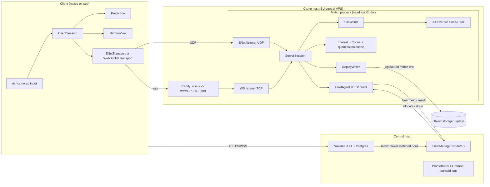
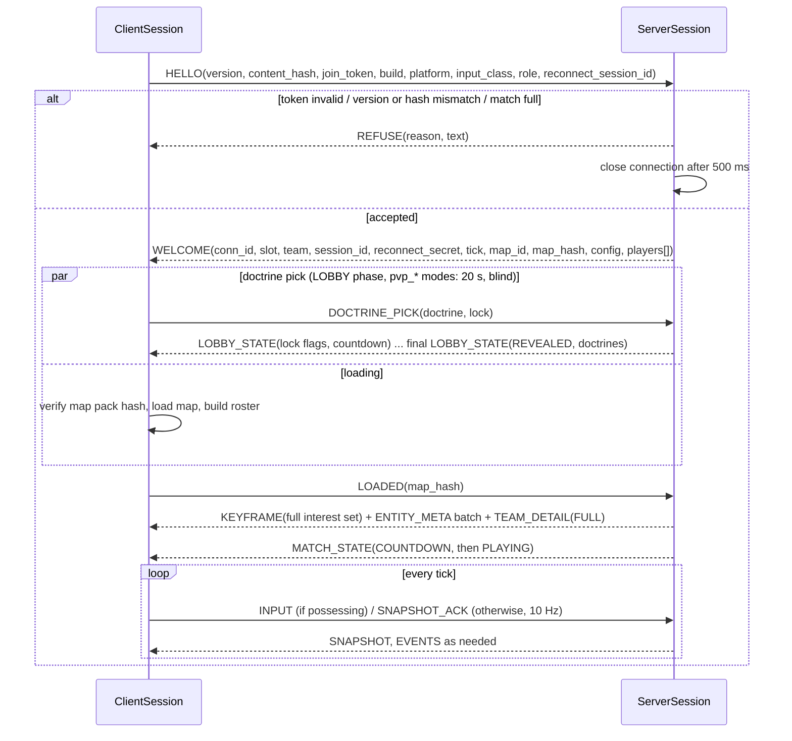

# 04 - Networking and Backend

| | |
|---|---|
| **Project** | Codename PLANEWAR - arcade spaceship combat + base-building RTS on a spherical moon. Godot 4.7.2, typed GDScript. |
| **Document** | 04 - Networking and backend: wire protocol, snapshot codec, prediction, transports, server loop, FleetManager, Nakama, security, hosting, observability, replays. |
| **Status** | v1.0 (stage 3, revised 2026-10-10) |
| **Date** | 2026-10-10 (stage 2 draft 2026-10-09) |
| **Author** | Network and backend architect agent (Fable tier); stage-3 revision by the 04 reviser (Opus tier) |
| **Inputs** | `docs/reviews/R0-resolution-register.md` (binding; its Part B tables override this document), `docs/01-vision-and-core-decisions.md` v1.1 (binding spine; brief in Section 12 "04"), `docs/research/R2-godot-tech.md` (s3, s5, s11), `docs/research/R3-platform-requirements.md` (s4, s5, s7), `docs/research/R1-game-references.md` (s2.1, s3 items 15-18). |
| **Owns** | `godot/src/net/`, `godot/src/server/` (protocol side), `server-ops/fleet-manager/`, `server-ops/nakama/`, `server-ops/Caddyfile`, `godot/test/net/`. |
| **Work-breakdown prefix** | NET |

**How to read.** Sections 1-5 are the game protocol (what goes over the wire and how both ends treat it). Sections 6-8 are the runtime (transports, server loop, sessions). Sections 9-12 are the backend (FleetManager, Nakama, security, hosting). Sections 13-15 are replays, observability and testing. Sections 16-19 are the mandatory closing sections. All byte layouts are little-endian. `PLANET_RADIUS` (6,000 m, confirmed by the owner, R0 O-1) is referenced by name; no value derived from it is hard-coded in code-level specs. Enumerations quoted here (`SimEvent.Kind`, `Command.Kind`, `OrderSpec.Kind`, `AlertKind`, `CommandResult.Code`, `Build.Reject`, `ReleaseReason`, `SessionPhase`, `QuickPing.Kind`) are the append-only lists of R0 B.3 / `sim/MODULE.md`; the wire carries their ordinals unchanged.

---

## 0. Decisions inherited from 01

| # | Decision (01 reference) | Consequence for this document |
|---|---|---|
| I1 | Server-authoritative, fixed 30 Hz tick, `SimWorld` is `RefCounted`, changes only via `Command` (ADR-06). | Every client message is either a `Command`, a `PilotInput` batch, or control-plane chatter; nothing else mutates the world. |
| I2 | Clients predict only their possessed unit with the shared `Kinematics.step_ship()`; 100 ms reconciliation smoothing; weapons never predicted (ADR-07). | Section 5 prediction state machine. |
| I3 | Everything else interpolates 100 ms behind the newest snapshot, extrapolates at most 100 ms (ADR-07). | Section 5.6. |
| I4 | Interest tiers A (<= 40 entities, 30 Hz), B (<= 200, 15 Hz), C (<= 1,000, 2 Hz); snapshot packet <= 1,200 B; reliable keyframe on join, reconnect and stale ack; tier C refreshed by a rolling round-robin inside snapshots, never by a periodic burst (ADR-07 v1.1, R0 C1-15). | Sections 3-4. |
| I5 | Transports behind `net/transport.gd`: ENet, WebSocket (wss behind Caddy), Local, WebRTC from v1.1; server polls all listeners each tick; no `SceneMultiplayer`, RPC or `MultiplayerSynchronizer` (ADR-07). | Sections 6-7. |
| I6 | Dedicated servers (one headless process per match) for matchmade play; listen server for LAN/custom; offline modes run `ServerSession` in-process over `LocalTransport`, and the client reads a `LocalSimView` directly with no snapshot encode/decode (ADR-07, 01 s9.3, R0 C1-01). | One code path for commands; Sections 7.1 and 8. |
| I7 | Reconnect within 120 s with keyframe; 60 s background-tab tolerance; clock sync by tick number with drift estimator (ADR-07). | Section 5.7, 8.4. |
| I8 | Budgets: server->client <= 24 KB/s typical, 40 KB/s peak; client->server <= 2 KB/s / 4 KB/s; 1 dedicated vCPU and 512 MB per match; tick p95 <= 25 ms per instance with 6 concurrent instances; an 8 **dedicated**-vCPU / 16 GB host runs 6 matches (4 on shared vCPU); match ready <= 3 s after allocation (01 s8.3-8.4, R0 B.7). | Section 4.6 proof, Sections 9.2 and 12. |
| I9 | Protocol version and content hash in `HELLO`; mismatch refuses the connection (ADR-07). | Section 2.2. |
| I10 | Nakama 3.41.x self-hosted with Postgres for accounts (v1.0: device, email, Steam), friends, parties, lobby chat, matchmaker, ratings recorded, storage, TypeScript RPCs; our own FleetManager (TypeScript/Node) with a pre-started process pool on fixed regional hosts, EU-central first, serving the moderation admin page; minimal ops stack (Prometheus/Grafana, journald) (ADR-08 v1.1, R0 C1-12, C3-15). | Sections 9-10, 12, 14. |
| I11 | Age band stored in Nakama metadata gating chat, analytics, purchases; team-only text chat with quick-ping wheel; message ids, report/block/mute, moderation queue; account deletion cascade across Nakama, FleetManager results and analytics (ADR-08, ADR-13). | Sections 10.6-10.8. |
| I12 | Replays are server-recorded snapshot streams (10 Hz deltas, keyframe every 10 s, full event stream, gzip, <= 20 MB per 30-min 8-player match); offline sessions write `.pwr` to `user://replays/`; online replays via a signed-URL RPC; spectator role with 10 s delay (ADR-10 v1.1, R0 C2-25). | Section 13. |
| I13 | `Transport`, `ServerSession`, `ClientSession`, `Command`, `PilotInput` signatures of 01 s9.4 are fixed; R0 B.5 and `sim/MODULE.md` supersede where they differ (`step_ship` form, `Command.pilot`, `Sphere.cell_of`). | Reproduced and extended, never renamed. |
| I14 | Matchmaking keys: region, mode, input class, content hash; no rating bands until the first season patch; parties adopt the leader's input class with a notice (R3 s5; 01 Q13, ADR-08 v1.1; R0 C3-15). | Section 10.4. |
| I15 | `EntityId = slot | (generation << 20)`; hard cap 1,280 live slots (ADR-06, 01 s8.1). | Slots fit in u16 on the wire; Section 3.1. |
| I16 | Interest cells 6 x 8 x 8 = 384 (~1,178 m); world frame float32 moon-centred (ADR-03, ADR-05). | Position quantisation is per interest cell in its tangent (ENU) frame; Section 3.2. |
| I17 | Cross-platform determinism is not required; input replays are impossible (ADR-03, ADR-10). | Replays and spectating are snapshot-based only. |
| I18 | GDScript only; no GDExtension in v1; web is single-threaded `web_noextensions` (ADR-01). | The codec is written for `PackedByteArray` + `StreamPeerBuffer` performance; the WebRTC transport waits for v1.1. |

---

## 1. Architecture overview



Two planes: a **control plane** (Nakama for identity and social, FleetManager for server allocation, HTTPS/WSS) and a **match plane** (our binary protocol between `ClientSession` and `ServerSession`, over ENet or WebSocket). A client only ever talks to one match process at a time, and only after Nakama has given it a signed join token for that process.

---

## 2. Wire protocol

### 2.1 Framing and channels

Every packet on every transport is a `PackedByteArray` whose first byte is the **message id**. Message ids below `0x80` flow client -> server, ids `0x80` and above flow server -> client. Multiple messages are never concatenated in one packet except inside `SNAPSHOT` (which has its own sections) and `EVENTS` (which carries a count). This keeps the parser trivial and fuzzable.

Channels follow 01 s9.4 exactly:

| Channel | Name | Reliability | Ordering | Carries |
|---|---|---|---|---|
| 0 | control | reliable | ordered | HELLO, WELCOME, REFUSE, LOADED, DOCTRINE_PICK, LOBBY_STATE, MATCH_STATE, COMMAND, COMMAND_RESULT, CHAT, CHAT_RELAY, QUICK_PING, PLAYER_STATUS, MATCH_END, LEAVE, INTEREST_HINT, REQUEST_KEYFRAME, SPECTATE_FOLLOW, ADMIN_NOTICE |
| 1 | input | unreliable, unsequenced | none | INPUT, SNAPSHOT_ACK, PING, PONG |
| 2 | snapshot | unreliable, sequenced (drop stale) | newest wins | SNAPSHOT, TEAM_STATE, PROJECTILE_BATCH |
| 3 | events | reliable | ordered | KEYFRAME, EVENTS, ENTITY_META, POSSESS_ACK, RELEASED, ROSTER_REMOVE, TEAM_DETAIL |

ENet maps these to four ENet channels with the stated modes (`TRANSFER_MODE_RELIABLE` for 0 and 3, `TRANSFER_MODE_UNRELIABLE` for 1, `TRANSFER_MODE_UNRELIABLE_ORDERED` for 2). WebSocket is a single reliable ordered TCP stream, so `WebSocketTransport` prefixes each frame with the channel byte and ignores the reliability flag; the sequencing of channel 2 is re-applied on the receiving side by tick number. `LocalTransport` is a pair of in-process queues with optional fault injection (Section 15.1). The 1,200-byte limit on unreliable packets (R2 s5.4: fragmented unreliable ENet packets are promoted to reliable) is enforced by the snapshot builder; reliable keyframes may exceed it and are fragmented by ENet or carried as one WebSocket frame.

### 2.2 Versioning and the handshake

- `PROTOCOL_VERSION: int = 1` lives in `godot/src/net/protocol.gd` and is bumped on any change to any layout in this document. There is no in-protocol negotiation in v1: a mismatch is a refusal (`REFUSE reason=VERSION`), and the client shows "update required" with the server's version.
- `CONTENT_HASH` is the SHA-256 of the sorted defs (ADR-09; inputs per R0 C2-34: `content/defs/*.json` minus `sfx.json`/`vfx_prewarm.json`, `presentation` keys stripped), 32 bytes, computed by `ContentDB.hash()`.
- `MAP_HASH` is the SHA-256 of the map recipe plus baked faces, 32 bytes, delivered in `WELCOME` so a client can verify its map pack before `LOADED`.



The server allows 5 s from TCP/UDP connect to a valid `HELLO`, and `load_timeout_s` (60 s, `match_rules.json`) from `WELCOME` to `LOADED` (web clients stream the 4 MB map pack during this window; 01 ADR-04). The client loads the map while the doctrine pick runs, so the 20 s pick window costs no wall-clock time on top of loading (Section 8).

### 2.3 Message catalogue

Field types: `u8/u16/u32/u64`, `i8/i16/i32`, `f32`, `vec3q` = quantised position (cell `u16` + 3 x `u16`, 8 bytes, Section 3.2), `quat_s3` = smallest-three orientation (4 bytes), `str8` = `u8` length + UTF-8 bytes, `str16` = `u16` length + UTF-8 bytes, `bytes8/bytes16` = length-prefixed blobs. "Rate" is the steady-state rate per sender; "Max" is the hard parser limit (packets beyond it are dropped and counted, Section 11.4).

**Client -> server**

| Id | Name | Ch | Fields (type: size) | Max B | Rate |
|---|---|---|---|---|---|
| 0x01 | HELLO | 0 | protocol_version u16:2, content_hash:32, join_token bytes8:<=160, client_build u32:4, platform u8:1 (WIN, MAC, LINUX, ANDROID, IOS, WEB, SERVER_BOT), input_class u8:1 (TOUCH, GAMEPAD, POINTER), role u8:1 (PLAYER, SPECTATOR, ADMIN), reconnect_session_id u64:8, reconnect_secret:16 (zeros if none) | 230 | once |
| 0x02 | LOADED | 0 | map_hash:32 | 33 | once |
| 0x03 | COMMAND | 0 | seq u16:2, tick u32:4, kind u8:1, target u32:4 (EntityId or 0), payload bytes16:<=256 | 270 | <= 10/s sustained, burst 30 (Section 11.3) |
| 0x04 | INPUT | 1 | epoch u16:2 (possession epoch), base_tick u32:4, ack_tick u32:4 (newest snapshot tick seen), count u8:1 (1-3), inputs count x 8 | 36 | 30/s while possessing |
| 0x05 | SNAPSHOT_ACK | 1 | ack_tick u32:4, ack_keyframe_seq u16:2 | 7 | 10/s when not possessing |
| 0x06 | PING | 1 | client_ms u32:4 | 5 | 1/s |
| 0x07 | CHAT | 0 | client_msg_id u32:4, scope u8:1 (TEAM only in v1; ALL reserved for custom lobbies), text str16:<=200 | 210 | 2/s, burst 5 |
| 0x08 | QUICK_PING | 0 | kind u8:1 (`QuickPing.Kind`, canonical list in 06 `content/ui/pings.json`, R0 B.3: ATTACK_HERE, DEFEND_HERE, NEED_ESCORT, ENEMY_BOMBERS, ON_MY_WAY, NEED_ICE, THANKS, RETREAT, WING_FORM, WING_ATTACK, WING_RELEASE, NEED_SUPPLY), pos vec3q:8, target u32:4 | 14 | 1/s, burst 3 |
| 0x09 | INTEREST_HINT | 0 | camera_tier u8:1, focus_cell u16:2, altitude_m u16:2, radius_m u16:2 | 8 | 5/s |
| 0x0A | LEAVE | 0 | reason u8:1 (QUIT, TO_MENU, CRASH_REPORTED) | 2 | once |
| 0x0B | REQUEST_KEYFRAME | 0 | reason u8:1 (DESYNC, ROSTER_GAP, RESUME) | 2 | <= 1 per 5 s |
| 0x0C | SPECTATE_FOLLOW | 0 | entity u32:4 (0 = free camera) | 5 | 2/s |
| 0x0D | DOCTRINE_PICK | 0 | doctrine u8:1 (index into `doctrines.json`), lock u8:1 (0 provisional, 1 locked; a lock is final) | 3 | <= 2/s, `LOBBY` phase only (ignored otherwise, no strike) |

Message kinds `0x0E-0x7F` are reserved (`0x70-0x7F` for v1.1 WebRTC signalling); receiving one is a protocol violation (Section 11.4).

**Server -> client**

| Id | Name | Ch | Fields (type: size) | Max B | Rate |
|---|---|---|---|---|---|
| 0x80 | WELCOME | 0 | conn_id u16:2, slot u8:1 (0-7, 255 = spectator), team u8:1, session_id u64:8, reconnect_secret:16, tick u32:4, server_ms u32:4, map_id str8:<=64 (`cradle`, `anvil`, `rimewater`; `tiny_test` in tests), map_hash:32, config bytes16 (`MatchConfig` serialized, <=256, Section 9.3), player_count u8, players[] x (slot u8, team u8, kind u8 `PlayerKind` HUMAN/BOT/OPEN, doctrine u8 (255 = hidden until the `LOBBY_STATE` reveal), input_class u8, name str8:<=24) | 700 | once |
| 0x81 | REFUSE | 0 | reason u8:1 (VERSION, CONTENT_HASH, TOKEN_INVALID, TOKEN_EXPIRED, MATCH_FULL, MATCH_ENDED, BANNED, SERVER_DRAINING, RATE_LIMIT), server_version u16:2, text str8:<=120 | 125 | once |
| 0x82 | MATCH_STATE | 0 | phase u8:1 (`SessionPhase`, R0 B.3: LOBBY, LOADING, COUNTDOWN, PLAYING, ENDED are the values a client sees), tick u32:4, countdown_ticks u16:2, loaded_mask u8:1 | 9 | on change |
| 0x83 | COMMAND_RESULT | 0 | seq u16:2, code u8:1 (`CommandResult.Code`, R0 B.3), detail u8:1 (`Build.Reject` when code = REJECTED_PLACEMENT, else 0) | 5 | per rejected or possess-class command; accepted ordinary orders are implied by events |
| 0x84 | SNAPSHOT | 2 | header 10 + sections (Section 3.4) | 1,200 | 30/s (one or more per tick) |
| 0x85 | TEAM_STATE | 2 | tick u32:4, ore u32:4, ice u32:4, ore_cap u32:4, ice_cap u32:4, power_supply u16:2, power_demand u16:2, unit_cap u16:2, structure_cap u16:2 (per player, from the caps profile), flags u8:1 (CORE_EXPOSURE, LOW_POWER, CORE_SHIELD_UP, SPEND_LOCK_ACTIVE), member_count u8:1, members[] x (slot u8, unit_count u16, structure_count u16) | 72 | 2/s |
| 0x86 | KEYFRAME | 3 | keyframe_seq u16:2, tick u32:4, scope u8:1 (ALL, ROSTER_REPAIR), roster_count u16:2, roster[] x FULL record (19 B, +1 `ai_tag` for own-team entries) | 65,535 (ENet fragments) | join, reconnect, stale ack, on request (Section 4.3) |
| 0x87 | EVENTS | 3 | tick u32:4, count u8:1, events[] (Section 3.6) | 1,200 | per tick with events |
| 0x88 | ENTITY_META | 3 | count u8:1, entries[] x (slot u16:2, generation u16:2, def_id u16:2, owner u8:1, team u8:1, name_or_tag str8:<=16 for named units else 0) | 1,200 | when entities enter a client's roster |
| 0x89 | POSSESS_ACK | 3 | entity u32:4, epoch u16:2, tick u32:4, p f32x3:12, v f32x3:12, basis quat f32x4:16, fuel_s u16:2, ammo u16:2, bombs u8:1, rockets u8:1, hp u16:2, saved_order_kind u8:1 | 60 | per possession |
| 0x8A | RELEASED | 3 | entity u32:4, epoch u16:2, tick u32:4, reason u8:1 (`ReleaseReason`, R0 B.3: PLAYER, DEATH, CEILING, HANDOVER, DISCONNECT, MATCH, INVALID, ADMIN), new_possessor u8:1 (255 = none) | 13 | per release |
| 0x8B | PONG | 1 | client_ms u32:4, server_tick u32:4, server_ms u32:4 | 13 | reply to PING |
| 0x8C | CHAT_RELAY | 0 | msg_id u64:8, sender_slot u8:1, scope u8:1, tick u32:4, text str16:<=200, client_msg_id u32:4 (echo to sender), status u8:1 (0 OK; to the sender only: 1 BLOCKED_AGE, 2 MUTED, 3 RATE, 4 INVALID, with empty text) | 222 | relay |
| 0x8D | PLAYER_STATUS | 0 | slot u8:1, status u8:1 (CONNECTED, DISCONNECTED_GRACE, BOT_TAKEOVER, RECONNECTED, LEFT, ELIMINATED_COMMANDER), grace_ticks u16:2, flags u8:1 (bit0 AUTO_ECONOMY = `adjutant_economy` active, shown to opponents; bit1 ADJUTANT_ON) | 6 | on change |
| 0x8E | MATCH_END | 0 | winner_team u8:1, reason u8:1 (CORES_DESTROYED, HARD_END_VALUE, SURRENDER, ABANDONED, ADMIN), tick u32:4, result_hash:32, team_count u8, structure_value[team] u32, player_count u8, per_player[] x (slot u8, score_pilot u32, score_commander u32, kills u16, deaths u16, structures_built u16, structures_destroyed u16, manual_landings u16, sorties u16, ore_mined u32, ore_spent u32, ice_delivered u32, pilot_time_s[5] u16 (dart, lancer, bomber, scout, hauler), medal_count u8, medals[] u8 (02 `medals.json` order)) | 640 | once |
| 0x8F | PROJECTILE_BATCH | 2 | tick u32:4, count u8:1, items[] x (shooter_roster u16:2, weapon_slot u8:1 (bit7 HAS_FUSE), seed u8:1, dir_yaw_pitch i8x2:2, [fuse_ticks u8 if HAS_FUSE: flak burst time]) = 6-7 B | 1,200 | per tick with shots, sent twice (this tick and next) for loss tolerance; gun slugs, flak shells and rail slugs (R0 C2-35) |
| 0x90 | ROSTER_REMOVE | 3 | count u8:1, entries[] x (index u16, reason u8: DEATH, OUT_OF_VISION, LEFT_INTEREST) | 768 | when entities leave a client's interest set for good (death, 30 s out of vision, interest pruning) |
| 0x91 | ADMIN_NOTICE | 0 | kind u8:1 (SERVER_DRAIN_WARNING, PAUSE, RESUME, KICK), text str8 | 130 | rare |
| 0x92 | TEAM_DETAIL | 3 | Section 3.7 layout (own team's factory queues and progress, replenish targets, order heads, pads, supply pools, field remaining; per-player scores and early-share spend) | 1,200 (split if larger) | 2/s, changed entries only; FULL after every `KEYFRAME(ALL)` |
| 0x93 | LOBBY_STATE | 0 | flags u8:1 (bit0 REVEALED), countdown_ticks u16:2, slot_count u8:1, slots[] x (slot u8, flags u8 (bit0 LOCKED, bit1 AUTO_ECONOMY, bit2 CONNECTED, bit3 BOT), doctrine u8 (255 until REVEALED)) | 30 | on change during `LOBBY`; once with REVEALED at `LOBBY -> LOADING` |

Ids `0x94-0xFF` reserved (`0xF0-0xFF` for v1.1 WebRTC signalling).

### 2.4 `PilotInput` wire form (8 bytes)

| Offset | Field | Type | Encoding |
|---|---|---|---|
| 0 | thrust | u8 | `round(thrust * 255)` |
| 1 | pitch | i8 | `round(pitch * 127)` |
| 2 | yaw | i8 | same |
| 3 | roll | i8 | same |
| 4 | buttons | u8 | bit0 BOOST, bit1 BRAKE, bit2 FLIP, bit3 FIRE1, bit4 FIRE2, bit5 DOCK, bit6 RELEASE, bit7 reserved |
| 5 | reserved | u8 | must be 0 (checked by V-INP) |
| 6 | reserved | u8 | must be 0 (checked by V-INP) |
| 7 | tick_lo | u8 | low 8 bits of the tick this input is for; checked against `base_tick + i` |

Per-entity meaning (R0 B.3, owned by 05 s1.1): ships use every field as above; **towers** read `pitch`/`yaw` as turret slew rates and FIRE1/FIRE2 (there is no absolute aim field); **ground units** read `thrust` as forward drive, `yaw` as steer and BRAKE as stop, reversing at <= 3 m/s after BRAKE is held 0.5 s.

`PilotInput.from_wire(bytes, offset)` and `to_wire()` are pure and round-trip exactly on the quantised values; the client **applies the quantised values to its own prediction**, so prediction and server see bit-identical inputs (01 s9.4 contract note). An `INPUT` packet carries inputs for `base_tick`, `base_tick+1`, `base_tick+2`, the newest last; the server keeps a per-player ring buffer of 64 ticks and drops inputs older than `current_tick - 2` or newer than `current_tick + 8`. A client that cannot hold 30 Hz sends every other tick with `count` 3 (03 s12.3); no protocol change is needed.

### 2.5 `Command` payload layouts

`Command.payload` is codec-defined per `Command.Kind` (01 s9.4, R0 B.3 ordinals 0-15). `net/codec_commands.gd` owns these layouts; `sim` reads them through typed accessors so the sim never parses bytes itself. Every payload is <= 256 bytes.

| Kind | Target | Payload | Validation (Section 11.3 row) |
|---|---|---|---|
| ORDER (0) | 0 (selection in payload) | see the ORDER layout below | V-ORD |
| BUILD (1) | 0 | structure_def u16, cell u32 (occupancy cell id), rotation u8 (0-3) | V-BLD (shape only; legality = `Build.can_place`) |
| CANCEL_BUILD (2) | structure entity | - | V-OWN (owner-only cancel) |
| PRODUCE (3) | factory entity | unit_def u16, count u8 (1-5) | V-PRD |
| CANCEL_PRODUCE (4) | factory entity | queue_index u8 | V-OWN (owner-only cancel) |
| SET_RALLY (5) | factory entity | pos vec3q | V-OWN |
| POSSESS (6) | entity | - | V-POS |
| RELEASE (7) | entity (currently possessed) | - | V-POS |
| REQUEST_POSSESS (8) | entity possessed by a teammate | - | V-REQ |
| HANDOVER (9) | entity (currently possessed) | to_slot u8 | V-REQ |
| PILOT_INPUT (10) | - | never sent as COMMAND; inputs use message 0x04 and enter the sim as `Command.pilot(slot, entity, input)`. Reserved so `Command.Kind` stays complete for replays. | - |
| TOGGLE_AUTO_REPLENISH (11) | factory entity | enabled u8, target_roster bytes8 (def u16 + count u8 pairs) | V-OWN |
| SURRENDER (12) | 0 | - | V-TEAM |
| SET_ADJUTANT (13) | 0 | enabled u8, profile u8 (0 assist, 1 caretaker, 2 economy), toggles u8 (bit0 economy, bit1 replenish, bit2 defence, bit3 expand) | V-ADJ |
| DEBUG_SPAWN (14), DEBUG_SET (15) | per 03 (`sim/MODULE.md`) | per 03 | V-DBG (local/offline links with `rules.debug_commands` only) |

**ORDER layout** (R0 C2-06; 05 owns the order semantics):

```
u8   order_kind      OrderSpec.Kind (R0 B.3): 0 MOVE .. 8 GUARD; 9 SUPPLY_DROP only once SL-5 is built; 10-11 rejected in v1
u8   flags           bit0 QUEUE, bit2 LOW (bit1 PREPEND is system-only and rejected from clients)
u8   haul_mode       HaulMode for HAUL (0 FERRY, 1 TOW, 2 CAPTURE); 0 otherwise
u8   count           1-32 selected entities
u32  ids[count]      EntityIds
u32  target          EntityId or 0
u8   point_count     0-16
vec3q points[point_count]   8 B each: MOVE/ATTACK point, PATROL waypoints (2-8 per 05), future routes
```

Size = `8 + 4 * count + 8 * point_count` <= 256 B, so a 32-unit selection carries at most 15 points (8 + 128 + 120 = 256; V-ORD rejects larger payloads as REJECTED_MALFORMED). The layout already fits the v1.x `PATROL_ROUTE`/`ATTACK_VIA` routes of 08 SL-4 (R0 C3-12), so no protocol change is needed when they are adopted.

---

## 3. Snapshot codec

### 3.1 Roster and entity identification

Sending a 4-byte `EntityId` per record per tick is the single largest avoidable cost, so the codec identifies entities by **roster index**. Each client (and the replay writer, as a pseudo-client with an all-seeing interest set) has a **roster**: an ordered array of up to 1,280 entries, each binding a roster index to `(slot u16, generation u16, def_id, owner, team)`. The roster is built by `KEYFRAME`, extended by `ENTITY_META` (reliable, before the first snapshot record that references the new index) and pruned by `ROSTER_REMOVE`. Because channels 2 and 3 are different channels, a snapshot may arrive before the `ENTITY_META` that defines an index; the client then **holds that record** (keeps the raw bytes keyed by tick) until the meta arrives, with a 1 s timeout that triggers `REQUEST_KEYFRAME(ROSTER_GAP)`.

Within a snapshot section, records are sorted by roster index and encode the index as a **gap** from the previous record: `u8` gap for 1-254, `0xFF` escape followed by `u16` absolute index. On a 1,280-entry roster with 240 entities per tick the mean gap is about 5, so the identifier costs 1 byte.

Roster slot indices reuse the sim slot number (0-1,279) **only inside `KEYFRAME`/`ENTITY_META`**; snapshot records never carry slots.

### 3.2 Position quantisation: per interest cell, tangent frame

A position `p` (moon-centred float32) is encoded as `(cell u16, e u16, n u16, u u16)`:

1. `cell = Sphere.cell_of(p, Sphere.GRID_INTEREST)` (face * 64 + row * 8 + col; 384 values), from `core/sphere.gd` (ADR-05, R0 C2-12).
2. `c = Sphere.cell_center_dir(cell, Sphere.GRID_INTEREST) * Sphere.PLANET_RADIUS` (a point on the datum sphere) and its ENU frame `(east, north, up)` as defined in ADR-03.
3. `d = p - c`; `e = dot(d, east)`, `n = dot(d, north)`, `u = dot(d, up)`.
4. Quantise with the constants below; clamp to range.

| Axis | Range | Quantum | Note |
|---|---|---|---|
| e, n | [-1,280, +1,280) m | `2560 / 65536 = 3.906 cm` | an interest cell is ~1,178 m across at face centre and up to ~30 % larger at corners (ADR-05), so every point of the cell lies within +-900 m of its centre **on the datum**; the tangent-plane offset scales with `(R + h) / R`, so at the 2,000 m hard ceiling a cube-corner cell reaches 1,200 m (R0 B.9 A-23, NET-02 CQ-1; the 01 v1.0 range of 1,024 m clamped above ~827 m) |
| u | [-768, +3,328) m | `4096 / 65536 = 6.25 cm` | covers terrain floor -500 m, the 2,000 m ceiling and the sagitta of a tangent plane at 1,200 m from the centre (`1200^2 / (2 * PLANET_RADIUS)`, about 120 m at R = 6,000) with margin |

Decoding is the exact inverse: `p = c + e * east + n * north + u * up`. The ranges are constants in `net/codec.gd` (`POS_EN_HALF = 1280.0`, `POS_U_MIN = -768.0`, `POS_U_SPAN = 4096.0`); they are **independent of `PLANET_RADIUS`** as long as a cell's tangent extent at the hard ceiling stays under 1,280 m, which holds at the confirmed R = 6,000 m (R0 O-1; `Codec.pos_in_range` must be true for every cell corner from -500 m to `ceiling_hard_m`, the NET-02 envelope test). S-WORLD-1's 4 km and 8 km radius variants are renderer-only and never cross the wire.

The quantisation error (<= 2.0 cm horizontally, <= 3.1 cm vertically) is far below the 100 ms interpolation blur of a 110 m/s ship (11 m), so no client-side dequantisation smoothing is needed.

### 3.3 Field encodings

| Field | Encoding | Bytes | Error |
|---|---|---|---|
| Orientation | smallest-three: 2-bit index of the largest-magnitude quaternion component, then the other three as 10-bit signed values scaled by `1/sqrt(2)`, sign-normalised so the dropped component is positive | 4 | <= 0.4 deg |
| Coarse orientation (tier B) | smallest-three at 5 bits per component + 2-bit index = 17 bits, packed into 3 bytes with 7 spare bits carrying the flags byte **minus bit 5 BRAKING** (spare bits 0-4 = flags bits 0-4, spare 5 = flags bit 6, spare 6 = flags bit 7; B entities read braking as false; R0 B.9 A-24). The **decoder is normative** (plain smallest-three inverse); any encoder whose output decodes within the bound conforms. Plain rounding of 5-bit components reaches ~7.4 deg, so the reference encoder refines one code (NET-02; 5.07 deg measured, R0 B.9 A-25) | 3 | <= 6 deg (B entities are 100+ m away and interpolated; visible banking still reads) |
| Velocity | 3 x i8 at 2.0 m/s per unit (range +-254 m/s; ships <= 220 m/s dive, rockets 250 m/s, siege shells 110 m/s and falling bombs fit; gun slugs, flak shells and rail slugs are never replicated as entities, Section 3.6) | 3 | 1 m/s |
| HP | u8 = `round(hp01 * 255)` | 1 | 0.4 % |
| Flags | u8: bits 0-1 control state (AUTO, ORDERED, POSSESSED), bit 2 docked, bit 3 firing, bit 4 boosting, bit 5 braking, bit 6 shield up / cargo loaded / towing (per def class), bit 7 dying (wreck animation) | 1 | - |
| `ai_tag` (own-team entities only) | u8 written by sim_ai through `CommandSinkBase.set_ai_tag` (R0 C2-07); A: follows the flags byte in the FLAGS group; B: its own mask bit (Section 3.4); FULL: appended as byte 20 | 1 | exact |
| Pilot block (own possessed unit only) | fuel u16 (0.1 s), ammo u16, bombs u8, rockets u8, hull u16 (exact HP), incoming_rockets u8, boost_state u8 (bits 0-1 READY / ACTIVE / COOLDOWN, bits 2-7 remaining fraction of the active or cooldown timer in 1/63), flip_cooldown01 u8, dock_state u8 (FLYING, LANDING_ASSIST, DOCKED, LAUNCHING, R0 B.3), service_progress 3 x u8 (refuel, rearm, repair; 255 = complete, 0 when not docked) | 15 | exact |

### 3.4 Snapshot packet layout

```
SNAPSHOT (channel 2, <= 1,200 bytes)
  u8   msg_id = 0x84
  u32  tick                      tick this snapshot describes
  u32  baseline_tick             0 = records are FULL against nothing (post-keyframe); otherwise the acked tick deltas are relative to
  u8   flags                     bit0 HAS_A, bit1 HAS_B, bit2 HAS_C, bit3 HAS_PILOT, bit4 CONTINUED (another packet for this tick follows), bit5 LAST (last packet of this tick), bits 6-7 packet index 0-3 within the tick (R0 B.10 A-36; index 0 carries the pilot block; LAST on the highest index declares the count)
  -- 10-byte header --
  [section A]  u8 count, then count records (A-FULL or A-DELTA, per record type bit)
  [section B]  u8 count, records (B-FULL or B-DELTA)
  [section C]  u8 count, records (C-FULL or C-BLIP; also the rolling-refresh FULL records of Section 4.3, any tick)
  [pilot block] 15 bytes
```

Record formats (`gap` = roster index gap as in 3.1; `mask` bits select which optional groups follow):

| Record | Layout | Bytes |
|---|---|---|
| FULL (keyframes, new entities, cell changes, rolling refresh; same in A/B/C) | gap, `0x80 | 0x7F mask=all` (= 0xFF, the FULL marker in every section), cell u16, e u16, n u16, u u16, quat_s3 4, vel 3, hp 1, flags 1, [ai_tag 1 for own-team entities] | 19 (+1 own team, +1 if escape gap) |
| A-DELTA | gap, mask u8 (bit7 = 0 marks DELTA; bit0 POS_SMALL, bit1 POS_LARGE, bit2 ORI, bit3 VEL, bit4 HP, bit5 FLAGS, bit6 CELL_CHANGED -> force FULL), then: POS_SMALL = 3 x i8 residual at 4 quanta (15.6 cm E/N, 25 cm U; **range +-19.8 m E/N, +-31.75 m U**; R0 B.9 A-23, B.10 A-38) **against the dead-reckoned position** `dr(t)` below; POS_LARGE = 3 x i16 residual at 1 quantum; ORI = quat_s3 4; VEL = 3 x i8; HP = u8; FLAGS = u8 (+ `ai_tag` u8 for own-team entities) | 2 + 3..6 + 0..4 + 0..3 + 0..1 + 0..2; typical moving ship 2+3+4+3 = 12, coasting 5, unchanged entity **absent** |
| B-DELTA | gap, mask u8 as above but ORI = coarse 3 bytes carrying the B flags in its spare bits (so FLAGS is never separately sent in B) and bit5 = AI_TAG (own team only, u8); HP u8 | typical moving ship 2+3+3 = 8 (+3 with VEL), slow harvester 2+3 = 5, unchanged absent |
| C-BLIP | gap u8, e8 u8 (**clamped to 254** so the byte after the gap is 0xFF only for FULL; R0 B.10 A-37), n8 u8, alt6_flags2 u8 (alt in 40 m steps from -500 m; flags: 0 moving, 1 static/docked, 2 under fire, 3 dying) | 4; cell change -> FULL |

**Dead reckoning** (R0 C1-18), with `t = (tick - baseline_tick) * DT`:

```
dr(t) = pos_b + vel_b * t - 0.5 * g * normalize(pos_b) * t^2    # gravity-bearing: projectile defs with gravity:true
                                                                 # (bomb, siege_shell) and unpowered ships (baseline flag bit 7 dying)
dr(t) = pos_b + vel_b * t                                        # everything else (powered ships, ground units, rockets)
```

`g` is `rules.gravity`; `pos_b`, `vel_b` and the baseline flags are the **dequantised** baseline values, so both ends choose the same branch and compute the same `dr`. A fuel-empty ship that is not dying uses the linear form; its sag is carried by the residual. Dead-reckoned residuals are the PA lesson (R1 s2.1 DO 3): ballistic motion under known gravity is cheap to predict. The server keeps, per client, the **last acked baseline** (tick + per-roster-entry quantised state) and computes the residual against exactly the state the client holds, so quantisation never accumulates: the client reconstructs `pos = dr(baseline) + residual` and stores the result as its new state for that entity; the server does the same arithmetic on its copy of the client's baseline. If `|residual|` exceeds the POS_SMALL range the encoder uses POS_LARGE; if it exceeds POS_LARGE (teleport, spawn) or the entity changed cell, it emits FULL.

**Baseline policies** (R0 B.10 A-39; bytes unchanged, both ends hold the same mirror). (1) A residual under one POS_SMALL step (4 quanta) on every axis is not sent; both mirrors keep `dr(t)`, so the error is bounded by one step (15.6 cm E/N, 25 cm U) and never accumulates. (2) Mirror entries hold velocity at 1/1024 m/s per axis, set from the dequantised i8 value when a VEL group or FULL record arrives and advanced by `g * dt` per tick for gravity-bearing entries without re-quantising; the wire VEL group stays 3 x i8 at 2 m/s. (3) A gravity-bearing entry sends VEL only when its quantised velocity is at least one 2 m/s step from the dead-reckoned velocity on some axis; any other entry sends VEL when the quantised value changed.

**Baseline rule.** Deltas are encoded against the newest tick the client has acknowledged (`ack_tick` in INPUT/SNAPSHOT_ACK). A client acknowledges a tick only when it is **complete**: every packet index `0 .. k_last` of that tick has arrived (flags bits 6-7, R0 B.10 A-36), so a split tick is a baseline like any other once acknowledged; a tick with a lost packet is simply never acknowledged. The server retains per-client baselines for the last 32 ticks (about 1 s). If the ack is older than 32 ticks (loss burst, background tab), the server sends a `KEYFRAME(scope=ALL)` and resets. This is the classic Quake 3 delta scheme and needs no reliable snapshot path.

**Shared quantisation cache** (R0 C1-02). `SnapshotCodec.prepare_tick(view)` runs once per tick before any client is encoded: every team-visible entity is quantised once into packed arrays (cell, e/n/u, quat_s3 full and coarse, vel i8, hp u8, flags, ai_tag), and the tier-C candidate set is computed once per team. Per-client work is only tier selection, the roster gap and the integer residual against that client's baseline; `ReplayWriter` encodes its frames from the same cache. FULL and C-BLIP bodies depend only on the cache, so `prepare_tick` writes them once per entity and `encode` appends slices (R0 B.10 A-40, NET-49); A/B DELTA bodies depend on each client's baseline and are always per client, which is why there is no "encode per tier". The cost of this whole step is the "events + interest + encode + replay" row of the 03 s4.2 tick budget (R0 B.7); this document keeps no budget numbers of its own.

### 3.5 Worked example packet

Scenario: tick 18,042, client's last ack is tick 18,039 (RTT 100 ms). The client's possessed Dart is roster index 17; an enemy Dart (index 23) is in tier A; a Harvester (index 41) is in tier B; one C blip (index 300) moved. The Dart moved 3.6 m east over 3 ticks exactly as dead-reckoned except a 0.25 m climb, turned 4 degrees, accelerated 2 m/s. Hex, one record group per line:

```
84                                   msg_id SNAPSHOT
7A 46 00 00                          tick = 0x0000467A = 18042
77 46 00 00                          baseline_tick = 18039
2B                                   flags = 0b0010_1011: HAS_A | HAS_B | HAS_PILOT | LAST (packet index 0)
-- section A --------------------------------------------------------------
02                                   count = 2
11                                   gap 17 -> roster index 17 (own Dart)
0D                                   mask = 0b0000_1101: POS_SMALL | ORI | VEL
00 00 01                             residual e=0, n=0, u=+1 (x 25 cm = 0.25 m)
9A 2F 4C 71                          quat_s3 (2-bit idx=2, three 10-bit components)
37 00 F4                             vel = (+55, 0, -12) x 2 m/s = (110, 0, -24) m/s
06                                   gap 6 -> roster index 23 (enemy Dart)
05                                   mask = POS_SMALL | ORI
FE 03 00                             residual e=-2, n=+3, u=0 (-0.31 m, +0.47 m at 15.6 cm per step)
12 C0 87 3E                          quat_s3
-- section B --------------------------------------------------------------
01                                   count = 1
12                                   gap 18 -> roster index 41 (Harvester)
01                                   mask = POS_SMALL
01 00 00                             residual e=+1 (15.6 cm): harvester at 12 m/s drifted off dead reckoning by one step
-- section C: absent (HAS_C not set; not a C tick and no rolling-refresh record is due) --
-- pilot block ------------------------------------------------------------
B4 08                                fuel = 0x08B4 = 2228 x 0.1 s = 222.8 s
7E 01                                ammo = 382
02                                   bombs = 2
00                                   rockets = 0
64 00                                hull = 100 HP
00                                   incoming_rockets = 0
00                                   boost_state = READY
00                                   flip_cooldown01 = 0
00                                   dock_state = FLYING
00 00 00                             service_progress (not docked)
```

Total: 10 header + 1 + 12 + 9 + 1 + 5 + 15 = **53 bytes** for a tick with three moving entities and the pilot block. A busy tick (40 A entities, 110 B entities, 20 C blips) fills about 900 bytes and still fits in one packet; the builder splits into `CONTINUED` packets (indices 0, 1, ... with `LAST` on the final one; at most 4 per tick) when it would not.

### 3.6 Events, projectiles and `ENTITY_META`

- **Gun slugs, flak shells and rail slugs are not entities on the wire** (R0 B.5, C2-35). They fly straight lines in the world frame (`p += v * dt`, no gravity, no transport), so a spawn fully determines them. The server sends `PROJECTILE_BATCH` (6 bytes per shot: shooter roster index, weapon slot, a seed byte, and the fire direction quantised to yaw/pitch i8 around the weapon's boresight; flak items set `HAS_FUSE` and add `fuse_ticks` u8, the predicted-intercept burst time). The client spawns the projectile with `Kinematics.step_projectile()` from the shooter's **interpolated** state and the `ProjectileDef` speed, and removes it at max range, at the flak burst time, or when a `HIT` event names it (by shooter + seed). These projectiles are presentation; damage arrives in `HIT` events (01 ADR-07: never predict weapon hits). The batch is sent on channel 2 twice (tick t and t+1); duplicates are discarded by `(shooter, seed, tick)`.
- **Bombs, rockets, siege shells, Supply Canisters (SL-5) and wrecks are entities** (guided, gravity-bearing or persistent) and are replicated in tiers like ships. A bomb or siege shell is a 19-byte FULL record once; with the gravity-aware dead reckoning of Section 3.4 its residual stays at zero quanta, so after the FULL record it costs only the occasional 5-byte POS_SMALL record when quantisation of the baseline velocity drifts past one quantum (typically a few records per fall).
- **Events** (`EVENTS`, channel 3) mirror `SimEvent.Kind` (R0 B.3). Layout per event: `kind u8`, `size u8`, payload; `roster` = the entity's roster index for this client, `0xFFFF` when the entity is not in the client's roster (e.g. a killer outside vision). Every kind has a payload:

| # | Kind | Payload | B (incl. kind+size) | Scope |
|---|---|---|---|---|
| 0 | SPAWN | roster u16, def u16, owner u8 | 7 | roster |
| 1 | DEATH | roster u16, killer roster u16, cause u8 | 7 | roster |
| 2 | HIT | target u16, attacker u16, seed u8, damage u16, part u8 | 10 | roster |
| 3 | BOMB_IMPACT | pos vec3q, projectile def u16, owner u8 | 13 | roster cell (A/B cells) |
| 4 | DOCKED | ship u16, pad u16 | 6 | roster |
| 5 | SERVICED | ship u16, pad u16, what u8 (bit0 fuel, bit1 ammo, bit2 repair) | 7 | team |
| 6 | LAUNCHED | ship u16, pad u16 | 6 | roster |
| 7 | ORDER_DONE | unit u16, order_kind u8 | 5 | team |
| 8 | ORDER_FAILED | unit u16, order_kind u8, reason u8 (R0 B.3) | 6 | team |
| 9 | POSSESSED | entity u16, player u8 | 5 | roster |
| 10 | RELEASED | entity u16, player u8, reason u8 (`ReleaseReason`) | 6 | roster |
| 11 | BUILD_STARTED | structure u16, def u16, player u8 | 7 | team |
| 12 | BUILD_DONE | structure u16, def u16 | 6 | team |
| 13 | STRUCTURE_LOST | structure u16, def u16, killer u16 | 8 | team + roster |
| 14 | LOW_POWER | team u8, ratio u8 | 4 | team |
| 15 | ALERT | alert_kind u8 (`AlertKind`), subject u16, pos vec3q, severity u8 | 14 | team |
| 16 | CORE_EXPOSURE | team u8 (255 = all) | 3 | all |
| 17 | MATCH_END | never in `EVENTS`; message 0x8E | - | - |
| 18 | CAP_REACHED | player u8, cap u8 (units, structures, projectiles) | 4 | team |
| 19 | WRECK_SPAWNED | wreck u16, from_def u16, ore u16 | 8 | roster |
| 20 | WRECK_SALVAGED | wreck u16, by u16, ore u16 | 8 | roster |
| 21 | CEILING_RELEASE | entity u16, player u8 | 5 | team |
| 22 | HANDOVER | entity u16, from u8, to u8 | 6 | team |
| 23 | PLAYER_ELIMINATED | player u8, by_team u8 | 4 | all |
| 24 | LOCK_ACQUIRED | shooter u16, target u16 | 6 | target's possessor + shooter's team |
| 25 | LOCK_BROKEN | shooter u16, target u16 | 6 | as 24 |
| 26 | CAPTURE_PROGRESS | site u16, team u8, progress01 u8 | 6 | roster |
| 27 | CAPTURED | site u16, team u8 | 5 | all |
| 28 | SALVAGE_DELIVERED | hauler u16, at u16, ore u16 | 8 | team |
| 29 | LANDING | entity u16, pad u16, grade u8 (`LandingGrade.Grade`), q u8 (`q * 255`), flags u8 (bit0 manual, bit1 hot), v_vert u8 (0.1 m/s, clamp 255), v_horiz u8 (0.1 m/s, clamp 255) | 11 | team + roster |
| 30 | SHIELD_COLLAPSE | structure u16 | 4 | roster |
| 31 | POSSESS_REQUESTED | entity u16, from u8 | 5 | possessor of entity |
| 32 | CANISTER_DEPLOYED | canister u16, owner u8 | 5 | team (SL-5, v1 stretch) |
| 33 | CANISTER_COLLECTED | canister u16, ship u16 | 6 | team (SL-5, v1 stretch) |

"roster" = the client receives the event when the subject entity is in its roster; "team" = the subject's team only; "all" = every client. Landing grades travel only in `LANDING`, never as extra `DOCKED` fields. New kinds are appended in `sim/MODULE.md` with a payload row here in the same change (protocol version bump).

- **`ENTITY_META`** is sent once per client per roster entry. Named units (players' possessed units, Cores) carry a tag so the HUD can show "piloted by".

### 3.7 `TEAM_DETAIL` and the `SimView` replication map

`TEAM_DETAIL` (0x92, channel 3, reliable, 2 Hz; R0 C2-05, C2-17, C3-08) carries the team-private state that 05/06/08 read through `SimView` and that no per-entity record holds. Because the channel is reliable and ordered, each message carries only the entries that changed since the previous `TEAM_DETAIL` to this client; a message with `FULL` follows every `KEYFRAME(ALL)`. A change set above 1,200 B is split across several messages in the same tick.

```
TEAM_DETAIL
  u8   msg_id = 0x92
  u32  tick
  u8   flags            bit0 FULL
  u8   n_factories;  x (factory roster u16, queue_len u8 (<= 5), queue[] x (def u16, owner_slot u8),
                        progress01 u8, replenish_on u8, n_replenish u8, replenish[] x (def u16, count u8))
  u8   n_orders;     x (unit roster u16, head_kind u8 (255 none), pending_kind u8 (255 none), issuer_slot u8,
                        flags u8 (bit0 HAS_POINT, bit1 MORE_QUEUED), target roster u16 (0xFFFF none), [point vec3q])
  u8   n_pads;       x (pad roster u16, occupant roster u16 (0xFFFF none), queue_n u8, queue[] u16)
  u8   n_supply;     x (tower roster u16, supply01 u8, flags u8 (bit0 SUPPLIED))
  u8   n_fields;     x (field index u16 (features.json), remaining01 u8)       team-visible fields only
  u8   n_players;    x (slot u8, score_pilot u32, score_commander u32, early_spend_left_ore u16 (0xFFFF = not own team or lock over))
```

`queue[].owner_slot` is what V-OWN checks for owner-only cancel (Section 11.3); `early_spend_left_ore` drives 06's greyed spend-lock amount (`economy.early_share_ore` 800 per player until `early_share_lock_s` 120). Scores are sent for every slot (the scoreboard is public); everything else is own team only.

**Replication map.** `NetSimView` implements the full `SimView` of R0 B.5 and passes the shared contract test against `LocalSimView`. Fields a client does not receive for an entity return the def default and set the entity's bit in the `unknown` bitset.

| `SimView` accessor | Source on the client | Unknown when |
|---|---|---|
| `pos`, `vel`, `basis`, `hp01`, `control_state` | snapshot records (A/B), blips (C, position only) | C tier: `basis`, `vel` |
| `tick` | snapshot header; sampled at `render_tick` | never |
| `fuel01`, `ammo`, `bombs`, `rockets`, `boost_state`, `flip_cooldown01`, `dock_state`, `service_progress`, `incoming_rockets` | pilot block (own possessed unit); `POSSESS_ACK` seed | any other entity (`dock_state` falls back to flags bit 2: DOCKED / FLYING) |
| `service_state` | flags bits 2 and 6 + `DOCKED`/`LAUNCHED`/`CAPTURE_PROGRESS`/`BUILD_STARTED` events | enemy entities beyond NONE / DOCKED |
| `possessor` | `POSSESSED`/`RELEASED` events, `ENTITY_META` tag | never for roster entities |
| `ai_tag` | flags group (own team) | other teams |
| `order_head`, `order_issuer`, `pending_order` | `TEAM_DETAIL` orders | other teams |
| `pad_queue`, `pad_occupant`, `nearest_friendly_pad` | `TEAM_DETAIL` pads; nearest pad computed client-side from the roster | other teams |
| `production_queue`, `production_progress01`, `auto_replenish_target` | `TEAM_DETAIL` factories | other teams |
| `supply01` | `TEAM_DETAIL` supply | other teams |
| `field_remaining` | `TEAM_DETAIL` fields | fields outside team vision |
| `stockpile`, `stockpile_cap`, `power_balance`, `unit_count` | `TEAM_STATE` | other teams |
| `tech_available` | derived from own roster structures, `requires[]` and the resolved doctrine | other teams |
| `player_score` | `TEAM_DETAIL` players (banked == total, R0 C3-13) | never |
| `landing_grade_last` | `LANDING` event | entities outside roster/team |
| `projectiles_near` | client-spawned `PROJECTILE_BATCH` projectiles + replicated projectile entities | approximate by design |
| `path_grid_version` | not replicated (server AI only) | always (returns 0) |
| `match_arc()`, `match_phase()` | tick + `MatchConfig` timers + `CORE_EXPOSURE` event + `MATCH_STATE` | never |

---

## 4. Interest management and bandwidth

### 4.1 Tier assignment per client per tick

Inputs: the client's possessed entity (if any), its current target (nearest enemy the autopilot/HUD is tracking), the client's `INTEREST_HINT` (camera tier, focus cell, altitude), and the team vision set `Vision.visible_to(team)` from the sim.

```
for each client k each tick:
  V  = team-visible entity set (own team entities are always visible)
  A  = {possessed, target} ∪ {e ∈ V : dist(e, possessed) <= 600 m}            cap 40 by distance
  B  = {e ∈ V \ A : cell(e) ∈ focus_cell ∪ ring1(focus_cell)}                   cap 200 by distance to focus
       if camera_tier == COMMANDER: ring1 widens to ring2 but B keeps the cap, C takes the rest
  C  = V \ A \ B                                                                  cap 1,000
  schedule: A every tick; B on ticks where (tick + k) % 2 == 0; C on ticks where (tick + k) % 15 == 0
  structures with no changed field since the client's baseline are skipped in every tier (the delta encoder emits nothing)
```

Tier membership is sticky for 15 ticks (hysteresis) so an entity on a tier boundary does not flip rate every tick. Entities that leave `V` stay in the roster for 30 s as "ghost" (the Commander view's last-known ghosts, ADR-05) and are then `ROSTER_REMOVE`d. When no unit is possessed, A contains only the target and the 600 m disc around the focus point at Tactical tier, which is what makes a commander-only player cheap.

The tiering runs in `net/interest.gd` on top of the shared quantisation cache of Section 3.4 (R0 C1-02): `V` and the tier-C candidate set are computed **once per team** per tick; per client only A (a cell pre-filter plus a great-circle distance check for the 600 m disc, ADR-05 consequence) and B (the focus cell and its ring from `SimView.ids_in_cell`) are selected, and C = the team's candidates minus A and B. Per-client encoding is then the roster gap plus the integer residual against that client's baseline. The cost is accounted in the 03 s4.2 row "events + interest + encode + replay" (4.0 ms p95 for 8 clients, R0 B.7); NET-08 and S-SIM-1 measure it.

### 4.2 Rate governor

Each `ClientLink` tracks its send rate over a 1 s window. If it exceeds 32 KB/s for 2 s: B drops to 10 Hz and C to 1 Hz. If it exceeds 40 KB/s: A's cap drops to 24 (keeping possessed, target and the nearest), and `PROJECTILE_BATCH` duplicates are disabled. Recovery after 5 s under 24 KB/s. The governor's state is logged as a per-match metric (Section 14). On a WebSocket link with RTT growth above 400 ms (TCP head-of-line backlog), the governor also drops to the 10/1 Hz schedule immediately.

### 4.3 Keyframes

| Trigger | Scope | Content |
|---|---|---|
| After `LOADED` | ALL | every roster entry as FULL (19 B); 1,200 entities = 22.8 KB, sent once; followed by `TEAM_DETAIL(FULL)` |
| Reconnect | ALL | same, plus `POSSESS_ACK` if the player still possesses (Section 5.7) |
| `REQUEST_KEYFRAME` | ALL or ROSTER_REPAIR | rate-limited to one per 5 s per client |
| Ack older than 32 ticks | ALL | resets the delta baseline |

`KEYFRAME(ALL)` is sent **only** on join, reconnect, a stale ack or a request; there is no periodic keyframe (the `TIER_C_ONLY` scope is removed, R0 C1-15). **Tier C is kept fresh by a rolling refresh instead:** every tick, FULL records for `ceil(C_count / 300)` C entities, chosen round-robin over the client's C set, travel inside that tick's `SNAPSHOT` in section C (channel 2, unreliable; a lost record is simply refreshed on the next cycle). An entity refreshed less than 5 s ago is skipped, which only matters when `C_count` < 150. At the canonical 700 C entities this is 3 records (57 B) per tick, a full cycle every ~7.8 s and 1.7 KB/s, with no burst ahead of the snapshots on a WebSocket's single TCP stream.

### 4.4 Client -> server budget

Possessing: `INPUT` 36 B + UDP/IP 28 B = 64 B at 30 Hz = 1.9 KB/s. Not possessing: `SNAPSHOT_ACK` 7 B at 10 Hz plus `INTEREST_HINT` 8 B at 5 Hz plus `PING` 1 Hz: under 0.5 KB/s. Commands: a frantic commander issues 3-5 per second at ~30 B each. Total under 2 KB/s typical, well under 4 KB/s peak (01 s8.3).

### 4.5 The canonical late-game scene (used for all bandwidth claims)

8 players, minute 25, Siege phase, entity counts at the 01 s8.1 standard caps: 1,120 units + structures live (480 units, 640 structures: a worst-plausible fill of the 8 x 80 / 8 x 60 caps), 150 wrecks, 2,000 live gun slugs, flak shells and rail slugs (not replicated), 60 rockets/bombs/siege shells (replicated). The measured client possesses a Dart in a 3-team fight over a contested Ore Field with its own base 2 km behind it.

| Tier | Entities | Of which moving per snapshot | Of which static but changed (hp/flags) | Rate |
|---|---|---|---|---|
| A | 40 | 24 (8 own ships, 10 enemy ships, 6 rockets/bombs) | 16 structures, 10 % change rate | 30 Hz |
| B | 200 | 70 (harvesters, haulers, patrols) | 130 structures, 5 % change rate | 15 Hz |
| C | 700 | 300 | 400, 2 % change rate | 2 Hz |

### 4.6 Bandwidth proof for the 24 KB/s typical budget

Baseline age drives two costs: a residual against an older baseline is more often too large for POS_SMALL (+3 B for POS_LARGE), and an hp/flags change is re-sent every tick until the client acknowledges it. The columns assume baseline ages of about 3 ticks (100 ms RTT), 6 ticks (150 ms) and 10 ticks (250 ms with 3-5 % loss; 01 s8.3). POS_LARGE shares are estimated from the hardest regular manoeuvre: a Dart turning at 60 deg/s at 110 m/s deviates from its dead-reckoned line by `0.5 * v * omega * t^2`, 5.2 m at a 0.3 s baseline age and 19.8 m (the POS_SMALL limit, R0 B.10 A-38) only past ~0.59 s, so POS_LARGE comes mostly from loss bursts, terminal rockets and spawns: A 2 / 5 / 10 %, B 1 / 2 / 5 %.

| Stream | Computation | 100 ms B/s | 150 ms B/s | 250 ms B/s |
|---|---|---|---|---|
| A moving | 24 x (12 B + 3 B x POS_LARGE share) x 30 | 8,683 | 8,748 | 8,856 |
| A static changes | 16 x 0.10 x 3 B (gap, mask, hp) x 30 x baseline-age factor (1 / 2 / 3.3) | 144 | 288 | 475 |
| Pilot block | 15 x 30 | 450 | 450 | 450 |
| B moving | 70 x (8 B + 3 B x POS_LARGE share) x 15 | 8,432 | 8,463 | 8,558 |
| B static changes | 130 x 0.05 x 3 B x 15 x age factor | 293 | 586 | 967 |
| C blips | 300 x 4 B x 2 | 2,400 | 2,400 | 2,400 |
| C static changes | 400 x 0.02 x 4 B x 2 | 64 | 64 | 64 |
| C rolling refresh (Section 4.3) | ceil(700 / 300) = 3 FULL x 19 B x 30 | 1,710 | 1,710 | 1,710 |
| Snapshot headers | 10 B header + 3 section counts, 1.3 (1.35 at 250 ms) packets per tick x 30 | 507 | 507 | 527 |
| `PROJECTILE_BATCH` | (12 nearby shooters x 10 rounds/s x 6 B + 6 flak/rail shells/s x 7 B) x 2 (duplicate) + 5 B header x 30 | 1,674 | 1,674 | 1,674 |
| `EVENTS` | 20 HIT/s x 10 + 2 DEATH/s x 7 + 5 misc/s x 10 + 5 B header x 15 packets/s | 339 | 339 | 339 |
| `ENTITY_META` | 2 new roster entries/s x 9 B | 18 | 18 | 18 |
| `TEAM_STATE` | 51 B (4 members) x 2 | 102 | 102 | 102 |
| `TEAM_DETAIL` | ~150 B of changed entries x 2 | 300 | 300 | 300 |
| **Payload total** | | **25,116** | **25,649** | **26,440** |
| Transport overhead (UDP 8 + IPv4 20 + ENet 10 = 38 B x ~64 / 64 / 66 packets/s) | | 2,432 | 2,432 | 2,508 |
| **Link total** | | **27,548** | **28,081** | **28,948** |

The canonical scene is a hard-cap worst case, not a typical scene: its payload is 25.1 KB/s at 100 ms RTT (5 % above the 24 KB/s typical figure of 01 s8.3) and 26.4 KB/s at 250 ms; the link totals of 27.5-28.9 KB/s stay inside S-NET-1's 30 KB/s bar and the 40 KB/s peak. Bot-vs-bot soak scenes are lower because A rarely holds 24 moving entities and B's 70 movers assume a dense convoy war; the soak gate is the 24 KB/s typical figure. The governor (4.2) is the safety net, not the plan. Peak check: A at 40 movers and B at 120 movers gives 14,472 + 14,454 + 8,001 (the rest) = about 37 KB/s payload and 39.4 KB/s on the link, still under the 40 KB/s peak; the governor's 32 KB/s trigger acts first. Server egress for 8 such clients: 8 x 27.5 = 220 KB/s (01 s8.3: ~200 KB/s per match). On a WebSocket link the per-packet overhead is higher (TCP/IP 40 B + WS frame 2-6 B + TLS record ~29 B) but packets are coalesced by TCP, so S-NET-1 measures it rather than this table.

The costs that make this work, in order: (1) unchanged entities cost zero bytes, (2) roster gaps instead of ids, (3) gravity-aware dead-reckoned residuals so a coasting or ballistic entity costs 5 bytes or nothing, (4) gun slugs, flak shells and rail slugs as 6-7-byte spawn events instead of entities, (5) a coarse 3-byte orientation in B. The S-NET-1 spike measures the first three at 100, 150 and 250 ms RTT; `test/perf/codec_bench.gd` tracks "bytes per snapshot on the canonical scene" nightly (ADR-11), failing on a 20 % regression (a byte count, deterministic on any runner).

---

## 5. Tick synchronisation, prediction and reconciliation

### 5.1 Clocks

There is one clock: the server tick counter. The client maintains `server_tick_estimate = last_snapshot_tick + elapsed_since_arrival / DT`, smoothed by an exponential drift estimator (`alpha = 0.05`) fed by every snapshot and `PONG`. From it:

- `render_tick = server_tick_estimate - INTERP_DELAY_TICKS` where `INTERP_DELAY_TICKS = 3` (100 ms, ADR-07); presentation samples `NetSimView.sample(render_tick)` fractional.
- `input_tick = server_tick_estimate + ceil(rtt_half / DT) + INPUT_LEAD_TICKS` where `INPUT_LEAD_TICKS = 1`. The client simulates its possessed unit at `input_tick`, i.e. **ahead** of the server by half the RTT plus one tick, so its input for tick T reaches the server before the server simulates T.
- The server keeps a per-player **jitter buffer**: inputs for ticks `[current, current + 8]` are accepted. If the input for the current tick is missing, the server reuses the previous input with stick axes decayed 50 % per tick (thrust held; buttons: BOOST and BRAKE held, FLIP, DOCK, RELEASE, FIRE1 and FIRE2 cleared, since a momentary action is never replayed; 05 C13, R0 B.10 A-44) for up to 10 ticks (NQ10 closed at 10, R0 B.10 A-45), then sets the `LINK_BRIDGE` overlay (`Assist.link_bridge()`, sim step 4); the unit **stays POSSESSED** and the first fresh input clears the overlay (05 C14). Only the transport timeout (60 s web / 15 s native) releases it (05 C12, Section 5.5; R0 C2-08).
- The client corrects its clock by **time dilation**, never by jumps: if `input_tick` falls behind (server reports `late_inputs` in `POSSESS_ACK`/`PONG`'s spare field or the client observes `ack_tick` lagging), the client runs ticks at up to 1.05x; if it is too far ahead (inputs arrive more than 6 ticks early), at 0.95x. A jump (resync) happens only on reconnect or a 500 ms discontinuity.

### 5.2 Prediction state machine

`net/prediction.gd` owns one `Prediction` per `ClientSession`. It stores an input ring (`PackedByteArray`, 64 x 8 B), a state ring of `ShipState` for the last 64 predicted ticks, `epoch` (the possession epoch from the server) and the smoothing offset.

**Render-rate output** (R0 C1-07). Prediction advances at 30 Hz, so the possessed unit must not be drawn at tick poses:

```gdscript
func render_state(alpha: float) -> ShipState
    # alpha = Engine.get_physics_interpolation_fraction()
    # interpolates the predicted states of input_tick - 1 and input_tick (lerp p, slerp basis),
    # then adds the decaying smoothing offset of Section 5.3
```

`EntityViewPool.set_local_override` (03 s10.1) is called every `_process` frame with `render_state(alpha)`, and the chase camera (06 s5.2) follows that pose. Acceptance (NET-18): at 60 fps a Dart at 110 m/s has per-frame displacement variance < 10 % of the mean.

```mermaid
stateDiagram-v2
  [*] --> NONE
  NONE --> REQUESTED : send COMMAND(POSSESS) ; camera transition starts (0.5 s)
  REQUESTED --> PREDICTING : POSSESS_ACK(epoch) ; seed state ring from ack ; input_tick set
  REQUESTED --> NONE : COMMAND_RESULT(REJECTED) or 2 s timeout
  PREDICTING --> PREDICTING : each tick: push input, step_ship, send INPUT ; each snapshot: reconcile (5.3)
  PREDICTING --> RELEASING : send COMMAND(RELEASE) or RELEASE button ; keep predicting until RELEASED
  PREDICTING --> DEAD_HOLD : DEATH event for own entity ; camera holds 1.5 s on wreck
  PREDICTING --> HANDING_OVER : send COMMAND(HANDOVER, to_slot)
  PREDICTING --> FORCED_OUT : RELEASED(reason=CEILING|MATCH|INVALID|ADMIN)
  PREDICTING --> SUSPENDED : transport disconnected
  RELEASING --> NONE : RELEASED(reason=PLAYER) ; entity becomes interpolated like any other
  HANDING_OVER --> NONE : RELEASED(reason=HANDOVER, new_possessor)
  DEAD_HOLD --> NONE : 1.5 s elapsed ; UI offers re-embodiment (01 s3.1.7)
  FORCED_OUT --> NONE : immediate ; HUD one-line reason
  SUSPENDED --> PREDICTING : reconnected and POSSESS_ACK re-sent with same entity
  SUSPENDED --> NONE : reconnected and no possession, or 120 s grace expired
  NONE --> REQUESTED : possess another entity (switching releases the old one server-side)
```

Rules that keep the machine honest:

- **Epoch.** Every `POSSESS_ACK` carries `epoch` (per player, incremented on every possession). `INPUT` carries the epoch; the server drops inputs whose epoch does not match the current possession. This kills the race where inputs for the old ship arrive after a switch.
- **Only `step_ship` (plus the assist substitution) predicts.** Prediction calls `Kinematics.step_ship(s, input, _def, _common, _rules, _terrain, DT)` (R0 B.5 form) and nothing else: no fuel burn, no ammo, no collisions with other entities, no damage. Before stepping it applies `Assist.auto_dock()` exactly as the server's sim step 4 does while DOCK is held within `auto_dock_radius_m` of a free friendly pad (R0 C2-04), so the tail-down auto-dock (05 L4-L6) predicts identically. Terrain collision is predicted only as a **clamp** (the predicted position is never allowed below `Terrain.height_at(dir) + bounding_radius`); the server decides whether contact is a landing, damage or destruction (03 s6.4, R0 B.5 landing rule).
- **Docked.** While the pilot block reports `dock_state` DOCKED, prediction holds the pad pose (nose up, `vel = 0`) and replays nothing; on `LAUNCHED` it resumes from `vel = launch_speed_mps * up_pad` (tail-down launch along the pad normal).
- **Thrust efficiency fade** above the soft ceiling and boost/brake are part of `step_ship` and therefore predicted; the fuel-empty cut-off is not (the server's `fuel01 == 0` flag arrives in the pilot block and the client then zeroes thrust in its own input, which keeps both sides aligned within one RTT).
- The HUD fires muzzle flash and plays the gun sound on the local FIRE1 press immediately (01 ADR-07) and spawns a **cosmetic** slug; the authoritative `PROJECTILE_BATCH` for the same shot is matched by `(own roster, seed)` and the cosmetic slug is replaced silently.

### 5.3 Reconciliation

On every snapshot whose section A contains the possessed entity (every tick, 30 Hz):

```gdscript
func reconcile(server_tick: int, server_state: ShipState) -> void:
    var predicted: ShipState = _state_ring.get(server_tick)      # what we predicted for that tick
    if predicted == null:                                          # ring underflow: too far behind, hard snap
        _hard_snap(server_tick, server_state); return
    var err: Vector3 = server_state.p - predicted.p
    if err.length() > HARD_SNAP_M:                                 # 8.0 m: teleport / respawn / huge loss
        _hard_snap(server_tick, server_state); return
    # replay: start from the server state and re-apply inputs server_tick+1 .. input_tick
    var s: ShipState = server_state
    for t in range(server_tick + 1, _input_tick + 1):
        var input: PilotInput = _assist_substitute(s, _inputs.get(t))   # Assist.auto_dock() where active, as sim step 4
        s = Kinematics.step_ship(s, input, _def, _common, _rules, _terrain, Sim.DT)          # R0 B.5 form
        _state_ring.set(t, s)
    # visual smoothing: the presentation offset decays over SMOOTH_MS = 100 ms
    _visual_offset = (_visual_offset + (_state_ring.get(_input_tick).p - _displayed_p)).limit_length(SMOOTH_CLAMP_M)
```

`HARD_SNAP_M = 8.0`, `SMOOTH_MS = 100`, `SMOOTH_CLAMP_M = 3.0`: the visual offset is removed exponentially over 100 ms and is never allowed to hide more than 3 m, so a desync is visible rather than masked. The S-NET-1 pass criterion ("reconciliation error < 1 m at 150 ms RTT") measures `err.length()` on a Dart flying a 60 deg/s turn with 3 % loss; with bit-identical `step_ship` on both ends and quantised inputs, the only error sources are the position quantisation (3 cm) and dropped inputs, so the expected steady-state error is under 0.1 m and the 1 m criterion has margin for one lost input packet (3 ticks of input reuse).

Replay cost: at 150 ms RTT the client replays about 6 ticks per snapshot = 180 `step_ship` calls per second. Together with snapshot decode and `NetSimView` sampling this is the `ClientSession.tick` budget of 03 s10.2: PC 1.0 ms, mobile/web 3.0 ms per 30 Hz tick (R0 C1-23), measured in S-NET-1 and S-WEB-1.

### 5.4 Handoff sequence diagrams

**Possess** (hides one RTT behind the 0.5 s camera transition, 01 s4.4 rule 1):

```mermaid
sequenceDiagram
  participant P as Player client
  participant S as Server
  participant T as Teammates
  P->>S: COMMAND(POSSESS, entity)   [ch0]
  P->>P: camera Tactical -> Chase over 0.5 s; Prediction = REQUESTED
  S->>S: validate V-POS; state POSSESSED(player); saved_order stored; epoch++
  S-->>P: POSSESS_ACK(entity, epoch, tick, p, v, basis, fuel, ammo, bombs, rockets, hp, saved_order_kind) [ch3]
  S-->>T: EVENTS: POSSESSED(entity, player)  [ch3]  (HUD "piloted by")
  P->>P: Prediction = PREDICTING from ack state; input_tick = tick + rtt/2 + 1
  loop 30 Hz
    P->>S: INPUT(epoch, base_tick, ack_tick, 3 inputs) [ch1]
    S-->>P: SNAPSHOT with pilot block [ch2]
  end
```

**Release** (01 s4.4 rule 2, safety handoff on the server; 05 C9):

```mermaid
sequenceDiagram
  participant P as Player client
  participant S as Server
  P->>S: COMMAND(RELEASE, entity) or INPUT with RELEASE bit
  P->>P: Prediction = RELEASING (keeps predicting; inputs still sent)
  S->>S: ControlMachine (05 C9) sets overlay SAFETY; sim_ai Overlays.run_safety executes it: hold velocity, pull up if TTI < 2 s, RETURN if fuel < 20 %
  S->>S: control state -> ORDERED(saved_order or pending_order) else AUTO
  S-->>P: RELEASED(entity, epoch, tick, reason=PLAYER) [ch3]
  S-->>P: EVENTS: RELEASED  (all teammates)
  P->>P: Prediction = NONE; entity now interpolated; camera Chase -> Tactical
```

The client keeps sending inputs until `RELEASED` arrives, so the server never sees a silent pilot during the hand-off; the server ignores inputs that arrive after the release because the epoch no longer matches.

**Death:**

```mermaid
sequenceDiagram
  participant P as Player client
  participant S as Server
  S->>S: Combat kills the possessed entity at tick T; wreck spawned; control state cleared
  S-->>P: EVENTS: DEATH(entity, killer, cause) [ch3] ; RELEASED(reason=DEATH)
  P->>P: Prediction = DEAD_HOLD; stop sending INPUT; camera holds on wreck 1.5 s
  P->>P: UI: nearest same-class unit / Core / roster (01 s3.1.7)
  P->>S: COMMAND(POSSESS, chosen)  -> normal possess flow
```

Snapshots that arrive for ticks after T no longer contain a pilot block; the client's `Prediction` ignores them in `DEAD_HOLD`.

**Hand-over** (01 s4.4 rule 4; requester's prediction starts next tick):

```mermaid
sequenceDiagram
  participant A as Pilot A
  participant S as Server
  participant B as Requester B
  B->>S: COMMAND(REQUEST_POSSESS, entity)
  S-->>A: EVENTS: POSSESS_REQUESTED(entity, from=B)  (HUD one-tap accept)
  A->>S: COMMAND(HANDOVER, entity, to_slot=B)
  S->>S: validate V-REQ (B online, same team, B's request <= 10 s old); epoch_A closed; epoch_B opened at tick T+1; overlay LINK_BRIDGE until B's first input (05 C10)
  S-->>A: RELEASED(entity, epoch_A, T, reason=HANDOVER, new_possessor=B)
  S-->>B: POSSESS_ACK(entity, epoch_B, T+1, full state)
  A->>A: Prediction = NONE; camera to Tactical
  B->>B: Prediction = PREDICTING from T+1; camera Chase in 0.5 s
```

Between T and B's first input arriving (about one RTT), the server runs the `LINK_BRIDGE` overlay (05 C10, `Assist.link_bridge()`: pull up if TTI < 2 s, else hold velocity); **A's input is never replayed** for B. B's 0.5 s camera transition hides the bridge. `handoff_test` asserts: `LINK_BRIDGE` lasts <= one RTT and the ship makes no terrain contact (R0 C2-08).

### 5.5 Disconnect and the pilot-silent rule

If a possessing player's transport drops (explicit close, or the transport timeout: 60 s for web peers, 15 s for native), the server (a) marks the player `DISCONNECTED_GRACE` with a `reconnect_grace_s` (120 s) timer (`PLAYER_STATUS`), (b) releases the unit through 05 C12 (`SAFETY` overlay, `RELEASED(reason=DISCONNECT)`) at once (01 s4.4 rule 6), and (c) keeps the player's commander rights (orders already issued stand; production queues keep running; an active Adjutant keeps running) until the grace timer expires, after which the Adjutant bot takes the slot (`BOT_TAKEOVER`).

A **silent** pilot whose transport is still up is **not** a disconnect (R0 C2-08; 05 C13/C14): the server reuses the last input with stick axes decayed 50 % per tick (BOOST / BRAKE held, FLIP / DOCK / RELEASE / FIRE bits cleared; R0 B.10 A-44) for up to 10 ticks, then flies the unit with the `LINK_BRIDGE` overlay while it **stays POSSESSED**, and emits `ALERT(LINK_WEAK)` once. The first fresh input clears the overlay. Only the transport timeout ends the possession (C12). This is what protects a web client whose tab lost focus without closing the socket: the ship is flown safely for up to 60 s and the pilot gets it back the moment input resumes.

### 5.6 Interpolation and extrapolation for everything else

`NetSimView` keeps for each roster entry the two newest decoded states `(tick_a, state_a)`, `(tick_b, state_b)` and samples at `render_tick`:

- If `tick_a <= render_tick <= tick_b`: linear interpolation of position, slerp of orientation (full precision in A, coarse in B; the client upgrades a B entity's orientation precision when it enters A without a visible pop because the slerp target simply becomes more precise).
- If `render_tick > tick_b` (newest state is older than the render time, i.e. loss): dead-reckon from `state_b` with the `dr(t)` rule of Section 3.4 (gravity term for gravity-bearing entities) for at most `EXTRAP_MAX_TICKS = 3` (100 ms), then **freeze** and set the view's `stale` flag, which the HUD renders as a faint outline. C-tier blips are never extrapolated; they jump at 2 Hz and the Commander view draws them with a 500 ms ease.
- `tick_a`/`tick_b` for tier B are 2 ticks apart, so interpolation between them is exactly the 15 Hz sampling; render still happens at frame rate.

`NetSimView` implements the full `SimView` interface of R0 B.5 (01 s9.4 plus the C2-05 accessors) and passes the shared contract test (`test/unit/sim/sim_view_contract_test.gd`) against `LocalSimView`; Section 3.7 maps every accessor to its wire source. Fields a client does not receive for an entity (e.g. `fuel01` of an enemy) return the def default and are flagged `unknown` in a parallel bitset the HUD may consult. The signature is `NetSimView.sample(render_tick: float)` everywhere (R0 C2-12).

### 5.7 Reconnect

```mermaid
sequenceDiagram
  participant C as Client
  participant S as Server
  Note over C: transport lost (mobile network switch, tab stall > 60 s, crash restart)
  C->>C: ClientSession state RECONNECTING; UI overlay; keep session_id + reconnect_secret in memory (and user:// for a crash restart)
  loop every 2 s, up to 120 s, same transport then fallback (ENet -> WebSocket)
    C->>S: connect; HELLO(..., reconnect_session_id, reconnect_secret)
  end
  S->>S: find player by session_id; verify secret; status RECONNECTED; grace timer stops
  S-->>C: WELCOME(same slot, new conn_id, current tick)
  C->>S: LOADED
  S-->>C: KEYFRAME(ALL) ; ENTITY_META batch ; TEAM_DETAIL(FULL) ; TEAM_STATE ; MATCH_STATE
  S-->>C: POSSESS_ACK only if the old link had not yet timed out (the new HELLO replaced it before C12 fired); otherwise none
  C->>C: state PLAYING; Prediction = NONE (PREDICTING if POSSESS_ACK arrived); UI "reconnected, 43 s missed"
```

Server-side tolerance (01 ADR-07): the WebSocket listener's keep-alive timeout is 60 s for web platform peers (background tab) and 15 s for native peers; ENet's own timeout is set to 15 s. A peer that times out enters the same 120 s grace as an explicit disconnect. The reconnect secret is 16 random bytes per session; it is single-use per reconnect (rotated in each `WELCOME`).

---

## 6. Transports

### 6.1 The `Transport` interface (01 s9.4, extended)

```gdscript
class_name Transport extends RefCounted
signal connected(conn: int)
signal disconnected(conn: int, reason: int)             # TIMEOUT, REMOTE_CLOSE, LOCAL_CLOSE, ERROR
signal packet(conn: int, channel: int, bytes: PackedByteArray)
func poll() -> void                                     # drain the underlying peer; emit signals synchronously
func send(conn: int, channel: int, bytes: PackedByteArray, reliable: bool) -> void
func rtt_ms(conn: int) -> int
func kind() -> StringName                               # &"enet" | &"ws" | &"local" | &"webrtc"
func platform_hint(conn: int) -> int                    # WEB if the peer is a browser (for timeout policy), else NATIVE
func close(conn: int, reason: int) -> void
func stats(conn: int) -> TransportStats                 # bytes_in/out, packets_in/out, loss_estimate, since last call
```

Connection ids are **allocated by the `ServerSession`**, not by the transport: each transport maps its native peer id to a session-wide `conn` from one counter, so an ENet peer 7 and a WebSocket peer 7 never collide (R2 s5.3).

### 6.2 Implementations

| Class | File | Underlying Godot API | Notes |
|---|---|---|---|
| `ENetTransport` | `net/transport_enet.gd` | `ENetMultiplayerPeer` driven directly (`poll`, `get_packet`, `get_packet_peer`, `get_packet_channel`, `set_target_peer`, `put_packet`), 4 channels, `ENetConnection.compress(COMPRESS_NONE)` because our payloads are already dense | Server: `create_server(port, max_clients=16, max_channels=4)`. Client: `create_client(host, port, 4)`. Timeouts via `ENetPacketPeer.set_timeout(1000, 5000, 15000)`. |
| `WebSocketTransport` | `net/transport_ws.gd` | Server: `WebSocketMultiplayerPeer.create_server(port, "127.0.0.1")` bound to loopback only; Caddy terminates `wss://` and proxies to it. Client: `create_client("wss://host/match/<id>")`. | Frame = `channel u8` + message. `reliable` flag ignored. Per-peer send queue monitored: if `get_peer(id).get_available_packet_count()` on the outgoing side would exceed 64 KB the link is marked congested and the governor (4.2) acts. Keep-alive ping every 10 s; close after 60 s silence (web) or 15 s (native). |
| `LocalTransport` | `net/transport_local.gd` | Two `Array[PackedByteArray]` queues per channel per direction, delivered on `poll()` | Zero latency by default. `set_fault_model(FaultModel)` enables Section 15.1 injection. Used by offline modes, listen-server host and every net test. |
| `WebRtcTransport` (v1.1) | `net/transport_webrtc.gd` | `WebRTCMultiplayerPeer` with `create_server()` on the server (needs `webrtc-native` 1.2.x, allowlisted from v1.1), browser built-in on the client; two data channels: reliable ordered (ch 0, 3) and unreliable unordered (ch 1, 2) | Signalling over the existing WebSocket connection (`SIGNAL` messages reserved as ids `0x70-0x7F` / `0xF0-0xFF`). STUN via Cloudflare's public TURN/STUN endpoint, TURN only if S-NET-2 shows > 5 % of browsers failing direct. |

Client transport selection: native platforms try ENet first; if no `WELCOME` arrives within 3 s (UDP blocked), they fall back to `WebSocketTransport` on the same host (the `wss` URL comes with the allocation, Section 9.3). Web uses WebSocket only in v1.

### 6.3 Compression

None at the transport level in v1. The codec is already dense and ENet range coding on 50-900 byte packets gives under 5 % in tests of comparable codecs; it is re-evaluated in S-NET-1 by measuring `ENetConnection.compress(COMPRESS_RANGE_CODER)` on the recorded canonical scene. Replays are gzip-compressed on disk (Section 13).

---

## 7. The dual-listener server loop

`server/main.gd` is the headless entry point. It builds the transports from command-line flags, constructs the `ServerSession`, and drives it from `_physics_process` at `physics_ticks_per_second = 30`. The loop below is `ServerSession.tick()`; the pseudocode is close to the final GDScript and names the real methods. AI never runs here: `AiDriver` (sim_ai) is attached once with `_world.set_ai_hook(_ai)` and runs inside `SimWorld.step()` (R0 B.5 tick order, steps 3-4; R0 C2-04).

```gdscript
class_name ServerSession extends RefCounted

var _world: SimWorld
var _ai: AiDriver                 # implements SimAiHook; attached via _world.set_ai_hook(_ai) in _init
var _transports: Array[Transport]
var _links: Dictionary            # conn: int -> ClientLink
var _players: Array[PlayerSlot]   # 8 slots: human conn or bot or open
var _interest: Interest
var _codec: SnapshotCodec
var _events_out: EventRouter
var _replay: ReplayWriter
var _rules: MatchRules            # sim/match_rules.gd (03 config + 02 phase API)
var _config: MatchConfig          # server/match_config.gd: this match's allocation (Section 9.3)
var _phase: SessionPhase          # POOLED .. ABORTED (R0 B.3)
var _tick_budget: TickBudget      # measures each phase of tick() for metrics

func add_bot(slot: int, difficulty: StringName) -> void:
    _ai.add_bot(slot, difficulty)                     # forwards; bots are PlayerSlots without a ClientLink

func tick() -> void:
    _tick_budget.begin()
    # 1. Network in: poll every listener; signals land in _on_packet synchronously.
    for t: Transport in _transports:
        t.poll()
    _tick_budget.mark(&"poll")

    # 2. Apply queued control-plane work (joins, loads, lobby picks, leaves) and validated commands.
    for link: ClientLink in _links.values():
        link.pump_control(self)                       # HELLO/LOADED/DOCTRINE_PICK/LEAVE/CHAT/INTEREST_HINT handlers
        for cmd: Command in link.take_commands():      # already parsed; protocol validation here
            var verdict: int = ProtocolValidator.check(cmd, link, _world.view(), _config, _phase)
            if verdict != CommandResult.Code.ACCEPTED:
                link.send_command_result(cmd.seq, verdict, 0)
                link.strikes += ProtocolValidator.strike_for(cmd, verdict)
                continue
            var res: CommandResult = _world.apply_command(cmd)   # game legality, e.g. Build.can_place
            if cmd.kind in [Command.Kind.POSSESS, Command.Kind.RELEASE, Command.Kind.HANDOVER] or res.rejected():
                link.send_command_result(cmd.seq, res.code, res.detail)   # detail = Build.Reject for REJECTED_PLACEMENT
    _tick_budget.mark(&"commands")

    # 3. Human pilot inputs for this tick from each link's jitter buffer (decay / LINK_BRIDGE rule of 5.1).
    for p: PlayerSlot in _players:
        if p.link == null or p.possessed_entity == 0: continue
        _world.apply_command(Command.pilot(p.slot, p.possessed_entity, p.link.input_for(_world.tick())))
    _tick_budget.mark(&"inputs")

    # 4. The sim advances exactly one tick; AI think/act and the assist substitution run inside step().
    if _phase == SessionPhase.PLAYING:
        _world.step()
    _tick_budget.mark(&"sim")

    # 5. Events out: drain once, route per client by interest and team; feed replay.
    var events: Array[SimEvent] = _world.drain_events()
    _handle_lifecycle_events(events)                  # DEATH of possessed -> RELEASED; MATCH_END -> phase ENDED
    _events_out.route(events, _links, _interest)
    _replay.write_events(_world.tick(), events)
    _tick_budget.mark(&"events")

    # 6. Snapshots: quantise once into the shared cache, then tier and encode per link.
    var view: SimView = _world.view()
    _codec.prepare_tick(view)                         # Section 3.4 shared quantisation cache; per-team C sets
    for link: ClientLink in _links.values():
        if link.state != ClientLink.PLAYING or link.direct_view: continue   # offline local link reads LocalSimView
        var tiers: TierSet = _interest.assign(link, view, _world.tick())
        var packets: Array[PackedByteArray] = _codec.encode_snapshot(link.baselines, tiers, link.c_refresh, _world.tick())
        for pkt: PackedByteArray in packets:
            link.transport.send(link.conn, Transport.CH_SNAPSHOT, pkt, false)
        link.governor.account(packets)
        if _world.tick() % 15 == link.slot % 15:      # 2 Hz TEAM_STATE + TEAM_DETAIL, staggered by slot
            link.send_team_state(view); link.send_team_detail(view)
    if _world.tick() % 3 == 0:
        _replay.write_frame(_codec, _world.tick())    # 10 Hz, encoded from the same cache
    _tick_budget.mark(&"snapshots")

    # 7. Housekeeping at 1 Hz: timeouts, grace timers, fleet heartbeat, metrics.
    if _world.tick() % 30 == 0:
        _expire_links(); _tick_grace_timers(); _fleet_agent.heartbeat(_status()); _metrics.flush(_tick_budget)
    _tick_budget.end()
```

`_on_packet(conn, channel, bytes)` (connected to every transport's `packet` signal) does **only** parsing and queuing: it checks the message id against the channel's allowed set, the size against the catalogue max, the per-link rate limits (Section 11.4), then either stores the parsed `Command`/`PilotInput`/control message on the `ClientLink` or increments a violation counter. No sim access happens from a signal handler; everything the sim sees is applied in steps 2-3 in deterministic order (links sorted by `conn`), which is what makes the loop replayable in tests with `LocalTransport`.

Tick budget: the per-step p95 budget is the 03 s4.2 table as re-baselined in R0 B.7 (26.5 ms on paper, ~24.2 ms with the default `sim_budget_profile` rungs 1-2; pass p95 <= 25 ms per instance with 6 concurrent instances on the production SKU). This document keeps no budget of its own: steps 5-6 above plus the replay writer are that table's "events + interest + encode + replay" row (4.0 ms). `TickBudget` histograms are exported per phase (Section 14) so a regression names its phase.

### 7.1 Listen server and offline

The same `ServerSession` runs inside the client process for offline Skirmish/Campaign (`LocalTransport` only, bots fill the open slots) and for a LAN/custom listen server (`LocalTransport` for the host plus `ENetTransport` and optionally `WebSocketTransport` without Caddy, plain `ws://`, LAN only).

- **Offline (R0 C1-01).** The local link is a `direct_view` link: the server encodes no snapshots for it and the client reads a `LocalSimView` of the in-process `SimWorld` directly; commands and `PilotInput`s still travel through `LocalTransport` and `ProtocolValidator`, so there is one command path. The possessed unit is drawn by interpolating its last two sim ticks (the same `render_state(alpha)` contract as Section 5.2). Web and mobile offline sessions use the **Lite** caps profile (<= 4 player slots, 30 units + 30 structures per player, 600 projectiles, 60 wrecks; `match_rules.json`) until S-WEB-2 passes at Reduced; 8-slot offline is native PC/Deck only. On non-web builds `app/offline_host.gd` may run `ServerSession.tick()` on a worker `Thread` (the only allowed use, ADR-06 amendment); on web it runs on the main thread. `ReplayWriter` still records the session (Section 13.1).
- **Pause and save** (ADR-10 v1.1) are `ServerSession.pause()` / `world.serialize()` (which includes the AI hook's bytes). Pause exists when every link is local and, in `coop`, for the listen host (`modes.json` `pause_scope: "listen_host"`, R0 B.6 and B.9 A-16; the host's `pause()` broadcasts `ADMIN_NOTICE PAUSE` / `RESUME`, 0x91, and ticks stop for every link); save exists only when every link is local and uses 3 manual slots plus an autosave every 5 minutes.
- **Listen server.** It does not report to FleetManager and issues no join tokens: it accepts any `HELLO` with a matching version and hash plus the lobby password in the token field (`LobbyToken`, Section 11.1).

---

## 8. Match lifecycle

The process-level state is `SessionPhase` (R0 B.3: 0 POOLED, 1 ALLOCATED, 2 LOBBY, 3 LOADING, 4 COUNTDOWN, 5 PLAYING, 6 ENDED, 7 REPORTED, 8 ABORTED), defined as the wire enum `Protocol.SessionPhase` in `net/protocol.gd` (04-owned; `MATCH_STATE` carries it and `net` cannot depend on `server`, R0 B.9 A-28) and driven by `ServerSession`. It is distinct from the sim's `MatchRules.Phase` (PLAYING, EXPOSURE, ENDED; 02 s12.1 starts at PLAYING) and from `MatchArc` (OPEN, EXPAND, SIEGE, OVERTIME).

```mermaid
stateDiagram-v2
  [*] --> POOLED : process started by FleetAgent, map packs preloaded, no match
  POOLED --> ALLOCATED : FleetManager POST /allocate (match_id, MatchConfig, players, join keys)
  ALLOCATED --> LOBBY : SimWorld.load_map; listeners open; waiting for HELLOs; join_window_s 60
  LOBBY --> LOADING : doctrine window closed (20 s after all humans connected, or all locked) or join window expired; unfilled -> bots; LOBBY_STATE(REVEALED)
  LOADING --> COUNTDOWN : all connected clients LOADED (or load_timeout_s 60)
  COUNTDOWN --> PLAYING : countdown_s 5; tick 0
  PLAYING --> ENDED : MATCH_END event (cores, per-mode hard_end_s, surrender, abandoned)
  ENDED --> REPORTED : results POSTed to FleetManager (retry 5x), replay uploaded
  REPORTED --> [*] : process exits 0; FleetAgent starts a fresh pooled process
  ALLOCATED --> ABORTED : nobody joined in 60 s
  PLAYING --> ABORTED : all humans gone > 120 s (PvP and co-op)
  ABORTED --> REPORTED : result reason ABANDONED
```

**Doctrine pick (R0 C2-16, B.6).** For `pvp_1v1`, `pvp_2v2` and `pvp_team` the pick runs in the match process's `LOBBY` phase: the window (`doctrine_pick_s` 20 s in `MatchConfig`) opens when every human slot is connected or the join window expires, and closes early when every connected human has locked. Clients send `DOCTRINE_PICK`; the server answers with `LOBBY_STATE` carrying lock flags only (blind), and at `LOBBY -> LOADING` one final `LOBBY_STATE` with `REVEALED` and every slot's doctrine, which the loading screen shows. Unlocked players get a random doctrine. In `coop` each human picks the same way without blindness; in `custom` the lobby host may lock doctrines beforehand, which arrive pre-set in `MatchConfig.players[].doctrine` (255 = pick in LOBBY). Clients load the map in parallel, so the window adds no wall-clock time when loading takes longer than 20 s.

**Auto economy tag (R0 O-6, C3-07).** A player's Adjutant preference (`off` or `economy` in PvP queues) arrives in `MatchConfig.players[].adjutant` and is shown to everyone as the `AUTO_ECONOMY` flag in `LOBBY_STATE`; during the match `PLAYER_STATUS.flags` carries the same bit whenever the `adjutant_economy` profile is active, so opponents always see a truthful "Auto economy" tag.

**Pre-warm (01 s8.4 "ready <= 3 s"):** a pooled process has already imported the pck, loaded `ContentDB`, and parsed the three v1 maps' (`cradle`, `anvil`, `rimewater`) baked height faces into memory (12.6 MB each raw; the server keeps only the height faces, not biome faces). Allocation therefore costs `SimWorld.load_map()` (placing resource nodes and the start slots of `slots_by_player_count`, under 1 s) plus listener binding. Measured in S-BACKEND-1.

**Abandon rule:** a PvP match in which every human has been in `DISCONNECTED_GRACE` or `LEFT` for 120 s ends as `ABANDONED` with no rating change; co-op with zero connected humans for 120 s ends the same way (NQ8). The process never blocks on a client: a client that stalls in LOADING for 60 s starts the match as a disconnected player (bot takeover after grace).

**Bots and slot filling:** `ServerSession.add_bot(slot, difficulty)` forwards to `AiDriver.add_bot` for every `OPEN` slot at `LOBBY -> LOADING` (difficulty from `MatchConfig`; matchmade bot fill uses the mode's `fill_after_s` and tier, Section 10.4). Bots are `PlayerSlot`s with no `ClientLink`; their commands are issued inside `SimWorld.step()` through `CommandSink` and validated by the sim, never by `ProtocolValidator` (they never cross a transport). A bot command rejection is a bug and is logged at ERROR.

**Results:** `MATCH_END` carries `result_hash` = SHA-256 of (match_id, tick, winner, per-player tuple (slot, score_pilot, score_commander)). The same hash is in the FleetManager result POST (Section 9.3) so a client can prove to Nakama that it saw the result the server reported; the authoritative path is server -> FleetManager -> Nakama, never client -> Nakama. `MATCH_END` and the result POST carry every field of R0 C2-17 (score split, medals, structures destroyed, sorties, Ore mined/spent, Ice delivered, piloting time per class, final structure value per team); 06's results screen and 02 GD-27 bind to them.

---

## 9. FleetManager

### 9.1 Responsibilities and placement

`server-ops/fleet-manager/` is a single Node 22 LTS + TypeScript service (Fastify, better-sqlite3 for its own state, no ORM) running on the control host beside Nakama. It (a) knows every game host and its process pool, (b) answers Nakama's matchmaker hook with a host, ports and signed join tokens, (c) receives heartbeats and results from match processes, (d) drains hosts for deploys, (e) executes the account-deletion cascade for its own data, (f) exposes Prometheus metrics, (g) serves the moderation admin page `/admin/moderation` (Section 10.7, R0 C1-12) and (h) accepts client crash reports (`POST /v1/crash`, NET-41). It stores nothing a player would miss if it were lost: match results are forwarded to Nakama within seconds and replays live in object storage.

On each game host a tiny **FleetAgent** (the same TypeScript codebase, `--role agent`) runs as a **systemd service** and supervises the local process pool: it spawns `godot --headless --path /opt/planewar/<version> --role server --pool-slot N` processes from the unpacked server release image, passes per-process secrets through environment variables, restarts exited processes, and relays the host's pool state to FleetManager every 5 s. Match processes talk to **FleetManager directly** over HTTPS (not through the agent) for allocation acknowledgement, heartbeats and results, so the agent is only a supervisor.

### 9.2 Process pool lifecycle

| Parameter | Value | Note |
|---|---|---|
| Matches per host | **at most 6 active** (ALLOCATED through ENDED) on an 8 **dedicated**-vCPU / 16 GB host; 4 on a shared-vCPU host (01 s8.4, R0 C1-08) | When PLAYING + ALLOCATED = 6 the host accepts no further allocations (R0 C1-22) |
| Warm pool | one warm (POOLED) process per free match slot plus 1 spare, pre-warmed for instant replacement | the spare is allocatable only while PLAYING + ALLOCATED < 6; a replacement pooled process starts only when a match process exits, so 7 matches never run |
| Warm process RAM | ~180 MB (engine + ContentDB + 3 maps' height faces) | measured in S-BACKEND-1; budget 512 MB when playing |
| Ports | ENet UDP `30000 + slot`, WebSocket TCP `31000 + slot` on 127.0.0.1 (Caddy path `/m/<slot>` -> that port) | fixed per slot so firewall rules are static |
| Allocation timeout | process must ACK within 3 s or FleetManager picks another process and kills this one | |
| Heartbeat | every 5 s (`tick`, phase, players connected, p95 tick ms, bytes out) | 3 missed -> process considered dead: players see `RECONNECTING` and the match is lost (v1 has no match migration) |
| Exit | process exits 0 after `REPORTED`; agent respawns a fresh one within 1 s | a fresh process per match avoids GDScript heap fragmentation and leaks |
| Crash | exit code != 0 -> agent uploads the last 2,000 journald lines and the partial replay to object storage under `crash/<match_id>/`, then respawns | FleetManager marks the match `CRASHED`; no rating change |

### 9.3 HTTP API

All endpoints are HTTPS behind Caddy on the control host (`https://fleet.<domain>/v1/...`). Bodies are JSON. Four callers, four auth schemes:

| Caller | Auth | Scheme |
|---|---|---|
| Nakama server-side RPC (TypeScript runtime) | `Authorization: Bearer <FM_NAKAMA_SECRET>` + `X-Nakama-Request-Id` | shared 32-byte secret from the deploy secret store |
| Match process / FleetAgent | `Authorization: Bearer <process_token>` | per-process random 32-byte token generated by the agent at spawn, registered with FleetManager by the agent, valid for the process lifetime |
| Operators / CI / moderators | `Authorization: Bearer <admin_token>` from the secret store, plus an IP allowlist on `/admin/*`; the deploy script's client certificate on `/v1/hosts/*` | |
| Game clients | none (rate-limited per IP, 10/hour) | `/v1/crash` only |

| Method and path | Caller | Request | Response | Notes |
|---|---|---|---|---|
| `POST /v1/allocate` | Nakama | `{ match_id: string(uuid), region: "eu-central", config: MatchConfig, players: [{ user_id, slot, team, doctrine (255 = pick in LOBBY; quick match always 255), adjutant: "off"|"economy"|"full", input_class, display_name, role }], party_ids: [], blocks: { [user_id]: [user_id] } }` | `200 { host: "gh1.eu.<domain>", enet: { ip, port }, ws_url: "wss://gh1.eu.<domain>/m/3", tokens: { [user_id]: base64url(JoinToken) }, process_id, expires_at }` or `503 { retry_after_ms }` when no host can take a match | picks the least-loaded host with a warm process and PLAYING + ALLOCATED < 6; writes the match row; sends the allocation to the process (`POST http://127.0.0.1:32000+slot/allocate` on the host via the agent's loopback relay) and waits for the process ACK (3 s). Quick-match requests carry no doctrine (R0 C2-16). |
| `POST /v1/matches/{id}/heartbeat` | process | `{ tick, phase, connected: [slots], p95_tick_ms, bytes_out_per_s, entities }` | `204` | also carries `drain_requested: bool` in the response body (`200`) when the host is draining |
| `POST /v1/matches/{id}/result` | process | `{ tick, reason, winner_team, result_hash, mode, vs_bot: bool, rating_weight, structure_value: [u32 per team], players: [{ user_id, slot, team, kind, score_pilot, score_commander, kills, deaths, structures_built, structures_destroyed, manual_landings, sorties, ore_mined, ore_spent, ice_delivered, pilot_time_s: [dart, lancer, bomber, scout, hauler], medals: [u8], adjutant_used, connected_ticks, abandoned: bool }], replay_object: "replays/2026/10/09/<match_id>.pwr" }` | `200 { accepted: true }` | idempotent on `match_id`; FleetManager forwards to Nakama's `match_result` RPC (Section 10.5) with retries (exponential, 5 attempts, dead-letter table on failure). Fields per R0 C2-17. |
| `POST /v1/matches/{id}/abort` | process or admin | `{ reason }` | `204` | |
| `POST /v1/matches/{id}/report` | process | `{ reporter_user_id, reported_user_id, chat_msg_ids: [u64], category, tick }` | `204` | chat moderation path (Section 10.7) |
| `POST /v1/crash` | game client | `{ build_id, platform, signal, log_tail (<= 16 KB, no PII), session_kind }` | `204` | NET-41; stored under `crash/client/` for 30 days; no account or device id |
| `GET /admin/moderation`, `GET /admin/moderation/{report_id}`, `POST /admin/moderation/{report_id}/sanction` | moderator | - / - / `{ action, duration }` | HTML pages | calls Nakama RPCs `moderation_list`, `moderation_view`, `sanction_apply`; reads the replay's CHAT frames for the listed `msg_id`s (Section 10.7) |
| `POST /v1/hosts/{host}/drain` | admin, CI | `{ grace_s: 2400 }` | `202` | stop allocating to the host; warm processes exit now; playing processes finish (the longest per-mode `hard_end_s` is 2,400 s, so the drain always completes) |
| `POST /v1/hosts/{host}/undrain` | admin | - | `204` | |
| `GET /v1/fleet` | admin, Nakama | - | `{ hosts: [{ name, region, warm, playing, allocated, draining, version, last_seen }] }` | Nakama uses it to show "servers available" in the lobby |
| `GET /v1/health` | anyone | - | `200 { ok, warm_total, playing_total }` | unauthenticated, for uptime checks |
| `GET /metrics` | Prometheus | - | text exposition | loopback only |
| `POST /v1/agents/{host}/register` | FleetAgent | `{ version, pool: [{ slot, process_token_hash, state }] }` | `204` | on agent start and every 5 s |
| `POST /v1/accounts/{user_id}/purge` | Nakama (deletion RPC) | `{ deletion_id }` | `200 { purged_results: n, purged_reports: n, replay_redactions: n }` | Section 10.6 |

**`MatchConfig`** (R0 C2-12: `server/match_config.gd`, schema `tools/schemas/match_config.schema.json`; not to be confused with the sim's `MatchRules` in `sim/match_rules.gd` or 02's `match_rules.json` / `MatchRulesDef`): the per-match allocation. Timer defaults come from `match_rules.json` and per-mode values from `modes.json` (R0 B.6); `MatchConfig` repeats them so the process needs no lookup and a custom host's edits travel with the match.

```
{ mode: "pvp_1v1"|"pvp_2v2"|"pvp_team"|"coop"|"custom"|"skirmish"|"campaign",
  map_id: "cradle"|"anvil"|"rimewater", team_count, slots: [slot per player, from modes.json slots_by_player_count],
  caps_profile: "standard"|"reduced"|"lite",
  core_exposure_s, hard_end_s,                      # per mode: pvp_1v1 1200/1800, pvp_2v2 1500/2100, others 1800/2400 (C3-19)
  join_window_s: 60, load_timeout_s: 60, countdown_s: 5, reconnect_grace_s: 120,
  doctrine_pick_s: 20, doctrine_blind: true,        # pvp_* modes; coop/custom per B.6
  adjutant_policy: "off"|"economy"|"full",          # pvp_*: economy is the most allowed (O-6)
  fill_after_s, vs_bot: false, rating_weight: 1.0,  # 1v1 bot fill sets vs_bot (no MMR change); bot-filled 2v2 weight 0.5
  bot_tier: "easy"|"normal"|"hard"|"brutal",
  spectator_delay_ticks: 300, spectators_max: 4, allow_all_chat: false, moving_sun: false, replay: true }
```

### 9.4 Failure handling

| Failure | Detection | Response |
|---|---|---|
| No warm process in region, or every host at 6 active matches | `allocate` finds none | `503 retry_after_ms: 2000`; Nakama keeps the matched party in a "finding server" state for up to 20 s, then returns them to the queue with a toast. FleetManager alerts if the warm count is 0 for > 30 s. |
| Process fails to ACK allocation | 3 s | mark process `SUSPECT`, kill via agent, retry on another process; the second failure fails the allocation. |
| Process crash mid-match | heartbeat gap 15 s or agent exit report | match `CRASHED`, Nakama notified (`match_aborted` RPC -> players get a "server lost, no rating change" notice via Nakama notification), partial replay kept 14 days for diagnosis. |
| Game host unreachable | agent silent 30 s | all its matches `CRASHED` after 60 s; host `DOWN`; no allocations. |
| FleetManager down | Nakama RPC gets connection error | matchmaker hook returns an error and the players' tickets re-queue; running matches are unaffected (they retry heartbeats/results with backoff for 10 minutes and then write results to the host's local spool, which the agent replays when FleetManager returns). |
| Nakama down | FleetManager's forward fails | results stay in the dead-letter table; a cron retries every minute for 7 days. |
| Control host or Postgres lost | uptime check, Nakama errors | restore the latest nightly `pg_dump` to a fresh control host per `server-ops/RUNBOOK.md`; RTO 2 h, RPO 24 h; rehearsed by the monthly restore drill (NET-44, R0 C1-12). Running matches spool results meanwhile (row above). |
| Version skew after deploy | `register` carries the server build version | FleetManager only allocates processes whose `content_hash` matches the hash Nakama's lobby published for the current client build; mismatched hosts are drained automatically. |

---

## 10. Nakama

### 10.1 Deployment topology

**v1 launch stack (R0 C1-12):** Nakama + Postgres + FleetManager (+ FleetAgent as systemd services on game hosts) + Caddy + Prometheus/Grafana. Logs go to journald on every host and are uploaded daily (compressed, 30-day lifecycle) to object storage by a systemd timer; Loki/Promtail are v1.x. Two launch deliverables come with it: `server-ops/RUNBOOK.md` (deploy, drain, restore, key rotation, incident steps) and a monthly `pg_dump` restore drill to a scratch VM with an RTO of 2 h (NET-44).

Control host (EU-central, 4 vCPU / 8 GB): Docker Compose with `heroiclabs/nakama:3.41.x`, `postgres:16`, `fleet-manager`, `caddy`, `prometheus`, `grafana`, nightly `pg_dump` to object storage. Nakama ports: 7350 (HTTP/WS API) behind Caddy at `https://api.<domain>` (`wss` for the realtime socket), 7351 (console) bound to loopback and reached over SSH tunnel only (operators only; moderation does **not** use the console), 7349 (gRPC) loopback. Nakama's `runtime.js_entrypoint` loads our TypeScript modules compiled from `server-ops/nakama/src/`. Config highlights: `session.token_expiry_sec = 7200`, `session.refresh_token_expiry_sec = 2592000`, `socket.max_message_size_bytes = 16384`, `matchmaker.max_tickets = 2`, `matchmaker.interval_sec = 10`, `matchmaker.max_intervals = 3`.

Client side: `godot/addons/nakama/` (nakama-godot `master`, pinned by commit, allowlisted by ADR-01) is wrapped by `platform/accounts.gd`, `platform/social.gd`, `platform/matchmaking.gd`; nothing outside `platform/` imports Nakama types (ADR-08 consequence). On web, nakama-godot uses Godot's `HTTPRequest` and `WebSocketPeer`, which work in the single-threaded export (R2 s11).

### 10.2 Features used, and not used

| Nakama feature | v1.0 use | Notes |
|---|---|---|
| Authentication | **device (guest), email, Steam** (Steam build) | R0 C3-15, ADR-08 v1.1. Device auth for guests (web, offline-first mobile); linking upgrades a guest to an account without losing storage. **Google and Apple sign-in arrive together in v1.1** with iOS. Facebook, Game Center not planned. |
| Account metadata | yes | `age_band`, `region`, `input_class_default`, `accepted_tos_version`, `chat_allowed` |
| Friends, parties (max 4), notifications | yes | Party leader queues for the party (10.4) |
| Realtime chat | lobby/party chat only | In-match team chat goes through the game server (10.7), not Nakama channels, because the game server must stamp ticks and apply age gating per match |
| Matchmaker | yes, with a `matchmaker_matched` hook | 10.4 |
| Authoritative match handler (Nakama's own Go/TS match loop) | **no** | our matches run in Godot processes; Nakama only brokers |
| Ratings | recorded only | OpenSkill per queue in storage (10.3), updated by `match_result`; not used for matching until the first season patch (01 Q13) |
| Leaderboards, seasons, groups/clans | **v1.x** | R0 C3-15 |
| Storage engine | yes | 10.3 |
| Tournaments | no | |
| IAP validation | Google Play Billing receipts in v1.0 | Apple receipts v1.1 (iOS); Steam is premium (no IAP; entitlement check v1.1, 06 UX-40) |
| Console | ops only | moderation runs on FleetManager's admin page (10.7) |

### 10.3 Storage collections schema

All writes to these collections go through server RPCs (`permission_write = 0` for clients, `permission_read = 1` owner-only unless stated). Keys are stable strings; values are JSON validated by schemas in `tools/schemas/nakama/*.schema.json`.

| Collection | Key | Owner | Value (fields) | Read perm |
|---|---|---|---|---|
| `profile` | `main` | user | `{ display_name, callsign_title, account_level, xp, created_at, platform_links: ["email","steam"], tos_version, age_band_set_at }` | public (2): other players see name/title/level |
| `settings` | `client` | user | `{ updated_at, input_class_override, assist_tier_override, controls: {...}, audio: {...}, video_tier, locale, reduced_motion, colour_blind_mode }` (<= 8 KB) | owner |
| `progression` | `campaign` | user | `{ missions: { "m01": { completed, best_time_s, medals: [] } }, paints_unlocked: [], flags_unlocked: [], medals_unlocked: [], current_mission }` | owner |
| `cosmetics` | `loadout` | user | `{ hull_paint: { dart: id, lancer: id, ... }, pad_flag: id, callsign_title: id }` | public |
| `entitlements` | `owned` | user | `{ products: [{ sku, store, purchased_at, receipt_hash }], full_unlock: bool }` written only by the receipt-validation RPC | owner |
| `ratings` | `<queue>` (`pvp_1v1`, `pvp_2v2`, `pvp_team`) | user | `{ mu, sigma, games, wins, last_match_id }` (OpenSkill-style; recorded, not used for matching at launch) | owner |
| `match_history` | `<match_id>` | user | `{ ended_at, mode, map_id, team, result, vs_bot, score_pilot, score_commander, kills, deaths, structures_built, structures_destroyed, manual_landings, sorties, ore_mined, ore_spent, ice_delivered, pilot_time_s: [5], medals: [], replay_object, result_hash }` (last 50 kept; an index RPC trims) | owner |
| `moderation` | `blocks` | user | `{ blocked_user_ids: [] }` | owner |
| `moderation_queue` | `<report_id>` | system (owner = nil) | `{ reporter, reported, match_id, chat_msg_ids, excerpt_hashes, category, created_at, state: "open"|"actioned"|"dismissed", action, moderator_note }` | admin only (via `moderation_list`/`moderation_view`) |
| `sanctions` | `<user_id>` | system | `{ chat_muted_until, matchmaking_banned_until, reason_code, issued_by, issued_at }` | owner reads a redacted form via RPC |
| `deletion_log` | `<deletion_id>` | system | `{ user_id_hash, requested_at, steps: { nakama, fleet, replays, analytics }, completed_at }` (no PII; the user id is hashed with a server pepper so the log can prove deletion without naming the user) | admin |

**Settings sync (R0 C2-36).** 06's `SettingsModel` (`app/settings_model.gd`) and its local file are the source of truth. A signed-in client pushes `settings.client` through `settings_put` on every change and pulls it on sign-in; conflicts resolve last-write-wins by `updated_at`. Guests never sync.

Age band gating is applied in RPCs: `age_band = "u13"` -> `chat_allowed = false`, analytics opt-out forced, purchases blocked; `"13-15"` -> chat with teammates only (already the v1 rule), no public profile name beyond generated callsigns. Bands are never downgraded by the client; a change requires the age-verification flow owned by 06.

### 10.4 Matchmaking

Queues at launch (R0 B.6, C2-16, C3-15): `pvp_1v1`, `pvp_2v2`, `pvp_team` (3v3/4v4 pooled) and `coop`; private custom lobbies up to 4v4 (`custom`). **Matchmaking keys are region, mode, input class and content hash only: no rating bands and no widening.** Ratings are recorded on every `match_result` but not used for matching until the first season patch; the "any input" pool, leaderboards and seasons are v1.x.

Queue ticket properties (strings `s_`, numerics `n_`) set by the `matchmaking_ticket` RPC on behalf of `platform/matchmaking.gd`:

| Property | Type | Value | Source |
|---|---|---|---|
| `s_region` | string | `eu-central` (only value in v1) | client ping table against `GET /v1/fleet` hosts |
| `s_mode` | string | `pvp_1v1`, `pvp_2v2`, `pvp_team`, `coop` | lobby choice; the same ids as `modes.json`, FleetManager and `MatchConfig.mode` |
| `s_input` | string | `touch`, `gamepad`, `pointer` | the device used to press Queue; for a party, the **leader's** input class with a visible notice (R3 s5) |
| `s_build_hash` | string | first 16 hex of `CONTENT_HASH` | mismatch never matches |
| `n_party_size` | number | 1-4 | |
| `s_adjutant` | string | `off`, `economy` (PvP); `off`, `economy`, `full` (coop) | player setting; carried into `MatchConfig.players[].adjutant` and the lobby "Auto economy" tag; not a matching key (R0 C3-07) |
| `s_platform_group` | string | `any` in v1 (cross-play on by default, R3 s5) | |
| `s_uid` | string | the player's user id | stamped by the RPC; used only for the block-exclusion query terms (10.5) |

Query (built by the RPC so every ticket is symmetric): `+properties.s_region:eu-central +properties.s_mode:<mode> +properties.s_input:<input> +properties.s_build_hash:<hash>`; `min_count`/`max_count` by mode (1v1: 2/2; 2v2: 4/4 with party-aware fill; team: 6/8 with an even count; coop: 2/4).

**Bot fill (R0 B.6).** Each mode's `fill_after_s` is read from `modes.json` (never hard-coded): `pvp_1v1` 120 s, `pvp_2v2` 60 s, `pvp_team` 90 s; `coop` starts whenever the party leader presses Start. When a ticket has waited `fill_after_s`, the RPC re-issues it with `min_count` = the party size, so the next matchmaker interval matches it with whoever compatible is waiting and bots fill the remaining slots (bots are stat-honest and declared in the lobby, 01 pillar P5). A 1v1 that ends up against a bot sets `MatchConfig.vs_bot` (no MMR change); a 2v2 containing bots carries `rating_weight` 0.5.

**`s_transport` split.** Browser (WebSocket) and native (ENet) players share queues. `s_transport` (`udp`/`ws`) is added as a key for the later ranked ladder only if S-NET-1 shows browser reconcile error p95 above 2x the ENet value (R0 C1-26); otherwise no split is needed and none is made.

`matchmaker_matched` hook (TypeScript): builds team assignment with the R0 B.6 slot layout (1v1: slot 0 vs 2; 2v2: 0, 2 vs 4, 6; 3v3: 0-2 vs 4-6; 4v4: 0-3 vs 4-7; parties kept together; equal team sizes else bots), picks a map by rotation over `cradle`, `anvil`, `rimewater`, builds the `MatchConfig` from `modes.json`, calls `POST /v1/allocate`, then sends each player a Nakama notification `{ code: 1001, content: { match_id, enet, ws_url, token, slot, team, players } }`. The client's `Matchmaking.match_found` signal hands this to `app`, which starts a `ClientSession`. Custom lobbies (private, code-joinable) use Nakama's realtime match as a **lobby object only** (`nk.matchCreate` with a tiny TS handler for slot, doctrine-lock and option state) and call the same `allocate` when the host presses Start.

Rating update: on `match_result`, the RPC applies an OpenSkill/Weng-Lin team update (constants `beta = 25/6`, `tau = 25/300`) per queue, scaled by `rating_weight` and skipped when `vs_bot`; `abandoned` players take a loss with `sigma` unchanged, except in the first 3 minutes where the match is voided; it writes `ratings` + `match_history` + XP (02 s17.3) and medal unlocks.

### 10.5 Nakama RPC catalogue (TypeScript, `server-ops/nakama/src/`)

| RPC | Caller | Purpose |
|---|---|---|
| `profile_init` | client after first auth | create `profile`/`settings` defaults, set `age_band` from the neutral prompt (one-way) |
| `settings_put` | signed-in client | write `settings.client` if `updated_at` is newer (last-write-wins, R0 C2-36) |
| `matchmaking_ticket` | client | validate mode/party, stamp properties, add or re-issue the ticket (bot-fill rule of 10.4); returns ticket id |
| `match_result` | FleetManager | validate `result_hash`; update ratings (weight, vs-bot), `match_history` (all R0 C2-17 fields), XP and medal unlocks |
| `match_aborted` | FleetManager | notify players, void ticket |
| `replay_url` | client | `replay_url(match_id)` -> 15-minute signed GET URL for the replay of a match in the caller's `match_history` (object retained 14 days; R0 C2-25) |
| `receipt_validate` | client | Google Play Billing receipts -> `entitlements` (Apple in v1.1) |
| `cosmetics_set` | client | validate ownership, write `loadout` |
| `telemetry` | client (`platform/analytics.gd`) | batched pseudonymous analytics events validated against `tools/schemas/analytics_event.schema.json`, stored in the EU analytics store; refused for `u13` and opted-out accounts (NET-40) |
| `report_submit` | client (post-match screen) and game server via FleetManager | create `moderation_queue` row (10.7) |
| `block_user`, `unblock_user` | client | `moderation/blocks`; blocked users never match into the same lobby when both have `n_party_size = 1` (query term `-properties.s_uid:<blocked>` added server-side, capped at 20 ids); blocks also travel in the allocation so chat relays respect them |
| `moderation_list` | FleetManager admin page | open reports, newest first, with category and state (R0 C1-12) |
| `moderation_view` | FleetManager admin page | one report: queue row, reported user's sanction history, replay object and `msg_id`s |
| `sanction_apply` | FleetManager admin page | writes `sanctions` and the report's action/note, sends a notification |
| `account_delete_request` | client (settings) and web page | 10.6 |
| `account_export` | client | GDPR Art. 15/20 JSON export of all owner collections |

### 10.6 Account deletion cascade

Triggered from the in-app settings screen or the public web page (`web/account/delete`, which signs in through Nakama's web auth and calls the same RPC; R3 s2, s7.1). The RPC is idempotent on `deletion_id` and runs the steps below with a durable `deletion_log`; a step failure is retried by a Nakama cron (`runtime cron` every 10 minutes) until all steps succeed, and the user sees "deletion in progress" until then. Hard deadline: 30 days (GDPR Art. 17 "without undue delay"); target: minutes.

```mermaid
sequenceDiagram
  participant U as User (app or web)
  participant N as Nakama RPC account_delete_request
  participant P as Postgres (Nakama)
  participant F as FleetManager
  participant O as Object storage (replays)
  participant A as Analytics store
  U->>N: delete my account (re-auth within 5 min required)
  N->>P: write deletion_log { user_id_hash, steps: pending }
  N->>N: revoke all sessions; set account disabled; remove from matchmaker
  N->>F: POST /v1/accounts/{user_id}/purge { deletion_id }
  F->>F: match results: replace user_id with "deleted:<deletion_id>", drop display_name; reports: anonymise reporter/reported ids; local spool scanned
  F->>O: for each replay object listing this user in its header index: rewrite header player entry -> "Deleted pilot", keep sim data (no PII in sim data); chat events referencing the user -> text removed
  F-->>N: 200 { purged counts }
  N->>A: POST /purge { analytics_pseudonymous_id } (pseudonymous id stored only in Nakama metadata; the analytics store never had the account id)
  A-->>N: 200
  N->>P: delete storage objects (all collections), friends, party memberships, notifications, leaderboard records, linked identities, wallet; nk.accountDeleteId(user_id, recorded=true)
  N->>P: deletion_log.completed_at = now
  N-->>U: confirmation (email if an email was linked; otherwise in-app)
```

Retention exceptions (disclosed in the privacy policy and the Play data-safety form, R3 s2): `moderation_queue` rows keep the **reported** user's anonymised id and excerpt hashes for 90 days for appeal handling; `sanctions` rows persist as a hash of linked identity for ban evasion for 180 days; financial records required by law are stored only at the store (Apple/Google/Steam), not by us. Replays are retained 14 days regardless (01 s8.4), and a deleted user's name is scrubbed from them as shown above.

### 10.7 Chat moderation data flow

In-match text chat is team-only (01 Q8). The game server, not Nakama, is the relay so that the message gets a `msg_id`, a tick, and is written to the replay's event stream with the same id.

```mermaid
flowchart LR
  A[Client A: CHAT ch0] --> S[ServerSession]
  S --> G{gates}
  G -->|age_band u13 or muted sanction| X[drop + CHAT_RELAY to sender with status BLOCKED_AGE / MUTED / RATE]
  G -->|rate limit 2/s burst 5| X
  G -->|length <= 200, UTF-8 valid, control chars stripped| F[profanity filter: word list from content/defs/chat_filter.json, masks only, never blocks]
  F --> R[CHAT_RELAY(msg_id = match_id_hash<<32 | counter) to teammates not blocking A]
  R --> L[ReplayWriter: CHAT event with msg_id, sender slot, text]
  R --> B[Client B]
  B -->|report| P[post-match or in-match report UI: picks msg_ids from the local chat log]
  P --> FM[FleetManager POST /matches/id/report]
  FM --> NK[Nakama RPC report_submit -> moderation_queue row with excerpt hashes + replay pointer]
  NK --> Q[FleetManager /admin/moderation (admin token + IP allowlist): moderation_list / moderation_view, reads the replay's CHAT frames for the listed msg_ids, decides]
  Q --> SA[sanction_apply: mute 24 h / 7 d / matchmaking ban]
```

Properties: the server stores chat text **only** in the replay (14-day retention) and the moderation queue holds **hashes** of excerpts plus the replay pointer, so moderators read context from the replay and no second copy of chat text exists. Blocks (`moderation/blocks`) are pushed to the game server in the allocation's player list so relays respect them from tick 0. Mutes are enforced at the gate. The quick-ping wheel (`QUICK_PING`) carries no text and is never moderated beyond its rate limit. Response target for reports: 72 h, tracked as a metric (R3 s1 guideline 1.2 "timely").

---

## 11. Security

### 11.1 Join tokens

A `JoinToken` is a compact binary structure signed with **HMAC-SHA256** over a per-region key. Ed25519 would let game servers verify without holding a signing key, but Godot 4.7's `Crypto` class exposes HMAC (`HMACContext`) and RSA, not Ed25519, and we refuse native code in v1 (ADR-01); the per-region HMAC key is therefore shared between FleetManager and every match process of that region, delivered by the FleetAgent through the process environment (`PW_JOIN_KEY_CURRENT`, `PW_JOIN_KEY_PREVIOUS`) and rotated every 24 h with a 1 h overlap. Compromise of one game host compromises join tokens for that region only, and a token grants nothing beyond joining the one match it names.

```
JoinToken (binary, 110 bytes, base64url in JSON = 147 chars)
  u8    version = 1
  u8    role              PLAYER | SPECTATOR | ADMIN
  u8    slot              0-7, 255 spectator
  u8    team
  u8    input_class
  u8    flags             bit0 chat_allowed, bit1 analytics_opt_out, bit2 party_leader, bit3 delayed (spectator)
  u16   content_hash16    first 2 bytes of CONTENT_HASH (fast reject)
  u32   issued_at         unix seconds
  u32   expires_at        issued_at + 90 s
  [16]  match_id          uuid bytes
  [16]  user_id           uuid bytes
  [16]  nonce             random
  [16]  display_name      UTF-8, zero-padded/truncated (the server uses it for "piloted by"; the full profile stays in Nakama)
  [32]  hmac              HMAC-SHA256(key, all previous bytes)
```

Server checks on `HELLO`, in order: HMAC under current then previous key (constant-time compare); `expires_at` against server time (+-30 s skew allowed); `match_id` equals this process's match; `slot` not yet claimed by a different `user_id` (a claimed slot with the same `user_id` is a reconnect of a crashed client and is treated as reconnect without secret if within grace); nonce not seen before in this process. Spectator tokens for matchmade PvP carry `flags.delayed` and the server applies the 300-tick spectator delay (ADR-10). `LobbyToken` for listen servers is a 16-byte lobby password hash in the same field with `version = 2`; LAN only.

### 11.2 Transport security

ENet traffic is **unencrypted** in v1: it carries quantised positions and inputs, no credentials (the join token is a one-shot capability and the reconnect secret is per session). WebSocket is always `wss://` through Caddy with automatic Let's Encrypt certificates (R2 s11 hosting constraint). Nakama and FleetManager are HTTPS only. The threat model accepts that an on-path attacker on the ENet link can read or inject packets for a match they are already playing in; integrity for ranked relies on server authority plus the input/command validation below. ENet with DTLS (`ENetConnection.create_host_bound` + `dtls_server_setup`) is an option for v1.x once the certificate distribution for dynamic hosts is in place; it is listed as NET-33.

### 11.3 Command validation rules

`ProtocolValidator` (`server/protocol_validator.gd`; renamed from `CommandValidator` to avoid the sim's class, R0 C2-12) runs before `SimWorld.apply_command()`. It catches protocol-level abuse and produces `strikes`; game-rule legality (placement, cost, caps, tech, the early share lock) stays in the sim, which answers with its own `CommandResult.Code`. Rejection codes are `CommandResult.Code` (R0 B.3).

| Rule id | Applies to | Check | On failure |
|---|---|---|---|
| V-ANY | all | `cmd.player == link.slot`; `cmd.tick` within `[server_tick - 90, server_tick + 30]`; payload length matches the kind's layout and is <= 256 B; `seq` increases (duplicates dropped silently, not struck); session phase is PLAYING (else REJECTED_PHASE, no strike) | REJECTED_MALFORMED, strike |
| V-OWN | CANCEL_BUILD, CANCEL_PRODUCE, SET_RALLY, TOGGLE_AUTO_REPLENISH | target alive and `team(target) == link.team` (team-shared command, 01 s4.4 rule 5). **Owner-only cancel (R0 C3-08):** `CANCEL_BUILD` and `CANCEL_PRODUCE` are accepted only from the player who placed/queued the item (structure `owner`, queue entry `owner_slot`), or from any teammate when that player is disconnected (`DISCONNECTED_GRACE` or later), eliminated or a bot | REJECTED_NOT_OWNER; strike only for a foreign-team target |
| V-ORD | ORDER | layout of Section 2.5 (order_kind 0-8, 9 only once SL-5 is built, 10-11 never in v1; flags QUEUE/LOW only; `haul_mode` 0-2 and only with HAUL; count 1-32; point_count 0-16; size <= 256 B); each id alive, same team; the kind is allowed for the entity's class by 05 `order_rules.json` (**towers accept ATTACK, HOLD, GUARD**; other structures none); points decode inside the valid altitude band; ATTACK target is team-visible (`SimView.visible_to`) or a last-known ghost < 30 s old | REJECTED_INVALID_ORDER (REJECTED_MALFORMED for layout errors), no strike for stale ghosts |
| V-BLD | BUILD | layout only: `structure_def` is a buildable structure def, rotation 0-3, cell id in range. **All placement legality defers to `Build.can_place(player, def_id, cell, rotation)`** inside `apply_command`, which returns one of 02's 13 `Build.Reject` reasons (incl. the Outpost presence/spacing rules, AR-1) carried in `COMMAND_RESULT.detail` with REJECTED_PLACEMENT | REJECTED_MALFORMED (layout); placement rejections never strike (UI races are normal) |
| V-PRD | PRODUCE | factory is a Shipyard/Vehicle Bay of the team; def producible by that factory; count 1-5; **queue length after adding <= 5** (`economy.queue_max`, R0 C2-27); unit cap is the sim's (REJECTED_CAP) | REJECTED_INVALID_ORDER, no strike |
| V-POS | POSSESS / RELEASE | 01 s4.4 rule 1: alive, same team, possessable class, not possessed by another; player not a spectator; for RELEASE the player currently possesses `target`; altitude < 1,950 m for POSSESS (REJECTED_UPLINK) | REJECTED_NOT_POSSESSABLE / REJECTED_ALREADY_POSSESSED / REJECTED_DEAD; strike only if the target is enemy or a passive structure |
| V-REQ | REQUEST_POSSESS / HANDOVER | target possessed by a teammate (request) or by the sender (handover); `to_slot` connected, same team, has an open request on this entity **<= 10 s old** (05 C10, R0 C2-08) | REJECTED_NO_RIGHTS, strike on a forged handover |
| V-TEAM | SURRENDER | sender is a human on the team; after `surrender_min_s` (600 s; 180 s in 1v1); recorded as a vote; takes effect when all connected humans of the team voted within 60 s | REJECTED_PHASE before the minimum |
| V-ADJ | SET_ADJUTANT | layout (enabled 0-1, profile 0-2, toggles bits 0-3); the profile is allowed by `MatchConfig.adjutant_policy`: in `pvp_*` modes only `economy` (profile 2; R0 O-6), in the later ranked ladder none (REJECTED_NO_RIGHTS); a change updates `PLAYER_STATUS.flags` | REJECTED_NO_RIGHTS, no strike |
| V-DBG | DEBUG_SPAWN / DEBUG_SET | only on local/offline links with `rules.debug_commands` true | REJECTED_NO_RIGHTS, strike on a remote link |
| V-INP | INPUT | epoch matches; `base_tick` within `[tick - 2, tick + 8]`; count 1-3; `tick_lo` consistent; **bytes 5-6 of every input are 0** (reserved, R0 C2-09) | dropped; strike per 100 bad packets |
| V-CHAT | CHAT, QUICK_PING | age band and sanctions; rate; length; UTF-8; ping kind < 12 (NEED_SUPPLY only once SL-5 is built) | `CHAT_RELAY` to the sender with a blocked status; QUICK_PING dropped |
| V-LOBBY | DOCTRINE_PICK | `LOBBY` phase; doctrine index valid; not already locked | ignored, no strike |
| V-HINT | INTEREST_HINT | tier valid; focus cell < 384; altitude <= 14,000 | dropped |

Strikes: 20 strikes per minute -> `ADMIN_NOTICE(KICK)` and disconnect with `REFUSE(RATE_LIMIT)` on reconnect for 60 s; the event is reported to FleetManager (`/report` with category `protocol_abuse`) for pattern review. Bots never reach `ProtocolValidator` (their commands are issued inside `SimWorld.step()`); a sim rejection of a bot command is logged as a server bug.

### 11.4 Rate limits and parser hardening

| Limit | Value | Enforcement |
|---|---|---|
| Packets per link per second | 120 (ch1 at 30 Hz + bursts) | token bucket; excess dropped and counted |
| Bytes per link per second inbound | 8 KB | token bucket; excess dropped |
| COMMAND | 10/s sustained, burst 30 (the one command-rate rule; 03 S10 cites it, R0 C2-27) | token bucket; excess REJECTED_RATE |
| CHAT | 2/s, burst 5; QUICK_PING 1/s burst 3 | |
| REQUEST_KEYFRAME | 1 per 5 s | |
| Connections per IP to one match process | 4 (web proxies, families) | ENet/WS accept hook |
| Pre-HELLO connections | 32 per process; 5 s to HELLO | drop oldest |
| Max message size | per catalogue; anything above the channel's hard cap (ch0 1,024 B, ch1 64 B, ch2/3 2,048 B inbound) is dropped | before parsing |

Parser rules: every decoder reads through `StreamPeerBuffer` with explicit bounds checks and returns `null` on any short read; a `null` is a dropped packet plus a strike, never an exception; the sim is never called with partially parsed data. `test/net/fuzz_test.gd` feeds 100,000 random and mutated packets per message id at every PR (ADR-11 "fuzzed packets never crash the server").

### 11.5 Anti-cheat posture

Server authority removes position, damage, economy and vision cheats by construction (01 pillar P5; PA, R1 s2.1). What remains and how it is handled:

| Threat | Mitigation |
|---|---|
| Input automation (aim bots) on the possessed unit | aim assist is already server-known per input class; `INPUT` statistics (reaction time, angular jitter) are logged per match and flagged for review; replays allow human review; no client-side detection in v1 |
| Information: reading other teams' positions from memory | impossible: entities outside team vision are never sent (ADR-05/07) |
| Information: horizon/sensor edge cases leaking via `ENTITY_META` or events | `ENTITY_META` is sent only when the entity first enters the client's roster (i.e. is visible); events are interest-filtered |
| Command spam to lag the server | rate limits; per-command validation cost is bounded; the sim rejects before computing |
| Griefing (team-shared command): a teammate cancelling builds, draining the pool, hopping into units | cancels are owner-only unless the owner is gone (V-OWN, R0 C3-08); each player may spend at most 800 Ore of the pool until 2:00 (`economy.early_share_lock_s`, sim-enforced, REJECTED_LOCKED / `Build.Reject.SPEND_LOCKED`); possession and orders stay team-shared by design (01 s4.4); reports + sanctions; issuer shown in the HUD (`order_issuer`) |
| Token replay / sharing | single-use nonce, 90 s expiry, bound to match + user + slot |
| Result forgery | results flow server -> FleetManager -> Nakama; clients cannot write ratings |
| Modified clients in matchmade play | content hash in `HELLO`; stock defs only (ADR-09); a modified `step_ship` only hurts the cheater's own prediction |

Replay-based review (ADR-10): every reported match's replay is kept until the report is closed; `tools/replay_inspect.py` dumps a player's input stream and possess/kill timeline for moderators.

---

## 12. Hosting topology and cost

### 12.1 Topology

| Host | Role | Size | Software |
|---|---|---|---|
| `ctl1.eu` | control | 4 vCPU / 8 GB / 160 GB NVMe | Caddy, Nakama 3.41.x, Postgres 16, FleetManager (incl. `/admin/moderation`), Prometheus, Grafana, nightly `pg_dump` to object storage, journald with daily log upload |
| `gh1.eu` | game host | **8 dedicated vCPU** / 16 GB / 80 GB | Caddy (wss termination), FleetAgent (systemd), at most 6 active headless Godot match processes plus warm/spare processes (Section 9.2; server build from the `planewar-server:<version>` release image, `debian:bookworm-slim`, ADR-12), node_exporter, journald with daily log upload |
| `gh2.eu` (month 10 if needed) | game host | same | same |
| scratch VM | monthly restore drill | smallest instance, hourly billed, destroyed after the drill | Postgres 16 + Nakama from the compose file (NET-44) |
| Object storage | replays (14 d), crash bundles (30 d), logs (30 d), DB backups (30 d), web build hosting for the own site (`web/`) | S3-compatible, EU region | lifecycle rules per prefix |

All hosts sit in one provider region in Germany or Finland (EU-central per 01 Q7; latency to Finland and central Europe both under 40 ms). Hosts talk to each other over the provider's private network; only the ports below are public. A shared-vCPU game host is allowed only as a stopgap and then runs at most 4 matches (01 s8.4).

### 12.2 Ports and TLS

| Host | Port | Proto | Purpose |
|---|---|---|---|
| ctl1 | 443 | TCP | Caddy: `api.<domain>` -> Nakama 7350 (HTTPS + WSS realtime); `fleet.<domain>` -> FleetManager 8080 (incl. `/admin/*` behind the IP allowlist); `grafana.<domain>` (auth required) |
| ctl1 | 22 | TCP | SSH, key-only, allow-listed IPs |
| gh1 | 443 | TCP | Caddy: `gh1.eu.<domain>/m/<slot>` -> `ws://127.0.0.1:3100<slot>`; `/health` -> FleetAgent |
| gh1 | 30000-30006 | UDP | ENet listeners, one per pool slot (6 match slots + spare) |
| gh1 | 22 | TCP | SSH |
| all | 9100, 9090, 8080 | TCP | metrics and APIs, **private network only** |

Caddy obtains and renews Let's Encrypt certificates for every hostname automatically; the web client's `wss_url` always uses the hostname, never an IP (browsers refuse `ws://` from HTTPS pages, R2 s3.4). ENet uses the host's IP directly. Caddyfile lives in `server-ops/Caddyfile` with `reverse_proxy` blocks generated by the deploy script from the pool size.

### 12.3 Deployment

GitHub Actions `release.yml` (ADR-12; 03 TA-39) builds the server release image, pushes it to the registry, then runs `server-ops/deploy.sh <host>`: `POST /v1/hosts/<host>/drain`, wait for `playing == 0` (<= 40 min: the longest per-mode hard end is 2,400 s), pull the image and unpack it to `/opt/planewar/<version>/`, restart the FleetAgent service, `undrain`. With two game hosts a deploy is rolling; with one host, deploys are scheduled at the daily low (04:00 EU) and the lobby shows a "maintenance in N minutes" banner from `ADMIN_NOTICE`. Every step, plus restore, key rotation and incident handling, is written down in `server-ops/RUNBOOK.md` (NET-44).

### 12.4 First-year cost estimate

Assumptions: EU-central VPS list prices of the Hetzner/netcup class as of late 2026; the game host is a **dedicated-vCPU** instance (CCX-style, ~EUR 60/month for 8 dedicated vCPU / 16 GB; R0 C1-08) because S-SIM-1's p95 must hold under 6 concurrent instances without steal time; 20 TB/month egress included in the VPS price, EUR 1/TB beyond; object storage EUR 5/TB-month plus EUR 1/TB egress; one domain; no managed Nakama (self-hosted); no CDN for the own-site web build in year one (object storage + Caddy; itch.io hosts its own copy). Launch population scenario: 300 matches/day average by month 6, peak 6 concurrent matches (one game host), 60 % of matches 8-player, average 22 minutes.

| Item | Monthly EUR | Basis |
|---|---|---|
| Control host 4 vCPU / 8 GB | 16 | |
| Game host 8 dedicated vCPU / 16 GB | 60 | one host year-round; second host from month 10 in the growth row |
| Object storage: replays 300 x 15 MB x 14 d = 63 GB; crashes, logs and backups 50 GB | 1 | 0.11 TB x EUR 5 |
| Egress: 300 matches x 22 min x 220 KB/s x 60 = 87 GB/day = 2.6 TB/month | 0 | inside the 20 TB included allowance; EUR 2.6 if billed |
| Web build hosting (own site): 20 MB initial + 4 MB map per session, 3,000 sessions/day = 2.2 TB/month | 3 | object storage egress |
| Domain, DNS, monitoring e-mail/SMS alerts | 4 | |
| Backups off-provider (encrypted, 50 GB) | 1 | |
| **Baseline total** | **85** | **EUR 1,020 / year** |
| Growth row: second game host from month 10, +Postgres volume | +60 x 3 = 180 | |
| Restore drill scratch VM (monthly, a few hours) | 4 x 12 = 48 | NET-44 |
| **Year-one total** | | **about EUR 1,250** (R0 C1-08); with a 20 % contingency the upper bound is EUR 1,500 |

Egress is not the cost driver at this scale; CPU is, and the 1 dedicated vCPU/match budget (01 s8.4) is what keeps one EUR 60 host sufficient for 6 concurrent matches. The estimate excludes Apple/Google/Steam fees, third-party TURN (only with WebRTC in v1.1, and only if direct connectivity fails), and staff time. It should be re-run after S-BACKEND-1 measures real per-process RAM and after the first month of real match counts (NET-37).

---

## 13. Replays and spectating

### 13.1 Replay file format (`.pwr`)

A replay is the snapshot codec applied to a pseudo-client whose interest set is everything, written at 10 Hz (every 3rd tick) with a keyframe every 10 s, plus the full event stream, gzip-compressed as a whole (ADR-10). `net/replay_writer.gd` and `net/replay_reader.gd` share the record formats of Section 3 exactly; `tools/replay_inspect.py` has a Python port of the decoder for moderators and perf scripts.

```
.pwr = gzip( HEADER, FRAME*, INDEX, FOOTER )
HEADER
  magic "PWR1" (4), protocol_version u16, content_hash 32, map_hash 32, map_id str8,
  match_id 16, config bytes16 (MatchConfig), seed u64, started_unix u32, tick_rate u8 = 30,
  player_count u8, players[] x (slot u8, team u8, kind u8, doctrine u8, input_class u8, user_id 16, name str8),
  header_len u32 (so a redaction can rewrite names in place)
FRAME (every 3 ticks)
  u8 type (1 KEYFRAME, 2 DELTA, 3 EVENTS, 4 CHAT, 5 INPUT_SUMMARY)
  u32 tick, u32 len, payload
    KEYFRAME: roster_count u16, FULL records (19 B) for every live entity, incl. generation per slot
    DELTA: A-DELTA records against the previous frame (not against an ack: the file is lossless) for every entity whose state changed
    EVENTS: same layout as message 0x87 (all events, unfiltered)
    CHAT: msg_id u64, sender slot u8, scope u8, text str16 (the only copy of chat text, Section 10.7)
    INPUT_SUMMARY (1 Hz): per possessing player: slot u8, entity u32, 30 inputs x 8 B (for anti-cheat review and the kill-cam; never for sim replay, ADR-10)
INDEX
  count u32, entries[] x (tick u32, byte_offset u32) of every KEYFRAME, for scrubbing
FOOTER
  index_offset u32, result_hash 32, ended_tick u32, magic "PWRE"
```

Size estimate for the canonical scene over 30 minutes: 1,120 entities with ~450 moving at 10 Hz x 12 B = 54 KB/s raw deltas + keyframes 21 KB per 10 s + events 1 KB/s + input summaries 2 KB/s = about 59 KB/s raw, 106 MB per 30 minutes before compression; gzip on this data (many zero residual bytes, repeated masks) measures 4-6x in comparable codecs, giving 18-26 MB. The 20 MB target of ADR-10 is therefore achievable but tight, so the writer uses two refinements: deltas are written **every 3 ticks against the previous written frame** (dead-reckoned residuals over 100 ms stay in POS_SMALL for ships), and entities that did not change are absent. If nightly `perf/replay_size` shows > 20 MB at the cap scene, the fallback is 5 Hz for tier-C-class entities (structures, harvesters) within the replay, which keeps the file under the target without touching the live protocol. Disk write cost is about 25 KB/s compressed as 01 s8.4 budgets.

The server writes to `/var/lib/planewar/replays/<match_id>.pwr.part`, finalises on `ENDED`, uploads to object storage, and deletes the local copy after the upload is acknowledged (or after 24 h in the crash path). Old protocol versions are readable only by matching clients: `ReplayReader.open()` returns `UNSUPPORTED_VERSION` and the UI says so (ADR-10 consequence).

**Getting replays to players (R0 C2-25).** Online: the client calls the Nakama RPC `replay_url(match_id)` for a match in its `match_history` and receives a 15-minute signed GET URL to the object (available while the object exists, 14 days). Offline: Skirmish and Campaign sessions run the same `ReplayWriter` in-process (encoding from the shared quantisation cache; no snapshots are built for the `direct_view` link) and write `user://replays/<started_unix>_<mode>_<map_id>.pwr`, keeping at most 20 files (the oldest is deleted first; all access through 06's `Saves.try_*` wrappers on web). 06's Replays screen lists the local files plus the online `match_history` (NET-42).

### 13.2 Playback

`ClientSession` accepts a `ReplayTransport` (reads frames from the file, delivers them as `KEYFRAME`/`SNAPSHOT`/`EVENTS` messages at a controllable rate) in place of a network transport. Scrubbing seeks to the previous keyframe in `INDEX` and fast-forwards deltas silently. Possession-view follow replays the camera from `INPUT_SUMMARY`'s entity ids; the free camera is the normal Tactical/Commander rig. Playback has full vision by construction; a "team view" filter re-applies `Vision` client-side for the kill-cam and caster tools (08 evaluates).

### 13.3 Spectators

A spectator joins with a `SPECTATOR` token (role byte), gets a roster over the full world, never possesses, and sends only `INTEREST_HINT`, `SPECTATE_FOLLOW`, `PING` and `SNAPSHOT_ACK`. Tiering for a spectator follows the camera (A = 600 m around the followed entity or focus; B = view cells; C = everything else), so a spectator costs the same bandwidth as a player. In matchmade PvP (and the later ranked ladder) the server delays a spectator's whole stream by `spectator_delay_ticks = 300` (10 s) by buffering encoded packets per link; the buffer costs about 240 KB per spectator. Max `spectators_max` = 4 spectators per match (`match_rules.json`, carried in `MatchConfig`). 06 provides the spectator overlay (follow target, free camera, player list, no consumables HUD; UX-42). Eliminated players become spectators of their own team only when their team has no Core left (ADR-10); until then they stay players with pilot rights (01 s3.3).

---

## 14. Observability

| Signal | Where | Content |
|---|---|---|
| Structured logs | match process stdout (JSON lines) -> journald -> daily compressed upload to object storage (30 d); Loki/Promtail are v1.x (R0 C1-12) | `{ t, level, match_id, tick, conn, slot, event, ... }`; levels: ERROR (bugs, bot strikes, crashes), WARN (kicks, governor actions, keyframe resets), INFO (lifecycle), DEBUG off in production |
| Match metrics | process pushes to FleetAgent's Pushgateway-style endpoint every 5 s; Prometheus scrapes the agent | `pw_tick_ms{phase=poll|commands|inputs|sim|events|snapshots, quantile}`, `pw_entities`, `pw_projectiles`, `pw_clients`, `pw_bytes_out_per_s{slot}`, `pw_bytes_in_per_s{slot}`, `pw_rtt_ms{slot}`, `pw_loss_pct{slot}`, `pw_snapshot_bytes{tier}`, `pw_keyframes_total{reason}`, `pw_governor_level{slot}`, `pw_commands_total{kind, result}`, `pw_strikes_total`, `pw_replay_bytes`. Client-side reconciliation error is not reported live in v1 (no server metric); it arrives in the end-of-match client telemetry row below. |
| Fleet metrics | FleetManager `/metrics` | `fm_warm`, `fm_playing`, `fm_allocations_total{result}`, `fm_allocation_latency_ms`, `fm_results_pending`, `fm_hosts_up` |
| Nakama metrics | Nakama's built-in Prometheus endpoint (9100) | sessions, matchmaker tickets, RPC latency |
| Client crashes | app crash hook -> FleetManager `POST /v1/crash` (build id, platform, log tail, no PII; NET-41) | crash rate per build and platform on the Grafana board |
| Client telemetry (opt-in by age band, pseudonymous) | `platform/analytics.gd` -> Nakama RPC `telemetry` batched per match end; events follow `tools/schemas/analytics_event.schema.json` (NET-40) | `rtt_p50/p95`, `loss_pct`, `reconnects`, `reconcile_err_p95_m`, `hard_snaps`, `frames_p95_ms`, `transport_kind`, `fallback_used`, `platform` (no device identifiers; EU hosting; ADR-13) |
| Alerts (Grafana) | | warm processes = 0 for 30 s; p95 tick > 25 ms for 2 min on any match; result dead-letter > 0 for 10 min; host down; certificate expiry < 7 d; disk > 80 %; daily log upload failed; last successful restore drill > 35 days ago |

Per-match summary line at `ENDED` (one JSON object) is the thing agents read when a soak or a bug report says "match X felt bad": tick p50/p95/p99 per phase, bytes out per client, governor time, keyframe resets, strikes, reconnects, and the replay object path.

---

## 15. Net test harness and spikes

### 15.1 Fault injection: `FaultModel` on `LocalTransport`

```gdscript
class_name FaultModel extends RefCounted
var seed: int = 1                       # PCG32 from core/rng.gd; every test is reproducible
var latency_ms: float = 0.0             # one-way base delay
var jitter_ms: float = 0.0              # uniform +- jitter
var loss: float = 0.0                   # 0..1 per packet, unreliable channels only (reliable channels emulate ENet: delayed, never lost)
var reorder: float = 0.0                # probability that a packet is delivered after the next one
var duplicate: float = 0.0              # probability of a duplicate delivery
var bandwidth_kbps: float = 0.0         # 0 = unlimited; else a token bucket that queues and then drops
var stall_ms: float = 0.0               # scripted stalls: fault.stall_at(tick, ms) emulates a background tab
var burst_loss: Array[Vector2i] = []    # [(from_tick, to_tick)] windows of 100 % loss
```

`LocalTransport.set_fault_model(model)` applies the model per direction (`client_to_server`, `server_to_client`) and delivers on `poll()` using the test's virtual clock (`--fixed-fps 30`), so tests never sleep. Presets in `test/net/presets.gd`: `LAN` (0/0/0), `GOOD` (40 ms, 5 ms, 0.5 %), `TARGET` (100 ms, 15 ms, 3 %, 1 % reorder: the 01 s8.3 playable target), `BAD` (250 ms, 40 ms, 5 %, 2 % reorder, 0.5 % duplicate: the degrade-gracefully bound), `MOBILE_SWITCH` (TARGET + a 4 s burst loss at tick 900), `TAB_STALL` (GOOD + a 45 s stall at tick 1,200).

For real-transport tests on Linux CI, `tools/netem.sh` wraps `tc qdisc netem` on the loopback interface with the same presets; it runs only in the nightly job because it needs `CAP_NET_ADMIN`.

### 15.2 Test suites (`godot/test/net/`, every PR unless stated)

| Test | Asserts |
|---|---|
| `codec_roundtrip_test.gd` | every record type encodes and decodes to within one quantum for 10,000 random states in every interest cell, including cell corners; `PilotInput` round-trips bit-exactly; smallest-three error <= 0.4 deg (A) / 6 deg (B) |
| `codec_delta_test.gd` | server and client baselines stay identical over 3,000 ticks of a scripted scene with random acks; a stale ack > 32 ticks triggers exactly one keyframe |
| `snapshot_budget_test.gd` | the canonical scene (Section 4.5, built from a fixture) encodes to <= 25,600 payload B/s at a 3-tick baseline age and <= 27,000 B/s at a 10-tick age (the Section 4.6 columns + 2 %), averaged over 300 ticks, and never produces a packet > 1,200 B; the rolling tier-C refresh refreshes every C entity within 300 ticks; no `KEYFRAME` is sent after the join keyframe without a stale ack or request |
| `prediction_test.gd` | with `TARGET` and `BAD` presets a scripted 60 deg/s turning Dart has `reconcile err p95 < 1 m` (TARGET) and `< 4 m` (BAD) and no hard snap in 1,800 ticks; a held DOCK within 150 m of a free pad predicts the same tail-down auto-dock as the server; `render_state(alpha)` at 60 fps gives per-frame displacement variance < 10 % of the mean for a Dart at 110 m/s |
| `handoff_test.gd` | possess, release, death, hand-over and ceiling release sequences produce the exact message sequences of Section 5.4 with `ReleaseReason` values; stale-epoch inputs are dropped; on hand-over `LINK_BRIDGE` lasts <= one RTT, A's input is never replayed and the ship makes no terrain contact; a silent pilot (inputs stop 70 ticks, link up) gets decayed inputs for 10 ticks, then `LINK_BRIDGE`, stays POSSESSED and is back under control on the first fresh input |
| `reconnect_test.gd` | `MOBILE_SWITCH` and `TAB_STALL`: client resumes within 2 s of connectivity with a keyframe and no roster gaps; grace expiry hands the slot to a bot; reconnect secret is single-use |
| `interest_test.gd` | tier caps respected; hysteresis prevents flip; entities outside team vision never appear in any packet (checked by scanning raw bytes for their roster index after `ENTITY_META`) |
| `validator_test.gd` | every row of the Section 11.3 `ProtocolValidator` table has a positive and a negative case (incl. owner-only cancel, towers ATTACK/HOLD/GUARD, queue max 5, 10 s request expiry, reserved input bytes, ORDER size <= 256 B, `SET_ADJUTANT` economy-only in PvP); strikes and kicks |
| `fuzz_test.gd` | 100,000 mutated packets per message id: no exception, no sim mutation, bounded strikes |
| `dual_listener_test.gd` (nightly, real sockets) | one `ServerSession` with ENet + WS listeners on loopback, 4 ENet + 4 WS `ClientSession`s, 400 entities, `netem TARGET`: all clients `PLAYING`, bytes/s per client <= 30 KB (correctness; any runner). The p95-tick assertion runs **only** on the pinned self-hosted perf runner of the production SKU; GitHub-hosted jobs instead run a same-job base-vs-head A/B with a 25 % threshold (R0 C1-11) |
| `replay_test.gd` | write a 2-minute scripted match, read it back, state at every keyframe equals the live `SimView` within quantisation; scrubbing lands on the right tick; redaction rewrites names in place; an offline session writes to `user://replays/` and the 21st file evicts the oldest |
| `lobby_test.gd` | `DOCTRINE_PICK`/`LOBBY_STATE`: lock flags only until reveal, early close when all locked, random doctrine for unlocked slots at 20 s, `AUTO_ECONOMY` flag shown; map loading overlaps the window |
| `team_detail_test.gd` | `NetSimView` passes the `SimView` contract test for every accessor of Section 3.7 against `LocalSimView` on a scripted scene (own-team values exact within quantisation, other teams flagged `unknown`); `TEAM_DETAIL` deltas reconstruct the full state after 600 ticks |
| `fleet_contract_test.ts` (`server-ops/fleet-manager/test`, vitest) | API schemas, token signing/verification against a GDScript-produced vector, allocation retry, result forwarding with a mocked Nakama |

### 15.3 Spike mini-specs

**S-NET-1: dual-listener server + tiered codec (P0, Opus, 3 days; executed by NET-45).**
Build: `ServerSession` with `ENetTransport` and `WebSocketTransport` listeners (no Caddy; `ws://`), `SnapshotCodec` with the shared quantisation cache, A/B/C tiers, gravity-aware dead reckoning, the delta/baseline scheme and the rolling tier-C refresh, `ClientSession` with `Prediction` and `render_state(alpha)`, a throwaway scene of 400 entities (300 autopilot Darts on random patrols using a stub autopilot, 100 static structures) on the S-FLIGHT-1 sphere, 8 clients: 4 ENet native, 2 native builds using `WebSocketTransport`, and **at least 2 real browsers (Chrome desktop and Android Chrome) over `WebSocketTransport`** (R0 C1-26). Run under `netem` TARGET (100 ms RTT, 3 % loss) and BAD (250 ms, 5 %), plus a 150 ms column. Measure for 5 minutes per preset: bytes/s per client, packet sizes, keyframe count, reconciliation error on each possessed Dart (all 8 clients possess and fly a scripted figure-eight), browser main-thread stalls > 100 ms, `ClientSession.tick` time per client (03 s10.2: PC 1.0 ms, mobile/web 3.0 ms; R0 C1-23), POS_LARGE share per tier (to check the Section 4.6 estimates), server tick time per phase. Pass: <= 30 KB/s per client, reconciliation error p95 < 1 m at 150 ms RTT, no packet > 1,200 B, no stall. Outputs: the ENet range-coder compression ratio (Section 6.3), the WS links' behaviour under loss for the WebRTC decision, and the `s_transport` decision (a split only if browser reconcile p95 exceeds 2x ENet; Section 10.4).

**S-NET-2: WebRTC unreliable channel to a native server (P1, Opus, 2 days, v1.1 gate).**
Build: Linux headless server with `webrtc-native` 1.2.x, `WebRTCMultiplayerPeer.create_server()`, signalling over the S-NET-1 WebSocket connection, a browser client (Chrome, Firefox, Safari) with two data channels (reliable ordered, unreliable unordered), STUN only. Measure: connection success rate across the three browsers on a home NAT and on a mobile hotspot, one-way latency vs WS under the `TARGET` netem, bytes/s overhead per packet (SCTP/DTLS). Pass: works end to end in all three browsers on the home NAT; decision data for whether TURN is needed.

**S-BACKEND-1: Nakama + FleetManager + one game host behind Caddy (P0, Sonnet with Opus review, 5 agent-days; R0 C1-12; executed by NET-31, NET-43 and NET-44).**
Build: `docker compose` on the control VPS with Nakama 3.41.x + Postgres, Caddy, Prometheus/Grafana; the FleetManager skeleton (`allocate`, `heartbeat`, `result`, `health`) with the `/admin/moderation` page; a game host with a systemd FleetAgent and a pool of 2 processes, Caddy with Let's Encrypt for `api.` and `gh1.`; `platform/matchmaking.gd` queuing two clients (one browser build, one native) into `pvp_1v1`; the `matchmaker_matched` hook allocating and notifying; both clients joining the same match with `JoinToken`s, one over ENet and one over `wss://`, through the LOBBY doctrine pick. Then a `pg_dump` restore drill to a scratch VM following `server-ops/RUNBOOK.md`. Measure: time from `matched` to both clients `PLAYING` (target <= 10 s plus the 20 s doctrine window when loading is shorter; allocation ACK <= 3 s), warm-process RAM, result arriving in Nakama storage with a verified `result_hash`, restore duration. Pass: both clients in one match with WSS and ENet; result row written with every C2-17 field; a second allocation reuses the respawned pooled process; a moderator sanctions a test report through the admin page; the restore completes within the 2 h RTO.

---

## 16. ADR amendment requests

None open. The stage-2 refinement on `PilotInput` bytes 5-6 is resolved (R0 C2-09: reserved, towers use pitch/yaw slew rates) and the rolling tier-C refresh is already in ADR-07 v1.1. One refinement inside an existing decision remains, recorded so reviewers see it:

1. ADR-07 says tier C blips are "4 bytes". This document keeps 4 bytes for the steady-state blip (Section 3.4), but a C entity that changes interest cell, and each rolling-refresh record, costs a 19-byte FULL record. The bandwidth proof includes both. No contradiction.

---

## 17. Open questions

| # | Question | Default used until answered |
|---|---|---|
| NQ1 | Should ENet traffic be encrypted (DTLS) in v1? | No; v1.x (NET-33). Join tokens and reconnect secrets are one-shot; no credentials cross the ENet link. |
| NQ2 | Nakama Heroic Cloud vs self-hosted? | Self-hosted on the control host (01 ADR-08); re-evaluate at > 2,000 DAU. |
| NQ3 | Object storage provider for replays, logs and backups (Hetzner Object Storage, Backblaze B2 EU, Scaleway)? | Any S3-compatible EU-region bucket; the code uses the S3 API only. |
| NQ4 | Spectators in matchmade PvP at launch? | 4 per match; friends-only (must be on a player's friend list); 10 s delay. |
| NQ5 | Should the server hold a player's commander rights for 120 s even when they quit voluntarily (`LEAVE`)? | `LEAVE(QUIT)` hands the slot to the Adjutant bot immediately; `LEAVE(TO_MENU)`/crash keep the 120 s grace. |
| NQ6 | Chat text retention: replay only (14 d) as specified, or a separate 90-day store for moderation appeals? | Replay only; appeals beyond 14 days rely on the queue's excerpt hashes and the moderator's decision note. |
| NQ7 | OpenSkill vs Glicko-2 for the recorded ratings? | OpenSkill (Weng-Lin) because it handles teams natively; constants in Section 10.4; recorded but unused for matching at launch (01 Q13). |
| NQ8 | Do bots count as "players" for the abandon rule in co-op (match continues with zero humans)? | No; co-op with zero connected humans for 120 s ends `ABANDONED` like PvP. |
| NQ9 | Should `INTEREST_HINT` be trusted for tier B, allowing a client to request B detail anywhere on the sphere (vision is still enforced, but bandwidth could be gamed)? | Trusted; B is still capped at 200 entities and the governor bounds bytes; the hint affects only which visible entities are high-rate. |
| NQ10 | **Closed (R0 B.10 A-45, 2026-10-13): 10 ticks.** R0 C2-08 and 05 C13 (stage 3) both say 10; the stage-2 "60 ticks" was the transport-timeout order of magnitude, not the reuse window. NET-03 ships `InputBuffer.DECAY_TICKS = 10`; 05's `ControlMachine` mirrors the same value when AI-02 lands (one named constant each; `handoff_test` pins it). | 10 ticks. |

---

## 18. Cross-doc dependencies

| Doc | What this document assumes |
|---|---|
| 02 (game design) | Order vocabulary is R0 B.3 `OrderSpec.Kind` (0-8 in v1; 9 SUPPLY_DROP behind the SL-5 gate; 10-11 v1.x); selection size <= 32; production queue max 5 and count 1-5 per PRODUCE (`economy.queue_max`); owner-only cancel and the 800-Ore early share lock until 2:00 (C3-08); surrender rules from `match_rules.json`; `modes.json` provides mode ids, `fill_after_s`, `core_exposure_s`/`hard_end_s`, `slots_by_player_count` and the Adjutant column (B.6); `medals.json` order defines `MATCH_END.medals[]`; scoring per 02 s17 with the SL-1 landing points (banked == total). Rating constants and placement rules are 02's to tune; the wire layouts give them room (u16 defs, u8 counts). |
| 03 (technical architecture) | `core/sphere.gd` provides `Sphere.cell_of(p, Sphere.GRID_INTEREST)` (384 cells, face*64+row*8+col), `Sphere.cell_center_dir(cell, Sphere.GRID_INTEREST)`, `Sphere.PLANET_RADIUS` and the ENU frame functions used by the position codec; `Kinematics.step_ship(s, input, def, common, rules, terrain, dt)` (R0 B.5) is pure and bit-identical on both ends; `Assist.auto_dock()`/`link_bridge()` are callable from `net`; `SimWorld` follows the R0 B.5 tick order (AI hook in step 3, assist substitution in step 4) and `set_ai_hook`; `SimWorld.apply_command` answers `CommandResult.Code` with `Build.Reject` in the detail; `SimWorld.serialize()` includes the AI hook bytes (listen-server and offline saves); `Terrain.height_at(dir)` exists on clients for the prediction clamp; `Rng` is PCG32 (`core/rng.gd`); `LocalSimView` and the shared `SimView` contract test; `app/offline_host.gd` threading rule; 03 s4.2 owns the server tick budget incl. the "events + interest + encode + replay" row; 03 s10.2 owns the `ClientSession.tick` budget; TA-39 `release.yml` builds the server image. |
| 05 (AI) | 05 owns control semantics: `ControlMachine` sets overlay SAFETY on every release path and sim_ai `Overlays.run_safety` executes it; C10 hand-over runs `LINK_BRIDGE` until the new possessor's first input; C12 is the only disconnect release; C13/C14 silent-pilot decay and bridge (NQ10); request expiry 10 s; one `ReleaseReason` enum (PLAYER ... ADMIN). `AiDriver.add_bot(slot, difficulty)` exists and `ServerSession.add_bot` forwards to it; the Adjutant can take over a disconnected human's slot; `adjutant_economy` is the only profile accepted in PvP; towers read `PilotInput.pitch/yaw` as slew rates (no aim bytes); `order_rules.json` lists the per-class allowed order kinds that V-ORD enforces. |
| 06 (platforms/UX) | `InputRouter` emits exactly one `PilotInput` per sim tick; the camera transition on possess is 0.5 s and starts on the local request, not on `POSSESS_ACK`; the chase camera follows `Prediction.render_state(alpha)`; the HUD renders `stale` entities faintly, shows the one-line forced-release reason, "piloted by" from `ENTITY_META` tags, the "Auto economy" tag from `LOBBY_STATE`/`PLAYER_STATUS`, the spend-lock amount from `TEAM_DETAIL`, and `ROSTER_REMOVE` reasons in the ghost tracker; the lobby uses `DOCTRINE_PICK`/`LOBBY_STATE` (20 s, blind) and reads `fill_after_s` from `modes.json`; the ping wheel is `content/ui/pings.json` (`QuickPing.Kind`); `SettingsModel` is the settings source of truth and syncs through `settings_put`; the report UI selects `msg_id`s from the local chat log; the Replays screen lists `user://replays/` plus `match_history` via `replay_url`; the spectator overlay (UX-42); `alerts.json` maps every `AlertKind`; the neutral age prompt produces `age_band` once; web clients keep `session_id`/`reconnect_secret` in memory and `user://` behind try/catch (R3 s4). |
| 07 (art/content) | The three v1 maps `cradle`, `anvil`, `rimewater` have baked faces loadable headless from the server image; `MAP_HASH` is computed by the baker and stored in `meta.json` (R0 B.2); map packs for web are separate `.pck`s fetched before `LOADED`. |
| 08 (features) | Kill-cam, caster tools and spectator features build on `ReplayTransport` and the spectator role as specified here; the `INPUT_SUMMARY` frame type exists for them. SL-5 Supply Canisters (v1 stretch) replicate as entities and use `CANISTER_*` events, the `NEED_SUPPLY` ping and order kind 9; SL-2 wing pings are `QuickPing.Kind` 8-10; future SL-4 routes fit the existing ORDER layout. |
| All | `tools/schemas/` hosts `match_config.schema.json`, `analytics_event.schema.json` and `nakama/*.schema.json` (04-owned) beside the def schemas of CONTRACT-0; `tools/validate_content.py` validates them alongside defs. |

---

## 19. Work breakdown seeds

Sizes are 0.5-3 agent-days. "Lane" is the 01 s9.2 module. Every dependency names a task ID (NET, TA = 03, AI = 05, UX = 06, CONTRACT-0) per R0 C2-26. Seeds tagged v1.1 or v1.x are not launch work.

| ID | Task | Module/lane | Tier | Depends on | Acceptance criteria |
|---|---|---|---|---|---|
| NET-01 | `net/protocol.gd`: constants, message ids (incl. 0x0D `DOCTRINE_PICK`, 0x92 `TEAM_DETAIL`, 0x93 `LOBBY_STATE`), channel map, `PROTOCOL_VERSION`, reason/flag enums citing R0 B.3, catalogue size table as data; `net/MODULE.md` v0.1 | net | Sonnet | CONTRACT-0 | Unit test asserts every id in Section 2.3 is defined once, channel allowed-sets match the table, enums match `sim/MODULE.md` ordinals, `check_deps.py` passes |
| NET-02 | Position codec: per-cell ENU quantisation (`encode_pos`/`decode_pos`), smallest-three full and coarse, velocity/hp/flags/`ai_tag` encoders | net | Opus | TA-04 | `codec_roundtrip_test` passes at 10,000 random points incl. cell corners; max error <= 2.0 cm (R0 B.9 A-23) / 3.1 cm / 0.4 deg / 6 deg |
| NET-03 | `PilotInput.to_wire/from_wire` (bytes 5-6 reserved) and `INPUT` packet with 3-tick redundancy; server jitter buffer, axis-decay reuse for 10 ticks, `LINK_BRIDGE` flag hand-off to the sim | net | Sonnet | NET-01 | Round-trip is bit-exact; a dropped middle packet loses no inputs; inputs outside `[tick-2, tick+8]` are rejected and counted; 11 missing ticks raise the bridge flag exactly once |
| NET-04 | `Command` payload codecs for all 16 kinds (`codec_commands.gd`) with typed accessors, incl. the ORDER layout (<= 256 B) and `SET_ADJUTANT` | net | Sonnet | NET-01 | Encode/decode tests per kind; a 32-id, 14-point ORDER round-trips and a 15-point one is refused; malformed payload returns `null` without exception |
| NET-05 | Roster model (`Roster`), `ENTITY_META`, `ROSTER_REMOVE` with reasons, held-record logic with 1 s timeout | net | Opus | NET-01 | `interest_test` roster cases; snapshot before meta is held then applied; timeout triggers `REQUEST_KEYFRAME` once; every removal carries DEATH / OUT_OF_VISION / LEFT_INTEREST |
| NET-06 | `SnapshotCodec`: `prepare_tick` shared quantisation cache (per-team C sets), `encode_snapshot` / `decode_snapshot` with sections, gap ids, FULL/A-DELTA/B-DELTA/C-BLIP, gravity-aware dead reckoning, baseline store (32 ticks), 15-byte pilot block, packet splitting at 1,200 B | net | Opus | NET-02, NET-05 | `codec_delta_test` 3,000 ticks identical baselines; a falling bomb produces no POS records after its FULL except quantisation drift; no packet > 1,200 B; Section 3.5 example bytes (53 B) reproduced exactly by a fixture test; one `prepare_tick` per tick regardless of client count |
| NET-48 | `SNAPSHOT` flags bits 6-7 packet index; client completes a tick only with indices 0..last and acks complete ticks; every emitted frame usable; `BaselineStore.last_split` removed; `max_packets` default 4; `PROTOCOL_VERSION` stays 1 (R0 B.10 A-36) | net | Opus | NET-06 | A 3-packet tick with the middle packet dropped is never acked and the next complete tick becomes the baseline; Section 3.5 example unchanged; `codec_delta_test` with random splits keeps identical baselines; `HAS_PILOT` on index > 0 and an index above `LAST` are MALFORMED |
| NET-49 | Client-independent FULL / C-BLIP byte cache in `prepare_tick`; canonical-schedule 8-client `bench_snapshot` (A 40 / B 15 Hz / C 2 Hz + 3 refresh, ack delays 3/6/10) with a `perf/history.jsonl` row (R0 B.10 A-40) | net | Opus | NET-06 | BENCH_SNAPSHOT canonical mode printed and recorded; per-client encode at the canonical schedule not above the pre-change number; snapshot bytes identical before and after the cache |
| NET-07 | `KEYFRAME` encode/decode (scopes ALL, ROSTER_REPAIR), stale-ack reset, rolling tier-C refresh (`ceil(C_count/300)` FULL records per tick in section C, 5 s minimum re-refresh) | net | Sonnet | NET-06, NET-48 | Keyframe after 33-tick ack gap exactly once; no periodic keyframe; every C entity refreshed within 300 ticks; refresh bytes at 700 C entities <= 1.8 KB/s |
| NET-08 | `Interest.assign`: tiers A/B/C from cell lists over the shared cache, caps, hysteresis, ghost retention, spectator mode | net | Opus | NET-05, NET-06, NET-49, TA-18 | `interest_test`; tiering + encode for 8 clients fits the 03 s4.2 "events + interest + encode + replay" row (4.0 ms p95) on the pinned perf runner |
| NET-09 | Rate governor and `TransportStats` accounting | net | Sonnet | NET-06, NET-11 | Scripted overload drops B to 10 Hz within 2 s and recovers after 5 s under budget |
| NET-10 | `EventRouter`: every `SimEvent.Kind` payload of Section 3.6 (HIT damage u16), interest/team/all filtering; `PROJECTILE_BATCH` for slugs, flak shells (fuse byte) and rail slugs with duplicate send and client dedupe; cosmetic slug replacement | net | Sonnet | NET-05, TA-18 | Every kind 0-33 round-trips; event filter test: an enemy entity outside vision never appears in any event; duplicate batch never spawns twice; a flak item bursts at its fuse tick |
| NET-11 | `Transport` interface, `LocalTransport` with `FaultModel` and presets | net | Sonnet | NET-01 | `FaultModel` reproduces identical delivery order for a fixed seed; presets table implemented |
| NET-12 | `ENetTransport` (server + client), 4 channels, conn-id mapping, timeouts | net | Sonnet | NET-11 | Loopback test: 2 clients connect, channels map to the right ENet modes, disconnect reasons correct |
| NET-13 | `WebSocketTransport` (server loopback bind, client `wss`), channel-byte framing, keep-alive, 60 s/15 s policy, congestion flag | net | Sonnet | NET-11 | Loopback test with `ws://`; a stalled receiver flips the congestion flag; web export smoke connects to a local server through Caddy in S-BACKEND-1 (NET-31) |
| NET-14 | `ClientLink`: handshake (`HELLO`/`WELCOME`/`REFUSE`/`LOADED`), state machine, per-link queues, rate limiting token buckets, strikes | server | Sonnet | NET-01, NET-04 | `validator_test` rate rows; HELLO timeout 5 s; LOADED timeout 60 s |
| NET-15 | `ServerSession.tick()` as in Section 7 with `TickBudget`, `set_ai_hook` wiring and `add_bot` forwarding; `server/main.gd` flags (`--role server --pool-slot N --enet-port --ws-port`) | server | Opus | NET-06..NET-14, TA-18, AI-04 | Runs the canonical scene fixture with 8 `LocalTransport` clients; AI never called outside `step()`; phase timings exported; `snapshot_budget_test` passes |
| NET-16 | `ProtocolValidator` (`server/protocol_validator.gd`) with the Section 11.3 table: owner-only cancel, V-ORD class rules from `order_rules.json`, V-BLD deferring to `Build.can_place`, queue max 5, V-REQ 10 s, V-ADJ, V-INP reserved bytes | server | Sonnet | NET-04, TA-18, AI-01 | Positive and negative test per rule; strikes and kick threshold; a placement rejection carries the `Build.Reject` detail |
| NET-17 | `ClientSession`: state machine, clock/drift estimator, time dilation, `NetSimView.sample(render_tick)` with interpolation/gravity-aware extrapolation/stale flag, `SimView` contract test | net | Opus | NET-06, NET-07, NET-48, TA-18 | Contract test green on `NetSimView`; extrapolation stops at 3 ticks; clock converges within 2 s under `TARGET`; `ClientSession.tick` <= 1.0 ms PC on the canonical scene; acks complete ticks only (R0 B.10 A-36) |
| NET-18 | `Prediction`: state machine of Section 5.2, reconcile/replay with the R0 B.5 `step_ship` form and `Assist.auto_dock()` substitution, `render_state(alpha)`, smoothing, hard snap, epoch handling, docked hold | net | Opus | NET-03, NET-17, TA-12, AI-09 | `prediction_test` p95 < 1 m (TARGET), no hard snap; stale-epoch inputs dropped; 60 fps displacement variance < 10 % of the mean; predicted auto-dock matches the server |
| NET-19 | Handoff flows server-side: `POSSESS_ACK`, `RELEASED` with `ReleaseReason`, death, hand-over with `LINK_BRIDGE`, ceiling, silent-pilot C13 path, disconnect C12 | server | Opus | NET-15, NET-18, AI-02, AI-08 | `handoff_test` message sequences exactly as Section 5.4; `LINK_BRIDGE` <= one RTT with no terrain contact; silent pilot stays POSSESSED |
| NET-20 | Reconnect: session ids, secrets, grace timers, `PLAYER_STATUS` (incl. flags), bot takeover hook, client retry loop with transport fallback, `TEAM_DETAIL(FULL)` after the keyframe | net, server | Sonnet | NET-14, NET-17 | `reconnect_test` on `MOBILE_SWITCH` and `TAB_STALL`; secret single-use; a reconnect before the old link times out resumes possession |
| NET-21 | Chat and quick-ping path: `CHAT`/`CHAT_RELAY` (status byte)/`QUICK_PING` (`QuickPing.Kind` from 06 `pings.json`), gates, filter from `content/defs/chat_filter.json`, replay CHAT frames, report hook | server | Sonnet | NET-14, NET-25 | Gate tests (age band, mute, rate, length); relay respects blocks; msg ids unique per match; ping kinds match `pings.json` |
| NET-22 | Match lifecycle with `SessionPhase` (Section 8), `MatchConfig` (`server/match_config.gd` + `match_config.schema.json`), bot slot filling, `MATCH_END` with every R0 C2-17 field + `result_hash`, abandon rule | server | Sonnet | NET-15 | Scripted lifecycle test incl. nobody-joins abort and all-humans-gone abandon; per-mode hard end from `MatchConfig`; `MATCH_END` carries every field (02 GD-27) |
| NET-23 | Fuzz harness `fuzz_test.gd` and parser hardening pass over all decoders | net | Sonnet | NET-04, NET-06, NET-14 | 100,000 mutations per id, zero exceptions, sim untouched |
| NET-24 | Net test presets, fixtures (canonical scene builder), `dual_listener_test` with `tools/netem.sh` (nightly) | test | Sonnet | NET-12, NET-13, NET-15 | Nightly job green; bytes/s per client <= 30 KB logged to `perf/history.jsonl`; p95 asserted only on the pinned perf runner |
| NET-25 | `ReplayWriter`/`ReplayReader` (`.pwr`, encoding from the shared cache), index, redaction-in-place, `ReplayTransport`, `tools/replay_inspect.py` decoder port | net, tools | Opus (writer/reader), Sonnet (Python) | NET-06, NET-10 | `replay_test`; 2-minute match file decodes to live state within quantisation; Python decoder agrees with GDScript on the fixture |
| NET-26 | Spectator role: token role and `delayed` flag, all-seeing roster, follow/free camera hints, 300-tick delay buffer, cap 4 | net, server | Sonnet | NET-08, NET-14 | Spectator never receives `POSSESS_ACK`; delay measured 10 s +-1 tick; buffer <= 240 KB |
| NET-27 | `JoinToken` sign/verify in GDScript (`HMACContext`) and TypeScript, key rotation env handling, test vectors | server, server-ops | Sonnet | NET-14 | Cross-language vectors verify both ways; expired/foreign-match/replayed tokens refused with correct reasons |
| NET-28 | FleetManager service: schema, SQLite state, `allocate` (MatchConfig, no quick-match doctrine, 6-active cap) / `heartbeat` / `result` (C2-17 fields) / `abort` / `report` / `health` / `metrics`, retries and dead-letter, Nakama forwarder | server-ops | Sonnet | NET-27, NET-22 | `fleet_contract_test.ts`; allocation picks the least-loaded host and refuses a host at PLAYING + ALLOCATED = 6; 503 when none; result idempotent |
| NET-29 | FleetAgent (systemd service): process pool supervisor with 6 match slots + spare, env secrets, crash bundle upload from journald, register loop, drain | server-ops | Sonnet | NET-28, NET-15 | Kill a process: respawn within 1 s; never 7 active matches; drain stops warm processes, keeps playing ones; crash bundle appears in storage |
| NET-30 | Match process <-> FleetManager client (`server/fleet_agent_client.gd`): allocate ACK, heartbeat, result POST with spool fallback, replay upload | server | Sonnet | NET-22, NET-28 | With FleetManager down for 10 min, result is spooled and later delivered exactly once |
| NET-31 | Nakama deployment and S-BACKEND-1 execution: compose (Nakama, Postgres, FleetManager, Caddy, Prometheus, Grafana), config, journald log upload timer, backups; TypeScript RPC skeleton (`profile_init`, `settings_put`, `matchmaking_ticket` with keys region/mode/input/hash and `fill_after_s` re-issue, `matchmaker_matched` -> allocate with B.6 slots, `match_result` with weight/vs-bot, `match_aborted`) with storage schemas | server-ops | Sonnet (Opus review) | NET-28, NET-29 | S-BACKEND-1 scenario passes (Section 15.3); schemas validated by `validate_content.py`; two clients land in one match; a lone 1v1 ticket gets a vs-bot match after 120 s |
| NET-32 | Nakama RPCs: `report_submit`, `block_user`, `sanction_apply`, moderation queue, `account_delete_request` cascade with `deletion_log` and cron retry, `account_export`, `receipt_validate` (Google Play Billing; Apple v1.1) | server-ops | Sonnet | NET-31, NET-28 | Deletion integration test: all collections empty, FleetManager results anonymised, replay header rewritten, log complete; a failing step retries; a Play test receipt writes `entitlements` |
| NET-33 | ENet DTLS evaluation and certificate distribution design (**v1.x**) | net | Opus | NET-12, NET-31 | Written decision with measured CPU cost; no production change in v1 |
| NET-34 | `WebRtcTransport` prototype per S-NET-2 (**v1.1** gate) | net | Opus | NET-11, NET-13 | S-NET-2 pass criteria; signalling messages use the reserved ids 0x70-0x7F / 0xF0-0xFF |
| NET-35 | Observability: JSON logging to journald, `TickBudget` metrics push, FleetAgent scrape endpoint, Grafana dashboard JSON, alert rules (incl. log upload and restore-drill age), end-of-match summary line | server, server-ops | Haiku (dashboards, rules), Sonnet (metrics code) | NET-15, NET-29 | Dashboard shows all metrics in Section 14 from a local soak; alerts fire in a staged failure |
| NET-36 | `platform/matchmaking.gd`, `accounts.gd` (device, email, Steam; Google/Apple v1.1), `social.gd` wrappers over nakama-godot with the ticket properties of Section 10.4 and `match_found` handoff to `app` | platform | Sonnet | NET-31 | Queue -> notification -> `ClientSession` start on native and web builds; party leader input-class rule with notice; no rating property on tickets ("any input" pool, leaderboards: v1.x) |
| NET-37 | Hosting cost and capacity model as JSON (`docs/ops/capacity.json`) updated from S-BACKEND-1 measurements (dedicated-vCPU host, 6 matches) | server-ops | Haiku | NET-31 | Numbers in Section 12.4 reproduced from the model; per-process RAM and allocation latency filled in from measurement |
| NET-38 | `net/MODULE.md` and `server/MODULE.md` final contracts (public API, invariants, test entry points, tier guidance) | net, server | Sonnet (Opus review) | NET-01..NET-26, NET-39, NET-46 | `check_deps.py` passes; every public signature in this doc appears in a MODULE.md; reviewed by an Opus agent |
| NET-39 | `TEAM_DETAIL` (0x92) encoder/decoder with change tracking, `TEAM_STATE` caps/power/unit_count fields, pilot block additions, `ai_tag` in A/B flags, `NetSimView` accessors of Section 3.7 with the `unknown` bit (R0 C2-05) | net | Sonnet | NET-17 | `team_detail_test`: contract test green for every Section 3.7 accessor; deltas reconstruct the full state after 600 ticks; average <= 300 B/s on the canonical scene |
| NET-40 | Analytics event schema `tools/schemas/analytics_event.schema.json` + Nakama `telemetry` RPC writing to an EU store + age-band gate (R0 C2-24) | server-ops, platform | Sonnet | NET-31 | Events failing the schema are refused; `u13` and opted-out accounts store nothing; the deletion cascade purges the pseudonymous id |
| NET-41 | FleetManager `POST /v1/crash` (build id, platform, log tail, no PII, per-IP rate limit) + app crash hook in `app/` (R0 C2-24) | server-ops, app | Sonnet | NET-28 | A forced client crash produces one stored report with no account or device id; the 11th report from one IP within an hour is refused |
| NET-42 | Replay access (R0 C2-25): Nakama `replay_url(match_id)` (15-minute signed GET, caller's history only), offline `.pwr` writing to `user://replays/` with a 20-file cap, local listing API for 06's Replays screen | server-ops, net | Sonnet | NET-25, NET-31 | A foreign match id is refused; the URL expires after 15 minutes; the 21st offline replay evicts the oldest; web writes go through `Saves.try_*` |
| NET-43 | Moderation admin page `/admin/moderation` on FleetManager (admin token + IP allowlist) + Nakama RPCs `moderation_list`, `moderation_view`; TypeScript reader for `.pwr` CHAT frames (R0 C1-12) | server-ops | Sonnet | NET-28, NET-32, NET-25 | A test report is listed, its chat excerpt shown from the replay, and a sanction applied end to end; requests from a non-allowlisted IP get 403 |
| NET-44 | Ops deliverables (R0 C1-12): `server-ops/RUNBOOK.md` (deploy, drain, restore, key rotation, incidents), monthly `pg_dump` restore drill script to a scratch VM, journald daily upload timer | server-ops | Sonnet (Haiku for the runbook text) | NET-31 | Drill restores the latest dump and a smoke RPC succeeds within the 2 h RTO; runbook steps executed once by a second agent without questions |
| NET-45 | S-NET-1 execution (Section 15.3): real Chrome desktop and Android Chrome clients over `WebSocketTransport`, netem TARGET/BAD and 150 ms, `REPORT.md` with the 100/150/250 ms bandwidth columns, browser stalls, `ClientSession.tick` times and the `s_transport` decision | net, spikes | Opus | NET-24, NET-18, NET-07 | S-NET-1 pass criteria met or the report names the failing criterion and the fix; Section 4.6 estimates updated from measurement |
| NET-46 | LOBBY phase protocol: `DOCTRINE_PICK` / `LOBBY_STATE` (blind 20 s window, early close, random fallback, reveal), Adjutant preference and `AUTO_ECONOMY` flags in `LOBBY_STATE` and `PLAYER_STATUS`, parallel map loading | server, net | Sonnet | NET-22, NET-14 | `lobby_test`; a client that never picks gets a random doctrine; opponents see lock flags only until reveal |

---

## Revision log (stage 3)

Applied 2026-10-10 from `docs/reviews/R0-resolution-register.md`, the owner decisions (R0 Part 0) and 01 v1.1.

| Register ID | Change | Sections |
|---|---|---|
| C1-02 | Shared quantisation cache (`prepare_tick`, per-team C sets, replay from the same cache); "about 1 ms per client" and the s7 phase-budget sentence deleted; 03 s4.2 / R0 B.7 cited | 3.4, 4.1, 7, NET-06, NET-08 |
| C1-07 | `Prediction.render_state(alpha)`; per-frame override and chase camera follow it; variance test | 5.2, 15.2, NET-18 |
| C1-08 | Dedicated-vCPU host, 6 matches (4 shared), EUR 60/month, year one ~EUR 1,250 | 0 (I8), 9.2, 12.1, 12.4, NET-37 |
| C1-10 | Contract alignment: `step_ship` R0 B.5 form, AI only inside `step()`, `SET_ADJUTANT` payload, map ids, CONTRACT-0 dependency | 2.5, 5.2, 5.3, 7, 8, NET-01 |
| C1-11 | Perf/p95 assertions only on the pinned perf runner; GitHub jobs A/B at 25 % | 15.2 (`dual_listener_test`), NET-24 |
| C1-12 | Minimal ops stack (no Loki/Promtail), journald + daily upload, FleetAgent under systemd, FleetManager `/admin/moderation` + `moderation_list`/`moderation_view`/`sanction_apply`, restore drill (RTO 2 h), runbook; S-BACKEND-1 5 days with Opus review | 1, 9.1, 9.3, 9.4, 10.1, 10.2, 10.5, 10.7, 12, 14, 15.3, NET-43, NET-44 |
| C1-15 | Rolling tier-C refresh inside snapshots; `TIER_C_ONLY` and the staggered keyframe removed | 0 (I4), 2.3, 3.4, 4.3, 4.6, 7, NET-07 |
| C1-18 | POS_SMALL range +-15.9 m / +-31.75 m; gravity-aware dead reckoning; bomb cost corrected; 150/250 ms columns | 3.4, 3.6, 4.6, 5.6, NET-06 |
| C1-22 | No allocation when PLAYING + ALLOCATED = 6; replacement only on exit | 9.2, NET-28, NET-29 |
| C1-23 | `ClientSession.tick` budget cited and measured in S-NET-1 | 5.3, 15.3, NET-17 |
| C1-26 | S-NET-1 with >= 2 real browsers, stalls measured; `s_transport` rule | 10.4, 15.3, NET-45 |
| C2-03 | Payload for every `SimEvent.Kind` 0-33; HIT/DEATH fields; enums cited from R0 B.3 | header note, 3.6, NET-10 |
| C2-04 | `ServerSession` step 4 = `_world.step()` only; `add_bot` forwards to `AiDriver.add_bot`; SAFETY overlay via `ControlMachine`/`Overlays.run_safety`; prediction uses `Assist.auto_dock()` | 5.2, 5.3, 5.4, 7, 8, 18 |
| C2-05 | Pilot block (no heat; boost_state, flip_cooldown01, rockets, dock_state, service_progress, incoming_rockets), `ai_tag`, `TEAM_DETAIL` 0x92, `TEAM_STATE` fields, replication map; NET-39 | 2.3, 3.3, 3.4, 3.5, 3.7, NET-39 |
| C2-06 | ORDER payload (<= 256 B, haul_mode, flags, points); towers ATTACK/HOLD/GUARD | 2.5, 11.3, NET-04, NET-16 |
| C2-08 | `LINK_BRIDGE` hand-over (A's input never replayed), silent pilot stays POSSESSED, C12-only disconnect release, request expiry 10 s, `ReleaseReason` | 2.3, 5.1, 5.2, 5.4, 5.5, 11.3, 15.2, 17 (NQ10), NET-19 |
| C2-09 | `PilotInput` bytes 5-6 reserved; towers use slew rates; ground BRAKE rule; slow-client cadence | 2.4, 11.3, 16, 18 |
| C2-12 | `step_ship` B.5 form, `ProtocolValidator`, `MatchConfig`, `SessionPhase`, `Command.pilot`, `Sphere.cell_of`/`cell_center_dir`, `NetSimView.sample(render_tick)`, V-BLD defers to `Build.can_place` | 2.3, 3.2, 5.3, 5.6, 7, 8, 9.3, 11.3, NET-16, NET-22 |
| C2-16 | Mode ids incl. `pvp_team`; `fill_after_s` from `modes.json`; `DOCTRINE_PICK`/`LOBBY_STATE`; no doctrine in quick-match allocate | 2.2, 2.3, 8, 9.3, 10.4, NET-46 |
| C2-17 | `MATCH_END`, result POST and `match_history` carry the full results field set | 2.3, 8, 9.3, 10.3, 10.5, NET-22 |
| C2-24 | NET-40 analytics schema + telemetry RPC; NET-41 crash endpoint | 9.1, 9.3, 10.5, 14, NET-40, NET-41 |
| C2-25 | `replay_url` RPC; offline `.pwr` to `user://replays/` (cap 20); NET-42 | 10.5, 13.1, NET-42 |
| C2-26 | SIM/PLT/OPS prefix sentence deleted; every dependency names a task id (TA-04, TA-12, TA-18, AI-01/02/04/08/09, CONTRACT-0) | 19 |
| C2-27 | Queue max 5; command rate = token bucket 10/s burst 30 | 11.3, 11.4, 18 |
| C2-35 | Flak shells and rail slugs as `PROJECTILE_BATCH`; HIT damage u16; `ROSTER_REMOVE` reasons | 2.1, 2.3, 3.3, 3.6, 4.5, 4.6 |
| C2-36 | `SettingsModel` local file is truth; `settings_put` last-write-wins; guests never sync | 10.3, 10.5 |
| C2-39 | `QuickPing.Kind` = 06 `pings.json` list (12 kinds) | 2.3, 11.3, 18 |
| C3-08 | Owner-only cancel (V-OWN); early share lock surfaced via `TEAM_DETAIL`; griefing row | 3.7, 11.3, 11.5 |
| C3-12 | ORDER layout fits future routes; SL-5 canisters, `NEED_SUPPLY`, order kind 9 gated as v1 stretch | 2.5, 3.6, 18 |
| C3-15 | Matchmaking keys region/mode/input/hash, no bands or widening; ratings recorded only; auth device/email/Steam; leaderboards, seasons, groups, "any input" pool v1.x | 0 (I14), 10.2, 10.3, 10.4, NET-36 |
| C3-19 | Per-mode `core_exposure_s`/`hard_end_s` in `MatchConfig`; drain bound by the longest hard end | 8, 9.3, 12.3 |
| Owner O-1 | Radius confirmed; codec range note updated | header, 3.2 |
| Owner O-2 | Tail-down landing: prediction auto-dock, docked hold, tail-down launch, `LANDING` event fields | 3.6, 5.2 |
| Owner O-3 | Platform enum unchanged; Apple/Google sign-in and Apple receipts v1.1; itch.io hosts its own web copy | 10.2, 10.5, 12.4 |
| Owner O-4 / O-5 | Map ids and B.6 slot layout (1v1 slots 0 and 2) in team assignment | 8, 9.3, 10.4 |
| Owner O-6 | `adjutant_economy` allowed in PvP queues, shown as "Auto economy" (`LOBBY_STATE`, `PLAYER_STATUS`), V-ADJ | 2.3, 8, 9.3, 10.4, 11.3 |
| Owner O-7 | Supply Canisters replicate as entities with `CANISTER_*` events (v1 stretch) | 3.6, 18 |
| ADR amendment requests | Stage-2 refinement 2 resolved by C2-09; section now "None open" | 16 |
| Open questions | NQ4/NQ7 defaults restated; NQ10 added (silent-pilot tick count) | 17 |
| R0 B.9 A-12, A-16, A-20, A-23..A-28 (CONTRACT-0 amendments 02, 2026-10-13) | Coop listen-host pause (`pause_scope`), save still local-only; `Kinematics.step_projectile` gains an optional `out` scratch (client spawn path unchanged); projectile slots quarantine 0 ticks, so projectile entities are keyed by the full `EntityId` (generation), never by slot. NET-01/NET-02 contract questions: `POS_EN_HALF` 1,280 m (quantum 3.906 cm, error <= 2.0 cm; covers cube-corner cells to the hard ceiling); tier B drops flag bit 5 BRAKING; coarse-quaternion decoder normative, reference encoder refines one code; `CHAT_RELAY` Max 222 (the s2.3 cell is patched by NET-02 together with the `test_protocol.gd` erratum); `SessionPhase` defined in `net/protocol.gd`; `net` named sim types gain `SimEvent` and `CommandResult` (OWNER, deps.json) | 3.2, 3.3, 7.1, 8 (2.3 follows in NET-02) |
| R0 B.10 A-36..A-40 (CONTRACT-0 amendments 03, 2026-10-13) | NET-06 contract questions: `SNAPSHOT` flags bits 6-7 = packet index, clients ack complete ticks only, so split ticks are baselines (`PROTOCOL_VERSION` stays 1, OWNER); section C discriminator (0xFF = FULL, blip `e8` <= 254); POS_SMALL numbers after A-23 (15.6 cm, +-19.8 m E/N); baseline policies (dead band, 1/1024 m/s mirror velocity, gravity VEL resend); client-independent FULL / C-BLIP byte cache and the canonical-schedule bench (NET-49), encode-per-tier rejected; new rows NET-48, NET-49; NET-07, NET-08, NET-17 dependencies. NET-03 (A-44, A-45): silent-pilot reuse clears FLIP / DOCK / RELEASE / FIRE bits and keeps BOOST / BRAKE; NQ10 closed at 10 ticks | 3.4, 3.5, 4.6, 5.1, 5.5, 17, 19 |
