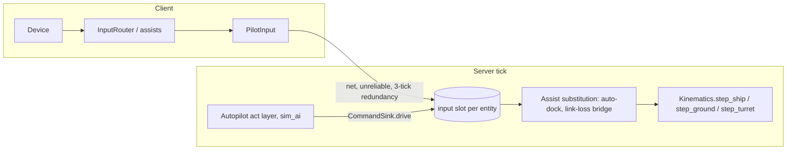
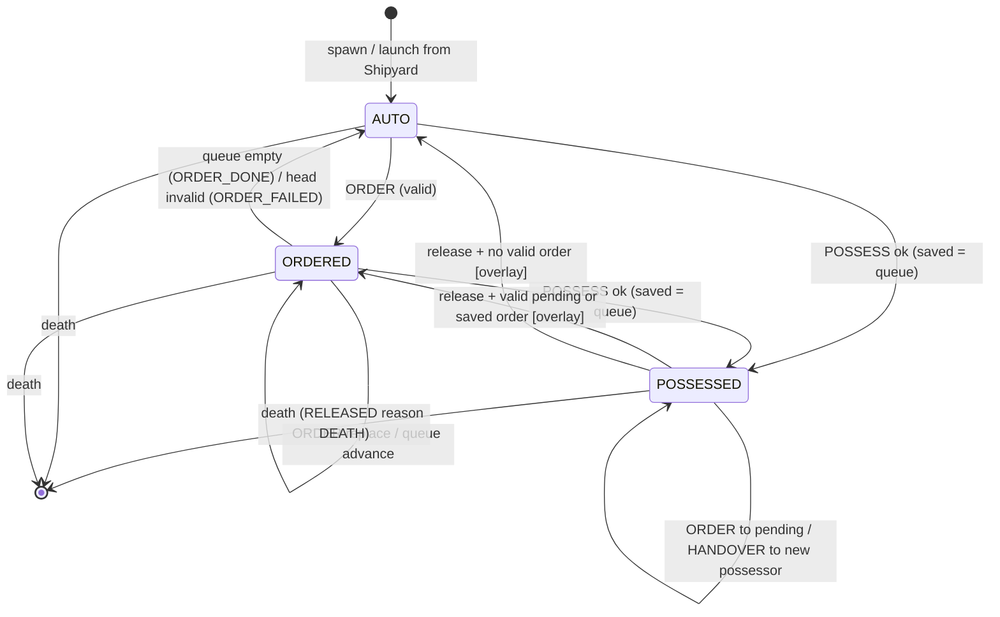
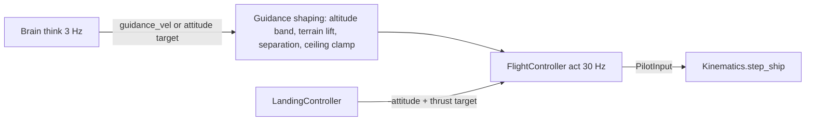
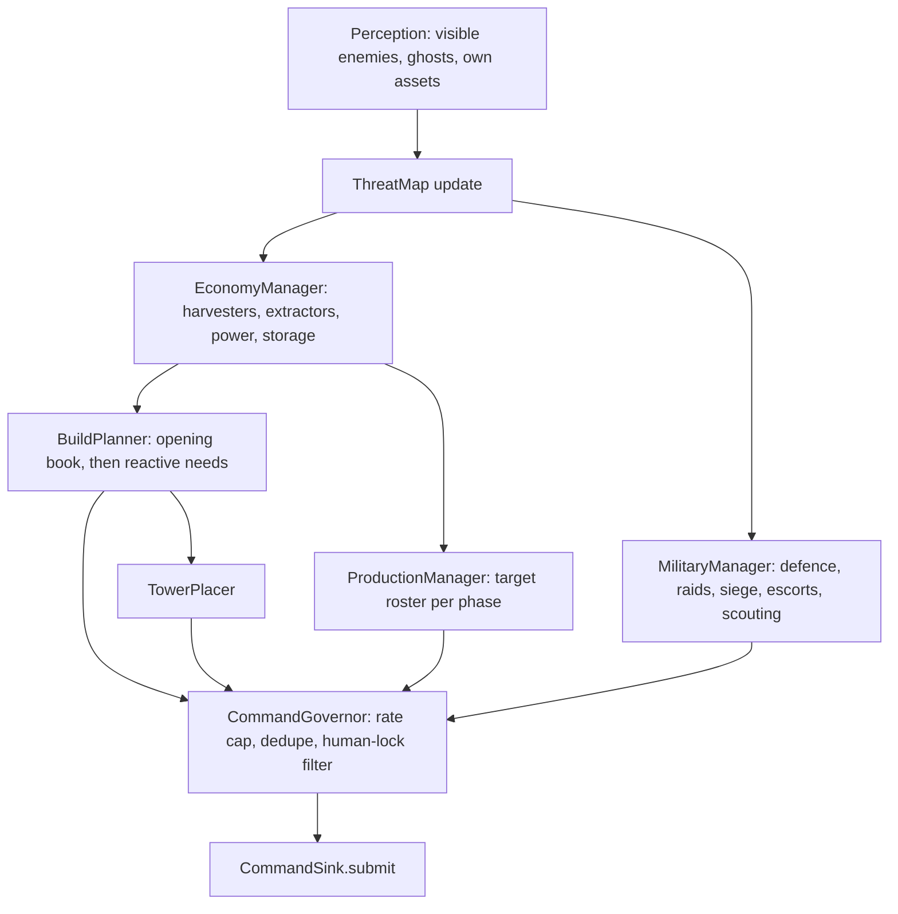

# 05 - AI, Autonomy and Control

| | |
|---|---|
| **Project** | Codename PLANEWAR - arcade spaceship combat + base-building RTS on a spherical moon. Godot 4.7.2, typed GDScript. |
| **Document** | 05 - AI, autonomy and control: control-state machine, orders, autopilots, steering and landing, Commander bot, Adjutant, AI test suite. |
| **Status** | v1.0 (stage 3, revised 2026-10-10) |
| **Date** | 2026-10-10 |
| **Inputs** | `docs/reviews/R0-resolution-register.md` (binding; Part B contract tables override this doc); `docs/01-vision-and-core-decisions.md` v1.1 (binding spine, brief in s12 "05"); `docs/research/R1-game-references.md`; `docs/research/R2-godot-tech.md`; `docs/research/R3-platform-requirements.md` |
| **Owner lane** | `sim_ai` (plus the control-state and order code inside `sim`, and the pure steering controllers, see s1.2) |

**Why this document matters most.** Pillar P1 says the automatic layer *is* the product (R1 s3 item 3). Carrier Command was marked down for fliers crashing on dock orders and tanks stuck in ravines (R1 s2.2); Triplane's own AI could not take off in caves (R1 s1.2). Every decision below favours an autopilot that is boring, predictable and never stupid over one that is clever.

## Decisions inherited from 01

1. Per-entity control state is exactly one of **AUTO / ORDERED / POSSESSED(player)** (01 s4.2). Structures use the same states.
2. Possess / release / orders-during-possession / one pilot per entity / hand-over by request only / team-shared command / disconnect / no cooldowns in v1: the seven handoff rules of 01 s4.4.
3. Safety handoff on release: take over current velocity; pull up if within 2 s of terrain impact; if fuel < 20 % set the order to return; then resume `saved_order` if valid, else AUTO (01 s4.4 rule 2).
4. Class AUTO behaviours and return-to-pad thresholds of 01 s4.3 (fuel < 25 %, ammo = 0, HP < 40 % for combat ships; Bomber never free-roams).
5. Hard ceiling at 2,000 m breaks possession; the autopilot descends to 1,400 m and resumes (01 s3.1.5). Soft ceiling 1,500 m.
6. CF kinematics with the speed-scaled lift law (01 s3.1.1, R0 B.5), `PilotInput` struct (01 s3.1.2, R0 B.3 wire form), **tail-down powered landing** (owner decision O-2, 01 s3.1.4, R0 B.5: body forward/thrust axis within 25 degrees of the pad normal, vertical <= 8 m/s, horizontal <= 15 m/s; every ship hovers, `a_thrust >= 2.0 g`), auto-dock assist within `auto_dock_radius_m` 150 m (01 s3.1.4). Supply Canisters (08 SL-5, A-1 accepted) refuel 40 % and rearm 50 % ammo in flight; bombs and repair still need a landing.
7. Sim is server-authoritative, 30 Hz, SoA packed arrays, `RefCounted`, no Nodes (ADR-06). Autopilots **think every `think_period_ticks` (default 10 = 3 Hz; 15 under cut-ladder rung 1 and on offline web/mobile)** staggered and **act every tick** on a cached plan; the **Commander bot thinks every 30 ticks (1 Hz) at Normal and above** (Easy 90). AI runs inside `SimWorld.step()` through `SimAiHook` (R0 B.5 tick order step 3).
8. AI reads only `SimView` and changes the world only through `Command`s via a `CommandSink` (01 s9.2, s12 "05").
9. Ground navigation is our own A* on the 6 x 256^2 path grid; never `NavigationServer3D` (ADR-05, R2 s9.1).
10. Interest cells 6 x 8 x 8 = 384 (~1,178 m) are the unit of threat maps and alerts (ADR-05).
11. Bots never possess; difficulty tiers are defined by decision cadence, information handicaps and command-rate caps, never by stat cheats (01 s12 "05").
12. Adjutant = throttled Commander bot running a human's economy and replenishment, toggled by `Command.SET_ADJUTANT` (Kind 13); default on in Skirmish and Campaign, selectable in Co-op; in PvP quick-match queues only the restricted `adjutant_economy` profile, shown to opponents as "Auto economy"; off in the post-launch ranked ladder (01 s4.3, owner decision O-6). A disconnected player's slot is run by the Adjutant after 120 s (01 s4.4 rule 6).
13. Team-shared command conflict rule: last command wins, with a 1 s UI echo (01 s12 "05").
14. All tunables in JSON defs under `godot/content/defs/` (ADR-09); gdUnit4 is the only test framework (ADR-11); AI fits inside the 25 ms p95 tick (01 s8.4).
15. `PLANET_RADIUS` = 6,000 m (owner decision O-1) lives in `core/sphere.gd`; this document never hard-codes values derived from it.
16. Start kit (R0 B.6): Core, Refinery, Shipyard with launch pad, Vehicle Bay, 1 Harvester mining; 800 Ore / 300 Ice per player; early share lock 800 Ore until 2:00. No Storage Silo exists (O-4). Siege Crawler, Rail Lance and the moving sun are v1. Start slot k at longitude `22.5 + 45 k`; 1v1 uses slots 0 and 2 (90 degrees, 9,425 m).
17. v1.0 platforms (O-3): Windows/Steam (incl. Deck), Android, web. Offline web and mobile play runs at **Lite** caps until S-WEB-2 passes (R0 B.7).

---

## 1. Scope, module layout and the one control path

### 1.1 The one control path

Every mobile unit and every tower is driven by exactly one `PilotInput` per tick, written into the sim's per-entity input slot. The only difference between a human and an autopilot is who writes the slot:



Consequences: a possessed Dart is the same Dart (P1); the autopilot cannot do anything a human cannot (no teleport turns, no perfect strafing outside rate caps); recorded human inputs and autopilot inputs are interchangeable in tests; client prediction never needs to know about AI. `CommandSink.drive()` is refused by the sim for an entity in POSSESSED state, so an autopilot can never fight a human for the stick.

Ground units use the same struct: `thrust` = forward speed fraction, `yaw` = steer, `BRAKE` = stop; while `BRAKE` stays held for 0.5 s after the unit has stopped it reverses at <= 3 m/s; pitch and roll ignored. Towers use `pitch`/`yaw` as turret slew rates and `FIRE1`. Wire bytes 5-6 are reserved (= 0); there are no `aim_*` fields (R0 B.3, C2-09).

### 1.2 Files and owners (01 s9 layout)

| Path | Lane | Content |
|---|---|---|
| `src/sim/orders/order_spec.gd` | sim (spec here) | `OrderSpec` value class and enums (R0 B.3) |
| `src/sim/orders/order_queue.gd` | sim | side table `orders`: standing and pending queues (max 8 each); the entity store keeps only the `order_kind` u8 head cache |
| `src/sim/orders/order_rules.gd` | sim | validity, completion and failure checks (s3) |
| `src/sim/control/control_machine.gd` | sim | the control-state machine (s2); handles POSSESS, RELEASE, REQUEST_POSSESS, HANDOVER, ceiling, disconnect, death; defines `ReleaseReason` (R0 B.3); sets overlays that `sim_ai` executes |
| `src/sim/steer/flight_controller.gd` | sim (written by the AI lane) | pure inner-loop controller: guidance target -> `PilotInput` (s5.2) |
| `src/sim/steer/landing_controller.gd` | sim (AI lane) | pure landing law (s5.5); also used by the auto-dock assist |
| `src/sim/steer/terrain_probe.gd` | sim (AI lane) | height-field lookahead, time-to-impact (s5.3) |
| `src/sim/steer/assist.gd` | sim (AI lane) | assist substitution (`auto_dock`, `link_bridge`), pure, shared with client prediction |
| `src/sim/sim_ai_hook.gd`, `src/sim/command_sink_base.gd` | sim | abstract hook and sink (s1.3) |
| `src/sim_ai/ai_driver.gd` | sim_ai | implements `SimAiHook`; schedules think/act slices; budget governor (s10) |
| `src/sim_ai/command_sink.gd` | sim_ai | `submit(Command)`, `drive(id, PilotInput)`, `set_ai_tag(id, tag)` |
| `src/sim_ai/ai_state.gd` | sim_ai | SoA autopilot state (mode, timers, target, waypoint) |
| `src/sim_ai/autopilot/*.gd` | sim_ai | `overlays.gd`, `guidance.gd`, `targeting.gd`, `ballistics.gd`, `separation.gd`, `formation.gd`, `rtb.gd` |
| `src/sim_ai/brains/*.gd` | sim_ai | one per class: `dart_brain.gd`, `lancer_brain.gd`, `bomber_brain.gd`, `scout_brain.gd`, `hauler_brain.gd`, `harvester_brain.gd`, `crawler_brain.gd`, `tower_brain.gd` |
| `src/sim_ai/commander/*.gd` | sim_ai | `commander_bot.gd`, `perception.gd`, `threat_map.gd`, `opening_book.gd`, `scripted_director.gd`, `economy_manager.gd`, `build_planner.gd`, `tower_placer.gd`, `production_manager.gd`, `military_manager.gd`, `squad.gd`, `raid_planner.gd`, `siege_planner.gd`, `scout_manager.gd`, `command_governor.gd`, `difficulty_profile.gd` |
| `src/sim_ai/adjutant/adjutant.gd` | sim_ai | restricted Commander profiles (s8) |
| `content/defs/autopilots.json` | content (05) | per-class autopilot parameters (s4.4) |
| `content/defs/order_rules.json` | content (05) | arrival radii, timeouts, per-class allowed order kinds (s3.3) |
| `content/defs/bot_profiles.json` | content (05) | behaviour parameters per difficulty tier id and Adjutant profiles (s7.8, s8); player-facing promises live in 02's `bot_promises.json` |
| `content/defs/build_orders.json` | content (05) | opening books per doctrine (s7.3) and campaign bot scripts (s7.10) |
| `test/unit/sim_ai/`, `test/sim/ai/`, `test/soak/` | test | s11 |

**Why the steering controllers live in `sim/steer/`.** The auto-dock assist (01 s3.1.4) runs the same landing law as the autopilot, and the client must predict its possessed ship under that assist (ADR-07). `net` may depend on `sim` but not on `sim_ai` (01 s9.2, R0 B.4), so the pure controllers sit in `sim`. They are static, side-effect free, and owned by the AI lane. 03 s5.5 autopilot steering calls `FlightController.track_velocity()`; 03 s6.4 auto-dock is `Assist.auto_dock()` (R0 C2-04).

### 1.3 Hook into the tick

`sim` cannot depend on `sim_ai`, so `SimWorld` exposes an abstract hook that `sim_ai` implements (`SimWorld.set_ai_hook(hook)`, R0 B.5). `ServerSession` never calls AI directly; `ServerSession.add_bot` forwards to `AiDriver.add_bot`.

```gdscript
# src/sim/sim_ai_hook.gd  (abstract, in sim)
class_name SimAiHook extends RefCounted
func on_tick(tick: int, view: SimView, sink: CommandSinkBase) -> void:
    pass   # tick-order step 3: after commands and human inputs, before assist substitution and kinematics

# src/sim/command_sink_base.gd  (abstract, in sim; also the type campaign's MissionRuntime receives)
class_name CommandSinkBase extends RefCounted
func submit(cmd: Command) -> CommandResult
func drive(id: int, input: PilotInput) -> bool
func set_ai_tag(id: int, tag: int) -> void       # writes the replicated ai_tag u8 (s6.1)

# src/sim_ai/ai_driver.gd
class_name AiDriver extends SimAiHook
func _init(content: ContentDB, rules: MatchRules, rng: Rng) -> void
func add_bot(slot: int, profile_id: StringName) -> void          # Commander bot or Adjutant profile (bot_profiles.json id)
func remove_bot(slot: int) -> void
func set_adjutant(slot: int, profile_id: StringName, enabled: bool, toggles: int) -> void   # from SET_ADJUTANT (s8)
func set_script(slot: int, script_id: StringName) -> void       # campaign bot script (s7.10)
func set_offline_profile(lite: bool) -> void                     # offline web/mobile: think 15 ticks, 3.5 ms budget (s10)
func on_tick(tick: int, view: SimView, sink: CommandSinkBase) -> void
func serialize() -> PackedByteArray                               # appended to SimWorld.serialize() (03 invariant S4, ADR-10)
func deserialize(bytes: PackedByteArray) -> void
func stats() -> Dictionary                                        # think/act µs, counts; for perf tests

# src/sim_ai/command_sink.gd
class_name CommandSink extends CommandSinkBase
func submit(cmd: Command) -> CommandResult       # ORDER, BUILD, PRODUCE...; goes through SimWorld.apply_command
func drive(id: int, input: PilotInput) -> bool   # writes the input slot; false if POSSESSED or dead
func set_ai_tag(id: int, tag: int) -> void
```

Tick order (03 owns it, R0 B.5; this is the AI's view): 1 commands (incl. POSSESS/RELEASE by `ControlMachine`) -> 2 human `PilotInput`s into slots -> **3 AI hook: think slice + act for all AI-driven entities, overlays executed by `Overlays.run_*`** -> 4 assist substitution (`Assist.auto_dock()` / `Assist.link_bridge()`) -> 5 kinematics -> 6 projectiles -> 7-8 spatial and collision -> 9 combat -> 10 economy/production/build/service/scoring -> 11 vision -> 12 events. `ControlMachine` *sets* an overlay (e.g. SAFETY on release); `sim_ai` *executes* it in step 3, except `LINK_BRIDGE`, which `Assist.link_bridge()` executes in step 4 because `drive` refuses POSSESSED entities.

AI randomness uses a sub-stream of the match PCG32 (`Rng.fork(&"ai")`), never `randf()`.

---

## 2. Control-state machine

### 2.1 Per-entity control fields (sim SoA)

| Field | Type | Meaning |
|---|---|---|
| `control_state` | u8 | `AUTO=0`, `ORDERED=1`, `POSSESSED=2` (R0 B.3) |
| `possessor` | i8 | player slot or -1 |
| `order_kind` | u8 | head-order cache in the entity store (replicated as part of `order_head`) |
| `orders.standing` | side table `orders` (`sim/orders/order_queue.gd`), max 8 `OrderSpec` | head = standing order; while POSSESSED this *is* `saved_order` (kept untouched, with its progress) |
| `orders.pending` | same side table, max 8 | orders issued while POSSESSED; replace `saved_order` on release |
| `order_issuer` | i8 | slot that issued the head order; -1 = system/AUTO |
| `order_tick` | i32 | tick the head was issued (conflict echo, bot lock) |
| `ai_overlay` | u8 | `NONE=0`, `SAFETY=1`, `RECOVER_CEILING=2`, `LINK_BRIDGE=3` (s2.4, R0 B.3); runs before the standing order is resumed |
| `ai_tag` | u8 | brain mode tag written through `CommandSinkBase.set_ai_tag` (s6.1); the only AI field in the entity store (AI state proper lives in `AiState`, s4.3) |
| `last_input_tick` | i32 | tick of the last human `PilotInput` received for this entity |
| `request_from` / `request_tick` | i8 / i32 | outstanding hand-over request (expires after 10 s) |

Service state (`NONE`, `DOCKED`, `TOWING`, `CAPTURING`, `BUILDING`; R0 B.3) and dock state (`FLYING`, `LANDING_ASSIST`, `DOCKED`, `LAUNCHING`) are sim states orthogonal to the control state. Possession never changes them directly.

### 2.2 State diagram



"Release" covers: `RELEASE` command, possessing another entity, hard ceiling, disconnect, possessor's team losing its last Core, match end.

### 2.3 Transition table

Guards are evaluated by `ControlMachine` inside `SimWorld.apply_command` (tick step 1) or in the control check at the start of step 3. Every row emits the listed `SimEvent` (R0 B.3 `SimEvent.Kind`; sub-reasons go in the event payload) or returns the listed `CommandResult.Code`.

| # | From | Trigger | Guard | Action | To | Event / result |
|---|---|---|---|---|---|---|
| C1 | AUTO | `ORDER` | `OrderRules.valid(kind, class, target)` | queue = [order] (append if `QUEUE` flag); set issuer, tick | ORDERED | - (invalid: `REJECTED_INVALID_ORDER`) |
| C2 | ORDERED | `ORDER` (replace) | valid | replace queue; if previous issuer is a different human: echo (s3.4) | ORDERED | `ORDER_FAILED(reason=OVERRIDDEN, by=slot)` to old issuer |
| C3 | ORDERED | `ORDER` with `QUEUE` | valid, queue < 8 | append | ORDERED | - |
| C4 | ORDERED | head complete | completion rule (s3.2) | pop head | ORDERED, or AUTO if empty | `ORDER_DONE` |
| C5 | ORDERED | head impossible | failure rule (s3.2) | pop head; next valid head or AUTO | ORDERED / AUTO | `ORDER_FAILED(reason)`: `INVALID_TARGET`, `UNREACHABLE`, `STUCK`, `NO_PAD`, `NO_AMMO` |
| C6 | AUTO, ORDERED | `POSSESS(e)` by p | alive; team(e) = team(p); def `possessable`; not POSSESSED; service state not `BUILDING`; p not spectator; altitude < 1,950 m | `possessor = p`; queue kept as saved; clear `orders.pending`; if p already possesses e2, run C9 on e2 first in the same tick | POSSESSED | `POSSESSED` |
| C6r | any | `POSSESS(e)` | guard fails | none | unchanged | `CommandResult`: `REJECTED_DEAD`, `REJECTED_NOT_OWNER` (other team), `REJECTED_NOT_POSSESSABLE` (def or under construction), `REJECTED_ALREADY_POSSESSED`, `REJECTED_NO_RIGHTS` (spectator), `REJECTED_UPLINK` (>= 1,950 m) |
| C7 | POSSESSED | `ORDER` (any teammate) | valid | write to `orders.pending` (replace or append) | POSSESSED | `ALERT(PENDING_ORDER)` to pilot |
| C8 | POSSESSED | `REQUEST_POSSESS` by q | q on team, q != p, no live request from another player | `request_from = q` | POSSESSED | `POSSESS_REQUESTED` + `ALERT(HANDOVER_REQUEST)` to p |
| C9 | POSSESSED | `RELEASE` by p, or p possesses another entity | - | `possessor = -1`; queue = pending if any valid, else saved; validate each (drop invalid with `ORDER_FAILED(INVALID_ON_RESUME)`); overlay `SAFETY` | ORDERED / AUTO | `RELEASED(reason=PLAYER)` |
| C10 | POSSESSED | `HANDOVER(q)` by p | `request_from = q`, request age <= 10 s, q in match; q's current possession (if any) released this tick | `possessor = q`; overlay `LINK_BRIDGE` until q's first input; p's input is never replayed | POSSESSED | `RELEASED(reason=HANDOVER)` + `HANDOVER` + `POSSESSED` |
| C11 | POSSESSED | altitude >= hard ceiling (control check) | - | as C9 but overlay `RECOVER_CEILING` | ORDERED / AUTO | `RELEASED(reason=CEILING)` + `CEILING_RELEASE` |
| C12 | POSSESSED | possessor's transport timed out (60 s web / 15 s native) | - | as C9 | ORDERED / AUTO | `RELEASED(reason=DISCONNECT)` |
| C13 | POSSESSED | no human input this tick while connected | - | ticks 1-10 without input: reuse the previous input with stick axes decayed 50 % per tick, thrust held; from tick 11: overlay `LINK_BRIDGE` (state stays POSSESSED until C12) | POSSESSED | `ALERT(LINK_WEAK)` once, on entering `LINK_BRIDGE` |
| C14 | POSSESSED | human input arrives during `LINK_BRIDGE` | - | clear overlay | POSSESSED | - |
| C15 | any | entity dies | - | if POSSESSED, release first; clear control fields | - | `RELEASED(reason=DEATH)`, `DEATH(entity, killer, cause)` |
| C16 | POSSESSED | possessor's team loses its last Core, or match ends | - | as C9 | AUTO | `RELEASED(reason=MATCH)` |
| C17 | any | request older than 10 s, or pilot releases | - | clear `request_from` | unchanged | - |
| C18 | POSSESSED | server-side invalidation (entity changes team, def no longer possessable) or admin action | - | as C9 | ORDERED / AUTO | `RELEASED(reason=INVALID)` / `RELEASED(reason=ADMIN)` |

`ReleaseReason` is the single enum of R0 B.3 (`PLAYER`, `DEATH`, `CEILING`, `HANDOVER`, `DISCONNECT`, `MATCH`, `INVALID`, `ADMIN`), defined in `sim/control/control_machine.gd` and used unchanged by 04's `RELEASED` message.

Notes. Commands are applied in server arrival order within a tick; with two `POSSESS` on the same entity in one tick, the first wins and the second gets `REJECTED_ALREADY_POSSESSED`. The altitude guard in C6 (no possession at >= 1,950 m) is a validity rule, not a cooldown; it stops a pilot re-grabbing a ship the ceiling has just released (01 s4.4 rule 7 keeps "no cooldowns"). A player eliminated as a *commander* (own Core lost, team alive) keeps every possession; they stay a pilot (01 s3.3).

### 2.4 Overlays: safety handoff, ceiling recovery, link bridge

Overlays run before the standing order, at the full 30 Hz act rate, and outrank everything except death.

```gdscript
# src/sim_ai/autopilot/overlays.gd
class_name Overlays extends RefCounted

static func run_safety(id: int, v: SimView, st: AiState, p: AutopilotParams, sink: CommandSink) -> void:
    # 1. Take over current velocity: guidance target = current velocity, no snap to a new heading.
    st.set_guidance(id, Guidance.hold_velocity(v.vel(id)))
    # 2. Terrain: time to impact on the current trajectory (s5.3).
    var tti: float = TerrainProbe.time_to_impact(v.pos(id), v.vel(id), p.probe)
    if tti < p.safety_pull_up_tti_s:                      # 2.0 s (01 s4.4)
        st.set_mode(id, Mode.PULL_UP)                      # nose to local up at max rate, thrust 1, no brake
        return
    # 3. Fuel: below 20 % force a RETURN order issued by the system (issuer -1); the resumed queue stays behind it.
    if v.fuel01(id) < p.safety_force_rtb_fuel01 and not st.has_return(id):   # 0.20 (01 s4.4)
        sink.submit(Orders.make_return(id, Orders.SYSTEM, Orders.FLAG_PREPEND))
    # 4. Settle.
    if tti >= p.safety_clear_tti_s and st.overlay_age_s(id) >= p.safety_min_hold_s:
        st.clear_overlay(id)
    elif st.overlay_age_s(id) >= p.safety_max_hold_s:
        st.clear_overlay(id)
```

| Overlay | Entry | Behaviour | Exit |
|---|---|---|---|
| `SAFETY` | every release (C9, C12, C16, C18); set by `ControlMachine`, executed by `Overlays.run_safety` | hold velocity; pull-up if TTI < 2.0 s; force RETURN if fuel < 20 % | TTI >= 4.0 s and >= 0.5 s elapsed, or 3.0 s max |
| `RECOVER_CEILING` | C11 | guidance: keep heading, flight-path angle -20 degrees, speed controller to cruise; SAFETY checks still apply | altitude <= 1,400 m |
| `LINK_BRIDGE` | C10 (hand-over), C13 (input starvation) | SAFETY behaviour while the state stays POSSESSED; written by the sim through `Assist.link_bridge()` because `CommandSink.drive` refuses POSSESSED entities | first human input from the current possessor, or C9/C12 |

Ground units: SAFETY = brake for 0.5 s, then resume. Towers and production structures: no overlay.

### 2.5 Edge cases

| Case | Resolution |
|---|---|
| **Possess during docking (autopilot in final approach)** | Allowed. The pilot gets the ship mid-air in its nose-up hover attitude (tail-down landing, O-2); the HUD landing guide appears (06). If the pilot holds `DOCK` and the assist tier has auto-dock, `Assist` keeps running the same `LandingController`, so the descent continues seamlessly; otherwise the pilot flies it. The landing is graded `AUTO` if any assist tick occurred in the final 150 m (s5.5). The saved RETURN order stays saved. |
| **Possess while DOCKED (being serviced)** | Allowed. Service continues while the ship sits nose-up on the pad. Thrust >= 0.5 held for 0.3 s launches along the pad normal (`LAUNCHED`, `launch_speed_mps`) and aborts service at the current fill (partial fuel/ammo/repair kept; Ice already spent is not refunded). |
| **Release or disconnect while DOCKED** | C9/C12 with a SAFETY overlay that is satisfied on the pad at once. The ship stays DOCKED; the brain's `DOCKED` mode waits for full service, then resumes the saved order or the class AUTO behaviour (Dart relaunches to patrol; Bomber stays docked). |
| **Release mid-bomb-run** | SAFETY first. ATTACK is then revalidated: target alive and bombs > 0 -> the brain re-plans; if the target is within 2,500 m and within 30 degrees of the nose it continues the run-in from where it is, otherwise it routes to a new initial point (s6.3). Bombs = 0 -> order complete -> RETURN. |
| **Release nose-down at deck altitude after the last bomb** | SAFETY pull-up (TTI < 2 s) outranks everything; the RETURN rule follows. |
| **Possess a unit with a non-empty order queue** | The whole queue, including progress (patrol leg index, harvest phase, haul leg), is the saved order. The HUD shows "Standing order: Patrol (resumes on release)". On release each order is revalidated in sequence; invalid ones are dropped with `ORDER_FAILED(reason=INVALID_ON_RESUME)`. |
| **Orders sent to a possessed unit, then release** | The pending queue wins over the saved order if at least one pending order is valid (01 s4.4 rule 3). |
| **Teammate hand-over during a dive** | C10 swaps the possessor at tick t. Until q's first input arrives (about one RTT), `LINK_BRIDGE` drives: pull-up if TTI < 2 s, else hold velocity. q's 0.5 s camera transition hides the bridge. p's last input is never replayed for q. |
| **Possessed unit crosses the hard ceiling** | C11 on the first tick at altitude >= 2,000 m. `RECOVER_CEILING` descends to 1,400 m, then the saved or pending order resumes. Re-possession is refused (`REJECTED_UPLINK`) while altitude >= 1,950 m. The client shows the one-line reason (06). |
| **Possessed unit dies** | C15; the re-embodiment offer of 01 s3.1.7 is client UI. Wrecks are not possessable. |
| **Pilot's link stalls (web background tab, mobile cell handover)** | C13 reuses the decaying last input for 10 ticks, then `LINK_BRIDGE` (state stays POSSESSED); only the transport timeout (60 s web / 15 s native, ADR-07) triggers C12. |
| **Hauler possessed while towing or capturing** | Tether (kinematic link, s6.5) and capture are sim states; the pilot inherits them, including the `tow_turn_rate_mult` rate cap. Capture continues only while landed on the Relay Station. Release mid-tow resumes the tow leg. |
| **Possess a tower that is offline (power < 50 %)** | Allowed; it slews but cannot fire (sim rule). |
| **Possess a Shipyard or Vehicle Bay** | Opens its production UI; no `PilotInput` effect; the queue keeps running; release is instant (no overlay). |
| **Unit owned by a bot teammate** | Possessable like any team unit. The bot never orders a POSSESSED unit and never writes its pending queue (s7.9). |
| **Two humans order the same unit** | Last command wins (C2) with the echo of s3.4. |

---

## 3. Orders

### 3.1 OrderSpec

```gdscript
# src/sim/orders/order_spec.gd
class_name OrderSpec extends RefCounted
# Ordinals frozen, append-only (R0 B.3; growth = sim/MODULE.md change)
enum Kind { MOVE = 0, PATROL = 1, ATTACK = 2, ESCORT = 3, HARVEST_HERE = 4, HAUL = 5, RETURN = 6, HOLD = 7, GUARD = 8,
            SUPPLY_DROP = 9,      # SL-5, v1 stretch: built only when the C1-13 scope gate opens
            PATROL_ROUTE = 10,    # reserved, v1.x (08 SL-4)
            ATTACK_VIA = 11 }     # reserved, v1.x (08 SL-4)
enum HaulMode { FERRY = 0, TOW = 1, CAPTURE = 2 }
enum EscortMode { FORM = 0, FOCUS = 1, BREAK = 2 }   # SL-2 (v1)
const FLAG_QUEUE: int = 1        # append instead of replace
const FLAG_PREPEND: int = 2      # system use only (forced RETURN)
const FLAG_LOW: int = 4          # fly the leg in the Deck band (raids)
var kind: Kind
var target: int = 0              # EntityId or 0 (ESCORT: the leader / escortee)
var point: Vector3 = Vector3.ZERO  # world position on/above the surface; altitude = its own |p| - PLANET_RADIUS
var points: PackedVector3Array   # PATROL waypoints (2..8 validated; the wire allows 0-16 for future route kinds)
var haul_mode: HaulMode = HaulMode.FERRY
var escort_slot: int = -1        # SL-2 formation slot index (wing.json slots_brf_m); -1 = class default slots (s5.6)
var focus: int = 0               # SL-2 focus target EntityId (EscortMode.FOCUS)
var escort_mode: EscortMode = EscortMode.FORM
var flags: int = 0
var issuer: int = -1             # player slot, -1 system
var issue_tick: int = 0
var progress: int = 0            # leg index / cycle phase, preserved across possession
```

The wire encoding is 04's `ORDER` payload (R0 C2-06): `order_kind u8, flags u8 (QUEUE, LOW), haul_mode u8, count u8, ids[count] u32, target u32, point_count u8 (0-16), points[] vec3q (8 B)`, max 256 B; ESCORT's `escort_slot`, `focus` and `escort_mode` fit inside that layout; 04 s2.5 owns the exact packing. `PREPEND` is never accepted from clients.

### 3.2 Vocabulary, validity, completion, failure

| Kind | Valid for | Target / point | Executes as | Completes when | Fails when |
|---|---|---|---|---|---|
| MOVE | all units | point | fly/drive to point; ships arrive at ordered altitude band or 300 m AGL default | within 150 m (ships) / 40 m (ground) of point | `UNREACHABLE` (ground: no path); point inside hard-ceiling band (clamped, not failed) |
| PATROL | ships, ground combat | 2-8 points | loop legs; engage per class AUTO rules within 1,200 m of the route, then rejoin | never (standing) | - |
| ATTACK | Dart, Lancer, Bomber, Siege Crawler, towers (manual target) | entity or ground point | class attack behaviour (s6) | target dead; point attacked once with full salvo (bombers) or 20 s of fire (guns) | `INVALID_TARGET`: not visible to team for 30 s (ghost expired); `NO_AMMO`: no ammo and no bombs (then RETURN) |
| ESCORT | Dart, Lancer | friendly unit; SL-2 adds `escort_slot`, `focus`, `escort_mode` | formation slot (s5.6); FORM: engage threats within 1,000 m of the escortee; FOCUS: attack `focus` on a 2,000 m leash for <= 20 s, then FORM; BREAK: engage freely within 1,200 m for 20 s, then FORM (`wing.json`) | escortee docked or dead; own RTB rule (wingman leaves) | `INVALID_TARGET`: escortee dead (fails to AUTO) |
| HARVEST_HERE | Harvester | Ore Field entity | mining cycle on that field | field depleted -> falls back to AUTO (nearest field) | `UNREACHABLE` |
| HAUL | Hauler | FERRY: extractor; TOW: wreck; CAPTURE: Relay Station (06: Relay Station targeted with a Hauler selected) | s6.5 | FERRY never; TOW wreck delivered; CAPTURE station owned | `INVALID_TARGET`: wreck expired; station destroyed, or owned by enemy and defended (threat > limit for 20 s) |
| RETURN | ships | optional pad id | RTB + tail-down landing (s5.5); pad chosen by the pad-selection choice point if 0 | DOCKED and fully serviced | `NO_PAD`: no friendly pad exists (then loiter over Core at 400 m and re-try every 5 s) |
| HOLD | all units, towers | point = current | ships orbit 250 m radius at current altitude; ground stops; tower holds fire | never | - |
| GUARD | ships, ground combat, towers | friendly structure or point | ships orbit 600 m radius, engage within 1,500 m, prioritise attackers of the guarded thing; towers prioritise attackers of the guarded thing inside their envelope | never | `INVALID_TARGET`: guarded structure dead |
| SUPPLY_DROP (SL-5, v1 stretch) | pad-bearing structures (Core pad, Pad, Hangar, held Relay Station) | friendly ship | sim launches a canister (`commander_verbs.json`); the target's brain diverts (s6.10) | canister launched | `CommandResult` reject (range, pad cooldown, team cap, cost; 08 SL-5) |

Return-to-pad rules (01 s4.3) interrupt every kind except RETURN: when they trigger, the brain *prepends* a system RETURN; the interrupted order resumes after service. A Bomber's ATTACK, when complete, is followed by RETURN automatically.

### 3.3 Order rules data

`content/defs/order_rules.json` holds the arrival radii, ghost timeout (30 s), attack gun duration (20 s), patrol engage radius (1,200 m), escort engage radius (1,000 m), guard radius (600 m / 1,500 m) and per-class allowed kinds (towers: ATTACK, HOLD, GUARD only; 04 V-ORD reads the same table), so all numbers above are tunable without code (ADR-09). SL-2 escort numbers (slots, focus timeout and leash, break radius) are read from 08's `wing.json`. Reserved kinds 10-11 are rejected with `REJECTED_INVALID_ORDER` until adopted; kind 9 likewise until the SL-5 scope gate opens.

### 3.4 Team-shared command conflicts

- **Last command wins.** The sim applies `ORDER`s in arrival order; no ownership of units between teammates (01 s4.4 rule 5).
- **1 s UI echo.** When an `ORDER` replaces a head issued by a *different human* less than 10 s earlier, the sim emits `ORDER_FAILED(reason=OVERRIDDEN, by=slot)` to the previous issuer, which 06 maps to `AlertKind.ORDER_OVERRIDDEN`. The client (06) shows for 1 s on the unit and in the alert feed: "Wolf re-ordered Dart 7: Attack -> Patrol". The new issuer gets the same echo, so both know.
- **Bots yield to humans.** A bot never replaces a head order issued by a human within the last `human_order_lock_s` = 60 s, never orders a POSSESSED unit, and never writes a pending queue (s7.9).
- **Pending orders.** Multiple teammates ordering a possessed unit: the last pending replaces earlier ones; the pilot sees the latest with the issuer's name.

---

## 4. Autopilot architecture

### 4.1 Options considered

| Criterion (weight) | Behaviour trees | Pure utility AI | HFSM (flat per class, with a few nested landing/attack sub-machines) |
|---|---|---|---|
| GDScript cost at 3 Hz x ~650 AI units (high) | tree walk per think with virtual calls per node; per-entity blackboard objects | scores every action every think; cheap per action, but every action re-scored | one `match` on an int mode + 2-4 guard checks per think; cheapest |
| SoA / serialisation (high) | running-node stacks per entity are awkward to store in packed arrays and to `serialize()` (ADR-10 saves) | stateless apart from the chosen action; easy | mode + timers + target fit in 5 packed arrays; trivial save/load |
| Predictability for players and testers (high, P4 and R1 s1.3 item 6) | good | poor: oscillation between near-equal scores, hard to explain | best: named modes, explicit transitions, readable HUD tags |
| Data-driven tuning by Haiku agents (medium) | tree shapes in JSON are agent-hostile | weights in JSON are easy | thresholds and weights in JSON are easy |
| Testability (high) | node-level tests, many mocks | score tables | transition-table tests: one assertion per row |
| Handling open-ended choice (medium) | selectors with ordering | best | weak on its own |

### 4.2 Decision: data-driven HFSM with utility choice points

Each class brain is a **flat finite-state machine** over an integer `mode`, with two nested sub-machines shared by all ships (`Landing` s5.5 and `AttackRun` s6.3). Where a brain must choose among open-ended options (which target, which field, which pad, whether to break off), it calls a **utility choice point**: a pure function that scores candidates with weights from JSON and returns the best, with a **hysteresis margin** (a new choice must beat the current one by 20 %, `switch_margin = 1.2`) to stop flip-flopping. Rationale: the FSM gives cheap, serialisable, explainable behaviour; utility gives good choices where an FSM would need dozens of states; hysteresis removes utility's main flaw.

### 4.3 Think / act split and staggering

| Layer | Rate | Runs | Output |
|---|---|---|---|
| **Think** (brain) | every `P` ticks, entity thinks when `(tick + slot) % P == 0`; `P` = `autopilots.json` `think_period_ticks` (10 = 3 Hz), raised to 15 under 03 s4.3 cut-ladder rung 1 (part of the default `sim_budget_profile` [1, 2]; S-SIM-1 decides whether the server can return to 10) and always 15 offline on web/mobile (Lite, s10) | mode transitions, choice points, sensing queries, path requests, terrain lookahead | `AiState`: mode, `guidance` (target velocity vector or attitude target), target id, fire permissions, cached aim lead |
| **Act** (controller) | every tick (30 Hz) | `FlightController` / ground follower / turret slew; trigger logic; per-tick emergency check on the cached TTI | one `PilotInput` via `CommandSink.drive()` |
| **Event wake** | same tick | `HIT` on self, `DEATH` of current target, order change, overlay entry | forces a think on the next tick, once per 5 ticks max per entity |

Brains are **batched by class**: `AiDriver` keeps one `PackedInt32Array` of entity ids per class and calls `DartBrain.think_batch(ids, view, state, params)`; no per-entity objects. All brains are static functions over `AiState` arrays.

```gdscript
# src/sim_ai/ai_state.gd  (SoA, indexed by entity slot)
class_name AiState extends RefCounted
var mode: PackedInt32Array            # brain-specific enum value
var mode_since: PackedInt32Array      # tick
var overlay_since: PackedInt32Array
var target: PackedInt32Array          # EntityId or 0
var aux_id: PackedInt32Array          # pad / field / escortee / squad id
var guidance_vel: PackedVector3Array  # desired world velocity (flight) or desired heading*speed (ground)
var guidance_point: PackedVector3Array
var aim_lead: PackedVector3Array      # cached lead point for guns/turrets
var tti: PackedFloat32Array           # cached time-to-impact (s)
var timer: PackedFloat32Array         # generic per-mode timer (s)
var fire_mask: PackedByteArray        # bit0 guns allowed, bit1 bombs armed, bit2 rockets allowed
var path_ticket: PackedInt32Array     # pending Pathing ticket or -1 (ground units)
var path: Dictionary                  # slot -> PackedVector3Array (ground units only); replaced whole, never mutated in place (03 s12.2 rule 11)
func ensure_capacity(slots: int) -> void
func set_mode(id: int, m: int, tick: int) -> void
func serialize() -> PackedByteArray
func deserialize(b: PackedByteArray) -> void

# Brain contract (one file per class)
class_name DartBrain extends RefCounted
static func think_batch(ids: PackedInt32Array, v: SimView, st: AiState, p: AutopilotParams, sink: CommandSink, tick: int) -> void
static func act_batch(ids: PackedInt32Array, v: SimView, st: AiState, p: AutopilotParams, sink: CommandSink) -> void
```

### 4.4 Parameter set in JSON

`content/defs/autopilots.json` (`AutopilotDef[]`, owner 05, R0 B.1): one object per autopilot id (`ap_dart`, `ap_lancer`, `ap_bomber`, `ap_scout`, `ap_hauler`, `ap_harvester`, `ap_crawler`, plus one per tower), referenced by each def's `autopilot` field; loaded into typed `AutopilotParams` by `ContentDB`. `rtb.fuel01` and `rtb.hp01` are public (08 SL-3 reads them). Values below are the v1.0 defaults (all *anchors* for S-FLIGHT-1 tuning). Speeds, rates and thrust are never duplicated here: brains read `v_cruise`, `v_boost`, `a_thrust`, `pitch_rate_dps`... from `ShipDef` under 02's names.

```json
{
  "ap_dart": {
    "think_period_ticks": 10,
    "cruise_alt_agl_m": 300, "deck_alt_agl_m": 60, "max_alt_m": 1450,
    "min_clearance_m": 25, "clearance_per_mps": 0.25,
    "probe_times_s": [0.5, 1.0, 1.5, 2.0, 3.0, 4.0],
    "safety_pull_up_tti_s": 2.0, "safety_clear_tti_s": 4.0, "safety_min_hold_s": 0.5, "safety_max_hold_s": 3.0,
    "safety_force_rtb_fuel01": 0.20,
    "rtb": { "fuel01": 0.25, "ammo": 0, "hp01": 0.40, "fuel_reserve_s": 30, "fuel_margin": 1.2 },
    "patrol_radius_m": 1200, "intercept_radius_m": 2000,
    "target_weights": { "harvester": 1.0, "bomber": 1.0, "hauler": 0.8, "lancer": 0.6, "dart": 0.5, "scout": 0.4, "siege_crawler": 0.7 },
    "target_dist_falloff_m": 1500, "target_under_tower_penalty": 0.5, "switch_margin": 1.2,
    "gun": { "fire_range_m": 650, "fire_cone_k": 1.5, "burst_s": 0.6, "pause_s": 0.3, "aim_error_deg": 1.2, "lead_iterations": 2 },
    "bomb": { "dive_angle_deg": 30, "release_tolerance_m": 15, "pullout_g_margin_s": 1.5 },
    "evade": { "hp_drop_trigger": 0.15, "duration_s": 2.5 },
    "separation": { "radius_m": 60, "gain": 1.0 },
    "flight": { "kp_path": 2.5, "ki_path": 0.6, "kp_roll": 3.0, "kp_yaw": 1.5, "bank_threshold_deg": 10,
                "kp_speed": 0.05, "ki_speed": 0.02, "brake_overspeed_mps": 20, "k_guidance": 0.8 },
    "landing": { "gate_dist_m": 1200, "pitch_over_agl_m": 20, "launch_climb_agl_m": 80, "glide_deg": 8, "transition_dist_m": 250, "transition_agl_m": 60,
                 "hover_agl_m": 25, "flare_agl_m": 8, "touch_vz_mps": 2.0, "max_tilt_deg": 30,
                 "kp_pos": 0.35, "kd_pos": 1.1, "kp_vz": 1.2, "abort_horiz_err_m": 12, "abort_vz_mps": 6, "max_attempts": 3 }
  }
}
```

`think_period_ticks` is the online default; `AiDriver.set_offline_profile(true)` (offline web/mobile, s10) and cut-ladder rung 1 override it to 15 for every class. Other classes share the schema with their own values (Lancer: `cruise_alt_agl_m` 200, `target_weights` ground-first; Bomber: `cruise_alt_agl_m` 400; Scout: `flee_radius_m` 1000; Hauler: `tow_scan_m` 800, `tow_enemy_clear_m` 1000 (tether geometry and the towing rate cap come from `flight_common`, s6.5); Harvester: `flee_radius_m` 600, `quiet_s` 15; towers: priority tables, s6.8). The JSON Schema `tools/schemas/autopilots.schema.json` constrains ranges (e.g. `kp_*` in (0, 10], times > 0) so Haiku edits are safe.

---

## 5. Steering for CF kinematics

### 5.1 Layers



The brain never touches stick axes. It expresses intent as a **desired world velocity** `v_cmd` (cruise, intercept, patrol, egress) or, in landing and hover phases, as a **desired thrust direction and magnitude** (s5.5). `FlightController` turns either into a `PilotInput`. Both are pure and live in `src/sim/steer/`.

### 5.2 FlightController (inner loop, every tick)

Because thrust acts only along the body forward axis and the CF model damps body-sideways and body-up velocity (01 s3.1.1), the controller flies the **flight-path vector** the way a pilot flies a velocity marker: it rotates the ship until the *velocity* points where guidance wants, and lets the nose find whatever angle of attack holds that path. This is model-agnostic: it does not need the closed-form equilibrium of the CF model, which 03 owns and 02 tunes. Under the default lift law (`rules.lift_model = speed_scaled`, `k_up_eff` rising from `k_up` to `k_up_flight` with forward speed; R0 B.5) the steady angle of attack at 0.9 x `v_cruise` is <= 6 degrees (03 TA-12 acceptance), so the pitch integrator below carries only a small trim; under the `damping_only` A/B variant it carries much more, which is why it is clamped and reset per mode.

Definitions per tick: `B` = body basis (`fwd`, `up`, `right`), `v` = velocity, `d = normalize(v_cmd)`, `s_cmd = |v_cmd|`, `u = |v|`. Errors in body frame of the commanded direction relative to the current velocity direction:

```
e_vec   = B^T * d - B^T * normalize(v)          # small-angle error, body components
e_pitch = atan2(dot(d, up), dot(d, fwd)) - atan2(dot(v, up), dot(v, fwd))
e_lat   = atan2(dot(d, right), dot(d, fwd))     # lateral angle of the command off the nose
```

Control law (`flight` params of s4.4; inputs clamped to their ranges):

| Output | Law |
|---|---|
| roll | if `abs(e_lat) > bank_threshold_deg`: bank-to-turn, `roll = kp_roll * angle(up_projected, d_lateral)` (rotate body up toward the lateral command); else wings-level: `roll = kp_roll * angle(right, local_horizontal_right)`, so released ships settle head-up (helps the camera, 01 s4.1) |
| pitch | `pitch = kp_path * e_pitch + ki_path * integral(e_pitch)`; integrator clamped to +-0.5 and reset on mode change; it absorbs the steady angle of attack |
| yaw | `yaw = kp_yaw * e_lat` when `abs(e_lat) <= bank_threshold_deg`, else 0 (fine heading only) |
| thrust | `thrust = clamp(t_trim + kp_speed * (s_cmd - u) + ki_speed * integral(s_cmd - u), 0, 1)`; `t_trim` 0.5 |
| brake | on when `u - s_cmd > brake_overspeed_mps` (20 m/s) |
| boost | brain-controlled only (intercept closing > 600 m, egress under fire); respects def cooldown |
| flip | brain-controlled only (s6.2 evade, s6.3 egress) |

Inputs are rate commands scaled by the def's caps (`pitch_rate_dps` / `yaw_rate_dps` / `roll_rate_dps` 120 / 60 / 180 and `rate_accel_dps2` 720 for the Dart, 02 s2.2; times `tow_turn_rate_mult` while towing), so the autopilot is bound by the same agility as a human. Gains are anchors to be tuned in S-FLIGHT-1 with the tuning harness (AI-06); acceptance: from any attitude, the velocity converges within 5 degrees of a step command in <= 2.0 s with < 15 % overshoot at cruise speed.

```gdscript
# src/sim/steer/flight_controller.gd
class_name FlightController extends RefCounted
static func track_velocity(b: Basis, v: Vector3, v_cmd: Vector3, up_local: Vector3,
        g: FlightGains, integ: Vector2, out: PilotInput) -> Vector2          # returns updated integrators
static func track_thrust_vector(b: Basis, t_dir: Vector3, t_mag01: float, up_local: Vector3,
        g: FlightGains, out: PilotInput) -> void                             # landing / hover mode (s5.5)
```

### 5.3 Terrain avoidance by height-field lookahead

`TerrainProbe` predicts the ship's path ballistically (straight line in the tangent frame, transported along the great circle, plus gravity drop `0.5 g t^2` along local down) and samples `Terrain.height_at(dir)` at the `probe_times_s` = 0.5, 1, 1.5, 2, 3, 4 s. Clearance at sample k: `c_k = (|p_k| - PLANET_RADIUS) - Terrain.height_at(normalize(p_k))`.

```gdscript
# src/sim/steer/terrain_probe.gd
class_name TerrainProbe extends RefCounted
static func time_to_impact(p: Vector3, v: Vector3, probe: ProbeParams) -> float      # INF if no sample below 0
static func min_clearance(p: Vector3, v: Vector3, probe: ProbeParams) -> Vector2     # (clearance m, time s) of worst sample
static func terrain_lift(p: Vector3, v: Vector3, probe: ProbeParams, h_req: float) -> float  # m/s of extra climb
```

- **Required clearance** `h_req = min_clearance_m + clearance_per_mps * u` (Dart at 110 m/s: 25 + 27.5 = 52.5 m).
- **Lift**: for the worst sample, `lift = max(0, h_req - c_k) / max(t_k, 0.5)` m/s, added to `v_cmd` along local up (capped at 0.6 u). This produces smooth ridge hopping; rilles and crater rims are flown over, not through.
- **TTI**: the first sample with `c_k <= 0`, linearly refined between samples. Cached in `AiState.tti` at think; at act, every 3rd tick the probe re-samples only the 1.0 s point; if it is below 0, the emergency **PULL_UP** mode starts that tick (nose to local up at max rate, thrust 1, brake off) until TTI >= 4 s.
- **Altitude band clamp**: guidance never commands above `max_alt_m` = 1,450 m (below the 1,500 m soft ceiling) and never below `deck_alt_agl_m` except in landing.
- **Cost**: 6 bilinear samples per think, 1 per 3 ticks at act. At 400 AI ships: 400 x (6 x 3 + 10) = 11,200 samples/s, about 375 per tick.

Ground units do not probe; their path grid already encodes slope.

### 5.4 Separation and structure avoidance

At think, `SimView.ids_near(p, separation.radius_m = 60, MASK_SHIPS_AND_TALL_STRUCTURES)` (collision-hash backed) gives neighbours. For each friendly ship j: `v_cmd += gain * (p - p_j).normalized() * (60 - dist) / 60 * 20 m/s`. For structures taller than the current AGL minus 10 m, the probe treats the structure's bounding sphere as terrain (sampled at the same times). Ramming kills both ships (01 s3.1.3), so separation outranks formation keeping. Enemy ships are never avoided by separation (guns and the flip handle them).

### 5.5 Landing controller

**Landing model (owner decision O-2, closed).** Landing is a **tail-down powered landing**, Lunar-Lander style (R1 s2.5): the ship transitions from aircraft flight to a nose-up hover on its main engine over the pad and settles tail-first onto its tail landing struts (`HP_Gear_0..2`, 07). The sim's touchdown rule is R0 B.5: within `pad_radius_m` horizontally, `-v.dot(up_pad) <= landing_safe_v_vert` (8 m/s), tangential speed <= `landing_safe_v_hor` (15 m/s), and `fwd.dot(up_pad) >= cos(landing_safe_pitch_deg)` (thrust axis within 25 degrees of the pad normal); between the safe and damage limits (15 / 25 m/s, attitude 25-45 degrees) the hull takes damage. Every ship hovers with margin: the schema enforces `a_thrust >= 2.0 * gravity` (12.0 m/s^2; Bomber 14 = 2.3 g is the floor). Launch is the mirror image: `LAUNCHED` sets `vel = launch_speed_mps * up_pad`, the brain climbs along the pad normal and pitches over above `pitch_over_agl_m` (20 m AGL).

**Pad selection** (`rtb.gd`, choice point, at RTB start and when the chosen pad becomes invalid): candidates = friendly pads (Core pad, Pad, Hangar, Outpost pad, owned Relay Station; each with `pad_radius_m` from its def) that accept this class. Score:

```
score = 1 / (1 + eta_s / 60) * w_free * w_hangar * (1 - risk01)
eta_s     = great-circle distance / v_cruise + queue_len * 15 s
w_free    = 1.0 if free, 0.6 if 1 ship queued, 0.3 if 2+
w_hangar  = 1.2 for a Hangar if the threat map shows enemy bombers within 3 km, else 1.0
risk01    = clamp(threat_air(cell of pad) / 50, 0, 0.9)
fuel check: reject if fuel needed (eta at cruise burn + fuel_reserve_s) > remaining fuel; if all rejected pick the nearest
```

**Pad reservation.** The brain sends nothing special; the sim's Pad service queue (01 s4.3 "service docked ships in arrival order") is read through `SimView`. A ship arriving at a busy pad holds (L2b) in a 400 m orbit at 150 m AGL until the pad is free, keeping 25 s of fuel reserve, else diverts.

**Phases** (sub-machine `Landing`, entered by RETURN):

| Phase | Entry | Guidance | Exit / next |
|---|---|---|---|
| L1 TRANSIT | RETURN starts | `v_cmd` toward the pad along the great circle at `v_cruise`, altitude `cruise_alt_agl_m`; terrain lift active | distance to pad < `gate_dist_m` (1,200 m) -> L2 |
| L2 APPROACH | gate | choose approach bearing: 8 candidates (45 degree steps), score = alignment with current track (cos) - terrain penalty (max probe height along the 1,200 m line above the glide path) - threat (enemy towers whose envelope covers the line); then fly the glide slope: target AGL `h(d) = d * tan(glide_deg = 8)`, speed schedule `s(d) = 40 + (v_cruise - 40) * (d - 250) / (gate - 250)` | d < `transition_dist_m` (250 m) and AGL within +-25 m of `h(d)` -> L4; else L3 |
| L2b HOLD | pad busy | 400 m orbit, 150 m AGL | pad free -> L2 |
| L3 GO-AROUND | any abort rule | climb at full thrust to 200 m AGL along the approach bearing, extend 1,500 m, re-enter L2; attempts + 1 | attempts > `max_attempts` (3) -> select a different pad, attempts = 0 |
| L4 TRANSITION | d < 250 m | pitch nose up toward local up while braking; switch the controller to `track_thrust_vector` once the nose is within 45 degrees of local up | horizontal speed < 15 m/s and over the pad within 30 m -> L5 |
| L5 HOVER-DESCENT | stable | position law below; target sink `vz_cmd = -clamp(0.25 * agl, 1.5, 6.0)` m/s | agl < `flare_agl_m` (8 m) -> L6 |
| L6 FLARE / TOUCH | agl < 8 m | `vz_cmd = -touch_vz_mps` (2.0); horizontal speed target 0; thrust axis within 10 degrees of the pad normal | sim reports contact: `LANDING` (grade) then `DOCKED` |

**Position law (L4-L6)**, horizontal components in the pad's tangent frame, `e` = pad centre minus ship position, `w` = horizontal velocity:

```
a_h   = kp_pos * e - kd_pos * w                    # 0.35 /s^2, 1.1 /s
a_v   = kp_vz * (vz_cmd - vz)                       # 1.2 /s
T     = a_h + a_v * n + g * n                       # n = pad normal, g = rules.gravity (6.0), never hard-coded
t_dir = T limited to max_tilt_deg (30) from n; t_mag01 = |T| / (a_thrust * eff)
```

`a_thrust` and `eff` come from the ship def and `Kinematics.thrust_efficiency()`; the schema minimum `a_thrust >= 2.0 g` guarantees the 30 degree tilt limit (needs >= 1.16 g vertical plus horizontal authority) is always reachable.

**Abort rules** (any -> L3): horizontal error > `abort_horiz_err_m` (12 m) below 15 m AGL; sink > `abort_vz_mps` (6 m/s) below 10 m AGL; pad destroyed, occupied by another ship, or taken; a bomb or rocket inbound to the pad cell (`SimView` projectile query, 300 m); TTI < 1.0 s with the pad not the impact point. Touchdown limits (8 / 15 m/s, 25 degrees) leave a factor of 4 on sink, 3 on drift and 2.5 on attitude: the autopilot never lands near the damage threshold. Autopilot landings are graded `AUTO` (`LandingGrade`, 08 SL-1), but the sim still computes their quality score `q`, which the soak uses as the landing-quality oracle (s11.3: mean q >= 0.70).

**Auto-dock assist.** When a possessed ship's input has `DOCK` held and the ship is within `auto_dock_radius_m` (150 m) of a free friendly pad, `Assist.auto_dock()` substitutes L4-L6 (TRANSITION, HOVER-DESCENT, FLARE) outputs for the human input in tick step 4, on server and in client prediction (`Prediction`, 04 NET-18) alike; dock state reads `LANDING_ASSIST`; releasing `DOCK` hands the stick straight back. A landing counts as manual (and earns a `LandingGrade` above `AUTO`, 08 SL-1) only when no assist tick occurred in the final 150 m.

```gdscript
# src/sim/steer/landing_controller.gd
class_name LandingController extends RefCounted
enum Phase { TRANSIT, APPROACH, HOLD, GO_AROUND, TRANSITION, HOVER, FLARE, DONE }
static func step(phase: Phase, ship: ShipSnapshot, pad: PadSnapshot, prm: LandingParams, out: PilotInput) -> Phase
static func choose_bearing(pad: PadSnapshot, ship: ShipSnapshot, threat: ThreatSampler, prm: LandingParams) -> Vector3
static func should_abort(phase: Phase, ship: ShipSnapshot, pad: PadSnapshot, prm: LandingParams) -> int   # 0 or reason
```

### 5.6 Formation and escort

Escort slots are offsets in the escortee's tangent frame (forward = escortee velocity heading): slot 0 (-40 right, -30 fwd, +20 up), slot 1 (+40, -30, +20), slot 2 (0, -60, +40), slot 3 (-80, -60, +20). `v_cmd = v_escortee + k_form * (slot_world - p)`, `k_form` = 0.5 /s, speed capped at the escort's cruise + 10 %. Escorts break formation to engage threats within 1,000 m of the escortee whose utility exceeds 0.5, at most half the escorts at once (the lower slot indices stay), and rejoin when the threat is gone or 1,500 m from the escortee. Squads in the Commander's raids use the same slots relative to the squad leader. **SL-2 wing (v1, 08):** an ESCORT with `escort_slot >= 0` uses `wing.json` `slots_brf_m` in the leader's body frame (tolerance 30 m) instead; FOCUS and BREAK follow s3.2; wingmen leave on their own RTB rule and never follow the leader above the soft ceiling. Bots never issue the wing macro; campaign scripts may (s7.10).

### 5.7 Ground following

Harvesters and Siege Crawlers follow A* paths (ADR-05, S-NAV-1) as polylines of path-grid cell centres. Paths come from the sim's time-sliced A* (R0 C1-05, B.5): at think the brain calls `Pathing.request(from, to, mask) -> ticket` and stores the ticket in `AiState`; each later think polls `Pathing.result(ticket)`, which stays empty while the query is pending. Queued queries progress incrementally under `rules.path_expansions_per_tick` (anchor 2,000, about 0.5 ms; budgeted in 03 s4.2, not in the AI budget); a cache keyed by (start cluster, goal cell) and invalidated by the per-face change counter serves the repeated harvester loops. A unit without a path waits (BRAKE); a query not answered within 30 ticks counts as one stuck strike. There is no AI-side query cap. Following: pure pursuit with a 40 m lookahead; `yaw` from heading error (`kp` 2.0), `thrust` from 1.0 on straight legs to 0.4 when heading error > 45 degrees. Stuck detection: progress < 5 m in 10 s -> repath once, then pick another destination, then report `ORDER_FAILED(reason=STUCK)`. Path invalidation: the path grid's change counter per face; a changed face along the path triggers a repath at the next think.

---

## 6. Per-class autopilots

Sensing inputs for every brain come from `SimView` only: own state (`pos`, `vel`, `basis`, `hp01`, `fuel01`, `ammo`, `bombs`), `ids_near` with masks, `visible_to(team, id)` for enemies (brains never read an entity their team cannot see), `stockpile(team)`, and the team's threat map (s7.4) through a read-only `ThreatSampler` (shared per team, refreshed at 1 Hz by the AI driver whether or not a Commander bot exists).

**Common RTB rule (all ships).** At every think, `needs_rtb = fuel01 < max(rtb.fuel01, fuel_needed01 * fuel_margin) or (has_gun and ammo == rtb.ammo and bombs == 0) or hp01 < rtb.hp01`, where `fuel_needed01` = (great-circle distance to the best pad / `v_cruise` + `fuel_reserve_s`) / `fuel_s`. 01's 25 % stays the floor; the distance term only makes far-flung ships turn home earlier. When true and the head order is not RETURN, the brain prepends a system RETURN (s3.2).

### 6.1 Mode tags

Every brain writes its mode as a short tag with `CommandSinkBase.set_ai_tag(id, tag)` into the entity store's `ai_tag` u8 (read back as `SimView.ai_tag(id)`, replicated in the tier A/B flags for the own team; 04) so the HUD can show "RTB", "INTERCEPT", "LANDING" on any unit. Readable autopilots are a P4 requirement and the cheapest debugging tool.

### 6.2 Dart (interceptor)

| Mode | Behaviour | Transitions |
|---|---|---|
| LAUNCH | climb tail-first along the pad normal, pitch over above `pitch_over_agl_m` (20 m) toward the patrol centre | AGL > `launch_climb_agl_m` (80 m) -> PATROL (or head order) |
| PATROL | AUTO: orbit waypoints on a 1,200 m circle around home pad (or last ordered point) at `cruise_alt_agl_m`, 6 points, `v_cruise` | target chosen -> INTERCEPT; RTB rule -> RETURN |
| INTERCEPT | lead pursuit at boost while closing > 600 m: `v_cmd` toward `p_t + v_t * t_close`; altitude matched to the target's band unless the target is inside an enemy Autocannon envelope (then stay > 450 m) | dist < `gun.fire_range_m` + 100 -> ENGAGE; target lost (not visible 3 s) -> PATROL |
| ENGAGE | gun solution (straight-line intercept, R0 C1-03): slugs fly straight in the world frame with no gravity and no transport, launched at shooter velocity + `speed_mps` (700) along the nose, so solve `|r + (v_t - v_s) t| = speed_mps * t` with `r = p_t - p_s` (two fixed-point iterations); lead point `L = p_t + (v_t - v_s) * t_f`; `v_cmd` toward `L` at the target's speed + 15 m/s; fire bursts (0.6 s on, 0.3 s off) while the angle between nose and `L` < `atan(fire_cone_k * r_target / dist)` and dist < 650 m | target dead -> choice point; HP drop >= 15 % in 1 s -> EVADE; overshoot (target behind the 3-9 line and closer than 150 m) -> EXTEND |
| EXTEND | fly straight at boost for 2 s away from the target, then re-attack | timer -> INTERCEPT |
| EVADE | flip if off cooldown, then a dive to deck altitude with a 60 degree heading change, 2.5 s | timer -> ENGAGE or PATROL |
| BOMB (ATTACK on structure/ground unit) | `AttackRun` sub-machine (s6.3) with `dive_angle_deg` 30 | run done -> RETURN if bombs = 0 else PATROL |
| RETURN | `Landing` sub-machine | DOCKED -> DOCKED |
| DOCKED | wait for full service | serviced -> LAUNCH |
| PULL_UP | emergency (s5.3) | TTI >= 4 s -> previous mode |

**Target choice point** (think, among team-visible enemies within `intercept_radius_m` of the patrol centre, or within 1,200 m of the route for PATROL orders):

```
U(t) = w_class[t] * 1 / (1 + dist / target_dist_falloff_m)
     * (1.5 if t attacked a friendly in the last 5 s else 1.0)
     * (1.3 if hp01(t) < 0.5 else 1.0)
     * (target_under_tower_penalty if t inside an enemy tower envelope at its altitude else 1.0)
     * (0.5 if 2+ friendly ships already target t else 1.0)
switch only if U(new) > switch_margin * U(current)
```

**Aim error.** Autopilot gunnery adds a per-burst angular error drawn from the AI RNG, `N(0, aim_error_deg = 1.2)`. It is a class property, identical at every difficulty (bots and AUTO units of humans share autopilots, so difficulty cannot live here).

### 6.3 AttackRun sub-machine (Dart, Lancer, Bomber)

| Step | Behaviour |
|---|---|
| R1 ROUTE | route to an initial point (IP) 2,500 m from the target on the bearing that minimises integrated threat along the last 5 km (threat map cells, s7.4); ingress band: **Deck** (60 m AGL, `FLAG_LOW`) if the target cell has Flak or Missile threat and no Autocannon; **High** (600 m) if Autocannon only; otherwise Low (250 m) |
| R2 RUN-IN | from the IP, straight line toward the target; Bomber level, Dart shallow dive from 600 m at `dive_angle_deg`, Lancer level at 200 m |
| R3 RELEASE | bomb sight prediction each tick (s6.3.1); drop when the predicted impact point is within `release_tolerance_m` (15 m) of the aim point; Bomber drops a stick of `min(bombs, ceil(target_hp / 400))` bombs at 0.25 s spacing; Lancer fires rockets at <= 1,200 m once the lock has held for `WeaponDef.lock_time_s` |
| R4 EGRESS | turn 120 degrees away toward the lowest-threat cell neighbour, dive to deck, boost; flip if a missile is inbound |
| R5 REATTACK | if bombs remain and the target is alive and the run was not aborted: back to R1 (max 2 passes for Dart, 3 for Bomber) |

Abort (to R4): HP < 50 % during R2, or 2+ escorts lost in the squad (s7.6).

**6.3.1 Bomb prediction.** `Ballistics.predict_impact(p, v, def: ProjectileDef, rules)` integrates the bomb (`behaviour` ballistic, `gravity` and `transport` true, `eject_down_mps` 40) with the same CF projectile step as the sim (`Kinematics.step_projectile(p, v, def, rules, dt)`) at 0.1 s steps (max 60 steps) at think, and with a closed-form local-flat refinement each tick between thinks. The same function drives the HUD bomb sight and the FULL-tier "Bomb release" assist (06), so human and autopilot see the same prediction. Only bombs and siege shells need this integrator; every gun, flak and rail solver is a straight-line intercept (B.5).

### 6.4 Lancer, Bomber, Scout

**Lancer (gunship).** AUTO = GUARD the nearest friendly structure cluster (centroid of structures within 800 m of the home pad), orbit 600 m at 200 m AGL. Target weights favour ground: harvester 1.0, siege crawler 1.0, hauler 0.9, structures under construction 0.8, bomber 0.7, dart 0.4. Rockets: fire when the target has stayed inside `lock_cone_deg` for `WeaponDef.lock_time_s` (02 s4.1) and range <= 1,200 m; save 2 rockets for bombers if any enemy bomber is known within 5 km. Escort is its main ORDERED job.

**Bomber.** AUTO = DOCKED (01 s4.3); on its home pad, or if no pad is free, parked in HOLD over the Core at 400 m and re-trying every 5 s. Only ATTACK / MOVE / RETURN / HOLD are valid. After any ATTACK completes or fails: RETURN. It flies AttackRun with level release; it never dogfights; under fighter attack it continues the run if R2 has begun, else aborts to egress. Gunless: it relies on escorts and the flip.

**Scout.** AUTO = expanding search. Each team keeps a `last_seen_tick` per interest cell (384 cells, part of the team's perception). Scout picks the cell maximising `staleness_s / (1 + dist_km)` within its fuel radius, flies there at 500 m AGL, then the next. Flee: any armed enemy within `flee_radius_m` (1,000 m) closing -> turn directly away, dive to deck, boost, for 6 s or until the threat is > 1,800 m. ORDERED MOVE/PATROL make it a picket.

### 6.5 Hauler

| Mode | Behaviour |
|---|---|
| FERRY_PICK | AUTO: choose extractor with buffer >= 50 % of cargo capacity (or fullest) by `buffer / (1 + eta_s/60) * (1 - risk01)`; fly at 150 m AGL; land on the extractor pad point using `Landing` L4-L6 (no service) |
| LOAD | sim loads while landed; wait until cargo full or buffer empty |
| FERRY_DROP | fly to the nearest Refinery that is not inside the 500 m automatic pipe radius of the source (otherwise ferrying is pointless); land; unload |
| TOW_SCAN | on each FERRY leg think: a wreck within `tow_scan_m` (800 m) of the route and no enemy within `tow_enemy_clear_m` (1,000 m) -> TOW |
| TOW | descend to the wreck at 30 m AGL, hover (thrust-vector law), attach (sim), climb to 120 m, fly to a Refinery at `v_cruise_loaded`, keeping a 2 s terrain margin computed with `tether_drop_m` + the wreck's bounding radius added to clearance; hover-release at the Refinery |
| CAPTURE (ORDERED only) | fly to the Relay Station, land, sit 20 s; take off and evade if HP drops > 20 % |

**Tether (R0 C3-17).** The tow is a kinematic link owned by the sim: the wreck sits `tether_len_m` (25 m) behind and `tether_drop_m` (8 m) below the Hauler's `HP_Tether` and follows that anchor through a critically damped spring (`tether_tau_s` 0.4 s); there is no pendulum and no collision for the towed wreck; swing is presentation only (07 `vfx_tether`). While towing, the sim caps the Hauler's rate limits at `tow_turn_rate_mult` (0.6) x its def rates (`flight_common` data). The brain has no damping rule: it plans turns and approach radii with the capped rates. 02 GD-19 owns the tether acceptance (wreck within 10 m of the attach point in a 1 g turn).

### 6.6 Harvester

| Mode | Behaviour | Transitions |
|---|---|---|
| PICK_FIELD | choice point over team-known Ore Fields with remaining ore: `U = remaining01 / (1 + path_len_km) / (1 + 0.5 * harvesters_assigned) * (1 - risk01)` | path found -> TO_FIELD |
| TO_FIELD | follow path | arrived -> MINE |
| MINE | drive slowly to the next free mining spot (field sub-cells tracked by the sim); mine until cargo = capacity (300 Ore; Foundry +25 % via the def) | full -> TO_REFINERY; field empty -> PICK_FIELD |
| TO_REFINERY | path to the nearest Refinery dock with the shortest `path_len + queue_len * 20 s * 12 m/s` | arrived -> QUEUE |
| QUEUE / UNLOAD | wait for the sim's unload slot | unloaded -> PICK_FIELD (sticky to the same field unless its U fell by > 30 %) |
| FLEE | trigger: HIT in the last 3 s, or an enemy armed unit within `flee_radius_m` (600 m) that is team-visible; path to the nearest friendly tower whose envelope covers the threat's altitude band, else the nearest Refinery | no threat for `quiet_s` (15 s) -> resume previous mode |

### 6.7 Siege Crawler (v1, `status: core`, owner decision O-4)

AUTO = HOLD (01 s4.3). ATTACK: path to a firing spot at 1,000-1,150 m from the target (inside `siege_gun` `range_m` 1,200, outside its 300 m minimum) with slope <= 10 degrees, stop, fire per def cadence (siege shells are ballistic, aimed with `Ballistics.predict_impact`); relocate if a bomb lands within 60 m; when its 20-shell `ammo` is empty the order fails with `NO_AMMO` and the Crawler holds; rearm rules are 02's (AI-18).

### 6.8 Towers

Towers have no movement; their act layer slews the turret with `pitch`/`yaw` slew rates (capped by `tower.turret_turn_dps`) toward the cached lead point and fires (`FIRE1`) when on target. Think picks a target among team-visible enemies inside the weapon's `range_m` **and** the tower's altitude envelope **per `towers.json`** (02 s4.4 incl. AR-2): height relative to the tower within [`h_rel_min`, `h_rel_max`] (Autocannon -200 to 400 m) and, where set, AGL >= `target_agl_min` (Missile Tower); only `target_kinds` are eligible. No envelope number is hard-coded in sim_ai.

```
priority order = towers.json target_priority (R0 B.1): bomber, hauler_loaded, lancer, dart, siege_crawler, harvester, scout, hauler
base weights by rank = 100, 80, 60, 50, 40, 30, 25, 20     (supply_canister, SL-5: 15, below every class)
U = base * (1.5 if t is attacking a friendly structure within 600 m) * (1 + 0.5 * (1 - hp01(t)))
      * (0.7 if > 2 friendly towers already target t)  /  (1 + time_to_slew_s)
switch_margin 1.3
Missile Tower: fires only after the lock has held for WeaponDef.lock_time_s (02 s4.1)
Flak: straight-line intercept with its flak_shell speed_mps (300) and no gravity (B.5); sets the timed fuse at the predicted intercept range
GUARD order: attackers of the guarded structure get x2; HOLD: no fire; ATTACK: the ordered target if eligible, else normal choice
```

Power < 100 % scales fire rate (sim); power < 50 % -> towers offline (sim); the brain idles. Possessed towers ignore all of this.

### 6.9 Production structures and pads

Shipyard, Vehicle Bay and Pad automation (queue running, auto-replenish, service order) are sim rules (02/03), not brains. AI's only role is to issue `PRODUCE` / `TOGGLE_AUTO_REPLENISH` commands through the Commander bot or Adjutant. A newly launched ship starts in AUTO with the Shipyard's rally point as an ORDERED MOVE if set (`SET_RALLY`).

### 6.10 Supply Canister divert (08 SL-5; v1 stretch behind the C1-13 scope gate)

Built only when the scope gate opens (R0 OQ-R0-6); until then `SUPPLY_DROP` is rejected and none of this runs. The canister's flight, rendezvous and pickup are sim rules (08 SL-5, `commander_verbs.json`); the brains only steer to it:

- **Target divert.** An AUTO or ORDERED ship named by a `SUPPLY_DROP` diverts (overlay-free mode `COLLECT`, tag "SUPPLY") when the canister is within `divert_radius_m` (1,500 m) and no team-visible enemy is within `divert_safe_radius_m` (800 m) of it; `v_cmd` aims through the canister's position at `v_cruise` so the pass falls inside `pickup_radius_m` (18 m); the interrupted order resumes after pickup, expiry or destruction.
- **Opportunist.** Any other AUTO ship below 50 % fuel within `opportunist_radius_m` (400 m) of a deployed canister may take it (one ship per canister, lowest fuel first).
- **RTB interplay.** A canister restores 40 % fuel and 50 % ammo, never bombs or repair, so the s6 RTB rule is re-evaluated after pickup; a ship whose RTB trigger was hull or bombs still lands.
- Bots (Commander and Adjutant) never issue `SUPPLY_DROP` in v1; campaign scripts may. Towers rank canisters below every ship class (s6.8).

---

## 7. Commander bot

### 7.1 Principles

1. It plays a full player slot through `Command`s only (ORDER, BUILD, PRODUCE, SET_RALLY, TOGGLE_AUTO_REPLENISH, CANCEL_BUILD and CANCEL_PRODUCE on its own items only, SURRENDER never). It **never possesses** and has no access to `SimWorld` internals. It obeys the same rejections as a human (`REJECTED_LOCKED` early share lock: <= 800 Ore of team pool before 2:00; `REJECTED_PLACEMENT` with a `Build.Reject`).
2. It sees what its team sees (`visible_to`) plus its own memory of ghosts; difficulty can only reduce that (s7.8).
3. It plays with the same autopilots as humans. It improves outcomes by *what it orders and builds*, never by better stick control.
4. Its opening is data (`build_orders.json`), its tuning is data (`bot_profiles.json`); a Haiku agent can add a doctrine opening without touching code.

### 7.2 Structure and 1 Hz decision loop



The bot thinks every `think_period_ticks` (30 = 1 Hz at Normal, Hard and Brutal; 90 at Easy; s7.8). Bots are staggered: bot k thinks on ticks where `(tick + 4 * k) % think_period_ticks == 0`, so 8 bots rarely share a tick. Each think runs the managers in the fixed order above. To bound cost, one think is split across up to 3 consecutive ticks (perception + threat on tick 0; economy, build and production on tick 1; military and governor on tick 2), each slice <= 0.7 ms. 03 s4.2 budgets the Commander row with exactly this slicing and stagger (R0 C2-38).

```gdscript
# src/sim_ai/commander/commander_bot.gd
class_name CommanderBot extends RefCounted
func _init(slot: int, team: int, doctrine: StringName, profile: BotProfile, content: ContentDB, rng: Rng) -> void
func think_slice(slice: int, tick: int, v: SimView, sink: CommandSink) -> void
func match_arc() -> MatchArc                 # OPEN | EXPAND | SIEGE | OVERTIME from SimView.match_arc(); scales with the mode's core_exposure_s (modes.json)
func debug_state() -> Dictionary             # for the bot inspector overlay and tests
func serialize() -> PackedByteArray
func deserialize(b: PackedByteArray) -> void
```

### 7.3 Opening books per doctrine (data)

`content/defs/build_orders.json` (`BuildOrderDef[]`). A book is a list of steps executed in order; a step waits until its `when` condition holds, then the bot issues the command (subject to the rate cap). Steps whose result already exists (`skip_if_have`) are skipped. Every book assumes the R0 B.6 start kit: Core, Refinery toward Field A, Shipyard with launch pad, Vehicle Bay, 1 Harvester mining, 800 Ore / 300 Ice, early share lock 800 Ore until 2:00 (02 s8.1, s8.7). After the last step, or at 5:00 match time, the bot switches to reactive planning (s7.5). Def ids are 02's canonical ids (R0 B.1); `storage_silo` does not exist (O-4).

Condition grammar (evaluated by `opening_book.gd`): `"t>=60"`, `"ore>=X"`, `"ice>=X"`, `"have:<def>>=N"`, `"power01<1.1"`, `"enemy_seen"`, `"affordable"` (default), `"presence"` (a friendly unit is within `presence_radius` 300 m of the step's resolved site, 02 AR-1), combined with `&` (and) and `|` (or, lower precedence).

Step kinds: `build` (`def`, `near`, `n`), `produce` (`def`, `n`, optional `then_order`), `set_replenish` (`def`, `n`), `order` (`kind`, `unit` = class list `a|b`, `to` = location token; picks the nearest available own unit of those classes that is not POSSESSED and not under a human order lock), `raid` (`target`, `with`). **Every `build outpost` step is preceded by an `order move` step to the same site and carries `"when": "presence"`** (Outposts need presence, not a build radius).

```json
{
  "vanguard_standard": {
    "doctrine": "vanguard",
    "steps": [
      { "do": "build", "def": "solar_array", "near": "core", "skip_if_have": "solar_array>=1" },
      { "do": "produce", "def": "dart", "n": 1 },
      { "do": "produce", "def": "harvester", "n": 1 },
      { "do": "build", "def": "autocannon_turret", "near": "approach:nearest_enemy" },
      { "do": "produce", "def": "dart", "n": 1 },
      { "do": "produce", "def": "harvester", "n": 1 },
      { "do": "order", "kind": "move", "unit": "dart|scout", "to": "outpost_site:home_trap", "when": "t>=150" },
      { "do": "build", "def": "outpost", "near": "outpost_site:home_trap", "when": "presence" },
      { "do": "build", "def": "solar_array", "near": "core", "skip_if_have": "solar_array>=2" },
      { "do": "produce", "def": "hauler", "n": 1 },
      { "do": "build", "def": "refinery", "near": "ore_field:home_2", "skip_if_have": "refinery>=2" },
      { "do": "build", "def": "ice_extractor", "near": "cold_trap:home", "when": "have:outpost>=1" },
      { "do": "build", "def": "pad", "near": "core" },
      { "do": "produce", "def": "scout", "n": 1, "then_order": "scout_auto" },
      { "do": "set_replenish", "def": "dart", "n": 3 },
      { "do": "raid", "target": "harvester_line", "with": "dart:3", "when": "t>=300&have:dart>=3" },
      { "do": "order", "kind": "move", "unit": "dart|scout", "to": "contested_field", "when": "t>=420|ore>=900" },
      { "do": "build", "def": "outpost", "near": "contested_field", "when": "presence" }
    ]
  },
  "bulwark_standard": {
    "doctrine": "bulwark",
    "steps": [
      { "do": "build", "def": "solar_array", "near": "core", "skip_if_have": "solar_array>=1" },
      { "do": "produce", "def": "harvester", "n": 1 },
      { "do": "build", "def": "autocannon_turret", "near": "approach:nearest_enemy" },
      { "do": "produce", "def": "dart", "n": 1 },
      { "do": "build", "def": "solar_array", "near": "core", "skip_if_have": "solar_array>=2" },
      { "do": "build", "def": "relay_pylon", "near": "toward:cold_trap:home", "n": 2 },
      { "do": "build", "def": "ice_extractor", "near": "cold_trap:home" },
      { "do": "produce", "def": "hauler", "n": 1 },
      { "do": "build", "def": "flak_battery", "near": "core" },
      { "do": "build", "def": "pad", "near": "core" },
      { "do": "build", "def": "hangar", "near": "core" },
      { "do": "produce", "def": "lancer", "n": 1 },
      { "do": "set_replenish", "def": "dart", "n": 2 },
      { "do": "build", "def": "sensor_mast", "near": "approach:nearest_enemy" },
      { "do": "order", "kind": "move", "unit": "dart|lancer", "to": "contested_field", "when": "t>=330" },
      { "do": "build", "def": "outpost", "near": "contested_field", "when": "presence" }
    ]
  },
  "foundry_standard": {
    "doctrine": "foundry",
    "steps": [
      { "do": "build", "def": "solar_array", "near": "core", "skip_if_have": "solar_array>=1" },
      { "do": "produce", "def": "harvester", "n": 1 },
      { "do": "produce", "def": "dart", "n": 1 },
      { "do": "build", "def": "refinery", "near": "ore_field:home_2", "skip_if_have": "refinery>=2" },
      { "do": "produce", "def": "harvester", "n": 1 },
      { "do": "build", "def": "solar_array", "near": "core", "skip_if_have": "solar_array>=2" },
      { "do": "order", "kind": "move", "unit": "dart|scout", "to": "outpost_site:home_trap", "when": "t>=120" },
      { "do": "build", "def": "outpost", "near": "outpost_site:home_trap", "when": "presence" },
      { "do": "build", "def": "ice_extractor", "near": "cold_trap:home", "when": "have:outpost>=1" },
      { "do": "produce", "def": "hauler", "n": 1 },
      { "do": "build", "def": "autocannon_turret", "near": "approach:nearest_enemy" },
      { "do": "order", "kind": "move", "unit": "dart|scout", "to": "contested_field", "when": "t>=270" },
      { "do": "build", "def": "outpost", "near": "contested_field", "when": "presence" },
      { "do": "set_replenish", "def": "harvester", "n": 6 },
      { "do": "build", "def": "reactor", "near": "outpost", "when": "t>=600" }
    ]
  }
}
```

Foundry gets its storage headroom from the second Refinery (+1,500 Ore / +500 Ice, O-4) instead of a Silo.

Location tokens (`core`, `approach:<x>`, `toward:<x>`, `cold_trap:home`, `ore_field:home_N`, `outpost_site:home_trap`, `contested_field`, `refinery`, `outpost`) are resolved by `BuildPlanner.resolve_site()` from the map feature list (`features.json`) and the slot layout (R0 B.6; in 1v1 the enemy base is 90 degrees away). For every structure it applies the ADR-05 radius rule; for Outposts it applies 02 AR-1 instead: no radius, `min_spacing_friendly` 800 m from every friendly Core/Outpost, `min_spacing_enemy` 1,500 m from every enemy Core/Outpost, outside enemy build radii, inside team vision. A `REJECTED_PLACEMENT` result (with its `Build.Reject`) makes the planner try the next candidate site on the next think; three rejections skip the step. Each doctrine may hold several books (`*_standard`, `*_rush`, `*_greedy`); the profile picks one by weighted random at match start (AI RNG), so bots are not identical.

Checkpoint targets that SC-40/41 and the soak check against these books (02 BAL-02, 01 s3.3): first Dart airborne by 0:45 (median ~0:30; BAL-02 band 0:25-1:30, p90 <= 1:45); first Outpost by 6:00. 02 GD-21 (`tools/econ_model.py`) replays `vanguard_standard` to re-derive 02 s8.7-8.9.

### 7.4 Threat map on interest cells

Per team, maintained by `ThreatMap` (384 cells x 8 floats, `PackedFloat32Array`):

| Channel | Meaning | Contribution |
|---|---|---|
| `air_deck`, `air_low`, `air_high` | enemy anti-air DPS reaching that band in the cell | towers by envelope; enemy fighters at 50 % of their DPS spread over cells within 1,500 m |
| `ground` | enemy anti-ground DPS | towers, Lancers, Crawlers |
| `enemy_value` | Ore value of known enemy assets | structures + units (ghosts included) |
| `own_value` | Ore value of own assets | |
| `own_defence` | own AA + AG DPS | |
| `last_seen` | tick the cell was last inside team vision | |

Update at each think: clear the dynamic channels, then for each known enemy entity add `dps * falloff` to cells whose centre is within `range + 590 m` (half a cell diagonal), using a precomputed `cell -> neighbour ring` table (ring radius up to 3 cells). Ghost contributions decay with half-life 60 s after last sight. Queries:

```gdscript
class_name ThreatMap extends RefCounted
func update(v: SimView, perception: Perception, tick: int) -> void
func threat_at(cell: int, band: int) -> float
func route_risk(from: Vector3, to: Vector3, band: int) -> float   # sum of threat over cells crossed by the great-circle arc, sampled every 500 m
func hottest_own_cell() -> int                                       # highest (enemy pressure / own_defence) among own-value cells
```

### 7.5 Economy and building (reactive phase)

| Need | Rule (all thresholds in `bot_profiles.json`) |
|---|---|
| Harvesters | target = 2 per owned Refinery-served field + 1, max 8; replenish via `set_replenish` |
| Ice | if Ice < 300 or Ice income < sortie burn estimate (2 Ice/s x docked ships): build an Extractor on the best free Cold Trap reachable in build radius, else build a Pylon chain or Outpost toward it |
| Power | keep `power01` in [1.1, 1.4]: below -> Solar (day side) or Reactor (night side, not within 300 m of the Core); above 1.6 -> stop power builds |
| Storage | Ore or Ice at >= 90 % of `stockpile_cap` for 30 s -> Refinery near a served field (+1,500 / +500), else spend down on the roster; there is no Silo (O-4) |
| Expansion | Outpost toward the contested field at the book's time or when home fields < 30 % remaining; second Outpost toward a pole when the team holds >= 50 % of its own half's fields; always as an `order move` + `build` pair under the presence and spacing rules of s7.3 |
| Pads | 1 pad per 4 ships; Hangar instead of a further Pad if enemy bombers seen and the team already has a Pad |
| Defence | TowerPlacer (s7.5.1) when `hottest_own_cell` pressure > 0.6 or after any structure loss |
| Spending order | defence emergency > economy deficit > production roster > expansion > tech |

**7.5.1 Tower placement.** Candidates: placement-valid footprint centres within build radius, on a 9-direction fan around the protected asset at 150-350 m. Score:

```
S = sum over approach bearings b of w_b * coverage(c, b)       # w_b from recent attack bearings (60 s memory) and bearings to enemy bases
  + 0.5 * protected_value_in_range / 1000
  + 0.3 if inside a Pylon supply radius else -1.0 (towers off-network starve)
  - 0.5 * overlap with existing same-type tower envelopes
type: if recent attackers mostly < 150 m AGL -> autocannon_turret; mostly > 400 m -> flak_battery;
      enemy bombers or haulers seen -> missile_tower; otherwise alternate autocannon / flak
```

### 7.6 Military manager: squads, raids, siege

Units owned by the bot are assigned to **squads**: DEFENCE (AUTO, home), RAID, SIEGE, ESCORT, SCOUT. Unassigned ships stay in class AUTO, which already defends. A squad is a list of ids, a leader, a plan and a state:

| State | Behaviour |
|---|---|
| FORM | MOVE all members to a rally point 2-3 km from the target, outside enemy sensor coverage (estimated from ghost sensor radii), deck band |
| INGRESS | leader gets MOVE along the planned route with `FLAG_LOW` where the plan says deck; others ESCORT the leader |
| STRIKE | bombers get ATTACK on the target; fighters ATTACK the highest-utility defenders or ESCORT bombers |
| EGRESS | all MOVE to the rally point, then RETURN |
| ABORT | losses > 40 % of squad value, or route risk rose 50 % above the plan: EGRESS now |

**Raid planner** (every 10 s): candidates = known enemy harvesters and haulers in motion, extractors, pylons, sensor masts, undefended pads. `score = target_value / (1 + route_risk / squad_strength) * staleness_factor` (staleness: info older than 30 s x 0.5). Squad size chosen as the smallest set of available Darts/Lancers/Bombers whose strength >= 1.3 x route risk at the target cell. Max concurrent raids: 1 (Easy), 2 (Normal), 3 (Hard, Brutal) are a *cadence/command* consequence, enforced via the command budget, not a separate cheat.

**Siege planner** (every 30 s, phase EXPAND or later): target = enemy cluster maximising `enemy_value / own_losses_estimate`, Core preferred from `MatchArc.SIEGE` onward or at Core Exposure (`core_exposure_s` of the mode, `modes.json`: 1v1 20:00, 2v2 25:00, team modes 30:00). Launch when available strength >= 1.5 x defence at the target cells (sum of `air_*` in the chosen band and `ground`). Composition: bombers 40 %, Lancers 30 %, Darts 30 % by value; escorts per bomber 1-2. At Core Exposure the multiplier drops to 1.2.

**Defence response**: when an own cell's enemy pressure exceeds own defence, DEFENCE squad members within 4 km get GUARD on the hottest structure; production priority switches to the counter class (fighters vs air, Lancers vs ground).

### 7.7 Production manager

A target roster per phase (OPEN, EXPAND, SIEGE, OVERTIME) in `bot_profiles.json` (`rosters {phase: {class: n}}`, R0 B.1; one roster per tier, not per doctrine, R0 B.8 A-5), e.g. EXPAND: `{dart: 6, lancer: 2, bomber: 1, scout: 1, hauler: 1, harvester: 6}`. Doctrine-specific composition lives in the opening books (`books[]`, s7.3), which end before the reactive phase takes over. Each think, the manager queues the class with the largest deficit fraction that is affordable while keeping a reserve (`ore_reserve` 200, `ice_reserve` 150) for emergencies, respecting entity caps (01 s8.1; production blocks at cap). It uses `set_replenish` for harvesters and the defence fighter count so the sim maintains them between thinks.

### 7.8 Difficulty tiers

Tiers differ **only** in cadence, information and command rate (01 s12 "05"). Stats, autopilots, costs and RNG streams are identical. **02 owns the player-facing promises** (`bot_promises.json`, 02 s15: think 3/1/1/1 s, reaction 6/2/0.5/0 s, 20/40/80/150 commands per minute); 05 adopts them (R0 C2-13). `bot_profiles.json` (`BotProfileDef[]`, owner 05, R0 B.1) holds the behaviour parameters per tier id and names its promise in `promise`; `validate_content.py` fails if a profile's cadence or rate fields differ from the promise it references.

| Parameter (`bot_profiles.json`) | `easy` | `normal` | `hard` | `brutal` |
|---|---|---|---|---|
| Cadence: `think_period_ticks` | 90 (3 s) | 30 (1 s) | 30 (1 s) | 30 (1 s) |
| Cadence: `reaction_delay_s` (new info becomes usable after) | 6 | 2 | 0.5 | 0 |
| Cadence: `raid_period_s` / `siege_period_s` | 30 / 90 | 20 / 60 | 10 / 30 | 10 / 30 |
| Information: `vision` | `own` (own units' vision only) | `team` | `team` | `team` |
| Information: `ghost_memory_s` | 10 | 30 | 60 | 90 |
| Information: `rescout_s` (0 = never re-scouts) | 0 | 180 | 90 | 60 |
| Command rate: `max_commands_per_min` | 20 | 40 | 80 | 150 |
| Command rate: `max_commands_per_think` | 2 | 3 | 5 | 8 |
| Command rate: `concurrent_squads` | 1 | 2 | 3 | 4 |

Every profile also carries `human_order_lock_s` 60, `ore_reserve`, `ice_reserve`, `rosters {phase: {class: n}}`, `books[]` and an `adjutant {}` block (s8). Normal and Hard now share the 1 Hz cadence; they differ in reaction delay, rate, squads and memory, which is what 02's ladder bands (BAL-27) calibrate.

No tier sees through fog of war, gets resource bonuses, or reads enemy production queues. Brutal is "no handicap": perfect use of what its team legitimately sees. The tier ladder is verified against 02's BAL-27 bands (s11.3).

**CommandGovernor.** Token bucket per bot: capacity `max_commands_per_think`, refill `max_commands_per_min / 60` per second. Requests are prioritised (defence > economy > production > military > expansion); a request for the same (entity, kind, target) as one issued in the last 10 s is dropped; requests that would override a human's order inside `human_order_lock_s` are dropped (s7.9).

### 7.9 Co-op and team rules for bots

- A bot manages only units and structures owned by its slot; human teammates may order or possess them (last command wins).
- It never orders a POSSESSED unit and never sends orders that become pending orders.
- It does not re-order a unit whose head order was issued by a human within 60 s (`human_order_lock_s`); once that order completes and the unit returns to AUTO, the bot may use it again.
- It spends from the shared team stockpile (Q3 default) but keeps its spending to <= `1 / n_team_slots` of team income per minute plus any surplus above 1,500 Ore, so a bot teammate never starves human builders.
- Pings: in Co-op the bot answers human pings (06) at attack-pings by sending its nearest available squad (if any) within its command budget; it emits one quick-ping of its own (`QuickPing.ATTACK_HERE`) when it launches a siege.

### 7.10 ScriptedDirector (campaign bot scripts)

02 missions name a bot per slot as `{ "slot", "difficulty", "doctrine", "script" }` (02 s16.3, e.g. `"script": "m05_marrow_dusk"`). `ScriptedDirector` (`sim_ai/commander/scripted_director.gd`) runs that script id as an additional command source for the slot's `CommanderBot`:

- A script is an entry in `build_orders.json` keyed by the script id, with `"doctrine": null`, `"mode": "replace" | "prepend"` and `"reactive": true | false`. `replace` skips the doctrine opening book; `prepend` runs the script first, then the book. `reactive: false` keeps the reactive managers (s7.5-7.7) off for the whole mission, so scripted waves are exact.
- Steps use the opening-book grammar of s7.3 plus `wave` (`defs: {class: n}`, `target` location or entity tag, `route` optional, `when`), `order` with mission entity tags (`"to": "tag:relay_east"`) and `ping`. Mission tags resolve through the mission's placed entities; an unknown tag is a content error caught by `validate_content.py`.
- Script commands go through the same `CommandGovernor` and difficulty rate cap as the bot, so a scripted Hard bot is still a Hard bot. Scripts may issue ESCORT with SL-2 fields; they never possess.
- `AiDriver.set_script(slot, script_id)` is called during session bootstrap from the `MissionDef` (`ServerSession.add_bot` then `set_script`; offline bootstrap in `app/match_controller.gd`, UX-39); `MissionRuntime` (campaign, `CommandSinkBase`) stays the owner of objectives and triggers and never drives bots directly.

---

## 8. Adjutant

The Adjutant is a `CommanderBot` with a restricted profile, running on a human's slot (01 s4.3). It uses the `CommandGovernor`, the human-order lock and the early share lock exactly as a bot does.

| Area | Adjutant does | Adjutant never does |
|---|---|---|
| Economy | harvester count, Extractors, power balance (Solar/Reactor), a Refinery when a home field is far from one or storage is at cap | build Outposts (expansion is a player decision) unless the `expand` toggle is on |
| Replenishment | maintains the player's auto-replenish rosters; re-queues lost Harvesters and Haulers | change the player's roster targets |
| Defence | builds towers via TowerPlacer only when the `defence` toggle is on (default on in Skirmish/Campaign, off in Co-op) | build towers outside existing build radius |
| Military | nothing | issue ORDER to any combat unit; possess anything |
| Production queue | appends; never cancels or reorders human-queued items | spend below the reserves (`ore_reserve` 300, `ice_reserve` 200) |

**Profiles** (`bot_profiles.json`, `adjutant {economy, replenish, defence, expand, towers_allowed, outposts_allowed, military}` block; R0 B.1):

| Profile id | `SET_ADJUTANT.profile` | Cadence / rate | Does | Never | Allowed in (R0 B.6) |
|---|---|---|---|---|---|
| `adjutant_assist` | 0 | Normal cadence, 20 commands/min | economy + replenish; `defence` and `expand` per toggles | military | `skirmish` (on by default), `campaign` (mission-controlled), `coop` (selectable), `custom` (if the host allows) |
| `adjutant_caretaker` | 1 | Normal cadence, 20 commands/min | economy + replenish + defence + DEFENCE-only military manager (s9) | raids, sieges, Outposts | system only (disconnect fill-in); never selectable |
| `adjutant_economy` | 2 | Normal cadence, 20 commands/min | Harvester count, Solar/Refinery power balance, replenishment of Harvesters and lost replacements (owner decision O-6) | towers, Outposts, any production beyond Harvesters and replacements, military | `pvp_1v1`, `pvp_2v2`, `pvp_team`, `custom`, `coop`, `skirmish`; shown to opponents as the lobby tag "Auto economy" (06 s8); off in the post-launch ranked ladder |

**Toggle.** `Command.SET_ADJUTANT` (Kind 13, R0 B.3; 05 AR-1 accepted), payload `enabled u8, profile u8 (0 assist, 1 caretaker, 2 economy), toggles u8 (bit0 economy, bit1 replenish, bit2 defence, bit3 expand)`. Validation: profile 1 is never accepted from a client; in `pvp_*` modes only profile 2 is accepted, and only for a player whose lobby carries the "Auto economy" tag; in ranked lobbies (post-launch) every `SET_ADJUTANT` is rejected with `REJECTED_NO_RIGHTS`; toggles that a profile forbids are ignored. Matchmaking keys do not change (C3-07).

**Feed.** Each Adjutant action emits `SimEvent ALERT(AlertKind.ADJUTANT, subject, pos, severity)` with the queued or placed def as subject; 06 renders it in the **Adjutant lane** of the single priority-laned feed (06 s7.4, R0 C3-21), e.g. "Adjutant: Solar Array (power 92 %)", so the player learns why stock moved. The Adjutant lane is the lowest priority and is filtered first in COMPACT layout.

**Campaign assist mode** (R0 C3-10). Missions M4a, M4b, M5, M6 and M8 offer a Commander-assist option: with it on, `adjutant_assist` runs with `expand` on and may complete objectives tagged `assist: "economy"` (02 s16.3); medals cap at silver (02 owns the cap). The Pilot-assist option on M3 and M6 uses SL-2 wingmen (s5.6), not the Adjutant.

## 9. Bots as fill-in for disconnected players

| Time after drop | Slot behaviour |
|---|---|
| 0 s | possessions released (C12); units keep standing orders; structures keep running; queues keep running; if the player had an Adjutant on, it continues |
| 0-120 s | commander rights reserved for reconnection (01 s4.4 rule 6); nothing new is planned for the slot |
| 120 s | `adjutant_caretaker` takes the slot: economy + replenishment + defence on, plus a DEFENCE-only military manager (GUARD orders on own threatened structures, no raids or sieges), Normal cadence |
| reconnect | caretaker stops on the same tick; no state transfer needed because all its effects are ordinary orders and queue entries |

In matchmade play a player who never returns stays a caretaker to match end (no full Commander bot promotion: a teammate's side should not suddenly change strategy). In Skirmish/Co-op lobbies the host may promote the slot to a full Commander bot.

## 10. Performance budget inside the 25 ms tick

Server reference: S-SIM-1 on the target VPS SKU (one dedicated 3 GHz-class vCPU per match, 6 concurrent instances), 1,200 entities, 8 players. Budgets are p95 per tick; the total is the "AI think + act 6.0 ms" row of the 03 s4.2 table (R0 B.7).

| Item | Count assumption | Budget | Per-item |
|---|---|---|---|
| Act layer, ships | ~400 AI-driven ships | 2.4 ms | 6 µs |
| Act layer, ground + towers | ~100 ground, ~200 towers | 0.8 ms | 2.7 µs |
| Think slice (1/`P` of AI units per tick; `P` = 10, or 15 under the default cut rung 1) | ~70 (~47 at `P` = 15) | 1.8 ms | 25 µs (6 probes, 1 neighbour query, 1 choice point) |
| A* path queries | time-sliced, `path_expansions_per_tick` 2,000 | not in the AI budget: the separate "A* 0.5 ms" row of 03 s4.2 (S-NAV-1) | - |
| Commander bots / Adjutants | <= 1 slice per tick typical, 3 worst | 0.7 ms typical, 2.1 ms worst | 0.7 ms per slice |
| Threat maps (per team, 1 Hz, spread) | 2 teams | 0.3 ms | - |
| **Total AI** | | **<= 6.0 ms p95** | |

**AI governor** (`AiDriver`): it measures each tick's AI time with `Time.get_ticks_usec()`. If AI time exceeds 6 ms for 5 consecutive ticks it degrades in this order, logging each step and restoring after 300 ticks under budget: (1) AUTO PATROL/GUARD ships far from enemies (> 3 km from any team-visible enemy) think every 20 ticks; (2) act for those ships at 15 Hz (input held for 2 ticks); (3) Commander slices spread over 6 ticks. Ships in combat, landing, or overlays are never degraded.

**Offline web and mobile (Lite caps, R0 C1-01, B.7):** single-thread offline Skirmish and Campaign on web, and on mobile until S-WEB-2 passes at Reduced caps, run at **Lite** caps (<= 4 player slots, 30 units + 30 structures per player, 240 entities, 600 projectiles). `AiDriver.set_offline_profile(true)` sets autopilot `think_period_ticks` to 15 for every class and an AI budget of **3.5 ms p95** at Lite caps, same governor. 8-slot offline play is native PC/Deck only (Standard caps, 6.0 ms, optional worker thread in `app/offline_host.gd`). S-WEB-2 measures the result (1/3 Normal bots at Lite and Reduced). Online clients run no AI at all.

**Coding rules for brains**: no allocation in act loops (reuse one `PilotInput` per batch, write the slot, overwrite); no `Dictionary` in hot paths except ground `path`; no signals; typed loops over `PackedInt32Array`; any function over 400 lines splits (ADR-14).

---

## 11. Testability

### 11.1 Layers

| Layer | Location | What | Gate |
|---|---|---|---|
| Unit: controllers | `godot/test/unit/sim_ai/` and `godot/test/unit/sim/steer/` | FlightController step response, TerrainProbe TTI on synthetic height fields, LandingController phase logic, Ballistics vs `Kinematics.step_projectile`, straight-line aim and flak lead (shooter velocity carried, no gravity; mirrors 03 `test_slug_hits_coaltitude_target`), choice-point scoring and hysteresis, CommandGovernor token bucket, opening-book condition parser | every PR |
| Unit: control machine | `godot/test/unit/sim/control/` | one test per transition-table row C1-C18 and per C6r rejection code | every PR |
| Recorded situations | `godot/test/unit/sim_ai/situations/*.json` | a frozen local world (own state, neighbours, threat cells, pad states) + expected brain decision (mode, target, order); loaded into a `FakeSimView` | every PR |
| Scenarios | `godot/test/sim/ai/` | scripted mini-matches on `tiny_test` (s11.2) | every PR (< 5 min total, 01 ADR-11) |
| Soak | `godot/test/soak/` | 8 bots on `cradle` (plus `anvil`/`rimewater` weekly), 30 sim-minutes; 02 GD-24 `BalanceProbe` owns the harness and `results.jsonl`, AI-31 adds the s11.3 AI metrics to its output | nightly; 10-min version on PR |
| Perf | `godot/test/perf/ai_*` | AI µs per tick at S-SIM-1 scale, Standard and Lite | p95 assertions only on the pinned self-hosted runner of the target SKU (nightly, regression > 20 % vs 7-day median fails); GitHub-hosted PR jobs run a same-job base-vs-head A/B with a 25 % threshold (R0 C1-11) |

`FakeSimView` implements `SimView` over hand-filled arrays so brains are testable without a `SimWorld`. A recorded situation can be captured from any running match with a debug command (`ai_capture <entity>`), which writes the JSON; this turns every observed AI bug into a regression test in minutes.

### 11.2 Scenario harness and catalogue

```gdscript
# godot/test/sim/ai/scenario.gd
class_name AiScenario extends RefCounted
static func on_test_map(seed: int = 1) -> AiScenario          # tiny_test map recipe, PLANET_RADIUS from core
func team(slot: int, team: int, doctrine: StringName = &"vanguard", bot: StringName = &"") -> AiScenario
func spawn(def: StringName, slot: int, at: Vector3, vel: Vector3 = Vector3.ZERO, basis: Basis = Basis()) -> int
func at_geo(lat_deg: float, lon_deg: float, alt_agl_m: float) -> Vector3
func cmd(c: Command) -> AiScenario                             # applied at the next tick
func human_inputs(id: int, inputs: Array[PilotInput]) -> AiScenario   # scripted possession
func run_ticks(n: int) -> AiScenario
func run_until(pred: Callable, max_ticks: int) -> bool
func events(kind: SimEvent.Kind) -> Array[SimEvent]
func view() -> SimView
```

Each scenario is one gdUnit4 test function named after its ID. "Survives" = not destroyed and no hull damage from terrain unless stated.

| ID | Name | Setup | Pass criteria |
|---|---|---|---|
| SC-01 | auto_patrol_holds | 1 Dart AUTO on home pad, empty map | launches within 3 s; flies 120 s; altitude AGL always 150-450 m; distance from pad <= 1,400 m; no terrain contact |
| SC-02 | rtb_low_fuel | Dart at 2,000 m from pad, fuel 24 % | mode RETURN within 1 think; DOCKED within 90 s; touchdown vz <= 3 m/s, vh <= 5 m/s, thrust axis within 10 degrees of the pad normal (tail-down) |
| SC-03 | rtb_far_fuel_margin | Dart 9 km from only pad, fuel 30 % | RETURN starts above 25 % (distance rule); docks with fuel > 0 |
| SC-04 | landing_100_seeds | Dart RETURN from random positions 2-4 km out, 100 seeds | >= 99 docks without damage; median gate-to-dock <= 35 s; max 1 go-around per landing on flat pad |
| SC-05 | landing_crater_rim_pad | pad 300 m inside a crater rim 150 m high | docks in <= 2 attempts; approach bearing never crosses the rim below 60 m clearance |
| SC-06 | landing_busy_pad_hold | 2 Darts RETURN to one pad 1 s apart | second holds in orbit, docks after the first is serviced; no collision |
| SC-07 | landing_pad_destroyed_divert | Dart in L5 hover; pad destroyed by script | aborts within 3 ticks; selects another pad; docks there |
| SC-08 | go_around_on_drift | inject 25 m lateral offset at L5 | L3 go-around; second attempt succeeds |
| SC-09 | terrain_ridge_ingress | Dart MOVE across a 700 m ridge at 60 m AGL deck band at 160 m/s | no terrain contact; min clearance >= 20 m |
| SC-10 | rille_low_flight | MOVE with FLAG_LOW along a rille | stays <= 120 m AGL for >= 70 % of leg; no contact |
| SC-11 | release_terrain_imminent | possessed Dart, scripted inputs dive at 190 m/s; release at 150 m AGL | PULL_UP within 1 tick; survives; ends overlay with TTI >= 4 s |
| SC-12 | release_low_fuel_forces_return | possessed Dart fuel 15 %, saved order PATROL | after release head order = RETURN (system issuer); PATROL still queued behind it; docks |
| SC-13 | release_resumes_saved_queue | Dart ORDERED PATROL leg 3 of 4 + queued MOVE; possess 30 s; release | head = PATROL with progress = 3; queue length unchanged |
| SC-14 | pending_overrides_saved | Dart PATROL; possess; teammate orders GUARD; release | head = GUARD; `ALERT(PENDING_ORDER)` was emitted to pilot |
| SC-15 | pending_invalid_falls_back | as SC-14 but guarded structure destroyed before release | `ORDER_FAILED(INVALID_ON_RESUME)`; head = PATROL |
| SC-16 | possess_during_final_approach | autopilot in L5; possess with DOCK held (auto-dock) | lands; no `SAFETY` overlay; `LANDING` event grade `AUTO` |
| SC-17 | possess_while_docked_and_launch | Dart DOCKED at 50 % service; possess; thrust 1.0 for 0.5 s | launches; service aborted with partial fuel kept |
| SC-18 | disconnect_while_docked | possessed Dart DOCKED; drop connection | `RELEASED(DISCONNECT)`; stays docked; completes service; relaunches to PATROL |
| SC-19 | release_mid_bomb_run_continue | Bomber ATTACK; possess in R2 at 1,800 m, bearing 10 deg; release | continues run-in without IP re-route; bombs released; target takes hits |
| SC-20 | release_mid_bomb_run_reroute | as SC-19 but release with target 60 deg off nose | routes to a new IP; completes attack |
| SC-21 | release_after_all_bombs | Bomber possessed drops all bombs; release | ATTACK completes; RETURN; docks |
| SC-22 | handover_during_dive | p possesses Dart in 30 deg dive 400 m AGL; q requests; p hands over; q input delayed 9 ticks | `LINK_BRIDGE` active <= 9 ticks; no terrain contact; possessor = q |
| SC-23 | hard_ceiling_release | possessed Dart climbs to 2,000 m | `RELEASED(CEILING)` same tick; POSSESS at 1,960 m returns `REJECTED_UPLINK`; descends to <= 1,400 m; resumes saved order |
| SC-24 | double_possess_same_tick | two players POSSESS same Dart in one tick | first accepted; second `REJECTED_ALREADY_POSSESSED` |
| SC-25 | input_starvation_bridge | possessed Dart; inputs stop 70 ticks (still connected) | previous input reused with axes decayed 50 %/tick for 10 ticks; `LINK_BRIDGE` from tick 11; one `ALERT(LINK_WEAK)`; inputs resume -> overlay cleared; state POSSESSED throughout |
| SC-26 | last_command_wins_echo | humans A then B order the same Lancer 2 s apart | head = B's order; `ORDER_FAILED(OVERRIDDEN)` to A |
| SC-27 | bot_respects_human_lock | bot-owned Dart; human orders HOLD; bot wants it for a raid | bot issues no order to it for 60 s |
| SC-28 | dart_intercepts_bomber | enemy Bomber crossing 1,500 m from Dart patrol | Dart targets the Bomber over a nearby enemy Scout; engages; Bomber destroyed within 60 s in >= 8/10 seeds |
| SC-29 | dart_avoids_flak_band | enemy Flak covering target; Dart ATTACK structure | ingress band Deck; time below 150 m AGL inside flak range >= 80 % |
| SC-30 | tower_priority | Autocannon with Bomber and Dart both in envelope; then a Dart 150 m below the tower | targets Bomber first; engages the low Dart (`h_rel_min` -200); never targets a ship above `h_rel_max` (400 m) |
| SC-31 | flak_min_elevation | Flak with a Dart 50 m below its `h_rel_min` (`towers.json`) | does not fire; fires once the Dart climbs 100 m above `h_rel_min` |
| SC-32 | harvester_cycle | 1 Harvester, 1 field, 1 Refinery | >= 3 full deliveries in 10 sim-min; never idle > 20 s |
| SC-33 | harvester_flee_and_return | enemy Lancer attacks mining Harvester; friendly Autocannon 800 m away | flees toward tower within 1 think; resumes mining 15 s after threat dies |
| SC-34 | harvester_repath_on_build | structure placed across Harvester path | repaths within 1 think; arrives; no STUCK |
| SC-35 | hauler_ferry_loop | Extractor outside pipe radius, Refinery 3 km | >= 2 ferries in 6 min; lands within 10 m of points |
| SC-36 | hauler_tow_wreck | wreck 500 m off route, no enemies | tows to Refinery; salvage credited; turn rates never exceed `tow_turn_rate_mult` x def rates; no terrain contact of ship or wreck |
| SC-37 | hauler_skips_hot_wreck | as SC-36 with enemy Dart at 700 m | does not tow |
| SC-38 | scout_explores_and_flees | Scout AUTO; enemy Dart patrol | visits >= 12 distinct interest cells in 3 min; survives first contact in >= 7/10 seeds |
| SC-39 | escort_formation | Bomber MOVE 5 km with 2 Dart ESCORT | escorts within 80 m of slots >= 80 % of time; no collisions |
| SC-40 | commander_opening_vanguard | 1 Normal bot, Vanguard book, R0 B.6 start kit, no enemy | Dart airborne by 0:45; all book steps up to the first Outpost executed by 6:00; Outpost placed with a friendly unit inside 300 m and >= 800 m from the Core; no `REJECTED_PLACEMENT` repeated for the same site; no `REJECTED_LOCKED` |
| SC-41 | commander_opening_all_books | every book in `build_orders.json`, 1v1 slot layout (slots 0 and 2) | each completes without stall; first Outpost by 6:00 |
| SC-42 | commander_rate_cap | Easy bot in 10-min match | never exceeds 20 commands/min (60 s sliding window; 02 promise) |
| SC-43 | commander_fog_fairness | Brutal bot; enemy base never seen | no command targets an entity that was never `visible_to` its team |
| SC-44 | commander_defends_raid | bot base attacked by 3 enemy Darts at 6:00 | builds or orders defence within 10 s (Hard); loses <= 2 structures |
| SC-45 | adjutant_never_orders_combat | human slot with the Adjutant on, 15 min, once with `adjutant_assist` and once with `adjutant_economy` | both: zero ORDER commands to combat units; zero cancels of human queue items. `adjutant_economy` additionally: zero BUILD of towers or Outposts; zero PRODUCE other than Harvesters and replacements; power ratio >= 1.0 for >= 90 % of the run |
| SC-46 | caretaker_after_disconnect | human drops at 5:00 | caretaker starts at 7:00 (+-1 tick); reconnect at 9:00 stops it the same tick |
| SC-47 | save_load_ai_state | Skirmish save at 10:00, load | AI state round-trips; first 300 ticks after load match a continuous run in modes and targets (same machine) |
| SC-48 | ground_brake_reverse | Harvester driving; scripted BRAKE held 2 s | stops; after 0.5 s stationary with BRAKE held reverses at <= 3 m/s |
| SC-49 | set_adjutant_validation | `pvp_1v1` lobby with and without the "Auto economy" tag; `skirmish` | pvp: profile 2 accepted only with the tag, profiles 0/1 `REJECTED_NO_RIGHTS`; skirmish: profile 0 accepted, profile 1 rejected |
| SC-50 | scripted_director_wave | `tiny_test` mission stub with a bot script (`mode` replace, `reactive` false) sending one wave at 1:00 | wave ordered on the scripted tick (+- reaction delay); no opening-book commands; rate cap respected |
| SC-51 | path_ticket_flow | 20 Harvesters re-path in one tick on `tiny_test` | every unit brakes while its ticket is pending; all paths arrive within 30 ticks |
| SC-52 | canister_divert (SL-5, v1 stretch) | Dart AUTO at 40 % fuel; `SUPPLY_DROP` on it; no enemies | diverts, collects within 40 s, fuel +40 %, bombs unchanged; resumes PATROL |

### 11.3 Soak metrics (bot-vs-bot, ADR-11)

| Metric | Threshold |
|---|---|
| Terrain deaths of AI-driven ships | < 1 per 100 sorties |
| Landing success (autopilot, no enemy within 1 km of pad) | >= 99 % |
| Landing quality (autopilot, `LandingGrade` q computed although graded `AUTO`) | mean q >= 0.70; crashes < 1 % (08 FEAT-07 reads the same metric) |
| Go-arounds per landing | median 0, p95 <= 1 |
| Stuck ground units (STUCK failures) | <= 1 per match |
| Idle AUTO ships (no mode change, not docked, > 60 s) | 0 |
| Commands per minute per bot | within tier cap 100 % of windows |
| AI time per tick | p95 <= 6 ms, p99 <= 9 ms (Standard); p95 <= 3.5 ms at Lite caps (offline profile) |
| Match length (8 bots, Normal, `pvp_team` timers) | median 18-32 min (01 ADR-11) |
| Tier ladder (1v1, 20 seeds per pair) | 02 BAL-27 bands: Normal > Easy 80-97 %; Hard > Normal 70-90 %; Brutal > Hard 60-85 % |
| Doctrine balance (Normal mirror, 30 seeds) | 02 BAL-10 band: every pairing 42-58 % |
| Auto-economy pilot team (tuning data, C3-07) | a pilot-only team (simulated as a Normal bot with only its military manager enabled, standing in for pilots) plus `adjutant_economy` wins >= 40 % vs a Normal Commander bot, 1v1 and 2v2, 20 seeds each; a miss retunes the profile, never pilot stats |

---

## 12. ADR amendment requests

None open. AR-1 (`SET_ADJUTANT`) was accepted by R0 (05 AR-1) and is now `Command.Kind` 13 in 01 s9.4 and R0 B.3; s8 holds its payload and validation. The two refinements noted in v0.1 are confirmed by the register: the pure steering controllers in `src/sim/steer/` (R0 B.4) and the 1,950 m re-possess guard as a validity rule (`REJECTED_UPLINK`, R0 B.3).

## 13. Open questions

Only items the register leaves open; work proceeds on the default.

| ID | Question | Default used until answered |
|---|---|---|
| OQ-2 | Which difficulty fills empty seats in matchmade play (02 s14 / R0 B.6 bot fill)? | Normal for hidden MMR below median, Hard above; never Brutal in matchmaking; Easy only in Skirmish/Co-op. |
| OQ-3 | Should AUTO gunnery accuracy (`aim_error_deg` 1.2) be worse than a skilled human so possession always pays off? | Yes, keep 1.2 degrees; tune so an expert possessing a Dart wins 1v1 vs an AUTO Dart >= 70 % (02 s18.4 playtest). |
| OQ-4 | Adjutant default in Co-op? | Off, selectable per player in the lobby (01 s4.3 "selectable"). |
| OQ-5 | Promote a permanently disconnected player's slot to a full Commander bot in matchmade games? | No; caretaker only (s9). Host may promote in Skirmish/Co-op lobbies. |
| OQ-7 | Do bot teammates in Co-op answer human attack pings? | Yes, within their command budget (s7.9). |
| OQ-8 | Should bots chat (quick-pings only) in matchmade PvP to teammates? | Quick-ping only, max 1 per minute. |

Closed: OQ-1 (landing attitude) by owner decision O-2, tail-down powered landing (s5.5); OQ-6 (1,950 m re-possess guard) accepted by R0 as a validity rule.

## 14. Cross-doc dependencies

All former assumptions are settled by R0; this table records what 05 consumes and where the canonical contract lives.

| Doc | What this doc needs | Settled by |
|---|---|---|
| 02 | Canonical def ids and field names for every unit, structure, weapon, projectile, tower | R0 B.1; books and autopilots use them verbatim (`v_cruise`, `a_thrust`, `lock_time_s`, `target_priority`...) |
| 02 | Start kit per player | R0 B.6 / C3-01: Core, Refinery, Shipyard with launch pad, Vehicle Bay, 1 Harvester mining; 800 Ore / 300 Ice; early share lock 800 Ore to 2:00 |
| 02 | Hover authority | `a_thrust >= 2.0 * gravity` schema minimum (O-2); Bomber 14, Hauler 15 |
| 02 | Tier promises | `bot_promises.json` (02 s15) is the source; `bot_profiles.json` mirrors cadence/rate fields and is validated against it (C2-13); BAL-27 / BAL-10 are the soak bands |
| 02 | Tower envelopes and priority; lock times | `towers.json` `h_rel_min`/`h_rel_max`/`target_agl_min`/`target_priority`; `WeaponDef.lock_time_s` (C2-15) |
| 02 | Tether and towing | `flight_common` `tether_len_m`, `tether_drop_m`, `tether_tau_s`, `tow_turn_rate_mult`; kinematic link (C3-17) |
| 02 | Mission bot scripts and assist tags | `MissionDef.bots[].script` ids run by `ScriptedDirector` (s7.10); objectives tagged `assist: "economy"` (C3-10) |
| 02 | Per-mode timers | `modes.json` `core_exposure_s` / `hard_end_s`; `MatchArc` scales with them (C3-19) |
| 03 | AI hook, tick order, sink | `SimWorld.set_ai_hook`, `SimAiHook`, `CommandSinkBase` (incl. `set_ai_tag`), R0 B.5 tick order (C2-04) |
| 03 | `SimView` accessors | R0 B.5 list (C2-05): `order_head`, `order_issuer`, `pending_order`, `service_state`, `dock_state`, `pad_queue`, `pad_occupant`, `nearest_friendly_pad`, `projectiles_near`, `incoming_rockets`, `ai_tag`, `field_remaining`, `path_grid_version`, `stockpile_cap`, `power_balance`, `unit_count`, `match_arc()`; terrain through read-only `Terrain` |
| 03 | Entity store | `order_kind` u8 + `orders` side table (C2-06); `ai_tag` u8; no `ai_*` fields (C2-07); `serialize()` appends `AiDriver.serialize()` (invariant S4) |
| 03 | Pathing | `Pathing.request/result` tickets, time-sliced under `rules.path_expansions_per_tick`, path cache (C1-05) |
| 03 | Kinematics and projectiles | `step_ship(s, input, def, common, rules, terrain, dt)`, `step_projectile(p, v, def, rules, dt)`; slugs, flak and rail straight (C1-03); `GroundMotion.step` honours the BRAKE rule (C2-09) |
| 03 | Budgets | 03 s4.2 rows "AI think + act 6.0" and "A* 0.5"; default `sim_budget_profile` [1, 2]; Commander slicing per s7.2 (C2-38); Lite caps and S-WEB-2 (C1-01) |
| 04 | `ORDER` payload, `SET_ADJUTANT` payload, `RELEASED` reasons | R0 C2-06 layout (<= 256 B); B.3 payload; one `ReleaseReason` enum (C2-08) |
| 04 | Control timing | hand-over: `LINK_BRIDGE` until B's first input, A never replayed; silent pilot: 10 decayed ticks then `LINK_BRIDGE`; C12 only on transport timeout (60 s web / 15 s native); request expiry 10 s (C2-08) |
| 04 | Replication | `ai_tag` in tier A/B flags for own team; pilot block `dock_state`, `service_progress`...; `TEAM_DETAIL` (0x92) carries order heads and queues (C2-05) |
| 04 | Prediction | `Prediction` calls `Assist.auto_dock()` / `Assist.link_bridge()` exactly as the server (R0 B.4) |
| 06 | HUD and UI | mode tags; pending-order suggestion with issuer; 1 s override echo (`ORDER_OVERRIDDEN`); request/hand-over flow (`HANDOVER_REQUEST`); uplink-lost line; tail-down landing guide ("nose from vertical"); Adjutant lane in the single feed (C3-21); `SET_ADJUTANT` toggles and the "Auto economy" lobby tag (C3-07); `DOCK` semantics for auto-dock |
| 07 | Tail-down landing look | tail struts `HP_Gear_0..2`, thruster flare facing the pad; `HP_Tether`; mode-tag icons |
| 08 | SL-2 wing, SL-5 canister, SL-1 grades | ESCORT fields (s3.1, s5.6), `wing.json`; `SUPPLY_DROP` kind 9 and divert (s6.10), v1 stretch; `LandingGrade` q as the landing oracle (s11.3). PATROL_ROUTE / ATTACK_VIA reserved for v1.x |

## 15. Work breakdown seeds

| ID | Task | Module/lane | Tier | Depends on | Acceptance criteria |
|---|---|---|---|---|---|
| AI-01 | `OrderSpec` (R0 B.3 kinds incl. reserved 9-11, `HaulMode`, `EscortMode`, SL-2 escort fields), `orders` side table + `order_kind` head cache, `order_rules.json` + schema | sim | Sonnet | CONTRACT-0, TA-06 | unit tests for validity per class/kind (towers: ATTACK, HOLD, GUARD only; reserved kinds rejected); standing and pending queues max 8 each; serialize round-trip |
| AI-02 | `ControlMachine`: transitions C1-C18, `CommandResult` rejection codes, `ReleaseReason`, events | sim | Opus | AI-01 | one gdUnit4 test per row C1-C18 and per C6r code, all green; `RELEASED` reasons exactly R0 B.3 |
| AI-03 | `SimAiHook`, `CommandSinkBase`, `CommandSink` (`submit`, `drive` refusing POSSESSED, `set_ai_tag`) | sim + sim_ai | Sonnet | AI-02, TA-06, TA-18 | `drive` on a possessed id returns false and leaves the slot untouched; hook called once per tick at R0 B.5 step 3 |
| AI-04 | `AiState` SoA + serialize; `AiDriver` scheduling (stagger by `think_period_ticks`, event wake, batches per class, `set_offline_profile`) | sim_ai | Sonnet | AI-03 | each AI entity thinks exactly 30/P times per 30 ticks for P = 10 and P = 15; wake rate-limited to 1 per 5 ticks; save/load round-trip |
| AI-05 | `FlightController` (track_velocity, track_thrust_vector) | sim/steer | Opus | TA-12, TA-30 | step response: within 5 degrees in <= 2.0 s, overshoot < 15 % at `v_cruise`, against `Kinematics.step_ship` under both `lift_model` values |
| AI-06 | Gain-tuning harness: headless sweep of `flight` and `landing` gains, CSV report | test/tools | Sonnet | AI-05 | runs 200 seeds in < 2 min headless; outputs best gains and metrics file |
| AI-07 | `TerrainProbe` (TTI, min clearance, lift) | sim/steer | Sonnet | TA-13 | synthetic ridge/plane tests: TTI error < 0.1 s; SC-09, SC-10 pass |
| AI-08 | Overlays: SAFETY, RECOVER_CEILING, LINK_BRIDGE; `Assist.link_bridge` | sim_ai + sim/steer | Opus | AI-02, AI-05, AI-07 | SC-11, SC-12, SC-22, SC-23, SC-25 pass |
| AI-09 | `LandingController` L1-L6 (tail-down, O-2), aborts, go-around, bearing choice, pad selection | sim/steer + sim_ai | Opus | AI-05, AI-07 | SC-02..SC-08 pass; SC-04 >= 99/100; every touchdown meets R0 B.5 with thrust axis within 10 degrees of the pad normal |
| AI-10 | Auto-dock assist (`Assist.auto_dock`) shared by server and prediction | sim/steer | Opus | AI-09, NET-18 | SC-16 passes; prediction test shows no extra reconciliation error with assist on |
| AI-11 | Separation, formation slots, escort behaviour (class slots; SL-2 fields consumed by 08 FEAT-09) | sim_ai | Sonnet | AI-05 | SC-39 passes; zero friendly collisions in 50-seed swarm test |
| AI-12 | Targeting choice points + hysteresis; straight-line aim and flak lead; `Ballistics.predict_impact` for bombs and siege shells | sim_ai | Sonnet | AI-04, TA-12 | unit tests for scoring tables; co-altitude slug test at 200/400/650/800 m hits; bomb prediction within 3 m of simulated impact for drops from 50-800 m |
| AI-13 | Dart brain incl. AttackRun sub-machine | sim_ai | Opus | AI-08, AI-09, AI-11, AI-12 | SC-01, SC-28, SC-29 pass |
| AI-14 | Lancer, Bomber, Scout brains (Lancer lock per `lock_time_s`) | sim_ai | Sonnet | AI-13 | SC-19, SC-20, SC-21, SC-38 pass |
| AI-15 | Hauler brain (ferry, tow under the `tow_turn_rate_mult` cap, capture); no damping rule | sim_ai | Sonnet | AI-09, GD-37 | SC-35, SC-36, SC-37 pass |
| AI-16 | Ground follower (`Pathing` tickets, BRAKE/reverse rule) + Harvester brain (cycle, flee, repath, stuck) | sim_ai | Sonnet | TA-20, TA-38, AI-04 | SC-32, SC-33, SC-34, SC-48, SC-51 pass |
| AI-17 | Tower brain (`towers.json` envelopes and priorities, `lock_time_s`, straight-line lead, flak fuse) | sim_ai | Sonnet | AI-12, GD-04 | SC-30, SC-31 pass; no envelope literal in `sim_ai/` (grep check) |
| AI-18 | Siege Crawler brain (v1, `status: core`) | sim_ai | Haiku | AI-16 | attacks from 1,000-1,150 m on `tiny_test`; relocates after a near bomb; `NO_AMMO` after 20 shells |
| AI-19 | `autopilots.json` full content (`ap_*` ids) + JSON Schema | content | Haiku | CONTRACT-0, AI-05, AI-17 | `validate_content.py` passes; every autopilot id referenced by a def exists with every required key |
| AI-20 | Possession edge-case scenarios SC-13..SC-27 | test | Sonnet | AI-08, AI-09, AI-13 | all listed scenarios green in < 90 s total |
| AI-21 | Recorded-situation capture (`ai_capture`) + `FakeSimView` | test + sim_ai | Sonnet | AI-04 | capture -> JSON -> replay test reproduces the same mode/target |
| AI-22 | `Perception` (vision, ghosts, memory, reaction delay) + `ThreatMap` | sim_ai | Opus | AI-04 | SC-43 passes; threat update <= 0.3 ms per team at 1,200 entities |
| AI-23 | `OpeningBook` interpreter + condition grammar (incl. `presence` and the or-operator) + `order` steps + `BuildPlanner.resolve_site` (ADR-05 radius, 02 AR-1 Outpost presence and spacing) | sim_ai | Sonnet | AI-22, GD-02, GD-04 | SC-40, SC-41 pass |
| AI-24 | `build_orders.json` books on the R0 B.6 start kit (3 doctrines x 2 variants) | content | Haiku | AI-23, GD-05 | schema-valid; no `storage_silo`; every `build outpost` preceded by an `order move` with `when: presence`; each book passes SC-41 |
| AI-25 | Economy manager + BuildPlanner reactive rules + TowerPlacer | sim_ai | Opus | AI-23 | 10-min solo bot keeps power01 in [1.0, 1.6] >= 90 % of time; SC-44 passes |
| AI-26 | Production manager + rosters in `bot_profiles.json` | sim_ai + content | Sonnet | AI-25 | roster deficits close within 2 min when affordable; caps respected |
| AI-27 | Military manager: squads, raid planner, siege planner | sim_ai | Opus | AI-13, AI-14, AI-22 | 4-bot 20-min soak: >= 3 raids and >= 1 siege per bot; abort rule triggers in scripted ambush test |
| AI-28 | CommandGovernor + difficulty profiles (`bot_profiles.json` tier rows, validated against `bot_promises.json`) | sim_ai + content | Sonnet | AI-26, GD-05 | SC-42 passes; SC-27 passes; validator rejects a profile whose cadence/rate differs from its promise |
| AI-29 | Adjutant profiles (`adjutant_assist`, `adjutant_caretaker`, `adjutant_economy`) + caretaker + `SET_ADJUTANT` validation + feed alerts + campaign assist mode | sim_ai + server | Sonnet | AI-28, CONTRACT-0 | SC-45, SC-46, SC-49 pass |
| AI-30 | AI governor and perf benchmark `test/perf/ai_tick` (Standard and Lite) | sim_ai + test | Opus | AI-13, AI-14, AI-15, AI-16, AI-17, TA-22 | AI p95 <= 6 ms at 1,200 entities on the pinned SKU runner; <= 3.5 ms at Lite caps with the offline profile; governor degrades and restores in a forced-overload test |
| AI-31 | AI soak metrics added to 02 GD-24 `BalanceProbe` output + tier ladder / auto-economy report | test/soak | Sonnet | AI-27, AI-28, AI-29, GD-24 | nightly job emits every s11.3 metric (incl. landing q and the auto-economy row) into `results.jsonl`; thresholds enforced |
| AI-32 | AI debug overlay data (`debug_state`, mode tags) and `sim_ai/MODULE.md` | sim_ai | Haiku | AI-04, AI-22 | MODULE.md lists public API of s1.3/s4.3/s7.2; tags documented |
| AI-33 | Save/load of AI state (SC-47) | sim_ai | Sonnet | AI-04, AI-22, TA-21 | SC-47 passes |
| AI-34 | `ScriptedDirector` (s7.10): script entries in `build_orders.json`, `wave`/tag/`ping` steps, `AiDriver.set_script` | sim_ai | Sonnet | AI-23, GD-29 | SC-50 passes; every `script` id referenced by an 02 mission resolves (validator) |
| AI-35 | Supply Canister divert and opportunist pickup (s6.10; SL-5, v1 stretch, after the C1-13 scope gate) | sim_ai | Sonnet | AI-13, FEAT-21 | SC-52 passes; >= 95 % pickups in 40 seeds against a straight-flying AUTO Dart |
| AI-36 | Offline Lite profile: `set_offline_profile`, think 15, 3.5 ms budget wiring, Lite soak variant | sim_ai + test | Sonnet | AI-30 | 1v1 and 2v2 Normal bots at Lite caps complete 25-minute offline matches; AI p95 <= 3.5 ms; numbers handed to the S-WEB-2 report |

## Revision log (stage 3)

Revised 2026-10-10 against `reviews/R0-resolution-register.md` and 01 v1.1.

| Register ID | Change | Sections |
|---|---|---|
| O-1 | R = 6,000 m confirmed; pending-owner note removed | Inherited 15 |
| O-2 / C2-10 / C1-04(b) | Tail-down landing is owner-decided; OQ-1 closed; touchdown rule per R0 B.5; `a_thrust >= 2.0 g`; tail launch and pitch-over at 20 m; landing quality via `LandingGrade` | Inherited 6, s2.5, s5.5, s6.2, s12, s13, s14 |
| C1-04(a) | Lift law noted in the FlightController integrator paragraph | s5.2 |
| O-3 | v1.0 platform set; Lite offline on web/mobile | Inherited 17, s10 |
| O-4 / C3-14 | Silo removed from books, reactive economy and Adjutant; Foundry relies on its second Refinery; Siege Crawler is core | s7.3, s7.5, s8, s6.7, AI-18, AI-24 |
| O-5 | 1v1 slots 0/2 at 90 degrees used by site resolution and SC-41 | Inherited 16, s7.3, s11.2 |
| O-6 / C3-07 | `adjutant_economy` profile, allowed modes, "Auto economy" tag, ranked off; soak criterion >= 40 % vs Normal | s8, s11.2 SC-45/SC-49, s11.3, AI-29, AI-31 |
| O-7 / 08 A-1 | Canister refuel/rearm acknowledged; `SUPPLY_DROP` kind 9 and divert behaviour (v1 stretch) | Inherited 6, s3.1, s3.2, s6.10, SC-52, AI-35 |
| C1-01 | Offline web/mobile AI budget tied to Lite caps, think 15, `set_offline_profile` | s1.3, s4.3, s4.4, s10, s11.3, AI-36 |
| C1-02 (B.7 check) | Default cut rung 1 runs autopilot think at 15 ticks; AI budget is the 03 s4.2 "AI think + act 6.0" row on the target SKU | s4.3, s10 |
| C1-03 | Straight-line aim lead (shooter velocity carried, no gravity) and flak lead; bomb integrator only for bombs/siege shells | s6.2, s6.3.1, s6.8, s11.1, AI-12 |
| C1-05 | `Pathing.request/result` tickets; `max_path_queries_per_tick` deleted; A* outside the AI budget | s4.3 AiState, s5.7, s10, SC-51, AI-16 |
| C1-10 | Contract drift: 02 field names (`v_cruise`, rates, `lock_time_s`), AI inside `step()` via the hook, `SET_ADJUTANT` Kind 13, `tiny_test`/`cradle` map ids | s1.3, s4.4, s5.2, s5.5, s6, s8, s11 |
| C1-11 | Perf assertions only on the pinned SKU runner; PR A/B at 25 % | s11.1 |
| C2-03 | Event and alert names per R0 B.3 (`POSSESS_REQUESTED`, `HANDOVER_REQUEST`, `ORDER_OVERRIDDEN`, `CEILING_RELEASE`, `HANDOVER`); `CommandResult` codes for C6r; `TOGGLE_ADJUTANT` sentence deleted | s2.3, s3.4, s8 |
| C2-04 | `CommandSinkBase`, `set_ai_hook`, R0 B.5 tick order, assist substitution step, overlays set by `ControlMachine` and run by `sim_ai` | s1.2, s1.3, s2.4 |
| C2-05 | SimView accessor list adopted; ai_tag through the sink | s6.1, s14 |
| C2-06 | 05 owns orders: `order_kind` cache + `orders` side table, reserved kinds, `EscortMode` and SL-2 fields, ORDER payload layout, towers ATTACK/HOLD/GUARD, Hauler CAPTURE | s1.2, s2.1, s3.1-3.3, s5.6 |
| C2-07 | `ai_tag` u8 via `set_ai_tag`; no `ai_*` store fields; serialize appends hook bytes | s1.3, s2.1, s6.1 |
| C2-08 | `VOLUNTARY` -> `PLAYER`; single `ReleaseReason`; silent pilot 10 decayed ticks then `LINK_BRIDGE`, C12 only on transport timeout; C18 for INVALID/ADMIN | s2.3, s2.5, SC-25, AI-02 |
| C2-09 | Ground BRAKE stop, reverse <= 3 m/s after 0.5 s; towers slew with pitch/yaw, `FIRE1`; reserved bytes | s1.1, SC-48 |
| C2-12 | `MatchArc` / `match_arc()` | s7.2, s7.6 |
| C2-13 | Tier numbers 90/30/30/30 ticks, 6/2/0.5/0 s, 20/40/80/150 per min; profiles validated against `bot_promises.json`; SC-41 6:00, SC-42 20/min; ladder and doctrine rows cite BAL-27 / BAL-10 | s7.2, s7.8, s11.2, s11.3, AI-28 |
| C2-14 / C3-01 | Books rewritten on the pre-built kit; `order move` + `when: presence` before every Outpost; `resolve_site` spacing 800 / 1,500 m; `ScriptedDirector` hook; start-kit row replaced | s7.3, s7.10, s14, AI-23, AI-24, AI-34 |
| C2-15 | Tower targeting from `towers.json` (envelopes, `target_priority`, base weights 100..20) and `WeaponDef.lock_time_s`; Lancer lock | s6.4, s6.8, SC-30, SC-31, AI-17 |
| C2-26 | Dependencies name task IDs (AI-03 -> TA-06/TA-18, AI-05 -> TA-12/TA-30, AI-07 -> TA-13, AI-10 -> NET-18, AI-16 -> TA-20/TA-38, AI-30 -> TA-22, AI-31 -> GD-24); AI-31 feeds GD-24 | s11.1, s15 |
| C2-38 | Commander slicing confirmed as 03's budget basis | s7.2 |
| C3-10 | Campaign Commander-assist mode for the Adjutant (`assist: "economy"`) | s8 |
| C3-13 | Autopilot landings graded `AUTO`; soak mean q >= 0.70 | s5.5, SC-16, s11.3 |
| C3-17 | Tether is a kinematic link; brain damping rule replaced by the `tow_turn_rate_mult` data cap | s2.5, s4.4, s6.5, SC-36, AI-15 |
| C3-19 | Siege timing uses per-mode `core_exposure_s` | s7.6, s11.3 |
| C3-21 | Adjutant entries go to the Adjutant lane of the single feed | s8 |
| 05 AR-1 | Accepted; `SET_ADJUTANT` payload and validation; s12 emptied | s8, s12 |
| R0 B.8 A-5, A-6 (CONTRACT-0 amendments 01) | Rosters are per phase only (R0 B.1 shape); Adjutant profiles carry `promise: null` and are validated against the `normal` cadence | s7.7, s8 |

