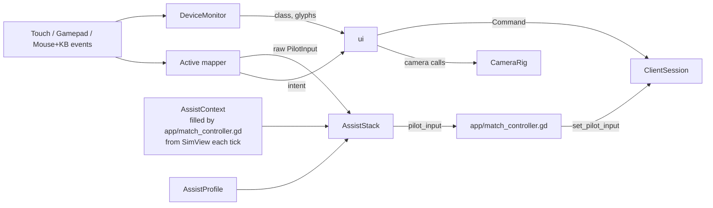
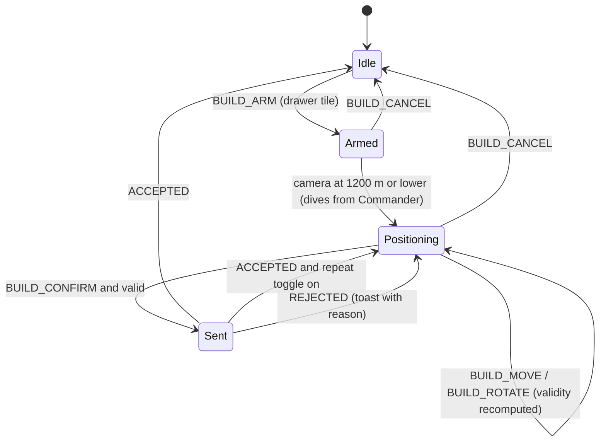
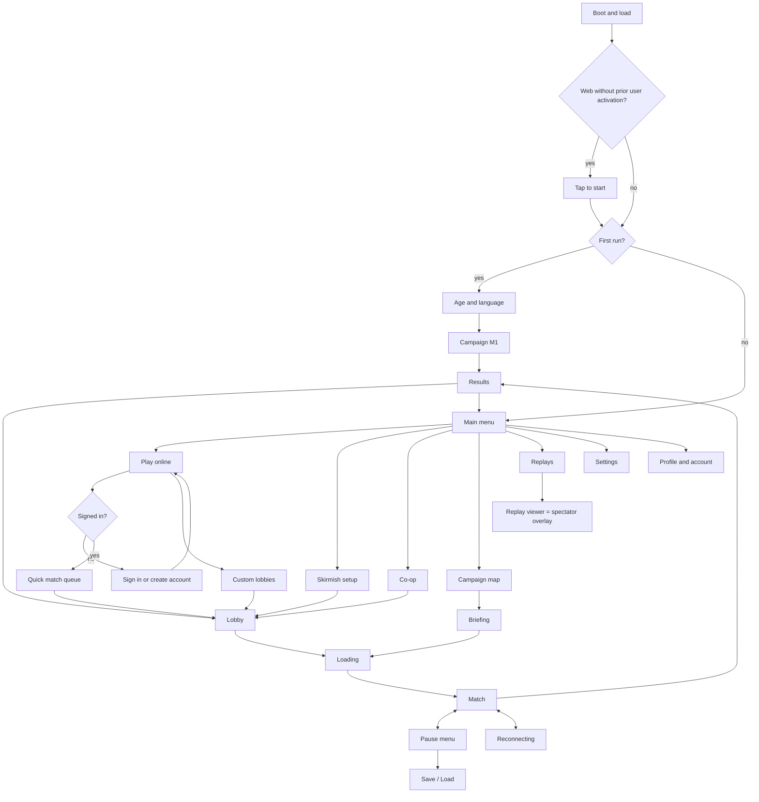

# 06 - Platforms, input and UX

| | |
|---|---|
| **Project** | Codename PLANEWAR: arcade spaceship combat + base-building RTS on a spherical moon. Godot 4.7.2. |
| **Document** | 06 - Platforms, input and UX. Owns input schemes, client-side assists, the camera rig, the HUD, the Tactical/Commander UI, screen flow, web/mobile/Steam UX, accessibility, localisation and onboarding. |
| **Status** | v1.0 (stage 3, revised 2026-10-10) |
| **Date** | 2026-10-10 |
| **Inputs** | `docs/reviews/R0-resolution-register.md` (binding); `docs/01-vision-and-core-decisions.md` v1.1 (binding); `docs/research/R1-game-references.md`, `R2-godot-tech.md`, `R3-platform-requirements.md` |
| **Lanes touched** | `input`, `camera`, `ui`; `platform` (storage probe, entitlements; PortalSdk adapters are v1.1); `app` (screen flow, `SettingsModel`, match controller); `web/` |

## Decisions inherited from 01

1. Camera tiers Chase (35 m behind a Dart), Tactical (300-2,500 m), Commander (2,500-14,000 m); continuous Tactical-Commander zoom; possess -> Chase in 0.5 s; release -> Tactical over the unit; up = local normal with damped roll; ship-relative controls (01 s4.1).
2. `PilotInput` is the only flight contract; the 01 s9.4 `InputRouter` and `CameraRig` signatures are kept and extended, never renamed.
3. Assist tiers Full (touch), Standard (gamepad), Raw (pointer); ranked locks the class default; assists never change stats; auto-dock default on for touch/gamepad, off for pointer; auto-throttle default on for Full; bomb release is a Full-tier assist (01 s3.1.4, s3.1.6, R0 C3-23).
4. Tail-down powered landing (O-2, 01 s3.1.4): thrust axis within 25 deg of the pad normal, 8 m/s vertical, 15 m/s horizontal; damage band to 15/25 m/s; service 10/6/15 s. Ceiling 1,500/2,000 m with forced release (01 s3.1.5). Altitude bands (01 s5.3).
5. Death: 1.5 s wreck hold, then nearest same-class unit / Core / roster (01 s3.1.7).
6. AUTO/ORDERED/POSSESSED, one pilot per entity, request/hand-over, pending orders as HUD suggestions, team-shared command (01 s4.2-4.4).
7. Production from every tier; placement inside Core/Outpost/Pylon radii 600/400/250 m (the Outpost instead needs a friendly unit within 300 m and spacing rules, R0 02 AR-1), slope <= 15 deg; fog ghosts 30 s (01 s3.2, ADR-05).
8. Compatibility renderer everywhere; near plane per 03's formula (0.3-20 m), far 40,000 m (ADR-02). Frame targets of 01 s8.2.
9. Web: single-threaded, no COOP/COEP, WSS, <= 20 MB initial, <= 20 s to gameplay (ADR-07, R3 s7 item 9).
10. ADR-13: age band, in-app deletion, team-only chat + ping wheel, report/block/mute, no ad/tracking SDKs, Deck baseline (controller navigation, >= 9 px text at 1280x800), WCAG 2.1 AA web account pages.
11. ADR-14: autoloads only `App`, `ContentDB`, `Log`; `class_name` everywhere; <= 400 lines per file; 01 s9.2 dependencies as amended by the R0 B.4 whitelist.
12. Matchmaking key includes input class; parties adopt the leader's class (R3 s5; protocol is 04's).
13. Adjutant: full profile on in Skirmish/Campaign, optional in Co-op; the `economy` profile (lobby tag "Auto economy") is allowed in casual PvP queues and shown to opponents; everything off in the later ranked ladder (01 s4.3). Guest play offline and on portals (ADR-08).
14. 06 owns night readability tests (01 s5.5). English first, Finnish second. Missions 1-3 are the tutorial (01 Q4).

**Refinements (within tolerance):** the Tactical floor is `max(300 m, focus ground + 200 m)` so the camera never sits inside a +700 m highland (s5.3); the 35 m Chase distance becomes per-ship presentation data; in ranked the applied assist tier is `min(queued class tier, active device tier)` (s2.4); the chase camera follows the interpolated predicted pose (s5.2).

---

## 1. Principles

| ID | Rule |
|---|---|
| P-1 | Every action is reachable on every input class. No action requires a modifier key. The two PC modifier shortcuts (Shift+click add, Ctrl+number assign) only duplicate a modifier-free route (R1 s2.3 Mindustry AVOID). |
| P-2 | Thumbs own continuous controls; deliberate or rare actions sit outside the thumb zones (s4.2). |
| P-3 | Flight input is ship-relative; camera lag never changes what "left" means (R1 s2.6). |
| P-4 | **Assist definition:** an input transformation is an assist if it (a) acts while the player gives no input, or (b) reads sim state other than the possessed entity's own kinematic state. Assists are tiered and lockable. Pure mappings (mouse-aim instructor, response curves, dead zones) are not assists. |
| P-5 | UI reads the world only through `SimView` and changes it only through `ClientSession.send_command()` / `set_pilot_input()`. |
| P-6 | All tuning lives in JSON. Fairness-relevant assist numbers: `godot/content/defs/assists.json` (inside the content hash). Camera, gesture, layout, alert and glyph data: `godot/content/ui/*.json` (outside the hash, as are `content/ui/**` and `content/locale/**`; `assists.json` is inside, per C2-34). |

---

## 2. Input architecture (`godot/src/input/`)

### 2.1 Files

| File | Class | Role |
|---|---|---|
| `input_router.gd` | `InputRouter` (Node under the App scene, not an autoload) | Emits `pilot_input`, `intent`; `process_physics_priority = -10` (runs before `ClientSession.tick()`). |
| `input_class.gd` | `InputClass` | `enum Kind { TOUCH, GAMEPAD, POINTER }`, boot and tier defaults. |
| `device_monitor.gd` | `DeviceMonitor` | Active class, glyph set (s2.4). |
| `intents.gd` | `Intents` | Kind and payload-key constants (s2.5). |
| `gesture_recognizer.gd` | `GestureRecognizer` | Tap, double tap, long press, drag, pinch, twist, two-finger drag; reads `_unhandled_input`. |
| `mappers/*.gd` | `{Touch,Gamepad,Pointer}FlightMapper`, `{Touch,Gamepad,Pointer}RtsMapper` | Device -> raw `PilotInput` (s3.5) / RTS intents (s3.3). |
| `assists/*.gd` | `AssistProfile`, `AssistContext`, `AssistStack`, `ArcadeSteer`, `MouseAim`, `AutoLevel`, `AimAssist`, `AutoThrottle`, `CruiseAssist`, `BombRelease` | Pure static `apply()` + small state (s3.6). |
| `remap/*.gd` | `BindingStore`, `Glyphs` | `user://settings/input_map.cfg`; `content/ui/glyphs.json`. |

Touch flight controls are `ui` Controls (s4.3) that drive InputMap actions (`ux_stick_*`, `ux_throttle`, `ux_boost`, `ux_brake`, `ux_flip`, `ux_fire1`, ...) with `Input.action_press(action, strength)`; `TouchFlightMapper` reads only actions, so `input` never depends on `ui`. Every mapper ignores events with `device == InputEvent.DEVICE_ID_EMULATION`.

### 2.2 Data flow



`input` depends only on `core` plus the `PilotInput` type (R0 B.4 whitelist, 06 A1 accepted; `ui` may also reference `SimView`, `SimEvent`, `Command`, `CommandResult`, `PilotInput`, `AlertKind`, `OrderSpec`, `LandingGrade` and read-only `Terrain`). World knowledge reaches assists through `AssistContext`, which `app` fills, so `input` never reads `SimView`.

### 2.3 API

```gdscript
class_name InputRouter extends Node
enum Mode { MENU, FLIGHT, TURRET, GROUND, RTS, PLACEMENT, TEXT, PEEK }
signal pilot_input(input: PilotInput)                 # once per sim tick in FLIGHT, TURRET, GROUND, PEEK
signal intent(kind: StringName, payload: Dictionary)   # s2.5
signal input_class_changed(input_class: int)
signal glyph_set_changed(glyph_set: StringName)        # &"kbm", &"xbox", &"ps", &"nintendo", &"deck", &"generic"
func input_class() -> int                              # 01 s9.4: active device class
func match_input_class() -> int                        # class locked at queue time; -1 offline
func set_match_input_class(input_class: int) -> void
func set_mode(mode: Mode) -> void
func set_assist_profile(profile: AssistProfile) -> void
func set_assist_context(ctx: AssistContext) -> void

class_name AssistProfile extends RefCounted
enum Tier { RAW, STANDARD, FULL }        # ordered, so min() picks the weaker tier
enum Steer { DIRECT, ARCADE, MOUSE_AIM }
var tier: Tier
var steer: Steer
var auto_level: bool
var auto_dock: bool
var auto_throttle: bool                  # FULL default true, STANDARD false
var cruise: bool                         # FULL, default true on touch (08 I-16)
var bomb_release: bool                   # FULL only (C3-23)
var aim_assist_deg: float                # FULL 6, STANDARD 3, RAW 0 (defs/assists.json)
var invert_pitch: bool
static func build(match_class: int, active_class: int, ranked: bool, prefs: Dictionary) -> AssistProfile   # prefs = plain snapshot from SettingsModel

class_name AssistContext extends RefCounted
var valid: bool
var pos: Vector3
var vel: Vector3
var basis: Basis                         # predicted render state of the possessed entity
var up: Vector3                          # normalize(pos)
var agl: float
var max_rates: Vector3                   # pitch, yaw, roll in rad/s from the def
var cruise_speed: float
var muzzle_speed: float
var targets_pos: PackedVector3Array      # hostiles in team vision <= 1,000 m
var targets_vel: PackedVector3Array
var pad_pos: Vector3
var pad_dist: float
var pad_free: bool
var bomb_hit_predicted: bool             # predicted bomb impact within 15 m of an enemy footprint or ground unit (s6.3)
```

Per `_physics_process` (30 Hz): sample devices (mouse deltas are accumulated in `_input`) -> mapper -> `AssistStack.apply(raw, ctx, profile, state)` -> emit. Nothing is emitted in MENU, RTS, PLACEMENT, TEXT. PEEK emits neutral axes with thrust held, through assists: the ship auto-levels on Full/Standard and flies straight on Raw.

### 2.4 Input class detection and assist profile

| Event | Counts as | Threshold |
|---|---|---|
| `InputEventScreenTouch` / `ScreenDrag` | TOUCH | press |
| `InputEventJoypadButton` | GAMEPAD | press |
| `InputEventJoypadMotion` | GAMEPAD | abs(axis) > 0.35 |
| `InputEventMouseButton` | POINTER | press, `device != InputEvent.DEVICE_ID_EMULATION` (emulation is also off project-wide: `emulate_mouse_from_touch = false`) |
| `InputEventMouseMotion` | POINTER | > 4 du in 100 ms, not emulated |
| `InputEventKey` | POINTER | press of a bound key |

- Glyphs switch on the first qualifying event; layouts (touch HUD, cursor) after the class persists 0.5 s or on a press. No KBM glyphs while a gamepad is active (R3 s3).
- Boot default: `OS.has_feature("mobile")`, `"web_android"`, `"web_ios"` -> TOUCH; `OS.get_environment("SteamDeck") == "1"` -> GAMEPAD; else POINTER.
- Match class: the device class that pressed "Find match"; in a party, the leader's (R3 s5). Locked for the match.
- Applied tier: non-ranked = user setting per class. Ranked = `min(default_tier(match_class), default_tier(active_class))` with aim assist, auto-level, auto-dock, auto-throttle/Cruise and bomb release forced to that tier's defaults (a touch-queued player using a mouse plays Raw). Steering mode, inversion and sensitivities stay free (mappings, P-4).

### 2.5 Intent catalogue

Payload keys are constants in `Intents` (`K_POS := &"pos"` etc.); consumers read them with typed casts.

| Kinds | Payload |
|---|---|
| `SELECT`, `SELECT_BOX`, `SELECT_PAINT`, `SELECT_SAME`, `DESELECT` | `pos: Vector2`, `rect: Rect2`, `center: Vector2`, `radius: float`, `add: bool` |
| `ORDER_CONTEXT`, `ORDER_MENU`, `ORDER` | `pos`, `order: StringName` |
| `BUILD_ARM`, `BUILD_MOVE`, `BUILD_ROTATE`, `BUILD_CONFIRM`, `BUILD_CANCEL` | `def_id: StringName`, `pos`, `steps: int` |
| `PRODUCE`, `CANCEL_PRODUCE`, `SET_REPLENISH` | `def_id`, `count: int` |
| `CAM_PAN_GRAB`, `CAM_PAN_VEL`, `CAM_ZOOM`, `CAM_ROTATE`, `CAM_TILT`, `CAM_TIER_TOGGLE`, `CAM_HOME`, `FREE_LOOK` | `from`, `to`, `vel`, `log_delta: float`, `anchor`, `rad: float`, `vec: Vector2` |
| `JUMP_ALERT` | `index: int` (-1 = latest) |
| `POSSESS`, `REQUEST_POSSESS`, `QUICK_FLY`, `RELEASE`, `PEEK`, `HANDOVER_ACCEPT` | `entity: int` or `pos`, `on: bool` |
| `GROUP_SELECT`, `GROUP_ASSIGN`, `GROUP_JUMP` | `slot: int` |
| `PING_WHEEL`, `PING`, `WING_RADIAL` | `open: bool`, `ping: StringName` (a `QuickPing.Kind` id), `pos` |
| `FEED_FILTER`, `SPECTATE_NEXT`, `SPECTATE_PREV` | `lane: StringName` |
| `CHAT_OPEN`, `MENU`, `BACK`, `ROSTER` | - |

---

## 3. Control maps

### 3.1 Chase: possessed ships

| Action | PilotInput / intent | Touch (default ARCADE, Full) | Gamepad (default DIRECT, Standard) | KBM (default MOUSE_AIM, Raw) |
|---|---|---|---|---|
| Pitch | `pitch` | left stick Y (up = nose up) | LS Y | mouse (aim); DIRECT: mouse Y |
| Turn / roll | `roll` (+ `yaw` in ARCADE) | left stick X | LS X | mouse (aim); A / D roll override |
| Yaw | `yaw` | auto-coordinated | LB / RB | Q / E |
| Thrust | `thrust` | sticky thrust slider (set and forget; auto-throttle on by default, s3.6) | RT analog | W hold (ramps 4/s) |
| Brake (retro) | BRAKE | BRAKE button (hold) | LT > 0.5 | S |
| Boost | BOOST | BOOST button (tap) | L3 | Shift (alone, not a modifier) |
| Guns | FIRE1 | FIRE (hold) | A (hold) | LMB (hold) |
| Bombs / rockets | FIRE2 | BOMB | B | RMB |
| Flip | FLIP | flick up on the stick zone | Y | Space |
| Auto-dock | DOCK | DOCK hold (shown near a pad) | X hold | F hold |
| Free look | `FREE_LOOK` | none | RS; R3 = look back | C hold + mouse |
| Release | `RELEASE` | RELEASE button (bottom-right cluster, amber) | D-pad Down | R |
| Map peek (Commander overlay while flying) | `PEEK` | MAP button (toggle) | View (toggle) | Tab (toggle) |
| Production drawer | - | BUILD button (top bar) | D-pad Left | B |
| Ping wheel (`QuickPing.Kind` entries, incl. Need supply when SL-5 is built) | `PING_WHEEL` | PING button (top bar) | D-pad Up hold + RS | G hold + mouse |
| Wing orders: Form on me, Attack my target, Break, Release wing (SL-2) | `WING_RADIAL` / ping entries | long-press FIRE 0.5 s opens a radial (only when no hostile is within 800 m, otherwise FIRE keeps firing); also in the ping wheel | ping wheel | ping wheel |
| Latest alert into PiP / accept hand-over | `JUMP_ALERT`, `HANDOVER_ACCEPT` | tap ticker / toast | D-pad Right | X / H |
| Cruise on/off (hold heading, speed, altitude; s3.6) | - | double-tap the thrust slider handle; Settings | Settings | Settings |
| Pause | `MENU` | II | Menu | Esc |
| Chat | `CHAT_OPEN` | pause menu > Chat | pause menu > Chat (built-in OSK) | Enter |

While the drawer is open, face buttons (gamepad) or the right cluster (touch) operate the drawer; sticks and thrust keep flying; FIRE1/FIRE2 are suppressed. Wing and supply requests are always reachable through the ping wheel on every input class (P-1).

### 3.2 Possessed towers, ground units and factories

| Entity | Touch | Gamepad | KBM | PilotInput use (05 interprets) |
|---|---|---|---|---|
| Tower | drag on right 60 % of screen = aim (0.15 deg/du); FIRE | RS (or LS) aim; RT fire | mouse aim (captured); LMB | `pitch`, `yaw` = aim rates; FIRE1 |
| Harvester / Siege Crawler | left stick Y = drive, X = steer; FIRE (Crawler) | LS drive/steer; RT fire; RS camera orbit | W/S drive, A/D steer; mouse orbits camera; LMB | `thrust` forward, BRAKE = stop (reverse only at <= 3 m/s after 0.5 s held), `yaw` = steer, `pitch` = barrel |
| Shipyard / Vehicle Bay | opens UNITS tab filtered to that factory; Tactical camera over it | same | same | none |

### 3.3 Tactical and Commander

Gamepad uses a fixed reticle at screen centre (Halo Wars-style): the map moves under it.

| Action | Intent | Touch | Gamepad | KBM |
|---|---|---|---|---|
| Pan | `CAM_PAN_GRAB` / `_VEL` | one-finger drag (grab the globe), fling | LS | WASD / arrows / screen edge (8 du) |
| Zoom | `CAM_ZOOM` | pinch | RT in, LT out | wheel (toward cursor) |
| Rotate heading | `CAM_ROTATE` | two-finger twist | RS X | Q / E; MMB drag X |
| Tilt (Tactical) | `CAM_TILT` | two-finger vertical drag | RS Y | MMB drag Y |
| Tactical/Commander snap | `CAM_TIER_TOGGLE` | double-tap empty ground (snaps toward the tap) | View | Tab |
| Home | `CAM_HOME` | long-press the compass | L3 | H |
| Select | `SELECT` | tap | A | LMB |
| Add / remove one | `SELECT` add | long-press a unit | paint adds | ADD toggle in selection bar; Shift+LMB accelerator |
| Box / paint select | `SELECT_BOX` / `_PAINT` | long-press ground 0.35 s, then drag | hold A (circle grows) | LMB drag |
| Same type on screen | `SELECT_SAME` | double-tap unit | double-press A | double-click |
| Clear | `DESELECT` | X in selection bar | B | Esc; LMB on empty ground |
| Context order / rally | `ORDER_CONTEXT` | tap target or ground with a selection | X | RMB |
| Order menu | `ORDER_MENU` | ORDERS button | hold X (radial) | hold RMB 0.4 s (radial) or O |
| Possess | `POSSESS` | POSSESS button | Y | R (selection, else under cursor) |
| Quick Fly | `QUICK_FLY` | FLY button | hold Y 0.5 s | F |
| Jump to alert | `JUMP_ALERT` | tap feed entry | RB (repeat = older) | Space; click entry |
| Control groups | `GROUP_*` | group bar 1-5: tap select, double-tap jump, long-press assign | D-pad 1-4: same, assign = hold 0.6 s | 1-9: same, assign = hold 0.5 s (Ctrl+n accelerator) |
| Production / build | `BUILD_ARM`, `PRODUCE` | drawer tiles | LB focuses drawer; LB/RB tabs; A | B / N tabs; click |
| Placement | `BUILD_*` | drag ghost; ROTATE, check, cross buttons | ghost at reticle; RB rotate; A confirm; B cancel | ghost on cursor; T rotate; LMB; RMB / Esc |
| Follow selection | - | FOLLOW in selection bar | ORDERS radial "Follow" | V |
| Ping | `PING` | PING button (top bar) | R3 tap / hold = wheel | G |
| Exit peek | `PEEK` | MAP | View / B | Tab |
| Roster / scoreboard | `ROSTER` | roster in pause | Menu > Players | P |

### 3.4 Menus

Touch: tap; Android back gesture = `BACK`. Gamepad: D-pad/LS focus, A accept, B back, LB/RB tabs, built-in OSK for text. KBM: mouse, Tab/arrows focus, Enter, Esc back, PageUp/PageDown tabs. Every screen is fully navigable by each class alone (Deck Verified, R3 s3).

### 3.5 Flight mapping math

**Sticks (touch, gamepad).** Radial dead zone `d0` (touch 0.12, gamepad 0.15): `s = clamp((|x| - d0) / (1 - d0), 0, 1)`, direction preserved; response `c(s) = s^gamma`, gamma 1.6 touch, 1.8 gamepad, 1.0 for throttle.

**DIRECT** (gamepad default): `roll = x'`, `pitch = y'` (sign flips if `invert_pitch`), `yaw` = bumpers +-1 with a 0.15 s ramp.

**ARCADE** (touch default), with ship bank `phi` (s5.2):

```
phi_target = x' * 70 deg
roll  = clamp((phi_target - phi) / 35 deg, -1, 1)
pitch = clamp(y' + 0.6 * |x'| * clamp(|phi| / 45 deg, 0, 1), -1, 1)   # pull into the turn once banked
yaw   = 0.3 * x'
```

**MOUSE_AIM** (pointer default): the mouse rotates an aim vector `a` (yaw about the local up `n`, pitch about camera right, 0.12 deg per px, pitch of `a` clamped +-85 deg from the tangent plane). With body components `ax = a.r`, `ay = a.u`, `az = a.f` and `alpha = angle(f, a)`:

```
pitch = clamp(atan2(ay, az) / 15 deg, -1, 1)
yaw   = clamp(atan2(ax, az) / 10 deg, -1, 1)
roll  = alpha > 8 deg and ay > 0 ? clamp(atan2(ax, ay) / 40 deg, -1, 1) : clamp(-phi / 40 deg, -1, 1)
A / D replace roll with -1 / +1 while held.
```

The chase camera looks along `a`, not `f` (s5.2). DIRECT for pointer: mouse moves a virtual stick that recentres with tau 0.15 s; A/D yaw.

**Touch thrust slider (sticky, set and forget).** The 244 du slider maps handle `h` in [0,1] to a target speed fraction. The handle moves by relative finger travel (a tap does nothing) and stays where it is released. With auto-throttle on (Full-tier default) `v* = h * v_cruise` and the thrust comes from the auto-throttle rule of s3.6; with it off `thrust = h`. A double tap on the handle toggles Cruise (s3.6). **BOOST** is a button: a tap sets BOOST for one tick (the sim owns duration and cooldown). **BRAKE** is a button: BRAKE every tick while held; the handle is unchanged. **FLIP** is a flick up on the stick zone (`FLICK_UP`: >= 80 du net upward travel within 0.2 s, peak speed >= 600 du/s) and sends FLIP for one tick; the stick axes keep reading normally.

**KBM thrust.** Default "power key" (Triplane lineage, R1 s1.2): W held ramps thrust to 1 at 4/s, release ramps to 0. Option "lever": W/S step +-0.25, sticky; S at 0 = BRAKE. **Gamepad:** RT analog (dead zone 0.05); BRAKE when LT > 0.5.

### 3.6 Assist math

| Assist | Tiers | Rule |
|---|---|---|
| Auto-level | FULL, STANDARD | Engages after 0.25 s of neutral stick/keys; releases instantly on input. `roll = clamp(-phi / 30 deg, -1, 1)`; `pitch = clamp(-0.05 * v_n - (theta - theta_trim) / 30 deg, -0.6, 0.6)` with `v_n = v.n` (m/s), `theta = asin(f.n)`, `theta_trim` per ship in `defs/assists.json` (default 4 deg). |
| Aim assist | FULL 6 deg, STANDARD 3 deg | Candidates: hostiles <= 800 m; lead point per candidate (s6.3); pick smallest angular error `e` inside the cone. While FIRE1 is held and 0.5 s after: add `k * e_pitch / cone` and `k * e_yaw / cone` (k 0.4 FULL, 0.25 STANDARD); no effect against opposing input > 0.5. Never touches thrust or fire. |
| Auto-throttle | FULL (default on), STANDARD option (default off) | Slider sets target speed `v* = h * cruise`; `thrust = clamp((v* - v_fwd) / 15, 0, 1)`; BRAKE when `v_fwd - v* > 25 m/s`; a held BRAKE button overrides. |
| Cruise (08 I-16) | FULL, default on for touch; option elsewhere | Holds heading, speed (auto-throttle) and altitude (AGL below 300 m AGL, otherwise datum altitude); stick input offsets the target and letting go recaptures it. `input/assists/cruise_assist.gd`; emits plain `PilotInput`. |
| Bomb release | FULL only | While FIRE2 is held, the bomb leaves on the first tick the predicted impact point (s6.3 predictor, filled into `AssistContext.bomb_hit_predicted`) is within 15 m of an enemy structure footprint or ground unit; no other effect. Counts as an assist (P-4); locked per tier in ranked; `bomb_release_assist` in `defs/assists.json`. |
| Auto-dock | FULL, STANDARD (pointer opt-in outside ranked) | DOCK bit is sent only if `profile.auto_dock`. The DOCK button shows when `pad_dist <= 1,000 m` and `pad_free`. Inside `auto_dock_radius_m` (150 m) the sim runs `Assist.auto_dock()` (05 L4-L6: transition, hover-descent, flare), a tail-down hover touchdown that the client predicts identically. The server ignores DOCK from Raw players in ranked (04). |

---

## 4. Layout, scale and touch

### 4.1 Units and scale

- **du** = design unit; project stretch `canvas_items`, aspect `expand`, base 1280x720. `UiScale.apply()` (`godot/src/ui/theme/ui_scale.gd`) sets `Window.content_scale_factor` on boot and resize so that **1 du = 1 pt/dp on touch devices**:

```gdscript
static func content_scale_factor(win_px: Vector2i, screen_scale: float, is_touch: bool, user_scale: float) -> float:
	var s0: float = minf(win_px.x / 1280.0, win_px.y / 720.0)
	if is_touch:
		return clampf(screen_scale / s0, 0.75, 3.0) * user_scale
	return user_scale   # desktop and Deck: 1280x720 base, user range 0.8-1.5
```

`screen_scale` = `DisplayServer.screen_get_scale()` (iOS points, Android density, web devicePixelRatio; S-UX-1 verifies Android).
- **Profiles:** COMPACT if the visible canvas height < 500 du (landscape phones, ~800x360), else REGULAR (tablets, PC 1280x720, Deck 1280x800).
- **Touch targets** >= 44 du (= 44 pt); continuous primary controls 64-96 du; >= 8 du apart.
- **Text:** body 16 du, small 13, minimum 12 at 100 %; text scale 80-150 %. Deck worst case 12 x 0.8 x 800/720 = 10.7 px >= 9 px (ADR-13).
- **Safe area:** `DisplayServer.get_display_safe_area()` converted to du; HUD root inset = safe area + 8 du. Anchors below are relative to the safe rect.

### 4.2 Thumb zones (landscape, two-handed)

Distance from a bottom corner of the safe rect: **green <= 200 du**, **amber 200-300**, **red** elsewhere. Continuous controls (stick, throttle, FIRE) green; frequent taps green/amber; deliberate or rare actions (BUILD, PAUSE, PING) red; RELEASE sits in the amber part of the bottom-right cluster (s4.3). Tablets keep the same corner offsets.

### 4.3 Phone landscape: Chase (reference safe rect 720 x 340 du)

```
x: 0       90      180      270      360      450      540      630     720
  +--------------------------------------------------------------------------+
  |[ORE 1,240][ICE 380][PWR 92%]    [12:41][!2]    [MAP][BLD][PNG][ II ]     | y 0-44 top bar  RED
  |+-------------+   Harvester attacked - South                              | y 52 ticker
  ||  PiP: HOME  |                                                           |
  ||  160 x 90   |     [tutorial / hand-over toast]                          | y 88 prompt
  |+-------------+          . - - - - - - - - .                  (RELEASE)   |
  |                        /   - - limb - -    \                    56       |
  |      112 m/s          |    ----( + )----  o |      320 m  LOW            |
  |      BOOST ready       \    (lead pip o)   /       AGL 210  VS -4        |
  | +---+                    ' - - - - - - - '        (BRAKE)    (DOCK)      |
  | |   |                    [ landing guide ]          56         56        |
  | |70%|                                               (BOOST)   (FIRE)     |
  | |   |    .-------.      stick spawns under            56       96         |
  | |   |   (  ( o )  )     the thumb; flick up    (BOMB)                     |
  | +---+    '-------'      = FLIP                   64                       |
  |  sticky   [HP ===-][FUEL ==-][AMMO 280][BOMB 2]                           |
  +--------------------------------------------------------------------------+
   GREEN <= 200 du from each bottom corner   AMBER 200-300   RED elsewhere
```

| Element | Anchor | Position (du) | Size (du) | Zone |
|---|---|---|---|---|
| Top bar (resources, clock, alert badge, MAP, BUILD, **PING**, II at 44x44) | top | y 0 | full x 44 | red |
| PiP | top-left | (0, 52) | 160 x 90 | red |
| Feed ticker (one line of the priority feed) | top-centre | (0, 52) | 360 x 28 | red |
| Prompt / toast | top-centre | (0, 88) | 420 x 44 | - |
| Speed block / altitude block | centre | (-150, 0) / (+150, 0) | 120 x 56 | - |
| Reticle ring (threat arrows) | centre | radius 140 | - | - |
| Thrust slider (sticky, set and forget) | bottom-left | x 8, y -260 | 56 x 244 | green/amber |
| Stick zone (`VirtualJoystick`, Dynamic mode; flick up = FLIP; FLIP cooldown ring on the base) | bottom-left | x 72-272, y -240-0 | base 112, knob 44 | green |
| FIRE (long-press 0.5 s: wing radial, s3.1) | bottom-right | centre (-76, -76) | 96 | green |
| BOMB | bottom-right | centre (-184, -44) | 64 | green |
| BOOST (tap) | bottom-right | centre (-184, -112) | 56 | amber |
| BRAKE (hold) | bottom-right | centre (-176, -184) | 56 | amber |
| DOCK (contextual) | bottom-right | centre (-76, -168) | 56 | green |
| RELEASE | bottom-right | centre (-76, -236), above DOCK | 56 | amber |
| Consumables | bottom-centre | (0, -8) | 160 x 40 | - |
| Landing guide | centre | (0, +96) | 220 x 64 | - |

**Right-half budget.** FIRE, BOMB, BOOST, BRAKE, DOCK and RELEASE are six touch controls; at most one further contextual control may join the right half (a hard UI lint: no more than 7 touch controls on the right half of Chase). The wing orders ride the FIRE long-press radial and the ping wheel; PING sits in the top bar; FLIP is a gesture on the stick zone, so none of them adds a button.

Multi-touch: the slider and buttons are `TouchControl`s (`godot/src/ui/hud/touch/`) that handle `InputEventScreenTouch`/`ScreenDrag` in `_input`, own a finger index while it is down, mark the event handled and press/release their `ux_*` action; `mouse_filter = MOUSE_FILTER_IGNORE`. The stick wraps Godot 4.7's `VirtualJoystick` (Dynamic mode, R2 s12.3), which already maps to actions. Steering, thrust, FIRE, BOOST and BRAKE therefore work at the same time. The project setting `emulate_mouse_from_touch` is false.

### 4.4 Phone landscape: Commander (drawer open)

```
  +--------------------------------------------------------------------------+
  |[ORE 1,240][ICE 380][PWR 92%][U 34/80] [12:41] (N)    [PNG][FLY][ II ]   | top bar 44
  |+-ALERTS 3---------+                              +--+------------------+ |
  ||! Extractor S  x2 |                              |B |[DART][LNCR][BMBR]| |
  ||! Harvester lost  |                              |L |[SCT ][HAUL][HARV]| |
  ||  Pole contested  |        .-~~~~~~~-.           |D |[SIEG][    ][    ]| |
  ||  [filter]        |      /    GLOBE    \         +--+[    ][    ][    ]| |
  |+------------------+     |  pan / pinch  |        |U |[    ][    ][    ]| |
  |                          \   / twist   /         |N |[    ][    ][    ]| |
  |                            '-~~~~~~~-'           +--+------------------+ |
  |[1][2][3][4][5] [X][3 Darts][POSSESS][ORD]                                |
  +--------------------------------------------------------------------------+
```

| Element | Anchor | Position (du) | Size (du) | Notes |
|---|---|---|---|---|
| Top bar | top | y 0 | full x 44 | ORE, ICE, PWR, UNITS, clock, compass 44, PING 44, FLY 64, II 44 |
| Alerts feed (the single priority feed, s7.4) | top-left | (0, 52) | 200 x 176 | 3 rows of 44 plus a 44 filter button; collapses to the badge |
| Production drawer | top-right | (-188, 52) | 188 x 284 | 2 vertical tabs 44 x 140; grid 3 x 6 tiles of 44, gaps 4. Default closed in COMPACT; edge handle 24 x 88 |
| Control groups | bottom-left | (0, -44) | 236 x 44 | 5 slots |
| Selection bar | bottom-left | (244, -44) | 276 x 44 | Clear 44, summary 88, POSSESS 88, ORDERS 44 |
| Placement bar | bottom-centre | (0, -44) | 224 x 44 | cancel 64, ROTATE 64, confirm 88; replaces the selection bar |

The bottom row ends at x 520, clear of the open drawer (x >= 532).

### 4.5 REGULAR layout (1280 x 720+ du)

Top bar 48; PiP 320 x 180 top-left; alerts feed 280 wide, 6 rows; drawer 3 x 6 tiles of 64 du + 48 tabs, open by default, queue strip 64 below; selection panel bottom-centre 520 x 96 with the group bar above (9 slots of 40 du; 5 of 44 on tablets).

---

## 5. Camera (`godot/src/camera/`)

### 5.1 Rig

`CameraRig` (Node3D) owns one `Camera3D`, `ChaseController`, `OrbitController`, `TransitionPlayer`, `PipCamera` and a replaceable `NearFarPolicy`. It reads entity transforms and terrain radius from presentation's `ViewState`, never the sim. Constants: `godot/content/ui/camera.json`.

```gdscript
class_name CameraRig extends Node3D
enum Tier { CHASE, TACTICAL, COMMANDER }
enum JumpStyle { FLY, CUT }
signal tier_changed(tier: Tier)
signal transition_finished()
func set_tier(tier: Tier, focus: Vector3, duration: float) -> void          # 01 s9.4
func follow(entity: int) -> void                                             # -1 clears
func set_view_state(vs: ViewState) -> void
func set_orbit(focus_dir: Vector3, heading: Vector3, altitude: float, tilt_offset: float) -> void
func pan_grab(from_px: Vector2, to_px: Vector2) -> void
func pan_velocity(v_du: Vector2) -> void
func zoom_log(delta: float, anchor_px: Vector2) -> void
func rotate_heading(rad: float) -> void
func tilt(rad: float) -> void
func jump_to(dir: Vector3, style: JumpStyle) -> void
func peek(on: bool) -> void
func current_tier() -> Tier
func focus_dir() -> Vector3
var near_far_policy: NearFarPolicy
```

Pure math: `OrbitMath`, `CamMath` (static, unit-tested). Basis convention (assumed, 03): `f = -basis.z`, `u = basis.y`, `r = basis.x`; `n = p.normalized()`. `R` in every formula is `PLANET_RADIUS` from `core/sphere.gd`; no code hard-codes 6,000 or values derived from it.

### 5.2 Chase

**Bank angle** (also used by the HUD and ARCADE steer):

```gdscript
static func bank_angle(b: Basis, n: Vector3) -> float:
	var f: Vector3 = -b.z
	var n_perp: Vector3 = n - f * f.dot(n)
	if n_perp.length_squared() < 1e-6:
		return 0.0
	n_perp = n_perp.normalized()
	return atan2(-b.x.dot(n_perp), b.y.dot(n_perp))   # > 0 = right wing down
```

**Follow target.** The chase camera follows the interpolated predicted pose, never the raw tick state. For the locally piloted ship it calls `Prediction.render_state(alpha)` (interpolating predicted ticks `input_tick-1` and `input_tick`, `alpha = Engine.get_physics_interpolation_fraction()` plus the smoothing offset) every `_process` frame, and `EntityViewPool.set_local_override` receives the same pose; other ships use the `NetSimView` interpolation. Test: at 60 fps a Dart at 110 m/s has per-frame displacement variance < 10 % of the mean.

**Look direction:** `d* = normalize(f + 0.25 (v_hat - f))` when `|v| > 20 m/s`, else `f`; MOUSE_AIM uses `d* = a`. Free look adds yaw about `n` (+-150 deg) and pitch (+-60 deg), returning with tau 0.2 s. `d <- slerp(d, d*, 1 - exp(-dt / tau_dir))`, tau_dir = 0.08 s.

**Head-up with damped roll:**

```
w       = smoothstep(cos 35 deg, cos 15 deg, |d.n|)                 # near-vertical view: lean on ship up
u_ref   = normalize(lerp(perp(n, d), perp(u, d), w))                 # perp(x, d) = x - (x.d) d
phi_t   = clamp(k_roll * phi, -30 deg, 30 deg) * (1 - smoothstep(90 deg, 150 deg, |phi|))
phi_cam = phi_cam + (phi_t - phi_cam) * (1 - exp(-dt / tau_roll))   # tau_roll = 0.25 s
u_cam   = u_ref.rotated(d, phi_cam)                                  # camera rolls with the ship's bank
basis   = Basis(x, y, z) with z = -d, y = normalize(perp(u_cam, d)), x = y.cross(z)
```

`k_roll` = 0.35: the horizon tilts a little in turns, and the camera stays head-up when inverted (01 s4.1). 0 in reduced motion; 1, unclamped, in the FREE_ROLL option. All time constants are <= 0.3 s, avoiding R1 s2.6's slow catch-up.

**Spring arm on the offset** (no velocity lag at 110-190 m/s):

```
D  = D0 * s_user * (1 + 0.15 * clamp((|v| - v_cruise) / (v_dive - v_cruise), 0, 1))
H  = 0.2 * D                    # D0 = def presentation.camera.chase_distance_m (Dart 35); s_user 0.8-1.3
o* = -d * D + y_cam * H
o, o_vel = crit_damp(o, o_vel, o*, omega = 12 rad/s, dt);  P = p + o
```

```gdscript
static func crit_damp(x: Vector3, v: Vector3, target: Vector3, omega: float, dt: float) -> PackedVector3Array:
	var delta: Vector3 = x - target
	var temp: Vector3 = (v + delta * omega) * dt
	var decay: float = exp(-omega * dt)
	return PackedVector3Array([target + (delta + temp) * decay, (v - temp * omega) * decay])   # [pos, vel]
```

**Clearance:** if `|P| - ground_radius(P_hat) < 2.5 m`, lift `P` along `P_hat`; sample the ship-camera segment at 4 points and shorten `D` to the first clear one (min 0.4 D). **FOV** 70 deg (user 60-90), +6 boost, +4 at full dive stretch, tau 0.3 s; fixed in reduced motion. **Turret cam:** pivot `n * pivot_m` (default 8) above the structure, 12 m behind along the aim, 3 m up, tau_dir 0.05 s. **Ground cam:** D0 18, H 6, k_roll 0. **Death cam:** freeze on the wreck, orbit at 40 m, 10 deg/s for 1.5 s, then the chooser (s7.6).

### 5.3 Tactical and Commander orbit

State: focus direction `dF` (unit), heading `h` (unit tangent at `dF`), camera altitude `A` above datum, user tilt offset `delta`.

```
F     = dF * ground_radius(dF);  gF = |F| - PLANET_RADIUS
A_min = max(300, gF + 200);      A_max = 14,000          # |P| <= PLANET_RADIUS + 14,000 (ADR-03)
z     = ln(A / 300) / ln(A_max / 300)                     # Tactical when A < 2,500 (z < 0.552)
theta = clamp(40 + 50 * smoothstep(0.45, 0.85, z) + delta * (1 - smoothstep(0.45, 0.60, z)), 25, 90) deg
w     = cos(theta) * (-h) + sin(theta) * dF               # camera sits behind and above F
D     = -|F| sin(theta) + sqrt(|F|^2 sin^2(theta) - |F|^2 + (PLANET_RADIUS + A)^2)   # exact: |F + D w| = R + A
P     = F + D * w;  z_cam = w;  y_cam = sin(theta) * h + cos(theta) * dF;  x_cam = y_cam.cross(z_cam)
```

`y_cam` is unit length by construction and continuous at theta = 90 deg (globe view, heading up the screen). `delta` in [-15, +30] deg fades out above Tactical. `ln A` and `theta` smooth with tau 0.12 s.

**Pan (grab the globe):** on touch-down intersect the screen ray with the sphere of radius `|F|` -> `G0`; on each move ray -> `G1`, rotate `dF` by the minimal rotation `G1_hat -> G0_hat`, transport `h`. A ray past the limb uses its closest point to the moon centre, projected onto the sphere. Fling decays with tau 0.35 s (stop < 0.002 rad/s). Velocity pan (LS, WASD, edge): `0.6 * (A - gF)` m/s at full deflection. Zoom keeps the ground point under the anchor fixed.

**Heading transport and the poles.** No latitude parameter means no pole singularity and no clamp:

```gdscript
static func transport_heading(h: Vector3, d_old: Vector3, d_new: Vector3) -> Vector3:
	var axis: Vector3 = d_old.cross(d_new)
	var s: float = axis.length()
	var out: Vector3 = h
	if s > 1e-7:
		out = h.rotated(axis / s, atan2(s, d_old.dot(d_new)))
	out = out - d_new * out.dot(d_new)
	return out.normalized()
```

Heading modes: **FREE** (default) and **NORTH_UP**. NORTH_UP slews `h` to ENU north (tau 0.5 s), suspended inside the polar cap `|dF.Z| > cos 8 deg` (~840 m radius at R = 6,000) and after it until the error is < 100 deg or the compass is tapped, so a pole crossing never spins the view. Compass tap: heading to north in 0.4 s (inside the cap: toward the own Core).

**Focus rules.**

| Event | Focus | Heading | Altitude |
|---|---|---|---|
| Match start | own Core | north (identical for all, 01 s5.7) | 1,800 m |
| Release | unit's ground point | ship heading | 600 m above ground |
| Alert / group jump | subject position | kept | max(900, current if Tactical) |
| Follow on | followed entity's ground point, tau 0.2 s; any pan cancels | kept | kept |
| Build armed in Commander | current focus | kept | dive to 1,200 m (0.5 s) |

### 5.4 Transitions

| Transition | Duration | Easing |
|---|---|---|
| Possess (any tier -> Chase) | 0.5 s (01) | smootherstep |
| Release (Chase -> Tactical) | 0.6 s | smootherstep |
| Peek on/off | 0.3 s | smoothstep |
| Alert / home / group jump | 0.4 + 0.3 x (gamma / 90 deg) s, max 1.0 s; gamma = great-circle angle | smootherstep with hop |
| Tactical <-> Commander snap | 0.35 s | ease-out cubic on `ln A` |
| Any of the above in reduced motion | 0.2 s | fade to 60 % black at the midpoint, cut |

Geodesic interpolation; endpoints are recomputed every frame because targets move:

```
s = e(t / T),  e(t) = 6t^5 - 15t^4 + 10t^3
c(s)  = slerp(c0, c1, s)                                        # camera direction from the moon centre
hg(s) = exp(lerp(ln h0, ln h1, s)) + 4 s (1 - s) max(0, 0.5 R gamma - max(h0, h1))   # above ground; 2 m <= hg <= 14,000 m
P(s)  = c(s) * (ground_radius(c(s)) + hg(s))
q(s)  = slerp(q0, q1, e(clamp((t / T - 0.2) / 0.8, 0, 1)))       # orientation lags slightly
```

FOV and near plane interpolate likewise. Possess starts on the intent, hiding one round trip (01 s4.4); on rejection the reverse plays with a reason toast ("Piloted by Aino").

### 5.5 Near/far

- Default `NearFarPolicy` implements 03's formula `near = clamp(0.3 + 0.004 * h_cam, 0.3, 20)`, `h_cam` = camera height above ground (Chase, turret and ground cams therefore sit at 0.3 m). 06's earlier orbit formula `near = clamp(4 + (A_g - 300) * 16 / 2,200, 4, 20)` stays as the named alternative `orbit_alt` that S-WORLD-1 (TA-25) may choose. Transitions interpolate `ln near`.
- Far = 40,000 m always (ADR-02).
- `NearFarPolicy` is a `RefCounted` with `func planes(tier: int, agl: float) -> Vector2`; S-WORLD-1 may replace it without touching the rig.

### 5.6 Picture-in-picture

| | |
|---|---|
| Targets | HOME (own Core, default); LAST_ALERT (10 s, then back); PINNED (from the selection bar). |
| HIGH | `SubViewport` 320x180 px, orbit pose (A 700 m, theta 55 deg), every 3rd frame (`UPDATE_ONCE`), no particles or shadows, LOD bias 2; <= 150 draw calls PC, <= 60 mobile. |
| MEDIUM | 256x144 px at 10 fps. |
| LOW, web-mobile | 2D schematic (cached terrain patch + icon dots, 4 Hz); no second 3D render. Any tier falls back here if the main view misses its frame target for 3 s. |
| Interaction | Tactical/Commander: tap jumps to the target. Chase: tap cycles the target. Border flashes 2 Hz for 3 s on P0/P1 alerts in its cell. |

### 5.7 Shake and comfort

Shake <= 0.6 deg rotation (translation <= 0.3 m), 0.3 s decay, on hits (by damage), bomb impacts within 150 m and boost start; off in reduced motion. Options: FOV, chase distance, roll follow 0-100 %, FREE_ROLL, heading mode, edge pan.

---

## 6. HUD (Chase)

### 6.1 Widget inventory

Accessors named here are `SimView` members (R0 B.5, C2-05); fields not replicated to the client return defaults with the `unknown` bit and the widget shows "-".

| Widget | Shows | Data source | Rate |
|---|---|---|---|
| Reticle, gun axis | boresight (straight line, no drop: slugs ignore gravity) | `basis(id)` | frame |
| Pitch ladder, limb tick | level line, 10 deg marks, bank, horizon dip | `pos`, `basis` -> `HudMath` | frame |
| Speed block | speed, boost ready/active/cooldown | `vel`, `boost_state(id)` | frame |
| Altitude block | datum altitude, AGL, vertical speed, band | `pos`, `vel`, `ViewState.ground_radius` | frame |
| Heading tape | heading, N mark, home bearing | `pos`, `basis` | frame |
| Consumables | HP, fuel, ammo, bombs/rockets | `hp01`, `fuel01`, `ammo`, `bombs`, `rockets`; maxima from `ShipDef` | 10 Hz |
| FLIP cooldown ring | ring around the stick base (touch) or the FLIP glyph | `flip_cooldown01(id)` | 10 Hz |
| Bomb sight | impact ring, time to impact | predictor (s6.3) | 15 Hz |
| Lead pip | per targeted hostile (straight-line intercept) | target `pos`/`vel` | frame |
| Threat ring | arrows for hostiles <= 2,000 m, rocket lock | `ids_near(p, 2000, HOSTILE)`, `visible_to`, `incoming_rockets(id)` | 10 Hz |
| Tower hint | "Flak: stay below 150 m", "Autocannon: climb above 400 m" | `ids_near` + `towers.json` envelopes (`h_rel_min`/`h_rel_max`, `target_agl_min`) | 4 Hz |
| Uplink meter | link % above 1,500 m | `pos` | frame |
| Landing guide | pad marker, gauges, grade stamp | `nearest_friendly_pad(id)`, `pad_occupant(pad)`, `landing_grade_last`; `pos`, `vel`, `basis` | frame |
| Service panel | refuel/rearm/repair bars | `dock_state(id)`, `service_progress(id)` | 10 Hz |
| Pending order | "Order from Aino: escort Bomber 2 (on release)" | `pending_order(id)` | event |
| Piloted-by badges | names over teammate-flown units | `possessor`, lobby roster | 4 Hz |
| Hand-over toast | request from a teammate (8 s) | `SimEvent` request (04) | event |
| Wing radial | long-press on FIRE: Form on me, Attack my target, Break, Release (SL-2) | `OrderSpec` escort modes via QuickPing entries | event |
| Canister beacon | marker and compass pip for a deployed Supply Canister (SL-5) | `SimEvent` CANISTER_DEPLOYED | event |
| Top bar, feed ticker, PiP | as s7.1 and s7.4 | s7.1 | - |

### 6.2 Horizon on a sphere (`godot/src/ui/hud/hud_math.gd`)

- Pitch `theta = asin(clamp(f.n, -1, 1))`; bank `phi = CamMath.bank_angle`.
- Heading: `f_t = normalize(f - (f.n) n)`, `N = normalize(Z - (Z.n) n)`, `E = N.cross(n)` (ADR-03 ENU), `psi = atan2(f_t.E, f_t.N)`; within 1 deg of a pole the tape shows "POLE" and freezes.
- The ladder's 0 deg line is the tangent plane (level flight). The visible limb sits lower by `dip = acos(R / (R + h))` (10.4 deg at 100 m), so a separate limb tick keeps curvature readable.
- Band: AGL < 150 -> DECK; else datum altitude < 400 -> LOW, < 1,500 -> HIGH, < 2,000 -> FADE (01 s5.3).
- Uplink from 1,500 m: `link = 1 - (alt - 1,500) / 500`, amber, pulsing 2 Hz from 1,800 m. Forced release: "Uplink lost above 2,000 m. Autopilot is descending." (01 s3.1.5).

### 6.3 Bomb sight and lead (`bomb_sight.gd`, `lead_solver.gd`)

Slugs, flak shells and rail slugs fly straight lines in the world frame (no gravity, no parallel transport); bombs and siege shells fall under gravity and are transported (R0 B.5).

```
predict_bomb(p, v, n):                        # 15 Hz, dt = 1/15 s, horizon 8 s (120 steps)
  q = p; w = v - n * eject_down_mps           # projectiles.json bomb: 40 m/s along local down
  for i in 1..120:
    q, w = step(q, w, dt)                     # injected Callable wrapping Kinematics.step_projectile
    if |q| <= ground_radius(q_hat): return (q, i * dt)
  return none                                 # sight hidden
lead(p_s, v_s, p_t, v_t, speed):              # straight-line intercept, no gravity term
  # the slug carries the shooter's velocity, so the target moves by (v_t - v_s) relative to the muzzle
  t = |p_t - p_s| / speed
  repeat 3: L = p_t + (v_t - v_s) t;  t = |L - p_s| / speed
  show pip only if t <= range_m / speed         # slug_light 700 m/s, 800 m range
```

`app` injects the step and ground functions as `Callable`s, so the HUD owns no physics. Test: bomb impact within 2 m of a 1/30 s reference run; `test_slug_hits_coaltitude_target` style check that the pip matches the sim for co-altitude targets at 200/400/650/800 m. The ring turns green when an enemy structure footprint or ground unit is within 15 m of the impact; the same predicate feeds the Bomb release assist (s3.6).

### 6.4 Landing guide and docking

Landing is tail-down and powered (01 s3.1.4): the ship pitches nose-up, hovers on its main engine and settles tail-first on the pad. The guide is shown when a friendly pad (Pad, Hangar, Core, Outpost, held Relay Station) is <= 1,500 m away and the ship is below 400 m AGL or fuel < 25 %.

- Gauges: vertical speed (safe 8, damage 15 m/s), horizontal speed (15 / 25 m/s), **nose from vertical** (angle between the thrust axis and the pad normal; safe 25 deg, damage 45 deg); green safe, amber damage, red destruction.
- A flare cue: when within 150 m and above 100 m AGL the guide shows "Pitch up, hold thrust" with a target attitude mark; the hover phase shows the pad ring (`pad_radius_m` 10-12 m) and drift arrows.
- An occupied pad greys out and points to the next free one.
- DOCKED shows three service bars and "thrust to launch".
- On touchdown a grade stamp shows the `LandingGrade` (ACE, CLEAN, FAIR, HARD, BENT, CRASH, or AUTO for an assisted landing) with points and the hot-landing multiplier (02 and 08 SL-1 own the scoring); the Sortie Card follows.

---

## 7. Tactical and Commander UI (`godot/src/ui/rts/`)

### 7.1 Overlay inventory

Accessors are `SimView` members (R0 B.5). Fields the server does not replicate to this client return defaults with the `unknown` bit; the widget then shows "-" instead of a value. Own-team detail arrives in the 2 Hz `TEAM_DETAIL` message.

| Widget | Shows | Data source | Rate | Tiers |
|---|---|---|---|---|
| Resource bar | Ore, Ice (stock/cap), Power % | `stockpile(team)`, `stockpile_cap(team)`, `power_balance(team)` | 4 Hz | all |
| Unit cap | used / cap | `unit_count(player)`; cap from `match_rules.caps` | 2 Hz | T, C |
| Match clock | mm:ss; Core Exposure countdown to the mode's `core_exposure_s` (`modes.json`: 1,200 / 1,500 / 1,800 s) and hard end `hard_end_s` | `tick()`, mode data | 1 Hz | all |
| Core shield timer | ring on the Core and a badge on the clock until `core_shield_until_s` (480 s) or until the shield is down (`CORE_SHIELD_DOWN`) | `tick()`, rules, ALERT | 1 Hz | all |
| Alerts feed | s7.4 | `SimEvent` stream | event | T, C (ticker in Chase) |
| Selection bar | count, HP, state, pilot, standing order | `hp01`, `control_state`, `possessor`, `order_head(id)`, `order_issuer(id)` | 4 Hz | T, C |
| World health bars | selected or damaged own units | `hp01` | 10 Hz | T |
| Entity icons | slot shape + slot colour (07 s2.2) for team and class (16/22/28 du for unit/structure/Core); frame style carries allegiance: solid = own/allied, four-corner brackets = enemy, dashed = neutral | `def_id`, `team` | frame | C; far units in T |
| Fog ghosts | last-known enemies | `GhostTracker` | 2 Hz | T, C |
| Build radius rings | Core 600, Outpost 400, Pylon 250; Outpost presence ring (s7.3) | own structure `pos` + defs | while armed | T |
| Supply pools | Pylon ammo/power | `supply01(id)` | 2 Hz | T |
| Production drawer | tiles, queues, replenish targets | ContentDB; `production_queue(id)`, `production_progress01(id)`, `tech_available(team, def)`, `auto_replenish_target(team, def)` | 4 Hz | all |
| Roster | players, doctrine, what they fly, connection, Auto economy tag, `player_score` | lobby roster + `possessor` | 1 Hz | T, C, pause |
| Orientation globe | where the camera is; alert dots | `CameraRig.focus_dir()`, alerts | 4 Hz | T, peek |
| Compass | north, home bearing | rig heading | frame | T, C |

### 7.2 Selection, picking, orders

- Selectable: any own-team entity (team-shared command); enemies and neutrals get an inspect card.
- Pick: nearest icon/model centre within 22 du (touch), 10 du (pointer), 28 du (gamepad reticle); ties: own units > own structures > others > nearest to camera.
- Box takes units only (structures if no units). Paint circle grows 30 -> 240 du over 1.2 s. Same-type takes own units of that def in the frustum.

`OrderResolver.resolve(target_kind, selection_kinds) -> Command` (pure; vocabulary from 01 s4.2, exact names and `OrderSpec.Kind` per 05):

| Target under tap / RMB / X | Selection | Command |
|---|---|---|
| Enemy entity | any armed unit | ORDER attack(target) |
| Enemy entity | unarmed only | ORDER move(target position) |
| Tower | (possession is separate) | towers accept ATTACK, HOLD, GUARD only |
| Friendly Pad, Hangar, Core, Outpost | ships | ORDER return(pad) |
| Friendly Relay Station | selection contains a Hauler | ORDER haul(station, CAPTURE) |
| Friendly Relay Station | other ships | ORDER guard(station) |
| Friendly unit | ships | ORDER escort(unit) |
| Other friendly structure | ships | ORDER guard(structure) |
| Friendly ship (SUPPLY button in the selection bar, SL-5) | commander with a pad in range | ORDER supply_drop(target) |
| Ore Field | Harvesters | ORDER harvest_here(field) |
| Ice Extractor | Haulers | ORDER haul(extractor, FERRY) |
| Wreck | Haulers | ORDER haul(wreck, TOW) |
| Ground | factories | SET_RALLY(point) |
| Ground | units | ORDER move(point); ships loiter there |

Shift-queue is the QUEUE flag (a touch/gamepad toggle in the selection bar duplicates it). When a teammate's order replaces one on a selected unit, its order line flashes with the issuer's name for 1 s (05: last command wins). Control groups are client-side, per match, and survive possession. Rally points draw as a flag line.

### 7.3 Build placement



- Ghost starts at the focus. Touch: drag the ghost to move it, drag elsewhere to pan. Pointer: ghost on the cursor. Gamepad: ghost under the reticle. Four rotations.
- Validity uses the shared pure validator `Build.can_place(player: int, def_id: int, cell: int, rotation: int) -> Build.Reject` (`def_id` is the integer def index, `cell` the build-grid cell of the ghost origin, 03 s3.5): footprint cells tinted green/red, radius rings, slope tint. A footprint that straddles a cube-face edge validates like any other. The server's `CommandResult.REJECTED_PLACEMENT` carries the same `Build.Reject`; `REJECTED_LOCKED` covers the early share lock.
- **Outpost** has no radius requirement. While it is armed the ghost shows: a 300 m presence ring (a friendly unit must be inside it at placement), amber 800 m rings around friendly Cores/Outposts (`min_spacing_friendly`) and red 1,500 m rings around known enemy ones (`min_spacing_enemy`). The first-minute build books (05) move a Dart or Scout to the site first.
- One reason line, highest first, one string per `Build.Reject` (13 values): ELIMINATED "Commander eliminated" > PREREQ "Requires <building>" > NO_RADIUS "Outside build radius" > NO_PRESENCE "Move a unit within 300 m" > ENEMY_RADIUS "Inside enemy build range" > NOT_VISIBLE "Not in team vision" > NODE "On a resource node" > OCCUPIED "Blocked" > SLOPE "22 deg > 15 deg" > SPACING "Too close to another base" > SPEND_LOCKED "Share locked until 2:00" > FUNDS "Not enough Ore/Ice" > CAP "Cap reached". 8 ms haptic when validity flips.
- After confirm, a "pending" outline holds until `CommandResult` (hides one round trip).

### 7.4 Alerts: one priority feed

`godot/content/ui/alerts.json` maps **every** `AlertKind` (0-31, R0 B.3) to a priority, string id, sound id (07), lane and jump target; a validator fails on an unmapped kind (A11Y-11). The feed is a single list with lanes: P0 banner, alerts, chatter (SL-3 `ChatterDirector`) and Adjutant, plus a filter button that hides lanes. Same kind in the same interest cell within 15 s coalesces ("x2"). It shows 3 rows (COMPACT) or 6 rows (REGULAR), newest first, expiring after 60 s; P0 adds a 3 s centre banner and a sound.

| `AlertKind` | P | Lane | Jump target |
|---|---|---|---|
| CORE_UNDER_ATTACK, CORE_EXPOSURE_WARNING, CORE_EXPOSURE, CORE_SHIELD_DOWN | 0 | banner | Core |
| BASE_UNDER_ATTACK, STRUCTURE_LOST, LOW_POWER, BOMBERS_DETECTED, HANDOVER_REQUEST, RELAY_CONTESTED | 1 | alerts | subject |
| HARVESTER_ATTACKED, UNIT_LOST, ICE_LOW (< 100), POLE_CONTESTED, TEAMMATE_PING, TOWER_OFFLINE, LINK_WEAK, RELAY_CAPTURED, DUSK_WARN, SUPPLY_AWAY, METEOR_WARN (v1.x) | 2 | alerts | subject / ping |
| BUILD_DONE, PRODUCTION_BLOCKED_CAP, FACTORY_IDLE, STORAGE_FULL, WAITING_FOR_ICE, WAITING_FOR_ORE, SPEND_LOCKED, PENDING_ORDER, ORDER_OVERRIDDEN, WING_STATE | 3 | alerts | structure / unit |
| ADJUTANT | 3 | Adjutant | subject |

Core Exposure warnings use the mode's timer, not a fixed clock. Tap in Tactical/Commander: jump (s5.4) and select the subject, no command. In Chase: the alert goes into the PiP for 10 s. In peek: release (safety handoff) and jump. A canister beacon (SL-5) also draws a compass pip and a world marker.

**Fog ghosts** (`ghost_tracker.gd`): when an enemy leaves the interest set with reason OUT_OF_VISION (04 `ROSTER_REMOVE` reasons DEATH, OUT_OF_VISION, LEFT_INTEREST), keep {def_id, team, pos, time} and draw a hollow icon there fading 80 % -> 20 % over 30 s, without extrapolation; drop it on re-sighting, DEATH or 30 s. LEFT_INTEREST creates no ghost.

### 7.5 Production drawer

Tabs: **BUILD** (16 structures; the Storage Silo is cut) and **UNITS** (5 ships + 2 ground units). Each fits 18 tiles with no scrolling (R1 s2.4).

| Tile state | Look |
|---|---|
| AVAILABLE | full colour, cost under the icon |
| UNAFFORDABLE | dimmed; the missing resource highlighted |
| SPEND_LOCKED | the amount greyed with the reason "Share locked until 2:00" (each player may spend at most 800 Ore of the team pool until 2:00) |
| LOCKED (tech) | prerequisite icon |
| CAP_REACHED | cap badge |
| QUEUED / BUILDING | count badge, progress ring |
| AUTO-REPLENISH | target badge in the corner |

Tap / LMB / A on a unit queues 1 at the team factory with the shortest queue (tie: nearest the focus). Long-press / RMB / X: x5, cancel one, auto-replenish stepper (0-12). The production queue holds at most 5 items per factory. Cancel (`CANCEL_PRODUCE`, `CANCEL_BUILD`) is enabled only for the player who queued or placed the item, or for any teammate when that player is disconnected, eliminated or a bot; otherwise the button is disabled with the reason. A structure tile arms placement (from Chase via peek). Eliminated commanders see the drawer disabled with the reason (01 s3.3).

### 7.6 Possession UI

- POSSESS is enabled with exactly one possessable entity selected. If another player pilots it: "Piloted by NAME" + REQUEST; the pilot gets an 8 s hand-over toast (01 s4.4); the request expires after 10 s ("No answer"). Between the hand-over and the requester's first input the unit flies `LINK_BRIDGE` on the server (no more than one round trip, no terrain contact); the previous pilot's input is never replayed. A pilot who goes silent keeps the unit POSSESSED (badge stays) while the server decays the last input over 10 ticks and then bridges; the transport timeout (60 s web, 15 s native) finally releases it (`ReleaseReason` DISCONNECT).
- **Quick Fly** possesses the best own-team ship no human flies: `score = 1000 * docked_and_serviced + class_pref - distance_to_focus / 10` (Dart 50, Lancer 40, Bomber 30, Scout 10, Hauler 0), requiring fuel >= 50 % and ammo > 0. One tap for players who only want to fly (P1).
- **Re-embodiment chooser** (after the 1.5 s death cam): three 64 du choices: nearest same-class unit (with distance), Core (Commander view), Roster; keys 1/2/3, gamepad A/X/Y. No choice in 10 s -> Tactical over the Core, nothing possessed.

### 7.7 Spectator overlay

Used by SPECTATING (eliminated or invited spectators, 4 max, 300-tick delay) and by the replay viewer. It shows a follow target (cycle with prev/next or tap a roster row), a free camera (the orbit controls of s3.3), the player list with scores, the match clock and the alerts feed; it hides consumables, the production drawer and all flight controls. Pause/seek controls appear only in the replay viewer.

---

## 8. Screen flow



| Screen | Scene (`godot/scenes/ui/screens/`) | States |
|---|---|---|
| Boot | `boot.tscn` | LOADING_CORE, LOADING_MAP_PACK, PREWARM, ERROR_NO_WEBGL2, WARN_STORAGE |
| Start gate (web) | `start_gate.tscn` | WAITING (skipped when `navigator.userActivation.hasBeenActive`) |
| Age and language | `age_gate.tscn` | ENTRY, CONFIRM |
| Main menu | `main_menu.tscn` | GUEST, SIGNED_IN, OFFLINE, CONTINUE_AVAILABLE, UPDATE_REQUIRED; footer shows version, content hash, git SHA (ADR-12) |
| Play online / queue | `online.tscn`, `queue.tscn` | SIGNED_OUT, SEARCHING (elapsed, estimate, input pool), BOT_FILL_NOTICE (at the mode's `fill_after_s`), FOUND, ERROR |
| Lobby | `lobby.tscn` | FORMING, DOCTRINE_PICK (20 s), COUNTDOWN (5 s), STARTING, HOST_LEFT, KICKED |
| Skirmish / Co-op / Custom setup | `setup_*.tscn` | EDITING, INVALID (reason), READY; web/mobile offline shows the Lite caps notice |
| Campaign map, briefing | `campaign.tscn`, `briefing.tscn` | LOCKED, AVAILABLE, COMPLETE per mission; assist toggles (s12) |
| Loading | `loading.tscn` | DOWNLOADING_MAP, PREWARMING, WAITING_PLAYERS, TIMEOUT |
| Match | `match.tscn` (HUD + overlay) | PLAYING, PEEK, PAUSED (offline), RECONNECTING, ELIMINATED_COMMANDER, SPECTATING, ENDING |
| Results | `results.tscn` | VICTORY, DEFEAT, TIME_LIMIT (the mode's `hard_end_s`), REMATCH_VOTE (20 s) |
| Settings | `settings.tscn` | CLEAN, DIRTY, APPLIED |
| Profile and account | `profile.tscn` | GUEST, LINKED, DELETION_REQUESTED |
| Replays | `replays.tscn` | EMPTY, LIST, INCOMPATIBLE_VERSION |

**Navigation.** `ScreenFlow` (`godot/src/app/screen_flow.gd`): state machine + back stack. Screens extend `Control` with `enter(args: Dictionary) -> void`, `exit() -> void`, `handle_back() -> bool` and an initial focus Control. B / Esc / Android back (`NOTIFICATION_WM_GO_BACK_REQUEST`, `quit_on_go_back = false`) pop; the main menu asks to quit (native only).

**Sign-in (v1.0).** Device (guest), email, and Steam (Steam build). Google and Apple sign-in arrive in v1.1 with iOS.

**Queues and lobby.** Quick-match queues at launch: `pvp_1v1`, `pvp_2v2`, `pvp_team` (3v3 / 4v4 pooled) and `coop`; private custom lobbies up to 4v4. Matchmaking keys are region, mode, input class and content hash, with no rating bands or widening; there is no "any input" pool in v1.0. Bot fill reads `fill_after_s` from `modes.json`: 1v1 120 s (flagged "vs bot", no rating change), 2v2 60 s, team 90 s.

The lobby lists slots (team, name, input-class icon, doctrine lock state, ready) using the slot subset for the player count (02 `slots_by_player_count`); three doctrine cards (text from 02); map and rules; bot difficulty per bot slot (host). Doctrine pick runs in the match process LOBBY phase: the client sends `DOCTRINE_PICK` (doctrine, lock) and renders `LOBBY_STATE` (lock flags only, blind, 20 s window); doctrines are revealed on the loading screen and an unlocked player gets a random one. Adjutant control follows the mode's `modes.json` `adjutant` column (off / economy / full): in PvP queues the choices are Off and "Auto economy" (the `adjutant_economy` profile); a player using it carries the lobby tag **Auto economy**, visible to opponents. It is set through `SET_ADJUTANT` and greyed with a reason where the server would answer `REJECTED_NO_RIGHTS` (the later ranked ladder). Notices: "You are in the Touch pool: Full assists"; party: "Party plays in the Gamepad pool (leader: Aino)".

**Results** bind to the `MATCH_END` fields: outcome; per player `score_pilot`, `score_commander`, medals (in `medals.json` order), `structures_destroyed`, `sorties`, `ore_mined`, `ore_spent`, `ice_delivered`, `pilot_time_s[5]` (time piloted per class) plus kills and manual landings from the score events; `structure_value` per team; rematch vote; report. Per-player Ore spent, mined and Ice delivered make early-share-lock effects visible (C3-08).

**Pause.** Offline pauses the in-process server; online is an overlay with neutral input to the possessed unit; Co-op pauses for the listen host only (`modes.json` `pause_save` true with `pause_scope: "listen_host"`: pause, no Save/Load; the `in_process` scope of Skirmish and Campaign has both; R0 B.9 A-16). Items: Resume, Save, Load, Settings, Players (report/block/mute), Chat, Surrender (team vote), Leave. **Save/Load** exists for the offline modes (Skirmish, Campaign): 3 manual slots plus an autosave every 5 minutes (UX-42, `SimWorld.serialize()`); the main menu shows "Continue" when an autosave exists.

**Replays.** The Replays screen lists local `.pwr` files (`user://replays/`, cap 20, oldest deleted; written by offline sessions and downloaded online matches) and the online match history; an online entry fetches a 15-minute signed URL through the `replay_url(match_id)` RPC. The viewer is the spectator overlay (s7.7). A file from another `PROTOCOL_VERSION` or content hash shows INCOMPATIBLE_VERSION.

**Settings tabs:** Gameplay (assists per class, locked in ranked; steering; inversion; Adjutant) - Controls (remap, sensitivities, dead zones, hold/toggle, vibration) - Touch layout editor - Camera (s5.7) - Graphics (tier, render scale, fps cap, battery saver, PiP, fullscreen) - Audio - Accessibility (s10) - Language - Account (s9.5) - About (versions, licences, privacy, terms, support). The model is `SettingsModel` (`godot/src/app/settings_model.gd`), persisted to `user://settings/settings.cfg`, injected into screens. The local file is the source of truth: signed-in clients sync the `settings.client` blob on change (last-write-wins by timestamp); guests never sync. Input code receives a plain preference snapshot, never the model (s2.3).

---

## 9. Platform specifics

### 9.0 v1.0 platform set

| Platform | v1.0 | Notes |
|---|---|---|
| Windows (Steam, covers Steam Deck) | yes | s9.4 |
| Android (Google Play) | yes | s9.3 |
| Web (itch.io + own site) | yes | s9.1; no portal SDK |
| iOS, macOS, Linux native, Poki, CrazyGames | v1.1 | CI builds every export from day one; store, QA and compliance work waits (O-3) |

### 9.1 Web

| Topic | Spec |
|---|---|
| Shell | Custom shell `web/shell/index.html` + `boot.js`: progress bar, no COOP/COEP, Brotli, WebGL2 check with a plain-language error page. |
| Start gate | "Tap to start" only when `navigator.userActivation.hasBeenActive` is false. It is the first gesture: unlocks audio (nothing plays before), allows fullscreen, wakes gamepads. |
| Fullscreen / pointer lock | Requested only from `_input` on a press (R2 s3.1). The first LMB press in Chase or an aim mode sets `MOUSE_MODE_CAPTURED`; if still uncaptured after release, hint "Click to capture the mouse". Browser Esc drops the lock -> pause (offline) or "Click to resume control" (online, neutral input meanwhile). |
| Gamepad | Visible only after a button press: Controls says "Press any button on your controller". |
| Storage | Boot checks `OS.is_userfs_persistent()`; if false, data stays in memory with a one-time banner "Progress will not be saved in this browser mode". Every `FileAccess.open` is null-checked (GDScript has no try/catch); JS shell and adapters wrap `localStorage` in `try/catch` (R3 s4). |
| Stall detection | Frame gap > 2 s (`Time.get_ticks_msec()`) = hidden tab. Offline: resume, no catch-up. Online: "Resyncing..." + keyframe request; if dropped (> 60 s), Reconnecting auto-retries until the 120 s commander window ends, then offers "Rejoin" (Adjutant holds the slot). |
| Orientation | Web-mobile: `screen.orientation.lock("landscape")` after fullscreen via `JavaScriptBridge`; where unsupported (iOS Safari) a "Rotate your phone" overlay. |
| Offline caps | Web offline Skirmish and Campaign use the Lite caps profile (<= 4 player slots, 30 units + 30 structures per player, 600 projectiles, 60 wrecks) until S-WEB-2 passes at Reduced; the profile is `modes.json` `caps_web_mobile` (R0 B.9 A-17), which `app` selects when `Config.is_web()` or `is_mobile()` and flips to `reduced` as a data change when S-WEB-2 passes; the setup screen defaults to 1v1 / 2v2 and shows the cap notice; 8-slot offline is native PC/Deck only. |
| Time to gameplay | Fast start: the first Mission 1 beat is interactive within 10 s on 20 Mbit/s. The wasm (streamed compile, measured on web-mobile in S-WEB-1) and core pack download while the age screen is up; pre-warm covers only the materials used in that beat (~1 s); all music and the remaining materials load afterwards (music pack after the menu or first beat). The inherited gate still holds: <= 20 MB initial, <= 20 s to the menu or gameplay. First run goes straight into Mission 1; later runs reach the menu in <= 12 s. |

### 9.2 Portal SDK adapter (v1.1)

Portals (Poki, CrazyGames) move to v1.1 (O-3, A2 deferred). v1.0 ships only `PortalSdkNone` (no-ops, `break_allowed()` false); the itch and self-hosted builds need no SDK, and no ad or tracking SDK exists in any build. The rest of this section is the v1.1 design.

Chosen by export feature tag (`portal_poki`, `portal_crazygames`; none = itch / self-hosted). GDScript in `godot/src/platform/portal/`; JS in `web/portals/<portal>/adapter.js`, each exposing a uniform `window.PwPortal` reached via `JavaScriptBridge.get_interface("PwPortal")` with `JavaScriptBridge.create_callback` for async results.

```gdscript
@abstract
class_name PortalSdk extends RefCounted
signal ready_changed(ready: bool)
signal break_started(kind: StringName)                    # mute audio, pause offline sim, block input
signal break_finished(kind: StringName, rewarded: bool)
@abstract func portal_id() -> StringName                   # &"none", &"poki", &"crazygames"
@abstract func init_sdk() -> void                          # non-blocking; emits ready_changed
@abstract func loading_progress(fraction: float) -> void
@abstract func loading_finished() -> void
@abstract func gameplay_start() -> void
@abstract func gameplay_stop() -> void
@abstract func happy_moment() -> void                      # victory or medal; no-op where unsupported
@abstract func break_allowed() -> bool                     # false until the owner rules on A2
@abstract func request_break(kind: StringName) -> void     # &"midgame"; only between matches
@abstract func external_requests_allowed() -> bool         # false on Poki by default (R3 s4)
static func create() -> PortalSdk                          # picks the adapter by feature tag
```

| Game moment | Call |
|---|---|
| Boot progress / main menu interactive | `loading_progress`, `loading_finished` |
| Match enters PLAYING, or resumes from pause | `gameplay_start` |
| Pause, results, menus, stall detected, break | `gameplay_stop` |
| Victory, medal | `happy_moment` |
| Results -> menu/rematch (if allowed) | `request_break("midgame")` |

Adapters: `PortalSdkNone` (v1.0), `PortalSdkPoki`, `PortalSdkCrazyGames` (v1.1). Portal JS method names are verified against current portal docs in UX-32; R3 s4 confirms only the mandatory gameplay start/stop events.

### 9.3 Mobile

Android (Google Play) ships in v1.0; iOS-specific work (iPhone reference device, safe-area checks on notch devices, TestFlight, StoreKit) is v1.1.

| Topic | Spec |
|---|---|
| Orientation | Landscape only (both directions). Safe areas per s4.1, recomputed on `size_changed`. |
| Quality tiers | LOW / MEDIUM / HIGH (knobs: 03 `quality_tiers.json`, 07). First run picks from 03's 2 s micro-benchmark run inside the pre-warm window, decided by this p90 rule: p90 < 12 ms HIGH, < 22 ms MEDIUM, else LOW; phones get HIGH only below 10 ms. Mobile fps cap 30 (01 s8.2), 60 optional on HIGH. |
| Offline caps | Mobile offline Skirmish and Campaign use the Lite caps profile until S-WEB-2 passes at Reduced (see s9.1; `modes.json` `caps_web_mobile`, R0 B.9 A-17); setup defaults to 1v1 / 2v2 and shows the cap notice. |
| Battery saver | LOW, 30 fps cap, render scale 0.7, 2D PiP. |
| Thermal proxy | No engine thermal API (R2 s12.4): p90 > 1.3 x budget for 20 s drops one tier with a toast; never raises during a match. |
| Pause / resume | `NOTIFICATION_APPLICATION_PAUSED`: offline -> pause + autosave; online -> write `user://session/resume.json` (match id, server, reconnect ticket, `expires_at` = now + 120 s). On resume/relaunch with a valid ticket: auto-rejoin once, else a "Rejoin match" dialog. An offline autosave lights "Continue". |
| Haptics | `Input.vibrate_handheld`: hit 30 ms, bomb release 20 ms, touchdown 40 ms, validity flip 8 ms; toggle + intensity. Text entry uses the OS keyboard (`LineEdit`). |

### 9.4 Steam and Steam Deck

Windows is the v1.0 desktop target. macOS and Linux native builds are v1.1 (CI still exports them from day one).

| Topic | Spec |
|---|---|
| Deck | `OS.get_environment("SteamDeck") == "1"` -> GAMEPAD, `deck` glyphs, MEDIUM, fps cap 60 dropping to 30 if p95 > 25 ms (01 s8.2). 1280x800 -> REGULAR at 1280x800 du. |
| Glyphs | `content/ui/glyphs.json` maps `Input.get_joy_name()` / `get_joy_info()` to xbox, ps, nintendo, deck, generic. Steam Input glyph API arrives with GodotSteam in v1.1 (ADR-01). |
| Text entry | Built-in controller OSK (`godot/scenes/ui/widgets/osk_keyboard.tscn`, QWERTY + Finnish letters): R3 s3's "built-in controller entry", no Steamworks needed in v1. |
| Cloud | Steam Auto-Cloud (Steamworks config, no SDK) when ADR-08's v1.x mirror lands. By change frequency: `settings/` (rare, ~4 KB), `saves/campaign_progress.json` (per mission), `saves/autosave_*.sav` (5 min, ~200 KB), `profile/cache.json` (per match). Excluded: `replays/`, `session/`, `logs/`. |
| Verified checklist | Controller navigation everywhere; no KBM glyphs during controller use; text >= 9 px; default >= 30 fps; no launcher; OSK on every text field. |

### 9.5 Store compliance UX

| Item | Spec |
|---|---|
| Age prompt | First launch, guests included: "What year were you born?", scroller starts unselected, month asked only in boundary years. Only the band is stored (under 13 / 13-15 / 16-17 / 18+, ADR-08); no in-game re-entry. Under 13: chat and analytics off, purchases behind a parental gate, generated callsign ("Comet 482"). Privacy policy and terms linked here and in About. |
| Account deletion | Settings > Account > Delete account (3 taps from the main menu): what is deleted and retention exceptions, one confirm, then status. The web deletion URL is shown too (Play, R3 s2). Calls `platform` `Deletion.request()`. |
| Report / block / mute | From the roster (pause, results) and by long-press / right-click on a chat line. Reasons: cheating, harassment, offensive name, other; sent with message ids (ADR-13). Block hides that player's chat and pings (avoid-match is 04's). |
| Chat and ping wheel | Team-only text plus the ping wheel. The wheel's entries are `QuickPing.Kind` from `content/ui/pings.json`: the eight base entries (attack here, defend here, need escort, enemy bombers, on my way, need ice, thanks, retreat) plus, when built, the wing entries (Form on me, Attack my target, Release wing; SL-2, v1) and Need supply (SL-5, v1 stretch). Locked off under 13; chat filtered for 13+. |
| Unlocks | Play Billing receipts (v1.0) drive `platform/entitlements.gd`; the profile shows locked and unlocked cosmetics; guests see the locked state. |

---

## 10. Accessibility checklist

| ID | Requirement | Test |
|---|---|---|
| A11Y-01 | World emissives and markers use the 07 s2.2 slot colours and shapes in 07's order (Amber circle, Cobalt triangle, Mint square, Forest diamond, Magenta cross, Orchid star, Lime chevron, Coral ring). Allegiance is not carried by hue but by the frame style: solid = own/allied, four-corner brackets = enemy, dashed = neutral. | CIEDE2000 team-vs-team >= 11.0 under each simulated CVD (deuteranopia, protanopia, tritanopia) and >= 20 under normal vision (07 measured 12.0 / 25.1); relation colours ally/enemy/self >= 20 under CVD. |
| A11Y-02 | Presets: Default, Deuteranopia, Protanopia, Tritanopia, High contrast (UI tokens; 07 mirrors on emissives) and "Relation colours" (Okabe-Ito: ally #0072B2, enemy #D55E00, self #56B4E9; FFA adds #E69F00 #009E73 #F0E442 #CC79A7 + white), a palette variant in 07's `palette.json` checked by `cvd_check.py`. | Golden diff per preset. |
| A11Y-03 | Text scale 80-150 %; no clipping at 150 % in REGULAR; COMPACT wraps to <= 2 lines. | UI lint (UX-37). |
| A11Y-04 | Minimum text 12 du at 100 %; >= 9 px at 1280x800 at 80 %. | UI lint. |
| A11Y-05 | Touch targets >= 44 du, spacing >= 8 du; primary flight controls >= 64 du. | UI lint on every touch layout. |
| A11Y-06 | Full remapping (KBM, gamepad, UI navigation); touch layout editor (move, size 75-150 %, opacity 30-100 %), left-handed mirror. | Persists across restart; conflicts flagged. |
| A11Y-07 | Hold/toggle for fire, brake, free look, paint select, map peek. | Input replay test per option. |
| A11Y-08 | Subtitles with speaker names (S/M/L, backing 0-100 %); campaign dialogue is subtitled text with speaker blips (no voice in v1); captions for gameplay sounds ("[Missile lock]"). | CI: every gameplay audio id has a caption id. |
| A11Y-09 | Reduced motion: 0.2 s fades, no shake, no FOV kick, roll follow 0, static PiP border. | Toggle test; golden. |
| A11Y-10 | No flashing above 3 Hz (WCAG 2.3.1); warning pulses <= 2 Hz. | Luminance scan of VFX goldens. |
| A11Y-11 | Parity: every gameplay sound has a visual cue; every P0/P1 visual alert has a sound. | `alerts.json` validator. |
| A11Y-12 | Each assist toggleable outside ranked (auto-level, aim assist with strength slider, auto-throttle/Cruise, auto-dock, bomb release); Volume buses (master, music, SFX, voice, alerts) + mono; haptics toggle and intensity; FOV 60-90 deg, chase distance 80-130 %. | Settings tests. |
| A11Y-13 | Controller-only navigation of every screen; focus outline 3 du, contrast >= 3:1. | Headless focus walk per screen. |
| A11Y-14 | HUD text on a 60 % dark plate, contrast >= 4.5:1; web account pages WCAG 2.1 AA (ADR-13). | Golden contrast check; axe audit. |
| A11Y-15 | Offline game speed 75 % (Skirmish, Campaign) via `Engine.time_scale`; sim tick unchanged. | Soak at 0.75: no rule change. |
| A11Y-16 | Night readability (01 s5.5): team emissive vs terrain contrast >= 3:1 at Chase and Tactical. | Pixel check on the night scenes of `golden/art/` (Chase and Tactical). |
| A11Y-17 | Menu screen reader: v1.x after 4.8.1 (AccessKit). | Deferred. |

---

## 11. Localisation

| Topic | Spec |
|---|---|
| Source of truth | CSV per domain in `godot/content/locale/src/<domain>.csv`, columns `id,en,fi,max_len,context,note`. Domains: `ui_menu`, `ui_hud`, `ui_rts`, `ui_settings`, `alerts`, `units` (units and structures), `campaign_mNN` (keys like `campaign_m05.title`), `barks` (`barks.<key>.<variant>`, 08 SL-3), `tutorial`, `legal`. Per-domain files avoid merge conflicts between parallel agents. |
| Build | `tools/locale/build_po.py` writes `godot/content/locale/en.po` and `fi.po` (msgid = string id); Godot imports PO. `tools/locale/po_to_csv.py` re-imports translator PO files. |
| IDs | `<domain>.<area>.<item>[.<variant>]`, lowercase snake case: `ui.menu.play_online`, `hud.band.deck`, `alert.core_under_attack`, `unit.dart.name`. Unit/structure names derive from def ids by convention (`unit.<def_id>.name`, `structure.<def_id>.name`, `.desc`), so defs carry no `name_key` or text fields. Input-specific variants end in `.touch`, `.gamepad`, `.pointer`. |
| Placeholders | `{name}`, `{count}`, `{btn:fire1}` (resolved to the active glyph inline via `RichTextLabel`). Never concatenate translated fragments: Finnish inflection breaks them. Full sentences only. |
| Plurals | Rows `id#one` and `id#other` become PO `msgid_plural`; used with `tr_n()`. Finnish and English both use 2 forms. |
| Checks (CI) | `tools/locale/check_locale.py`: every `tr()` / `tr_n()` / scene key exists; English complete; placeholder sets match per row; `len(fi) <= max_len` (default `max_len = 1.4 x len(en)`); Finnish coverage report (fails release branches below 100 %). |
| Pseudolocale | Godot pseudolocalisation (expansion 1.4, accents) in one UI golden and in the UI lint. |
| Selection | `OS.get_locale_language() == "fi"` -> Finnish, else English; override in Settings and on the age screen. |
| Formatting | `Fmt` (`godot/src/ui/i18n/fmt.gd`): en "12,400" / "92.5" / "1.2 km"; fi "12 400" (U+202F) / "92,5" / "1,2 km"; 24 h time everywhere. |
| Fonts | Two OFL families (07 s7): Rajdhani SemiBold for headings, Inter for body and tabular timers, both with Latin Extended-A, imported as MSDF so text scaling stays sharp. |
| Process | Strings in English with context notes -> Haiku drafts Finnish -> owner (native speaker) reviews -> string freeze 4 weeks before each release. Glossary later at `godot/content/locale/glossary.csv`. |

---

## 12. Onboarding: Missions 1-3

Missions 1-3 are the tutorial (02 s16.2 owns content, objectives and the acceptance table shared with GD-30; 06 owns beats, prompts and UI). M1 is the first session and takes about 8 minutes; M2 and M3 follow from the main menu. Prompts: <= 12 words, one verb, glyph first, per-class variants. Escalation per step: 20 s idle -> pulsing glyph; 45 s -> arrow or ghost hand; 90 s -> "Skip this step". Each step logs `onboarding_step` (start, end, input class) when analytics is permitted.

Landing in every mission is tail-down (01 s3.1.4): the Dart pitches nose-up, hovers on its main engine and settles tail-first on the pad.

### M1 "Landfall": fly, land, release, look down

| Time | Beat | Player does | Success |
|---|---|---|---|
| 0:00-0:20 | Boot; web start gate | tap / click | - |
| 0:20-0:40 | Age and language (one screen) | pick year; confirm Suomi/English | band stored |
| 0:40-1:00 | Cold open: camera dives from Commander view to a Dart flying at 300 m (the zoom metaphor, wordless) | watch; one subtitled line | - |
| 1:00-1:20 | "Climb!" (no direction given) | first strong pitch input | if it is "pull back", invert on and say so |
| 1:20-2:30 | Turn and throttle through 3 rings, 800 m apart (gate count 3) | stick / LS / mouse; throttle | 3 rings |
| 2:30-3:30 | Dive gains speed, climb loses it; boost through a ring | dive, boost | ring at > 140 m/s |
| 3:30-5:30 | Fuel scripted to 22 %; landing guide. Touch/gamepad: "Hold DOCK to land" (auto-dock does the hover touchdown). Pointer: guided manual landing on a training pad: nose up, hover, settle tail-first (tolerance per 02). The required objective is "dock (auto or manual)" (`LAND`, `mode: any`); the manual landing and an "ACE landing" are optional objectives | land; watch service bars | DOCKED, then launch |
| 5:30-6:15 | "Release. Your Dart flies itself." Camera pulls to Tactical; the Dart patrols on autopilot (P1) | RELEASE | objective `RELEASE` |
| 6:15-6:45 | Emergency beat: the Dart is scripted into a dive; "Tap RELEASE if you lose control" and the autopilot recovers it | RELEASE (bottom-right on touch) | Dart recovered |
| 6:45-8:00 | Pan, zoom out to Commander, back in (objective `CAMERA_TIER`); alert "Harvester under attack" | pinch / wheel / triggers; tap alert | jumped to alert |
| 8:00-8:30 | Results, medals; main menu with Mission 2 highlighted | choose | - |

### M2 "Two kill speeds": combat

| Beat | Player does | Success |
|---|---|---|
| Guns: 3 drones (static, then slow) | FIRE | 3 kills |
| Bombs: derelict crawler; bomb sight in one prompt (Full-tier touch players also meet the bomb-release assist here) | FIRE2 | hit |
| Training rocket; lock warning; "Flip!" | FLIP | rocket evaded |

### M3 "Hands off": build and possess

| Beat | Player does | Success |
|---|---|---|
| Build an Autocannon (invalid spot shown first, then valid) and a Solar Array; queue a Harvester | drawer, placement | both placed; 1 queued |
| Two enemy Darts raid: "Possess the Autocannon" | select tower, POSSESS, aim, fire, RELEASE | raid destroyed |
| "Your base runs itself. Jump into anything." Results: medals | - | - |

Later missions teach ice, Haulers, power and hand-over (02 s16.2). The campaign map shows the assist toggles (C3-10): a Commander-assist option on M4a-M8 and a Pilot-assist option on M3 and M6; using one caps that mission's medals at silver.

Targets: M1 median completion 8 min, fast players 6 min; >= 80 % of starters reach the landing beat; >= 65 % finish M1 (UX-36 funnel); M2 and M3 funnel events are tracked with the same step logging.

---

## 13. Verification

| ID | What | Pass criterion | Blocks |
|---|---|---|---|
| S-UX-1 (spike) | Touch flight + command on Android-mid in the S-FLIGHT-1 build (TA-30): s4.3 layout, ARCADE, Full assists, sticky thrust with auto-throttle on, BOOST/BRAKE buttons, FLIP flick, possess/release, one placement; plus a 25-minute online match on Android-mid at Low tier (iPhone 11 in v1.1) | 3 of 4 novices fly 3 rings and land (tail-down) within 10 min; 3 of 4 novices boost-and-steer through a ring pair within 20 s; HUD mis-taps < 5 %; possess, release and place each < 30 s; stick + FIRE + throttle never drop input; in the 25-minute match no downshift below Low, median >= 28 fps, throttle/temperature notes logged (recorded in 03 s13 as the Low-tier confirmation) | s3, s4 |
| S-UX-2 (spike) | Chase and orbit cameras: loops, inverted flight, Commander pole crossing, all transitions | No flips or NaN in a 1 deg pole sweep; no tester rates discomfort above 1 (0-3 scale) after 15 min | s5 |
| Pad-time telemetry (playtest) | Median pad time per sortie (approach + service), probed at sorties 10 and 30 | <= 30 s touch, <= 40 s pointer; on failure 02 applies the C3-24 fallback order | s6.4 |
| Unit tests | `godot/test/unit/input/` (gestures, mappers, assists, class detection); `godot/test/unit/camera/` (`OrbitMath` closed form, transport, crit_damp, transitions); `godot/test/unit/ui/` (bomb sight, lead, `OrderResolver`, `Fmt`) | every PR | - |
| UI lint | `tools/ui_lint.gd` (headless): instantiates each HUD/screen scene at 800x360, 1280x720 and 1280x800 du with pseudolocale: target sizes, text sizes, safe-rect containment, label overflow; rule "no more than 7 touch controls on the right half of Chase" | every PR touching `ui/` | - |
| UI goldens | Up to 8 scenes in `golden/ui/` (Chase phone, Commander phone, Commander Deck, Settings with pseudolocale, per-preset colour scenes); night Chase and night Tactical live in `golden/art/` (07 ART-33) and feed A11Y-16 | nightly job shared with the 12 world scenes | A3 (accepted) |

---

## 14. ADR amendment requests

A1 (dependency whitelist) and A3 (separate UI golden set) are resolved (accepted, extended; see the Revision log). One request remains open.

| # | 01 decision | Problem | Proposed change | Impact |
|---|---|---|---|---|
| A2 | ADR-13: "no ad or tracking SDKs". | Portal builds (Poki, CrazyGames) need their own SDKs, which serve ads (R3 s4). | Allow portal-provided SDKs only in portal-specific web builds (feature tags), ad breaks only between matches, never in a match or a queue; no other ad or analytics SDK. | **Deferred to v1.1 (O-3, R0 06 A2).** Until the owner rules at v1.1 planning: `break_allowed()` returns false, no ad or tracking SDK exists in any build, the `portal_poki` / `portal_crazygames` adapters are not built. The itch and self-hosted web builds need no SDK. |

---

## 15. Open questions

| # | Question | Default until answered |
|---|---|---|
| Q-UX-1 | Pointer default steering: MOUSE_AIM or DIRECT? | MOUSE_AIM (a mapping, not an assist, by P-4); DIRECT one toggle away. |
| Q-UX-3 | First run jumps straight into Mission 1? | Yes on every platform, with "Skip tutorial" in the first prompt. |
| Q-UX-4 | Age prompt for guests at first launch? | Yes, so analytics and chat gating work from session 1. |
| Q-UX-5 | Gyro steering/aiming on mobile? | Not in v1; v1.x option. |
| Q-UX-6 | Portrait support on phones? | No; landscape only with a rotate overlay. |
| Q-UX-7 | Poki build online play (Poki blocks external requests by default)? | v1.1 question (portals are v1.1). Default then: the Poki build is offline (Skirmish + Campaign chapter 1) until Poki approves WSS to our hosts. |
| Q-UX-8 | Analytics default for 13-15 and 16+? | 16+: on with a toggle; 13-15: opt-in; under 13: off (ADR-13). Compliance to confirm. |
| Q-UX-9 | Translate unit and structure names into Finnish? | Yes via string ids; names chosen with 07. |
| Q-UX-10 | Chase roll follow 0.35 or pure head-up (0)? | 0.35; S-UX-2 decides. |
| Q-UX-11 | Tap-to-order with an active selection on touch (accidental orders)? | Yes (Rusted Warfare idiom, R1 s2.3); revisit if S-UX-1 mis-orders > 5 %. |
| Q-UX-12 | Menu screen reader? | v1.x after 4.8.1 (AccessKit). |
| Q-UX-13 | FLIP flick-up on the stick zone: thresholds (>= 80 du in <= 0.2 s) might clash with fast pitch-up pulls. | Defaults of s3.5; S-UX-1 tunes them (the flick is also bindable to a tap on the stick base in the layout editor). |

Resolved and removed: Q-UX-2 (touch auto-throttle: now ON by default on the Full tier, C3-06).

---

## 16. Cross-doc dependencies

| Doc | What 06 assumes |
|---|---|
| 01 | v1.1 spine: ADR-12 platform set (Windows/Steam incl. Deck, Android, web; iOS, macOS, Linux native, Poki, CrazyGames in v1.1); tail-down landing (s3.1.4); Supply Canister exception (A-1). |
| 02 | M1-M3 own the tutorial structure (06 s12 maps beats to them); objectives `LAND` (`mode: any`), `RELEASE`, `CAMERA_TIER`, `assist` tags; 16 buildable structures and 7 units (the drawer fits 18); bomb blast radius for the sight colour; `theta_trim` per ship; doctrine card text; `modes.json` (`fill_after_s`, `core_exposure_s`, `hard_end_s`, `adjutant` column, slot layouts); `LandingGrade` scoring and Sortie Card; `scoring.json` / `medals.json` order for results; 8 missions M1, M2, M3, M4a, M4b, M5, M6, M8. |
| 03 | `SimView` accessors of R0 B.5 (C2-05) including `tick()`, `boost_state`, `flip_cooldown01`, `dock_state`, `service_progress`, `nearest_friendly_pad`, `pad_occupant`, `pending_order`, `order_head`, `incoming_rockets`, `stockpile_cap`, `power_balance`, `unit_count`, `supply01`, `production_queue`, `production_progress01`, `tech_available`, `auto_replenish_target`, `player_score`, `landing_grade_last`, `match_arc()`; `Build.can_place(player, def_id, cell, rotation) -> Build.Reject`; presentation `ViewState` with `entity_transform(id)`, `ground_radius(dir)`; `NearFarPolicy` formula `near = clamp(0.3 + 0.004 * h_cam, 0.3, 20)`; `Kinematics.step_projectile` wrappable in a `Callable`; `Assist.auto_dock()` in `sim/steer/assist.gd`; forward = -Z; content hash per C2-34 (06 `assists.json` inside, `content/ui/**` and `content/locale/**` outside); quality tiers LOW / MEDIUM / HIGH with the 2 s benchmark run inside 06's pre-warm window; project settings canvas_items/expand 1280x720, `emulate_mouse_from_touch = false`, `quit_on_go_back = false`; Lite caps for offline web/mobile. |
| 04 | `NetSimView` removal reasons DEATH / OUT_OF_VISION / LEFT_INTEREST; ALERT events carry `AlertKind`, subject, position; `Command.RELEASE` authoritative (the RELEASE bit is a hint); in ranked the server ignores DOCK from Raw players; queue carries match input class and party rule (no "any input" pool in v1.0); `DOCTRINE_PICK` (0x0D) and `LOBBY_STATE` (0x93) in the LOBBY phase; `TEAM_DETAIL` (0x92); `MATCH_END` / result fields of C2-17; `replay_url(match_id)` RPC; 120 s reconnect ticket; keyframe on resync; chat message ids, report and block APIs; `Deletion.request()` in `platform`; `settings.client` storage with last-write-wins sync; telemetry RPC (NET-40). |
| 05 | Order names (attack, move, return, escort, guard, harvest_here, haul, patrol, hold, supply_drop) with the s7.2 targets (haul on a wreck = TOW; haul on a Relay Station = CAPTURE); `AlertKind` list; `Assist.auto_dock()` on the DOCK bit within 150 m (tail-down L4-L6); `PilotInput` meaning for towers (slew rates) and ground units (thrust / BRAKE = stop / yaw); starvation = LINK_BRIDGE then safety handoff; `SET_ADJUTANT` profiles (assist / caretaker / economy); Adjutant feed lane; last-command-wins echo event; `ReleaseReason` enum. |
| 07 | Palette slots, shapes and frame styles (`palette.json`) and the "Relation colours" variant; shape-coded icons at 16/22/28 du; glyph art per controller family; two OFL families (Rajdhani SemiBold, Inter) as MSDF; alert sound ids keyed by `AlertKind`; tail landing struts and pad visuals; `presentation.camera.chase_distance_m`, `pivot_m` per def; subtitle ids for all voice; `golden/art/` night scenes (ART-33). |

---

## 17. Work breakdown seeds

Existing IDs are stable. Real IDs: S-FLIGHT-1 = TA-30, S-WORLD-1 = TA-25, S-WEB-1 = TA-28, S-CI-1 = TA-03.

| ID | Task | Module/lane | Tier | Depends on | Acceptance criteria |
|---|---|---|---|---|---|
| UX-01 | Spike S-UX-1: touch flight + command prototype on Android-mid, plus the 25-minute Low-tier match | input, ui | Opus | TA-30 | S-UX-1 pass criteria (s13) met and written up |
| UX-02 | Spike S-UX-2: chase and orbit cameras on the sphere | camera | Opus | TA-25 | S-UX-2 pass criteria met; constants recorded in `camera.json` |
| UX-03 | `input/MODULE.md`, `InputRouter`, `InputClass`, `DeviceMonitor`, `Intents` | input | Sonnet | TA-03 | Class detection table (s2.4) covered by unit tests; emulated mouse ignored; `pilot_input` emitted once per tick only in flight modes |
| UX-04 | `GestureRecognizer` (incl. FLICK_UP for FLIP and the FIRE long-press radial) | input | Sonnet | UX-03 | Synthetic-event tests for tap, double tap, long press 0.35 s, drag, pinch, twist, two-finger drag, flick; no false pinch on two-finger drag |
| UX-05 | Gamepad and KBM flight mappers (DIRECT, throttle modes) | input | Sonnet | UX-03 | Dead zone and curve tests; power-key ramp 4/s; LT > 0.5 sets BRAKE |
| UX-06 | Touch flight controls: stick wrapper, sticky thrust slider, BOOST/BRAKE/BOMB/FIRE/DOCK/RELEASE buttons, FLIP flick, multi-touch `TouchControl`s | ui (hud/touch) | Sonnet | UX-03, UX-04, UX-12 | Three simultaneous touches register; layout matches the s4.3 table within 1 du; lint "<= 7 touch controls on the right half" passes |
| UX-07 | Assist stack: ArcadeSteer, MouseAim, AutoLevel, AimAssist, AutoThrottle/Cruise, BombRelease, ranked tier rule | input | Opus | UX-05, TA-30 | Pure-function tests; auto-level from 60 deg bank to level within 3 s; ranked `min()` test; only AutoThrottle/Cruise touch thrust; bomb release fires on the first tick the predicted impact is within 15 m of an enemy footprint or ground unit and never otherwise |
| UX-08 | `defs/assists.json` (incl. `bomb_release_assist`) + `content/ui/*.json` schemas and default values | content, tools | Haiku | UX-07 | `validate_content.py` passes; `content/ui` excluded from content hash, `assists.json` included |
| UX-09 | Remapping UI, `BindingStore`, glyph sets and `glyphs.json` | input, ui | Sonnet | UX-03 | Remaps persist; conflicts flagged; glyphs swap within one frame of device change |
| UX-10 | `camera/MODULE.md`, `OrbitMath`, `CamMath`, `crit_damp` | camera | Sonnet | - | Closed-form D test vs iterative solve (< 1 mm); 1 deg pole sweep with no NaN, orthonormal bases, heading step < 2 deg |
| UX-11 | `ChaseController`: look, head-up roll, spring offset, clearance, FOV, free look, turret and ground cams, follow of `Prediction.render_state` | camera | Opus | UX-10, UX-02 | Camera never below 2.5 m AGL in a terrain-hugging replay; no flip through a scripted loop; reduced-motion variant; at 60 fps a Dart at 110 m/s has per-frame displacement variance < 10 % of the mean |
| UX-12 | `UiScale`, COMPACT/REGULAR profiles, safe-area HUD root, theme and palette tokens | ui (theme) | Sonnet | - | 1 du = 1 pt on Android test devices (iOS in v1.1); profiles switch at 500 du; safe insets applied |
| UX-13 | `OrbitController`: grab pan, fling, zoom to anchor, tilt curve, heading modes, follow | camera | Sonnet | UX-10 | Grab keeps the touched ground point under the finger within 2 du; NORTH_UP never spins at a pole crossing |
| UX-14 | `TransitionPlayer`, `NearFarPolicy` (03 formula default, orbit formula as named alternative), death cam, reduced-motion fades | camera | Sonnet | UX-11, UX-13 | Durations per s5.4 within 1 frame; near plane continuous; rejected possess plays reverse |
| UX-15 | PiP (3D SubViewport + 2D schematic) | camera, ui | Sonnet | UX-13 | Draw-call budget per tier met in profiler; automatic 2D fallback |
| UX-16 | Flight instruments and `HudMath` (ladder, limb dip, band, heading, uplink) | ui (hud) | Sonnet | UX-12 | Unit tests for pitch, bank, heading, dip; band thresholds per s6.2 |
| UX-17 | Bomb sight and straight-line lead solver (no gravity term) | ui (hud) | Sonnet | TA-12 | Bomb impact error < 2 m vs 1/30 s reference; the lead pip matches the sim in a `test_slug_hits_coaltitude_target`-style test (shooter 300 m AGL, targets at 200/400/650/800 m) |
| UX-18 | Landing guide ("nose from vertical", hover descent), service panel, grade stamp, Core shield timer, consumables, cooldown rings | ui (hud) | Sonnet | UX-16, TA-18 | Gauge colours switch at 8/15 and 15/25 m/s and 25/45 deg in tests; grade stamp shows every `LandingGrade.Grade` from a `LANDING` event |
| UX-19 | Threat ring, tower hints, piloted-by badges, pending order, hand-over toast, canister beacon marker | ui (hud) | Sonnet | UX-16, NET-10 | Scenario tests show each widget from recorded `SimView` states |
| UX-20 | Selection, picking, `OrderResolver`, control groups, rally points | ui (rts) | Sonnet | UX-04, AI-01 | Resolver table (s7.2) fully covered incl. Relay Station haul/CAPTURE vs guard; pick radii per class |
| UX-21 | Build placement controller and validity feedback | ui (rts) | Sonnet | UX-20, TA-19 | State machine per s7.3; all 13 `Build.Reject` reasons mapped with priority order; Outpost presence and spacing rings; pending outline until `CommandResult` |
| UX-22 | Production drawer (tabs, 16 structure tiles + 7 unit tiles, states, queues, replenish, early-share lock display, owner-only cancel) | ui (rts) | Sonnet | UX-12 | Tiles fit without scrolling at 800x360 and 1280x720; tile states from mocked `SimView`; lock shows greyed amount with reason |
| UX-23 | Single priority feed (`alerts.json` for every `AlertKind`, filter, lanes), ghost tracker, Quick Fly, re-embodiment chooser | ui (rts) | Sonnet | UX-14, NET-10 | Coalescing within 15 s per cell; 3/6 rows; ghosts fade over 30 s; chooser default after 10 s; validator: every AlertKind mapped |
| UX-24 | `ScreenFlow` state machine, back stack, focus rules | app | Sonnet | UX-12 | Flow per s8 mermaid; B/Esc/Android back pop; every screen has initial focus |
| UX-25 | Static screens: main menu, mode setup (Lite caps notice), campaign map (assist toggles), briefing, replays, about | ui (screens) | Haiku | UX-24, NET-42 | Screens instantiate headless; states listed in s8 present; UI lint clean |
| UX-26 | Online, queue and lobby screens (doctrine pick via `DOCTRINE_PICK`/`LOBBY_STATE`, input-pool notices, bot fill, Auto economy tag) | ui (screens) | Sonnet | UX-24, NET-36 | Party notice shows the leader's class; 20 s blind doctrine window; countdown 5 s; Auto economy tag visible to opponents |
| UX-27 | Match overlays: loading, pause, reconnecting, eliminated, results with rematch vote | ui (screens) | Sonnet | UX-24 | Reconnecting auto-retries until 120 s, then offers Rejoin; results bind to every `MATCH_END` field of s8 |
| UX-28 | Settings screens, `SettingsModel` (`app/settings_model.gd`), local file source of truth + `settings.client` sync, touch layout editor | ui, app | Sonnet | UX-24 | All tabs of s8 persist; guests never sync; signed-in sync is last-write-wins; ranked locks shown as disabled with a reason |
| UX-29 | Localisation tools (`build_po.py`, `check_locale.py`, `po_to_csv.py`), `Fmt`, locale selection, pseudolocale CI | tools, ui (i18n) | Sonnet | - | CI fails on missing id, placeholder mismatch or `max_len`; `Fmt` tests for en/fi |
| UX-30 | English string tables and Finnish draft | content (locale) | Haiku | UX-29 | 100 % en, >= 95 % fi coverage; owner review sign-off |
| UX-31 | Web shell, start gate, storage probe, stall detection, orientation overlay, Mission 1 fast start (deferred pre-warm and music) | web, platform | Sonnet | TA-28 | Gate skipped with prior activation; private window shows the storage banner; Mission 1 first beat interactive within 10 s at 20 Mbit/s |
| UX-32 | (v1.1, deferred per O-3) `PortalSdk` Poki/CrazyGames adapters (GDScript + JS); v1.0 ships `PortalSdkNone` only | platform, web | Sonnet | UX-31, A2 | Event calls per s9.2 table in a mock portal page; no ad call while A2 is open |
| UX-33 | Mobile (Android in v1.0; iOS parts v1.1): tier auto-select, battery saver, thermal step-down, pause/resume, session resume, haptics | app, platform | Sonnet | UX-24 | Resume ticket rejoins within 120 s on Android; tier drop after 20 s overload |
| UX-34 | Steam/Deck (Windows in v1.0; Linux parts v1.1): detection, OSK widget, Auto-Cloud path config, Deck checklist run | platform, ui | Sonnet | UX-09 | Every text field usable with the OSK; Deck checklist (s9.4) all pass |
| UX-35 | Compliance UX: age prompt, account and deletion screens, report/block/mute, chat panel, ping wheel (QuickPing list) | ui, platform | Sonnet | NET-36, NET-32 | Deletion reachable in 3 taps; under-13 band locks chat; report carries message ids |
| UX-36 | Onboarding prompt system, M1/M2/M3 UX beats JSON, funnel events (shares one acceptance table with GD-30) | ui (tutorial), campaign | Sonnet | UX-16, UX-20, GD-29 | Prompt escalation 20/45/90 s; per-class prompt variants; funnel events emitted; M1 gate count 3, dock (auto or manual) required |
| UX-37 | `tools/ui_lint.gd` (incl. "<= 7 touch controls on the right half of Chase"), UI goldens (`golden/ui/`), night readability check on `golden/art/` | test, tools | Sonnet | UX-12, TA-35 | Lint covers A11Y-03/04/05; night contrast >= 3:1 computed |
| UX-38 | Accessibility pass: colour presets, subtitles and captions, flash limiter, reduced-motion audit | ui | Sonnet | UX-37 | A11Y-01 to A11Y-16 green |
| UX-39 | `app/match_controller.gd` + offline session bootstrap incl. pause / save / load (fills `AssistContext`, hands `Prediction.render_state` to the camera, LocalSimView) | app | Sonnet | NET-17, TA-21, UX-24 | Offline match starts, pauses, saves, loads and resumes on the same tick; `AssistContext` filled each tick |
| UX-40 | `platform/entitlements.gd` (Play Billing in v1.0; StoreKit and Steam check v1.1) + unlock UI | platform, ui | Sonnet | NET-32 | Receipt-validated unlock shown in the profile; guest sees the locked state |
| UX-41 | `docs/compliance/`: privacy manifest, Play data-safety answers (App Privacy answers v1.1) generated from the analytics schema | docs | Haiku (Opus review) | NET-40 | Answers regenerate from the schema; Opus sign-off |
| UX-42 | Spectator overlay (follow target, free camera, player list, no consumables HUD) and pause-menu Save/Load (3 manual slots + autosave) for offline modes | ui, app | Sonnet | UX-27, UX-39 | Spectating works live and in the replay viewer; manual slots and autosave round-trip |

---

## Revision log (stage 3)

Revised 2026-10-10 against R0 (binding), the owner decisions and 01 v1.1.

| Register ID | Section(s) changed |
|---|---|
| O-2 / C2-10 / C1-04(b) / C3-02 | Decisions 4; s3.6 auto-dock; s6.4 landing guide ("nose from vertical", hover touchdown); s12 landing beat |
| O-3 / C3-16 / C1-14 | Header lanes; s9.0 platform set; s9.2 (v1.1); s9.3 (Android v1.0, iOS v1.1); s9.4; s17 UX-32/33/34; Q-UX-7 |
| O-4 / C3-14 | s7.5 (16 structure tiles); s16; UX-22 |
| O-5 / C1-09 | s8 lobby (slot subsets named by 02) |
| O-6 / C3-07 | Decisions 13; s8 lobby Auto economy tag and Adjutant column |
| O-7 / A-1 | s3.1 (NEED_SUPPLY ping, canister beacon); s6.1; s7.2 SUPPLY; s9.5 wheel entries |
| C1-03 | s6.3 straight-line lead, no gravity term; s3.6 aim assist; s5.2 reticle note; UX-17 |
| C1-07 | s5.2 chase follows `Prediction.render_state`; UX-11 |
| C1-11 | s10 A11Y-01 thresholds |
| C1-21 | s9.1 fast start; UX-31 |
| C1-25 | s13 S-UX-1 25-minute Low-tier match |
| C1-26 | No 06 change (web clients are S-NET-1 participants); s16 row 04 |
| C2-03 | s7.4 `alerts.json` covers every `AlertKind` |
| C2-04 / 06 A1 | s2.2 dependency note; s14 (A1 closed); s16 |
| C2-05 | s6.1 and s7.1 accessor marks resolved, `unknown` bit handling |
| C2-06 | s7.2 Relay Station order mapping |
| C2-08 | s7.6 hand-over and silent-pilot wording |
| C2-09 | s3.2 ground BRAKE |
| C2-12 | s7.3 `Build.can_place` signature and 13 reasons |
| C2-16 | s8 lobby and queue (`pvp_team`, `DOCTRINE_PICK`, `LOBBY_STATE`, `fill_after_s`) |
| C2-17 | s8 results fields |
| C2-19 / C3-09 / C3-25 | s12 split into M1/M2/M3 rows, gate count 3, optional manual landing, RELEASE beat |
| C2-21 | s10 A11Y-01/02 (07 palette, Okabe-Ito preset) |
| C2-22 / C3-21 | s3.1 wing radial on FIRE; s9.5 ping wheel; s4.3 control budget |
| C2-23 | s17 UX-39 |
| C2-24 | s17 UX-40, UX-41 |
| C2-25 | s8 Replays screen, spectator overlay, Save/Load; UX-42 |
| C2-26 | s17 dependencies rewritten to real IDs |
| C2-28 | s5.5 `NearFarPolicy`; s16 project settings (`emulate_mouse_from_touch = false`) |
| C2-29 / 06 A3 / C2-30 | s9.3 benchmark; s13 UI goldens; s14 (A3 closed) |
| C2-32 / C2-33 | s11 fonts, domains and ids; s10 A11Y-08 subtitle-only dialogue |
| C2-34 | P-6 content-hash scope |
| C2-36 | s8 Settings: `SettingsModel` |
| C2-39 | s3.1 and s9.5 `QuickPing.Kind` list |
| C3-05 | s7.1 Core shield timer |
| C3-06 / C3-12 (I-16) | s3.1, s3.5, s3.6, s4.3 touch rework; s13 |
| C3-08 | s7.5 owner-only cancel, early-share lock |
| C3-10 | s8 campaign map assist toggles; s12 |
| C3-13 | s6.4 grade stamp |
| C3-19 | s7.1 clock countdown from `modes.json` |
| C3-23 | s3.6 Bomb release assist |
| C3-24 | s13 pad-time telemetry |
| R0 B.9 A-16, A-17, A-18 (CONTRACT-0 amendments 02, 2026-10-13) | s8 Pause (`pause_scope`); s9.1 and s9.3 Offline caps (`caps_web_mobile`); s11 locale keys `promise.<id>.audience` / `.human_target` live in `content/locale/*.json` (02 s15) |
