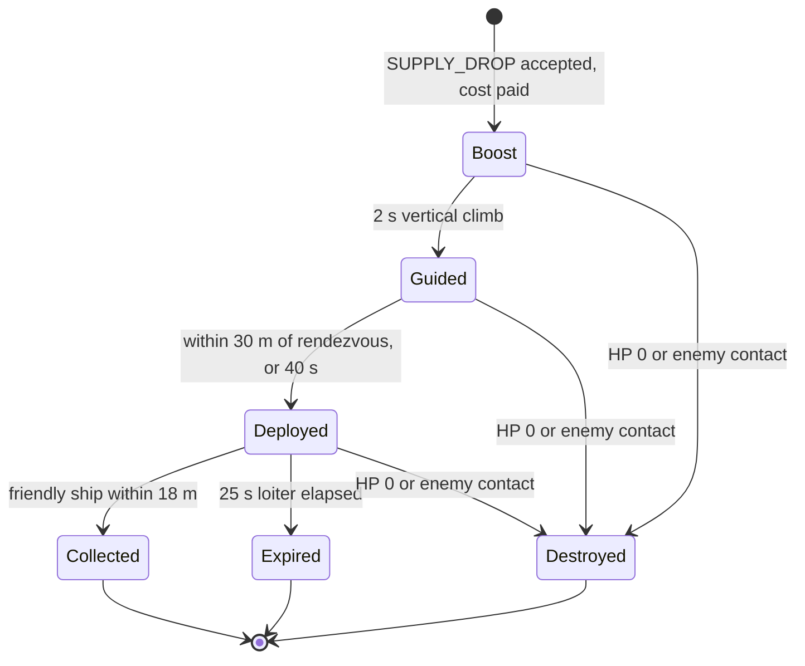

# 08 - New Feature Ideas

| | |
|---|---|
| **Project** | Codename PLANEWAR - arcade spaceship combat + base-building RTS on a spherical moon. Godot 4.7.2. Mobile, PC, browser. |
| **Document** | 08 - New feature ideas: one ranked backlog, a v1 shortlist with build-ready designs, and an evaluation of every seed in the 01 brief. |
| **Status** | v1.0 (stage 3, revised 2026-10-10) |
| **Date** | 2026-10-10 (stage 2 draft: 2026-10-09) |
| **Author role** | Creative director agent (stage 3: reviser) |
| **Inputs** | `docs/01-vision-and-core-decisions.md` (v1.1, binding; brief in s12 "08"), `docs/reviews/R0-resolution-register.md` (binding, incl. Part B contract tables), `docs/research/R1-game-references.md`, `R2-godot-tech.md`, `R3-platform-requirements.md` |
| **ID prefixes** | Proposals `I-nn`, shortlist designs `SL-n`, amendment requests `A-n`, open questions `OQ-n`, work seeds `FEAT-nn` |

## Decisions inherited from 01 (v1.1) and R0

1. Pillars P1-P5 (01 s1). Every proposal names the pillar it serves, or it is cut.
2. **Control.**
   - There is no avatar.
   - Each entity is in one control state: AUTO, ORDERED or POSSESSED.
   - Only one pilot can possess an entity.
   - An order sent to a possessed unit waits as a pending order and applies on release (01 s4).
3. **Flight and resupply** (01 s3.1).
   - CF kinematics with g = 6.0 m/s^2. Every ship can hover (`a_thrust >= 2.0 * g`).
   - Fuel, ammo, bombs and repair come back by landing on a friendly Pad. **One exception (A-1, accepted): a collected Supply Canister restores 40 % fuel and 50 % ammo in flight; bombs and repair come only from landing** (SL-5, v1 stretch).
   - **Landing is tail-down and powered** (owner decision O-2): the ship pitches nose-up, hovers on its main engine and settles tail-first. A safe touchdown needs the body forward (thrust) axis within 25 degrees of the pad normal, vertical speed <= 8 m/s and horizontal speed <= 15 m/s.
   - Auto-dock is an assist (`Assist.auto_dock()`, radius 150 m).
   - A manual landing earns a 10 % repair-time bonus and a score bonus (SL-1).
4. **Economy** (01 s3.2). The team shares its Ore, Ice and Power. A wreck is worth 40 % of its Ore cost for 90 s, and Haulers tow wrecks.
5. **Sun.** Matchmade play has a static terminator. A moving sun exists only in Campaign, Co-op and custom lobbies (01 s5.5); 02 owns its rules.
6. **Fair play.**
   - Progression is cosmetic only.
   - Nothing that affects gameplay is sold.
   - There are no randomised paid items (01 s3.4, ADR-13, R3 s6.5).
7. **Roster.** The roster in 01 s6 is fixed. Adding a unit needs an amendment (A-4 is deferred to v1.x).
8. **Sim and networking.**
   - The sim is server-authoritative at 30 Hz.
   - `Command` is the only way to change it and `SimView` the only way to read it.
   - The server's PCG32 is the only randomness (ADR-06).
   - Clients predict only their possessed unit (ADR-07).
   - Replays are snapshot streams recorded by the server (ADR-10).
9. **Data and rendering.**
   - Every number lives in JSON defs, with 02's descriptive snake_case field names (R0 Part B).
   - Data packs work only in custom lobbies and offline play (ADR-09).
   - Compatibility renderer everywhere, with no decals in 4.7 (ADR-02).
10. **Caps and constants.**
    - Caps profiles (R0 B.7): Standard 2,000 projectiles, 200 wrecks, 1,200 units plus structures; Reduced 1,000 / 100 / 640; **Lite** (single-thread offline web/mobile) 600 / 60 / 240.
    - `PLANET_RADIUS = 6000.0` m (owner-confirmed); specs below use the constant.
11. **Release rule.** No v1 proposal may require changing ADR-01..08. An idea that would is labelled v2, with the ADR named (01 s12).
12. **v1.0 platforms.** Windows (Steam, incl. Deck), Android, web. iOS, macOS, Linux native and portals are v1.1; nothing in 08 is platform-specific.

---

## 1. Method

**Scales.**
- **F** = pillar fit, 1-5.
- **D** = player delight, 1-5.
- **C** = cost. S = 1 (up to 4 agent-days), M = 2 (5-15 days), L = 3 (more than 15).
- **R** = risk, covering fairness, technical risk and scope. Low = 1, Medium = 1.5, High = 2, Very high = 3.

**Score = (F x D) / (C x R)**, so the maximum is 25.

**Categories.**
- **New:** a feature that 01 does not have.
- **Refinement:** detail for something 01 already commits to v1. Recommended for v1, but it uses no shortlist slot.
- **Polish:** presentation only, no rule change; it goes straight to 07.
- **Rejected:** a score below 1.5, or a conflict with a pillar.

**Shortlist rule.** The six highest-scoring **New** proposals that fit v1 without touching ADR-01..08 make the shortlist. Ties go to the higher F, then to the proposal with fewer amendment requests. The scores are stage-2 values and are kept; stage 3 decides what actually ships in v1 with the scope gate (section 3), not by re-scoring.

**Releases.**
- **v1:** launch.
- **v1 stretch:** accepted content that ships in v1 only if the scope gate opens in time; otherwise it slips to v1.1 with no new decision.
- **v1.x:** post-launch, no ADR change.
- **v2:** needs a named ADR amendment.

---

## 2. Ranked backlog (all proposals)

"Seed" means the 01 s12 brief requires the item to be evaluated. A star marks the shortlist (SL-n). Release shows the stage-3 ruling.

| # | ID | Proposal | Origin | Pillars | F | D | C | R | Score | Category | Release |
|---|---|---|---|---|---|---|---|---|---|---|---|
| 1 | I-10 | Landing Grades (no banking) | seed | P2 P4 | 5 | 4 | 1 | 1 | **20.0** | New ★ SL-1 | v1 |
| 2 | I-20 | Radio Chatter and callsigns | original | P1 P4 | 4 | 4 | 1 | 1 | **16.0** | New ★ SL-3 | v1 |
| 3 | I-19 | Form on Me (wingmen) | original | P1 | 5 | 4 | 1 | 1.5 | **13.3** | New ★ SL-2 | v1 |
| 4 | I-03 | Relay Station capture rules | seed | P3 | 4 | 3 | 1 | 1 | 12.0 | Refinement | Proposal, not adopted (02 owns) |
| 5 | I-16 | Cruise assist | seed | P2 P4 | 4 | 3 | 1 | 1 | 12.0 | Refinement | v1 (default on for touch) |
| 6 | I-04 | Moving-sun mechanics | seed | P3 | 4 | 3 | 1 | 1 | 12.0 | Refinement | Proposal, not adopted (02 owns; sun stays v1 campaign/custom) |
| 7 | I-24 | Earth Clock | original | P4 P3 | 3 | 3 | 1 | 1 | 9.0 | Polish | v1 |
| 8 | I-18 | Taught Routes ("fly it once") | original | P1 P3 | 5 | 5 | 2 | 1.5 | **8.3** | New ★ SL-4 | v1.x (second) |
| 9 | I-08 | Supply Canister (commander supply drop) | seed | P1 P2 | 5 | 4 | 2 | 1.5 | **6.7** | New ★ SL-5 (A-1 accepted) | v1 stretch (behind the scope gate) |
| 10 | I-21 | Meteor Fall (Moon Almanac) | original | P3 P2 | 4 | 5 | 2 | 1.5 | **6.7** | New ★ SL-6 | v1.x (first) |
| 11 | I-09 | Relay Combo scoring | seed | P1 | 3 | 3 | 1 | 1.5 | 6.0 | New (first alternate if SL-5 slips) | v1.x |
| 12 | I-31 | Skip bombing | original | P2 | 4 | 3 | 1 | 2 | 6.0 | New | v1.x |
| 13 | I-36 | Derelicts (pre-placed heavy salvage) | original | P2 P3 | 3 | 3 | 1 | 1.5 | 6.0 | New | v1.x |
| 14 | I-35 | Photo mode | original | P4 | 2 | 3 | 1 | 1 | 6.0 | New | v1.x |
| 15 | I-27 | Ghost trials and sortie challenges | original | P2 | 4 | 4 | 2 | 1.5 | 5.3 | New | v1.x |
| 16 | I-29 | Lifeboat (Core ejection) | original | P1 P2 | 4 | 5 | 2 | 2 | 5.0 | New (A-3 deferred) | v1.x |
| 17 | I-15 | Cosmetic rules | seed | P5 | 3 | 3 | 2 | 1 | 4.5 | Refinement | v1 |
| 18 | I-23 | Solar Flare event | original | P3 | 3 | 3 | 1 | 2 | 4.5 | New | v1.x |
| 19 | I-11 | Kill-cam | seed | P4 | 3 | 4 | 2 | 1.5 | 4.0 | New | v1.x |
| 20 | I-13 | Daily challenges | seed | P2 | 3 | 4 | 2 | 1.5 | 4.0 | New | v1.x |
| 21 | I-17 | Gunner mode (aim-to-fly) | seed-derived | P1 P2 | 4 | 4 | 2 | 2 | 4.0 | New | v1.x |
| 22 | I-22 | Eclipse event | original | P3 | 4 | 4 | 2 | 2 | 4.0 | New | v1.x |
| 23 | I-30 | Pad Loadout Dial | original | P2 | 4 | 3 | 2 | 1.5 | 4.0 | New | v1.x |
| 24 | I-34 | Moment of the Match | original | P5 P4 | 3 | 4 | 2 | 1.5 | 4.0 | New | v1.x |
| 25 | I-32 | Cold Coast (engine-off stealth) | original | P2 P3 | 4 | 4 | 2 | 2 | 4.0 | New | v2 (ADR-05) |
| 26 | I-25 | Crew stations (ride-along, Bombardier) | original | P1 | 4 | 5 | 3 | 2 | 3.3 | New (A-2 deferred) | v1.x |
| 27 | I-28 | Fortress Raids (async) | original | P1 P2 | 4 | 5 | 3 | 2 | 3.3 | New | v1.x |
| 28 | I-05 | Terrain line-of-sight | seed | P3 | 4 | 3 | 2 | 2 | 3.0 | New | v1.x |
| 29 | I-12 | Spectator and caster tools | seed | P5 | 2 | 3 | 2 | 1 | 3.0 | New | v1.x |
| 30 | I-37 | Starshell (commander flare) | original | P1 P4 | 3 | 3 | 2 | 1.5 | 3.0 | New | v1.x |
| 31 | I-38 | Prize Tow (capture crippled Harvesters) | original | P2 | 3 | 4 | 2 | 2 | 3.0 | New | v1.x |
| 32 | I-01 | Barge mobile pad | seed | P2 P1 | 4 | 4 | 3 | 2 | 2.7 | New (A-4 deferred) | v1.x anchored; v2 moving deck (ADR-07) |
| 33 | I-26 | Mass Driver logistics | original | P2 P3 | 4 | 4 | 3 | 2 | 2.7 | New (A-4 deferred) | v1.x |
| 34 | I-07 | Picture-in-picture multi-view | seed | P4 | 3 | 3 | 2 | 2 | 2.3 | New | v1.x (PC/Deck) |
| 35 | I-14 | Player-authored map recipes | seed | P3 | 3 | 4 | 3 | 2 | 2.0 | New | v1.x packs; v2 editor (ADR-04, ADR-08) |
| 36 | I-39 | Squadrons and Seasons | original | P5 | 2 | 3 | 2 | 1.5 | 2.0 | New | v1.x |
| 37 | I-02 | Salvage market | seed | P5 | 2 | 2 | 2 | 1.5 | 1.3 | Rejected | - |
| 38 | I-33 | Moonquake | original | P3 | 2 | 2 | 2 | 2 | 1.0 | Rejected | - |
| 39 | I-40 | Uplink Jammer | original | inverts P1 | 2 | 3 | 2 | 3 | 1.0 | Rejected | - |
| 40 | I-06 | Helium-3 rare resource | seed | P5 | 1 | 2 | 2 | 2 | 0.5 | Rejected | - |
| 41 | I-41 | Orbital strike verb | original | violates P3 | 1 | 3 | 2 | 3 | 0.5 | Rejected | - |

---

## 3. Shortlist at a glance and the scope gate

**Scope gate (C1-13).** Shortlist work starts only after S-SIM-1, S-WEB-2 and S-FLIGHT-1 pass and the vertical slice (01 s3.2 loop, 1v1 vs a Normal bot) is feature-complete. Until then no FEAT seed in section 11 is released to an agent, except the Haiku content seeds FEAT-01 and FEAT-02, which touch no code. If the gate opens too late, SL-5 slips to v1.1 without a new decision.

| Slot | ID | One line | Main absorbers | ADR impact | Amendment | Release |
|---|---|---|---|---|---|---|
| SL-1 | I-10 | Landings are graded; points go straight to the Pilot score. | 02, 06 | none | - | **v1** |
| SL-2 | I-19 | One cockpit verb puts two autopilot ships on your wing, attacking your target. | 05, 06 | none | - | **v1** |
| SL-3 | I-20 | Callsigns and radio barks make every autopilot decision readable. | 06, 07 | none | - | **v1** |
| SL-5 | I-08 | The commander launches a supply canister that the pilot catches in flight. | 02, 05, 06 | none | A-1 (01 s3.1.4) **accepted** | **v1 stretch** |
| SL-6 | I-21 | Announced, symmetric meteor falls drop neutral salvage on the seams between teams. | 02, 05, 06, 07 | none | - | v1.x (built first) |
| SL-4 | I-18 | Fly a route once and the autopilot repeats it, deck-level legs included. | 05, 06 | none | - | v1.x (built second) |

- **Also in v1 (no slot used):** Refinements I-15 and I-16 (Cruise assist, default on for touch), Polish I-24. I-03 and I-04 are proposals only; 02 owns both rule sets (section 5).
- **If the gate slips SL-5 to v1.1:** I-09 Relay Combo is the first alternate for any v1.x slot.
- The SL-4 and SL-6 designs below stay build-ready so they can start the day v1 ships, but no v1 seed depends on them.

---

## 4. Shortlist designs

Every design ends with a **Performance** line: the per-tick cost at standard caps, as an estimate to be measured in S-SIM-1; 03 s4.2 reserves a row for each v1 and v1-stretch item.

### SL-1 Landing Grades (I-10) - v1

**Why.** The landing is the signature moment (P2, R1 s3 item 9). 01 promises a score bonus for manual landings. This design defines that bonus. It is the single v1 landing-grade system (C2-18 and C3-13: 02's S/A/B table is deleted). There is no banking: points add straight to the Pilot score, so no unbanked pool exists.

**Rules.**
1. **Touchdown.** Touchdown is the tick on which 03 s6.4's landing rule is satisfied for a friendly pad. At that tick the sim records `TouchdownMetrics`:
   - `v_vert` and `v_horiz`, both relative to the pad;
   - `tilt_deg`: the angle between the body forward (thrust) axis and the pad normal (tail-down landing);
   - `offset_m` from the pad centre;
   - `manual`: true if no auto-dock assist tick occurred in the final 150 m (`manual_window_m`);
   - `hot`: true if a hostile was within 1,500 m, or the ship was hit in the last 5 s;
   - `fuel01`.
2. **Quality score q.**
   - `q = 0.35*(1 - v_vert/V) + 0.25*(1 - v_horiz/H) + 0.20*(1 - tilt/T) + 0.20*(1 - offset/pad_radius_m)`.
   - Each term is clamped to [0,1].
   - V, H and T are 01's limits (8, 15 and 25: `landing_safe_v_vert`, `landing_safe_v_hor`, `landing_safe_pitch_deg`), read from `flight_common`. `pad_radius_m` comes from the pad's StructureDef (Core 12, Outpost 10, Pad 10, Hangar 10, Relay Station 12).
3. **Grades** (`LandingGrade.Grade`, R0 B.3: 0 CRASH, 1 BENT, 2 HARD, 3 FAIR, 4 CLEAN, 5 ACE, 6 AUTO).
   - ACE: q >= 0.85.
   - CLEAN: q >= 0.65.
   - FAIR: q >= 0.40.
   - HARD: below 0.40 but still safe.
   - BENT: in 01's damage band.
   - CRASH: the ship is destroyed.
   - AUTO: not a manual landing. No points and no penalty.
4. **Points.**
   - ACE 50, CLEAN 30, FAIR 15, HARD 5.
   - x1.5 if `hot`.
   - +20 for a dead-stick landing (`fuel01 < 0.03`).
   - 01's x0.9 repair time applies to manual landings graded FAIR or better.
   - Points are added to the player's Pilot score by 02's score events (GD-27) in tick step 10; `LandingGrade.points()` is the only formula.
5. **What score is for.** Score is social only: medals, profile and the end-of-match summary. Rating stays win/loss (02). 02's medal `feather_touch` is 5 manual landings graded CLEAN or better, and Mission 1 carries an optional "ACE landing" objective; both read the `LANDING` event.
6. **Replication.** `SimView.player_score(slot) -> Vector2i` stays so the score HUD needs no special case; it returns (total, 0) because nothing is unbanked.

**Sortie Card.** While the ship is DOCKED (a full service takes 15 s), a card shows:
- sortie time and distance;
- kills and damage dealt;
- bombs dropped and bombs that hit;
- Ice and Ore spent;
- the grade, with V / H / Tilt / Centre bars and the points earned.

V and H come from the `LANDING` event; Tilt and Centre are read by the client from its own predicted pose at the touchdown tick (no extra event fields). The card fills the service wait and teaches the economic bleed (P4). 02's telemetry (GD-35) watches the median pad time per sortie (<= 30 s touch, <= 40 s pointer); if it fails, the order of fixes is auto-dock radius 150 -> 120 m, then `repair_time_s` -20 %, and the card stays.

**UI (06).**
- A grade stamp shows for 1.5 s (06 s6.4), with one shape per grade so it reads without colour: ACE star, CLEAN diamond, FAIR circle, HARD square.
- The Sortie Card is a bottom panel that hides on launch.
- The profile tracks landing streaks. Pad flags unlock at 10, 50 and 200 ACE landings (cosmetic, I-15).

**Autopilots (05).** Autopilot landings are graded silently. `LandingGrade` is the test oracle for 05's landing routine; the soak test requires mean q >= 0.70 and fewer than 1 % crashes (05 s11.3).

**Data.** `godot/content/defs/scoring.json`, `landing_grade` block (02 owns the file; this block is 08's). The v1 block has no banking section.
```json
{ "landing_grade": {
    "weights": {"v_vert": 0.35, "v_horiz": 0.25, "tilt": 0.20, "offset": 0.20},
    "thresholds": {"ace": 0.85, "clean": 0.65, "fair": 0.40},
    "points": {"ace": 50, "clean": 30, "fair": 15, "hard": 5},
    "hot_multiplier": 1.5, "hot_radius_m": 1500, "hot_window_s": 5,
    "dead_stick_fuel01": 0.03, "dead_stick_points": 20, "manual_window_m": 150 } }
```

**Code.**
```gdscript
# godot/src/sim/scoring/touchdown_metrics.gd
class_name TouchdownMetrics extends RefCounted
var v_vert: float; var v_horiz: float; var tilt_deg: float; var offset_m: float
var manual: bool; var hot: bool; var fuel01: float

# godot/src/sim/scoring/landing_grade.gd  (pure; used by sim scoring, UI and soak metrics; ui may reference it)
class_name LandingGrade extends RefCounted
enum Grade { CRASH, BENT, HARD, FAIR, CLEAN, ACE, AUTO }
static func quality(m: TouchdownMetrics, pad_radius_m: float, limits: Vector3, def: LandingGradeDef) -> float  # limits = (V, H, T)
static func grade(q: float, safe: bool, destroyed: bool, manual: bool, def: LandingGradeDef) -> Grade
static func points(g: Grade, m: TouchdownMetrics, def: LandingGradeDef) -> int
```

**Event and view changes.**
- Grades travel in the `LANDING` SimEvent (kind 29: entity, pad, `grade:u8`, `q:u8` (q x 255), `manual`, `hot`, `v_vert`, `v_horiz`). `DOCKED` carries no grade fields.
- `SimView.player_score(slot)` is part of the R0 B.5 accessor list.

**Performance.** No per-tick cost. One `LandingGrade` evaluation per landing, estimated <= 0.01 ms; the `LANDING` event is already in 04's catalogue.

### SL-2 Form on Me (I-19) - v1

**Why.** "Depend on nothing" (P1) should also mean "never fly alone". ESCORT already exists in 01's order vocabulary. This design adds its cockpit verb, which delivers the escorted bomber run of 01 s0.4 without a menu.

**Rules.**
1. **Form on me.** Recruits up to 2 team ships, nearest first. A ship qualifies when it:
   - is armed, with a cruise speed of at least 0.9 x the leader's. A Dart leader takes Darts; a Lancer or Bomber leader takes Darts and Lancers;
   - is AUTO or on PATROL;
   - is within 1,500 m;
   - has fuel01 >= 0.4 and hp01 >= 0.5.

   Each recruit receives `ORDER ESCORT(leader, slot)`, and the client remembers its previous order.
2. **Formation slots** are in the leader's body frame, given as (back, right, up) in metres: (-50, -60, +10) and (-50, +60, +10). If the cap is raised there is a third slot at (-100, 0, +20). Tolerance is 30 m. Wingmen join on an intercept course, and the HUD shows the join distance. Above 95 % cruise, the HUD suggests easing the throttle.
3. **Attack my target.** The HUD target becomes the focus until it dies, 20 s pass, or it is more than 2,000 m from the leader; then wingmen return to their slots. **Break**: wingmen engage freely within 1,200 m for 20 s.
4. **Release wing** restores the remembered orders, or AUTO. Wingmen also leave on their own return-to-pad thresholds (01 s4.3) with a bark (SL-3), and they never follow the leader into the Fade band.
5. **Transfer.**
   - If the leader dies and the player possesses another eligible ship within 5 s and 2,500 m, the escort moves to that ship.
   - A leader released alive keeps its escort until it docks.
   - Between teammates, the last command wins (05).
6. **Campaign pilot-assist.** On M3 and M6 the player may enable Pilot-assist; SL-2 wingmen then may score kill objectives, and medals are capped at silver (02 s16.2, C3-10).

**UI (06).** SL-2 adds no new button (C2-22, C3-21).
- Form on me, Attack my target and Release wing are entries of the ping wheel on every input class (`QuickPing.Kind` 8 WING_FORM, 9 WING_ATTACK, 10 WING_RELEASE).
- In Chase, a long-press radial on FIRE offers Form, Attack, Break and Release.
- Bindings per input class are defined in 06 s3.1; this document names no keys.
- Chevrons at the screen edge show each wingman's callsign and state: JOINING, IN SLOT, ENGAGING or RTB. State changes also raise `AlertKind.WING_STATE` (31) into the shared feed.

**05.**
- `OrderSpec` gains `escort_slot`, `focus` and `escort_mode` (`EscortMode` 0 FORM, 1 FOCUS, 2 BREAK); the ORDER wire layout is 04's (C2-06: kind, flags, count, ids, target, <= 256 B) with these fields carried per 05 s3.1.
- Behaviours: slot keeping, focus engagement on a leash, rejoin (AI-11).
- Bots never use the macro; campaign scripts may.

**Data.** `godot/content/defs/wing.json`:
```json
{ "max_wingmen": 2, "recruit_radius_m": 1500, "min_fuel01": 0.4, "min_hp01": 0.5,
  "min_speed_ratio": 0.9, "recruit_states": ["AUTO", "PATROL"],
  "armed_classes": ["dart", "lancer"],
  "slots_brf_m": [[-50, -60, 10], [-50, 60, 10], [-100, 0, 20]], "slot_tolerance_m": 30,
  "focus_timeout_s": 20, "focus_leash_m": 2000, "break_radius_m": 1200, "break_s": 20,
  "transfer_window_s": 5, "transfer_radius_m": 2500 }
```

**Code.** Commands are built client-side, like any other team order.
```gdscript
# godot/src/ui/wing/wing_commands.gd
class_name WingCommands extends RefCounted
static func pick_wingmen(view: SimView, leader: int, def: WingDef) -> PackedInt32Array
static func form_on_me(view: SimView, player: int, leader: int, def: WingDef) -> Array[Command]
static func attack_my_target(player: int, leader: int, wingmen: PackedInt32Array, target: int) -> Array[Command]
static func break_engage(player: int, leader: int, wingmen: PackedInt32Array) -> Array[Command]
static func release(player: int, wingmen: PackedInt32Array, prev_orders: Dictionary) -> Array[Command]

# godot/src/ui/wing/wing_state.gd  (client memory of my wing)
class_name WingState extends RefCounted
var leader: int; var wingmen: PackedInt32Array; var prev_orders: Dictionary  # EntityId -> order payload
func on_leader_lost(tick: int) -> void
func on_possessed(new_leader: int, view: SimView, tick: int, def: WingDef) -> Array[Command]  # transfer rule
```

**Performance.** At most 2 ESCORT autopilots per human pilot (16 at 8 humans), each one extra Dart-brain think slice inside 05's AI governor plus slot steering; estimate +0.1 ms per tick at 8 pilots. Client cost <= 0.05 ms.

### SL-3 Radio Chatter and callsigns (I-20) - v1

**Why.** The automatic layer is the product (R1 s3 item 3). But an autopilot you cannot see thinking looks stupid, and Carrier Command was judged on exactly that (R1 s2.2). Short barks make each decision readable (P4) and give units personality (Hostile Waters, R1 s2.2) at almost no cost.

**Rules.**
1. **Callsigns.** Each team unit gets a callsign `<Word>-<n>`.
   - The word comes from a list per team slot (0..7) and class. For example, slot 0 ships are named after birds (Kestrel, Wren, Swift), Harvesters are "Crawler" and Haulers are "Tug".
   - n = 1 + (hash(entity_id) mod 9).
   - Callsigns are deterministic on every client and cost no bandwidth.
   - A possessed ship shows the player's name instead.
2. **Source.** Barks are built client-side from existing SimEvents (including `LANDING` and `ALERT`), and from SimView values crossing the thresholds in the autopilot defs (`rtb.fuel01`, `rtb.hp01`). v1 adds no sim state.
3. **v1 bark table.** Alert-derived keys read `AlertKind` (R0 B.3).

| Key | Derived from | Scope | Prio | Example (EN) | Release |
|---|---|---|---|---|---|
| `launch` | `LAUNCHED` | WING/NEAR | 3 | "Kestrel-2 airborne." | v1 |
| `rtb_fuel` | an AUTO/ORDERED ship's fuel01 drops below its autopilot `rtb.fuel01` | WING/NEAR | 4 | "Kestrel-2, low fuel, heading home." | v1 |
| `rtb_ammo` | ammo reaches 0 | WING/NEAR | 4 | "Kestrel-2, guns dry, rearming." | v1 |
| `rtb_damage` | hp01 drops below its autopilot `rtb.hp01` | WING/NEAR | 4 | "Kestrel-2, hit hard, breaking off." | v1 |
| `engage` | the unit's first `HIT` after 20 s without one | WING | 3 | "Kestrel-2 engaging." | v1 |
| `docked` | `DOCKED` (autopilot) | WING | 2 | "Kestrel-2 on the pad." | v1 |
| `harvester_hit` | `ALERT` HARVESTER_ATTACKED | ALERT | 6 | "Crawler-4 taking fire, falling back to the towers." | v1 |
| `structure_lost` | `STRUCTURE_LOST` / `ALERT` STRUCTURE_LOST | ALERT | 7 | "Flak Battery lost at Outpost East." | v1 |
| `low_power` | `LOW_POWER` / `ALERT` LOW_POWER | ALERT | 6 | "Power at 60 percent. Towers slowing." | v1 |
| `wing_join` / `wing_leave` | `ALERT` WING_STATE (SL-2) | WING | 5 | "Two, on your wing." / "Two, low fuel, going home." | v1 |
| `landing_grade` | `LANDING` with a grade for the local player | SELF | 5 | "Ace landing." | v1 |
| `supply_away` | `ALERT` SUPPLY_AWAY (SL-5) | SELF | 5 | "Canister away. Look for the beacon." | v1 stretch |
| `almanac_warn` | `ALERT` METEOR_WARN (SL-6) | ALERT | 7 | "Meteor fall in sixty seconds, east seam." | v1.x |

4. **Rate limits.**
   - At most one line every 1.5 s.
   - Each entity has a 20 s cooldown per key.
   - The queue holds 4 lines and drops the lowest priority first.
   - A line lives 4 s.
5. **Scope.**
   - SELF: the possessed unit.
   - WING: wingmen plus the possessed unit.
   - NEAR: team entities within 3,000 m of the camera focus.
   - ALERT: the whole team.
6. **Filters.** All; Wing + alerts (the touch default); Alerts only; Off. The feed doubles as the subtitle track. Voice lines are a v1.x content task.

**UI (06).** Chatter is a lane of 06's single feed, not a second widget (C3-21).
- `ChatterDirector` writes into the feed's chatter lane; the feed has priority lanes (P0 banner, alerts, chatter, Adjutant) and one filter button, and shows 3 rows in COMPACT and 6 in REGULAR.
- Each callsign shows in team colour with a class glyph.
- In the Tactical and Commander views, tapping a line jumps the camera to that unit (extends 01 s4.1's tap-to-jump).
- Minimum text size is 9 px at 1280x800 (ADR-13).

**Data.**
- `defs/callsigns.json`: `{team_slot: {class_key: [words]}}`.
- `defs/barks.json`: entries of `{key, source, scope, priority, cooldown_s, sfx_id}`. Strings are not stored here.
- Strings live in 06's localisation CSV under the domain `barks`, with ids `barks.<key>.<variant>` (variants 1..3), in EN and FI (C2-33).

**Code.**
```gdscript
# godot/src/ui/chatter/callsigns.gd
class_name Callsigns extends RefCounted
static func callsign(entity_id: int, team_slot: int, class_key: StringName, def: CallsignDef) -> String

# godot/src/ui/chatter/chatter_line.gd
class_name ChatterLine extends RefCounted
var key: StringName; var entity: int; var text: String; var priority: int; var sfx_id: StringName; var born_tick: int

# godot/src/ui/chatter/chatter_director.gd
class_name ChatterDirector extends RefCounted
signal line_ready(line: ChatterLine)    # the feed adapter pushes it into the chatter lane
func _init(barks: BarkDefs, callsigns: CallsignDef, autopilots: AutopilotDefs, local_player: int) -> void
func set_filter(f: StringName) -> void   # the feed's filter state: all | wing_alerts | alerts | off
func set_wing(leader: int, wingmen: PackedInt32Array) -> void
func on_events(events: Array[SimEvent], view: SimView, tick: int) -> void
func sample(view: SimView, focus: Vector3, tick: int) -> void   # 3 Hz threshold-crossing scan
```

**v1.x.** A `SimEvent.INTENT_CHANGED(entity, intent)` emitted from autopilot plans would make barks exact rather than inferred. It would also allow lines such as "Tug-1 hooked salvage, 300 Ore".

**Performance.** Server cost zero (client only). The 3 Hz scan is estimated <= 0.2 ms per scan on mobile, bounded by a 4-line queue.

### SL-5 Supply Canister (I-08) - v1 stretch (A-1 accepted)

**Why.** The commander helps the pilot and the pilot asks for help (R1 s3 item 5, Natural Selection in R1 s2.2). The canister is a physical object under CF gravity that can be shot down, not a magic refill. Bombs and repair still require a landing, so the landing stays the signature moment. Amendment **A-1 is accepted** (owner decision O-7; 01 s3.1.4 carries the exception). SL-5 ships in v1 behind the scope gate (section 3); its defs stay `status: "candidate"` until the gate opens.

**Rules.**
1. **Issue.** Any teammate targets a friendly ship; the pilot can also ask through the ping wheel's "Need supply" (`QuickPing.Kind` 11 NEED_SUPPLY). The client picks the nearest friendly pad within 3,500 m of the target: a Core pad, Pad, Hangar or held Relay Station. It sends `ORDER SUPPLY_DROP(target)` (`OrderSpec.Kind` 9) to that pad.
2. **Validation.** The server checks:
   - the range;
   - the pad's 45 s cooldown;
   - the team cap of 2 canisters in flight;
   - the cost of 40 Ice + 15 Ore, paid at launch.

   A failure returns `REJECTED(reason)`.
3. **Flight.**
   - The canister boosts vertically at 120 m/s for 2 s.
   - It then guides at up to 160 m/s with 25 m/s^2 of acceleration toward a rendezvous point R, recomputed at 3 Hz. R = target position + target velocity x ETA + 250 m ahead along the target's horizontal velocity. If the target moves slower than 5 m/s, R is 60 m above it instead.
   - R is clamped between 80 m AGL and 1,400 m datum altitude.
4. **Deploy and expire.** The canister deploys within 30 m of R, or after 40 s of flight. It then holds station for 25 s as a beacon and expires.
5. **Pickup.** Any friendly ship within 18 m collects it and gains +40 % fuel and +50 % ammo (rockets count as ammo). It gives **no bombs and no repair**. Events: `CANISTER_DEPLOYED` (32), `CANISTER_COLLECTED` (33); the commander sees `AlertKind.SUPPLY_AWAY` (30).
6. **Vulnerability.** The canister has 30 HP. Enemy guns and towers can target it; for towers it ranks below scouts in `target_priority`. An enemy ship that flies through it destroys it and takes no damage. It replicates as a projectile-store entity with hp (04 s3.3).
7. **Cost.** Per second of fuel, a canister costs about 5x a pad refuel: 40 Ice for 96 s of Dart fuel, against 20 Ice for a full 240 s tank on a pad. It buys tempo, not efficiency.
8. **Autopilots (05).**
   - An AUTO or ORDERED target diverts to collect if it is within 1,500 m and no enemy is within 800 m.
   - Any other AUTO ship below 50 % fuel and within 400 m may take it.
9. **Telemetry guard (C3-24).** Playtest telemetry must show that landings per flight-hour do not fall below 80 % of the pre-canister value. If they do, cut the team cap to 1 or raise the Ice cost before launch; the pad-time probe (median <= 30 s touch, <= 40 s pointer) is read with canisters on.



**UI (06).**
- A "Supply drop" button appears on a selected friendly ship. When unavailable it is greyed out and shows the reason, for example "No pad within 3.5 km" or "Pad cooldown 0:21".
- The ping wheel has "Need supply". No new cockpit button (C3-21 control budget).
- The HUD beacon marker shows distance and turns green when the current heading passes within 18 m.

**Data.**
- `godot/content/defs/commander_verbs.json` holds the block below (def class `SupplyCanisterDef`, `status: "candidate"`).
- `projectiles.json` has the row `supply_canister` with `"behaviour": "rendezvous"`, `hp` 30, `status: "candidate"` (R0 B.1).
```json
{ "supply_canister": {
    "cost_ore": 15, "cost_ice": 40, "launch_range_m": 3500, "pad_cooldown_s": 45,
    "team_max_in_flight": 2, "boost_mps": 120, "boost_s": 2, "max_speed_mps": 160,
    "max_accel_mps2": 25, "lead_m": 250, "slow_target_mps": 5, "hover_above_m": 60,
    "min_agl_m": 80, "max_alt_m": 1400, "deploy_radius_m": 30, "max_flight_s": 40,
    "loiter_s": 25, "pickup_radius_m": 18, "hp": 30, "fuel_frac": 0.4, "ammo_frac": 0.5,
    "divert_radius_m": 1500, "divert_safe_radius_m": 800, "opportunist_radius_m": 400 } }
```

**Code.**
```gdscript
# godot/src/sim/verbs/supply_drop.gd
class_name SupplyDrop extends RefCounted
enum Reject { OK, NO_PAD_IN_RANGE, PAD_COOLDOWN, TEAM_CAP, NO_ORE, NO_ICE, BAD_TARGET }
static func pick_pad(view: SimView, team: int, target: int, def: SupplyCanisterDef) -> int   # also used by the UI
static func validate(view: SimView, team: int, pad: int, target: int, tick: int, state: SupplyDropState, def: SupplyCanisterDef) -> Reject
static func rendezvous(target_p: Vector3, target_v: Vector3, canister_p: Vector3, def: SupplyCanisterDef) -> Vector3
```

**Performance.** Estimated <= 0.05 ms per canister tick; the team cap of 2 gives <= 0.2 ms typical and 0.8 ms in the worst case (8-team custom FFA, 16 canisters). 03 s4.2 reserves a "verbs" row of 0.2 ms nominal.

### SL-6 Meteor Fall: the Moon Almanac (I-21) - v1.x (built before SL-4)

**Why.** One moon (P3) should feel alive without becoming unfair (P5). Meteor falls are scheduled, announced and symmetric. They drop neutral salvage on the seams between teams, which is where the match arc wants contests (01 s3.3). Each fragment is an ordinary wreck, so 01's towing and comeback logic (R1 s3 item 13) is reused rather than a new system added. Not in v1 (C3-12); the map recipe schema reserves `meteor_sets` and `AlertKind.METEOR_WARN` (28) is reserved, so no v1 format changes when it lands.

**Rules.**
1. **The Almanac.** At match start the server builds a schedule from its PCG32 seed and the map's meteor sets. The schedule ships in the match-start state. From 0:00, the Commander view shows it on an **Almanac strip** covering 0:00 to the mode's `hard_end_s`, which also marks Core Exposure (`core_exposure_s`) and the hard end (both per-mode data in `modes.json`: 1v1 1,200 / 1,800 s, 2v2 1,500 / 2,100 s, team/custom/co-op/skirmish 1,800 / 2,400 s).
2. **Timing.** The first fall is at 8:00, then one every 7:00, each moved by up to ±60 s at random. Falls are scheduled only before `core_exposure_s`, at most 4: a 1v1 gets 2 (about 8 and 15 minutes), a 2v2 gets 3, a team match 4 (about 8, 15, 22 and 29 minutes). Site sets rotate in a shuffled order.
3. **Sites.** A recipe defines site sets by **anchor**:
   - `seam`: one site per seam at the given latitude. A seam is the equatorial midpoint between adjacent bases of different teams.
   - `noon_pole` or `midnight_pole`.

   In a team-block layout (R0 B.6) every team is equally far from its nearest site. For uneven custom layouts, the validator rejects any set whose per-team distances spread by more than 2 %, and the sim skips that set.
4. **Fragment symmetry.**
   - Seam sites: one set of (east, north) fragment offsets is sampled per fall and applied in every site's tangent frame, so all seam sites in a fall are congruent.
   - Pole sites: one fragment at the centre and the rest on a ring at 0.6 x the site radius, bisecting each team's block.
5. **Warnings.** At T-60 s an amber ellipse (400 m) and a HUD toast with bearing and distance appear (`AlertKind.METEOR_WARN`). At T-10 s a second toast fires and streaks show in the sky.
6. **Fragments.**
   - 5 per site.
   - Each spawns 300 m west of its impact point at 1,900 m altitude, with its velocity solved for an 8 s flight.
   - At impact, ships within 25 m are destroyed, and structures or ground units within 40 m take 150 damage.
   - The visuals are presentation only (ADR-04).
7. **Salvage.**
   - Each fragment leaves a neutral `wreck_meteor` worth 400 Ore. It lasts 240 s, and any team's Hauler can tow it at 0.7x tow speed.
   - Fragments count toward the wreck cap of the active caps profile (200 Standard, 100 Reduced, 60 Lite); when the cap is hit, the oldest wreck is evicted.
   - Totals: 2,000 Ore per site, 4,000 per fall in a two-team match, and up to 16,000 per team-size match. That is about 10 % of a 1v1 map's Ore.
8. **Late game.** Ore Fields stop regenerating at Core Exposure (01 s3.3), so the last fall before `core_exposure_s` is the last fresh Ore on the moon. That is a deliberate late-game draw.
9. **Modes.** The Almanac is on in every mode (OQ-1). Custom lobbies can toggle it, and campaign missions set it per mission.

**05.**
- The Commander bot and the Adjutant treat live sites as temporary objectives. At T-30 s they send one Hauler per reachable site, plus 2 Darts as escort when the threat estimate allows. The `adjutant_economy` profile ignores sites.
- AUTO Haulers already tow wrecks near their route (01 s4.3).

**UI (06).**
- The Almanac strip, with a "now" needle.
- Toasts at T-60 s and T-10 s, plus the `almanac_warn` bark.
- Site ellipses on the globe and in Tactical view.
- A distinct salvage icon on fragment wrecks, showing their Ore value.

**07.** A meteor streak, an impact flash and a crater decal quad, all pre-warmed.

**Data.** `godot/content/defs/moon_events.json` is added to R0 B.1's file list when SL-6 is adopted:
```json
{ "meteor_fall": {
    "first_at_s": 480, "interval_s": 420, "jitter_s": 60, "max_per_match": 4,
    "warn_s": [60, 10], "site_radius_m": 400, "fragments_per_site": 5,
    "spawn_alt_m": 1900, "spawn_back_m": 300, "flight_s": 8,
    "kill_radius_m": 25, "damage": 150, "damage_radius_m": 40,
    "pole_ring_frac": 0.6, "wreck_def": "wreck_meteor" } }
```
Wreck constants live in `economy.json` (R0 B.1), so the wreck row is added there:
```json
{ "wreck_meteor": { "ore_value": 400, "lifetime_s": 240, "tow_speed_factor": 0.7, "team": "neutral" } }
```
Added to the map recipe's reserved `meteor_sets[]` block (map ids `cradle`, `anvil`, `rimewater`; empty in v1):
```json
"meteor_sets": [ {"set": 0, "anchor": "seam", "lat_deg": 30}, {"set": 1, "anchor": "seam", "lat_deg": -35},
                 {"set": 2, "anchor": "midnight_pole"} ]
```

**Code.**
```gdscript
# godot/src/sim/events/almanac_entry.gd
class_name AlmanacEntry extends RefCounted
var kind: StringName                 # &"meteor_fall" first; &"eclipse", &"solar_flare" later
var at_tick: int
var site_set: int
var offsets_en_m: PackedVector2Array # (east, north) per fragment, shared by every site in the set

# godot/src/sim/events/moon_almanac.gd
class_name MoonAlmanac extends RefCounted
func build(map: MapDef, rules: MatchRules, rng: Rng, defs: MoonEventDefs) -> void
func entries() -> Array[AlmanacEntry]
func site_positions(entry: AlmanacEntry) -> PackedVector3Array   # from anchors and the live start layout
func step(world: SimWorld, tick: int) -> void                     # ALERT warnings, fragment spawns
func encode() -> PackedByteArray                                  # match-start state, saves, replay header
static func decode(bytes: PackedByteArray) -> MoonAlmanac
```

**Performance.** `step` is O(1) per tick. A fall spawns 20-40 projectiles for 8 s and an impact tick of estimated < 0.3 ms; up to 40 wrecks count toward the cap. 03 s4.2 reserves no row until SL-6 is adopted.

### SL-4 Taught Routes (I-18) - v1.x (built after SL-6)

**Why.** Possession is our best way of giving orders: fly the route once and the autopilot repeats it. This turns P3's hidden low corridors (rilles and crater rims, 01 s5.4) into orders, and gives phone players a stealthy Bomber approach without a waypoint editor. Not in v1 (C3-12): there is no `core/route.gd` in v1, and `OrderSpec.Kind` 10 PATROL_ROUTE and 11 ATTACK_VIA are reserved but unimplemented.

**Rules.**
1. **Recording.** While possessing a ship, press **Mark** to start. A waypoint is sampled:
   - every 400 m of great-circle travel;
   - when the heading changes by more than 35 degrees;
   - when Mark is pressed;
   - when a bomb is released (flag `BOMB_POINT`).

   Recording stops on Mark-hold, on landing, on release, or at 16 waypoints.
2. **Waypoint contents.**
   - Direction.
   - Altitude and mode. If the sampled AGL is under 300 m, the mode is AGL and the hold is max(sampled AGL, 40 m). Otherwise the mode is DATUM.
   - A speed hint, clamped to class cruise.
   - Flags.
3. **Review.** The route is shown as a ribbon. The player then chooses one of:
   - **Patrol (loop):** applies as a pending order on release (01 s4.4 rule 3), or goes to the current selection.
   - **Attack via:** pick a target near the last `BOMB_POINT` or at the route's end.
   - **Save:** up to 8 routes per player per match.
   - **Discard.**
4. **PATROL_ROUTE.**
   - Capture each waypoint at 150 m or abeam.
   - Close the loop by great circle.
   - Engage hostiles within 1,200 m of the route, then rejoin at the nearest waypoint.
5. **ATTACK_VIA.** Fly the route without engaging (self-defence only), attack the target, then return home by the default path.
6. **Safety.** 05's terrain avoidance overrides the route. Never fly below 40 m AGL. Legs that would hit terrain are climbed over and shown amber.
7. **Fuel check.** At assignment, if route length / cruise x burn rate exceeds 0.75 of the tank, show an amber warning. Return-to-pad thresholds still apply.
8. **Teammates** see the ribbon of any unit carrying a route.

**Wire.** Uses the ORDER layout of 04 (C2-06): `order_kind` 10 or 11, `flags`, `count`, `ids`, `target` (ATTACK_VIA), `point_count` 0-16 and `points[]` of `vec3q` (8 B each), at most 256 B, which already fits a 16-point route. Each point's altitude, AGL/DATUM mode, speed hint and `BOMB_POINT` flag are packed by a codec defined when SL-4 is adopted; the resolution target is <= 1 m horizontally and 0.1 m vertically at R = 6,000.

**UI (06).**
- Mark is bound per input class in 06 s3.1 (when built: gamepad View hold 0.5 s, pointer `M`, touch REC in the amber zone with explicit coordinates); this document names no other keys.
- Ribbons appear in the Tactical and Commander views. Deck legs are dashed, with altitude ticks and BOMB_POINT icons.
- A library panel sits in the order menu.
- Routes are auto-named after the nearest baked feature, for example "via Rille 3" (07).

**05.**
- PATROL_ROUTE and ATTACK_VIA standing orders, with an AGL hold driven by height-field lookahead.
- Waypoint capture by radius or abeam.
- Engage-and-rejoin behaviour.
- Server-side payload validation: count, altitude range, and total length up to 40 km.

**Data.** `godot/content/defs/routes.json`:
```json
{ "sample_spacing_m": 400, "turn_sample_deg": 35, "max_waypoints": 16, "library_size": 8,
  "agl_mode_threshold_m": 300, "min_agl_m": 40, "capture_radius_m": 150,
  "patrol_engage_radius_m": 1200, "fuel_warn_fraction": 0.75, "max_route_length_m": 40000 }
```

**Code.** `Route` lives in `core` only once SL-4 is adopted (R0 B.4 forbids it in v1); `ui`, `sim`, `sim_ai` and `net` would all use it and it needs only `Sphere`.
```gdscript
# godot/src/core/route.gd   (v1.x)
class_name Route extends RefCounted
enum Mode { PATROL_LOOP, ATTACK_VIA }
enum AltMode { DATUM, AGL }
const FLAG_BOMB_POINT := 1
var mode: Mode; var target: int
var dirs: PackedVector3Array; var alts_m: PackedFloat32Array; var alt_modes: PackedByteArray
var speeds: PackedFloat32Array; var flags: PackedByteArray
func encode() -> PackedByteArray
static func decode(bytes: PackedByteArray) -> Route   # null on malformed input
func length_m() -> float                               # great-circle sum at Sphere.PLANET_RADIUS

# godot/src/ui/routes/route_recorder.gd   (v1.x)
class_name RouteRecorder extends RefCounted
func start(entity: int, p: Vector3, tick: int) -> void
func sample(p: Vector3, v: Vector3, agl_m: float, bomb_released: bool, def: RoutesDef) -> void  # every tick
func mark() -> void
func stop() -> Route
func is_recording() -> bool
```

**Performance.** Each PATROL_ROUTE ship adds one height-field lookahead sample per think slice; estimated <= 0.1 ms at 20 route ships. Not part of the v1 tick budget.

---

## 5. Evaluation of the 01 seeds

Each entry gives pillars, cost, risk and earliest release, then the design. I-08 and I-10 are on the shortlist (section 4).

**I-01 Barge mobile pad.** P2, P1 · L · High · v1.x anchored; v2 moving deck. A-4 deferred.
- **Why not now.** Deck landings on a moving Barge would be a great skill moment, but ADR-07 predicts only the possessed unit. The deck would render 100 ms + RTT/2 behind, which is about 5-7 m of error at 35 m/s. Autopilot deck landings are also hard. With tail-down landing (O-2) a deck must also accept a hover touchdown.
- **v1.x anchored variant.** A 1,500 HP ship flying at 35 m/s with 600 s of fuel. It settles on ground with a slope of 8 degrees or less and deploys in 10 s, becoming a pad with a 200 m build radius for towers only. It accepts no landings while flying.
- **Amendments.** The anchored variant needs A-4 (deferred; 01 s6.3 Barge row reads "v1.x idea": anchored v1.x, moving deck v2); the moving deck needs ADR-07 (section 7).

**I-02 Salvage market.** P5 · M · Medium · Rejected (towing stays in v1).
- A market inside a team is pointless because the economy is shared (Q3).
- Trading with enemies invites griefing and adds phone UI.
- Salvage grows instead through SL-6, I-36 and I-38.

**I-03 Relay Station capture rules.** P3 · S · Low · **proposal, not adopted.** 02 owns the Relay Station numbers (contest radius 300 m, progress resets when the capturer leaves, same-rule recapture; GD-23). The text below is kept only as input for a 02 revision; where it differs, 02 wins (this proposal used 600 m and decay at 5 %/s).
- **Capture.** A Hauler docks on the station pad under normal landing rules, and progress runs 0 to 1 over 20 s.
  - Progress advances only while no enemy ship or ground unit is within 600 m.
  - Contest pauses progress without resetting it.
  - If the Hauler leaves, progress decays at 5 %/s.
- **Taking an enemy-held station.** It must first be neutralised (20 s), then captured (20 s).
- **Invulnerability.** The station cannot be destroyed. The capturing Hauler can, so a capture is a landing under fire.
- **Holding** gives a pad and 3,500 m sensors.
- **Alerts:** `RELAY_CONTESTED` and `RELAY_CAPTURED` (both exist in `AlertKind`).

**I-04 Moving-sun mechanics.** P3 · S · Low · **proposal, not adopted.** 02 owns the moving-sun rules (`cold_trap_sunlit_mult` 0.5, a 0.5 degree solar band; GD-33); the moving sun stays in v1 for campaign and custom lobbies (owner decision O-4). The text below is kept as design input only.
- **Fact for designers:** the terminator moves at 2 pi x `PLANET_RADIUS` / period. For a 60 min period at R = 6,000 that is 10.5 m/s at the equator, slower than a Harvester (12 m/s), so "outrun the dawn" is literal.
- **Rules proposed.**
  - Sublimation: a sunlit Cold Trap (sun elevation above 0 degrees at its centre) stops yielding, and its buffer loses 2 % every 10 s.
  - Dusk alert: 2:00 before a cluster's Solar Arrays go dark (`AlertKind.DUSK_WARN`).
  - Twilight band: within ±3 degrees of the terminator, Solar runs at 50 %.
- **Mission seeds:** "Outrun the Dawn" and "Night Raid".

**I-05 Terrain line-of-sight.** P3 · M · High · v1.x.
- **Problem.** A height-field march per vision check is too slow in GDScript at 1,200 entities.
- **Approach.** The baker emits **rim occluders**: every crater rim at least 80 m above its surroundings becomes a spherical cap (centre, angular radius, rim altitude).
- **Test.** A sight line is blocked when it crosses a cap's ring below the rim altitude. Only caps inside the interest cells the line crosses are tested.
- **Budget:** 1.5 ms or less per vision pass (FEAT-35).
- **Fairness.** Vision is computed on the server, so the result is identical on every platform.

**I-06 Helium-3.** P5 · M · High · Rejected.
- A third stockpile breaks 02's "two stockpiles plus power" and crowds the phone HUD.
- It would matter only after matches are already decided.
- The "rare late prize" fantasy goes to the late Meteor Fall (v1.x), plus "rich" fragments (2x Ore).

**I-07 Picture-in-picture multi-view.** P4 · M · High · v1.x, PC and Deck only.
- v1 keeps 01's single home PiP.
- v1.x adds up to 3 pinned 320x180 SubViewports with a cheap profile: terrain depth cap 3, no particles, no shadows.
- Each costs about +25 % draw calls, which only PC-mid can afford (01 s8.2).

**I-09 Relay Combo scoring.** P1 · S · Medium · v1.x. First alternate.
- Kills within 6 s of each other raise a multiplier, x1.25 per step up to x2.0 (Luftrausers, R1 s2.5).
- The relay twist: possessing another unit within 3 s of a kill keeps the chain alive.
- Points add to the Pilot score like SL-1's (there is no unbanked pool).

**I-11 Kill-cam.** P4 · M · Medium · v1.x.
- Replays are server files (ADR-10), so the live version uses a client ring buffer: the last 6 s of NetSimView state within 1,500 m of the possessed unit, under 512 KB.
- A **Watch** button on the re-embodiment panel replays 4 s from behind the killer, using the `killer` id in DEATH.
- It never delays re-embodiment (P1).

**I-12 Spectator and caster tools.** P5 · M · Low · v1.x. Built on ADR-10's spectator role:
- a director camera that cuts to the busiest interest cell;
- a possession roster;
- Ore and Ice curves;
- an event timeline;
- up to 4 pilot PiPs on PC.

Ranked keeps the 10 s delay.

**I-13 Daily challenges.** P2 · M · Medium · v1.x.
- Built on the campaign runtime.
- A pool of 60 JSON templates, written at Haiku tier. Examples: "Ace three landings under fire", "Bomb a convoy with one Dart".
- 3 challenges a day, seeded from the UTC date.
- Offline play, with Nakama leaderboards guarded by plausibility checks.
- Rewards: badges and streaks only.

**I-14 Player-authored map recipes.** P3 · L · High · v1.x packs; v2 editor.
- **v1.x.** PC players hand-write `recipe.json`. A hosted bake job runs the same Python baker and returns a 4 MB pack. The pack is hash-locked to custom lobbies (ADR-09).
- **Validation.** The validator enforces symmetric slots, 01 s5.6's template and the relief range. Map names pass moderation (ADR-13).
- **v2.** An in-game editor needs ADR-04 and ADR-08 amendments.

**I-15 Cosmetic rules.** P5 · M · Low · v1 refinement.
1. Never change silhouette, size, hitbox or team-colour emissive regions.
2. Paints are palette-row swaps on non-emissive panels, auto-checked for contrast with team colours (07 `cvd_check.py`).
3. Engine trails stay in the team's hue family.
4. In-match kill marks reset after the match.
5. Pad flags, titles, medals and streak decals are earned.
6. Direct sale only, never randomised (R3 s6.5).

**I-16 Cruise assist.** P2, P4 · S · Low · v1 refinement of 01 s3.1.6.
- A Cruise toggle holds heading, speed (auto-throttle) and altitude. Altitude is held as AGL below 300 m AGL, otherwise as datum altitude.
- Stick input offsets the target; letting go recaptures it.
- Lives in `input/assists/cruise_assist.gd` and emits plain `PilotInput`, so it creates no stat difference. World facts (AGL, altitude) arrive through `AssistContext` filled by `app` (R0 B.4). It is a row in `defs/assists.json` (in the content hash) and counts as an assist for ranked tier rules.
- **Default on for touch** (C3-12); off elsewhere.

**I-17 Gunner mode (aim-to-fly).** P1, P2 · M · High · v1.x. Seed-derived accessibility play style.
- The player aims a free reticle and an input-layer assist steers the nose toward it, handling roll and throttle. The player only fires.
- No server change is needed. Ranked use is OQ-4.

---

## 6. Original proposals

Each entry gives pillars, cost, risk and earliest release. I-18 to I-21 are on the shortlist (section 4).

**I-22 Eclipse.** P3 · M (S once the Almanac exists) · High · v1.x.
- Earth passes in front of the sun around 18:00 for 75 s, and Solar output drops to 0.2x.
- Teams that rely only on solar fall below 50 % power and lose their towers. This creates a raid window everyone can see from 0:00.
- The counter is building Reactors in time.

**I-23 Solar Flare.** P3 · S · High · v1.x.
- 45 s on the day hemisphere: Shield Projectors drain to 0, sensors lose 40 % of their range, and ships in the High band take 2 HP/s.
- This pushes fights south and down to the deck.

**I-24 Earth Clock.** P4, P3 · S · Low · v1 polish (07).
- Earth waxes from a crescent at 0:00 to full at Core Exposure (the mode's `core_exposure_s`; 20:00 in 1v1, 30:00 in long-form modes).
- Night earthshine rises from 60 % to 100 % over the same span, so the night gets more readable as fights grow.
- The clock is readable without the HUD.

**I-25 Crew stations.** P1 · L · High · v1.x (A-2 deferred; "one pilot per entity" stands).
- **Stage A, ride-along.** A teammate's camera attaches to a possessed ship, and their pings show on the pilot's HUD. Example: a parent on PC with a child on a tablet.
- **Stage B, Bombardier.** A second player on a Bomber owns `fire_secondary` and a stabilised bomb sight looking down. The release is a reliable Command, which tolerates latency because the sight shows the predicted impact.

**I-26 Mass Driver.** P2, P3 · L · High · v1.x (A-4 deferred).
- Every 12 s, it throws 100 Ore or 100 Ice on a ballistic arc to a friendly Refinery up to 6,000 m away.
- Reaching 4,712 m needs about 175 m/s at 45 degrees (the flat estimate of 168 m/s, corrected for CF altitude). The arc peaks near 1,180 m and lasts about 40 s.
- Canisters have 20 HP and can be shot down.
- This is a third logistics style: fast and cheap, but visible and fixed.

**I-27 Ghost trials and sortie challenges.** P2 · M · Medium · v1.x.
- **Courses** are campaign-runtime JSON: gates through rilles, targets and an end pad.
- **Ghosts.** The client records its track at 10 Hz and 10 bytes per sample (about 6 KB/min) and uploads it with the run time to Nakama, where it is plausibility-checked.
- **Sortie challenges from server replays.** After a match, the server extracts a standout sortie and publishes it as a course, with the original pilot as the ghost.

**I-28 Fortress Raids.** P1, P2 · L · High · v1.x.
- **Publish.** After a match, a player may publish their base layout: Core plus up to 40 structures, 7 bytes each, stored in Nakama.
- **Raid.** Others raid it offline against its AUTO towers with a fixed wing (3 Darts, 2 Bombers, 1 Lancer) in 6 minutes.
- **Feedback.** The owner sees "repelled 12 of 30 raids".
- **No moderation needed.** The mode is asynchronous PvE with no free text.

**I-29 Lifeboat.** P1, P2 · M · High · v1.x (A-3 deferred; the Core "cannot be rebuilt" stands).
- **The pod.** When a Core dies, its owner gets an auto-possessed pod: 60 HP, 120 m/s, 90 s of fuel, no weapons.
- **Field Command.** If the pod lands on a friendly Outpost within 90 s (tail-down landing, graded by SL-1), that Outpost becomes a **Field Command** and the owner keeps commander rights.
- **Limits.** Once per player, and only before Core Exposure.

**I-30 Pad Loadout Dial.** P2 · M · Medium · v1.x.
- Triplane's hangar columns (R1 s1.2): while DOCKED, the pilot picks a preset:
  - Standard: 2 bombs.
  - Long Range: 1 bomb, x1.3 fuel.
  - Strafe: 0 bombs, x1.5 ammo.
- The commander sets the class default for autopilots, so a possessed unit gains no edge (P1).
- Waits on 02's Doctrine balance.

**I-31 Skip bombing.** P2 · S · High · v1.x.
- **Rule.** A bomb that hits terrain at 12 degrees or less with at least 70 m/s of tangential speed bounces once. It keeps 55 % of its tangential speed and 0.3x its reflected vertical speed, then detonates on second contact or after 2.5 s.
- Hangar walls still stop it.
- The bomb sight shows a skip marker.
- Waits on S-FLIGHT-1 sign-off.

**I-32 Cold Coast.** P2, P3 · M · High · v2 (ADR-05).
- In the Deck band, at thrust 0.2 or less for at least 2 s, a ship's signature drops to 0.6: it is detected at 60 % of sensor range.
- Firing breaks the effect for 3 s.
- It changes ADR-05's vision definition, so it is v2.

**I-34 Moment of the Match.** P5, P4 · M · Medium · v1.x.
- The server scores highlights from the event stream:
  - multi-kills within 5 s;
  - Bomber bomb kills;
  - ACE landings while hot;
  - Core kills;
  - canister catches under fire.
- It cuts a 12 s sub-replay (same codec, entities within 1,500 m, 100-300 KB) and sends it for the end screen. Players can skip it.

**I-35 Photo mode.** P4 · S · Low · v1.x.
- Available in the replay viewer (free camera, ADR-10) and in paused offline play.
- Hide the HUD, adjust FOV and roll, and pick a Compatibility-safe colour preset (no depth of field, R2 s2.2).
- Saves a PNG to `user://`.
- Also gives marketing shots of terminator sunsets.

**I-36 Derelicts.** P2, P3 · S · Medium · v1.x.
- 2-4 pre-placed ancient hulks per map, at symmetric sites. Each is worth 1,500 Ore, never expires, and tows at 0.5x speed.
- Gives Haulers an early job and Scouts something to find.

**I-37 Starshell.** P1, P4 · M · Medium · v1.x.
- A pad launches a flare with SL-5's launcher for 25 Ice. It bursts at 600 m over a point within 3,000 m.
- The flare is a team sensor entity with a 900 m radius for 20 s. It reveals deck flyers within 600 m.
- 30 s cooldown per pad.
- Needs SL-5 to have shipped.

**I-38 Prize Tow.** P2 · M · High · v1.x.
- A Hauler may tether a stopped enemy Harvester at 25 % HP or below and drag it to a friendly Refinery to capture it.
- Needs an ownership-change path in the sim.

**I-39 Squadrons and Seasons.** P5 · M · Medium · v1.x.
- **Squadrons** are Nakama groups (ADR-08) of up to 30 players, with a shared paint and squadron leaderboards.
- **Names.** Tags come from generated word lists until free text clears moderation (ADR-13).
- **Seasons** feature one map, one Almanac event set and a free cosmetic track earned by playing.

**Rejected originals.**

| ID | Idea | Why it is cut |
|---|---|---|
| I-33 | Moonquake | ADR-04 forbids terrain deformation, so a quake could only shake the camera and stun units: noise with no decision in it. |
| I-40 | Uplink Jammer (no-possession zones) | Inverts P1, and players would read it as the game being broken. |
| I-41 | Orbital strike verb | Orbit is not a playspace (P3), and an unanswerable superweapon hurts fairness (P5). Physical verbs (SL-5, I-37, I-26) cover the fantasy. |

---

## 7. v2 items and the ADRs they would amend

| ID | Idea | ADR | Why |
|---|---|---|---|
| I-01 | Moving-deck Barge landings | ADR-07 | The deck would need to be predicted like the possessed unit, but only that unit is predicted. |
| I-32 | Cold Coast | ADR-05 | Adds a target-signature term to "vision = union of sensor discs". |
| I-14 | In-game map editor | ADR-04, ADR-08 | Needs a baker inside the client (ADR-04 specifies an offline Python baker) or a bake service in the backend. |

---

## 8. ADR amendment requests

A-1 is accepted (owner decision O-7, applied in 01 s3.1.4; see the revision log). The three below are deferred to v1.x by R0 and have no v1 seed.

| ID | 01 decision | Problem | Proposed change | Ruling |
|---|---|---|---|---|
| A-2 (v1.x) | s4.4 rule 4: "One pilot per entity." | Crew stations (I-25) put a second human on one entity. | Keep one pilot. Add an optional **crew station** on designated classes (the Bomber's Bombardier) and a non-controlling **ride-along**. | Deferred. "One pilot per entity" stands; re-evaluate after launch telemetry. |
| A-3 (v1.x) | s6.2 Core: "Cannot be rebuilt"; s3.3 elimination | The Lifeboat (I-29) restores commander rights once. | "Once per player, before Core Exposure, a Lifeboat landed on a friendly Outpost within 90 s makes it a Field Command, which counts as a Core for victory." | Deferred. The Core stays unrebuildable in v1. Soak must hold the median match length at 18-32 min (ADR-11) if revived. |
| A-4 (v1.x) | s6 roster; 02 brief "may not add units without an amendment" | Barge (anchored) and Mass Driver add to the roster. | Admit both as v1.x candidates, gated on a post-launch playtest. | Deferred. 01 s6.3 Barge row reads "v1.x idea": anchored v1.x, moving deck v2. No v1 effect. |

---

## 9. Open questions

Resolved items (OQ-2) moved to the revision log.

| # | Question | Default until answered |
|---|---|---|
| OQ-1 | Should the Moon Almanac (SL-6, v1.x) run in ranked and quick match? | Yes. It is symmetric and announced from 0:00. Custom lobbies can toggle it; campaign sets it per mission. |
| OQ-3 | Are landing grades public? | No. The scoreboard shows the total only, plus a "best landing" line in the end summary. |
| OQ-4 | Is Gunner mode allowed for pointer players in ranked? | No. It stays unranked-only until telemetry shows parity with Raw. |
| OQ-5 | Do taught routes (SL-4, v1.x) persist between matches? | Kept per match first. Later, up to 8 per map are saved in Nakama storage. |
| OQ-6 | Are callsign themes tied to the team slot or the Doctrine? | The team slot (0..7). |
| OQ-7 | Can Form on Me recruit ships that are on a teammate's explicit order? | Only AUTO and PATROL ships (PATROL_ROUTE joins them if SL-4 ships), never ships on ATTACK, ESCORT, HAUL or HARVEST orders. |
| OQ-8 | Can Harvesters mine meteor fragments? | Not in the first release of SL-6; only Haulers tow them. |
| OQ-9 | Is the Earth Clock full exactly at Core Exposure? | Yes, at the mode's `core_exposure_s`. |

---

## 10. Cross-doc dependencies

Each item is either something 08 needs from that document or an assumption 08 has made in its place. Items marked (v1.x) are not needed for v1.

**02 - Game design**
- `scoring.json` carries the `landing_grade` block (SL-1); 02 s17.1's S/A/B table is deleted and GD-15/GD-27 own the grade and score events. Medals `feather_touch` and the M1 optional "ACE landing" objective read `LANDING`.
- `pad_radius_m` on pad StructureDefs: satisfied (Core 12, Outpost 10, Pad 10, Hangar 10, Relay Station 12; C2-37).
- Canister cost and effect tuning (SL-5); `commander_verbs.json` in the file list with status `candidate` until the scope gate opens; s2.3 sortie economy note for the A-1 exception.
- Campaign Pilot-assist on M3 and M6 (SL-2 wingmen score kills; medals capped at silver).
- Relay Station rules and moving-sun rules are 02's (I-03 and I-04 not adopted).
- (v1.x) Meteor Ore value, holding the economy share at 5-15 % (SL-6); Almanac mode defaults (OQ-1).
- Landing-streak medals.

**03 - Technical architecture**
- Folders `sim/scoring/`, `sim/verbs/` and (v1.x) `sim/events/` are acceptable. No `core/route.gd` in v1.
- `MoonAlmanac.step` runs in the economy phase of the tick (v1.x).
- Confirmed by R0 B.4: `ui` may reference `SimView`, `SimEvent`, `Command`, `CommandResult`, `PilotInput`, `AlertKind`, `OrderSpec`, `LandingGrade` and read-only `Terrain`; `input` gets world facts (Cruise) through `AssistContext`.
- `HIT` and `DEATH` events carry `attacker` and `killer` ids (confirmed C2-03).
- Projectile behaviour `rendezvous` (v1 stretch); `meteor` (v1.x).
- Grades travel in `LANDING` (29); `DOCKED` is unchanged.
- 03 s4.2 reserves a "verbs" row (SL-5) and reserved rows per section 4 Performance lines.

**04 - Networking and backend**
- ORDER payload <= 256 B (C2-06); SL-4 fits it later.
- Canisters replicate as projectile-store entities with hp; `CANISTER_DEPLOYED/COLLECTED` events (32, 33) have payloads in the codec.
- `SimView.player_score` is replicated through `TEAM_DETAIL` (total, 0).
- (v1.x) The Almanac schedule travels in the match-start state, in saves and in the replay header.
- (v1.x) For I-34: a sub-replay sent on the events channel.

**05 - AI, autonomy and control**
- ESCORT fields `escort_slot`, `focus`, `escort_mode` on `OrderSpec` (AI-11).
- `SUPPLY_DROP` pad order (kind 9), divert-to-collect behaviour and a tower target priority for canisters below scouts (SL-5, v1 stretch).
- `rtb.fuel01` and `rtb.hp01` exposed in `autopilots.json` (SL-3).
- The landing routine is measured with `LandingGrade` (mean q >= 0.70, crashes < 1 %).
- (v1.x) PATROL_ROUTE and ATTACK_VIA orders with AGL hold; Commander bot and Adjutant treat meteor sites as objectives.

**06 - Platforms, input and UX**
- Wing entries and Need supply in the ping wheel (`QuickPing.Kind` 8-11) and a long-press radial on FIRE for SL-2, with no new button; bindings in 06 s3.1.
- UI elements: grade stamp, Sortie Card, chatter lane of the shared feed with filter, canister beacon, Supply drop button, Cruise in the assist tiers (default on for touch).
- (v1.x) Mark binding, route ribbons and library, Almanac strip and toasts.

**07 - Art, audio and content**
- Canister mesh (150 triangles or fewer) and beacon (SL-5).
- Grade stamps; radio-blip SFX; callsign word lists for the 8 team slots.
- Earth Clock phases.
- (v1.x) Meteor streak, flash and decal; feature names for route auto-naming; `meteor_sets` in the three v1 map recipes (`cradle`, `anvil`, `rimewater`), empty until SL-6.

---

## 11. Work breakdown seeds

"Release" is v1, v1 stretch (behind the scope gate) or v1.x. Every dependency is a task ID. IDs are stable; removed rows stay listed.

| ID | Task | Module/lane | Suggested tier | Release | Depends on | Acceptance criteria |
|---|---|---|---|---|---|---|
| FEAT-01 | Def files and JSON Schemas (following GD-01 conventions) for the `landing_grade` block, `wing.json`, `callsigns.json`, `barks.json`, `commander_verbs.json`; v1.x adds `routes.json`, `moon_events.json`, `wreck_meteor` | content, tools | Haiku | v1 (commander_verbs: stretch) | CONTRACT-0, GD-01 | `validate_content.py` passes; values equal SL-1..SL-6; grade weights must sum to 1.0; `commander_verbs` status is `candidate` |
| FEAT-02 | Callsign word lists (8 slots x 4 classes x 12 words) and bark strings (12 v1 keys plus `supply_away`, 3 variants each) as CSV domain `barks` (`barks.<key>.<variant>`), EN and FI | content | Haiku | v1 | UX-29 | `check_locale.py` passes: every key has 3 variants in both languages; ids follow the domain scheme |
| FEAT-03 | (removed: merged into GD-15, which owns the grade; `TouchdownMetrics`/`LandingGrade` table tests become GD-15 acceptance, C2-18/C3-13) | - | - | - | - | - |
| FEAT-04 | (removed: merged into GD-15; the `LANDING` event replaces the `DOCKED` fields, C2-03) | - | - | - | - | - |
| FEAT-05 | (removed: no banking, so no `SortieLedger`; points go straight to the Pilot score via GD-27, C3-13) | - | - | - | - | - |
| FEAT-06 | Grade stamp and Sortie Card with a client stats accumulator (V/H from `LANDING`, tilt/centre from the predicted pose) | ui | Sonnet | v1 | GD-15, UX-18, NET-10 | Screenshots of all six grades; card matches a scripted sortie's totals; stamp shapes distinguishable without colour |
| FEAT-07 | Autopilot landing-quality metric in the nightly soak | test | Haiku | v1 | GD-15, AI-09 | Report includes mean q; fails if q < 0.70 or crashes >= 1 % |
| FEAT-08 | `WingCommands` (recruit, form, focus, break, release) with fake-SimView tests | ui | Sonnet | v1 | FEAT-01, AI-01, TA-18 | 10 selection tests pass: class/speed, fuel/hp, radius, exclusion of ordered units |
| FEAT-09 | Escort autopilot: slots, leashed focus, break, leave on RTB | sim_ai | Sonnet | v1 | FEAT-01, AI-11 | 2 Darts hold within 30 m for 60 s of leader manoeuvres; back in slot within 15 s after the focus kill |
| FEAT-10 | `WingState` transfer on re-embodiment; restore orders on release | ui | Sonnet | v1 | FEAT-08 | Leader dies, new Dart possessed within 5 s: ESCORT re-issued within 1 tick of the possess ack |
| FEAT-11 | Wing entries in the ping wheel (WING_FORM/ATTACK/RELEASE), FIRE long-press radial (Form, Attack, Break, Release) and HUD chevrons | input, ui | Sonnet | v1 | FEAT-08, UX-35, UX-06 | Works on touch, gamepad and pointer; no new button; touch right-half control count <= 7 (UI lint); chevrons show callsign and state |
| FEAT-12 | Deterministic callsign generator | ui | Haiku | v1 | FEAT-02 | Same id gives the same callsign on 2 clients; under 5 % collisions among 12 live ships per class |
| FEAT-13 | `ChatterDirector`: event mapping (incl. `LANDING`, `ALERT`), threshold crossings, priority queue, scope, filters, cooldowns | ui | Sonnet | v1 | FEAT-12, TA-18, NET-10 | On a 10 min recorded stream: at most 1 line per 1.5 s; no key repeated per entity within 20 s |
| FEAT-14 | Chatter lane adapter in the shared feed, filter button state, blip SFX hook, tap-to-jump | ui | Haiku | v1 | FEAT-13, UX-23, UX-28 | Lines appear in the chatter lane (3 rows COMPACT, 6 REGULAR); filter persists across restarts; 9 px minimum at 1280x800 |
| FEAT-15 | `core/route.gd` with a waypoint codec on 04's ORDER `points[]` | core | Sonnet | v1.x | TA-04, NET-04 | Round trip within 1 m and 0.1 m altitude; 16 waypoints fit 256 B; malformed input returns null |
| FEAT-16 | `RouteRecorder` sampling rules with synthetic-track tests | ui | Sonnet | v1.x | FEAT-15, TA-13 | Rille track gives the expected waypoint count ±1; AGL/DATUM and BOMB_POINT flags correct |
| FEAT-17 | Autopilot PATROL_ROUTE and ATTACK_VIA: AGL hold, lookahead climb, capture, engage-and-rejoin | sim_ai | Opus | v1.x | FEAT-15, AI-05, AI-07 | 50 seeded deck routes over rilles: 0 terrain impacts; mean waypoint miss under 60 m |
| FEAT-18 | Route UI: record toggle (Mark per 06 s3.1), review, library, assign / pending order, ribbons, fuel warning | ui, presentation | Sonnet | v1.x | FEAT-16, UX-20 | Scripted UI test passes; warning shown above 0.75 of the tank; screenshot attached |
| FEAT-19 | Server validation of route payloads with reject reasons | sim | Sonnet | v1.x | FEAT-15, NET-16 | 10,000 fuzzed payloads cause no crash; invalid ones return `REJECTED(reason)` |
| FEAT-20 | `SUPPLY_DROP` validation: pad pick, range, cooldown, team cap, cost | sim | Sonnet | v1 stretch | FEAT-01, AI-01, TA-18 | One test per `Reject` code; cost debited exactly once |
| FEAT-21 | Canister behaviour: boost, rendezvous guidance, deploy, loiter, pickup, HP / deny, expiry, events 32/33 | sim | Opus | v1 stretch | FEAT-20, TA-11, TA-22 | Collected in at least 95 % of 40 seeds against a Dart flying straight at 110 m/s; gives +40 % fuel and +50 % ammo, no bombs; under 0.05 ms per canister tick |
| FEAT-22 | Autopilot divert-to-collect, opportunist pickup, tower priority below scouts | sim_ai | Sonnet | v1 stretch | FEAT-21, AI-13, AI-17 | An AUTO Dart within 1,500 m with no enemies collects in more than 90 % of runs |
| FEAT-23 | Supply-drop button with reasons, "Need supply" ping, beacon marker with closure cue | ui | Sonnet | v1 stretch | FEAT-20, UX-35, UX-20 | Button state matches `validate` in 6 cases; cue turns green within the 18 m path |
| FEAT-24 | Canister mesh, beacon VFX, SFX, pre-warm entry | presentation | Haiku | v1 stretch | ART-12, ART-18 | Passes the asset validator; in the pre-warm list; golden screenshot |
| FEAT-25 | Recipe `meteor_sets` plus validator equidistance check, for the 3 v1 maps | tools | Sonnet | v1.x | ART-28, TA-15 | Fails a deliberately asymmetric set; all maps pass at 2, 4 and 8 players |
| FEAT-26 | `MoonAlmanac`: seeded schedule (per-mode `core_exposure_s`), set rotation, anchor resolution, mirrored offsets, encode, saves | sim | Sonnet | v1.x | FEAT-01, FEAT-25, TA-18 | Same seed gives the same schedule; 2 falls in 1v1, 4 in team modes; per-team distance spread under 2 %; offsets identical across sites in a set |
| FEAT-27 | Fragment projectile, impact effects, neutral wreck spawn, cap eviction | sim | Sonnet | v1.x | FEAT-26, GD-19, TA-11 | 5 fragments per site; wrecks towable by any team's Hauler; cap of the active caps profile respected |
| FEAT-28 | Almanac in the match-start state and replay header; ALERT METEOR_WARN at T-60 and T-10 | net | Sonnet | v1.x | FEAT-26, NET-10, NET-25 | Client shows the schedule within 1 s of match start; replay reproduces the strip |
| FEAT-29 | Almanac strip, toasts, site ellipses | ui | Sonnet | v1.x | FEAT-28, UX-23 | Screenshot test passes; toasts at 60 and 10 s; tap-to-jump to a site works |
| FEAT-30 | Commander bot and Adjutant meteor response | sim_ai | Opus | v1.x | FEAT-27, AI-27, AI-29 | Soak: bots collect at least 40 % of fragments; meteor Ore is 5-15 % of Ore income |
| FEAT-31 | Meteor streak, flash and decal quad, pre-warmed | presentation | Sonnet | v1.x | FEAT-27, ART-16 | Golden screenshot; at most 200 particle quads per impact on mobile |
| FEAT-32 | Earth Clock: phase and earthshine ramp from the match clock and the mode's `core_exposure_s` | presentation | Haiku | v1 | ART-15 | Goldens at 0, 1/3, 2/3 and 100 % of `core_exposure_s`; full at Exposure |
| FEAT-33 | (removed: GD-33 implements the moving sun, which stays in v1; I-04 is not adopted, C2-20) | - | - | - | - | - |
| FEAT-34 | Spike (v1.x): client ring-buffer kill-cam | net, ui | Sonnet | v1.x | NET-17 | Buffer of 512 KB or less; 4 s playback works for at least 95 % of deaths in a bot match; re-embodiment never delayed |
| FEAT-35 | Spike (v1.x): terrain LOS from baked rim occluders | sim, tools | Opus | v1.x | TA-22, TA-15 | p95 vision pass of 1.5 ms or less at 1,200 entities; no false occlusion in 100 checked cases |
| FEAT-36 | Cruise assist (I-16): `input/assists/cruise_assist.gd`, `AssistContext` AGL/altitude, `assists.json` row, default on for touch | input | Sonnet | v1 | UX-07, UX-08 | Holds heading, speed and altitude within tolerance in a scripted flight; counted as an assist in the ranked tier rule; touch default on |
| FEAT-37 | Campaign Pilot-assist: SL-2 wingmen may score kill objectives on M3 and M6; medal cap at silver | sim, campaign | Sonnet | v1 | FEAT-09, GD-29, GD-31 | A scripted M3 run with wingmen completes the kill objective; medal capped at silver |
| FEAT-38 | SL-5 telemetry guard: landings per flight-hour and median pad time with canisters on vs off | test | Sonnet | v1 stretch | FEAT-21, GD-35, GD-24 | Report shows landings per flight-hour >= 80 % of the canister-off baseline; pad time <= 30 s touch / 40 s pointer |

---

## Revision log (stage 3)

Applied 2026-10-10 from `docs/reviews/R0-resolution-register.md` and the owner decisions of 2026-10-09/10.

| Register ID | Section(s) changed |
|---|---|
| C1-13 | s3 scope gate; s3 table (release column, SL-5 stretch, SL-4/SL-6 v1.x); s4 Performance line per SL; s2 release column; s11 release tags |
| C3-12 | s2, s3, s8, s11: v1 = SL-1, SL-2, SL-3 + I-15, I-16 (Cruise default on for touch), I-24; SL-5 v1 stretch; SL-6 built before SL-4; no `core/route.gd` in v1 |
| C3-13 | SL-1 (no banking, `SortieLedger` and unbanked pool removed, hot radius 1,500 m, `player_score` returns (total, 0), `feather_touch` and M1 ACE objective noted, tilt = thrust axis from the pad normal); s11 FEAT-05 deleted, FEAT-03/04 merged into GD-15 |
| C2-18 | s11 FEAT-03/04/05 (REJECT of 02's S/A/B table; LandingGrade is the single system; grades in `LANDING`) |
| C2-03 | SL-1 event changes (grade in `LANDING` 29, no `DOCKED` fields); SL-3 table keys read `AlertKind`; s10 03/04 rows; SL-5 events 32/33 and `SUPPLY_AWAY`; SL-6 `METEOR_WARN` |
| C2-06 | SL-2 05 paragraph (`escort_slot`, `focus`, `escort_mode`); SL-4 Wire rewritten to the 04 ORDER layout (<= 256 B, `points[]` vec3q); s10 |
| C2-20 | s5 I-03 and I-04 marked proposal, not adopted (02 owns); s11 FEAT-33 deleted |
| C2-22 | SL-2 UI (ping-wheel entries and FIRE radial, no new button, keys not named); SL-4 Mark per 06 s3.1 |
| C2-26 | s11 dependency rewrites to real IDs (FEAT-04 -> GD-15, FEAT-09 -> AI-11, FEAT-13 -> TA-18, FEAT-17 -> AI-05/AI-07, FEAT-25 -> ART-28, FEAT-28 -> NET-10, others); merge of FEAT-03/04; deletion of FEAT-33 |
| C2-33 | SL-3 data: barks in CSV domain `barks` (`barks.<key>.<variant>`), `loc_ids` dropped; FEAT-02 |
| C2-37 | SL-1 rule 2 (pad_radius_m values satisfied); s10 02 row |
| C3-21 | SL-3 UI (chatter writes into 06's single feed with priority lanes; 3/6 rows); SL-2 UI (radial on FIRE); FEAT-11, FEAT-14 |
| C3-24 | SL-1 pad-time probe order of fixes; SL-5 rule 9 telemetry guard; FEAT-38 |
| A-1 (08) | s0 item 3; s3; SL-5 header and rule 9; s8 (moved out; accepted, O-7); old OQ-2 removed |
| A-2, A-3, A-4 (08) | s2, s5 I-01, s6 I-25/I-29/I-26, s8: deferred to v1.x, no v1 seed |
| C2-02 (08 part) | SL-6 Data: `meteor_sets` reserved, map ids `cradle`, `anvil`, `rimewater` |
| C3-19 | SL-6 timing and strip (per-mode `core_exposure_s`/`hard_end_s`); I-24 Earth Clock; OQ-9; FEAT-26, FEAT-32 |
| C2-04, C1-01 (08 parts) | s10 03 row (`ui`/`input` whitelist, `AssistContext`); caps profiles incl. Lite in s0 item 10 and SL-6 wreck cap |
| Owner O-2..O-7 | s0 items 3, 10, 12 (tail-down landing, v1.0 platforms, Lite caps); SL-1 tilt definition; I-01 deck note; O-4 moving sun stays |
| New seeds | FEAT-36 (Cruise assist), FEAT-37 (campaign Pilot-assist), FEAT-38 (SL-5 telemetry guard); FEAT-01 now depends on CONTRACT-0 |

**Editorial sweep 2026-10-10 (editor-in-chief):** I-01 and A-4 notes updated to the relabelled 01 s6.3 Barge row ("v1.x idea"; 01 amendment log #43). No content change.
