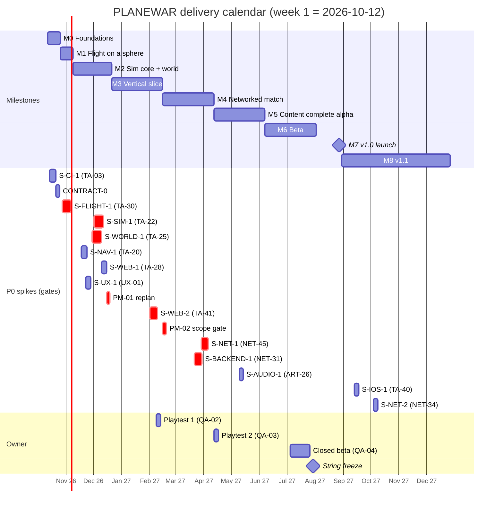

# 09 - Roadmap and Backlog

| | |
|---|---|
| **Project** | PLANEWAR (codename). Godot 4.7.2, typed GDScript. |
| **Document** | The production plan: milestones, the consolidated backlog (every work-breakdown seed of 02-08 plus the glue tasks), critical path, waves, lane ownership, effort and cost, owner tasks, and the risk gates that can change the plan. Machine-readable twin: `docs/backlog/backlog.json` (same tasks, same ids, `status` field for tracking). |
| **Status** | v1.0, 2026-10-10, written by the production director agent from 01 v1.1, `reviews/R0-resolution-register.md` (binding) and the revised 02-08. |
| **Authority** | 01 and R0 outrank this document on *what* is built. This document owns *order, sizing, tier and milestone*. A seed's acceptance text here is a short form; the long form in the owning doc (02 s22, 03 "Work breakdown seeds", 04 s19, 05 s15, 06 s17, 07 s14, 08 s11) is the definition of done. |
| **Maintenance** | `backlog.json` is the source of truth for status. The table in Section 2 and the totals in Section 4 are regenerated from it (`tools/backlog_report.py`, REPO-05); never edit the two independently. New tasks get a new id in their lane's prefix; removed seeds stay listed in their doc as "(removed)" and are not in this table. |

**Calendar assumption.** Week 1 starts Monday 2026-10-12. Capacity: one owner orchestrating 4-8 concurrent agents, ~4 productive agent-days per agent-week after review and rework, so 16-32 agent-days per week; the owner's review and decision bandwidth, not agent count, is the limiting resource from M2 on. Sizes are agent-days of the stated tier including tests and a review round.

---

## 1. Delivery strategy and milestones

**Vertical slice first.** Nothing ships to a store, and no 08 feature opens, before one playable loop (fly, fight, land, build, bots) exists on one map. The P0 spikes of 01 Appendix A are placed so that the riskiest unknowns (flight feel, server tick budget, chunk meshing, single-thread offline) are answered before the lanes that depend on them open. S-FLIGHT-1 runs in week 3-4 on an icosphere with no renderer or economy (R0 C3-03): no steering, touch-layout, ship-art or networking lane opens until it reports.

**Tier policy.** Every task is pushed to the cheapest tier that can do it reliably against a written contract (schema, `MODULE.md`, scenario test). Fable appears exactly three times (PM-01, PM-02, PM-03), each a plan-changing decision that spans several docs and may amend an ADR. Opus owns the hot paths and the spikes; Sonnet owns features against contracts; Haiku owns data, content, docs, fixtures and simple tests. Section 2.2 lists the seeds whose tier is lower here than in their doc, with the reason.

### 1.1 Milestones

| ID | Milestone | Weeks (dates) | Goal | Scope | Exit criteria (measurable) |
|---|---|---|---|---|---|
| **M0** | Foundations | w1-2 (2026-10-12 to 10-23) | A repo every agent can clone, build and test; the contracts frozen | REPO-*, CLAUDE.md, .claude/agents, TA-01/02/03 (S-CI-1), CONTRACT-0, core utilities, schemas, validators, palette and licence gates; owner buys hosts and devices | S-CI-1 green on a clean checkout (soak slope < 2 %/min, PR pipeline <= 15 min, size gate reporting); CONTRACT-0 merged (15 schemas, `sim/MODULE.md`, every docs example validates); `check_deps.py` D1-D10 pass; `backlog.json` imported into the tracker |
| **M1** | Flight on a sphere | w3-4 (10-26 to 11-06) | "Dart flies, shoots, bombs and lands tail-down on a sphere, keyboard and touch" (03 critical-path milestone) | TA-04 sphere math, TA-12 kinematics, TA-30 S-FLIGHT-1, first defs (GD-02/03/05) | S-FLIGHT-1 pass (01 App. A): three novices land within 10 min; < 20 % crashes in minutes 5-10; mouse tester lands within 15 attempts; co-altitude targets hit at 200-800 m; cruise AoA <= 6 deg; "feels like a plane" median >= 4/5; anchor patch filed to 02 and accepted by the owner (HUM-12) |
| **M2** | Sim core + world | w5-10 (11-09 to 12-18) | Headless sim at scale, planet renderer on three devices, pathing, the real codec, the AI steering layer | TA-09..TA-28, TA-37/38/42, NET-01..NET-11 codec core, AI-01..AI-12, GD sim-core rules, ART look-dev and shader library, `cradle` bake, S-UX-1, PM-01 replan | S-SIM-1 p95 <= 25 ms / p99 <= 33 ms on each of 6 instances on the production SKU with the default `sim_budget_profile`; S-WORLD-1 60/30/30 fps, Z1/Z4/Z5/Z8 pass, boost-path hole/hitch criteria met on web-mobile and Android-mid; S-NAV-1 amortised <= 0.5 ms/tick, worst query <= 30 ticks, cache hit >= 80 %; S-WEB-1 <= 20 MB Brotli, Mission 1 first beat <= 10 s, boots on a 3 GB device; S-UX-1 touch criteria; PM-01 replan approved |
| **M3** | Playable skirmish vertical slice | w11-18 (12-21 to 2027-02-19) | Offline 1v1 vs a Normal bot on `cradle` with the full 01 s3.2 loop, every unit and structure class, HUD, Tactical/Commander UI, all three input classes, saves | Brains and Commander bot (AI-13..AI-36), GD economy/combat/match rules, cameras, HUD, RTS UI, screens, match controller, assets for every class, VFX/SFX, soak + balance probe, S-WEB-2, playtest 1, GD-34 balance pass 1, PM-02 gate | A 20-minute Skirmish 1v1 vs Normal completes on PC, Android-mid (Lite) and web-desktop (Reduced) without a crash; S-WEB-2 pass (web-desktop p5 >= 45 fps at Reduced; web-mobile p5 >= 25 fps at Lite; Android-mid 25 min at 30 fps); scenario suite C-01..C-13 and SC-01..SC-51 green; nightly soak writes BAL-01..34 and >= 90 % of bands pass (GD-34); playtest 1 median pad time <= 30 s touch / <= 40 s pointer; PM-02 records the scope-gate decision |
| **M4** | Networked match | w19-26 (02-22 to 04-16) | Two humans in one dedicated-server match from a browser and a native build, through Nakama matchmaking, with reconnect, chat, replays and the ops stack | NET-03..NET-46 (transports, prediction, handoffs, lifecycle, FleetManager/Agent, Nakama, moderation, deletion, analytics, crash), OPS-02..04, TA-39 release.yml, lobby and compliance UX, mission schema, playtest 2 | S-NET-1 pass (<= 30 KB/s per client, reconcile p95 < 1 m at 150 ms RTT with 2 real browsers among 8 clients, no packet > 1,200 B, stalls counted) and the `s_transport` decision written; S-BACKEND-1 pass (browser + native in one match over WSS/ENet, result row with verified hash, moderator sanction end to end, restore drill within 2 h RTO); `fuzz_test` 100,000 mutations per id with zero exceptions; a tagged build produces a signed AAB, a server image and a Steam depot (TA-39); playtest 2 with no lost match |
| **M5** | Content complete alpha | w27-34 (04-19 to 06-11) | Every v1.0 feature and asset present: 8 missions, 3 maps, music, SL-1/2/3, Cruise, localisation draft, compliance docs, entitlements; SL-5 only if PM-02 opened the gate | GD-28..GD-35, campaign, UX-30/33/34/36/37/38/40/41, ART-26/27/29/30/33/35/38, FEAT SL-1/2/3 and v1 refinements, DOC-02, WEB-01, [v1 stretch] SL-5 | All 8 missions completable by the scripted player with and without assists; M1-M3 tutorial acceptance table passes; `anvil` and `rimewater` pass M1-M11 and the 2/4/8-player layouts; A11Y-01..16 green; en 100 % / fi >= 95 %; `music.pck` <= 4 MB; Play Billing test receipt unlocks; data-safety answers regenerate from the analytics schema; content hash stable for a week (string and def freeze candidate) |
| **M6** | Beta | w35-42 (06-14 to 08-06) | Store-ready builds on all three v1.0 channels, closed beta, perf and balance to budget, legal and compliance closed | REL-01..04, DOC-04, QA-01..QA-09, OPS-06, ANA-01, HUM-10/11/13 | Play closed track run complete (>= 12 testers, 14 days) with a clean pre-launch report; Steam build passes the Deck checklist (06 s9.4); web build within itch limits and <= 20 s to gameplay; nightly perf green against every 01 s8 budget for 7 consecutive days on the pinned runner; >= 95 % of BAL bands pass; zero open P0/P1; privacy policy / ToS signed off; age ratings issued; string freeze 4 weeks before launch |
| **M7** | v1.0 launch | w43-45 (08-09 to 08-27) | Windows (Steam, incl. Deck), Android (Google Play), web (itch.io + own site) live | REL-06/07, OPS-05/07, HUM-16/18 | Go/no-go checklist signed; hotfix path rehearsed in one working day; all three storefronts live the same day; week-one crash rate < 1 % of sessions; every moderation report actioned within 72 h; week-one patch shipped |
| **M8** | v1.1 | w46-62 (08-30 to 2027-12-24) | iOS, macOS, Linux native, portals (if A2 allows), WebRTC, Apple/Google sign-in, StoreKit, ranked season, native twins if needed, SL-6 then SL-4, deferred features | PM-03, HUM-14, TA-40 S-IOS-1, NET-33/34, UX-32, V11-01..08, FEAT SL-4/SL-6 and v1.x spikes | S-IOS-1 pass (TestFlight upload, privacy manifest, device frame log); S-NET-2 end to end in Chrome, Firefox, Safari; App Review approved; ranked season 1 live with bands; each v1.x SL feature behind its own PM-03 go/no-go |

### 1.2 Calendar

The spike bars are plan positions; each spike's real start is "when its dependencies in Section 2 are merged". The three crit-marked chains are where a slip moves the launch date one for one.

### 1.3 Capacity check

| Milestone | Agent-days planned | Weeks | Days per week needed | Comfortable at |
|---|---|---|---|---|
| M0 | 20 | 2 | 10 | 3 agents |
| M1 | 13.5 | 2 | 7 | 2 agents (serial: TA-04 -> TA-12 -> TA-30) |
| M2 | 128.5 | 6 | 21 | 6 agents |
| M3 | 161.5 | 8 | 20 | 6 agents |
| M4 | 68 | 8 | 9 | 3 agents (owner time goes to playtests and store accounts) |
| M5 | 52 | 8 | 7 | 2-3 agents |
| M6 | 30.5 + reserve use | 8 | 4-6 | 2 agents + the owner running the beta |
| M7 | 4.5 | 3 | 2 | 1 agent on call |

M2 and M3 are the two periods where 6-8 agents must run in parallel; the waves in Section 3.2 are cut so that no two tasks in one wave touch the same directory. M4-M7 deliberately run slower: the owner is the bottleneck (playtests, accounts, legal, store submissions), and a smaller agent count keeps review quality up.

---

## 2. Consolidated backlog

### 2.1 Conventions

- **ID prefixes.** Seeds keep their doc ids: `GD-` (02), `TA-`/`CONTRACT-0` (03), `NET-` (04), `AI-` (05), `UX-` (06), `ART-` (07), `FEAT-` (08). Glue tasks added here: `REPO-` (repository and agent conventions), `DOC-` (documents), `TEST-` (shared test infrastructure), `APP-` (app orchestration), `CONTENT-` (data), `OPS-` (infrastructure), `REL-` (release engineering), `QA-` (quality and playtests), `ANA-` (analytics), `WEB-` (web pages), `V11-` (v1.1 engineering), `PM-` (planning decisions, Fable), `HUM-` (owner/human tasks, tier "Owner", excluded from agent totals).
- **Lane** is the 01 s9.2 module (or module pair) whose files the task writes. Two tasks in the same wave with the same lane are given to one agent, or serialised.
- **Size** is agent-days of the stated tier; 03's sizes are kept; the other docs did not size, so sizes here follow 03's scale (0.5 = data file or small fixture, 1 = one class with tests, 2 = a subsystem, 3-4 = a spike or a hot-path subsystem with a report).
- **Milestone** is where the task must be merged. Every dependency is in the same or an earlier milestone (checked by the generator).
- **Release tags.** `[v1 stretch, SL-5]` tasks sit in M5 and are skipped to v1.1 without a new decision if PM-02 reports the scope gate late (R0 OQ-R0-6). `[v1.x ...]` tasks sit in M8. TA-29 is conditional on S-WEB-1 failing the size gate; V11-06 on S-SIM-1/QA-08 showing the need.

### 2.2 Deduplication, merges and edits applied

**Removed rows (merged by R0 C2-26; not in the table).** GD-06 -> TA-09; ART-31 -> TA-15 (its fixtures became ART-37); FEAT-03 and FEAT-04 -> GD-15; FEAT-05 deleted (no banking, C3-13); FEAT-33 -> GD-33. `02 GD-06`, `07 ART-31`, `08 FEAT-03/04/05/33` are therefore not valid ids in `backlog.json`.

**Tier lowered against the owning doc (doc tier in brackets; the reason is the written contract that makes the lower tier reliable, with an Opus review round in the acceptance where the doc's tier was Opus):** GD-08 damage rules (Opus) - every rule is a one-line formula in 02 s4.3 with a scenario test; GD-12 harvest cycle (Opus) - formula-driven, measured against 02 s8.2; GD-15 service and landing grade (Opus) - the q formula and grade table are fully specified (R0 C3-13); NET-05 roster (Opus) - message layouts fixed in 04 s3.3; NET-25 replay writer/reader (Opus) - record formats are 04 s3's, format spec in s13.1; AI-10 auto-dock assist (Opus) - reuses AI-09's L4-L6; UX-07 assist stack (Opus) - pure functions with numeric acceptance; ART-13 far meshes (Opus) - a tooling and budget task once ART-06 fixed the style; ART-26 audio spike (Opus) - a measurement spike with a checklist; ART-35 asset QA (Opus) - runs existing validators; FEAT-21 canister behaviour (Opus) - rendezvous guidance reuses AI-12 ballistics and the FlightController. Everything else keeps its doc tier. Tier *raised*: none.

**Dependency edits (recorded so the owning docs can be patched in their next revision):**
1. ART-01 depended on TA-25 and TA-24 while TA-24 depends on ART-03 which depends on ART-01 (a cycle). ART-01 now depends on TA-23 only; the look-dev runs on the renderer core before the terrain shader. TA-25 keeps TA-24.
2. AI-10 depended on NET-18 while NET-18 depends on AI-09 and the slice needs server-side auto-dock before networking exists. AI-10 now depends on AI-09; NET-18 depends on AI-10 and carries the prediction-parity acceptance.
3. NET-15 depended on "NET-06..NET-14" including the ENet and WebSocket transports. It now depends on NET-06, NET-08, NET-10, NET-11, NET-14, TA-18, AI-04; NET-12/13 plug in through the `Transport` interface and are exercised by NET-24.
4. GD-08 depended on TA-22 (the S-SIM-1 run). It now depends on TA-18, TA-14, TA-09; S-SIM-1 uses a stub `Combat`.
5. GD-22 depended on ART-29 and ART-30 (M5) while the slice needs `cradle` resources in M3. GD-22 now covers `cradle` only; ART-29 and ART-30 author their own `resources` blocks against the 02 s9 template.
6. UX-25 depended on NET-42 (M4). UX-25 ships the Replays screen with the local list in M3; NET-42 wires the online history and depends on UX-25.
7. Added dependencies that the docs left implicit: GD-11 -> TA-19 (economy core); GD-09 -> GD-36 (fire pipeline before tower lock tests); AI-01 -> TA-11 (side table lives in the store); AI-02 -> TA-18; AI-22 -> TA-37 (vision); AI-23 -> GD-16 (placement rules); NET-17 -> TEST-02; NET-20 -> NET-39; NET-21 -> UX-08 and CONTENT-01; NET-22 -> GD-27, GD-20; NET-31 -> NET-12, NET-13; UX-06 -> UX-01; UX-17 -> UX-16; UX-18 -> GD-15; UX-22 -> GD-17; UX-23 -> UX-08; UX-28 -> UX-09; UX-36 is a dependency of GD-30 as the shared acceptance table says; GD-31 -> AI-34, GD-33, GD-23, HUM-17; FEAT-06/08/09/13/20 -> PM-02 (the scope gate); every spike that measures on a device -> HUM-06; TA-42 -> HUM-04.

### 2.3 The backlog (339 tasks; identical to `docs/backlog/backlog.json`)

Sorted by milestone, then id. "Depends on" lists task ids only.

| ID | Title | Lane | Tier | Size (agent-days) | Depends on | Milestone | Acceptance (short) |
|---|---|---|---|---|---|---|---|
| ART-02 | palette.json (incl. the relation variant), build_palette.py, tools/art/cvd_check.py and CI hook | tools | Sonnet | 1 | REPO-01 | M0 | Atlas built; team-vs-team CIEDE2000 >= 11.0 under each CVD and >= 20 normal; relation colours >= 20 under CVD; CI fails on a breaking palette change |
| ART-32 | Licence ledger docs/credits/ASSET_LICENCES.csv and tools/check_licences.py CI gate | tools | Haiku | 0.5 | TA-03 | M0 | CI fails on an asset missing from the ledger or carrying a forbidden licence (CC-BY-NC/SA, GPL) |
| CONTRACT-0 | Commit tools/schemas/*.schema.json for the 15 def files and godot/src/sim/MODULE.md reflecting R0 Part B (enumerations block, signatures, SimView accessors); CI validates every docs/examples JSON | sim+tools | Opus | 1.5 | TA-03, REPO-04 | M0 | All 15 schemas self-consistent with R0 B.1/B.2; sim/MODULE.md matches 03 s15.4 incl. enumerations; validate_content.py passes on every docs example; no lane opens before merge |
| DOC-01 | Extend README.md (stub written with 00-master-plan.md): how to run headless tests and exports, lane map, links to docs 00-10 | docs | Haiku | 0.5 | REPO-01 | M0 | A new agent follows README to a green local test run without other help |
| GD-01 | Complete the CONTRACT-0 schemas for ships, ground_units, weapons, projectiles, structures, towers (ranges of 02 s2-5, a_thrust >= 2.0 * gravity) with negative fixtures | tools | Haiku | 1 | CONTRACT-0 | M0 | validate_content.py rejects 10 negative fixtures (missing/unknown field, out-of-range, name_key present, a_thrust 11) and accepts the positives |
| HUM-01 | Create GitHub org and repo, enable Actions and LFS quota, decide secret store | owner | Owner | 0.25 | - | M0 | Repo exists; Actions enabled; LFS quota covers ~2 GB; owner is the only admin |
| HUM-04 | Buy infrastructure: control VPS (4 vCPU), one dedicated-vCPU game host (8 vCPU/16 GB, doubles as the pinned perf runner before launch), S3 bucket (EU), domain | owner | Owner | 0.5 | HUM-01 | M0 | SSH access to both hosts; domain delegated; bucket keys in the secret store |
| HUM-06 | Buy reference devices: Android-mid (SD 695 class), a 3 GB-RAM Android, Steam Deck; PC-mid exists | owner | Owner | 0.25 | - | M0 | All devices on hand before S-WORLD-1 (week 5) |
| REPO-01 | git init, Godot .gitignore, LFS .gitattributes by extension, directory skeleton of 01 s9.1, branch protection on main, CODEOWNERS by lane | repo | Haiku | 0.5 | HUM-01 | M0 | Clean clone has the 01 s9.1 tree; a .glb commit lands as an LFS pointer; main requires a green PR |
| REPO-02 | Refine CLAUDE.md (first version committed with 10): ADR-14 conventions, tier guidance, lane/MODULE.md pointers, task-id commit rule, forbidden actions (no Triplane source, no upstream issues, no addons), definition of done | repo | Sonnet | 1 | REPO-01 | M0 | Every rule of 01 ADR-14 and 03 s12.2 is stated once with a file:line pointer; reviewed by the owner |
| REPO-03 | .claude/agents: refine the 12 role subagents committed with 10 (per-lane allowed paths, MODULE.md to read first, model = tier) + .claude/settings.json permissions + PostToolUse hook running check_deps/validate_content on edited files | repo | Sonnet | 1 | REPO-02 | M0 | Each role agent file names the lanes, module paths and tests it covers (10 s5.2 lane map); hook rejects a D1 violation locally before CI |
| REPO-04 | Extract every JSON example in docs 02-08 into docs/examples/<doc>/<name>.json for CI validation (input of CONTRACT-0) | docs | Haiku | 1 | REPO-01 | M0 | Every fenced JSON block in 02-08 exists as a file with a comment naming its source section; none hand-edited |
| REPO-05 | docs/adr/ folder with the amendment template, docs/templates/REPORT.md for spikes, tools/backlog_report.py (reads backlog.json, prints status by milestone) | docs | Haiku | 0.5 | REPO-01 | M0 | Template fields match 01 ADR layout; report script prints per-milestone counts from this file |
| REPO-06 | PR template (task id, acceptance checklist, screenshot rule for presentation/ui) + CI lint that every commit message references an id present in backlog.json | repo | Haiku | 0.5 | TA-03 | M0 | A commit without a valid id fails the lint; template renders in GitHub |
| TA-01 | godot/project.godot per 03 s1.1, .godot-version, export_presets.cfg with every 03 s1.3 preset, three autoload stubs, CLAUDE.md pointer list | app | Sonnet | 1 | REPO-01 | M0 | godot --headless --import succeeds; all 14 warning keys = 2 (D8); every preset exports an empty project (v1.1 presets build-only) |
| TA-02 | tools/check_deps.py rules D1-D10 + tools/deps.json (R0 B.4) + D3 allowlist (app/offline_host.gd) + D6 warning mode with tools/d6_allow.txt | tools | Sonnet | 2 | TA-01 | M0 | tools/tests/ has a passing and failing fixture per rule incl. the D3 web-guard and D6 error-in-expression; runs < 10 s |
| TA-03 | S-CI-1: ci.yml and nightly.yml skeletons, gdUnit4 install, 10-min soak stub with p95 slope, same-job A/B perf step, Xvfb screenshot job, web size gate, weekly v1.1 export checks | ci | Sonnet | 3 | TA-01, TA-02 | M0 | Green on a clean checkout; soak slope of per-minute p95 < 2 %/min; PR pipeline <= 15 min; size gate prints the Brotli sum; base-vs-base A/B noise < 25 % (Opus signs off the soak result) |
| TA-05 | core/entity_id.gd, core/rng.gd (PCG32 + vectors + fork), core/log.gd, core/config.gd, core/result.gd, core/mathx.gd | core | Haiku | 1.5 | TA-01 | M0 | Unit test per class; C6 reference sequence passes; fork(&"ai") deterministic and serialised; Log sink captured in tests |
| TA-07 | Complete rules.schema.json and map_recipe.schema.json (bounds from 01 anchors, full R0 B.2 recipe schema, negative fixtures) | tools | Haiku | 1 | CONTRACT-0 | M0 | validate_content.py accepts rules.json and the 03 s8.1 cradle example; rejects 10 negative fixtures (gravity 20, unknown key, radius_m != 6000, wedge_start_deg != 22.5, duplicate feature id) |
| TA-08 | tools/validate_content.py + content hash (03 s9.2 scope) + committed hash vector + docs-example validation | tools | Sonnet | 1.5 | TA-07 | M0 | Hash equals the GDScript hash on the vector; sfx.json, vfx_prewarm.json, presentation and _doc excluded; dangling def references detected; runs on every PR |
| TA-10 | Seed rules.json (world constants) and a quality_tiers.json skeleton | content | Haiku | 0.5 | TA-07 | M0 | Schema valid; every value carries _doc citing 01/R0 |
| TEST-01 | tools/validate_scenes.gd: every .tscn under godot/scenes instantiates headless; wired into ci.yml | test | Haiku | 0.5 | TA-03 | M0 | A scene with a missing script fails the job with file name; runs in < 1 min |
| GD-02 | Author ships.json (incl. flight_common) and ground_units.json from 02 s2-3 / R0 B.1 | content | Haiku | 1 | GD-01 | M1 | Validator passes; unit test checks 20 spot values (Bomber a_thrust 14, Dart rate_accel_dps2 720, k_up_flight) |
| GD-03 | Author weapons.json and projectiles.json from 02 s4.1-4.2 | content | Haiku | 1 | GD-01 | M1 | Validator passes; spot-value test; slugs, flak and rail have gravity false, transport false |
| GD-05 | Schemas and files for economy.json, match_rules.json, modes.json (7 modes, per-mode timers, slots_by_player_count), bot_promises.json, scoring.json | content | Haiku | 1 | GD-01 | M1 | Validator passes; ContentDB loads all five; mode ids equal R0 B.6 |
| HUM-07 | Recruit and schedule playtesters: 3 novices for S-FLIGHT-1 (week 4), 4 for S-UX-1 (week 9), 6-10 for the slice (week 17), 8+ for the online test (week 25), 20+ for the beta (week 36) | owner | Owner | 1 | - | M1 | Named testers and dates exist before each spike's harness is ready; consent for telemetry collected |
| HUM-12 | Spike gate reviews: read each P0 REPORT.md (S-FLIGHT-1, S-SIM-1, S-WORLD-1, S-NAV-1, S-WEB-1, S-WEB-2, S-NET-1, S-BACKEND-1) and pick the pass or the named fallback branch within 2 working days | owner | Owner | 1.5 | - | M1 | Each report carries an owner decision line; fallback branches of 09 s6 applied through PM-01/PM-02 |
| TA-04 | core/sphere.gd: frames, equal-angle cube mapping, cells at four resolutions, neighbour table, parallel transport, great circle, slot constants (lon 22.5 + 45 k) | core | Opus | 3 | TA-01 | M1 | All 03 s2.8 vectors incl. slots 0/1 pass; C1-C5 property tests on 10,000 random dirs; C9 slot-edge invariant; perf_core budgets met |
| TA-06 | core/MODULE.md and content/MODULE.md from 03 s15.2-15.3 plus the template file | docs | Haiku | 0.5 | TA-04, TA-05, CONTRACT-0 | M1 | gen_module_api.py --check (TA-27) passes once implementations exist; D10 passes |
| TA-12 | sim/kinematics.gd: step_ship with the speed-scaled lift law and lift_model switch, step_projectile (R0 B.5), k_up_effective, ShipState, purity test; fixture Dart/Bomber defs | sim | Opus | 3 | TA-04, TA-05 | M1 | S8 purity (3,000 steps x2 bit-identical); free fall from 100 m lands in 5.8-6.2 s; PD-held level flight at 0.9 v_cruise holds +-1 m for 60 s with AoA <= 6 deg; Dart and Bomber hold a tail-down hover; test_slug_hits_coaltitude_target passes |
| TA-30 | S-FLIGHT-1: icosphere, step_ship with lift A/B, Chase camera stub, 60 fps render interpolation, straight gun with 200-800 m targets, bombs with impact ring, stub pad with the tail-down rule and auto-dock, keyboard/mouse + gamepad + touch, live tuning panel, telemetry, tester protocol, REPORT.md and anchor patch to 02 | spikes | Opus | 4 | TA-04, TA-05, TA-12 | M1 | Three novices land within 10 min; < 20 % crashes in minutes 5-10; a Raw mouse tester lands within 15 attempts; all three input classes; co-altitude hits; AoA <= 6 deg; patch within anchors or filed to 02 (Sonnet does input layouts/HUD) |
| AI-01 | OrderSpec (R0 B.3 kinds incl. reserved 9-11, HaulMode, EscortMode, SL-2 fields), orders side table + order_kind head cache, order_rules.json + schema | sim/orders | Sonnet | 1.5 | CONTRACT-0, TA-06, TA-11 | M2 | Validity tests per class/kind (towers: ATTACK, HOLD, GUARD only; reserved kinds rejected); queues max 8 each; serialize round-trip |
| AI-02 | ControlMachine: transitions C1-C18, CommandResult codes, ReleaseReason, events | sim/control | Opus | 2 | AI-01, TA-18 | M2 | One gdUnit4 test per row C1-C18 and per C6r code; RELEASED reasons exactly R0 B.3 |
| AI-03 | SimAiHook, CommandSinkBase, CommandSink (submit, drive refusing POSSESSED, set_ai_tag) | sim+sim_ai | Sonnet | 1 | AI-02, TA-06, TA-18 | M2 | drive on a possessed id returns false and leaves the slot untouched; hook called once per tick at R0 B.5 step 3 |
| AI-04 | AiState SoA + serialize; AiDriver scheduling (stagger by think_period_ticks, event wake, class batches, set_offline_profile) | sim_ai | Sonnet | 2 | AI-03 | M2 | Each AI entity thinks 30/P times per 30 ticks for P = 10 and 15; wake rate-limited to 1 per 5 ticks; save/load round-trip |
| AI-05 | FlightController (track_velocity, track_thrust_vector) in sim/steer/ | sim/steer | Opus | 2 | TA-12, TA-30 | M2 | Step response within 5 deg in <= 2.0 s, overshoot < 15 % at v_cruise, under both lift_model values |
| AI-06 | Gain-tuning harness: headless sweep of flight and landing gains, CSV report | test+tools | Sonnet | 1 | AI-05 | M2 | 200 seeds in < 2 min headless; best gains and metrics file written |
| AI-07 | TerrainProbe (TTI, min clearance, lift) | sim/steer | Sonnet | 1.5 | TA-13 | M2 | Synthetic ridge/plane tests: TTI error < 0.1 s; SC-09, SC-10 pass |
| AI-08 | Overlays: SAFETY, RECOVER_CEILING, LINK_BRIDGE; Assist.link_bridge | sim_ai+sim/steer | Opus | 2 | AI-02, AI-05, AI-07 | M2 | SC-11, SC-12, SC-22, SC-23, SC-25 pass |
| AI-09 | LandingController L1-L6 (tail-down, O-2), aborts, go-around, bearing choice, pad selection | sim/steer+sim_ai | Opus | 3 | AI-05, AI-07 | M2 | SC-02..SC-08 pass; SC-04 >= 99/100; every touchdown meets R0 B.5 with thrust axis within 10 deg of the pad normal |
| AI-10 | Auto-dock assist Assist.auto_dock() in sim/steer/assist.gd (server-side substitution; prediction parity verified in NET-18) | sim/steer | Sonnet | 1 | AI-09 | M2 | SC-16 passes; assist runs L4-L6 while DOCK held within auto_dock_radius_m of a free friendly pad; a landing with an assist tick in the last 150 m grades AUTO (dependency on NET-18 moved to NET-18) |
| AI-11 | Separation, formation slots, escort behaviour (class slots; SL-2 fields) | sim_ai | Sonnet | 1.5 | AI-05 | M2 | SC-39 passes; zero friendly collisions in a 50-seed swarm test |
| AI-12 | Targeting choice points + hysteresis; straight-line aim and flak lead; Ballistics.predict_impact for bombs and siege shells | sim_ai | Sonnet | 2 | AI-04, TA-12 | M2 | Scoring-table unit tests; co-altitude slug test at 200/400/650/800 m hits; bomb prediction within 3 m for drops from 50-800 m |
| ART-01 | Look-dev spike S-ART-1: shared unit_lit + moon_light.gdshaderinc (wrap, radial ambient, earthshine, sun_dir), instance uniforms, test sphere, 12 sample meshes, Earth/sun sky | presentation | Opus | 3 | TA-23 | M2 | Goldens on PC, Android-mid, Web-mobile; instance uniforms work on WebGL2 and Adreno or fallback chosen; night mare luminance within 20 % of 07 s1.5 (dependency edited: TA-23 only, breaks the ART-01/TA-24/ART-03 cycle) |
| ART-03 | Shader library: unit_lit, prop_lit, vfx_additive, shield_dome, hologram_ghost, include file | presentation | Sonnet | 2 | ART-01 | M2 | Each compiles on Compatibility desktop + web; team zones render exact hex at rgb.r = 1; emblem offset for 8 teams; animating sun_dir moves the terminator cleanly |
| ART-04 | Blender helper library pw.py (incl. landing_struts) and MCP bootstrap | tools | Sonnet | 1.5 | REPO-01 | M2 | Recipes in a fresh file build a test box asset; finalize() report matches validate_glb.py |
| ART-05 | Import pipeline: validate_glb.py, asset_budgets.json, write_import.py, post_import_asset.gd, CI job | tools | Sonnet | 2 | ART-04 | M2 | Sample glb passes V01-V15; a bad glb fails each check; V11 requires HP_Gear_0..2 on ships; HP_* become Marker3D |
| ART-14 | Biome ramps biome_ramps.json and moon_ramp.png (16 x 64) builder; terrain art tuning with 03 | tools+presentation | Sonnet | 1.5 | ART-01, TA-24 | M2 | Rendered biome colours match 07 s2.1 within dE00 <= 6 on a flat scene, day and night |
| ART-15 | Sky shader (stars, sun at sun_dir, Earth 6 degrees at -Z above the Midnight Pole) | presentation | Sonnet | 1 | ART-01, TA-24 | M2 | Earth disc 6 degrees at -Z; no banding; < 0.3 ms on Android-mid |
| ART-22 | Audio synth sfxgen.py, recipe schema, analyze.py (peak, LUFS, centroid, loop seam) | tools | Sonnet | 1.5 | REPO-01 | M2 | A test recipe renders deterministically; analyzer flags clipping and a bad loop seam |
| ART-28 | Map cradle recipe and bake (terrain blocks; 02 resources block merged via GD-22) | content/maps | Sonnet | 2 | TA-15, CONTRACT-0 | M2 | M1-M11 pass for 2-, 4- and 8-player layouts; previews reviewed by the owner |
| ART-37 | Map validation fixtures: one failing recipe per check M1-M11 plus a passing recipe, consumed by TA-15 tests | tools | Haiku | 0.5 | TA-15 | M2 | Each M-check fails on exactly its fixture and passes on the good recipe |
| GD-04 | Author structures.json and towers.json incl. relay_station, Core integrated_shield, pad_radius_m; no storage_silo | content | Haiku | 1 | GD-01 | M2 | Validator passes; spot-value test; Rail Lance footprint [4,5], status core |
| GD-07 | doctrines.json and pure ContentDB.resolve_for_doctrine() with selectors, ops and rounding | content | Sonnet | 1.5 | TA-09 | M2 | Scenario C-10 passes; base defs unchanged after resolution |
| GD-08 | Damage rules of 02 s4.3: gun roll, structure/ground multipliers, bomb kill radius and blast, Hangar immunity, ramming, no friendly fire | sim | Sonnet | 2 | TA-18, TA-14, TA-09 | M2 | One unit test per rule; C-09 passes; identical results for a fixed seed (Opus review; doc tier Opus) |
| GD-11 | Stockpiles, storage caps, Core trickle, try_spend / credit, storage-full alert | sim | Sonnet | 1 | TA-09, TA-19 | M2 | Cap clamps at 3,000 + 1,500 per Refinery; overflow alert; trickle = 60 Ore/min |
| GD-13 | Power: supply/demand ratio, solar factor (fixed and moving sun, Plateau), effects on production, towers, shields | sim | Sonnet | 1.5 | GD-11 | M2 | C-12 passes; solar factor tests at latitudes -1, 0, +0.25, +1 degrees and on the Plateau |
| GD-16 | Build rules: alive prerequisites, caps, placement incl. Outpost presence and spacing, construction slots, queued sites, pay-at-start, owner-only cancel and refunds, early share lock, self-repair | sim | Sonnet | 2 | TA-09, TA-19 | M2 | C-11 passes; one test per Build.Reject incl. SPEND_LOCKED; teammate cancel rejected unless owner disconnected/eliminated/bot (Opus review) |
| GD-17 | Production: 5-item team-shared queues, owner-only cancel, pay at start, early share lock, power speed, auto-replenish, caps, rally, 3 s launch | sim | Sonnet | 2 | GD-13, GD-16 | M2 | Dart airborne 23 s after its start at full power; cap blocks production; a 4-player team member cannot spend past 800 Ore + own income before 2:00 |
| GD-36 | Weapon-fire pipeline in combat.gd: rate of fire, bursts, ammo/supply draw, projectile spawn, lock acquisition | sim | Opus | 2 | GD-08, TA-14 | M2 | Dart fires 10 rps spending 1 round/shot; tower 5-round bursts every 1.2 s; unsupplied tower at 50 %; rocket launches only after lock_time_s |
| NET-01 | net/protocol.gd: constants, message ids (incl. 0x0D, 0x92, 0x93), channel map, PROTOCOL_VERSION, enums citing R0 B.3, catalogue size table; net/MODULE.md v0.1 | net | Sonnet | 1 | CONTRACT-0 | M2 | Unit test: every 04 s2.3 id defined once, channel sets match, enums match sim/MODULE.md ordinals; check_deps passes |
| NET-02 | Position codec: per-cell ENU quantisation, smallest-three full and coarse, velocity/hp/flags/ai_tag encoders | net | Opus | 2 | TA-04 | M2 | codec_roundtrip_test at 10,000 random points incl. cell corners; max error <= 1.6 cm / 3.1 cm / 0.4 deg / 6 deg |
| NET-05 | Roster model, ENTITY_META, ROSTER_REMOVE with reasons, held-record logic with 1 s timeout | net | Sonnet | 1.5 | NET-01 | M2 | interest_test roster cases; held snapshot applied after meta; timeout triggers one REQUEST_KEYFRAME; every removal carries a reason (doc tier Opus) |
| NET-06 | SnapshotCodec: prepare_tick shared quantisation cache, encode/decode with sections, FULL/A-DELTA/B-DELTA/C-BLIP, gravity-aware dead reckoning, baseline store, 15-byte pilot block, 1,200 B splitting | net | Opus | 3 | NET-02, NET-05 | M2 | codec_delta_test 3,000 ticks identical baselines; a falling bomb produces no POS records after FULL except drift; no packet > 1,200 B; 04 s3.5 53 B example reproduced; one prepare_tick per tick |
| NET-08 | Interest.assign: tiers A/B/C over the shared cache, caps, hysteresis, ghost retention, spectator mode | net | Opus | 2 | NET-05, NET-06, TA-18 | M2 | interest_test; tiering + encode for 8 clients fits the 4.0 ms p95 row on the pinned perf runner |
| NET-10 | EventRouter: payload for every SimEvent.Kind 0-33 (HIT damage u16), interest/team/all filtering; PROJECTILE_BATCH for slugs, flak and rail with dedupe | net | Sonnet | 2 | NET-05, TA-18 | M2 | Every kind round-trips; an enemy entity outside vision never appears in any event; duplicate batch never spawns twice; a flak item bursts at its fuse tick |
| NET-11 | Transport interface, LocalTransport with FaultModel and presets (LAN, GOOD, TARGET, BAD, MOBILE_SWITCH, TAB_STALL) | net | Sonnet | 1.5 | NET-01 | M2 | FaultModel reproduces identical delivery order for a fixed seed; presets table implemented |
| NET-25 | ReplayWriter/ReplayReader (.pwr from the shared cache), index, redaction-in-place, ReplayTransport, tools/replay_inspect.py | net+tools | Sonnet | 2.5 | NET-06, NET-10 | M2 | replay_test: 2-minute match decodes to live state within quantisation; Python decoder agrees with GDScript on the fixture (Opus review; doc tier Opus) |
| PM-01 | Replan after the P0 spike wave: read S-FLIGHT-1, S-SIM-1, S-WORLD-1, S-NAV-1, S-WEB-1 reports; apply fallback branches (cut ladder, mesher variant, caps), re-baseline 03 s4.2 and 01 anchors, file ADR amendments, update 09 and backlog.json sizes/tiers | pm | Fable | 1.5 | TA-22, TA-25, TA-20, TA-30, TA-28, HUM-12 | M2 | Every spike's fail path is either closed or converted into tasks with ids; 09 s6 gate table updated; owner approves (Fable: cross-module ADR-level trade-offs; the one point where the plan itself changes) |
| TA-09 | content/content_db.gd and every *Def class incl. ProjectileDef, FlightCommonDef, ResolvedDefs; def_index ranges; resolve_for_doctrine; caps(profile), mode(id); load_all_async; mod pack loader stub | content | Sonnet | 3.5 | TA-05, TA-07, GD-01, GD-02, GD-03, GD-04, GD-05 | M2 | N1-N7 tested; loads the v1 defs in <= 150 ms PC; doctrine resolution matches 02 s7 examples; base defs unchanged after resolution |
| TA-11 | sim/entity_store.gd (150-byte SoA layout incl. order_kind, ai_tag, overlay; alloc/free/quarantine) and sim/projectile_store.gd (incl. projectile_def) | sim | Opus | 2 | TA-05 | M2 | Alloc/free fuzz 100k ops: no reuse within 64 ticks, generation increments, memory flat; S2 invariant |
| TA-13 | sim/terrain.gd loader + height_at/normal_at/biome_at/slope_deg_at + SHA verification | sim | Sonnet | 2 | TA-04, TA-16 | M2 | Bilinear matches a Python reference on 10,000 samples to 1e-3 m; continuity across 12 edges and 8 corners; height_at <= 2 us |
| TA-14 | sim/spatial.gd counting-sort hash + ids_near ring logic; sim/collision.gd incl. 8b projectile-vs-terrain with relief prefilter, Contact records | sim | Opus | 3 | TA-11, TA-12, TA-13 | M2 | Swept slug hits a 6 m sphere at 700 m/s and rail at 1,500 m/s for 1,000 geometries; ring coverage proof; terrain classification from flight_common; prefilter skips every high projectile; no Dictionary in Spatial |
| TA-15 | tools/moonbake/ baker: R0 B.2 recipe, outputs, seam pass, validate M1-M11, preview, moon_ramp.png hook (absorbs ART-31) | tools | Sonnet | 3.5 | TA-07 | M2 | Bakes the 03 s8.1 example in < 60 s; test_seams.py and test_sphere_parity.py pass; two runs byte-identical; validator rejects a day-side cold trap and a flatten disc on a cube edge |
| TA-16 | Test maps: tiny_test (6 x 128^2, flat, 2 slots) and the S-WORLD-1 radius variants (R = 4,000 / 6,000 / 8,000) | content | Haiku | 1 | TA-15 | M2 | Validator passes; tiny_test loads in < 50 ms; bake-check green |
| TA-17 | bake-check CI job and LFS materialisation check | ci | Haiku | 0.5 | TA-03, TA-15 | M2 | PR touching a recipe re-bakes and compares; a stale meta.json fails; an LFS pointer instead of a blob fails |
| TA-18 | sim/sim_world.gd tick driver in R0 B.5 order: set_ai_hook, SimAiHook/CommandSinkBase + sim sink, assist substitution sub-step (stubbed until AI-10), per-row profiler, set_budget_profile, apply_command + CommandValidator (S10 token bucket), enumerations, SimEvent, MatchRules/MatchArc, LocalSimView with every 15.4 accessor | sim | Opus | 4 | TA-11, TA-12, TA-14, CONTRACT-0 | M2 | S1, S3, S5, S10, S11, S12 invariant tests; a 100-tick scripted scenario yields the expected event sequence; drive on a possessed id returns false; profile array populated |
| TA-19 | sim/build.gd (can_place with 13 reasons, Outpost presence-and-spacing, cross-edge footprints), build_grid, slope cache; sim/economy.gd core (power ratio, refinery, extractors, salvage, Core shield and Exposure timers, caps profiles, early share lock); sim/production.gd queues (max 5, owner-only cancel) | sim | Sonnet | 3 | TA-18, TA-13 | M2 | Each Build.Reject produced by a fixture; a footprint across a face edge accepted; queue capped at 5; CAP_REACHED blocks production; REJECTED_LOCKED until 2:00 |
| TA-20 | S-NAV-1: sim/pathing.gd time-sliced A* (tickets, path_expansions_per_tick) + hierarchy + route cache + set_weight; comparison with AStar3D | sim | Opus | 3 | TA-04, TA-13, TA-16 | M2 | Amortised <= 0.5 ms/tick with 120 ground units re-pathing every 10 s; worst query <= 30 ticks; cache hit >= 80 % on harvester loops; zero correctness failures; path_expansions_per_tick calibrated |
| TA-21 | sim/serialize.gd: serialize()/deserialize() of all arrays, side tables, RNG, tick, plus the AI hook's opaque bytes; S4 round-trip | sim | Sonnet | 1.5 | TA-18 | M2 | S4 holds for 1,000 random ticks with a stub hook; payload ~150 KB at 1,200 entities |
| TA-22 | S-SIM-1 harness and run: scenario JSON, AI hook stub sized to 05 s10, real Pathing, Vision, projectile-terrain test, real codec/interest/replay; dev box + 6 concurrent instances on the production SKU; REPORT.md; sim_budget_profile recommendation | spikes | Opus | 4 | TA-18, TA-19, TA-20, TA-37, TA-42, NET-06, NET-08, NET-25 | M2 | 03 s14.1 measurements for both hosts; pass = each instance p95 <= 25 ms and p99 <= 33 ms; perf_tick.gd promoted to test/perf with history append |
| TA-23 | Planet renderer core: quadtree, split metric, scheduler with the starvation rule, pool, texel-index mesher (variant A) with per-depth direction table, shared index pattern and skirts, horizon/frustum cull | presentation/planet | Opus | 4 | TA-13, TA-04 | M2 | Renders the test map at all three tiers within chunk caps; no holes during split/merge; mesher heights bit-identical to height_at at vertices; build ms logged per chunk |
| TA-24 | moon_terrain.gdshader per 07 s3.1 using moon_light.gdshaderinc, sky_moon hookup, near-plane hook (ViewState.near), flatten sites API | presentation/planet | Sonnet | 2.5 | TA-23, ART-03 | M2 | Z1-Z5 and Z8 harness scenes run under Xvfb; ramp sampled by 07 biome id; Earth at -Z; displacement <= 0.6 m inside footprints |
| TA-25 | S-WORLD-1: GPU displacement variant B, three radii, three devices, camera paths incl. the boost path, Z1-Z8, REPORT.md with tier values and mesher choice per tier | spikes | Opus | 4 | TA-23, TA-24, TA-16, HUM-06 | M2 | 03 s14.2 pass criteria per device and variant (60/30/30 fps; no z-fighting; boost path: no hole > 1 s within 400 m, <= 1 frame > 50 ms per 10 s); recommendation on K/MAX_DEPTH/variant per tier |
| TA-26 | EntityViewPool with tier caps and far-pool path, render_state override per frame, VfxRouter, MultiMesh pools (projectiles per face, icons, trails, decals, far pools), pre-warm loader against a LocalSimView | presentation | Sonnet | 3 | TA-18, TA-09 | M2 | 800 views sync in <= 2.4 ms PC-mid; beyond-cap entities in <= 8 draws; per-frame displacement variance < 10 % at 60 fps for a Dart at 110 m/s from a 30 Hz prediction stub; pre-warm spawns each effect |
| TA-27 | tools/gen_module_api.py --check (MODULE.md signature drift) + docs/templates/MODULE.md.template | tools | Sonnet | 1.5 | TA-06 | M2 | Detects a renamed public func in a fixture; CI wired; zero false positives on core/content/sim |
| TA-28 | S-WEB-1: web export of TA-23 + 200 ships + pools, Brotli pipeline tools/web_compress.py, web/shell.html with pack streaming and fast start, INITIAL_MEMORY 256 MB, measurements, REPORT.md | web+spikes | Sonnet | 3 | TA-25, TA-26, HUM-06 | M2 | 03 s14.4 measurements incl. wasm compile time and 3 GB-device boot; size gate numbers; Mission 1 first beat <= 10 s; map pack mount demonstrated (Opus reviews) |
| TA-33 | Sim scenario test harness: test/sim/scenarios/*.json runner + seed scenarios (possess/release handoff, build radius and Outpost presence, victory, Core shield and Exposure, cap reached, tail-down landing grade) | test | Sonnet | 2.5 | TA-18, TA-19 | M2 | Runner executes all scenarios headless in < 60 s; each scenario fails when its rule is broken (Haiku writes the scenario files) |
| TA-37 | sim/vision.gd: visible_mask, per-team interest-cell lists, horizon occlusion, Sensor Mast reveal, 10 Hz stagger / 5 Hz under rung 2 | sim | Opus | 2 | TA-14, TA-18 | M2 | Horizon occlusion vectors pass; Sensor Mast reveals within 1,200 m regardless of occlusion; stagger verified per team; <= 1.1 ms p95 at S-SIM-1 scale |
| TA-38 | sim/ground_motion.gd: input-driven ground motion, 02 slope speed formula, terrain snap, cube-edge crossing, BRAKE stop/reverse rule | sim | Sonnet | 1.5 | TA-13, TA-20 | M2 | 02 slope formula exact; position on the surface +-1 cm; a path across a cube edge followed without a jump; reverse only after 0.5 s at <= 3 m/s |
| TA-42 | Pinned self-hosted perf runner of the production SKU: registration, labels, routing of absolute perf jobs, runner id in perf/history.jsonl | ci+ops | Sonnet | 1 | TA-03, HUM-04 | M2 | Absolute tick-p95 and nightly regression jobs run only there; hosted jobs run correctness + A/B; alert on a missed nightly |
| TEST-02 | Shared SimView contract test (gdUnit4) parameterised over LocalSimView now and NetSimView later: every R0 B.5 accessor on a scripted scene | test | Sonnet | 1 | TA-18 | M2 | Green on LocalSimView; NET-17 and NET-39 reuse it unchanged; one failing fixture per accessor |
| UX-01 | Spike S-UX-1: touch flight + command prototype on Android-mid in the S-FLIGHT-1 build (s4.3 layout, sticky thrust, BOOST/BRAKE, FLIP flick, possess/release, one placement); the 25-minute Low-tier match runs later as QA-07 | input+ui | Opus | 2 | TA-30, HUM-06 | M2 | 3 of 4 novices fly 3 rings and land within 10 min; boost-and-steer ring pair within 20 s by 3 of 4; mis-taps < 5 %; possess/release/place each < 30 s; written up |
| UX-10 | camera/MODULE.md, OrbitMath, CamMath, crit_damp | camera | Sonnet | 1.5 | TA-04 | M2 | Closed-form D test vs iterative solve (< 1 mm); 1 deg pole sweep with no NaN, orthonormal bases, heading step < 2 deg |
| UX-12 | UiScale, COMPACT/REGULAR profiles, safe-area HUD root, theme and palette tokens | ui | Sonnet | 1 | ART-02 | M2 | 1 du = 1 pt on Android test devices; profiles switch at 500 du; safe insets applied |
| UX-29 | Localisation tools (build_po.py, check_locale.py, po_to_csv.py), Fmt, locale selection, pseudolocale CI | tools+ui | Sonnet | 1.5 | TA-03 | M2 | CI fails on missing id, placeholder mismatch or max_len; Fmt tests for en/fi |
| AI-13 | Dart brain incl. AttackRun sub-machine | sim_ai | Opus | 2.5 | AI-08, AI-09, AI-11, AI-12 | M3 | SC-01, SC-28, SC-29 pass |
| AI-14 | Lancer, Bomber, Scout brains (Lancer lock per lock_time_s) | sim_ai | Sonnet | 2 | AI-13 | M3 | SC-19, SC-20, SC-21, SC-38 pass |
| AI-15 | Hauler brain (ferry, tow under the tow_turn_rate_mult cap, capture) | sim_ai | Sonnet | 1.5 | AI-09, GD-37 | M3 | SC-35, SC-36, SC-37 pass |
| AI-16 | Ground follower (Pathing tickets, BRAKE/reverse rule) + Harvester brain (cycle, flee, repath, stuck) | sim_ai | Sonnet | 2 | TA-20, TA-38, AI-04 | M3 | SC-32, SC-33, SC-34, SC-48, SC-51 pass |
| AI-17 | Tower brain (towers.json envelopes and priorities, lock_time_s, straight-line lead, flak fuse) | sim_ai | Sonnet | 1.5 | AI-12, GD-04 | M3 | SC-30, SC-31 pass; no envelope literal in sim_ai/ (grep check) |
| AI-18 | Siege Crawler brain (v1, status core) | sim_ai | Haiku | 1 | AI-16 | M3 | Attacks from 1,000-1,150 m on tiny_test; relocates after a near bomb; NO_AMMO after 20 shells |
| AI-19 | autopilots.json full content (ap_* ids) + JSON Schema | content | Haiku | 1 | CONTRACT-0, AI-05, AI-17 | M3 | validate_content.py passes; every autopilot id referenced by a def exists with every required key |
| AI-20 | Possession edge-case scenarios SC-13..SC-27 | test | Sonnet | 1.5 | AI-08, AI-09, AI-13 | M3 | All listed scenarios green in < 90 s total |
| AI-21 | Recorded-situation capture (ai_capture) + FakeSimView | test+sim_ai | Sonnet | 1 | AI-04 | M3 | Capture -> JSON -> replay test reproduces the same mode/target |
| AI-22 | Perception (vision, ghosts, memory, reaction delay) + ThreatMap | sim_ai | Opus | 2 | AI-04, TA-37 | M3 | SC-43 passes; threat update <= 0.3 ms per team at 1,200 entities |
| AI-23 | OpeningBook interpreter + condition grammar (presence, or-operator) + order steps + BuildPlanner.resolve_site (radius, Outpost presence and spacing) | sim_ai | Sonnet | 2 | AI-22, GD-02, GD-04, GD-16 | M3 | SC-40, SC-41 pass |
| AI-24 | build_orders.json books on the R0 B.6 start kit (3 doctrines x 2 variants) | content | Haiku | 1 | AI-23, GD-05 | M3 | Schema-valid; no storage_silo; every build outpost preceded by an order move with when: presence; each book passes SC-41 |
| AI-25 | Economy manager + BuildPlanner reactive rules + TowerPlacer | sim_ai | Opus | 2.5 | AI-23 | M3 | 10-min solo bot keeps power01 in [1.0, 1.6] >= 90 % of time; SC-44 passes |
| AI-26 | Production manager + rosters in bot_profiles.json | sim_ai+content | Sonnet | 1.5 | AI-25 | M3 | Roster deficits close within 2 min when affordable; caps respected |
| AI-27 | Military manager: squads, raid planner, siege planner | sim_ai | Opus | 3 | AI-13, AI-14, AI-22 | M3 | 4-bot 20-min soak: >= 3 raids and >= 1 siege per bot; abort rule triggers in a scripted ambush |
| AI-28 | CommandGovernor + difficulty profiles (bot_profiles.json tier rows validated against bot_promises.json) | sim_ai+content | Sonnet | 1.5 | AI-26, GD-05 | M3 | SC-42 and SC-27 pass; validator rejects a profile whose cadence/rate differs from its promise |
| AI-29 | Adjutant profiles (assist, caretaker, economy) + caretaker + SET_ADJUTANT validation + feed alerts + campaign assist mode | sim_ai+server | Sonnet | 2 | AI-28, CONTRACT-0 | M3 | SC-45, SC-46, SC-49 pass |
| AI-30 | AI governor and perf benchmark test/perf/ai_tick (Standard and Lite) | sim_ai+test | Opus | 1.5 | AI-13, AI-14, AI-15, AI-16, AI-17, TA-22 | M3 | AI p95 <= 6 ms at 1,200 entities on the pinned runner; <= 3.5 ms at Lite with the offline profile; governor degrades and restores under forced overload |
| AI-32 | AI debug overlay data (debug_state, mode tags) and sim_ai/MODULE.md | sim_ai | Haiku | 0.5 | AI-04, AI-22 | M3 | MODULE.md lists the public API of 05 s1.3/s4.3/s7.2; tags documented |
| AI-33 | Save/load of AI state (SC-47) | sim_ai | Sonnet | 1 | AI-04, AI-22, TA-21 | M3 | SC-47 passes |
| AI-36 | Offline Lite profile: set_offline_profile, think 15, 3.5 ms budget wiring, Lite soak variant | sim_ai+test | Sonnet | 1 | AI-30 | M3 | 1v1 and 2v2 Normal bots at Lite complete 25-minute offline matches; AI p95 <= 3.5 ms; numbers handed to the S-WEB-2 report |
| APP-01 | App boot sequence: app.gd autoload, boot.tscn, ContentDB load_all_async with progress, pre-warm window hosting the TA-31 benchmark, locale and age-prompt entry, main menu handoff | app | Sonnet | 1.5 | TA-09, TA-31, UX-24 | M3 | Cold boot to the main menu <= 10 s PC-mid; pre-warm spawns every vfx_prewarm.json entry; first run routes to Mission 1 when present |
| ART-06 | Style frames: ship_dart (with tail landing struts) and str_core recipes and glb | assets | Opus | 2 | ART-03, ART-05, HUM-09 | M3 | Validator passes; silhouette test; Dart landing-pose render (nose up, three feet, hover flame down); owner sign-off |
| ART-07 | Ships: Lancer, Scout, Bomber, Hauler (each with tail landing struts) | assets | Sonnet | 3 | ART-06, TA-30 | M3 | Validator green; silhouette test >= 90 %, no mutual confusion; landing-pose acceptance of 07 s1.3; team area 6-35 % |
| ART-08 | Ground units: Harvester, Siege Crawler | assets | Sonnet | 1.5 | ART-06 | M3 | As ART-07 minus struts |
| ART-09 | Base core set: Outpost, Pad, Hangar, Shipyard, Vehicle Bay, Refinery | assets | Sonnet | 3 | ART-06 | M3 | Validator green; foundations present (depth >= 0.6 m); Pad has HP_Dock, painted landing circle (pad_radius_m) and 12 HP_Light_* |
| ART-10 | Simple structures: Pylon, Solar, Reactor, Extractor | assets | Haiku | 1 | ART-06 | M3 | Validator green; recipe cards followed (dimension check V08) |
| ART-11 | Towers and support: Sensor Mast, Autocannon, Flak, Missile Tower, Shield Projector, Rail Lance (4 x 5 cells), Relay Station | assets | Sonnet | 3 | ART-06 | M3 | Validator green; Turret/Barrel parts present and pivot at their mounts |
| ART-12 | Wrecks, projectile meshes, 14 props | assets | Haiku | 1.5 | ART-05 | M3 | Validator green; props <= 80 tris |
| ART-13 | _Far meshes and LOD gate for all models; far-pool MultiMesh in the view layer (ART-A1) | presentation | Sonnet | 2 | ART-07, ART-08, ART-09, ART-11, TA-26 | M3 | Silhouette overlap >= 90 % at switch distances; 200 ships + 120 structures render under 400 draws on Android-mid (doc tier Opus) |
| ART-16 | VFX set A: muzzle, tracer, hit, rocket, flak, rail, bomb impact, scorch quads, debris MultiMesh | presentation | Sonnet | 2 | ART-03, TA-26 | M3 | Particle caps respected by a 2,000-quad stress test; frame time delta < 2 ms on PC-mid |
| ART-17 | VFX set B: explosions, smoke puff pool (0.75/0.5/0.25), shield dome and hit (incl. Core shield), dock beam, build scaffold, possession pulse, alert ring, plumes, landing dust, tether sway | presentation | Sonnet | 2.5 | ART-16 | M3 | Shield dome inside/outside switch works; reduced-motion variants; hovering ships below 15 m raise vfx_dust_plume |
| ART-18 | vfx_prewarm.json, loading-screen pre-warm, unit test of id coverage | presentation | Haiku | 0.5 | ART-17, TA-26 | M3 | No hitch > 50 ms when each effect first fires (headless log + Android test) |
| ART-19 | Quality-tier knobs (LOD threshold, particle caps, lights, shadows, 200-node cap) wired to the 03 tiers | presentation | Sonnet | 1 | ART-16, TA-31 | M3 | Three tiers produce the stated caps; mobile triangle sum <= 305 k in the 07 s5.3 scene |
| ART-20 | UI icon set (class glyphs, shapes, resources, HUD, alerts) and atlas builder | ui assets | Sonnet | 2 | ART-02 | M3 | 100 icons in one atlas; shape set legible at 16 px; icons referenced by id from 06 |
| ART-21 | Fonts subset and generated theme_pw.tres | ui assets | Sonnet | 1 | ART-02, UX-12 | M3 | Finnish text renders; web font payload <= 150 KB; all theme colours from palette.json |
| ART-23 | SFX recipes batch 1: guns, heavy weapons, destruction, shield | audio | Haiku | 1.5 | ART-22 | M3 | 27 ids meet numeric targets; human listening pass signed |
| ART-24 | SFX recipes batch 2: flight, docking, ground/structures, possession, UI, alerts (16), ambience | audio | Haiku | 2 | ART-22 | M3 | 51 ids meet targets; alerts mutually distinguishable (onset rhythm test); every AlertKind 0..31 resolves to a sound id; human pass signed |
| ART-25 | Audio runtime: AudioEmitter pool, default_bus_layout.tres, code ducking, voice stealing, sfx def loader, LANDING-grade touchdown selection | presentation | Sonnet | 2 | ART-22, TA-26 | M3 | Bus layout matches 07 s8.2; 32-voice cap enforced; priority stealing tested headless |
| ART-34 | Wreck, damage and build-progress shader states through EntityViewPool | presentation | Sonnet | 1 | ART-03, TA-26 | M3 | wreck, damage01, build_progress change per instance without extra draws |
| ART-36 | Mesh LOD gate tool (renders LOD1/2 at switch distance, silhouette IoU) | tools | Sonnet | 1 | ART-05 | M3 | Tool lists assets under 90 % overlap |
| FEAT-01 | Def files and JSON Schemas for the landing_grade block, wing.json, callsigns.json, barks.json, commander_verbs.json (status candidate) | content+tools | Haiku | 1 | CONTRACT-0, GD-01 | M3 | validate_content.py passes; values equal SL-1..SL-5; grade weights sum to 1.0; commander_verbs status candidate (allowed before the scope gate) |
| FEAT-02 | Callsign word lists (8 slots x 4 classes x 12 words) and bark strings as CSV domain barks, EN and FI | content | Haiku | 1 | UX-29 | M3 | check_locale.py passes: every key has 3 variants in both languages; ids follow the domain scheme |
| FEAT-36 | Cruise assist (I-16): input/assists/cruise_assist.gd, AssistContext AGL/altitude, assists.json row, default on for touch | input | Sonnet | 1 | UX-07, UX-08 | M3 | Holds heading, speed and altitude within tolerance in a scripted flight; counted as an assist in the ranked tier rule; touch default on |
| GD-09 | Tower envelopes, straight-line turret aim, missile lock and AGL floor, flip lock-break window, target priority | sim+sim_ai | Sonnet | 2 | GD-08, GD-36 | M3 | C-01, C-02, C-03, C-04, C-06 pass (Opus review) |
| GD-10 | Shield Projector and Core integrated shield: absorption, collapse, Ice-costed recharge, power and Exposure effects, Core shield expiry at 480 s | sim | Sonnet | 1.5 | GD-08, GD-13 | M3 | C-07 and C-13 pass; Exposure halves Projector charge/recharge and removes the Core shield |
| GD-12 | Harvest cycle: field capacity, regen, max_miners, depletion re-targeting, Exposure stop, Refinery docks | sim+sim_ai | Sonnet | 2 | GD-11, TA-20 | M3 | Trip time within 5 % of the 02 s8.2 formula at d = 450 and 600 m on the flat test map; regen stops at Exposure (doc tier Opus) |
| GD-14 | Ice: Extractor buffers, pipe radius, Hauler transfer, Relay pad service | sim | Sonnet | 1 | GD-11 | M3 | Piped Extractor credits 0.8 Ice/s; Hauler transfers 40 Ice/s |
| GD-15 | Resupply service and landing grade: parallel timers, per-ship costs, waiting-for-Ice pause, LandingGrade q and grades, manual/hot/dead-stick flags, x0.9 repair for manual FAIR+, LANDING event | sim | Sonnet | 2.5 | GD-08, GD-11, TA-18 | M3 | Service time and cost per ship reproduce 02 s2.3; 20+ grade cases incl. the 8 m/s, 15 m/s, 25 deg and pad_radius_m boundaries; assist tick in the last 150 m grades AUTO (Opus review; doc tier Opus) |
| GD-18 | Supply network: Pylon graph, supplied flag, ammo-pool refill, unsupplied 50 % rate | sim | Sonnet | 1 | GD-16 | M3 | Destroying a mid-chain Pylon unsupplies downstream towers next tick |
| GD-19 | Wrecks and salvage pods: values, 90 s lifetime, ceil(value/120) pods, tow slots, delivery credit | sim | Sonnet | 1 | GD-11 | M3 | A destroyed Shipyard yields 2 pods of 80; pods expire at 90 s; Foundry Hauler tows 2 |
| GD-20 | Match rules: elimination, self-destruct, surrender vote, Core shield timer, per-mode Core Exposure (x1.25 bombs on Cores) and hard end, structure value | sim | Sonnet | 1.5 | GD-10, GD-12 | M3 | One sim test per transition of 02 s12.1, run with pvp_1v1 and pvp_team timers |
| GD-21 | tools/econ_model.py: reproduce 02 s8.7-8.9 from the defs and a bot-book JSON with the C3-01 start kit | tools | Sonnet | 1.5 | GD-02, GD-03, GD-04, GD-05 | M3 | Checkpoints within +-5 s and 2-minute aggregates within +-5 % of the doc tables; a miss updates the tables in a 02 revision |
| GD-22 | resources block for cradle (02 s9.3 totals); anvil and rimewater blocks are authored inside ART-29/ART-30 against the same 02 s9 template | content/maps | Haiku | 1 | TA-15, ART-28 | M3 | Validator passes; cradle totals equal 02 s9.3 (dependency edited: ART-29/30 dropped, they carry their own blocks) |
| GD-23 | Relay Station capture and hold; Solar Plateau multiplier | sim | Sonnet | 1 | GD-14 | M3 | Capture completes at 20 s uncontested, pauses with an enemy within 300 m, resets when the Hauler leaves; same-rule recapture |
| GD-24 | BalanceProbe, soak configs SOAK-A..F incl. commander_only, results.jsonl | test/soak | Sonnet | 2 | TA-03, TA-34, AI-27 | M3 | Nightly job writes one JSON line per match containing every BAL field (BAL-01..34) |
| GD-25 | tools/balance_report.py and balance_bands.json | tools | Sonnet | 1 | GD-24 | M3 | Flags a synthetic out-of-band result; weekly job fails on a miss; per-mode bands for BAL-01/08 |
| GD-26 | Scenario tests C-01..C-13 | test/sim | Haiku | 1.5 | GD-09, GD-10, GD-16 | M3 | All thirteen run on every PR in < 2 min total (Sonnet for C-06, C-08) |
| GD-27 | Score events, landing points, Pilot/Commander split and the match result fields of 02 s17.1 | sim+server | Sonnet | 1.5 | GD-15 | M3 | One unit test per event; MATCH_END carries every 17.1 field (binds in NET-22) |
| GD-33 | Moving-sun rule: sun_dir(t), terminator crossing, cold_trap_sunlit_mult (absorbs 08 FEAT-33) | sim | Sonnet | 1 | GD-13 | M3 | Crossing time within +-2 s of the configured phase |
| GD-34 | Balance pass 1 after S-FLIGHT-1 and the first weekly soak: retune anchors, revise 02 | content+docs | Opus | 2 | GD-24, GD-25, TA-30, TA-41 | M3 | >= 90 % of BAL bands pass; changes recorded in a 02 revision |
| GD-37 | Tow tether link (C3-17): kinematic attach 25 m behind / 8 m below HP_Tether, critically damped follow, no collision while towed, tow_turn_rate_mult, Foundry 2 tows | sim | Sonnet | 1 | GD-19 | M3 | Towed wreck within 10 m of the attach point in a 1 g turn; towing Hauler turn rates x0.6 |
| HUM-09 | Art sign-off: review three Dart renders (Chase, Tactical, landing pose nose-up on a Pad) and two Core renders before the remaining 23 models start | owner | Owner | 0.25 | - | M3 | Written approval or change list on ART-06 within 2 days of the renders |
| NET-03 | PilotInput.to_wire/from_wire (bytes 5-6 reserved), INPUT packet with 3-tick redundancy, server jitter buffer, axis-decay reuse for 10 ticks, LINK_BRIDGE flag hand-off | net | Sonnet | 1.5 | NET-01 | M3 | Bit-exact round trip; a dropped middle packet loses no inputs; inputs outside [tick-2, tick+8] rejected and counted; 11 missing ticks raise the bridge flag once |
| NET-04 | Command payload codecs for all 16 kinds incl. the ORDER layout (<= 256 B) and SET_ADJUTANT | net | Sonnet | 1.5 | NET-01 | M3 | Encode/decode test per kind; a 32-id, 14-point ORDER round-trips and a 15-point one is refused; malformed payload returns null |
| NET-07 | KEYFRAME encode/decode (scopes ALL, ROSTER_REPAIR), stale-ack reset, rolling tier-C refresh (ceil(C_count/300) FULL records per tick) | net | Sonnet | 1.5 | NET-06 | M3 | Keyframe after a 33-tick ack gap exactly once; no periodic keyframe; every C entity refreshed within 300 ticks; refresh bytes at 700 C entities <= 1.8 KB/s |
| NET-14 | ClientLink: handshake (HELLO/WELCOME/REFUSE/LOADED), state machine, per-link queues, token-bucket rate limits, strikes | server | Sonnet | 1.5 | NET-01, NET-04 | M3 | validator_test rate rows; HELLO timeout 5 s; LOADED timeout 60 s |
| NET-15 | ServerSession.tick() per 04 s7 with TickBudget, set_ai_hook wiring and add_bot forwarding; server/main.gd flags | server | Opus | 2.5 | NET-06, NET-08, NET-10, NET-11, NET-14, TA-18, AI-04 | M3 | Runs the canonical scene with 8 LocalTransport clients; AI never called outside step(); phase timings exported; snapshot_budget_test passes (dependency edited: ENet/WS transports plug in via NET-24) |
| NET-17 | ClientSession: state machine, clock/drift estimator, time dilation, NetSimView.sample(render_tick) with interpolation / gravity-aware extrapolation / stale flag, SimView contract test | net | Opus | 2.5 | NET-06, NET-07, TA-18, TEST-02 | M3 | Contract test green on NetSimView; extrapolation stops at 3 ticks; clock converges within 2 s under TARGET; ClientSession.tick <= 1.0 ms PC |
| PM-02 | Vertical-slice architecture review and scope-gate decision: confirm the 08 shortlist gate (S-SIM-1, S-WEB-2, S-FLIGHT-1 green + 1v1 slice complete), SL-5 go/no-go (OQ-R0-6), final Lite caps, lane ownership for M4-M5, backlog re-size | pm | Fable | 1 | QA-02, TA-41, PM-01 | M3 | Gate decision recorded in 08 s3 and 09; FEAT seeds released or deferred by id; M4/M5 plan confirmed (Fable: the decision spans 02/03/05/06/08 and may amend ADRs) |
| QA-02 | Playtest round 1 on the vertical slice (offline 1v1 vs Normal, PC + Android): GD-35 protocol draft, 6-10 testers, pad-time and possession-uplift telemetry read by hand | owner | Owner | 2 | GD-34, UX-23, UX-22, TA-41, HUM-07 | M3 | Report with the 02 s18.4 metrics, top 10 issues filed as tasks; slice judged 'fun to fly, understandable to command' by the owner |
| TA-29 | Conditional (only if TA-28 fails the 20 MB gate): custom trimmed web export template build in CI | ci+web | Opus | 2 | TA-28 | M3 | Engine wasm Brotli size reduced >= 2 MB; all web tests still pass; skipped and closed if the gate passed |
| TA-31 | Quality tier system LOW/MEDIUM/HIGH: quality_tiers.json, 2 s benchmark inside 06's pre-warm window with the p90 rule, runtime downshift, settings hook | presentation+app | Sonnet | 2 | TA-10, TA-23, TA-26 | M3 | Tier selected on PC/Android/web in < 2 s; downshift under synthetic load; every 03 s13 setting applied |
| TA-32 | Perf overlay (F3), Performance monitors to console.log on web, perf/history.jsonl reporter tools/perf_report.py with runner-keyed 7-day median rule | presentation+tools | Haiku | 1.5 | TA-22 | M3 | Overlay shows frame/sim/draw/tri/mem; report fails on an injected +25 % regression fixture; ignores non-pinned runners for absolute gates |
| TA-34 | Nightly soak harness scene: 30 sim-minutes, no NaN, no stall, p95 recorded, Standard/Reduced/Lite profiles (GD-24 owns BalanceProbe) | test/soak | Sonnet | 1 | TA-22, TA-33 | M3 | Nightly green; three caps profiles run; results appended for GD-24 |
| TA-35 | Golden lane, world scenes: 12 fixed scenes (Z-plan incl. Z8, three tiers) under Xvfb + llvmpipe, perceptual compare keyed by adapter string | test/golden | Sonnet | 2 | TA-24, TA-26 | M3 | Nightly job produces 12 PNGs in golden/world/ and a diff report; a deliberate colour change fails |
| TA-36 | Web safety layer: Saves.try_* wrappers, JavaScriptBridge confinement, platform/portal_sdk.gd stub (break_allowed() false), D9 lint, hashing chunked over frames | platform+core | Sonnet | 1.5 | TA-02, TA-09 | M3 | D9 passes; web build boots with IndexedDB disabled to the menu; hash verification shows progress without a > 33 ms frame |
| TA-41 | S-WEB-2: app/offline_host.gd (worker Thread on native, main thread on web) + in-process skirmish on web-desktop, web-mobile and Android-mid at Lite/Reduced; REPORT.md setting final Lite values | app+spikes | Opus | 3 | TA-22, TA-28, UX-39, AI-28, NET-11, ART-28 | M3 | web-desktop 1v1 Normal at Reduced p5 >= 45 fps; web-mobile 1v1 at Lite p5 >= 25 fps; Android-mid native 1v1 25 min at 30 fps without downshift; D3 allowlist exercised; Lite/Reduced decision written into match_rules.json/modes.json |
| UX-02 | Spike S-UX-2: chase and orbit cameras on the sphere (loops, inverted flight, pole crossing, all transitions) | camera | Opus | 1.5 | TA-25, UX-10 | M3 | No flips or NaN in a 1 deg pole sweep; no tester rates discomfort above 1 (0-3) after 15 min; constants recorded in camera.json |
| UX-03 | input/MODULE.md, InputRouter, InputClass, DeviceMonitor, Intents | input | Sonnet | 1.5 | TA-03, TA-30 | M3 | 06 s2.4 class detection table covered by unit tests; emulated mouse ignored; pilot_input emitted once per tick only in flight modes |
| UX-04 | GestureRecognizer (incl. FLICK_UP for FLIP and the FIRE long-press radial) | input | Sonnet | 1.5 | UX-03 | M3 | Synthetic-event tests for tap, double tap, long press 0.35 s, drag, pinch, twist, two-finger drag, flick; no false pinch on two-finger drag |
| UX-05 | Gamepad and KBM flight mappers (DIRECT, throttle modes) | input | Sonnet | 1 | UX-03 | M3 | Dead zone and curve tests; power-key ramp 4/s; LT > 0.5 sets BRAKE |
| UX-06 | Touch flight controls: stick wrapper, sticky thrust slider, BOOST/BRAKE/BOMB/FIRE/DOCK/RELEASE buttons, FLIP flick, multi-touch TouchControls | ui/hud | Sonnet | 2 | UX-03, UX-04, UX-12, UX-01 | M3 | Three simultaneous touches register; layout matches 06 s4.3 within 1 du; lint <= 7 touch controls on the right half passes |
| UX-07 | Assist stack: ArcadeSteer, MouseAim, AutoLevel, AimAssist, AutoThrottle/Cruise, BombRelease, ranked tier rule | input | Sonnet | 2 | UX-05, TA-30 | M3 | Pure-function tests; auto-level from 60 deg bank within 3 s; ranked min() test; bomb release fires on the first tick the predicted impact is within 15 m of an enemy footprint or ground unit and never otherwise (Opus review; doc tier Opus) |
| UX-08 | defs/assists.json (incl. bomb_release_assist) + content/ui/*.json schemas and defaults (alerts, pings, glyphs, camera) | content+tools | Haiku | 1 | UX-07 | M3 | validate_content.py passes; content/ui excluded from the content hash, assists.json included |
| UX-09 | Remapping UI, BindingStore, glyph sets and glyphs.json | input+ui | Sonnet | 1.5 | UX-03 | M3 | Remaps persist; conflicts flagged; glyphs swap within one frame of device change |
| UX-11 | ChaseController: look, head-up roll, spring offset, clearance, FOV, free look, turret and ground cams, follow of Prediction.render_state | camera | Opus | 2 | UX-10, UX-02 | M3 | Camera never below 2.5 m AGL in a terrain-hugging replay; no flip through a loop; reduced-motion variant; 60 fps displacement variance < 10 % |
| UX-13 | OrbitController: grab pan, fling, zoom to anchor, tilt curve, heading modes, follow | camera | Sonnet | 1.5 | UX-10 | M3 | Grab keeps the touched ground point under the finger within 2 du; NORTH_UP never spins at a pole crossing |
| UX-14 | TransitionPlayer, NearFarPolicy (03 formula default), death cam, reduced-motion fades | camera | Sonnet | 1 | UX-11, UX-13 | M3 | Durations per 06 s5.4 within 1 frame; near plane continuous; rejected possess plays reverse |
| UX-15 | PiP (3D SubViewport + 2D schematic) | camera+ui | Sonnet | 1.5 | UX-13 | M3 | Draw-call budget per tier met in the profiler; automatic 2D fallback |
| UX-16 | Flight instruments and HudMath (ladder, limb dip, band, heading, uplink) | ui/hud | Sonnet | 1.5 | UX-12 | M3 | Unit tests for pitch, bank, heading, dip; band thresholds per 06 s6.2 |
| UX-17 | Bomb sight and straight-line lead solver (no gravity term) | ui/hud | Sonnet | 1 | TA-12, UX-16 | M3 | Bomb impact error < 2 m vs 1/30 s reference; lead pip matches the sim in a coaltitude test at 200/400/650/800 m |
| UX-18 | Landing guide (nose from vertical, hover descent), service panel, grade stamp, Core shield timer, consumables, cooldown rings | ui/hud | Sonnet | 1.5 | UX-16, TA-18, GD-15 | M3 | Gauge colours switch at 8/15 and 15/25 m/s and 25/45 deg; grade stamp shows every LandingGrade.Grade from a LANDING event |
| UX-19 | Threat ring, tower hints, piloted-by badges, pending order, hand-over toast, canister beacon marker | ui/hud | Sonnet | 1.5 | UX-16, NET-10 | M3 | Scenario tests show each widget from recorded SimView states |
| UX-20 | Selection, picking, OrderResolver, control groups, rally points | ui/rts | Sonnet | 2 | UX-04, AI-01 | M3 | 06 s7.2 resolver table fully covered incl. Relay Station haul/CAPTURE vs guard; pick radii per class |
| UX-21 | Build placement controller and validity feedback | ui/rts | Sonnet | 1.5 | UX-20, TA-19 | M3 | State machine per 06 s7.3; all 13 Build.Reject reasons mapped with priority; Outpost presence and spacing rings; pending outline until CommandResult |
| UX-22 | Production drawer (tabs, 16 structure + 7 unit tiles, states, queues, replenish, early-share lock display, owner-only cancel) | ui/rts | Sonnet | 2 | UX-12, GD-17 | M3 | Tiles fit without scrolling at 800x360 and 1280x720; tile states from a mocked SimView; lock shows the greyed amount with reason |
| UX-23 | Single priority feed (alerts.json for every AlertKind, filter, lanes), ghost tracker, Quick Fly, re-embodiment chooser | ui/rts | Sonnet | 2 | UX-14, NET-10, UX-08 | M3 | Coalescing within 15 s per cell; 3/6 rows; ghosts fade over 30 s; chooser default after 10 s; validator: every AlertKind mapped |
| UX-24 | ScreenFlow state machine, back stack, focus rules | app | Sonnet | 1.5 | UX-12 | M3 | Flow per 06 s8 mermaid; B/Esc/Android back pop; every screen has initial focus |
| UX-25 | Static screens: main menu, mode setup (Lite caps notice), campaign map (assist toggles), briefing, replays, about/credits | ui/screens | Haiku | 1 | UX-24 | M3 | Screens instantiate headless; states of 06 s8 present; UI lint clean (dependency edited: NET-42 wires the online replay list later) |
| UX-27 | Match overlays: loading, pause, reconnecting, eliminated, results with rematch vote | ui/screens | Sonnet | 1.5 | UX-24 | M3 | Reconnecting auto-retries until 120 s then offers Rejoin; results bind to every MATCH_END field of 06 s8 |
| UX-28 | Settings screens, SettingsModel (app/settings_model.gd), local file as source of truth + settings.client sync, touch layout editor | ui+app | Sonnet | 2 | UX-24, UX-09 | M3 | All 06 s8 tabs persist; guests never sync; signed-in sync is last-write-wins; ranked locks shown disabled with a reason |
| UX-39 | app/match_controller.gd + offline session bootstrap incl. pause / save / load (fills AssistContext, hands Prediction.render_state to the camera, LocalSimView) | app | Sonnet | 2 | NET-17, TA-21, UX-24, NET-15 | M3 | Offline match starts, pauses, saves, loads and resumes on the same tick; AssistContext filled each tick |
| AI-34 | ScriptedDirector (05 s7.10): script entries in build_orders.json, wave/tag/ping steps, AiDriver.set_script | sim_ai | Sonnet | 1.5 | AI-23, GD-29 | M4 | SC-50 passes; every script id referenced by an 02 mission resolves (validator) |
| CONTENT-01 | content/defs/chat_filter.json word list EN + FI (masks only), hash-excluded; owner approves | content | Haiku | 0.5 | CONTRACT-0 | M4 | Gate test masks each listed word and nothing else; owner sign-off recorded |
| FEAT-06 | Grade stamp and Sortie Card with a client stats accumulator (V/H from LANDING, tilt/centre from the predicted pose) | ui | Sonnet | 1 | GD-15, UX-18, NET-10, PM-02 | M4 | Screenshots of all six grades; card matches a scripted sortie's totals; stamp shapes distinguishable without colour |
| FEAT-07 | Autopilot landing-quality metric in the nightly soak | test | Haiku | 0.5 | GD-15, AI-09, GD-24 | M4 | Report includes mean q; fails if q < 0.70 or crashes >= 1 % |
| GD-29 | Mission schema and MissionRuntime objective and fail kinds (incl. CAMERA_TIER, LAND mode any, assist tags) | campaign | Sonnet | 2 | TA-09, TA-18 | M4 | Each objective and fail kind has a unit test driven by a scripted SimView |
| HUM-03 | Confirm the business model (Q2 default: premium EUR 15-20 on Steam; mobile free with a one-time full-unlock IAP; web free funnel) and the IAP catalogue | owner | Owner | 0.25 | - | M4 | Written decision; SKU list for UX-40 and the store listings |
| HUM-05 | Store accounts: Steam partner account + Steam Direct fee ($100), Google Play developer account ($25, identity verification; company D-U-N-S if applicable), itch.io account; start the Play closed-test clock early (12 testers for 14 days for new personal accounts) | owner | Owner | 1 | - | M4 | Steamworks app id, Play app id and itch project exist by week 25; Play closed-test requirements understood and scheduled |
| NET-09 | Rate governor and TransportStats accounting | net | Sonnet | 1 | NET-06, NET-11 | M4 | Scripted overload drops B to 10 Hz within 2 s and recovers after 5 s under budget |
| NET-12 | ENetTransport (server + client), 4 channels, conn-id mapping, timeouts | net | Sonnet | 1.5 | NET-11 | M4 | Loopback test: 2 clients connect, channels map to the right ENet modes, disconnect reasons correct |
| NET-13 | WebSocketTransport (server loopback bind, client wss), channel-byte framing, keep-alive, 60 s/15 s policy, congestion flag | net | Sonnet | 1.5 | NET-11 | M4 | Loopback test with ws://; a stalled receiver flips the congestion flag; web export smoke connects through Caddy in S-BACKEND-1 |
| NET-16 | ProtocolValidator (server/protocol_validator.gd) with the 04 s11.3 table: owner-only cancel, V-ORD from order_rules.json, V-BLD deferring to Build.can_place, queue max 5, V-REQ 10 s, V-ADJ, V-INP reserved bytes | server | Sonnet | 1.5 | NET-04, TA-18, AI-01 | M4 | Positive and negative test per rule; strikes and kick threshold; a placement rejection carries the Build.Reject detail |
| NET-18 | Prediction: state machine of 04 s5.2, reconcile/replay with the R0 B.5 step_ship form and Assist.auto_dock() substitution, render_state(alpha), smoothing, hard snap, epoch handling, docked hold | net | Opus | 3 | NET-03, NET-17, TA-12, AI-10 | M4 | prediction_test p95 < 1 m (TARGET), no hard snap; stale-epoch inputs dropped; 60 fps displacement variance < 10 %; predicted auto-dock matches the server with no extra reconciliation error (AI-10 parity check lives here) |
| NET-19 | Handoff flows server-side: POSSESS_ACK, RELEASED with ReleaseReason, death, hand-over with LINK_BRIDGE, ceiling, silent-pilot C13 path, disconnect C12 | server | Opus | 2 | NET-15, NET-18, AI-02, AI-08 | M4 | handoff_test message sequences exactly as 04 s5.4; LINK_BRIDGE <= one RTT with no terrain contact; silent pilot stays POSSESSED |
| NET-20 | Reconnect: session ids, secrets, grace timers, PLAYER_STATUS (incl. flags), bot takeover hook, client retry loop with transport fallback, TEAM_DETAIL(FULL) after the keyframe | net+server | Sonnet | 2 | NET-14, NET-17, NET-39 | M4 | reconnect_test on MOBILE_SWITCH and TAB_STALL; secret single-use; a reconnect before the old link times out resumes possession |
| NET-21 | Chat and quick-ping path: CHAT/CHAT_RELAY/QUICK_PING (QuickPing.Kind from pings.json), gates, filter from chat_filter.json, replay CHAT frames, report hook | server | Sonnet | 1.5 | NET-14, NET-25, CONTENT-01, UX-08 | M4 | Gate tests (age band, mute, rate, length); relay respects blocks; msg ids unique per match; ping kinds match pings.json |
| NET-22 | Match lifecycle with SessionPhase, MatchConfig (+ schema), bot slot filling, MATCH_END with every R0 C2-17 field + result_hash, abandon rule | server | Sonnet | 2 | NET-15, GD-27, GD-20 | M4 | Scripted lifecycle test incl. nobody-joins abort and all-humans-gone abandon; per-mode hard end from MatchConfig; MATCH_END carries every field |
| NET-23 | Fuzz harness fuzz_test.gd and parser hardening pass over all decoders | net | Sonnet | 1.5 | NET-04, NET-06, NET-14 | M4 | 100,000 mutations per id, zero exceptions, sim untouched |
| NET-24 | Net test presets, fixtures (canonical scene builder), dual_listener_test with tools/netem.sh (nightly) | test | Sonnet | 1.5 | NET-12, NET-13, NET-15 | M4 | Nightly green; bytes/s per client <= 30 KB logged to perf/history.jsonl; p95 asserted only on the pinned runner |
| NET-26 | Spectator role: token role and delayed flag, all-seeing roster, follow/free camera hints, 300-tick delay buffer, cap 4 | net+server | Sonnet | 1 | NET-08, NET-14 | M4 | Spectator never receives POSSESS_ACK; delay measured 10 s +-1 tick; buffer <= 240 KB |
| NET-27 | JoinToken sign/verify in GDScript (HMACContext) and TypeScript, key rotation env handling, test vectors | server+server-ops | Sonnet | 1 | NET-14 | M4 | Cross-language vectors verify both ways; expired/foreign-match/replayed tokens refused with correct reasons |
| NET-28 | FleetManager service: schema, SQLite state, allocate (6-active cap) / heartbeat / result / abort / report / health / metrics, retries and dead-letter, Nakama forwarder | server-ops | Sonnet | 3 | NET-27, NET-22 | M4 | fleet_contract_test.ts; allocation picks the least-loaded host and refuses a host at PLAYING + ALLOCATED = 6; 503 when none; result idempotent |
| NET-29 | FleetAgent (systemd): process pool supervisor with 6 match slots + spare, env secrets, crash bundle upload from journald, register loop, drain | server-ops | Sonnet | 2 | NET-28, NET-15 | M4 | Kill a process: respawn within 1 s; never 7 active matches; drain stops warm processes, keeps playing ones; crash bundle in storage |
| NET-30 | Match process <-> FleetManager client (server/fleet_agent_client.gd): allocate ACK, heartbeat, result POST with spool fallback, replay upload | server | Sonnet | 1 | NET-22, NET-28 | M4 | With FleetManager down 10 min, the result is spooled and later delivered exactly once |
| NET-31 | Nakama deployment and S-BACKEND-1 execution: compose (Nakama, Postgres, FleetManager, Caddy, Prometheus, Grafana), config, journald upload timer, backups; TypeScript RPC skeleton (profile_init, settings_put, matchmaking_ticket with fill_after_s re-issue, matchmaker_matched -> allocate with B.6 slots, match_result, match_aborted) with storage schemas | server-ops | Sonnet | 3 | NET-28, NET-29, OPS-02, OPS-03, NET-13, NET-12 | M4 | S-BACKEND-1 scenario passes (04 s15.3): browser and native client in one match with WSS and ENet; result row with verified hash; a lone 1v1 ticket gets a vs-bot match after 120 s (Opus review) |
| NET-32 | Nakama RPCs: report_submit, block_user, sanction_apply, moderation queue, account_delete_request cascade with deletion_log and cron retry, account_export, receipt_validate (Play Billing; Apple v1.1) | server-ops | Sonnet | 2.5 | NET-31, NET-28 | M4 | Deletion integration test: all collections empty, FleetManager results anonymised, replay header rewritten, log complete; a failing step retries; a Play test receipt writes entitlements |
| NET-35 | Observability: JSON logging to journald, TickBudget metrics push, FleetAgent scrape endpoint, Grafana dashboard JSON, alert rules, end-of-match summary line | server+server-ops | Sonnet | 1.5 | NET-15, NET-29 | M4 | Dashboard shows all 04 s14 metrics from a local soak; alerts fire in a staged failure (Haiku writes dashboards and rules) |
| NET-36 | platform/matchmaking.gd, accounts.gd (device, email, Steam; Google/Apple v1.1), social.gd wrappers over nakama-godot with the 04 s10.4 ticket properties and match_found handoff to app | platform | Sonnet | 2 | NET-31 | M4 | Queue -> notification -> ClientSession start on native and web; party leader input-class rule with notice; no rating property on tickets |
| NET-37 | Hosting cost and capacity model docs/ops/capacity.json updated from S-BACKEND-1 measurements | server-ops | Haiku | 0.5 | NET-31 | M4 | 04 s12.4 numbers reproduced from the model; per-process RAM and allocation latency filled in from measurement |
| NET-38 | net/MODULE.md and server/MODULE.md final contracts (public API, invariants, test entry points, tier guidance) | net+server | Sonnet | 1.5 | NET-15, NET-17, NET-18, NET-19, NET-20, NET-22, NET-26, NET-39, NET-46 | M4 | check_deps passes; every public signature in 04 appears in a MODULE.md; Opus review |
| NET-39 | TEAM_DETAIL (0x92) encoder/decoder with change tracking, TEAM_STATE caps/power/unit_count, pilot block additions, ai_tag in A/B flags, NetSimView accessors of 04 s3.7 with the unknown bit | net | Sonnet | 1.5 | NET-17 | M4 | team_detail_test: contract test green for every accessor; deltas reconstruct the full state after 600 ticks; average <= 300 B/s on the canonical scene |
| NET-40 | Analytics event schema tools/schemas/analytics_event.schema.json + Nakama telemetry RPC writing to an EU store + age-band gate | server-ops+platform | Sonnet | 1.5 | NET-31 | M4 | Events failing the schema are refused; u13 and opted-out accounts store nothing; the deletion cascade purges the pseudonymous id |
| NET-41 | FleetManager POST /v1/crash (build id, platform, log tail, no PII, per-IP rate limit) + app crash hook | server-ops+app | Sonnet | 1 | NET-28 | M4 | A forced client crash produces one stored report with no account or device id; the 11th report from one IP within an hour is refused |
| NET-42 | Replay access: Nakama replay_url(match_id) (15-minute signed GET), offline .pwr to user://replays/ with a 20-file cap, local listing API wired into the UX-25 Replays screen | server-ops+net | Sonnet | 1 | NET-25, NET-31, UX-25 | M4 | A foreign match id is refused; URL expires after 15 min; the 21st offline replay evicts the oldest; web writes go through Saves.try_*; Replays screen lists both sources |
| NET-43 | Moderation admin page /admin/moderation on FleetManager (admin token + IP allowlist) + Nakama RPCs moderation_list, moderation_view; TypeScript reader for .pwr CHAT frames | server-ops | Sonnet | 1.5 | NET-28, NET-32, NET-25 | M4 | A test report is listed, its chat excerpt shown from the replay, and a sanction applied end to end; a non-allowlisted IP gets 403 |
| NET-44 | Ops deliverables: server-ops/RUNBOOK.md (deploy, drain, restore, key rotation, incidents), monthly pg_dump restore drill script to a scratch VM, journald daily upload timer | server-ops | Sonnet | 1.5 | NET-31 | M4 | Drill restores the latest dump and a smoke RPC succeeds within the 2 h RTO; runbook executed once by a second agent without questions (Haiku writes the prose) |
| NET-45 | S-NET-1 execution: real Chrome desktop and Android Chrome clients over WebSocketTransport, netem TARGET/BAD and 150 ms, REPORT.md with bandwidth columns, browser stalls, ClientSession.tick times and the s_transport decision | net+spikes | Opus | 3 | NET-24, NET-18, NET-07, NET-09 | M4 | S-NET-1 pass criteria met (<= 30 KB/s per client; reconcile p95 < 1 m at 150 ms RTT; no packet > 1,200 B; stalls counted) or the report names the failing criterion and fix; 04 s4.6 estimates updated |
| NET-46 | LOBBY phase protocol: DOCTRINE_PICK / LOBBY_STATE (blind 20 s, early close, random fallback, reveal), Adjutant preference and AUTO_ECONOMY flags, parallel map loading | server+net | Sonnet | 1.5 | NET-22, NET-14 | M4 | lobby_test; a client that never picks gets a random doctrine; opponents see lock flags only until reveal |
| OPS-02 | Secrets and storage: GitHub Actions secrets (Android keystore, server tokens), deploy secret store on ctl1, S3 bucket lifecycle rules per prefix (replays 14 d, crashes/logs/backups 30 d) | server-ops | Sonnet | 0.5 | HUM-04 | M4 | No secret in git; lifecycle rules verified by listing; a rotated token is picked up without redeploying code |
| OPS-03 | Domain and DNS: api./fleet./grafana./gh1.eu. records, Caddyfile with automatic Let's Encrypt, firewall rules (04 s12.2 ports) | server-ops | Sonnet | 0.5 | HUM-04 | M4 | wss://gh1.eu.<domain>/health answers with a valid certificate; only the 04 s12.2 ports are public |
| OPS-04 | server-ops/deploy.sh rolling deploy (drain -> wait playing == 0 -> unpack image -> restart agent -> undrain), ADMIN_NOTICE maintenance banner, staging compose profile | server-ops | Sonnet | 1 | NET-28, NET-29, TA-39 | M4 | A tagged release deploys to the game host with zero dropped matches in a scripted test; staging and production share one compose file with profiles |
| QA-03 | Playtest round 2 online (8 players incl. 2 browsers on the deployed stack), reconnect and lobby flows, chat/report path | owner | Owner | 1.5 | NET-45, NET-31, UX-26, UX-35, HUM-07 | M4 | Report with RTT/loss/reconcile telemetry (NET-40 rows), top 10 issues filed; no desync or lost match in the session |
| REL-05 | Version stamping (MAJOR.MINOR.PATCH+build), content hash + git SHA in the main menu footer, CHANGELOG generation from task ids | ci+ui | Haiku | 0.5 | TA-39 | M4 | Footer shows version, hash and SHA on every platform; CHANGELOG lists merged task ids per tag |
| TA-39 | release.yml: signed AAB, server Docker image build and push, Steam depot upload; macOS notarisation and iOS signing wired but gated as v1.1 | ci | Sonnet | 2 | TA-03, OPS-02 | M4 | A tagged build produces a signed AAB, a pushed server image and a Steam depot build id; gated v1.1 jobs present and skipped by default |
| UX-26 | Online, queue and lobby screens (doctrine pick via DOCTRINE_PICK/LOBBY_STATE, input-pool notices, bot fill, Auto economy tag) | ui/screens | Sonnet | 2 | UX-24, NET-36, NET-46 | M4 | Party notice shows the leader's class; 20 s blind doctrine window; countdown 5 s; Auto economy tag visible to opponents |
| UX-31 | Web shell, start gate, storage probe, stall detection, orientation overlay, Mission 1 fast start (deferred pre-warm and music) | web+platform | Sonnet | 2 | TA-28, TA-36 | M4 | Gate skipped with prior activation; private window shows the storage banner; Mission 1 first beat interactive within 10 s at 20 Mbit/s |
| UX-35 | Compliance UX: age prompt, account and deletion screens, report/block/mute, chat panel, ping wheel (QuickPing list) | ui+platform | Sonnet | 2 | NET-36, NET-32, NET-21 | M4 | Deletion reachable in 3 taps; under-13 band locks chat; report carries message ids |
| UX-42 | Spectator overlay (follow target, free camera, player list, no consumables HUD) and pause-menu Save/Load (3 manual slots + autosave) for offline modes | ui+app | Sonnet | 1.5 | UX-27, UX-39, NET-26 | M4 | Spectating works live and in the replay viewer; manual slots and autosave round-trip |
| AI-31 | AI soak metrics added to GD-24 BalanceProbe output + tier ladder / auto-economy report | test/soak | Sonnet | 1 | AI-27, AI-28, AI-29, GD-24 | M5 | Nightly job emits every 05 s11.3 metric (incl. landing q and the auto-economy row) into results.jsonl; thresholds enforced |
| AI-35 | [v1 stretch, SL-5] Supply Canister divert and opportunist pickup scenario SC-52 (05 s6.10) on top of FEAT-22 | sim_ai | Sonnet | 0.5 | AI-13, FEAT-21, FEAT-22 | M5 | SC-52 passes; >= 95 % pickups in 40 seeds against a straight-flying AUTO Dart |
| ART-26 | Spike S-AUDIO-1: web Sample-mode positional audio, Stream-mode music, Ogg/QOA in Sample mode | presentation | Sonnet | 1.5 | ART-25, TA-28 | M5 | Written result for Chrome, Firefox, Safari, Android Chrome; fallbacks decided; no crackle over a 10-minute web run; web decoded audio <= 15 MB (doc tier Opus) |
| ART-27 | Music: integrate the licensed tracks with AudioStreamInteractive (phases from match_arc()) and stems, music.pck | audio | Sonnet | 1.5 | ART-25, HUM-08 | M5 | Phase transitions on bar boundaries; music.pck <= 4 MB; ledger entries complete |
| ART-29 | Map anvil recipe and bake incl. its 02 s9 resources block | content/maps | Sonnet | 2 | ART-28, GD-22 | M5 | M1-M11 pass; deck-cover score higher than cradle by the preview metric; resources block validates |
| ART-30 | Map rimewater recipe and bake incl. its 02 s9 resources block (mid traps lat -35, 8,000/1.8; Midnight nodes 6,000/0.9) | content/maps | Sonnet | 2 | ART-28, GD-22 | M5 | M1-M11 pass; highland share 65 % +-5; mid traps at lat -35 |
| ART-33 | Golden scenes golden/art/ (up to 8): 8 team colours day/night, three tiers, CVD renders, tail-down landing pose | test | Sonnet | 1 | ART-06, ART-14, TA-35 | M5 | Up to 8 art goldens committed; CVD renders reviewed; contrast thresholds asserted on screenshots |
| ART-35 | Asset QA sweep: silhouette tests, budget report, perf per tier | test | Sonnet | 1.5 | ART-13, ART-19 | M5 | Report in perf/; all assets within budgets; failures filed as tasks (doc tier Opus) |
| ART-38 | Hangar stow presentation: docked ship tips horizontal and lowers through the open Roof after touchdown, reverse before LAUNCHED | presentation | Sonnet | 1 | ART-09, TA-26 | M5 | Bomber fits the hall during the stow; no sim read of the stow transform; reduced-motion shows the final pose |
| DOC-02 | Privacy policy and Terms of Service drafts (EN/FI) from the analytics schema, retention exceptions and deletion flow; credits page content from the licence ledger | docs | Sonnet | 1 | NET-40, NET-32, ART-32 | M5 | Every data type in the schema and every 04 s10.6 retention exception appears; handed to HUM-10 for legal review |
| FEAT-08 | WingCommands (recruit, form, focus, break, release) with fake-SimView tests | ui | Sonnet | 1.5 | FEAT-01, AI-01, TA-18, PM-02 | M5 | 10 selection tests pass: class/speed, fuel/hp, radius, exclusion of ordered units |
| FEAT-09 | Escort autopilot: slots, leashed focus, break, leave on RTB | sim_ai | Sonnet | 1.5 | FEAT-01, AI-11, PM-02 | M5 | 2 Darts hold within 30 m for 60 s of leader manoeuvres; back in slot within 15 s after the focus kill |
| FEAT-10 | WingState transfer on re-embodiment; restore orders on release | ui | Sonnet | 1 | FEAT-08 | M5 | Leader dies, new Dart possessed within 5 s: ESCORT re-issued within 1 tick of the possess ack |
| FEAT-11 | Wing entries in the ping wheel (WING_FORM/ATTACK/RELEASE), FIRE long-press radial (Form, Attack, Break, Release) and HUD chevrons | input+ui | Sonnet | 1.5 | FEAT-08, UX-35, UX-06 | M5 | Works on touch, gamepad and pointer; no new button; touch right-half control count <= 7; chevrons show callsign and state |
| FEAT-12 | Deterministic callsign generator | ui | Haiku | 0.5 | FEAT-02 | M5 | Same id gives the same callsign on 2 clients; under 5 % collisions among 12 live ships per class |
| FEAT-13 | ChatterDirector: event mapping (incl. LANDING, ALERT), threshold crossings, priority queue, scope, filters, cooldowns | ui | Sonnet | 1.5 | FEAT-12, TA-18, NET-10, PM-02 | M5 | On a 10 min recorded stream: at most 1 line per 1.5 s; no key repeated per entity within 20 s |
| FEAT-14 | Chatter lane adapter in the shared feed, filter button state, blip SFX hook, tap-to-jump | ui | Haiku | 0.5 | FEAT-13, UX-23, UX-28 | M5 | Lines appear in the chatter lane (3 rows COMPACT, 6 REGULAR); filter persists; 9 px minimum at 1280x800 |
| FEAT-20 | [v1 stretch, SL-5] SUPPLY_DROP validation: pad pick, range, cooldown, team cap, cost | sim | Sonnet | 1 | FEAT-01, AI-01, TA-18, PM-02 | M5 | One test per Reject code; cost debited exactly once; skipped to v1.1 without a new decision if PM-02 reports the gate late (OQ-R0-6) |
| FEAT-21 | [v1 stretch, SL-5] Canister behaviour: boost, rendezvous guidance, deploy, loiter, pickup, HP / deny, expiry, events 32/33 | sim | Sonnet | 2 | FEAT-20, TA-11, TA-22 | M5 | Collected in >= 95 % of 40 seeds against a Dart flying straight at 110 m/s; +40 % fuel and +50 % ammo, no bombs; under 0.05 ms per canister tick (Opus review; doc tier Opus) |
| FEAT-22 | [v1 stretch, SL-5] Autopilot divert-to-collect, opportunist pickup, tower priority below scouts | sim_ai | Sonnet | 1 | FEAT-21, AI-13, AI-17 | M5 | An AUTO Dart within 1,500 m with no enemies collects in > 90 % of runs |
| FEAT-23 | [v1 stretch, SL-5] Supply-drop button with reasons, Need supply ping, beacon marker with closure cue | ui | Sonnet | 1 | FEAT-20, UX-35, UX-20 | M5 | Button state matches validate in 6 cases; cue turns green within the 18 m path |
| FEAT-24 | [v1 stretch, SL-5] Canister mesh, beacon VFX, SFX, pre-warm entry | presentation | Haiku | 0.5 | ART-12, ART-18, FEAT-20 | M5 | Passes the asset validator; in the pre-warm list; golden screenshot |
| FEAT-32 | Earth Clock: phase and earthshine ramp from the match clock and the mode's core_exposure_s | presentation | Haiku | 0.5 | ART-15, GD-20 | M5 | Goldens at 0, 1/3, 2/3 and 100 % of core_exposure_s; full at Exposure |
| FEAT-37 | Campaign Pilot-assist: SL-2 wingmen may score kill objectives on M3 and M6; medal cap at silver | sim+campaign | Sonnet | 1 | FEAT-09, GD-29, GD-31 | M5 | A scripted M3 run with wingmen completes the kill objective; medal capped at silver |
| FEAT-38 | [v1 stretch, SL-5] Telemetry guard: landings per flight-hour and median pad time with canisters on vs off | test | Sonnet | 1 | FEAT-21, GD-35, GD-24 | M5 | Landings per flight-hour >= 80 % of the canister-off baseline; pad time <= 30 s touch / 40 s pointer |
| GD-28 | medals.json, progression.json, cosmetic unlock table | content | Haiku | 1 | GD-27 | M5 | Validator passes; 10 medals, 50 levels, XP curve per 02 s17.3 |
| GD-30 | Missions M1-M3 (tutorial chapter) JSON and scripts | campaign | Sonnet | 2.5 | GD-29, UX-36, AI-34 | M5 | The 02 s16.2 tutorial acceptance table (shared with UX-36) passes; fail conditions trigger in negative runs |
| GD-31 | Missions M4a, M4b, M5, M6, M8 JSON, assist options and Marrow bot scripts | campaign | Haiku | 3 | GD-29, AI-23, AI-34, GD-33, GD-23, HUM-17 | M5 | Each completable by the scripted test player with and without the assist option; assist caps the medal at silver; M5 base crosses into night at 9:00 +-5 s (Sonnet review) |
| GD-32 | Campaign briefing and dialogue strings (English) | content/locale | Haiku | 1 | GD-31 | M5 | Every campaign_<mission>.* key referenced by missions exists; lint rejects a Triplane-name list |
| GD-35 | Possession-value, commander-only and pad-time playtest protocol and telemetry events for 02 s18.4 | test+platform | Sonnet | 1 | UX-19, NET-40 | M5 | Playtest build records every 18.4 metric; protocol reviewed by the owner |
| HUM-02 | Title decision and trademark clearance (EUIPO, USPTO, PRH) on the final title; set the shipped bundle id fi.<company>.<title> | owner | Owner | 0.5 | - | M5 | Clearance search filed; title and bundle id frozen before store listings (REL-01/02) start |
| HUM-08 | Music: buy licensed pack(s) (EUR 300-800) or commission; no AI-generated audio; licence proofs into the ledger | owner | Owner | 0.5 | - | M5 | Tracks for 9 loops + 3 stingers licensed for closed-source use on all platforms incl. web; ledger rows complete |
| HUM-17 | Approve campaign fiction and names (Cinder, Lantern Cooperative, Marrow Consolidated, Okafor/Lind/Voss) after a light trademark search | owner | Owner | 0.25 | - | M5 | Approval recorded in 02 OQ-9; renames propagated via the 07 cross-reference table if any |
| UX-30 | English string tables and Finnish draft | content/locale | Haiku | 2 | UX-29, GD-32 | M5 | 100 % en, >= 95 % fi coverage; owner review sign-off (HUM-11) |
| UX-33 | Mobile (Android v1.0): tier auto-select, battery saver, thermal step-down, pause/resume, session resume, haptics | app+platform | Sonnet | 1.5 | UX-24, TA-31 | M5 | Resume ticket rejoins within 120 s on Android; tier drop after 20 s overload |
| UX-34 | Steam/Deck (Windows v1.0): detection, OSK widget, Auto-Cloud path config, Deck checklist run | platform+ui | Sonnet | 1.5 | UX-09, UX-28 | M5 | Every text field usable with the OSK; Deck checklist (06 s9.4) all pass |
| UX-36 | Onboarding prompt system, M1/M2/M3 UX beats JSON, funnel events (shares the acceptance table with GD-30) | ui/tutorial+campaign | Sonnet | 2 | UX-16, UX-20, GD-29 | M5 | Prompt escalation 20/45/90 s; per-class prompt variants; funnel events emitted; M1 gate count 3, dock (auto or manual) required |
| UX-37 | tools/ui_lint.gd (incl. <= 7 touch controls on the right half of Chase), UI goldens (golden/ui/), night readability check on golden/art/ | test+tools | Sonnet | 1.5 | UX-12, TA-35, UX-06 | M5 | Lint covers A11Y-03/04/05; night contrast >= 3:1 computed |
| UX-38 | Accessibility pass: colour presets, subtitles and captions, flash limiter, reduced-motion audit | ui | Sonnet | 2 | UX-37, UX-28 | M5 | A11Y-01 to A11Y-16 green |
| UX-40 | platform/entitlements.gd (Play Billing v1.0; StoreKit and Steam check v1.1) + unlock UI | platform+ui | Sonnet | 1.5 | NET-32, HUM-03 | M5 | Receipt-validated unlock shown in the profile; guest sees the locked state |
| UX-41 | docs/compliance/: privacy manifest and Play data-safety answers generated from the analytics schema (App Privacy answers v1.1) | docs | Haiku | 1 | NET-40 | M5 | Answers regenerate from the schema; Opus sign-off |
| WEB-01 | web/account/delete deletion page (Nakama web auth -> account_delete_request), privacy and ToS static pages, WCAG 2.1 AA | web | Sonnet | 1.5 | NET-32, DOC-02 | M5 | Deletion works without the app installed; axe audit clean; page names the developer as listed on Play |
| ANA-01 | Analytics reports: tools/analytics_report.py (funnel, onboarding steps, pad time, possession uplift) and a Grafana funnel board over the EU store | tools+server-ops | Haiku | 1 | NET-40, GD-35, UX-36 | M6 | Weekly report reproduces the 02 s18.4 and 06 s12 funnel numbers from the beta data |
| DOC-04 | Store text EN + FI (short/long descriptions, feature bullets, system requirements), from the frozen title | docs | Haiku | 0.5 | HUM-02, UX-30 | M6 | Texts within each store's length limits; Finnish reviewed by HUM-11 |
| HUM-10 | Legal: lawyer review of privacy policy / ToS, GDPR records (controller, DPIA for chat moderation), company and VAT registration for the stores | owner | Owner | 1 | DOC-02 | M6 | Signed-off policy texts in docs/compliance/; registrations complete before REL-01/REL-02 submission |
| HUM-11 | Finnish localisation review (native speaker) and string freeze 4 weeks before launch | owner | Owner | 1 | UX-30, GD-32 | M6 | fi coverage 100 % on the release branch; freeze date recorded in 09 |
| HUM-13 | Age-rating questionnaires: IARC via Play Console, Steam content survey; store compliance forms (data safety, deletion URL) | owner | Owner | 0.5 | UX-41, WEB-01, HUM-05 | M6 | Ratings issued; data-safety form matches UX-41 answers |
| OPS-06 | Backend security review: join-token flows, rate limits, admin allowlist, deletion cascade, secrets handling, dependency audit of FleetManager/Nakama modules | server-ops | Opus | 1.5 | NET-31, NET-32, NET-43, NET-23 | M6 | Findings fixed or accepted in writing; a fuzzed/forged token never allocates or joins; npm audit clean |
| QA-01 | Device and browser test matrix (PC-mid, Deck, Android-mid, 3 GB Android, Chrome desktop/Android, Firefox, Edge) and the manual QA checklist per platform | test | Haiku | 0.5 | HUM-06 | M6 | Checklist covers every 06 s9 row and the Deck Verified list; one sheet per device |
| QA-04 | Closed beta: Play closed track (14 days, >= 12 testers) + Steam playtest build + itch private page; 20+ testers; GD-35 telemetry and NET-40 funnel read weekly | owner | Owner | 2 | QA-05, HUM-07, GD-35 | M6 | Beta report: BAL and 02 s18.4 metrics vs bands, crash rate per build, top 20 issues triaged |
| QA-05 | Manual QA pass per platform: Deck Verified checklist, Play pre-launch report, web browser matrix, reconnect and deletion flows; defects filed with repro | test | Sonnet | 2 | QA-01, REL-01, REL-02, REL-03, UX-38 | M6 | Zero P0/P1 open after the pass; every checklist row has a dated result |
| QA-06 | Beta bug-fix reserve (engineering): fixes for P0/P1 defects from QA-04/QA-05 across lanes, each as a sub-task with a regression test | all | Sonnet | 10 | QA-05 | M6 | Every P0/P1 closed with a test; reserve consumption reported weekly in 09 |
| QA-07 | Beta bug-fix reserve (content, data, docs, simple tests) + the 25-minute Low-tier Android match confirmation (S-UX-1 second half, R0 C1-25) | all | Haiku | 4 | QA-05, UX-33 | M6 | Low-tier match: no downshift below Low, median >= 28 fps, thermal notes logged; data defects closed with validator fixtures |
| QA-08 | Performance hardening to budgets: server tick on the pinned runner, client frame on the five reference devices, web size and heap, replay size; apply cut-ladder rungs only as data | perf | Opus | 4 | TA-22, TA-25, NET-45, TA-41, QA-05 | M6 | All 01 s8 budgets green on the nightly perf job for 7 consecutive days; any remaining rung recorded in rules.json |
| QA-09 | Balance pass 2 from beta telemetry and the weekly soak: retune defs and bot books; 02 revision | content+docs | Opus | 2 | GD-34, QA-04, AI-31 | M6 | >= 95 % of BAL bands pass; human-facing bot promises (02 s15) met in beta telemetry; changes in a 02 revision |
| REL-01 | Steamworks configuration: app, depots, launch options, Deck settings, Auto-Cloud file config, store page draft, build upload via release.yml | release | Sonnet | 1 | HUM-05, TA-39, UX-34, HUM-02 | M6 | A release.yml tag appears as a Steam build; Deck checklist items that Steamworks asks for are answered; store page in review-ready state |
| REL-02 | Google Play Console: app listing, data-safety answers from UX-41, deletion URL, Play App Signing, closed-testing track with the 14-day/12-tester run, production rollout plan | release | Sonnet | 1 | HUM-05, UX-41, TA-39, WEB-01, HUM-02 | M6 | Signed AAB accepted on the closed track; pre-launch report has no crashes; data-safety form submitted |
| REL-03 | itch.io page and own-site web hosting (object storage + Caddy, Brotli .br, Cache-Control immutable with hashed names, 200 MB per-file rule) | release+web | Sonnet | 1 | UX-31, OPS-03, HUM-05 | M6 | Web build plays from both URLs; itch ZIP within the per-file and file-count limits; own site passes the 20 s to gameplay check |
| REL-04 | Store assets: screenshots per platform, capsule/feature graphics from in-engine renders, trailer edit from replay captures (owner records voice-free footage) | release | Sonnet | 2 | HUM-02, ART-35, NET-25 | M6 | Every required image size for Steam, Play and itch delivered; trailer <= 90 s; no Triplane echo in any text or art |
| HUM-16 | Moderation duty and 72 h report-response SLA from launch; respond to store reviews; week-one community notes | owner | Owner | 2 | NET-43 | M7 | Every report actioned within 72 h in the first month; SLA metric on the Grafana board |
| HUM-18 | Launch day: Steam release, Play production rollout (staged 20 % -> 100 %), itch and own-site publish, announcement | owner | Owner | 0.5 | REL-06 | M7 | All three storefronts live on the same day; staged rollout completes within 72 h |
| OPS-05 | Launch operations plan: alert routing (email/SMS), on-call hours, status banner text, moderation rota, capacity trigger for gh2 (04 s12.4), daily metrics digest | server-ops | Haiku | 0.5 | NET-35, NET-44 | M7 | Plan in server-ops/RUNBOOK.md; alerts routed to the owner's phone; gh2 ordering trigger defined |
| OPS-07 | Launch-week engineering support: triage dashboards daily, hotfix P0s, capacity check, first week-one patch | all | Sonnet | 3 | REL-07, OPS-05 | M7 | Week-one patch shipped; crash rate < 1 % sessions; no unresolved P0 after day 7 |
| REL-06 | Release-candidate checklist and go/no-go record (deploy-checklist): CI green, perf 7-day, compliance artefacts, store approvals, restore drill < 35 days, rollback plan | release | Haiku | 0.5 | QA-08, QA-09, QA-06, HUM-13 | M7 | Every row dated and signed by the owner; rollback steps rehearsed in REL-07 |
| REL-07 | Hotfix rehearsal: branch -> release.yml -> rolling deploy -> client update on all three stores, timed | release | Sonnet | 0.5 | OPS-04, REL-01, REL-02, REL-03 | M7 | A no-op hotfix reaches production servers and all store channels in one working day; timings in the runbook |
| FEAT-15 | [v1.x SL-4] core/route.gd with a waypoint codec on 04's ORDER points[] | core | Sonnet | 1 | TA-04, NET-04, PM-03 | M8 | Round trip within 1 m and 0.1 m altitude; 16 waypoints fit 256 B; malformed input returns null |
| FEAT-16 | [v1.x SL-4] RouteRecorder sampling rules with synthetic-track tests | ui | Sonnet | 1 | FEAT-15, TA-13 | M8 | Rille track gives the expected waypoint count +-1; AGL/DATUM and BOMB_POINT flags correct |
| FEAT-17 | [v1.x SL-4] Autopilot PATROL_ROUTE and ATTACK_VIA: AGL hold, lookahead climb, capture, engage-and-rejoin | sim_ai | Opus | 2 | FEAT-15, AI-05, AI-07 | M8 | 50 seeded deck routes over rilles: 0 terrain impacts; mean waypoint miss under 60 m |
| FEAT-18 | [v1.x SL-4] Route UI: record toggle (Mark per 06 s3.1), review, library, assign / pending order, ribbons, fuel warning | ui+presentation | Sonnet | 1.5 | FEAT-16, UX-20 | M8 | Scripted UI test passes; warning above 0.75 of the tank; screenshot attached |
| FEAT-19 | [v1.x SL-4] Server validation of route payloads with reject reasons | sim | Sonnet | 1 | FEAT-15, NET-16 | M8 | 10,000 fuzzed payloads cause no crash; invalid ones return REJECTED(reason) |
| FEAT-25 | [v1.x SL-6] Recipe meteor_sets plus validator equidistance check, for the 3 v1 maps | tools | Sonnet | 1 | ART-28, TA-15, PM-03 | M8 | Fails a deliberately asymmetric set; all maps pass at 2, 4 and 8 players |
| FEAT-26 | [v1.x SL-6] MoonAlmanac: seeded schedule (per-mode core_exposure_s), set rotation, anchor resolution, mirrored offsets, encode, saves | sim | Sonnet | 1.5 | FEAT-01, FEAT-25, TA-18 | M8 | Same seed gives the same schedule; 2 falls in 1v1, 4 in team modes; per-team distance spread < 2 % |
| FEAT-27 | [v1.x SL-6] Fragment projectile, impact effects, neutral wreck spawn, cap eviction | sim | Sonnet | 1 | FEAT-26, GD-19, TA-11 | M8 | 5 fragments per site; wrecks towable by any team's Hauler; caps profile respected |
| FEAT-28 | [v1.x SL-6] Almanac in the match-start state and replay header; ALERT METEOR_WARN at T-60 and T-10 | net | Sonnet | 1 | FEAT-26, NET-10, NET-25 | M8 | Client shows the schedule within 1 s of match start; replay reproduces the strip |
| FEAT-29 | [v1.x SL-6] Almanac strip, toasts, site ellipses | ui | Sonnet | 1 | FEAT-28, UX-23 | M8 | Screenshot test passes; toasts at 60 and 10 s; tap-to-jump to a site works |
| FEAT-30 | [v1.x SL-6] Commander bot and Adjutant meteor response | sim_ai | Opus | 1.5 | FEAT-27, AI-27, AI-29 | M8 | Soak: bots collect >= 40 % of fragments; meteor Ore is 5-15 % of Ore income |
| FEAT-31 | [v1.x SL-6] Meteor streak, flash and decal quad, pre-warmed | presentation | Sonnet | 1 | FEAT-27, ART-16 | M8 | Golden screenshot; <= 200 particle quads per impact on mobile |
| FEAT-34 | [v1.x] Spike: client ring-buffer kill-cam | net+ui | Sonnet | 1 | NET-17, PM-03 | M8 | Buffer <= 512 KB; 4 s playback for >= 95 % of deaths in a bot match; re-embodiment never delayed |
| FEAT-35 | [v1.x] Spike: terrain LOS from baked rim occluders | sim+tools | Opus | 1.5 | TA-22, TA-15, PM-03 | M8 | p95 vision pass <= 1.5 ms at 1,200 entities; no false occlusion in 100 checked cases |
| HUM-14 | v1.1 decisions and purchases: 06 A2 portal ad SDKs ruling, Apple developer account ($99/yr), Mac mini for iOS profiling, Linux/macOS store presence | owner | Owner | 1 | HUM-18 | M8 | Decisions recorded in 01 Q15/Q10; Mac on the desk before TA-40 starts |
| NET-33 | ENet DTLS evaluation and certificate distribution design (v1.x) | net | Opus | 1 | NET-12, NET-31 | M8 | Written decision with measured CPU cost; no production change without a follow-up task |
| NET-34 | WebRtcTransport prototype per S-NET-2 (webrtc-native 1.2.x, signalling over WS, browser client, unreliable channel) | net | Opus | 2 | NET-11, NET-13, HUM-14 | M8 | Works end to end in Chrome, Firefox, Safari on a home NAT; TURN decision data |
| PM-03 | v1.1 planning: platforms (iOS, macOS, Linux native), portals and ad SDK (06 A2), WebRTC after S-NET-2, native twins per Q6 and S-SIM-1 result, ranked season design, SL-6 then SL-4 order; update 09 and backlog.json | pm | Fable | 1 | HUM-18, HUM-14 | M8 | v1.1 scope recorded with ids and sizes; ADR amendments filed (Fable: platform, monetisation and ADR trade-offs decided together) |
| TA-40 | S-IOS-1 (v1.1): Xcode >= 26 runner image check, Xcode project export from Linux CI, signing, TestFlight upload, PrivacyInfo.xcprivacy, 10-minute device frame-time log | ci+ios | Sonnet | 2 | TA-39, HUM-14 | M8 | Build uploaded to TestFlight; PrivacyInfo.xcprivacy present; 10-minute iPhone 11 frame-time log collected |
| UX-32 | PortalSdk Poki/CrazyGames adapters (GDScript + JS); portal-specific web builds by feature tag; Poki offline build if WSS is not approved | platform+web | Sonnet | 2 | UX-31, HUM-14 | M8 | Event calls per 06 s9.2 in a mock portal page; no ad call outside between-match breaks; portal size and 20 s rules met |
| V11-01 | Sign in with Apple and Google sign-in via Nakama; account linking from guest | platform+server-ops | Sonnet | 1.5 | NET-36, HUM-14 | M8 | Guest -> Apple/Google link keeps storage; deletion cascade covers the new identities |
| V11-02 | StoreKit receipt validation (Apple) and Steam entitlement check; iOS unlock UI | platform | Sonnet | 1.5 | UX-40, TA-40 | M8 | Apple test receipt writes entitlements; Steam build hides the IAP path |
| V11-03 | iOS store and compliance: App Privacy answers, safe-area checks on notch devices, TestFlight beta, App Review submission | release+ui | Sonnet | 2 | TA-40, UX-41, V11-02 | M8 | App approved; iPhone 11 MEDIUM tier 30 fps in a 25-minute match |
| V11-04 | macOS notarisation and Linux native release: un-gate the release.yml jobs, Steam depots for both, Deck native build comparison | release | Sonnet | 1.5 | TA-39, HUM-14 | M8 | Notarised macOS build and Linux build on Steam; Deck runs the native build at >= 30 fps |
| V11-05 | WebRTC transport to production (if S-NET-2 passes): server listener, fallback to WS, s_transport key only if required by S-NET-1 data | net+server | Opus | 3 | NET-34, NET-45 | M8 | Browser clients prefer WebRTC and fall back to WSS within 2 s; reconcile p95 within 1.5x ENet |
| V11-06 | Native twins for Kinematics and Spatial (GDExtension, godot-cpp 10.x) behind the same interfaces, selected by feature tag; web keeps the GDScript twin (conditional on S-SIM-1 / QA-08 showing the need, 01 Q6) | sim+native | Opus | 4 | QA-08, PM-03 | M8 | Bit-identical results vs GDScript on the purity test; tick p95 saving >= 3 ms on the pinned runner; web build unaffected |
| V11-07 | Ranked ladder: rating bands in matchmaking, visible ranks, seasons, leaderboards, groups (Nakama), assist tiers locked to class defaults, Auto economy off | server-ops+ui | Sonnet | 3 | NET-36, UX-26, PM-03 | M8 | Season 1 ladder live with bands and widening; auto-economy rejected in ranked lobbies (V-ADJ) |
| V11-08 | GodotSteam (desktop only): Steam Input glyphs, Steam Cloud mirror of offline saves split by change frequency; Loki/Promtail log stack | platform+server-ops | Sonnet | 2 | UX-34, NET-44, HUM-14 | M8 | Glyphs follow Steam Input configs; saves round-trip through Steam Cloud; logs searchable in Grafana |

---

## 3. Critical path, waves and lane ownership

### 3.1 Critical path

Longest dependency chain by agent-days (computed over the graph; owner tasks included at their owner-days). Serial work on it is short compared with the calendar, which says the schedule is throughput- and review-bound, not chain-bound; the chain still names the tasks whose slip moves everything after them.

HUM-01 -> REPO-01 -> TA-01 -> TA-02 -> TA-03 -> CONTRACT-0 -> TA-07 -> TA-15 -> TA-16 -> TA-13 -> TA-14 -> TA-18 -> TA-19 -> GD-11 -> GD-13 -> GD-10 -> GD-20 -> NET-22 -> NET-28 -> NET-29 -> NET-31 -> NET-32 -> DOC-02 -> WEB-01 -> REL-02 -> QA-05 -> QA-06 -> REL-06 -> HUM-18  (60.2 agent-days of serial work)

```mermaid
flowchart LR
  HUM_01["HUM-01<br/>Owner 0.25d"] --> REPO_01
  REPO_01["REPO-01<br/>Haiku 0.5d"] --> TA_01
  TA_01["TA-01<br/>Sonnet 1d"] --> TA_02
  TA_02["TA-02<br/>Sonnet 2d"] --> TA_03
  TA_03["TA-03<br/>Sonnet 3d"] --> CONTRACT_0
  CONTRACT_0["CONTRACT-0<br/>Opus 1.5d"] --> TA_07
  TA_07["TA-07<br/>Haiku 1d"] --> TA_15
  TA_15["TA-15<br/>Sonnet 3.5d"] --> TA_16
  TA_16["TA-16<br/>Haiku 1d"] --> TA_13
  TA_13["TA-13<br/>Sonnet 2d"] --> TA_14
  TA_14["TA-14<br/>Opus 3d"] --> TA_18
  TA_18["TA-18<br/>Opus 4d"] --> TA_19
  TA_19["TA-19<br/>Sonnet 3d"] --> GD_11
  GD_11["GD-11<br/>Sonnet 1d"] --> GD_13
  GD_13["GD-13<br/>Sonnet 1.5d"] --> GD_10
  GD_10["GD-10<br/>Sonnet 1.5d"] --> GD_20
  GD_20["GD-20<br/>Sonnet 1.5d"] --> NET_22
  NET_22["NET-22<br/>Sonnet 2d"] --> NET_28
  NET_28["NET-28<br/>Sonnet 3d"] --> NET_29
  NET_29["NET-29<br/>Sonnet 2d"] --> NET_31
  NET_31["NET-31<br/>Sonnet 3d"] --> NET_32
  NET_32["NET-32<br/>Sonnet 2.5d"] --> DOC_02
  DOC_02["DOC-02<br/>Sonnet 1d"] --> WEB_01
  WEB_01["WEB-01<br/>Sonnet 1.5d"] --> REL_02
  REL_02["REL-02<br/>Sonnet 1d"] --> QA_05
  QA_05["QA-05<br/>Sonnet 2d"] --> QA_06
  QA_06["QA-06<br/>Sonnet 10d"] --> REL_06
  REL_06["REL-06<br/>Haiku 0.5d"] --> HUM_18
  HUM_18["HUM-18<br/>Owner 0.5d"]
```

Three parallel near-critical chains carry the gates: (a) **flight**: TA-04 -> TA-12 -> TA-30 -> AI-05 -> AI-09 -> AI-13 -> AI-27 -> GD-24 -> GD-34 -> QA-02 -> PM-02; (b) **world**: TA-13 -> TA-23 -> ART-01 -> ART-03 -> TA-24 -> TA-25 -> TA-28 -> TA-41 (S-WEB-2); (c) **net**: NET-06 -> NET-08 -> NET-15 -> NET-17 -> NET-18 -> NET-19 -> NET-45 and NET-22 -> NET-28 -> NET-29 -> NET-31 -> NET-32 -> REL-02. A slip in (a) delays the slice; in (b) the web funnel decision; in (c) the launch.

### 3.2 Waves

A wave is a set of tasks whose dependencies are all merged in earlier waves (or earlier milestones), so every task in a wave can start the same day. Tasks are listed with their lane; two tasks sharing a lane within one wave go to the same agent or run back to back. Waves are computed from the graph, so they are an upper bound on parallelism; the Section 1.3 agent counts are what the owner can actually review.

**M0 Foundations** (22 tasks, 8 waves)

| Wave | Tasks (lane in brackets) |
|---|---|
| M0.1 | HUM-01 [owner], HUM-06 [owner] |
| M0.2 | HUM-04 [owner], REPO-01 [repo] |
| M0.3 | TA-01 [app], DOC-01 [docs], REPO-04 [docs], REPO-05 [docs], REPO-02 [repo], ART-02 [tools] |
| M0.4 | TA-05 [core], REPO-03 [repo], TA-02 [tools] |
| M0.5 | TA-03 [ci] |
| M0.6 | REPO-06 [repo], CONTRACT-0 [sim+tools], TEST-01 [test], ART-32 [tools] |
| M0.7 | GD-01 [tools], TA-07 [tools] |
| M0.8 | TA-10 [content], TA-08 [tools] |

**M1 Flight on a sphere** (9 tasks, 3 waves)

| Wave | Tasks (lane in brackets) |
|---|---|
| M1.1 | GD-02 [content], GD-03 [content], GD-05 [content], TA-04 [core], HUM-07 [owner], HUM-12 [owner] |
| M1.2 | TA-06 [docs], TA-12 [sim] |
| M1.3 | TA-30 [spikes] |

**M2 Sim core + world** (65 tasks, 10 waves)

| Wave | Tasks (lane in brackets) |
|---|---|
| M2.1 | UX-10 [camera], TA-42 [ci+ops], GD-04 [content], UX-01 [input+ui], NET-01 [net], NET-02 [net], TA-11 [sim], AI-05 [sim/steer], ART-04 [tools], ART-22 [tools], TA-15 [tools], TA-27 [tools], UX-29 [tools+ui], UX-12 [ui] |
| M2.2 | TA-17 [ci], TA-09 [content], TA-16 [content], ART-28 [content/maps], NET-05 [net], NET-11 [net], AI-01 [sim/orders], AI-11 [sim_ai], AI-06 [test+tools], ART-05 [tools], ART-37 [tools] |
| M2.3 | GD-07 [content], NET-06 [net], TA-13 [sim] |
| M2.4 | TA-23 [presentation/planet], TA-14 [sim], TA-20 [sim], AI-07 [sim/steer] |
| M2.5 | ART-01 [presentation], TA-18 [sim], TA-38 [sim], AI-09 [sim/steer+sim_ai] |
| M2.6 | NET-08 [net], NET-10 [net], ART-03 [presentation], TA-26 [presentation], GD-08 [sim], TA-19 [sim], TA-21 [sim], TA-37 [sim], AI-02 [sim/control], AI-10 [sim/steer], TEST-02 [test] |
| M2.7 | NET-25 [net+tools], TA-24 [presentation/planet], GD-11 [sim], GD-16 [sim], GD-36 [sim], AI-03 [sim+sim_ai], AI-08 [sim_ai+sim/steer], TA-33 [test] |
| M2.8 | ART-15 [presentation], GD-13 [sim], AI-04 [sim_ai], TA-22 [spikes], TA-25 [spikes], ART-14 [tools+presentation] |
| M2.9 | GD-17 [sim], AI-12 [sim_ai], TA-28 [web+spikes] |
| M2.10 | PM-01 [pm] |

**M3 Playable skirmish vertical slice** (103 tasks, 9 waves)

| Wave | Tasks (lane in brackets) |
|---|---|
| M3.1 | UX-24 [app], ART-12 [assets], ART-23 [audio], ART-24 [audio], UX-02 [camera], UX-13 [camera], TA-29 [ci+web], FEAT-02 [content], FEAT-01 [content+tools], GD-22 [content/maps], UX-03 [input], NET-03 [net], NET-04 [net], NET-07 [net], HUM-09 [owner], TA-36 [platform+core], ART-16 [presentation], ART-25 [presentation], ART-34 [presentation], TA-31 [presentation+app], TA-32 [presentation+tools], GD-10 [sim], GD-14 [sim], GD-15 [sim], GD-18 [sim], GD-19 [sim], GD-33 [sim], GD-09 [sim+sim_ai], GD-12 [sim+sim_ai], AI-13 [sim_ai], AI-16 [sim_ai], AI-17 [sim_ai], AI-22 [sim_ai], AI-21 [test+sim_ai], TA-35 [test/golden], TA-34 [test/soak], ART-36 [tools], GD-21 [tools], ART-20 [ui assets], ART-21 [ui assets], UX-16 [ui/hud], UX-22 [ui/rts] |
| M3.2 | APP-01 [app], ART-06 [assets], UX-11 [camera], UX-15 [camera+ui], AI-19 [content], UX-04 [input], UX-05 [input], UX-09 [input+ui], NET-17 [net], ART-17 [presentation], ART-19 [presentation], NET-14 [server], GD-20 [sim], GD-23 [sim], GD-37 [sim], GD-27 [sim+server], AI-14 [sim_ai], AI-18 [sim_ai], AI-23 [sim_ai], AI-32 [sim_ai], AI-33 [sim_ai], AI-20 [test], GD-26 [test/sim], UX-17 [ui/hud], UX-18 [ui/hud], UX-19 [ui/hud], UX-25 [ui/screens], UX-27 [ui/screens] |
| M3.3 | ART-07 [assets], ART-08 [assets], ART-09 [assets], ART-10 [assets], ART-11 [assets], UX-14 [camera], AI-24 [content], UX-07 [input], ART-18 [presentation], NET-15 [server], AI-15 [sim_ai], AI-25 [sim_ai], AI-27 [sim_ai], UX-28 [ui+app], UX-06 [ui/hud], UX-20 [ui/rts] |
| M3.4 | UX-39 [app], UX-08 [content+tools], ART-13 [presentation], AI-26 [sim_ai+content], AI-30 [sim_ai+test], GD-24 [test/soak], UX-21 [ui/rts] |
| M3.5 | FEAT-36 [input], AI-28 [sim_ai+content], AI-36 [sim_ai+test], GD-25 [tools], UX-23 [ui/rts] |
| M3.6 | TA-41 [app+spikes], AI-29 [sim_ai+server] |
| M3.7 | GD-34 [content+docs] |
| M3.8 | QA-02 [owner] |
| M3.9 | PM-02 [pm] |

**M4 Networked match** (47 tasks, 7 waves)

| Wave | Tasks (lane in brackets) |
|---|---|
| M4.1 | GD-29 [campaign], CONTENT-01 [content], NET-09 [net], NET-12 [net], NET-13 [net], NET-18 [net], NET-23 [net], NET-39 [net], NET-26 [net+server], HUM-03 [owner], HUM-05 [owner], NET-16 [server], NET-22 [server], NET-27 [server+server-ops], OPS-02 [server-ops], OPS-03 [server-ops], FEAT-07 [test], FEAT-06 [ui], UX-31 [web+platform] |
| M4.2 | TA-39 [ci], NET-20 [net+server], NET-19 [server], NET-21 [server], NET-46 [server+net], NET-28 [server-ops], AI-34 [sim_ai], NET-24 [test], UX-42 [ui+app] |
| M4.3 | REL-05 [ci+ui], NET-38 [net+server], NET-45 [net+spikes], NET-30 [server], NET-29 [server-ops], NET-41 [server-ops+app] |
| M4.4 | NET-35 [server+server-ops], NET-31 [server-ops], OPS-04 [server-ops] |
| M4.5 | NET-36 [platform], NET-32 [server-ops], NET-37 [server-ops], NET-44 [server-ops], NET-42 [server-ops+net], NET-40 [server-ops+platform] |
| M4.6 | NET-43 [server-ops], UX-35 [ui+platform], UX-26 [ui/screens] |
| M4.7 | QA-03 [owner] |

**M5 Content complete alpha** (42 tasks, 4 waves)

| Wave | Tasks (lane in brackets) |
|---|---|
| M5.1 | UX-33 [app+platform], GD-28 [content], ART-29 [content/maps], ART-30 [content/maps], DOC-02 [docs], UX-41 [docs], HUM-02 [owner], HUM-08 [owner], HUM-17 [owner], UX-34 [platform+ui], UX-40 [platform+ui], ART-26 [presentation], ART-38 [presentation], FEAT-32 [presentation], FEAT-20 [sim], FEAT-09 [sim_ai], ART-33 [test], ART-35 [test], GD-35 [test+platform], UX-37 [test+tools], AI-31 [test/soak], FEAT-08 [ui], FEAT-12 [ui], UX-36 [ui/tutorial+campaign] |
| M5.2 | ART-27 [audio], GD-30 [campaign], GD-31 [campaign], FEAT-11 [input+ui], FEAT-24 [presentation], FEAT-21 [sim], FEAT-10 [ui], FEAT-13 [ui], FEAT-23 [ui], UX-38 [ui], WEB-01 [web] |
| M5.3 | GD-32 [content/locale], FEAT-37 [sim+campaign], FEAT-22 [sim_ai], FEAT-38 [test], FEAT-14 [ui] |
| M5.4 | UX-30 [content/locale], AI-35 [sim_ai] |

**M6 Beta** (17 tasks, 4 waves)

| Wave | Tasks (lane in brackets) |
|---|---|
| M6.1 | DOC-04 [docs], HUM-10 [owner], HUM-11 [owner], HUM-13 [owner], REL-01 [release], REL-02 [release], REL-04 [release], REL-03 [release+web], OPS-06 [server-ops], QA-01 [test], ANA-01 [tools+server-ops] |
| M6.2 | QA-05 [test] |
| M6.3 | QA-06 [all], QA-07 [all], QA-04 [owner], QA-08 [perf] |
| M6.4 | QA-09 [content+docs] |

**M7 v1.0 launch** (6 tasks, 2 waves)

| Wave | Tasks (lane in brackets) |
|---|---|
| M7.1 | HUM-16 [owner], REL-06 [release], REL-07 [release], OPS-05 [server-ops] |
| M7.2 | OPS-07 [all], HUM-18 [owner] |

**M8 v1.1** (28 tasks, 6 waves)

| Wave | Tasks (lane in brackets) |
|---|---|
| M8.1 | NET-33 [net], HUM-14 [owner] |
| M8.2 | TA-40 [ci+ios], NET-34 [net], V11-01 [platform+server-ops], V11-08 [platform+server-ops], UX-32 [platform+web], PM-03 [pm], V11-04 [release] |
| M8.3 | FEAT-15 [core], V11-05 [net+server], FEAT-34 [net+ui], V11-02 [platform], V11-07 [server-ops+ui], V11-06 [sim+native], FEAT-35 [sim+tools], FEAT-25 [tools] |
| M8.4 | V11-03 [release+ui], FEAT-19 [sim], FEAT-26 [sim], FEAT-17 [sim_ai], FEAT-16 [ui] |
| M8.5 | FEAT-28 [net], FEAT-27 [sim], FEAT-18 [ui+presentation] |
| M8.6 | FEAT-31 [presentation], FEAT-30 [sim_ai], FEAT-29 [ui] |

### 3.3 Lane ownership

One agent stream owns one lane at a time; the owning tier reviews cross-lane PRs that touch its files. Reviews of `sim`, `net`, `presentation/planet` and `sim_ai` Commander code are Opus regardless of the author's tier (01 ADR-14).

| Lane (01 s9.2) | Directory | Owner tier (build / review) | Backlog prefixes that write here | Contract |
|---|---|---|---|---|
| core | `godot/src/core/` | Opus (sphere) / Haiku (utilities); Opus review | TA-04, TA-05, FEAT-15 | `core/MODULE.md` (TA-06) |
| content | `godot/src/content/`, `godot/content/defs/` | Sonnet loader / Haiku defs; Sonnet review | TA-09, TA-10, GD-01..05, GD-07, GD-28, AI-19, AI-24, UX-08, FEAT-01, CONTENT-01 | schemas (CONTRACT-0, GD-01, TA-07), `content/MODULE.md` |
| sim | `godot/src/sim/` | Opus / Opus | TA-11..TA-14, TA-18..TA-21, TA-37, TA-38, GD-08..GD-20, GD-23, GD-27, GD-33, GD-36, GD-37, AI-01..AI-03, AI-05, AI-07, AI-09, AI-10, FEAT-19..21, FEAT-26, FEAT-27 | `sim/MODULE.md` (CONTRACT-0), R0 Part B |
| sim_ai | `godot/src/sim_ai/` | Opus (Commander, brains) / Sonnet (autopilots); Opus review | AI-04, AI-08, AI-11..AI-18, AI-22..AI-36, FEAT-09, FEAT-17, FEAT-22, FEAT-30 | `sim_ai/MODULE.md` (AI-32) |
| net | `godot/src/net/` | Opus / Opus | NET-01..NET-13, NET-17, NET-18, NET-20, NET-23, NET-25, NET-26, NET-33, NET-34, NET-39, NET-42, NET-45, V11-05, FEAT-28, FEAT-34 | `net/MODULE.md` (NET-01, NET-38) |
| server | `godot/src/server/` | Sonnet / Opus review | NET-14..NET-16, NET-19, NET-21, NET-22, NET-27, NET-30, NET-35, NET-46 | `server/MODULE.md` (NET-38) |
| presentation | `godot/src/presentation/` | Opus (planet) / Sonnet (views, VFX); Opus review of planet | TA-23..TA-26, TA-31, TA-32, ART-01, ART-03, ART-13..ART-19, ART-25, ART-26, ART-34, ART-38, FEAT-24, FEAT-31, FEAT-32 | 03 s7, s10; 07 s3, s6 |
| camera | `godot/src/camera/` | Sonnet; Opus for UX-02/UX-11 | UX-02, UX-10, UX-11, UX-13, UX-14, UX-15 | `camera/MODULE.md` (UX-10) |
| input | `godot/src/input/` | Sonnet | UX-03..UX-05, UX-07, UX-09, FEAT-36, FEAT-11 (radial) | `input/MODULE.md` (UX-03) |
| ui | `godot/src/ui/`, `godot/scenes/ui/`, `godot/content/ui/` | Sonnet / Haiku screens | UX-06, UX-12, UX-16..UX-28, UX-35..UX-38, UX-42, FEAT-06, FEAT-08, FEAT-10, FEAT-12..14, FEAT-18, FEAT-23, FEAT-29, REL-05 (footer) | 06 s4-s8, `ui_lint.gd` (UX-37) |
| platform | `godot/src/platform/` | Sonnet | TA-36, NET-36, NET-40 (client half), UX-31..UX-34, UX-40, V11-01, V11-02, V11-08 | 04 s10; 06 s9 |
| campaign | `godot/src/campaign/`, `godot/content/campaign/` | Sonnet runtime / Haiku missions | GD-29..GD-32, UX-36 (beats), AI-34 (scripts), FEAT-37 | 02 s16.3 |
| app | `godot/src/app/` | Sonnet; Opus for TA-41 | TA-01, TA-41, APP-01, UX-24, UX-28 (SettingsModel), UX-39, UX-33, NET-41 (hook) | 01 s9.3; only `offline_host.gd` may use `Thread` |
| assets | `godot/assets/` (LFS) | Opus style frames / Sonnet / Haiku props | ART-04..ART-12, ART-20..ART-24, ART-27, REL-04 | 07 s4, `validate_glb.py` (ART-05), licence ledger (ART-32) |
| maps | `godot/content/maps/` | Sonnet / Haiku | TA-16, ART-28..ART-30, GD-22, FEAT-25 | `map_recipe.schema.json`, `moonbake validate` (TA-15) |
| tools | `tools/` | Sonnet / Haiku | TA-02, TA-07, TA-08, TA-15, TA-17, TA-27, ART-02, ART-05, ART-22, ART-36, ART-37, GD-21, GD-25, UX-29, UX-37, ANA-01 | 03 s12.4, s8 |
| test | `godot/test/` | Sonnet harnesses / Haiku scenarios | TEST-01, TEST-02, TA-33..TA-35, GD-24, GD-26, AI-20, AI-21, AI-31, QA-*, FEAT-07, FEAT-38 | 01 ADR-11 |
| server-ops | `server-ops/` | Sonnet; Opus review (NET-31, OPS-06) | NET-28, NET-29, NET-31, NET-32, NET-37, NET-40, NET-43, NET-44, OPS-* | 04 s9-s12, `RUNBOOK.md` |
| ci | `.github/workflows/` | Sonnet | TA-03, TA-39, TA-40, TA-42, REPO-06 | 03 s1.4 |
| web | `web/` | Sonnet | TA-28, TA-29, UX-31, UX-32, WEB-01, REL-03 | 03 s11, 06 s9.1 |
| docs / repo / pm | `docs/`, root | Haiku docs; Fable PM | REPO-*, DOC-*, TA-06, UX-41, PM-* | this document |

Cross-lane conflict rule for agents: a task may edit only its lane's directory plus `godot/test/<layer>/<lane>/` and its `MODULE.md`; anything else is a separate task or a PR comment to the owning lane. `tools/check_deps.py` D1 plus CODEOWNERS (REPO-01) enforce the directory side.

---

## 4. Effort and cost

### 4.1 Effort by milestone and tier (agent-days; owner days listed separately)

| Milestone | Fable | Opus | Sonnet | Haiku | Agent total | Owner days | Tasks |
|---|---|---|---|---|---|---|---|
| M0 Foundations (w1-2) | 0.0 | 1.5 | 10.5 | 8.0 | **20.0** | 1.0 | 22 |
| M1 Flight on a sphere (w3-4) | 0.0 | 10.0 | 0.0 | 3.5 | **13.5** | 2.5 | 9 |
| M2 Sim core + world (w5-10) | 1.5 | 49.0 | 75.0 | 3.0 | **128.5** | 0.0 | 65 |
| M3 Playable skirmish vertical slice (w11-18) | 1.0 | 29.0 | 113.5 | 18.0 | **161.5** | 2.2 | 103 |
| M4 Networked match (w19-26) | 0.0 | 8.0 | 58.0 | 2.0 | **68.0** | 2.8 | 47 |
| M5 Content complete alpha (w27-34) | 0.0 | 0.0 | 42.0 | 10.0 | **52.0** | 1.2 | 42 |
| M6 Beta (w35-42) | 0.0 | 7.5 | 17.0 | 6.0 | **30.5** | 4.5 | 17 |
| M7 v1.0 launch (w43-45) | 0.0 | 0.0 | 3.5 | 1.0 | **4.5** | 2.5 | 6 |
| M8 v1.1 (w46-62) | 1.0 | 15.0 | 27.5 | 0.0 | **43.5** | 1.0 | 28 |
| **v1.0 total (M0-M7)** | **2.5** | **105.0** | **319.5** | **51.5** | **478.5** | **16.8** | **311** |
| **All (M0-M8)** | **3.5** | **120.0** | **347.0** | **51.5** | **522.0** | **17.8** | **339** |

Two reserves are inside the M6 figure: QA-06 (10 Sonnet days) and QA-07 (4 Haiku days) for beta defects. If they are not consumed, M6 shortens; if they overflow, M7 moves.

### 4.2 Cost awareness

Relative list prices of the four tiers (first-party API, cached table dated 2026-10-06; input / output per million tokens): Haiku 5.5 $0.10 / $0.50, Sonnet 5.5 $2 / $10, Opus 5.5 $4 / $20, Fable 5.1 $10 / $50. Per token, Sonnet is about 20x Haiku, Opus 40x and Fable 100x. An agent-day is not a fixed token count (Opus and Fable spend more tokens per task on reasoning and tool calls than Haiku), so treat the ratios as lower bounds on cost per agent-day.

What that means for this plan:

- **Where Haiku saves most.** The 51.5 Haiku days (defs, schemas, fixtures, missions, strings, SFX recipes, props, dashboards, docs) would cost roughly 20x more on Sonnet for no gain, because each has a validator (`validate_content.py`, `moonbake validate`, `check_locale.py`, `validate_glb.py`, scenario runner) that catches a wrong answer mechanically. The single biggest saver is the content pipeline: every number in 02 lives in JSON with a schema and a spot-value test, so retuning (GD-34, QA-09) is an Opus decision followed by Haiku edits, not Opus edits.
- **Where Sonnet carries the programme.** 319.5 of the 478.5 v1.0 agent-days are Sonnet: features written against `MODULE.md` contracts, UI screens, platform services, tools, server-ops. The contracts (CONTRACT-0, the per-lane MODULE.md tasks, R0 Part B) are what make Sonnet reliable here; skipping them to save a week in M0 would push these tasks to Opus and double their cost.
- **Where Opus is unavoidable.** 105 Opus days: the sphere math, kinematics, entity store, collision, tick driver, vision, pathing, codec, interest, prediction, planet renderer, Commander bot, brains, and every P0 spike. These are the hot paths of 03 s4.2 and the places where a subtle error costs a milestone. Opus also reviews every PR into `sim`, `net`, `presentation/planet` and `sim_ai` Commander code; budget roughly 0.15 Opus days of review per Sonnet day in those lanes (not in the table; about 10 Opus days over v1.0).
- **Fable is 2.5 days in v1.0.** PM-01 and PM-02 are the two moments the plan itself changes (after the spike wave; at the scope gate), where the trade-offs span 02/03/05/06/08 and may amend an ADR. Everything else that looked like "architecture" in the seeds is already decided in 01 and R0 and is implementation against a contract.
- **Token hygiene that matters more than tier choice.** Agents read `MODULE.md` and the owning doc section, not the whole doc set (CLAUDE.md, REPO-02, says so); scenario and unit tests are the review medium, so reviewers read diffs and test output, not transcripts; spikes end with a `REPORT.md` the owner reads once. Rough order of magnitude: at the ratios above, the v1.0 agent effort splits as roughly 1 part Haiku : 110 parts Sonnet : 75 parts Opus : 4 parts Fable in token cost, so the lever is keeping Sonnet tasks small and contract-bound (fewer retries), not shaving Haiku.

---

## 5. Owner / human task list

Every task below is in the backlog with tier "Owner". The milestone is the one it blocks; "blocks" names the first agent task that cannot start without it.

| ID | Task | Milestone it blocks | Blocks | When |
|---|---|---|---|---|
| HUM-01 | GitHub org/repo, Actions, LFS quota, secret store decision | M0 | REPO-01 | week 1, day 1 |
| HUM-04 | Buy control VPS, dedicated-vCPU game host (pinned perf runner before launch), EU S3 bucket, domain | M0 (runner needed by S-SIM-1 in M2) | TA-42, OPS-02, OPS-03 | week 1-2 |
| HUM-06 | Reference devices: Android-mid, 3 GB Android, Steam Deck | M0 (needed by S-WORLD-1 week 7) | TA-25, TA-28, UX-01 | week 1-4 |
| HUM-07 | Recruit playtesters for each spike and playtest (3 novices for week 4) | M1 | TA-30 harness run | week 2 onward |
| HUM-12 | Spike gate reviews within 2 working days of each REPORT.md | M1-M4 | PM-01, PM-02 | week 4, 9-10, 18, 25 |
| HUM-09 | Dart and Core style-frame sign-off (three Dart renders incl. the nose-up landing pose) | M3 | ART-07..ART-11 | week 11 |
| HUM-05 | Steam partner account ($100 Steam Direct), Google Play developer account ($25, identity verification; D-U-N-S if a company), itch.io account; schedule the 14-day / 12-tester Play closed test | M4 (lead time for M6) | REL-01, REL-02, REL-03 | week 19-24 |
| HUM-03 | Confirm the business model (Q2 default) and the IAP catalogue | M4 | UX-40 | week 24 |
| HUM-02 | Final title + trademark clearance (EUIPO, USPTO, PRH); bundle id | M5 | REL-01, REL-02, REL-04, DOC-04 | week 27-30 |
| HUM-08 | Music licence purchase or commission (EUR 300-800), no AI audio | M5 | ART-27 | week 27 |
| HUM-17 | Approve campaign fiction and names | M5 | GD-31 | week 27 |
| HUM-10 | Legal: privacy policy / ToS review, GDPR records and DPIA, company/VAT registration | M6 | REL-01, REL-02 submission | week 35-38 |
| HUM-11 | Finnish localisation review; string freeze 4 weeks before launch | M6 | DOC-04, release branch | week 38-39 (freeze 2027-07-30) |
| HUM-13 | IARC and Steam content questionnaires; store compliance forms | M6 | REL-06 | week 38-40 |
| QA-02 | Playtest round 1 on the slice (owner-run, 6-10 testers) | M3 | PM-02, GD-34 | week 17-18 |
| QA-03 | Playtest round 2 online (8 players incl. 2 browsers) | M4 | M5 start | week 26 |
| QA-04 | Closed beta on all three channels (20+ testers, 14 days on Play) | M6 | QA-09, REL-06 | week 38-40 |
| HUM-16 | Moderation duty and the 72 h report SLA from launch; store review replies | M7 | - | from week 43 |
| HUM-18 | Launch day: Steam release, staged Play rollout, itch and own-site publish | M7 | OPS-07 | week 45 |
| HUM-14 | v1.1 decisions: 06 A2 portal ad SDKs, Apple developer account ($99/yr), Mac mini, Linux/macOS presence | M8 | PM-03, TA-40, UX-32, V11-* | week 46 |

Standing owner duties not in the table: review and merge every cross-lane PR (expect 1-2 hours per day in M2-M3), answer agent questions filed as "ADR amendment request", and run the weekly balance-band review from M3 on.

---

## 6. Risk-driven gates and fallback branches

Each gate is a spike (01 Appendix A) whose result can change this plan. "Fallback" is the branch already written in the owning doc; "plan change" is what moves in this document when the fallback is taken.

| Gate | When | Result that passes | Fallback branch (owning doc) | Plan change if the fallback is taken |
|---|---|---|---|---|
| **S-CI-1** (TA-03) | w2 | Green; soak slope < 2 %/min; PR <= 15 min | Slowdown reproduced: bisect scene tree vs `-s` script vs `--fixed-fps`; run the server with no main scene; owner files upstream (03 s14.5) | +2 Sonnet days in M0; no milestone moves. If the PR pipeline exceeds 15 min: split exports to nightly, keep tests per PR |
| **S-FLIGHT-1** (TA-30) | w4 | Novice landing criteria; co-altitude hits; AoA <= 6 deg; "feels like a plane" >= 4/5 | Landings too hard: widen auto-dock radius/flare, then grade bands, never safe limits; gravity not felt: raise g toward 8, lower `k_up_flight`; nose-high: raise `k_up_flight`; disorientation: camera roll damping (03 s14.6). Tail-down only, no level variant (R0 O-2) | Anchor patch to 02 (GD-02/GD-03 re-edit, Haiku 0.5 d). If a second iteration is needed: M1 extends one week and AI-05/AI-09 (steering) start one week later; no lane that depends on feel opens before the re-run (R0 C3-03). A failure after two iterations is an owner decision on pillar P2 (PM-01) |
| **S-SIM-1** (TA-22) | w9-10 | Each of 6 instances p95 <= 25 ms, p99 <= 33 ms with profile [1,2] | p95 25-35 ms: cut-ladder rungs 3-5 as data, re-measure; p95 > 35 ms: rung 6 (unit cap 60) and escalate 01 Q6; dev box passes but SKU fails: 4 matches per host, host row re-priced (03 s4.3, s14.1) | Rungs 3-5: `rules.json` change only (Haiku 0.5 d), 04 bandwidth row re-checked in NET-45. Rung 6: `match_rules.json` caps change, 02 BAL-28 band revisited in GD-34. Host density 4: NET-37 and the 04 s12.4 cost model update (+EUR 60/month per 4 extra matches); V11-06 native twins become a firm v1.1 task (PM-01 records it) |
| **S-WORLD-1** (TA-25) | w9-10 | 60/30/30 fps; Z1/Z4/Z5/Z8 pass; boost-path hole/hitch criteria | z-fighting: 03 s7.7 escalation ladder; variant A too slow on a tier: variant B there or `MAX_DEPTH` 5 on LOW and lower `K`; both too slow: LOW keeps depth 5 with a stronger detail shader and the icon band at 1,800 m (03 s14.2) | Winner per tier written into `quality_tiers.json` (TA-31). If LOW drops to depth 5: ART-14 tunes the detail shader (+1 Sonnet d), 06 icon band moves (UX-23 data). No milestone moves |
| **S-NAV-1** (TA-20) | w8 | Amortised <= 0.5 ms/tick; worst query <= 30 ticks; cache hit >= 80 %; zero correctness failures | Worst > 30 ticks: enable the hierarchical layer for short routes, raise cache size; `AStar3D` wins by > 2x: it becomes the container behind `Pathing`, custom A* kept for web if 1.5 M connections (~60 MB) are unacceptable there (03 s14.3) | `path_expansions_per_tick` recalibrated (data). If `AStar3D` is chosen: TA-20 +1 Opus day; web keeps the custom implementation (no new task, same interface) |
| **S-WEB-1** (TA-28) | w10 | <= 20 MB Brotli; <= 20 s to gameplay, Mission 1 beat <= 10 s; 30 fps Android-mid Chrome; boots with 256 MB on a 3 GB device | Size: TA-29 custom template (-2-3 MB), then `units_hi.pck` split, then locale trim (03 s11.2); fps: LOW tier values and the GPU mesher; still failing: web-mobile icon band at 1,200 m; load time: defer more pre-warm; heap: lower atlas/LOD residency on web (03 s14.4) | TA-29 activates (Opus 2 d in M3). Web-mobile at 1,200 m icon band is a `quality_tiers.json` edit. If the 20 s target is missed after every cut: the itch/own-site funnel keeps shipping (no portal in v1.0 anyway) and the gap is recorded for PM-03 |
| **S-UX-1** (UX-01) | w9 | 3 of 4 novices fly 3 rings and land within 10 min; boost-and-steer in 20 s; mis-taps < 5 % | Touch layout iterations within 06 s4.3's control budget (<= 7 controls on the right half); flick thresholds tuned (Q-UX-13); if mis-orders > 5 %: revisit tap-to-order (Q-UX-11) | UX-06 absorbs the layout change (+1 Sonnet d). A second failed iteration makes "touch Full tier defaults" an owner decision at PM-01 (e.g. auto-throttle and auto-level forced on for touch) |
| **PM-01 replan** | w10 | All P0 spikes passed or their fallbacks applied | - | Re-sizes M3 tasks whose contracts changed; may add tasks; owner approves before M3 opens |
| **S-WEB-2** (TA-41) | w17-18 | web-desktop p5 >= 45 fps at Reduced; web-mobile p5 >= 25 fps at Lite; Android-mid 25 min at 30 fps native | web-mobile fails at Lite: Lite units 30 -> 24 and think period 15 -> 20 offline; web-desktop fails at Reduced: web offline stays Lite; Android native fails: mobile offline stays Lite. Each is a `modes.json` / `match_rules.json` data change, never a code split (03 s14.7) | Caps rows in `match_rules.json`/`modes.json` (Haiku 0.5 d); 06 setup screens read the data (no task). If web offline stays Lite permanently, the Q2 web funnel is "1v1/2v2 vs AI", recorded in 01 s8.1 by PM-02 |
| **PM-02 scope gate** | w18 | S-SIM-1, S-WEB-2, S-FLIGHT-1 green and the 1v1 slice feature-complete (08 s3) | Gate late: SL-5 (FEAT-20..24, FEAT-38, AI-35) slips to v1.1 without a new decision (R0 OQ-R0-6); SL-1/2/3 stay v1 | Removes ~7 agent-days from M5; I-09 Relay Combo becomes the first alternate for a v1.x slot (08 s3). If the slice itself is not complete: M3 extends and M4 net work continues in parallel (it does not depend on the slice being fun) |
| **S-BACKEND-1** (NET-31) | w23-24 | Browser + native in one match; verified result row; sanction end to end; restore within 2 h | Allocation ACK > 3 s or warm RAM > 512 MB: pool size and pre-warm scope (drop biome faces, keep heights) revisited in NET-29; restore drill > 2 h: smaller dumps / provider snapshot added to NET-44 | NET-37 cost model and 04 s9.2 pool parameters updated (data); +1-2 Sonnet days in M4 |
| **S-NET-1** (NET-45) | w25-26 | <= 30 KB/s per client; reconcile p95 < 1 m at 150 ms; no packet > 1,200 B; browser stalls counted | Bandwidth over: tier B 15 -> 10 Hz (cut rung 5) or POS_LARGE share reduced by baseline age; reconcile over 1 m: smoothing window / epoch handling in NET-18; browser reconcile p95 > 2x ENet: `s_transport` key added to ranked tickets later (04 s10.4), WebRTC (S-NET-2) pulled forward to the top of v1.1 | `s_transport` is a one-line matchmaking key in V11-07. If browser play is judged not competitive: web stays unranked and cross-plays casual only (PM-03 decision); no v1.0 move |
| **S-AUDIO-1** (ART-26) | w30 | Positional audio works in all four browsers; no crackle in 10 min; <= 15 MB decoded | Non-positional fallback with distance volume; music stems to mono 22 kHz / 20 s (07 s8.3) | ART-25/27 data changes; no milestone moves |
| **Beta perf (QA-08)** | w36-40 | Every 01 s8 budget green 7 days on the pinned runner | Remaining cut-ladder rungs as data; LOW tier floor | If rungs 3-6 are all needed: V11-06 native twins become mandatory for v1.1 and 04 host density may drop to 4 for launch (cost +EUR 60/month) |
| **Store review** (REL-01/02) | w40-43 | Steam build live; Play production approved | Rejections are usually data-safety mismatches or deletion-link issues (R3 s2): UX-41/WEB-01 fixes | Launch day moves by the review cycle (Play up to 7 days; Steam 2-5 days); M7 has a 3-week window for exactly this |
| **S-IOS-1** (TA-40, v1.1) | w48 | TestFlight upload; privacy manifest; device frame log | Xcode image mismatch: `macos-26` runner; privacy manifest missing from the template: hand-written `PrivacyInfo.xcprivacy` (R0 C1-14) | v1.1 only |
| **S-NET-2** (NET-34, v1.1) | w51 | End to end in Chrome, Firefox, Safari on a home NAT | TURN needed: cost line added to the capacity model; or WebRTC dropped and WSS stays the browser transport | V11-05 cancelled or re-scoped by PM-03 |

**Standing rule.** A fallback is taken by data (`rules.json`, `match_rules.json`, `modes.json`, `quality_tiers.json`) wherever the owning doc provides one; a code-path split is never a fallback. Every gate decision is written on the spike's `REPORT.md` by the owner (HUM-12) and mirrored into `backlog.json` as status changes by the next PM task.

---

## Appendix A. How to use `backlog.json`

- One object per task: `{id, title, lane, tier, size_days, depends_on, milestone, acceptance, docs, status}`; `status` is `todo` | `in_progress` | `review` | `done` | `dropped`; `docs` lists the sections that hold the long-form acceptance.
- An agent is launched with one id; it reads `CLAUDE.md`, the `MODULE.md` of its lane and the `docs` entries of its task, and nothing else by default.
- A task is `done` when its acceptance is demonstrated by a test in CI or by a `REPORT.md`, the PR references the id, and the owning lane's tier has reviewed it.
- `tools/backlog_report.py` (REPO-05) prints per-milestone totals, open tasks per wave, and tasks whose dependencies are all `done` (the next wave).

## Appendix B. First wave

Tasks with no unmet dependency on day 1: HUM-01, HUM-06. Then REPO-01 unlocks TA-01, DOC-01, REPO-02, REPO-04, REPO-05 and ART-02 on day 2; TA-01 unlocks TA-02 and TA-05; TA-03 (S-CI-1) is the first gate at the end of week 2.

## Revision log

| Date | Change | Why |
|---|---|---|
| 2026-10-10 | Editorial sweep by the editor-in-chief: REPO-02 and REPO-03 retitled as *refinements* of `CLAUDE.md` and the 12 role subagents already committed with 10 (REPO-03 acceptance: role files name the lanes they cover); DOC-01 retitled to extend the README stub written with `00-master-plan.md` and link docs 00-10. The same three edits were made in `backlog.json` (ids, tiers, sizes, dependencies unchanged). | 10 header and Appendix A create `CLAUDE.md` and role-based (not lane-based) agents before M0; the old titles would have re-created them. |
